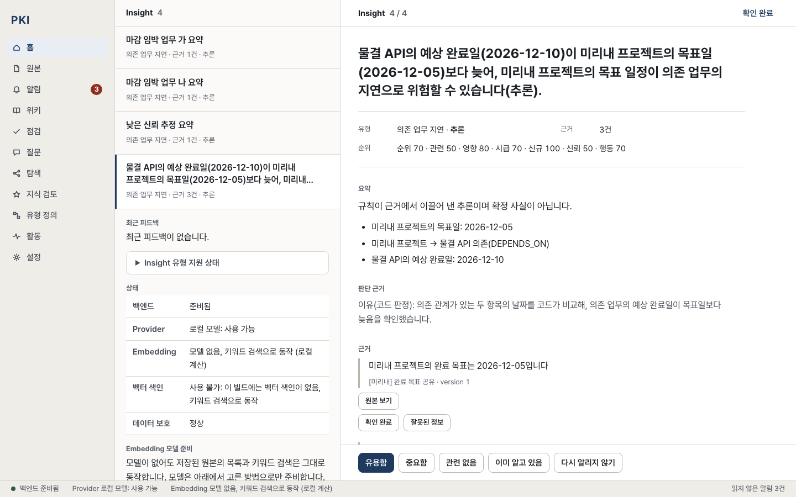
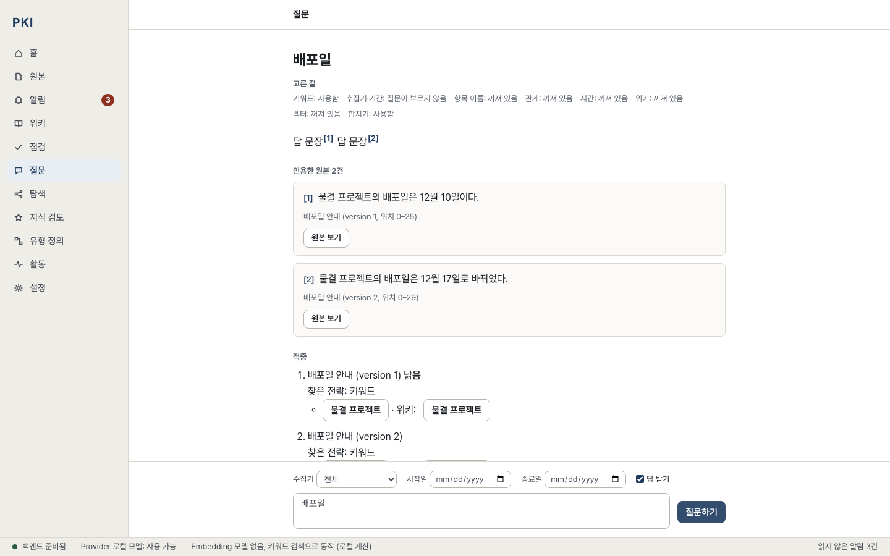
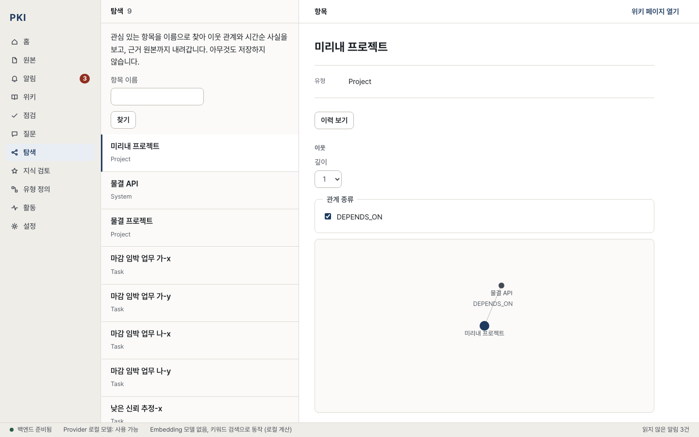
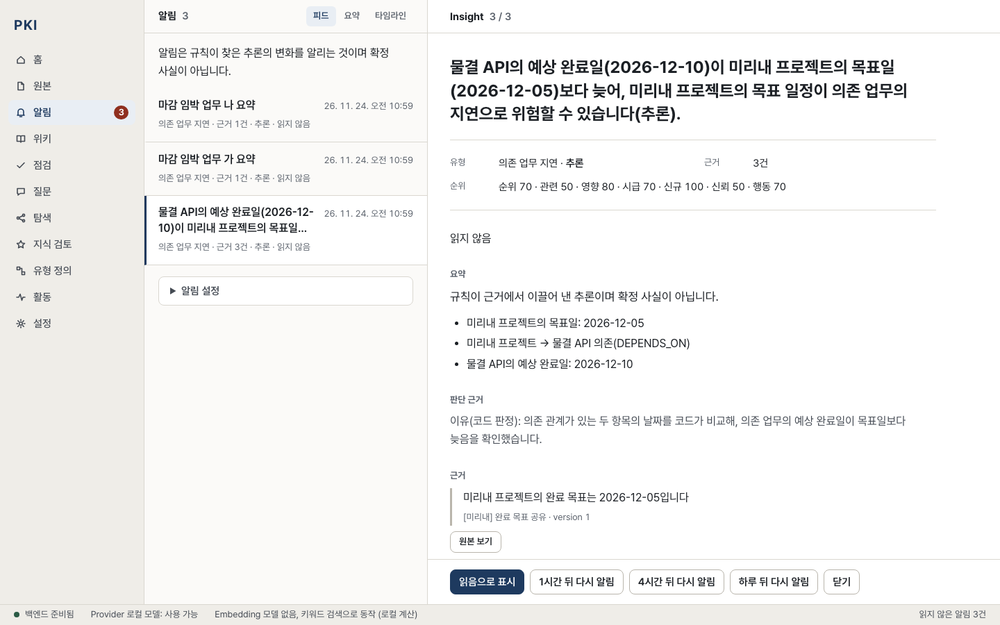
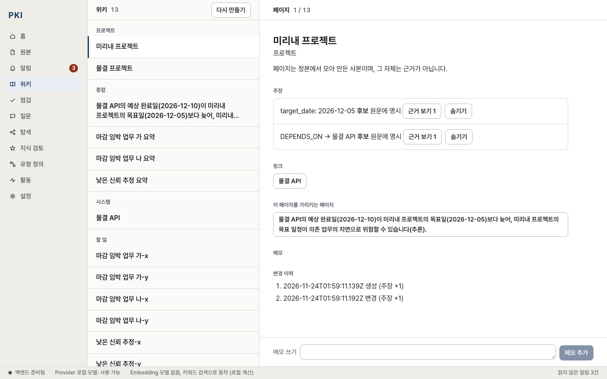
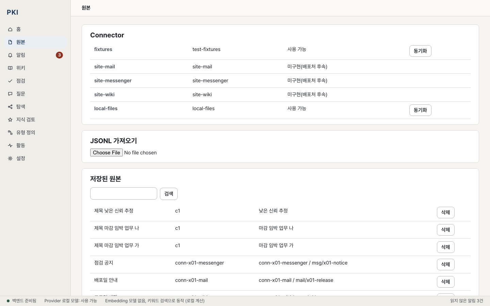
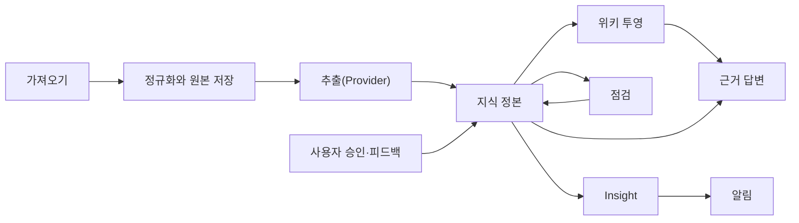

# PKI — Personal Knowledge Intelligence

> 개인 업무 지식을 이 PC에서 모아 연결하고, 근거를 붙여 답해 주는 지식 도구를 만듭니다.

## 이게 뭔가

메일·메신저·Wiki·문서에 흩어진 업무 지식을 이 PC 안에서 항목·사실·관계로 묶고, 각각이 어느 원본에서 나왔는지(근거)를 붙여 두는 로컬 우선 데스크톱 제품입니다. 그 위에서 마감 위험처럼 놓치기 쉬운 것을 Insight(규칙이 근거에서 이끌어 낸 추론)로 알리고, 질문에는 원본 인용이 붙은 답을 줍니다. 이 공개 저장소에서 합성 자료로 돌려 볼 수 있는 것은 화면, 로컬 API, 정본 저장, 가져오기, 위키, 점검, Insight, 알림, 질문, 탐색까지입니다. 실제 LLM Provider, Windows 설치본, 실제 메일·메신저·Wiki 수집기는 확인하지 않았고, 수집기는 이 저장소가 아니라 배포처(제품을 실제 환경에 올리는 쪽)의 포크에서 구현합니다.

## 데모

모두 합성 자료로 이 저장소의 개발 앱을 띄워 찍은 화면입니다.



홈: 왼쪽 목록에서 Insight를 열면 오른쪽에 규칙이 내린 판단과 근거 인용이 보이고, 아래 줄에서 피드백을 남깁니다.



질문: 답의 문장마다 번호가 붙고, 번호가 가리키는 원본 인용이 카드로 나옵니다. 답 문장 글은 시험용 Provider 대역이 만든 자리표시 글입니다.



탐색: 항목을 고르면 유형과 이웃 관계가 보이고, 위키 페이지로 넘어갈 수 있습니다.



알림: 피드의 알림을 열면 Insight 내용과 근거가 보이고, 읽음 표시와 다시 알림 같은 조치를 고릅니다.



위키: 정본에서 모아 만든 페이지입니다. 주장마다 근거 보기가 붙습니다.



원본: 수집기 상태를 보여 줍니다. `site-mail`·`site-messenger`·`site-wiki`는 공용 저장소에서 `미구현(배포처 후속)`입니다. (파일 선택 단추의 영어 글자는 브라우저가 그리는 것입니다.)

## 시작하기

전제: pnpm 11.17.0(`package.json`의 `packageManager`)이 필요합니다. Node.js 24는 pnpm이 `devEngines`에 따라 내려받습니다.

```sh
git clone https://github.com/nohdol97/PKI.git && cd PKI
pnpm install --frozen-lockfile
pnpm --filter @pki/web dev
```

세 번째 명령이 개발 백엔드(합성 자료)와 화면을 함께 띄우고 아래를 출력합니다. 브라우저에서 http://127.0.0.1:5173 을 엽니다. 멈출 때는 터미널에서 Ctrl+C를 누릅니다.

```text
$ vite
{"event":"connector-scopes-absent","configured":0}

  VITE v8.3.8  ready in 1800 ms

  ➜  Local:   http://127.0.0.1:5173/
```

첫 화면은 홈이고 `보여 줄 Insight가 없습니다.`가 보입니다. Provider를 고르기 전에는 추출을 돌리지 않기 때문입니다. 왼쪽 메뉴의 "원본"에는 합성 원본 다섯 건이 이미 들어 있습니다.

## 사용법

저장소 루트에서 실행합니다. 아래 출력은 이 저장소에서 실제로 실행해 얻은 것이며, `…`는 줄인 곳입니다.

### 화면에서 합성 원본 보기

시작하기의 개발 앱을 띄우고 왼쪽 메뉴의 "원본"을 열면 개발 백엔드가 합성 수집기(`fixtures`)로 가져온 원본이 나옵니다. 화면에 보인 글입니다.

```text
fixtures	test-fixtures	사용 가능		동기화
site-mail	site-mail	미구현(배포처 후속)
site-messenger	site-messenger	미구현(배포처 후속)
site-wiki	site-wiki	미구현(배포처 후속)
local-files	local-files	사용 가능		동기화
…
Lamp order (malicious variant)	fixtures	fx-mal-002	삭제
회의 메모(악성 변형)	fixtures	fx-mal-001	삭제
항만청 공지	fixtures	fx-003	삭제
Harbor budget review	fixtures	fx-002	삭제
주간 회의록: 등대 점검	fixtures	fx-001	삭제
```

"악성 변형" 원본은 신뢰할 수 없는 내용이 화면에서 실행되지 않는지 보는 시험 자료입니다.

### 백엔드만 띄워 주소와 세션 토큰 얻기

브라우저 개발 환경 밖에서 로컬 API를 직접 써 볼 때는 개발 백엔드만 띄웁니다. 주소(포트는 실행마다 다릅니다)와 세션 토큰을 표준 출력에 한 줄로 씁니다. 토큰은 아래에서 가렸습니다.

```sh
pnpm --filter @pki/backend dev
```

```text
$ node src/dev.ts
{"event":"connector-scopes-absent","configured":0}
{"url":"http://127.0.0.1:51275","token":"<가림>"}
```

### 아직 확인되지 않은 것 확인하기

최종 시나리오 FS01~FS14가 어떤 증거에 기대는지 검사합니다. 시험을 실행하지는 않고 증거 표(`eval/final-scenarios.json`)를 읽습니다.

```sh
pnpm check:scenarios
```

```text
$ node tooling/scenarios/check.ts
verified 0, mock-only 14, unverified 0
차단 항목 25
  FS01 windows-installer: 설치 파일이 이 저장소에서 만들어지지 않는다. 증거는 개발 장비에서 띄운 앱 폴더이고, 깨끗한 Windows 11에서의 설치·실행·제거는 돌린 적 없다
  FS01 site: 설치 파일 서명과 배포 채널은 배포처의 몫이다(site-setup S12)
  FS02 real-provider: 실제 Claude Code·Codex CLI를 찾고 상태를 묻는 실행은 돌린 적 없다. 증거는 가짜 CLI다
…
```

배포처 수집기는 공용 저장소에서 구현이 없어, 초기화 확인이 실패하며 그 사실을 알립니다.

```sh
pnpm --filter @pki/backend site-check site-mail
```

```text
$ node src/site-check.ts site-mail
site-mail: 미구현, 배포처 후속
…
Exit status 1
```

### 개발 명령

pnpm이 `package.json`의 `devEngines`에 고정한 Node.js 24로 명령을 실행합니다(없으면 내려받습니다). 저장소 루트에서 실행합니다.

**검사**

| 명령                                                                                       | 하는 일                                                                                                                                                                                                                                                                                                                                                                         |
| ------------------------------------------------------------------------------------------ | ------------------------------------------------------------------------------------------------------------------------------------------------------------------------------------------------------------------------------------------------------------------------------------------------------------------------------------------------------------------------------ |
| `pnpm install`                                                                             | 의존성 설치                                                                                                                                                                                                                                                                                                                                                                     |
| `pnpm lint`                                                                                | ESLint(모듈 경계 규칙 포함)와 Prettier 검사                                                                                                                                                                                                                                                                                                                                     |
| `pnpm typecheck`                                                                           | TypeScript strict 타입 검사                                                                                                                                                                                                                                                                                                                                                     |
| `pnpm test`                                                                                | Vitest 단위·계약 테스트                                                                                                                                                                                                                                                                                                                                                         |
| `pnpm e2e`                                                                                 | Playwright E2E. 화면 테스트는 브라우저에서 돌리고, 주요 흐름(화면 seed 0, 가져오기→근거 열기 흐름, 신뢰할 수 없는 내용, 설정 저장, 쉘 보안·수명 주기)만 Electron 쉘에서도 돌린다(쉘 쪽은 화면을 먼저 빌드한다). 프로덕션 산출물도 먼저 빌드해 검사하고 Electron으로 띄워 본다(`--project=artifact`만 돌릴 수 있다). 처음 한 번 `pnpm exec playwright install --only-shell chromium`으로 브라우저를 받고, Electron 바이너리는 처음 실행할 때 내려받는다 |
| `pnpm exec playwright test apps/web/e2e/notifications.e2e.ts --project=browser`            | 알림 화면(피드·요약·타임라인, 다른 탭에서 원본을 지우면 열린 화면이 스스로 바뀜)의 브라우저 E2E 하나. 쉘의 OS 알림과 트레이는 단위 시험(`apps/desktop/src/notifier.test.ts`, 가짜 Electron 객체)으로만 확인하며 실제 토스트를 띄우지 않는다. Windows 설치본의 토스트는 확인하지 않았다([site-setup S37](docs/site-setup.md))                                                  |
| `pnpm check:scenarios`                                                                     | (`--release`, `--write` 선택) 최종 시나리오 FS01~FS14의 증거 표(`eval/final-scenarios.json`)를 검사한다: 가리키는 시험 파일과 제목이 있는지, 대역·개발 장비 증거가 설치본·실제 Provider 결과로 적혀 있지 않은지 본다(시험을 실행하지 않는다). 어긋나면 1, 맞으면 상태별 수와 출시 차단 항목을 내고 0이며 `--release`는 차단 항목이 남으면 2, `--write`는 `docs/FINAL_SCENARIOS.md`를 다시 만든다. 설치본·실제 Provider에서 확인된 시나리오는 아직 없다([spec](docs/specs/2026-11-24-H03-C3-final-scenarios.md)) |

**실행**

| 명령                                                                    | 하는 일                                                                                                                                                              |
| ----------------------------------------------------------------------- | -------------------------------------------------------------------------------------------------------------------------------------------------------------------- |
| `pnpm --filter @pki/web dev`                                            | 개발 백엔드(합성 자료)와 화면을 함께 띄운다. 브라우저에서 http://127.0.0.1:5173 을 연다                                                                              |
| `pnpm --filter @pki/backend dev`                                        | 개발 백엔드만 띄운다(합성 자료, 데이터 폴더 `PKI-dev`). 주소와 세션 토큰을 표준 출력에 한 줄로 쓴다                                                                  |
| `pnpm --filter @pki/web build && pnpm --filter @pki/desktop start`      | Electron 쉘로 빌드한 화면과 백엔드를 띄운다(정본 DB는 사용자 데이터 폴더)                                                                                             |

**빌드**

| 명령                                                                                  | 하는 일                                                                                                                                                                                                                         |
| ------------------------------------------------------------------------------------- | ------------------------------------------------------------------------------------------------------------------------------------------------------------------------------------------------------------------------------- |
| `pnpm --filter @pki/desktop build`                                                    | 프로덕션 빌드. 백엔드·화면·쉘을 배포 빌드로 묶어 Electron 앱 폴더 `apps/desktop/dist/app/`을 만든다(설치 파일은 만들지 않는다). 합성 목록이 낡았으면 실패한다. 네이티브 모듈은 빌드한 PC의 것만 들어가므로 Windows용은 Windows에서 빌드한다 |
| `pnpm --filter @pki/providers build:synthetic-manifest`                               | `fixtures/`·`eval/golden/sources/`·연결 시험 자료가 바뀐 뒤 합성 목록을 다시 만든다(어긋나면 `pnpm test`와 프로덕션 빌드가 실패한다)                                                                                              |
| `pnpm --filter @pki/providers check:synthetic-manifest`                               | 합성 목록이 최신인지 확인만 한다                                                                                                                                                                                                |
| `pnpm --filter @pki/document-normalize build:fixtures`                                | 문서 정규화의 합성 시험 문서(`fixtures/documents/`)를 다시 만든다(같은 코드면 같은 바이트)                                                                                                                                       |

**측정·느린 검증** (기본 `pnpm test`와 `pnpm e2e`는 건너뜁니다)

| 명령                                                                                                                                              | 하는 일                                                                                                                                                                                                                                                                                                         |
| ------------------------------------------------------------------------------------------------------------------------------------------------- | --------------------------------------------------------------------------------------------------------------------------------------------------------------------------------------------------------------------------------------------------------------------------------------------------------------- |
| `PKI_REAL_EMBEDDING_MODELS_DIR=<절대 경로> pnpm vitest run providers/src/adapters/embedding.roundtrip.test.ts`                                    | 실제 bge-m3 모델로 embedding 왕복과 계약 테스트를 돈다(기본 `pnpm test`는 건너뛰고 네트워크를 쓰지 않는다). 처음 한 번 고정된 파일 약 586 MB를 내려받고, `PKI_REAL_EMBEDDING_PACK=<절대 경로>`를 주면 그 로컬 팩에서 가져온다                                                                                   |
| `PKI_SLOW_E2E=1 pnpm exec playwright test apps/desktop/artifact/artifact.normalizer.e2e.ts --project=artifact`                                    | 격리 정규화의 G23 측정(유발 XLSX가 Electron V8에서 쓰는 힙을 기록, 약 2.5분). 단언이 "두 행"과 종료 상태 형식뿐인 측정이라 기본 `pnpm e2e`에서는 건너뛴다                                                                                                                                                         |
| `pnpm exec vitest run --config vitest.normalizer-slow.config.ts`                                                                                  | 격리 정규화의 느린 시험(재현 입력 둘의 상한 시험과, 유발 입력을 30번 되풀이하는 시험. 한 번에 몇 분이 걸리고 메모리를 1 GB 넘게 쓰므로 `pnpm test`는 돌리지 않는다). 정규화는 백엔드와 다른 호스트 프로세스에서 돌고, 묶인 앱에서는 주 프로세스가 그 호스트를 띄운다                                              |
| `pnpm exec node backend/src/system-measure.main.test-support.ts --out eval/results --name h03-c2-dev [--sources 200] [--queries 220] [--idle-seconds 30] [--soak-seconds 0] [--skip-kill] [--force]` | H03-C2 시스템 측정(유휴 CPU·RSS, 문서 처리·검색 시간, LLM 호출 수, 저장 증가, 강제 종료 뒤 복구)을 실제 백엔드(별도 프로세스)와 Provider 대역으로 재고 `eval/results/<이름>.json`에 쓴다. 제품의 작업 임대 2분을 그대로 두므로 기본 실행은 몇 분 걸리고(`--skip-kill`로 생략), `pnpm test`에는 작은 값으로 한 번 도는 시험만 들어간다. 개발 장비의 값은 판정이 아니라 참고값이다(통과선은 값 옆에 적기만 한다). 설치 파일 크기·Windows 설치본·실제 Provider·수 시간 연속 가동은 재지 않는다([spec](docs/specs/2026-11-24-H03-C2-measure-runner.md)) |

**배포처** (공용 저장소에서는 `미구현, 배포처 후속`을 알리고 실패합니다)

| 명령                                                                           | 하는 일                                                                                                                                                      |
| ------------------------------------------------------------------------------ | ------------------------------------------------------------------------------------------------------------------------------------------------------------ |
| `python3 verification/v02-site-flow/run.py preflight --config <config.json>`   | V02 배포처 검증 실행기(Windows 설치본과 실제 Provider 전용, 그 밖에서는 `배포처 후속`을 알리고 실패한다). 절차: [RUNBOOK](verification/v02-site-flow/RUNBOOK.md) |
| `pnpm --filter @pki/backend site-check <종류>`                                 | 배포처 수집기(`site-mail`, `site-messenger`, `site-wiki`) 초기화 확인. 공용 저장소에서는 `미구현, 배포처 후속`을 알리고 실패한다                              |
| `pnpm --filter @pki/site-example site-check <종류>`                            | 배포처 포크의 조립 패키지(`site/composition`)가 갖는 `site-check`와 같은 모양의 예시. 예시 등록의 수집기 종류(`connector-example`)를 확인한다                |

## 설정 레퍼런스

사용자가 바꿀 수 있는 실행 중 설정의 주요 키입니다. 값의 형태, 켜는 길, 켜기 전에 확인할 것은 [docs/site-setup.md](docs/site-setup.md)의 「실행 중 설정」 표가 정본이며, 표에 없는 키(로컬 자료 한도 `localFiles.*`의 나머지 등)도 거기에 있습니다.

| 키                                  | 기본값                              | 설명                                                                                                         |
| ----------------------------------- | ----------------------------------- | ------------------------------------------------------------------------------------------------------------ |
| `providers.default`                 | 없음                                | 연결 시험과 호출에 쓸 Provider 하나. 고르기 전에는 어느 Provider도 부르지 않습니다                            |
| `providers.cli.background`          | 끔                                  | 검증된 CLI 조합의 백그라운드 자동 실행을 허용할지. 가져오기 뒤의 추출도 백그라운드 실행입니다                  |
| `providers.openaiCompatible.baseUrl` | 없음(Provider 미설정)              | OpenAI 호환 API의 `https` 주소. 바꾸면 그 Provider에 대한 동의가 무효가 됩니다                                |
| `providers.openaiCompatible.model`  | 없음                                | 그 엔드포인트에서 쓸 모델 이름                                                                                |
| `providers.callBudget.maxCalls`     | 60                                  | 한 시간 창에 허용하는 Provider 호출 시도 수(1에서 10000)                                                      |
| `jobs.maxConcurrent`                | 2                                   | 백그라운드 작업을 한 번에 몇 개까지 실행할지(1에서 4)                                                         |
| `semantic.autoVerify`               | 끔                                  | 조건을 채운 후보 사실·관계를 `verified`로 올리는 자동 승격                                                    |
| `semantic.autoDispute`              | 끔                                  | 값이 어긋나는 `CONTRADICTS`가 새로 생길 때 `verified` 사실에 이의를 거는 자동 이의                            |
| `wiki.summary`                      | 끔                                  | 위키 페이지마다 LLM 요약을 만들지(문서 본문이 Provider로 나갑니다)                                            |
| `insight.interpret`                 | 끔                                  | Insight마다 LLM 해석을 붙일지(문서 본문이 Provider로 나갑니다)                                                |
| `reflection.refine`                 | 끔                                  | 점검 결과에 LLM 의견을 붙일지. 켜는 화면이 아직 없습니다                                                      |
| `localFiles.maxFileBytes`           | 52428800                            | 로컬 파일 수집기가 읽을 파일의 최대 크기(바이트)                                                              |

## 동작 방식

입력이 결과가 되는 길은 아래와 같습니다. 단계마다 기본값이 꺼져 있거나 확인하지 않은 부분을 함께 적었고, 깊은 설명은 링크에 있습니다.



1. **가져오기.** 수집기(Connector)가 원본을 가져옵니다. 공용 저장소가 증명하는 것은 합성 JSONL과 로컬 폴더·파일 가져오기(설정 화면의 폴더 추가, 파일 추가, JSONL 파일 추가, [I02-B spec](docs/specs/2026-11-22-I02-local-file-import.md))뿐이고, 실제 메일·메신저·Wiki 수집기는 배포처 후속입니다. 내용이 같으면 새 version을 만들지 않고, 원본을 지우면 그 원본에서 나온 파생물도 함께 지웁니다([I01 spec](docs/specs/2026-11-21-I01-connector-sdk.md), [I04 spec](docs/specs/2026-11-21-I04-invalidation.md)).
2. **정규화와 원본 저장.** 문서를 글로 바꾸는 일은 백엔드와 다른 격리된 호스트 프로세스에서 돌고, 결과는 원본 version으로 저장됩니다. Windows 설치본에서의 가져오기는 확인하지 않았습니다([I02-A spec](docs/specs/2026-11-21-I02-document-normalization.md)).
3. **추출.** Provider(LLM)가 원본에서 항목·사실·관계 후보를 뽑습니다. Provider를 고르고 전송 정책이 허용할 때만 돌고, 고르기 전에는 어느 Provider도 부르지 않으며 다른 Provider로 몰래 넘어가지 않습니다. LLM에게서는 인용문만 받고, 근거의 위치는 코드가 원문에서 찾아 계산합니다. 인용문을 못 찾으면 그 지식은 기록하지 않습니다. 실제 Provider로 돌린 적은 없습니다([ARCHITECTURE 6절](docs/ARCHITECTURE.md#6-수집에서-insight까지), [ADR 0005](docs/adr/0005-llm-providers.md), [ADR 0014](docs/adr/0014-egress-policy-and-consent.md)).
4. **지식 정본과 연결.** 후보는 근거와 함께 정본(SQLite)에 쌓이고, 사용자가 "지식 검토"에서 승인·기각·값 고치기를 하고 충돌을 검토합니다. 조건을 채운 후보를 저절로 올리는 자동 승격은 기본으로 꺼져 있습니다. 화면의 "탐색"에서는 항목 하나를 이름이나 별칭으로 찾아 이웃 관계(그림 포함), 시간순 사실, 근거 원본을 보고 항목을 합치고 되돌리고 나누며, "유형 정의"에서 항목·사실·관계 종류를 고칩니다. "탐색"과 "지식 검토"는 읽기 문을 지난 것만 보여 줍니다. 위키 페이지는 정본에서 언제든 다시 만들 수 있는 투영이라 그 자체가 근거가 아닙니다([S01 spec](docs/specs/2026-11-22-S01-semantic-registry.md), [S02 spec](docs/specs/2026-11-22-S02-entity-resolution-temporal-graph.md), [K01 spec](docs/specs/2026-11-23-K01-wiki-projection.md), [X02 spec](docs/specs/2026-11-23-X02-explore-ux.md), [X02B spec](docs/specs/2026-11-24-X02B-explore-curation.md)).
5. **점검.** 점검(K02)은 정본이 바뀐 곳을 주기로 다시 살펴 합칠 만한 이름, 빠진 관계, 낡은 항목, 기한이 지난 업무를 후보로 알리고, 받아들이거나 닫는 것은 사용자가 정합니다. 후보에 LLM의 의견을 붙이는 기능(`reflection.refine`)은 기본으로 꺼져 있으며 켜도 의견만 남기고 지식은 바꾸지 않습니다([K02 spec](docs/specs/2026-11-23-K02-reflection-consolidation.md)).
6. **Insight와 알림.** 코드 규칙이 정본에서 Insight를 판정하고 "추론"으로 표시합니다. 중요한 것은 앱 안 피드와 OS 알림으로 곧바로, 나머지는 매일 요약과 주간 지식 리포트로 전하며, 사용자의 피드백(교정과 선호)은 순위와 알림을 바꿉니다. LLM 해석(`insight.interpret`)은 기본으로 꺼져 있습니다. OS 알림은 가짜 Electron 객체로만 시험했고 Windows 설치본에서 띄워 보지 않았습니다([P01 spec](docs/specs/2026-11-23-P01-insight-discovery.md), [P02 spec](docs/specs/2026-11-23-P02-notifications-digest-timeline.md), [P03 spec](docs/specs/2026-11-23-P03-feedback-learning.md)).
7. **근거 답변.** 화면의 "질문"에서 말로 물으면 키워드와 메타데이터 필터로 원본을 찾아(그 밖의 검색 전략은 만들어 두었지만 측정 전까지 꺼 둡니다) 보여 주고(`POST /api/ask`, 한 줄에 사건 하나인 NDJSON), Provider가 정해져 있으면 문장마다 원본 인용이 붙은 답을 줍니다. 질문과 답은 저장하지 않으며 벡터 검색은 아직 쓰지 않습니다([X01 spec](docs/specs/2026-11-23-X01-retrieval-qa.md)).

구성요소와 정본·투영의 관계는 [docs/ARCHITECTURE.md](docs/ARCHITECTURE.md)에, 모든 문서의 목록은 [docs/README.md](docs/README.md)에 있습니다. 엔진·저장소·런타임의 선택은 아직 잠정이며 배포처의 실행 검증 뒤에 확정합니다.

## FAQ · 트러블슈팅

**`Error: Port 5173 is already in use`가 나옵니다.** 이전에 띄운 `pnpm --filter @pki/web dev`가 아직 살아 있어서입니다. 그 프로세스를 멈춘 뒤 다시 실행합니다. 이 상태에서 새로 시작한 개발 백엔드는 시작 로그만 남기고 화면 서버는 뜨지 않습니다.

**홈에 `보여 줄 Insight가 없습니다.`만 보입니다.** 처음 띄운 개발 앱에는 Provider가 정해져 있지 않아 추출이 돌지 않습니다. 홈의 상태 표가 `기본 Provider가 정해지지 않음. 설정 화면에서 고르세요.`라고 알려 줍니다. 합성 원본은 "원본" 화면에서 이미 볼 수 있습니다.

## 로드맵

전체 계획과 완료 기준은 [#1 총괄](https://github.com/nohdol97/PKI/issues/1)이고, 단계별 에픽은 모두 열려 있습니다(2026-11-24 확인).

- [#2 Phase 0 — OSS Research & PoC](https://github.com/nohdol97/PKI/issues/2)
- [#3 Phase 1 — Vertical Slice](https://github.com/nohdol97/PKI/issues/3)
- [#4 Phase 2 — Information Ingestion](https://github.com/nohdol97/PKI/issues/4)
- [#5 Phase 3 — Semantic Knowledge](https://github.com/nohdol97/PKI/issues/5)
- [#6 Phase 4 — Knowledge Consolidation](https://github.com/nohdol97/PKI/issues/6)
- [#7 Phase 5 — Proactive Intelligence](https://github.com/nohdol97/PKI/issues/7)
- [#8 Phase 6 — Knowledge Experience](https://github.com/nohdol97/PKI/issues/8)
- [#9 Phase 7 — Production Readiness](https://github.com/nohdol97/PKI/issues/9)

## 기여

- 이 저장소에는 범용 제품만 둡니다. 실제 메일·메신저·Wiki 수집기와 환경별 연동은 배포처 포크에서 구현합니다.
- 테스트와 이슈에는 합성 데이터만 사용합니다.
- 최초 커밋 이후의 모든 변경은 feature 브랜치와 Pull Request로만 들어옵니다. `main`에 직접 push하지 않습니다.
- 구현 전에 `docs/specs/`에 요구사항과 완료 기준을 먼저 고정합니다.

## 라이선스

[MIT](LICENSE)

번들 글꼴: [Pretendard](https://github.com/orioncactus/pretendard) 1.3.9 (SIL OFL 1.1) — 원본 그대로 `apps/web/public/fonts/`에 두며 전문은 [OFL.txt](apps/web/public/fonts/OFL.txt), 출처와 해시는 [NOTICE.txt](apps/web/public/fonts/NOTICE.txt)에 있습니다.

## 참고

- 수집기(Connector)를 새로 만드는 방법: [docs/connector-sdk.md](docs/connector-sdk.md)
- 배포처 설정: [docs/site-setup.md](docs/site-setup.md)
- 공용 저장소와 배포처 포크의 책임 나눔: [docs/ownership.md](docs/ownership.md)
- 저장소 배치와 구조: [docs/ARCHITECTURE.md](docs/ARCHITECTURE.md)
- 문서 색인: [docs/README.md](docs/README.md)
- 배포처 검증 절차: [verification/v02-site-flow/RUNBOOK.md](verification/v02-site-flow/RUNBOOK.md)
