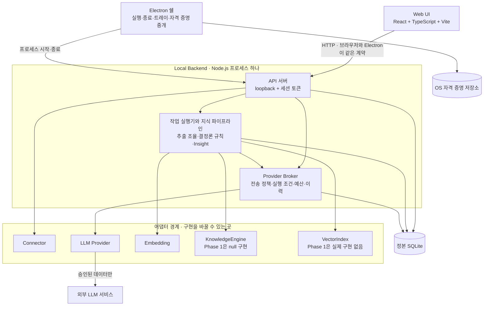
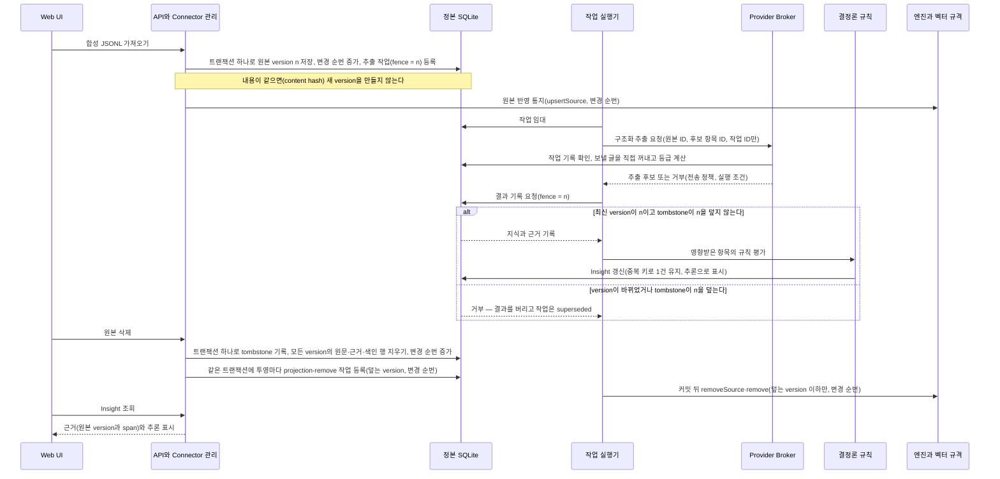

# 아키텍처 (잠정)

- 날짜: 2026-11-21 / 상태: **잠정 — 배포처 검증 대기**
- 관련: 이슈 #15(R06), #16(V01), #17(V02), #37(R07). 요구사항 원문 [original-design.md](design/original-design.md), 근거 [OSS_EVALUATION.md](OSS_EVALUATION.md), [CLI Provider 조사](research/2026-11-21-cli-provider-terms-and-isolation.md), 결정 기록 [adr/](adr/README.md)

이 문서는 Phase 1 개발을 시작할 수 있도록 구조를 잠정으로 정한다. **아무것도 실행해 보지 않고 쓴 문서다.** 엔진, CLI, Windows 설치 파일의 실행 검증은 배포처에서만 할 수 있으므로, 실행 근거가 필요한 결정은 모두 잠정이며 [9절 가정 표](#9-가정-표)에 걸려 있다. 가정이 틀리면 무엇을 바꾸는지도 그 표에 적었다. 확정은 R07(#37)에서 한다.

## 사용자 확인이 필요한 결정

아래 넷은 사용자가 정할 일이었다. 2026-11-21 사용자가 판단을 작업 세션에 위임해 넷 모두 지금 쪽으로 정했다. 결정의 이유와 다시 열 조건은 각 ADR의 "사용자 확인 결과" 절에 있다. 넷 다 실행 근거가 없는 잠정 결정이라 배포처 검증(R07)을 기다리는 것은 그대로다. 사용자가 다르게 정하면 마지막 열의 작업을 다시 한다.

다섯째 행(기본 Provider를 누가 정하는가)은 같은 위임에 따라 V01-T10이 2026-11-21 정했다. 이유와 다시 열 조건은 [ADR 0005](adr/0005-llm-providers.md) "후속 기록"에 있다.

| 결정 | 정한 쪽 | 원 설계와 어긋날 수 있는 곳, 사용자가 알아야 할 결과 | 번복되면 다시 하는 작업 |
|---|---|---|---|
| 지식의 정본을 누가 갖는가([ADR 0002](adr/0002-authority-in-product-records.md)) | 제품이 SQLite에 갖고 엔진은 투영 | 7절 "기존 Knowledge Engine의 로컬 저장소를 우선 사용", 15절 "동일 기능을 제공한다면 중복 저장소를 추가하지 않는다". 제품의 기록이 7절의 필수 기능 다섯 가지(시간·유효 기간, 관계별 근거, 사실의 변경·대체, 상충 관리, 삭제 시 파생 지식 갱신)를 직접 구현하게 된다 | V02의 지식 스키마와 그 위의 작업(V02-T02, T05~T09) |
| 정본 SQLite를 암호화하지 않고 시작하는가, 비밀 값을 어떻게 두는가([ADR 0010](adr/0010-encryption-at-rest.md)) | 정본은 평문으로 시작. 실제 업무 데이터는 OS 디스크 암호화가 확인된 PC에서만. **비밀 값은 OS 보관함 항목이 아니라** Electron `safeStorage`로 암호화한 암호문 파일(`<데이터 디렉터리>/secrets.json`)에 두고, 그 키를 OS가 지킨다(macOS 키체인, Windows DPAPI, Linux 비밀 서비스). API 키는 입력할 때의 엔드포인트 호스트에 묶인다 | 17절 "로컬 데이터 암호화", "OS Credential Store 활용". 값 자체가 OS 보관함에 있지 않으므로 데이터 디렉터리를 복사하면 암호문도 따라간다(키 없이는 풀 수 없다). 실제 `safeStorage` 동작은 개발 OS에서도 미검증. 값 자체를 OS 보관함에 두는 대안은 `@napi-rs/keyring`(평가 전 네이티브 모듈) | V01-T03(드라이버 교체와 그 앞의 드라이버 조사), V01-T11(쉘의 비밀 값 저장소) |
| Embedding 모델을 설치 파일에 넣지 않는가([ADR 0006](adr/0006-embedding.md)) | 넣지 않고 설치 뒤에 준비 | 1절 "설치 파일 하나만 설치하면 사용" | V01-T14(모델 준비 방식)와 패키징 구성 |
| 가져오기 뒤의 추출을 어떤 호출로 보는가([ADR 0005](adr/0005-llm-providers.md)) | **백그라운드 호출**로 본다. 사용자가 가져오기를 눌렀더라도 추출은 작업 큐가 실행하기 때문이다 | 제품의 핵심 흐름(가져오기 → 추출 → Insight)을 CLI Provider로 돌리려면, 그 CLI가 격리 검증을 통과해 목록에 있더라도 **백그라운드 자동 실행 스위치를 켜야 한다.** 그 스위치를 켜면 사용자가 자리에 없을 때의 자동 실행도 함께 허용된다. 이슈 #16의 문장이 요구하는 것보다 엄격하다. 원 설계 4절이 그린 "기존 CLI를 자동 탐색해 바로 쓴다"와 거리가 있다 | V01-T07의 호출 종류 판정, V01-T09의 실행 조건, V01-T17의 홈 상태 판정(`STATUS_EXECUTION`), V02-T03 |
| 기본 Provider를 누가 정하는가([ADR 0005](adr/0005-llm-providers.md) 후속 기록) | **언제나 사용자가 고른다.** 탐색된 CLI가 하나뿐이어도 저절로 고르지 않는다(V01-T10, 위임받은 잠정 결정). 다시 열 조건: 설치 상태가 바뀌어도 사용자가 모르는 Provider로 넘어가지 않게 하는 방법(예: 고른 적 있는 Provider만 자동 선택 후보로 두기)이 정해질 때 | 4절 "이미 로그인된 CLI를 자동 탐색해 쓴다". 처음 쓸 때 설정 화면에서 기본 Provider를 한 번 골라야 하고, 그 전에는 어떤 호출도 나가지 않는다 | `providers/src/provider-selection.ts`의 `selectProvider`와 V01 spec "T10이 넘기는 것" 8항 |

첫째 결정은 [OSS_EVALUATION 6절 1번](OSS_EVALUATION.md)이 "사용자가 R06에서 판단할 문제"로 넘긴 것이다. 실행 비교(R03)의 근거가 아직 없어 위임받은 판단은 지금 쪽을 유지하고, R03 결과를 받는 R07에서 다시 판단한다([ADR 0002](adr/0002-authority-in-product-records.md) "사용자 확인 결과").

## 0. 처음 나오는 말

| 말 | 뜻 |
|---|---|
| 정본 | 서로 다른 저장소의 내용이 어긋났을 때 옳다고 보는 쪽. 잃으면 다시 만들 수 없는 데이터 |
| 투영(projection) | 정본에서 계산해 만든 사본. 지우고 정본에서 다시 만들 수 있다. 검색 색인이 대표적이다 |
| 어댑터 | 바뀔 수 있는 부품(엔진, Provider 등) 앞에 두는 고정된 접속 규격과 그 구현. 부품을 바꿔도 규격을 쓰는 쪽 코드는 그대로다 |
| 계약 테스트 | 어댑터의 모든 구현이 같은 규격을 지키는지 확인하는 공용 테스트 묶음. 새 구현은 이 묶음을 통과해야 한다 |
| test double | 테스트에서 실제 부품 대신 끼우는 대역(가짜 Provider 등). 이것의 성공은 실제 부품의 성공이 아니다. 테스트 빌드에만 들어 있다 |
| Provider | 생성형 LLM을 호출하는 통로. Claude Code CLI, Codex CLI, API 키로 쓰는 HTTP 엔드포인트가 각각 하나의 Provider다 |
| Broker | 모든 Provider 호출이 반드시 지나는 관문. 전송 허용 여부, 시간 제한, 예산, 이력 기록을 한곳에서 처리한다 |
| 외부 전송(egress) | 데이터가 사용자 PC 밖으로 나가는 일. CLI가 로컬에서 실행되어도 추론 요청은 외부 서버로 간다 |
| 배포 빌드 / 개발 빌드 / 테스트 빌드 | 배포 빌드는 설치 파일로 묶어 사용자에게 주는 실행본. 개발 빌드는 개발자가 소스에서 띄운 실행. 테스트 빌드는 자동 테스트가 대역을 끼워 띄운 실행. 어느 것인지는 **빌드할 때 코드에 박히는 값 하나**로 정해지고, 그 값이 없으면 배포 빌드로 본다 |
| 합성 목록 | 저장소에 든 지어낸 테스트 자료의 해시를 빌드할 때 모아 둔 목록. 해시는 Provider에 보낼 수 있는 필드(제목과 본문)를 함께 묶어 계산한다. 어떤 원본이 "합성" 등급인지는 이 목록과의 대조로만 정해진다 |
| 씨앗 데이터 | 테스트를 시작할 때 미리 넣어 두는 데이터 |
| 카나리 | 새어 나가면 안 되는 자리에 심어 두는 눈에 띄는 문자열. 로그나 파일에서 이 문자열이 발견되면 누출이다 |
| loopback | 자기 PC 안에서만 닿는 주소(127.0.0.1). 다른 기기에서는 접속할 수 없다 |
| 근거(Evidence) | 지식이 나온 자리. 원본의 어느 version, 몇 번째 글자부터 몇 번째 글자 앞까지(span)인지 가리킨다. 글자 수는 유니코드 코드 포인트로 센다. 원본의 version은 한번 저장되면 바뀌지 않고, 근거는 자기가 나온 version을 계속 가리킨다 |
| 변경 순번 | 원본에 변경(새 version 저장, 삭제, 권한 철회)이 생길 때마다 정확히 1씩 오르는 번호. 투영에 통지할 때 함께 넘기고, 투영이 어디까지 반영했는지 비교하는 데 쓴다. 추출로 지식이 생기는 것만으로는 오르지 않는다 |
| knowledge revision | 정본의 지식(항목, 사실, 관계)이 바뀔 때마다 1씩 오르는 번호. 지식 자체를 색인하는 투영(나중의 벡터 색인, Wiki)이 쓸 번호이며 Phase 1에는 그것을 읽는 투영이 없다 |
| version fence | 작업이 시작할 때 본 원본 version 번호를, 결과를 쓸 때 다시 대조하는 검사. 그 사이 원본이 바뀌었으면 결과를 버린다 |
| tombstone | "이 원본은 삭제되었다(또는 권한이 철회되었다)"는 표식. 내용이 없고, 그 원본의 **어느 version까지 덮는지**(그 이하의 모든 version), 삭제 때의 출처 revision, 시각, 사유만 남긴다. 사유는 셋이다: 출처가 지움(`source-deleted`), 권한을 잃음(`access-revoked`), 사용자가 지움(`user-deleted`). 사용자는 tombstone을 **해제**할 수 있다. 해제해도 지운 내용은 돌아오지 않고, 그 뒤의 도착을 막지 않을 뿐이다. 지운 데이터가 늦게 끝난 작업이나 재수집으로 되살아나는 것을 막는다(I04-R9) |
| revision | 출처 시스템이 레코드에 매긴 번호. 도착의 앞뒤를 가리는 데만 쓴다. 제품이 원본마다 1부터 매기는 **version**과 다른 번호이며, fence와 tombstone은 version을 비교한다 |
| 파생물(derivative) | 원본 version에서 계산해 만든 모든 것(근거, 사실·관계, 항목, Insight, 색인 행, 엔진·벡터 투영 등). 원본이 바뀌거나 지워지면 함께 지우거나 다시 계산해야 한다 |
| 계보(lineage) | 파생물 하나가 어느 원본의 어느 version들에서 나왔는지의 목록. 범위, 전송 등급, fence 판단의 유일한 입력이다 |
| 등록부(registry) | 파생물의 종류를 모아 둔 목록. 종류마다 "변경이 건드리는 행", "계보", "지우거나 다시 계산하는 법"을 등록하고, 원본 변경은 이 목록을 한 번 지나며 전파된다(5.6절) |
| 임대(lease) | 작업 실행기가 작업 하나를 "기한까지 내가 처리한다"고 잡아 두는 것. 기한이 지나면 다른 실행이 다시 집을 수 있다 |
| outbox | 정본을 고친 트랜잭션 안에 함께 적어 두는 "투영에 반영할 일" 목록. 중간에 꺼져도 목록이 남아 이어서 반영한다 |
| 사이드카 | 앱 본체 옆에서 따로 실행되는 보조 프로세스(예: Python이나 Go로 만든 엔진) |
| IPC / preload | IPC는 Electron에서 화면과 쉘이 주고받는 메시지. preload는 화면에 꼭 필요한 기능만 골라 노출하는 작은 스크립트 |
| CSP | 화면이 어디에서 스크립트·이미지를 불러올 수 있는지 제한하는 브라우저 규칙 |

## 1. 맥락

제품은 메일·메신저·Wiki 형태의 업무 정보를 가져와 지식을 뽑고, 서로 연결하고, 여러 출처를 종합한 Insight를 근거와 함께 보여 주는 로컬 우선 데스크톱 앱이다(원 설계 1절). Phase 1의 목표는 그 가치를 한 줄기로 증명하는 것이다: 합성 출처 3개 → 추출 → 연결 → "의존 업무 지연" Insight → 근거 화면(이슈 #1 설계 분석 12번).

세 가지 사실이 구조를 정했다.

1. **실행으로 확인된 엔진이 없다.** 시간 유효성, 원문 span 수준의 근거, 삭제 시 파생물 제거를 모두 갖추었다고 실행으로 확인된 후보가 없다([OSS_EVALUATION 6절 1번](OSS_EVALUATION.md)). 후보 3개(LightRAG, cognee, sage-wiki)는 보류 상태로 배포처 실행을 기다린다(같은 문서 5.1절).
2. **구독 로그인 CLI를 제품이 자동 실행해도 되는지는 벤더 문구가 모호하거나 불리하다**([CLI Provider 조사 3절](research/2026-11-21-cli-provider-terms-and-isolation.md)). 격리 플래그도 한 번도 실행해 보지 않았다(같은 문서 4~5절).
3. **Windows 동작은 전부 미검증이다**(OSS_EVALUATION 0절, 8절).

그래서 뒤집힐 수 있는 선택(엔진, Provider, 벡터 저장, embedding)은 모두 어댑터 뒤에 두고, 제품이 직접 갖는 것은 "무엇이 옳은가"를 정하는 기록으로 한정했다.

## 2. 구성요소



읽는 법: 화면은 백엔드의 HTTP API만 안다. Electron 쉘은 화면을 띄우고 백엔드 프로세스를 켜고 끄는 일, 그리고 OS 기능(자격 증명 저장소, 트레이, 알림) 중개만 한다. 지식 처리 로직은 전부 백엔드에 있으므로 브라우저 개발 환경에서도 똑같이 돈다(원 설계 2절 "Web First, Desktop Ready"). Broker가 정본을 직접 읽는 선은 5.1절의 이유로 있다: Provider에 보낼 문서를 부르는 쪽에서 받지 않고 스스로 꺼낸다.

**모듈형 모놀리식**이란 프로세스는 하나지만 내부를 모듈로 나누고 모듈끼리는 정해진 규격으로만 부른다는 뜻이다([ADR 0001](adr/0001-modular-monolith-and-stack.md)). 저장소 배치는 원 설계 3절을 따른다.

| 디렉터리 | 내용 |
|---|---|
| `apps/web` | Web UI |
| `apps/desktop` | Electron 쉘(main, preload) |
| `backend/` | API 서버, Connector 관리, 작업 큐·실행기, 스케줄러 |
| `knowledge-engine/` | 제품의 지식 파이프라인(추출 조율, 결정론 규칙, Insight)과 KnowledgeEngine 어댑터. 이름과 달리 **엔진 구현을 두는 곳이 아니다**(3.2절) |
| `providers/` | LLM Provider 구현, Broker, 전송 정책, 지시문과 응답 스키마, Embedding |
| `storage/` | SQL 드라이버 포트, 마이그레이션, 정본 저장 모듈, VectorIndex |
| `packages/contracts` | API와 어댑터의 계약 타입·스키마(화면과 백엔드가 공유) |
| `packages/testkit` | 계약 테스트 묶음과 test double. 배포 빌드에 들어가지 않는다 |
| `fixtures/` | 합성 데이터. 품질 평가용 골든 데이터는 R05가 `eval/golden/`에 둔다 |
| `site/` | **배포처 포크 전용 자리.** 공용 저장소에는 안내문만 둔다([ownership.md](ownership.md)) |
| `tooling/` | 저장소 전체에 거는 검사: 모듈 경계 lint 규칙, 문서 대응 테스트. 제품 코드가 아니며 어느 패키지도 이것을 import하지 않는다 |

## 3. 프로세스 모델

| | 개발 | 프로덕션(설치본) |
|---|---|---|
| 화면 | 브라우저 → Vite 개발 서버 | Electron 창 → 쉘이 `app://pki`로 내주는 빌드된 화면. `/api/`는 쉘이 백엔드로 넘긴다(V01-T06) |
| 백엔드 | 개발자가 띄운 Node.js 프로세스, 고정 포트 | Electron 쉘이 자기 안에 든 Node 런타임으로 띄우는 별도 프로세스, 실행 때마다 고르는 빈 포트 |
| 세션 토큰 전달 | 개발 스크립트가 백엔드와 개발 서버에 같은 값을 준다(개발 빌드에만 존재) | 쉘이 만들어 **부모와 자식 프로세스 사이의 전용 통로**로 백엔드에 넘긴다. 명령줄 인자와 환경 변수로는 넘기지 않는다(같은 사용자의 다른 프로세스가 읽을 수 있다). 화면에는 preload의 검증된 IPC 하나로 준다 |
| 백그라운드 작업 | 백엔드 프로세스 안의 작업 실행기와 스케줄러(같은 프로세스 안에 있고 따로 띄우지 않는다). 작업은 동시 실행 묶음마다 한 번에 하나씩(묶음 `knowledge`는 1) 돌고 전체 동시 실행은 설정 `jobs.maxConcurrent`(기본 2)가 정한다. 주기 점검은 30초마다 돈다. 주기적인 `connector-sync`와 사용자가 시작한 동기 가져오기는 같은 인스턴스에서 배타적이다(가져오기가 진행 중이면 동기화가 1분 뒤로 미뤄지고, 동기화가 실행 중이면 가져오기 요청은 409) | 같음 |
| 비밀 값 | 환경 변수로만 읽고 저장하지 않는다 | 쉘이 OS 자격 증명 저장소를 중개하고 같은 전용 통로로 호출 직전에 넘긴다 |

- 화면이 쓰는 것은 "백엔드 주소 + 토큰" 두 값뿐이다. 값을 어디서 받는지만 다르고 API 계약은 같다(V01-C1).
- 원 설계 16절은 프로덕션에 "Background Knowledge Worker"를 따로 그렸다. Phase 1에서는 **백엔드 프로세스 안의 작업 실행기**로 둔다. 따로 떼어야 한다는 측정 근거가 생기면 그때 뗀다. Electron에 든 Node로 백엔드를 별도 프로세스로 띄우는 방식은 V01-T06이 Electron의 utility process로 정했다([V01 spec "T06이 넘기는 것"](specs/2026-11-21-V01-vertical-skeleton.md)). Windows 동작은 가정 A18이다.
- 쉘은 single instance lock(앱을 두 번 켜도 하나만 실행), 정상 종료 시 백엔드 종료 대기, 백엔드가 죽었을 때 재시작을 맡는다. 재시작은 V01-T16이 넣었다: 스스로 끝난 백엔드를 한 번의 실행에서 3번까지 같은 토큰으로 다시 띄우고 새 주소로만 넘긴다(잠정, [V01 spec "T16이 넘기는 것" 4항](specs/2026-11-21-V01-vertical-skeleton.md)).
- 설치 파일을 만드는 일은 R04(#13)가 맡는다. V01은 그 입력인 **프로덕션 빌드 산출물**(백엔드, 화면, 쉘의 묶음)까지 만든다.
- 사이드카(Python 또는 Go 엔진)는 Phase 1에 없다. 언어 선택은 미결이다([ADR 0011](adr/0011-sidecar-language.md)).

### 3.1 CLI Provider를 실행해도 되는 경우

네 가지 입력이 판정을 정한다. **어느 것도 호출하는 쪽이 값을 넘겨서 정할 수 없다.**

| 입력 | 어디서 오는가 |
|---|---|
| 빌드 종류 | 빌드할 때 코드에 박히는 값 하나. 그 값을 읽는 코드는 한 모듈뿐이고, 판정 코드는 환경 변수나 "설치본인가"를 묻는 실행 환경 기능을 읽지 않는다(lint로 막는다). 값이 없거나 알 수 없는 값이면 **배포 빌드**로 본다. 배포 빌드에는 개발용 예외 코드 자체가 들어 있지 않다. **테스트 빌드**는 테스트가 "배포 빌드처럼" 또는 "개발 빌드처럼" 판정하도록 고를 수 있고(고르지 않으면 배포 빌드처럼), 그 선택 기능은 테스트 빌드에만 들어 있다 |
| 검증된 조합 목록 | 격리 검증(R02)을 통과한 조합을 적은 **읽기 전용 빌드 자원**. 항목은 CLI 이름, **정확한 버전 하나**, OS, 인자 프로필 이름, 검증한 날짜다. 인자 프로필의 내용은 코드에 고정된 상수이고 목록은 그 이름만 가리킨다. 사용자 데이터 폴더의 설정, 환경 변수, 설정 API로는 항목을 더할 수 없다. 공용 저장소의 목록은 비어 있고, 배포처가 R02를 실행한 뒤 포크에서 채워 다시 빌드한다 |
| 호출 종류 | Broker가 **기록**으로 판정한다. 작업 기록에서 나온 호출은 전부 "백그라운드"다. 사용자가 가져오기 버튼을 눌러 등록된 추출 작업도 백그라운드다. "사용자 호출"이 되려면 **사용자 동작 기록**이 있어야 하는데, 이 기록은 API 계층만 만들 수 있고, 처리 중인 화면 요청 하나에 묶이며, 한 번 쓰면 끝이고, 그 요청이 끝나면 사라진다. 작업 실행기는 이 기록을 만들 수 없다. Phase 1에서 사용자 동작 기록을 만드는 곳은 설정 화면의 **연결 시험** 하나다 |
| 데이터 등급 | Broker가 요청에 든 원본 ID로 **정본에서 계산**하고, **Provider에 보낼 글도 그 ID로 정본에서 직접 꺼낸다.** 부르는 쪽이 건넨 글은 보내지 않는다. 그래서 "등급을 계산한 원본"과 "실제로 나가는 글"이 어긋날 수 없다. "합성"은 원본의 제목과 본문을 묶은 해시가 합성 목록에 있을 때만 붙는다. 파일 경로, 레코드의 필드, Connector의 주장으로는 붙지 않는다 |

| 실행본 | 조합이 목록에 **있다** | 목록에 **없다** |
|---|---|---|
| **배포 빌드** | 사용자 호출은 실행. 백그라운드 호출은 백그라운드 설정까지 켜져 있을 때만 실행(기본 끔) | **전부 차단.** 사용자 호출도 백그라운드 호출도 실행하지 않는다 |
| **개발 빌드** | 배포 빌드와 같다 | 다음을 모두 만족하는 호출만 실행: 사용자 호출이다, 입력이 전부 "합성" 등급이고 악성 변형이 아니다, 고정된 최소 권한 인자 프로필을 쓴다, "격리 미검증"을 표시한다, **그 호출 한 번에 대해** 사용자가 확인했다(확인은 저장되지 않는다) |

- CLI의 버전을 읽지 못하거나 해석하지 못하면 "목록에 없다"로 처리한다.
- test double은 테스트 빌드에만 있다. 가짜 CLI도 예외 없이 같은 판정을 지나며, 테스트 빌드가 자기 목록 자원에 가짜 CLI의 버전을 넣어 둔다.
- **판정을 거치지 않는 CLI 실행은 둘뿐이다**: 버전 조회, 그리고 CLI가 로그인 상태를 알려 주는 명령(Codex는 문서에 있다. Claude Code에 같은 명령이 있는지는 근거 문서에 없으며 가정 A22다). 둘 다 고정된 인자로, 입력 없이, 문서 내용 없이, 빈 임시 디렉터리와 최소 환경 변수와 시간 제한으로 실행한다. 연결 시험을 포함한 나머지는 전부 판정을 지난다.
- R02가 배포처에서 하는 부정 테스트(합성 악성 문서를 CLI에 직접 넣어 보는 것)는 제품을 거치지 않고 CLI를 직접 실행하는 검증 절차다. 이 판정의 대상이 아니다.
- API 키 Provider는 CLI가 아니라 HTTP 호출이므로 이 표의 대상이 아니다. 전송 정책과 동의는 똑같이 적용된다([ADR 0005](adr/0005-llm-providers.md)).

### 3.2 제품이 직접 하는 일과 엔진의 일 — 선 긋기

원 설계 2절은 Knowledge Engine, Graph, Vector, LLM Wiki, Memory Management를 다시 구현하지 말라고 한다. Phase 1은 제3자 엔진 없이 가므로([ADR 0003](adr/0003-phase1-without-engine.md)) 이 선을 넘지 않도록 양쪽을 적어 둔다. 이 선 자체는 사용자 확인 대상이었고, 위임받은 판단으로 유지하되 R07에서 다시 판단한다(맨 위 표의 첫째 결정).

| 제품이 직접 한다(기록과 정책) | 하면 선을 넘는다(엔진의 일) |
|---|---|
| 원본 version, 근거 span, 지식 항목, 사실, 관계를 **행으로 저장** | 문서를 chunk로 나누고 embedding으로 찾아 추출 문맥을 조립하는 검색 파이프라인 |
| 원본 하나당 구조화 출력 **호출 1회**(형식 오류 시 재시도 1회)로 추출 요청 | 보충 추출 반복, 병합 요약, 다단계 추출 프레임워크 |
| 기존 항목의 이름·별칭이 원문에 **글자 그대로 들어 있는지**로 후보를 찾아 LLM에 보여 주고, 결과를 후보(candidate)로 기록. 별칭(표기)은 그 항목에 이미 기록된 이름과, 상태가 `verified`인 표기(사용자가 승인하거나 직접 추가한 표기, 자동 승격을 켰을 때 정책이 올린 표기)에서만 온다([ADR 0021](adr/0021-semantic-registry-on-existing-rows.md) 결정 4). 비교 전에 유니코드 정규화, 대소문자 통일, 공백 정리만 한다. 키워드 색인이나 그 순위로 후보를 찾지 않는다. **합치기 후보**도 같은 방식의 결정론 신호(식별자, 조직, 프로젝트, 공유하는 이웃, 시간)로만 찾고 유사도 점수는 없으며, 항목을 합치는 것은 사용자뿐이다([ADR 0022](adr/0022-entity-resolution-and-conflicts.md) 결정 1) | 유사도 점수·군집으로 개체를 합치는 해소(entity resolution) 알고리즘 |
| **같은 행인지의 판정**: 두 사실은 항목 ID, 사실 종류, 정규화한 값이 모두 같을 때만 같은 행이다. 두 관계는 주체 ID, 관계 유형, 대상 ID가 모두 같을 때만 같은 행이다. 같은 행이면 근거만 더한다. 값이 하나여야 하는 종류에서 값이 다른 두 유효한 사실은 **주장 연결**(유효 구간으로 가려지면 `SUPERSEDES`, 아니면 `CONTRADICTS`)로 이을 뿐 어느 행의 상태·값·구간도 바꾸지 않는다([ADR 0022](adr/0022-entity-resolution-and-conflicts.md) 결정 3) | 뜻이 비슷한 사실을 하나로 합치는 병합, 값이 다른 사실 사이의 상충 해소 |
| **대체(supersession)**: 원본의 새 version이 오면 이전 version을 가리키는 근거는 그대로 두되 "지난 근거"가 된다. 최신 version을 가리키는 근거가 하나도 없게 된 행의 상태를 superseded로 바꾼다(상태 입구를 지나고 이력 한 줄이 남는다. 5.6절 "상태 입구") | 내용을 비교해 어느 사실이 어느 사실을 대체했는지 추론 |
| **삭제 전파**: 원본이 지워지면 그 원본의 모든 version을 가리키는 근거(지난 근거 포함)를 지우고, 근거가 하나도 남지 않은 행을 지운다. 근거 개수를 세는 일이다 | — |
| 날짜 비교, 상태 변경, 의존 관계 충돌, 중복 검사 같은 **결정론 규칙**(원 설계 10절) | 일반 그래프 탐색, 그래프 순위·군집 알고리즘 |
| **정해진 횟수(3까지)의 깊이 1 질의**(예: "A가 의존하는 B", 그 B가 의존하는 C). 한 번에 한 층씩 읽고, 펼치는 항목은 200개까지이며, 재귀 질의·순위·최단 경로 계산을 쓰지 않는다. 결과는 모두 접근 범위 검사를 지난다([ADR 0022](adr/0022-entity-resolution-and-conflicts.md) 결정 4) | 깊이가 정해지지 않은 관계 탐색 |
| 근거·시간·상태·교정 이력 관리. 항목·사실·관계의 상태와 인식 유형은 입구 하나가 바꾸고, 바꿀 때마다 이력 한 줄(누가·언제·무엇을 근거로, 글 없음)을 남긴다(S01-T01). 사용자의 승인·기각·직접 추가·값 고치기는 S01-T02·T03, 자동 승격은 S01-T05이고, 입구 하나를 두고 새 테이블을 만들지 않은 이유는 [ADR 0021](adr/0021-semantic-registry-on-existing-rows.md)에 있다 | 근사 최근접 색인, 벡터 점수 계산(다만 H01-C3의 `SqliteVectorIndex`는 R07 전의 잠정 구현으로 전수 코사인 비교를 한다. [ADR 0026](adr/0026-vector-index-generations.md)), Wiki 페이지 합성·병합, 기억 통합(consolidation) 파이프라인 |
| **분석 의미와 데이터 검사**: Dataset·Metric·Join을 항목·사실·관계 행으로 적고, 표 원본(CSV·XLSX)의 머리 행·열 이름·행 수를 읽어 Dataset의 표 행을 만들며, 네 가지 세는 검사(스키마·Grain·Join cardinality·집계)를 값 하나 계산하지 않고 센 결과로 쓴다([ADR 0023](adr/0023-analytical-semantic-rows-and-data-checks.md)) | 질의 엔진, 지표 값 계산, 임의 식·SQL을 받는 질의 |

오른쪽 칸의 기능이 필요해지면 직접 만들지 않고 KnowledgeEngine 어댑터 뒤에 엔진을 꽂는다. **위험을 숨기지 않는다**: 왼쪽 칸도 얇은 추출 파이프라인이고, "대체"와 "삭제 전파"는 조사에서 엔진을 평가한 바로 그 기능(OSS_EVALUATION 1절 탈락 조건 ③)이다. Phase 3(개체 해소, 시간 그래프, 충돌 처리)에서 오른쪽으로 번지려는 압력이 가장 크고, 그 선을 어디까지 넘었는지는 [ADR 0022](adr/0022-entity-resolution-and-conflicts.md)가 적는다.

## 4. 데이터의 정본과 투영

원 설계 15절은 "저장소별 Single Source of Truth를 명확히 정의한다"고 요구한다. 잠정 결정은 **제품이 정본 기록을 SQLite에 갖고, 지식 엔진·벡터 색인·Wiki는 정본에서 다시 만들 수 있는 투영으로 둔다**는 것이다([ADR 0002](adr/0002-authority-in-product-records.md)).

| 데이터 | 저장 위치 | 지위 | 잃었을 때 |
|---|---|---|---|
| 원본 version(한번 저장되면 바뀌지 않는다), 메타데이터(출처 식별자, content hash, access_scope), 수집 cursor, 변경 순번 | 정본 SQLite | **정본** | 커넥터로 다시 수집. 로컬 import는 사용자가 다시 넣어야 한다 |
| 근거(원본 version + span + 인용문) | 정본 SQLite | **정본** | 복구 불가 |
| 지식 항목, 사실, 관계: 유형, 인식 유형(명시 사실/사용자 승인/추론/가설), 상태, 유효 시각, 유효 구간의 끝 `valid_until`, 관측 시각, `confidence`(행이 처음 생길 때만 적는다), `user_authored`(사용자가 쓴 행), 사실의 문맥 꼬리표 `context`. 표기와 정의는 별도 테이블이 아니라 사실의 종류다(`alias.synonym`·`alias.abbreviation`·`alias.translation`, `definition`, S01-T08) | 정본 SQLite | **정본** | 추출을 다시 돌리면 일부 복원. 사용자 교정은 복구 불가 |
| 상태·인식 유형의 변경 이력(`item_history`·`fact_history`·`relation_history`, S01-T01). 번호와 코드만 있고 글이 없다 | 정본 SQLite | **정본** | 복구 불가(추출을 다시 돌려도 지나간 변경은 되살아나지 않는다). 대상 행이 지워지면 함께 지워진다 |
| 유형 정의(`ontology_elements`·`ontology_basis`·`ontology_history`, S01-T06): 항목 유형·사실 종류·관계 유형과 그 규칙, 제안한 원본의 계보, 변경 이력(번호와 코드만) | 정본 SQLite | **정본**(seed 열 개가 처음 값) | 사용자가 더하거나 승인한 것은 복구 불가. 원본에서 제안된 후보는 그 원본이 지워지면 함께 지워진다 |
| 합치기 줄(`item_merges`)·구분 표시(`item_distinct`)·나누기 기록(`item_split_moves`), 합치기 후보(`merge_candidates`), 주장 연결(`assertion_links`, Insight가 입력으로 쓴 줄은 `insight_link_inputs`)(S02). 번호와 코드만 있고 글이 없다 | 정본 SQLite | **정본** | 사용자의 합치기·구분 표시·나누기는 복구 불가. 후보와 규칙이 만든 주장 연결은 다시 계산 |
| 분석 의미의 표 행(`dataset_tables`: Dataset 항목, 표 원본, 표 키, 행 수)과 검사 줄(`analytical_checks`: 사실, 검사 이름, 통과 여부, 센 수. S03). 사실의 값과 원문 글은 없지만, 표 키는 XLSX 시트 이름이라 사용자의 글이다 | 정본 SQLite | **정본**(표 행은 표 원본에서, 검사 줄은 표와 사실에서 다시 만들 수 있다) | 표 원본을 다시 프로파일하고 검사를 다시 돌린다. 사용자의 승인은 행에 남아 있다 |
| 사용자의 교정·승인·기각·직접 추가: 따로 테이블을 두지 않고 대상 행(`user_authored`, 인식 유형 `user-approved`)과 위 이력 행의 줄이며, Insight가 입력으로 쓴 사용자 행은 `insight_user_inputs`로 그 Insight와 잇는다(S01-T02·T03·T04). 입력 화면은 아직 없고 API로만 한다 | 정본 SQLite | **정본** | 복구 불가 |
| 피드백(`feedback`, P03-T1, 스키마 v32): 종류(여덟 코드), 대상 하나(Insight·항목·사실·관계 가운데 정확히 하나의 외래 키, `ON DELETE CASCADE`), 만든 시각, 취소 시각, 교정이 쓴 이력 줄 번호. 글·이름·값은 없다. 교정("이 지식은 틀렸다/맞다")은 이 테이블에 상태를 두지 않고 위 사용자 교정 입구를 지나 대상 행과 이력 행에 쓰며, 선호("나에게 쓸모 있다/없다")는 이 테이블에만 쓴다. 순위의 선호 입력·피드 숨김·알림 억제 신호는 저장하지 않고 읽을 때 계산한다(`preferenceSignals`). 같은 유형의 피드백에서 미루어 가중하는 유형 단계는 설정 `feedback.learned`(기본 끔) 뒤에 있다([P03 spec](specs/2026-11-23-P03-feedback-learning.md)) | 정본 SQLite | **정본** | 복구 불가. 대상 행이 지워지면 함께 지워진다 |
| 알림 줄(`notifications`)과 알림 변경 순번(`notify_state`, P02-T1, 스키마 v33): 종류(`insight`·`daily`·`weekly`), 유일한 중복 키(Insight와 그 내용, 또는 요약의 종류와 구간 시작), Insight 하나(`ON DELETE CASCADE`), 상태(`sent`·`digest`·`deferred`·`dismissed`·`withdrawn`)와 사유 코드, 다시 알림 시각, 요약 구간, OS 통로 상태(`queued`→`handed`→`shown`·`unavailable`·`failed`, 또는 `cancelled`), 읽은 시각. 글·이름·인용문은 없고 보일 때마다 읽기 문(용도 `display`)을 지나 Insight에서 가져오며, 요약·리포트의 내용도 저장하지 않고 읽을 때 계산한다. 파생물 종류 `notification`(층 `delivery`, 실행 위치 `canonical`)이라 원본 삭제 때 같은 트랜잭션에서 지우거나 `withdrawn`으로 바꾼다. 설정은 기존 `settings` 표의 `notifications.os`·`notifications.quietHours`·`notifications.snoozeUntil`이다. Electron 쉘로는 건수만 든 메시지 하나(`{type:"notify", id, kind, count, unread}`, 쉘이 키와 값을 정확히 검사하고 답은 `notify-ack`)가 부모 채널로 가고, 토스트와 트레이 툴팁의 문구는 쉘이 가진 고정 틀이라 Insight의 글은 OS로 가지 않는다. 열린 화면은 `GET /api/changes`를 5초마다 읽어(순번 셋과 읽지 않은 수) 바뀌면 다시 읽는다([P02 spec](specs/2026-11-23-P02-notifications-digest-timeline.md)) | 정본 SQLite | 파생(전달 기록) | 알림 줄은 활성 Insight에서 다시 판정해 만들 수 있지만 읽음·닫음·다시 알림은 복구 불가. Insight가 지워지면 줄도 지워진다 |
| Insight(P01: 유형 이름 `rule`, 사실 줄 `fact_lines`, 이유 요약 `reasoning_summary`, 신뢰도 `confidence`, 시급 기준 날짜 `urgency_date`, 내용이 바뀐 시각 `changed_at`, 설정을 켰을 때만 채워지는 LLM 해석 열 셋 `llm_reasoning_summary`·`llm_impact`·`llm_actionability`(P01-T04). 순위는 저장하지 않고 읽을 때 계산) | 정본 SQLite | **정본**. 내용은 규칙으로 다시 계산할 수 있다 | 재계산 |
| 작업(job)과 스케줄 상태 | 정본 SQLite | **정본**(운영 상태) | 미완료 작업을 원본에서 다시 등록 |
| 설정, 동의 기록, 전송 정책 | 정본 SQLite | **정본** | 사용자가 다시 설정 |
| Provider 호출 이력(본문 없음) | 정본 SQLite | **정본**(감사용) | 복구 불가 |
| tombstone(내용 없음. 지운 원본의 식별자는 키 있는 해시) | 정본 SQLite | **정본** | 삭제된 데이터가 되살아날 수 있음 |
| 식별자 해시 키(설치마다 무작위 32바이트, I04-R7) | 정본 SQLite의 `identity_key` 표(비밀 값 저장소에 두지 않는다) | **정본**(운영 상태) | 해시된 원본이 있는데 잃으면 시작 오류. 새 키를 몰래 만들지 않는다. 백업에는 키가 데이터와 함께 들어가므로 복원본의 삭제도 계속 대조된다 |
| 무효화 기록(내용 없음, 변경 종류와 종류별 수만, I04-R4) | 정본 SQLite | **정본**(운영 상태) | 복구 불가. 전파가 일어났다는 기록일 뿐 삭제 자체는 tombstone이 지킨다 |
| tombstone 장부(삭제 사건의 줄, 머리에 식별자 해시 키. I04-R17, I04-T10이 씀) | 데이터 디렉터리 안의 `tombstone-ledger.jsonl`(옆으로 치운 장부는 `tombstone-ledger.other-key-<N>.jsonl`·`tombstone-ledger.damaged-<N>.jsonl`. 전체 데이터 삭제는 이들도 지워야 한다: H01 #32) | 정본의 **사본**(삭제의 복원용) | 장부 없음 알림. 복원본의 tombstone은 정본의 키로 계속 대조되나 백업 뒤의 삭제는 다시 수집해야 반영됨 |
| 데이터 디렉터리 밖의 사본(백업, 내보내기) | 사용자가 정한 위치 | 제품의 소거 대상이 아님. 백업은 암호구로 암호화한 `.pkibak` 파일이고 복원은 다음 시작에 적용된다(H01 #32, [spec](specs/2026-11-23-H01-backup-restore.md)). 복원 뒤 삭제는 장부로 재적용(I04-T10) | 복원본이 지운 데이터를 담고 있을 수 있음. 장부가 그 삭제를 다시 적용한다 |
| 사용자 동작 기록 | 백엔드 메모리. 저장하지 않는다 | 정본 아님. 요청 하나가 처리되는 동안만 있다 | 영향 없음 |
| 키워드 검색 색인 | 정본 SQLite 파일 안 | 투영. 정본과 같은 트랜잭션으로 갱신 | 정본에서 재구축 |
| 벡터 색인 | 별도 파일 `vectors/index.sqlite`(옵션 `vectorIndexing`을 켠 설치만, 백업에서 뺌). 켜지 않으면 실제 구현이 묶이지 않는다 | 투영 | 지우고 정본 + embedding으로 재구축 |
| 지식 엔진 내부 저장소 | 엔진이 쓰는 디렉터리 | 투영. Phase 1에는 없음 | 정본에서 재구축 |
| 그래프 저장소 | — | 도입하면 **투영**이다. Phase 1에는 없고 관계는 정본의 행이다. 관계 경로와 근거 사슬은 읽을 때 계산하고 저장하지 않는다(S02-R22) | 정본에서 재구축 |
| Wiki 페이지(본문·계보·링크·변경 기록·"만든 순번" 상태, K01) | 정본 SQLite의 `wiki_pages`·`wiki_page_lineage`·`wiki_links`·`wiki_log`·`wiki_state`(스키마 v27). 파생물 종류 `wiki-page`는 실행 위치가 `canonical`이라 원본 삭제 때 같은 트랜잭션에서 지우거나 다시 쓴다 | 투영 | 정본에서 재생성("다시 만들기") |
| Wiki의 사용자 편집(메모, 주장 숨김, K01) | 정본 SQLite의 `wiki_edits` | **정본**(사용자가 쓴 글). 다시 만들기가 쓰지 않고 읽을 때 페이지 위에 겹친다. 숨김은 그 사실·관계와 함께, 메모는 사용자가 지울 때만 지워진다 | 복구 불가 |
| 점검 발견(규칙 이름, 대상 행의 ID, 상태, 뒤집힌 횟수, 계보, 선택적 LLM 의견의 판정·위치, K02) | 정본 SQLite의 `lint_findings`·`lint_finding_lineage`(스키마 v31). 이름·값·인용문은 저장하지 않는다. 파생물 종류 `lint-finding`은 실행 위치가 `canonical`이라 원본 삭제·정리 때 같은 트랜잭션에서 다시 판정해 지우거나 계보를 다시 쓴다 | 투영. 단 사용자가 말한 것(닫음, 놓친 것 신고, 받아들임)과 뒤집힌 횟수는 규칙이 다시 만들지 못한다 | 규칙 재실행으로 후보를 다시 만든다. 사용자의 결정은 복구 불가 |
| 재검토 진행 표시(`reflection_dirty` 항목 ID와 순번, `reflection_state` 한 줄, K02) | 정본 SQLite의 두 테이블. 트리거가 항목 ID를 적는다 | 운영. 정본 아님. `reflection_dirty`는 항목 ID 열이 있어 종류 `lint-finding`의 테이블로 분류하고 그 종류가 사라진 항목의 줄을 지운다 | 지워도 다음 재검토가 전체를 한 번 훑는다 |
| 원본 파일과 첨부(원 설계 15절 "Local File Storage") | **사본을 두지 않는다**([ADR 0017](adr/0017-local-files-in-place.md)). 로컬 파일은 승인한 자리에서 읽기만 하고, 어느 파일을 어떤 정체로 알렸는지의 색인(`local_file_entries`)만 정본 SQLite에 둔다. 색인은 원본 정체 기록이지 파생물 종류가 아니다. 읽은 글(정규화한 본문)은 다른 원본과 같이 정본에 들어간다. 메일 첨부는 메일 수집기가 낸다 | 정본(색인은 원본의 정체 기록) | 원본 파일은 사용자의 것이라 복구하지 않는다. 색인과 원본 행은 백업·장부로 되살리고, 되살린 시작에서는 읽는 위치를 모두 멈춘다(I02B-R34) |
| Embedding 모델 파일 | 모델 캐시 디렉터리 | 캐시 | 다시 받거나 다시 반입 |
| CLI 실행 임시 폴더(V01-T10) | 데이터 디렉터리의 `cli-runs/<PID>.<무작위>`. 스키마와 Codex 결과 파일(문서에서 나온 모델 출력)이 실행 중에만 있다 | 운영. 정본 아님. 실행이 끝나면 지운다 | 영향 없음. 강제 종료로 남은 것은 다음 시작 때 청소한다(그동안 백업에 실리지 않게 제외해야 한다: H01) |
| 비밀 값(API 키) | 데이터 디렉터리의 `secrets.json`에 **암호문만**. 키는 OS가 보호한다(Electron `safeStorage`, [ADR 0010](adr/0010-encryption-at-rest.md)) | 정본. 평문은 SQLite·파일·로그·백업에 넣지 않는다 | 사용자가 다시 입력 |
| 로그 | 로그 디렉터리 | 정본 아님. 민감 값 제거 후 기록 | 영향 없음 |

원 설계와의 긴장은 맨 위 "사용자 확인이 필요한 결정"에 적었다. 실행 결과나 사용자 판단이 "엔진이 정본"을 지지하면 지식 항목·사실·관계 테이블을 엔진 쪽으로 넘기고 제품은 원본·작업·피드백·교정만 갖는 구조로 바꾼다(가정 A09).

## 5. 어댑터 경계

아래 5.1~5.5의 다섯 규격은 **스케치**다. 정확한 타입은 V01 구현(Provider, Embedding, KnowledgeEngine, VectorIndex)과 V02·I01(Connector)에서 확정한다(이슈 #1 설계 분석 3번). 모든 구현은 `packages/testkit`의 계약 테스트를 통과해야 하고, 각 경계에는 test double이 하나씩 있다. 5.6절의 파생물 등록부는 어댑터가 아니라 제품 안의 규격이지만, 모든 파생물 종류가 같은 계약 테스트를 통과해야 한다는 점이 같아 이 절에 둔다.

### 5.1 Provider

원 설계 4절의 인터페이스에 이슈 #1이 요구한 요청 정보(request ID, 작업 종류, 데이터 등급, 전송 정책, 스키마 버전, 예산, 취소, 재시도 가능 여부)를 더했다. 상위 코드가 Broker에 넘기는 것과 Broker가 Provider에 넘기는 것을 나눴다. **상위 코드는 ID만 넘기고 글은 넘기지 않는다.** 글을 넘길 수 있으면, 합성 원본의 ID를 대면서 다른 글을 실어 보내는 길이 생기기 때문이다.

```typescript
// 상위 코드 → Broker. 글도, 등급도, 호출 종류도 여기에는 없다. 이 밖의 필드가 있으면 거부한다
interface BrokerRequest {
  taskKind: 'extract' | 'connection-test'   // Phase 1이 쓰는 두 가지뿐이다
  sourceVersionIds: string[]                // 보낼 문서. Broker가 이 ID로 정본에서 제목과 본문을 직접 꺼낸다
  candidateItemIds: string[]                // 연결 후보로 보여 줄 기존 항목. Broker가 이름을 직접 꺼내고, 그 항목의 근거가 된 원본도 등급 계산에 넣는다
  origin: { jobId: string } | { userActionId: string }   // Broker가 이 기록을 직접 조회해 호출 종류를 판정한다
  schemaVersion: number
  budget: { timeoutMs: number; maxOutputTokens?: number }
  retryable: boolean
}
// 'extract'는 sourceVersionIds가 비어 있으면 거부한다.
// 'connection-test'는 두 ID 목록이 비어 있어야 하고, 문서는 빌드 자원인 고정 합성 자료 하나다(합성 목록에 들어 있다).

// Broker → Provider. 전부 Broker가 만든다
interface LLMRequest {
  requestId: string
  taskKind: BrokerRequest['taskKind']
  trigger: 'user' | 'background'
  dataClassification: DataClassification   // 문서와 후보의 출처 원본들 가운데 가장 엄격한 값
  egress: EgressDecision                   // 허용 결정, 목적지, 정책 버전
  schemaVersion: number
  budget: BrokerRequest['budget']
  retryable: boolean
  input: {
    instructions: string                   // 작업 종류와 스키마 버전으로 고르는 코드 상수. 부르는 쪽이 바꿀 수 없다
    untrustedDocuments: UntrustedDocument[]   // Broker가 정본에서 꺼낸 글. 지시와 섞지 않는다
  }
}

interface LLMProvider {
  readonly id: 'claude-code' | 'codex' | 'openai-compatible' | 'local-model'
  readonly transport: 'cli' | 'http'
  detect(): Promise<ProviderInfo>              // 설치 여부, 경로, 버전. 판정 없이 허용된 고정 인자만 쓴다
  checkAuthentication(): Promise<AuthStatus>   // 자격 증명 파일은 읽지 않는다. 알 수 없으면 'unknown'
  checkHealth(): Promise<HealthStatus>         // 모델을 부르지 않는다. 모델을 부르는 확인은 연결 시험이며 Broker를 지난다
  getCapabilities(): ProviderCapabilities      // structuredOutput, cancel, egress: 'external' | 'local'
  generate(req: LLMRequest, signal: AbortSignal): Promise<LLMResponse>
  generateStructured<T>(req: StructuredRequest<T>, signal: AbortSignal): Promise<StructuredResponse<T>>
  cancel(requestId: string): Promise<void>
}
```

구현은 네 가지다. `ClaudeCodeProvider`, `CodexProvider`(원 설계대로), `OpenAICompatibleProvider`(API 키. **필수 경로**), `LocalModelProvider`(계약만 있고 "미구현" 상태를 돌려준다). 상위 코드는 Provider를 직접 부르지 않고 Broker만 부른다. Broker는 호출마다 ① 기록 조회로 호출 종류 판정 ② 정본에서 문서와 후보를 꺼내고 등급 계산 ③ 동의와 전송 정책 검사 ④ CLI 실행 조건(3.1절) ⑤ 동시 실행·예산 ⑥ 시간 제한과 취소 ⑦ 응답 스키마 검증 ⑧ 본문 없는 이력 기록을 순서대로 한다.

**취소, 이력, 예산(I03-T06).** `broker.call(요청, signal?)`은 `AbortSignal`을 받는다. 신호는 시도 앞에서, 시도 중에, 재시도 대기 중에 확인하며, 끊기면 결과는 `{ status: "cancelled" }`이다(Broker 자신의 시간 제한만 `timeout`이다). 이미 Provider에 보낸 시도는 이력 결과가 `cancelled`이고 예산에 센다. 보내기 전에 끊긴 요청은 이력 행도 예산도 남기지 않는다. 이력은 Provider를 부르기 **전에** 결과 `started` 행으로 쓰고 시도가 끝나면 그 행의 결과로 고친다. Broker는 시작할 때 죽은 프로세스가 남긴 `started` 행을 `interrupted`로 고치고(예산에는 그대로 센다), 시간창(1시간) 안의 실제 시도 행(`blocked`·`budget-exhausted` 제외)으로 시간창 예산을 채운다. 그래서 재시작이나 호출 중 강제 종료로 예산이 0이 되지 않는다. 벽시계가 뒤로 가서 미래로 적힌 시도는 지금으로 당겨 세므로 예산은 늦어도 시간창 하나 뒤에 풀린다. `budgetUsage()`는 `{ used, maxCalls, windowMs, resetsAt }`를 주고, `resetsAt`은 가장 오래된 시도가 시간창에서 빠지는 때다(예산 소진 작업의 다음 실행 시각이며 활동 화면도 쓴다).

Broker가 Provider에 보내는 원본의 필드는 **제목과 본문뿐**이다. 작성자, 참여자, 메타데이터는 Phase 1에서 보내지 않는다. 합성 목록의 해시가 제목과 본문을 함께 묶어 계산되는 것은 이 때문이다(본문은 목록에 있는데 제목이 다르면 합성이 아니다).

### 5.2 Embedding

생성형 LLM과 분리한 별도 계약이다(원 설계 4절).

```typescript
interface EmbeddingProvider {
  describe(): { modelId: string; revision: string; dimension: number; maxTokens: number; license: string; egress: 'local' | 'external' }
  status(): Promise<'ready' | 'model-missing' | 'preparing' | { unavailable: string }>
  prepare(source: { kind: 'download' } | { kind: 'local-pack'; path: string }, signal: AbortSignal): Promise<void>   // 고정한 revision과 파일 해시가 맞을 때만 준비 완료
  embed(texts: string[], kind: 'document' | 'query', signal?: AbortSignal): Promise<Float32Array[]>
}
```

- 공용 저장소의 구현은 로컬에서 계산하므로 `egress`가 `'local'`이다. 포크가 원격 서비스를 부르는 구현을 넣으면 `'external'`이어야 하고, 그 경우 embedding 입력도 LLM 호출과 같은 동의·전송 정책 검사를 지난다(이슈 #1 설계 분석 5번, [ADR 0014](adr/0014-egress-policy-and-consent.md)).
- 모델이 없거나 받을 수 없으면 `status()`가 그 사실을 알리고 키워드 검색은 계속 동작한다(V01-C6). `modelId`와 `revision`이 바뀌면 벡터 색인을 통째로 다시 만든다.

**V01-T13에서 확정한 규격**(정확한 타입은 [`packages/contracts/src/embedding.ts`](../packages/contracts/src/embedding.ts), 결합 지점은 [V01 spec "T13이 넘기는 것"](specs/2026-11-21-V01-vertical-skeleton.md)):

- 모델이 준비되지 않았으면 `embed`는 `AdapterUnavailableError`로 거부되고, 중단된 `prepare`는 "모델 없음"으로 남는다.
- 상태 API는 `describe()`와 `status()`만 읽어 상태와 `egress`를 보이며, 읽을 수 없거나 규격 밖이면 그 항목만 `unavailable`("status check failed")이다.
- 텍스트를 embedding하는 입구는 `embedWithinPolicy` 하나다. `egress`가 정확히 `'local'`이 아니면 호출마다 embedding 전송 정책을 묻고, Phase 1의 기본 정책은 모든 외부 embedding을 거부한다.

**V01-T14의 구현**(결합 지점은 [V01 spec "T14이 넘기는 것"](specs/2026-11-21-V01-vertical-skeleton.md)): 제품 구성은 Transformers.js 구현을 묶는다. 고정한 bge-m3 int8 파일을 데이터 디렉터리 안에 해시를 계산하며 설치하고, 모두 맞을 때만 준비됨이 된다. 준비는 `POST /api/embedding/prepare` 요청으로만 시작하며, 다시 켠 뒤에도 요청 전에는 "모델 없음"이다.

### 5.3 KnowledgeEngine

제3자 지식 엔진을 꽂는 자리다. 엔진은 **후보를 제안하고 관련 문맥을 찾아 줄 뿐**이고, 무엇이 지식으로 기록되는지는 제품이 정본에 쓰면서 정한다.

```typescript
interface KnowledgeEngine {
  readonly id: string
  capabilities(): { propose: boolean; relatedContext: boolean; spanEvidence: boolean; temporal: boolean }
  health(): Promise<HealthStatus>
  appliedChangeSeq(): Promise<number | null>           // 엔진이 반영한 마지막 원본 변경 순번
  upsertSource(input: EngineSourceInput, fence: VersionFence, changeSeq: number): Promise<void>
  removeSource(ref: SourceVersionRef, fence: VersionFence, changeSeq: number): Promise<void>   // 이 원본에서만 나온 파생물이 엔진 안에 남지 않아야 한다
  proposeKnowledge(ref: SourceVersionRef): Promise<KnowledgeCandidate[]>    // capabilities().propose가 false면 Unsupported 오류
  relatedContext(query: ContextQuery): Promise<ContextHit[]>               // 결과는 정본의 ID나 원본 참조를 달고 온다
  rebuild(sources: AsyncIterable<EngineSourceInput>, changeSeq: number): Promise<void>
}
```

**파이프라인이 이 규격을 부르는 자리**(V02에서 구현한다. 부르는 자리가 없으면 구현을 바꿔 끼워도 아무것도 달라지지 않으므로 교체 시험이 의미가 없다):

| 때 | 호출 |
|---|---|
| 원본 version을 정본에 저장한 뒤 | `upsertSource` |
| 추출 직전, `capabilities().propose`가 참일 때 | `proposeKnowledge`. 돌아온 후보는 LLM 추출 결과와 **같은 검증**(인용문 대조)을 거쳐 candidate로 기록된다 |
| 원본이 새 version으로 바뀌거나 삭제·권한 철회된 뒤 | `removeSource`, 그리고 `VectorIndex.remove` |
| 시작할 때 `appliedChangeSeq()`가 정본의 변경 순번과 다르면 | `rebuild`. 같으면 부르지 않는다 |

통지의 기준 번호는 **원본 변경 순번**이다. 이 번호는 통지할 변경이 생길 때만 오르므로, 추출로 지식이 늘어나는 것만으로는 엔진과 정본이 어긋난 것으로 보이지 않는다. 깨끗이 끝냈다가 다시 켜면 `rebuild`는 일어나지 않아야 한다.

Phase 1에는 `NullKnowledgeEngine`(아무것도 하지 않고 모든 능력이 false)과 테스트용 메모리 구현이 있다. 계약 테스트는 "삭제한 원본을 가리키는 결과가 다시 나오지 않는다", "낡은 fence는 거부된다", "rebuild를 두 번 해도 결과가 같다", "없는 능력을 있다고 하지 않는다"를 확인한다. null 구현만으로는 이 테스트가 공허하게 통과하므로 메모리 구현이 함께 있어야 한다.

**V01-T12에서 확정한 규격**(정확한 타입은 [`packages/contracts/src/knowledge-engine.ts`](../packages/contracts/src/knowledge-engine.ts)):

- **null 엔진과 시작 비교.** `NullKnowledgeEngine.appliedChangeSeq()`는 언제나 `null`이다. 시작 비교는 구현을 가리지 않고 같은 규칙을 따른다: 반영한 순번이 정본과 다르면(`null` 포함) `rebuild`한다. 그래서 null 엔진이 묶인 구성은 켤 때마다 `rebuild`를 부르지만, null 엔진의 `rebuild`는 아무것도 하지 않아 비용이 없다. 파이프라인이 엔진 종류로 분기하지 않게 하려고 이렇게 정했다. "깨끗한 재시작 뒤 재구축 없음"(ADR 0013 7항)은 상태를 가진 투영에 대한 보장이다.
- **순서 규칙.** 엔진은 원본마다 받아들인 가장 높은 fence와, 제거로 지운 가장 높은 version을 기억한다. 그보다 낮은 fence의 `upsertSource`·`removeSource`, 그리고 지운 version 이하의 `upsertSource`는 `StaleFenceError`로 거부되고 아무것도 바뀌지 않는다. `removeSource(ref)`는 그 원본의 `ref.version` 이하에서 나온 것을 모두 지운다. `rebuild`는 이 기억까지 비우고 다시 만든다.
- 없는 능력의 메서드는 `UnsupportedCapabilityError`로 거부된다.

### 5.4 VectorIndex

```typescript
interface VectorIndex {
  status(): Promise<'ready' | 'rebuilding' | { unavailable: string }>
  embeddingSpace(): Promise<{ modelId: string; revision: string; dimension: number } | null>
  appliedChangeSeq(): Promise<number | null>
  beginRebuild(space: { modelId: string; revision: string; dimension: number }): Promise<VectorRebuild>   // 옆에 세대를 만든다
  upsert(items: { ref: IndexedRef; vector: Float32Array }[], changeSeq: number): Promise<void>
  remove(refs: IndexedRef[], changeSeq: number): Promise<void>
  search(query: Float32Array, k: number): Promise<{ ref: IndexedRef; score: number }[]>
}
interface VectorRebuild {   // 만드는 세대의 손잡이
  refs(): Promise<IndexedRef[]>
  upsert(items: { ref: IndexedRef; vector: Float32Array }[], changeSeq: number): Promise<void>
  activate(expectedRefs: IndexedRef[], appliedChangeSeq: number | null): Promise<void>   // 한 트랜잭션: 집합 대조, 전환, 이전 세대 삭제
  discard(): Promise<void>
}
// IndexedRef는 언제나 정본의 ID다. 색인은 본문을 갖지 않는다.
```

**제품의 기본 구성은 `unavailable`을 돌려주는 빈 구현에 묶이고, 키워드 검색으로 동작한다.** 네이티브 벡터 모듈은 넣지 않는다. 실제 구현은 H01-C3(#32)의 `SqliteVectorIndex`(앱 코드의 전수 코사인 비교, 잠정, [ADR 0026](adr/0026-vector-index-generations.md))이고 `bootBackend`의 옵션 `vectorIndexing`을 켠 설치에만 묶인다(기본 꺼짐). sqlite-vec는 R07이 정할 후보로 남는다([ADR 0004](adr/0004-embedded-storage.md), 가정 A08).

제품 코드가 이 규격을 부르는 자리: 상태 API가 읽는 `status()`, 삭제 때의 `remove()`(5.3절 표), X01의 `search`(아래), 그리고 옵션을 켠 설치에서 `projection-rebuild` 작업의 `beginRebuild`·`upsert`·`activate`와 새 version 통지의 `upsert`(문서 embedding은 전송 정책 `embedWithinPolicy`를 지난다). 켜지 않은 기본 설치에서는 앞의 셋뿐이다.

**V01-T12에서 확정한 규격**(정확한 타입은 [`packages/contracts/src/vector-index.ts`](../packages/contracts/src/vector-index.ts)):

- **빈 구현.** 제품 기본인 `EmptyVectorIndex`는 `status()`가 `{ unavailable: 이유 }`를 돌려주고, 나머지 메서드(`remove()`, `appliedChangeSeq()` 포함)는 같은 이유를 단 `AdapterUnavailableError`로 거부한다. V02의 삭제 경로와 시작 비교는 이 오류를 실패가 아니라 "건너뜀"으로 다룬다.
- **순서 규칙.** 색인은 ref마다 마지막 `upsert`·`remove`의 변경 순번을 기억한다. 어느 ref라도 그보다 오래된 순번을 실은 호출은 **묶음 전체가** `StaleFenceError`로 거부되고 아무것도 바뀌지 않는다. 같은 순번은 재전달로 보고 받아들인다. 기억은 세대마다 따로 있다(새 세대는 비어서 시작한다).
- **세대(H01-C3, [ADR 0026](adr/0026-vector-index-generations.md)).** 활성 세대는 많아야 하나이고 `status`·`embeddingSpace`·`appliedChangeSeq`·`search`·색인의 `upsert`는 활성 세대만 본다. 만드는 세대(많아야 하나)는 `beginRebuild`의 손잡이로만 쓰고, `activate`는 ref 집합이 기대한 집합과 같을 때만 한 트랜잭션으로 바꾼다. `remove`는 모든 세대에서 지운다. 열 때 만들던 세대는 버린다. 읽는 쪽이 보는 색인은 `status`만 덧씌운 것이다(낡음 표시면 `rebuilding`, 활성 세대의 공간이 묶인 embedder와 다르면 `unavailable`).
- **묶음 거부의 처리.** 묶음 전체가 거부되므로 부르는 쪽(X01)은 낡은 ref를 빼고 다시 보내거나 재구축에 맡긴다.
- 상태 API는 색인의 상태가 규격에 맞지 않거나 읽을 수 없으면 그 항목만 `unavailable`("status check failed")로 보이고 다른 항목은 그대로 보인다.
- **X01(#30)이 `search`를 부르는 자리(잠정).** 제품 코드에서 `search`를 부르는 곳은 `knowledge-engine/src/retrieval/`의 `vector` 전략 하나다. 질의를 `EmbeddingProvider.embed`로 벡터로 바꾸고 `VectorIndex.search`를 부르며, 기본 켬 목록에는 들지 않고([ADR 0025](adr/0025-retrieval-strategies.md)) 서버 옵션 `askStrategies`로만 켠다. 모델이 없거나 색인이 `unavailable`·`rebuilding`이면 그 이유를 `route` 사건에 `unavailable`로 알리고, 다른 전략이나 가짜 결과로 바꿔 쓰지 않는다(X01-R2, D4). 문서 임베딩과 `upsert`는 하지 않는다(X01-D6, 쓰기는 H01-C3). 이 호출이 확인된 것은 메모리 구현과 `SqliteVectorIndex`의 합성 시험이며 실제 모델에서의 동작은 배포처 후속이다(S39).

정본 SQLite 쪽에는 드라이버를 바꿀 수 있도록 좁은 **SQL 드라이버 포트**(열기, 실행, 트랜잭션)를 둔다.

### 5.5 Connector

원 설계 5절의 인터페이스에 삭제 사건, cursor 만료, 나눠 받기, 전체 재스캔, 능력 선언, 규격 버전을 더했다. 원 설계의 `sync()`는 Connector가 아니라 Connector 관리 모듈의 일로 옮겼다. 관리 모듈이 `getChanges`를 반복해 부르고, 받은 것을 저장한 **뒤에** cursor를 확정한다. 지금 규격은 v2다([ADR 0016](adr/0016-connector-sdk-v2.md), [I01 spec](specs/2026-11-21-I01-connector-sdk.md)). 관리 모듈은 `manifest.schemaVersion`이 `CONNECTOR_SDK_VERSION`(2)이 아닌 수집기를 초기화하지 않고 `unavailable`(사유 `unsupported-sdk-version`)로 둔다.

```typescript
const CONNECTOR_SDK_VERSION = 2
interface Connector {
  readonly manifest: { type: string; schemaVersion: number; capabilities: { incremental: boolean; deletes: boolean; accessScope: boolean; fullRescan: boolean; deletionsOnRescan: boolean } }
  initialize(config: unknown): Promise<void>   // 미구현 연동은 '미구현, 배포처 후속'이라는 오류로 실패한다
  healthCheck(): Promise<HealthStatus>          // 던지지 않는다
  getChanges(cursor: string | null, opts: { limit: number; signal: AbortSignal }): Promise<ChangeSet>
  getDocument(ref: { namespace: string; externalId: string }): Promise<SourceRecord | null>
}
interface SourceRecord {   // 모르는 필드는 거부. 인스턴스 ID·등급·합성·악성 필드 없음
  namespace: string; externalId: string; revision: number; schemaVersion: 2
  title: string; body: string; blocks?: { start: number; end: number; locator: NativeLocator }[]
  accessScope?: string[]; sourceType?: string; sourceUrl?: string; author?: string; participants?: string[]
  threadId?: string; createdAt?: string; updatedAt?: string; metadata?: Record<string, unknown>
}
type Ref = { namespace: string; externalId: string; revision: number; at: string }
type Change =
  | { kind: 'upsert'; record: SourceRecord }
  | ({ kind: 'scope-change'; accessScope: string[] } & Ref)
  | ({ kind: 'delete' | 'access-revoked' } & Ref)
interface ChangeSet { changes: Change[]; nextCursor: string; hasMore: boolean; cursorExpired?: boolean   // cursorExpired면 전체 재스캔
                      rejected?: { at: string; code: RejectCode }[] }
// 실패: ConnectorError(retryable), ConnectorRateLimitError(retryAfterMs), ConnectorNotImplementedError
```

원본의 정체는 `connector_instance_id + namespace + external_id`다. namespace는 한 인스턴스 안에서 원본 식별자가 유일한 범위(위키 공간, 편지함)이고, 범위가 하나면 빈 문자열이다. 인스턴스 ID는 레코드가 아니라 관리 모듈이 동기화하는 인스턴스에서 붙는다. content hash는 한 원본 안에서 새 version을 만들지 판단하는 데만 쓴다. 내용이 같아도 출처·권한·시점이 다르면 따로 보존한다(이슈 #1 설계 분석 2번). `revision`은 원 시스템이 매긴 개정 번호로 도착 순서를 가리는 데만 쓰고, 제품의 version 번호와 섞지 않는다. Connector는 데이터 등급을 정하지 못한다. access_scope를 채울 뿐이고 등급은 Broker가 계산한다. block의 locator는 I02의 위치표와 같은 모양이다.

R05의 골든 데이터는 레코드의 `operation` 필드에 `upsert`, `delete`, `revoke`를 쓴다. JSONL Connector는 `revoke`를 `scope-change`(내용은 그대로, 범위가 좁아짐)로 옮기고, 사용자가 더는 볼 수 없는 경우는 새 값 `access-revoked`로 적는다(I01-R22). 이 대응은 I01-T05가 바꿨다(`@pki/connector-sdk`의 `changeKindOf`). `POST /api/imports`와 파일 수집기가 같은 해석기와 같은 페이지 저장을 쓴다. 공용 저장소는 JSONL import와 테스트 Connector를 구현하고, 실제 메일·메신저·Wiki 수집기는 배포처 포크가 이 계약으로 구현한다.

### 5.6 파생물 등록부 — 무효화 계약

원본 version에서 계산해 만든 것(근거, 사실·관계·항목, Insight, 키워드 색인, 엔진·벡터 투영, 그리고 뒤에 생길 Wiki·알림·답변 문맥)을 **파생물**이라 하고, 파생물 하나를 만든 원본 version들의 목록을 **계보**라 한다. 원본이 지워지거나 범위가 바뀌면 무엇을 지우고 다시 계산할지는 파생물의 종류마다 등록부에 적힌 함수가 정한다. 종류가 늘어날 때마다 손으로 따라가면 하나만 빠뜨려도 지운 내용이 남기 때문이다(I04 spec 배경). 비유하면 새 방을 지을 때마다 청소 목록에 올리는 규칙이다. 실제로 청소했는지는 방마다 계약 테스트가 확인한다. **관계 경로와 근거 사슬(S02)은 파생물이 아니다**: 경로와 사슬은 읽을 때 계산하고 저장하지 않는다(S02-R22). 저장하지 않으므로 등록할 종류가 없고, 읽을 때 선마다 `visible`을, 길·사슬 전체에 `combinable`을 묻는다.

**I04-T01에서 확정한 규격**(정확한 타입은 [`storage/src/derivatives.ts`](../storage/src/derivatives.ts)). 이름과 모양은 [I04 spec](specs/2026-11-21-I04-invalidation.md)의 "등록 규격" 블록이 원본이고 이 절은 그것을 옮긴 것이다. 뒤 작업은 이 문장을 기준으로 종류를 등록한다.

```typescript
type AccessScope = readonly string[] | null          // null은 모름, 가장 엄격하게 다룬다
type Layer = 'source' | 'evidence' | 'knowledge' | 'item' | 'insight' | 'delivery' | 'projection'
interface DerivedRef { kind: string; id: string }     // 정본의 ID. 내용을 갖지 않는다
interface SourceVersionRef { sourceId: number; version: number }   // 정본의 원본 행 ID와 제품 version
type Affected = readonly { ref: DerivedRef; lineage: readonly SourceVersionRef[] }[]
interface InvalidationContext {
  tx: SqlDriver                                        // 부르는 쪽의 트랜잭션. 종류는 트랜잭션을 열지 않는다
  collected: ReadonlyMap<string, Affected>             // 모든 종류의 1단계 모음(지우기 전)
  invalidationId: number                               // 이 전파의 무효화 기록 ID
  combinable(lineage: readonly SourceVersionRef[]): boolean   // 등록부의 정책이 그 원본들을 묶어도 된다고 하는가. 정책이 오류를 내면 거짓(I04-T09)
}
interface DerivativeKind {
  readonly kind: string
  readonly layer: Layer
  readonly references: readonly string[]               // 같은 층에서 이 종류가 가리키는 종류. 이 종류가 먼저 실행된다
  readonly storage: 'canonical' | 'projection'
  readonly dataPaths: readonly string[]                // 데이터 디렉터리 안 경로
  readonly permanentlyAbsent?: true                    // projection 종류만
  affected(tx: SqlDriver, change: SourceChange): Affected
  lineage(db: SqlDriver, ref: DerivedRef): SourceVersionRef[]
  invalidate(ctx: InvalidationContext, snapshot: Affected, change: SourceChange): { removed: number; recomputed: number }
}
function createDerivativeRegistry(o: { kinds: readonly DerivativeKind[]; policy: ScopePolicy; now?: () => string }): {
  readonly kinds: readonly DerivativeKind[]            // 2단계 순서로, 고정됨
  readonly policy: ScopePolicy                         // 만들 때 받은 범위 판단. 작업 닫기의 `scope`도 이것으로 만든다(I04-T09)
  combinable(db: SqlDriver, lineage: readonly SourceVersionRef[]): boolean
  propagate(tx: SqlDriver, change: SourceChange): { invalidationId: number; removedByKind: Record<string, number>; recomputedByKind: Record<string, number> }
  lineage(db: SqlDriver, ref: DerivedRef): SourceVersionRef[]
  visible(db: SqlDriver, refs: readonly DerivedRef[], purpose: 'display' | 'search' | 'notify' | 'answer'): DerivedRef[]
  scopesOf(db: SqlDriver, refs: readonly DerivedRef[]): AccessScope[]
}
```

`SourceChange`, `ScopePolicy`, `atLeastAsStrict`, `commitDerived`의 모양(`CommitDerived`, `DerivedItem`, `CommitResult`, `ScopePolicyDrop`), `canonicalTransaction`과 `CanonicalTx`, `applyTombstone`·`liftTombstone`의 모양(`ApplyTombstone`, `LiftTombstone`, `TombstoneWrite`, `TombstoneOutcome`)은 spec 블록과 같은 이름·인자로 같은 파일에 타입으로 있다. 본문은 `commitDerived`가 I04-T06에서 채웠고(아래), 장부 줄(`LedgerLineDraft`, 지금은 I04-R17의 목록대로 잠정)은 I04-T10이 채운다. `ScopePolicy`의 기본 구현(`defaultScopePolicy`)과 `scope_policy_drops`는 I04-T09가 채웠다(아래 "범위 정책과 승계").

- **`commitDerived`의 본문(I04-T06, 잠정).** `storage/src/commit-derived.ts`에 있다. 부르는 쪽이 연 트랜잭션 안에서 차례로 ① `assertFresh(원본, version)`: 그 version이 저장돼 있고, 그 원본의 최신이며, tombstone에 덮이지 않았다(덮음이 가장 먼저 원인이 된다. 해제된 tombstone도 그 version은 계속 덮고, 덮개 위의 version은 막지 않는다) ② `assertLineage`: 모든 항목의 계보에 든 원본 version이 저장돼 있고 덮이지 않았다(최신일 필요 없음). 둘 중 하나가 실패하면 결과 **전체**를 버리고 `stale`(작업은 `superseded`)이다. ③ 통과하면 항목을 차례로 쓰되, 범위 정책(`scope`)이 `combinable`을 거부한 항목만 기록하고 건너뛴다(정책이 오류를 내거나 `true`가 아닌 것을 답해도 거부다. `scope`가 없으면 모두 쓴다. 기록은 `scope_policy_drops`, 아래). 추출 처리기는 결과를 `write` 하나가 아니라 항목(맨 앞에 그 작업의 장부 정리 하나, 사실·관계마다 하나, 마지막에 규칙 하나)으로 돌려주고, 후보 항목에 기댄 항목의 계보에는 그 후보가 제안될 때 읽은 계보를 싣는다.

- **tombstone 입구와 래퍼(I04-T05, 잠정).** 판정(누가 누구를 덮어쓰는가)과 행 쓰기는 저장소의 `recordTombstone`·`recordTombstoneLift`(`storage/src/tombstones.ts`) 한 곳에 있다. 덮는 version은 부르는 쪽이 정하지 않고 `max(최신 제품 version, 이미 있는 값)`이다. 입구 `applyTombstone`·`liftTombstone`은 `knowledge-engine/src/tombstone-entry.ts`에 있다(등록부가 필요해서다). `applyTombstone`은 원본을 정체로 찾고(처음 보는 원본은 행을 만들고 0을 덮는다), tombstone을 바꾼 경우에만 같은 트랜잭션에서 그 원본의 열린 작업을 닫고 등록부로 한 번 전파한다. `liftTombstone`은 해제 시각만 쓰고 전파하지 않는다. 사용자가 닿는 해제는 `GET /api/tombstones`(해제되지 않은 tombstone의 목록: 연결·사유·시각과 불투명한 `id`. 소거된 원본의 정체는 해시라 보이지 않는다)와 `POST /api/tombstones/lift`(그 `id`를 받는다)(서버 핸들러가 `canonicalTransaction` 안에서 `liftTombstone`을 부르는 유일한 곳)이며 화면은 없다(I04-T13). 출처 사건은 사유를 바꾸지 못하고(사용자의 삭제 위에서도), 더 큰 revision이면 출처 revision만 올린다. 래퍼 `canonicalTransaction`(`storage/src/canonical-transaction.ts`)은 드라이버의 트랜잭션 하나를 쓰기 잠금을 잡고 열며, 안에서 다시 부르면 같은 트랜잭션에 savepoint로 합류한다(안쪽이 예외로 끝나면 안쪽이 쓴 것만 되돌려진다). 장부 줄은 입구가 쌓기만 하고, 장부가 붙은 드라이버에서는 가장 바깥 `canonicalTransaction`이 COMMIT 바로 앞(`SqlDriver.transaction`의 `beforeCommit`)에 번호를 매겨 쓰고 fsync한다(I04-T10). 안 붙은 드라이버(단위 시험)에서는 줄이 버려진다. 화면의 삭제는 `canonicalTransaction` 안의 `applyTombstone`(`user-deleted`, 빈 revision)으로 간다(I04-T13). Connector의 삭제·접근 회수(I01-T02)와 화면 삭제(I04-T13)는 모두 이 입구를 쓴다. 변경 순번은 새 tombstone과 덮는 version이 바뀔 때만 오른다(스키마 v13의 트리거).

- **등록.** 등록부는 `createDerivativeRegistry`로 한 번 만들고 실행 중에 바뀌지 않는다(목록이 고정된다). 만들 때 이름 중복, 모르는 층, 없는 종류나 다른 층을 가리키는 `references`, 같은 층의 순환, `canonical` 종류의 `permanentlyAbsent`, 실행 위치가 다른 종류를 가리키는 `references`, `canonical`·`projection`이 아닌 실행 위치를 거부하고, 순서에서 빠진 종류가 없는지 확인한다. 실제 종류의 목록과 제품 구성은 I04-T03(정본 종류)·T04(투영 종류)가 만든다.
- **정본 종류(I04-T03, 잠정).** 제품 등록부는 `knowledge-engine/src/canonical-kinds.ts`의 `derivativeRegistry`다(Insight 종류가 규칙을 불러야 해서 저장소가 아니라 knowledge-engine에 있다). 정본 종류는 12개이고 모두 `canonical`, 경로 없음이다: `source`(원본 version과 키워드 색인 행), `evidence`, `fact`·`relation`(층 knowledge), `assertion-link`, `scope-drop`(I04-T09), `ontology`(유형 정의, S01-T06), `item`, `entity-merge`, `merge-candidate`, `insight`, `analytical-check`(`assertion-link`·`entity-merge`·`merge-candidate`는 S02, `analytical-check`는 S03). 개수는 `canonicalKinds()`의 목록에서 세므로 종류를 더하면 이 줄을 함께 고친다(`tooling/docs/site-setup-s02.test.ts`가 대조한다). 원본 삭제(`applyTombstone`)와 새 version의 전파(`propagateNewVersion`)가 이 등록부를 지난다: 삭제는 tombstone을 쓰고 그 원본의 끝나지 않은 작업을 닫은 뒤(`supersedeOpenJobs`) 전파하고, 새 version은 이전 version을 남긴 채 현재 근거를 잃은 사실·관계를 상태 입구(아래 "상태 입구")로 superseded로 바꾸고 규칙을 다시 계산한다. 그래서 새 version마다 무효화 기록이 한 행 생긴다. 근거와 Insight는 아래 층의 cascade로 사라지며, 종류는 1단계 모음 가운데 사라진 행을 지운 수로 센다. 범위 변경(`scope-changed`)은 내용을 지우지 않고 그 원본이 인용한 항목의 Insight(해소된 행 포함)를 정책으로 다시 판정한다(I04-T09). 등록부는 `createProductRegistry({ policy })`로 만들며, 정책은 설정으로 고른다(`default`, `site`는 공용 저장소에서 시작을 멈춘다). 이전 version 지우기(`old-versions-pruned`, I04-T12)는 사용자가 원본 하나에 대해 요청했을 때만 같은 등록부를 지난다(`pruneVersions`, API `POST /api/sources/prune-versions`): 최신보다 낮은 version과 그 근거를 지우고, 지난 근거만 있던 사실·관계·항목을 지우며(최신 version의 근거가 남은 것은 그대로), 지운 version의 엔진·벡터 제거 작업을 등록한다. tombstone은 쓰지 않고 자동으로도 하지 않는다. 한 삭제의 tombstone·작업 닫기·무효화 기록은 같은 시각을 쓴다. 자세한 결합 지점은 I04 spec "T03이 넘기는 것".
- **개체 해소와 주장 연결(S02, 잠정).** 종류 `entity-merge`는 합치기 줄·구분 표시·나누기 기록(항목 쌍이나 번호가 키이고 글이 없다), `merge-candidate`는 합치기 후보 행, `assertion-link`는 두 사실을 잇는 `SUPERSEDES`·`CONTRADICTS` 줄이고 각각 그 항목·사실의 계보를 따른다. 합치기는 줄 하나이고 항목과 그 위의 행은 움직이지 않으므로 묶음은 읽는 쪽이 줄을 따라 읽는다(`storage/src/entity-groups.ts`). 한 묶음의 계보를 `combinable`로 묶을 수 없게 되면 그 묶음의 줄이 모두 쉬고(합치기가 풀린 것처럼 읽힌다) 묶을 수 있게 되면 다시 선다. `insight_link_inputs`(Insight가 입력으로 쓴 주장 연결)는 종류 `insight`에 속한다. 근거 사슬과 관계 경로(`knowledge-engine/src/graph-read.ts`)는 이 종류들의 행을 읽기만 한다. 자세한 것은 [ADR 0022](adr/0022-entity-resolution-and-conflicts.md)와 [S02 spec](specs/2026-11-22-S02-entity-resolution-temporal-graph.md).
- **분석 의미와 데이터 검사(S03, 잠정).** 종류 `analytical-check`는 표 행(`dataset_tables`), 검사 줄(`analytical_checks`), 그 줄이 판정한 주장 행을 아우르고 각각 읽은 원본 version의 계보를 따른다. 표 행은 Dataset 항목에 속하고 항목이 지워지면 함께 지워진다. 작업 종류는 둘이다: `dataset-profile`(표 원본의 현재 version에서 표 행과 열 사실을 만든다. 설정 `analytical.profile`이 켜졌을 때만 등록하고 기본은 꺼짐)과 `analytical-check`(표와 사실을 견주어 검사 줄을 쓴다. 제품 실행기가 Provider를 부르지 않고 돈다). 제품은 값을 계산하지 않고 센 수와 코드만 남긴다. 자세한 것은 [ADR 0023](adr/0023-analytical-semantic-rows-and-data-checks.md)와 [S03 spec](specs/2026-11-22-S03-analytical-semantic.md).
- **두 단계 전파.** `propagate`는 받은 트랜잭션만 쓴다. 시작할 때 무효화 기록 한 행을 넣어 ID를 정하고, 1단계에서 모든 종류의 `affected`를 부른 뒤(아무것도 지우기 전), 2단계에서 `invalidate`를 부른다. 순서는 `canonical` 종류 전부를 층 순서로, 그 다음 `projection` 종류 전부를 층 순서로다(층이 `projection`이 아닌 투영 종류도 정본 종류 뒤). 같은 층·같은 실행 위치 안에서는 다른 종류를 가리키는 종류가 먼저다. 끝나면 종류마다 지운 수와 다시 계산한 수(0 포함)를 그 행에 적는다. 종류가 음수나 정수가 아닌 수를 돌려주면 오류이고, 부르는 쪽의 트랜잭션이 기록까지 되돌린다.
- **사용자 조치와 정한 행의 보호(S01-T02, 잠정).** 사용자의 승인·기각·이의·취소는 `storage/src/semantic-user.ts`의 `userDecisions`가 `applyTransition`(주체 `user`) 위에서 한다. 이 값은 공개 입구로 나가지만 모듈 경계 lint가 조립 지점(`backend/src/composition.ts`의 `productUserDecisions`)과 시험 파일만 가져오게 하고(API 층 `server.ts`는 타입만, 값은 `boot.ts`가 옵션으로 건넨다), 이력 테이블의 INSERT와 항목·사실·관계의 `REPLACE INTO`는 관문 모듈 밖에서 lint가 막는다. 그래서 추출·전파·작업 실행기는 `automatedLifecycle`만 닿고 거기에는 승인·기각이 없다. 사용자가 정한 행(취소되지 않은 사용자 조치가 이력에 있는 행)에 대한 자동 호출은 관문이 `user-override`로 거부하고 이력을 쓰지 않으며(같은 상태 지름길보다 앞), 전파의 `superseded`·정책의 이의만 지나되 현재 근거 없이 승인한 행과 사용자가 쓴 행은 전파도 건너뛴다. API는 `GET /api/semantic`(읽기 관문 `visible`을 지난 행), `POST /api/semantic/history`·`decide`·`undo`이고, 없는·지워진·숨긴 행은 모두 같은 404 `not-found`다. 자세한 것은 S01 spec "S01-T02이 넘기는 것".
- **상태 입구(S01-T01, 잠정).** 항목·사실·관계의 상태, 인식 유형, `user_authored` 표시를 바꾸는 코드는 `storage/src/semantic-lifecycle.ts` 한 곳이다. 자동 처리가 부르는 `automatedLifecycle`(`created`, `supersede`, `evidenceReturned`, `explicitEvidence`, `raiseDispute`, S01-T05부터 `autoVerify`, `autoVerifyLost`)만 `@pki/storage`의 공개 입구로 나가고, 모든 주체를 받는 `applyTransition`(사용자 조치의 바탕)과 전이 표 `TRANSITIONS`는 내보내지 않는다. 바꿀 때마다 이력 줄을 먼저 쓰고 그다음 행을 고치며, 스키마(v20)의 트리거가 "그 행의 가장 새 이력 줄이 바로 그 변경을 말할 때만" 상태·인식 유형·`user_authored`의 UPDATE를 통과시킨다. INSERT는 막지 않는다(생성은 `created`가 줄을 쓴다). 이력 테이블은 대상의 종류마다 하나이고 그 종류에 속한다(`item_history`는 `item`, `fact_history`는 `fact`, `relation_history`는 `relation`). 이력은 고치거나 지울 수 없고 대상 행이 지워질 때만 함께 지워진다(삭제를 막는 트리거가 "대상 행이 아직 있을 때만" 막아서 외래 키의 연쇄 삭제는 지난다). 이력의 근거 번호(원본 ID와 version)는 외래 키가 아니라 숫자라서 지워진 version을 가리켜도 남는다. 전파의 `superseded`는 새 version이면 그 version, 삭제면 tombstone이 덮은 version, 이전 version 정리면 남긴 version을 근거 번호로 적고, 추출의 되살리기는 "전파가 물린 행의 직전 상태 복원"이다. `insight_user_inputs`(Insight와 사용자 입력 행을 잇는 테이블, S01-R15)는 종류 `insight`에 속하며 S01-T04부터 `saveInsight`가 쓴다. 자세한 것은 S01 spec "S01-T01이 넘기는 것".
- **자동 승격(S01-T05, 잠정).** 설정 `semantic.autoVerify`(기본 꺼짐, 정확히 `on`일 때만 켜짐. `GET`·`POST /api/settings/semantic`)가 켜져 있으면 후보 사실·관계를 다섯 조건이 모두 참일 때 `verified`로 올린다: 인식 유형 `explicit`, 서로 다른 원본 둘 이상의 현재 근거(한 원본의 여러 version과 내용 해시가 같은 두 원본은 하나, tombstone이 덮은 원본은 제외), 그 종류의 유형 정의가 `verified`, 값이 하나여야 하는 종류면 다른 값의 유효한 행이 없음. confidence는 읽지 않는다. 판정은 `knowledge-engine/src/auto-verify.ts`가 하고, 상태는 게이트의 정책 입구 `automatedLifecycle.autoVerify`·`autoVerifyLost`만 바꾼다(이력 주체 `policy`). 부르는 자리는 세 곳이고 모두 그 변경의 트랜잭션 안이다: 추출(한 답의 모든 행을 쓴 뒤 한 번), 전파(사실·관계 종류가 물리기와 삭제를 끝낸 뒤), 사용자 조치(서버의 `judgeAgain`, 조치가 적용된 뒤. 나누기는 규칙 쪽을 소속 변경 알림의 받는 쪽이 하므로 이 판정만 직접 부른다). 올라간 행이 조건 3이나 5를 잃으면 이력의 앞 상태로 돌아간다(`auto-verify-reverted`). 사용자가 정한 행은 `user-override`로 거부하고, 정책이 올린 행을 사용자가 승인하면 `user-approved`가 되어 이후 건드리지 않는다. 항목은 올리지 않는다. 설정 키를 쓴 적이 없으면 설정 한 줄만 읽고 아무것도 쓰지 않는다. `off`로 쓴 뒤에는 새 승격은 하지 않되, 정책이 올린 행이 조건 3이나 5를 잃으면 되돌리는 판정은 계속한다. 자세한 것은 S01 spec "S01-T05이 넘기는 것".
- **표기와 정의의 추출(S01-T08, 잠정).** 추출 응답 스키마는 S01-T08이 3으로 처음 만들었고 지금은 4다(`EXTRACT_SCHEMA_VERSION`, S02-R4)이며 `terms`(표기: 항목, 글, 종류, 인용문)와 `definitions`(정의: 항목, 인용문, 문맥 꼬리표)를 모두 담는다(빠지면 모양이 틀린 출력이라 한 번 다시 묻는다). 표기는 사실 종류 `alias.<종류>`, 정의는 `definition`(그 규칙의 항목 유형: `Concept`·`Dataset`·`Metric`, 스키마 v25)이나, 그 정의 항목의 `kind`가 `statement`이면 `statement` 종류의 사실 행으로 쓰이고, 표기의 인식 유형은 언제나 `explicit`이고 정의·진술은 응답이 준 `explicit` 또는 `hypothesis`이며, 상태는 `candidate`다. 표기는 그 인용문 안에 글자 그대로 들어 있어야 하고 정의의 값은 인용문 자체이며, 아니면 버리고 수만 센다. 쓰기는 다른 사실과 같은 `commitDerived`를 지나므로 fence·계보·범위 정책·삭제 전파가 그대로다. 같은 항목·같은 종류·같은 가공(NFKC, 소문자, 공백 정리) 값이면 행을 더하지 않고 근거만 더한다(`storage/src/surface-form.ts`). 항목을 합치지는 않는다(S02). 자세한 것은 S01 spec "S01-T08이 넘기는 것".
- **연결 후보의 표기(S01-T09, 잠정).** 연결 후보를 찾는 `findCandidates`(`knowledge-engine/src/linking.ts`)는 항목의 이름에 더해 `listVerifiedForms`(`storage/src/candidates.ts`)가 돌려주는 표기를 같은 가공으로 견준다. 보는 것은 종류가 `alias.`로 시작하고 상태가 `verified`인 사실뿐이다. 표기 사실의 계보가 그 항목의 계보 안에 들 때만 쓰고(사용자가 만든 항목에 추출이 붙인 표기는 쓰지 않는다), 표기 행과 항목이 `search` 목적으로 읽기 검사를 지나야 하며, 정책을 가진 `registry`를 받아야 한다(없으면 이름만 본다). Provider로 나가는 것은 후보의 ID와 항목의 이름이고 표기의 글자는 나가지 않는다. 사용자가 이의·기각·승인 취소·값 고치기를 하면 그 표기는 다음 추출부터 빠진다. 이 결정은 [ADR 0021](adr/0021-semantic-registry-on-existing-rows.md) 결정 4다. 자세한 것은 S01 spec "S01-T09이 넘기는 것".
- **유형 정의 등록부(S01-T06, 잠정).** 항목 유형·사실 종류·관계 유형은 코드 상수가 아니라 정본 테이블 `ontology_elements`(이름, 종류별 규칙, 상태, 판 번호)의 행이고, 처음 값(seed 열 개)은 모두 `verified`다(스키마 v21). 계보는 `ontology_basis`(원본 ID와 version의 번호 쌍)이고 이력은 `ontology_history`(글 없음, 앞뒤 판 번호)이며, 셋 모두 종류 `ontology`(층 knowledge)에 속한다. 유형을 더하거나 규칙을 바꾸거나 물리는 변경은 `storage/src/ontology.ts`의 `checkOntologyChange`(중복·모양·기존 데이터 영향 검사. 검사만 한다)와 `applyOntologyChange`를 지난다. 사용자의 변경은 검사를 지나면 적용되고(`verified`, 판 번호 +1) 자동 처리의 변경은 근거 원본을 넘긴 더하기만 `candidate`로 남는다(적용되지 않는다). 공개 입구 `applyOntologyChange`는 자동 처리만 받고(`user`는 타입과 실행 때 모두 거부) 사용자의 변경은 패키지 안의 `applyUserOntologyChange`로만 간다. `candidate`와 `rejected` 요소만 계보를 따라 원본 삭제·정리로 사라지고, `verified` 요소와 물린(`superseded`) 요소는 계보 줄만 잃고 남는다. 상태·규칙·판 번호는 가장 새 이력 줄이 그 변경을 적고 있을 때만 바뀐다(트리거). **사용자 조작(S01-T07, 잠정).** 사용자의 변경·후보 승인·기각·취소는 `userDecisions.ontology`(`storage/src/ontology.ts`의 `userOntology`)이고 `userDecisions` 한 이름으로 API 층에 건너가므로 입구 lint의 이름 하나가 그대로 둘을 지킨다. 요소의 사용자 전이는 셋뿐이다(`candidate` → `verified` 승인, `candidate` → `rejected` 기각, `verified` → `superseded` 물리기). 이의는 언제나 `invalid-transition`이다. 승인은 계보 줄을 지우지 않고(`lineage`만 빈 목록이 된다) 승인 순간 후보를 한 번 더 더하기로 검사한다. 승인이나 사용자 추가의 취소는 그 요소가 쓰이고 있으면(살아 있는 행, 그 항목 유형을 가리키는 `verified`·`candidate` 규칙) 수만 알리고 거부하며, 승인 취소는 계보 줄이 없으면 요소를 지운다. 물리기의 취소는 `verified`로 돌아가되 판 번호가 오른다. 규칙 바꾸기는 취소하지 않는다. 추출은 쓰기 전에 사실·관계를 `verified` 요소에 맞추고(값의 종류, 방향) 맞지 않는 것만 버린 수 `other`에 센다(S01-R21). 값의 종류 검사는 `valueFits`·`factValueFit` 하나이고 사용자의 직접 추가·값 고치기(`/api/semantic/correct`)도 같은 것을 쓴다. 물린 요소의 취소는 규칙의 모양을 다시 검사한다. API는 `GET /api/ontology`와 `POST /api/ontology/check`·`change`·`decide`·`undo`·`history`다. 자세한 것은 S01 spec "S01-T06이 넘기는 것"과 "S01-T07이 넘기는 것".
- **직접 추가와 값 고치기(S01-T03, 잠정).** 사용자가 쓴 행은 `userDecisions.add`가 만든다: `verified`·`user-approved`·`user_authored`, 근거 없음, 생성 줄은 주체 `user`의 `created`이고 사용자 조치로 센다(그래서 정책 승격·`explicit` 올리기는 `user-override`, 전파의 `superseded`는 건너뛴다). 값 고치기(`replaceValue`)는 한 묶음이다: 옛 사실은 `verified`였으면 `superseded`, `candidate`·`disputed`였으면 `rejected`가 되고(조치 이름 `replace`) 새 값의 사용자가 쓴 행이 같은 묶음 번호로 생긴다. 쓰려는 값의 행이 그 항목에 어느 상태로든 이미 있으면 `value-exists`와 그 행을 알리고 아무것도 쓰지 않으며, 사용자는 그 행을 승인한다. 취소는 묶음의 두 행을 한꺼번에 되돌리고(하나라도 뒤의 변경이 있으면 아무것도 바꾸지 않고 `not-latest`), 직접 추가의 취소는 행을 지우거나(근거가 없을 때, 응답 `removed`) 근거가 붙었으면 `candidate`·`hypothesis`의 원본에서 온 행으로 남긴다. 다시 추출해도 사용자가 승인·기각·고친·쓴 행은 그대로이고, 전파는 사용자가 쓴 행을 물리지 않는다. API는 `POST /api/semantic/correct`(직접 추가, 값 고치기)가 더해졌고, 숨겨진 행이 가리키는 `value-exists`는 404 `not-found`로 답한다. 삭제·tombstone·정리의 전파가 사용자가 쓴 행을 어떻게 다루는지는 아래 "삭제 규칙과 고친 값의 효력(S01-T04)"이다. 숨은 행의 `value-exists`는 id를 숨기지만 값의 유무 한 비트는 새어 나간다(받아들인 위험). 자세한 것은 S01 spec "S01-T03이 넘기는 것".
- **삭제 규칙과 고친 값의 효력(S01-T04, 잠정).** 원본 삭제·tombstone·이전 version 정리의 전파에서, 사용자가 쓴 행(`user_authored`)은 근거 수 규칙(현재 근거가 없으면 `superseded`, 근거가 하나도 없으면 삭제)을 건너뛰어 근거 없이도 항목이 있는 한 남는다. 그 행이 사라지는 길은 항목이다: 원본에서 온 사실·관계가 하나도 남지 않은 항목(사용자가 만든 항목은 제외)은 지워지고, 그 위의 사용자가 쓴 사실과 그 항목이 끝인 사용자가 쓴 관계가 함께 지워진다(`fact`·`relation` 종류가 지워서 무효화 기록의 종류별 수에 들어간다). 사용자가 승인만 한 행은 근거가 모두 사라지면 지워진다(I04의 기존 규칙). 사용자가 쓴 행의 계보는 붙은 항목의 계보이고(관계는 두 항목의 합집합), 사용자가 만든 항목의 계보는 비어 있다(`storage/src/row-lineage.ts`의 `rowLineage`가 한 곳에서 정한다). 규칙 "의존 업무 지연"은 사용자가 쓴 행과 현재 근거 없이 승인한 `verified` 행을 유효한 입력으로 읽고(`userInputKind`), 그 행의 계보를 Insight의 계보와 묶기 판정(`combinable`)에 더하며, 그 행을 `insight_user_inputs`로 Insight에 잇는다. 근거 API(`POST /api/insights/evidence`)는 그 행을 원본 구간 대신 `userInputs`(대상, id, 상태. 글 없음)로 싣는다. 사용자 조치(승인·기각·이의·취소·직접 추가·값 고치기)가 성공하면 API 층이 같은 트랜잭션에서 규칙을 그 행이 닿는 항목에 다시 돌려, Insight가 고친 값을 바로 따른다. 새 version은 항목을 지우지 않는다. 자세한 것은 S01 spec "S01-T04이 넘기는 것".
- **무효화 기록**(스키마 v10 `invalidations`). 변경 순번(전파를 시작할 때의 값), 원본의 내부 ID, 변경 종류(tombstone이면 그 사유), 종류별 수, 시각. 제목·본문·인용문·외부 식별자는 넣지 않는다. 상태 API는 `invalidations: { recent, scopePolicyDrops }`를 돌려준다: 최근 20건을 새것부터, 그리고 범위 정책으로 버린 수(`scope_policy_drops`의 행 수, I04-T09).
- **읽기 검사 `visible`.** 계보의 모든 version이 저장되어 있고 tombstone에 덮이지 않았으며, 계보 원본들의 범위를 `ScopePolicy.allows`가 그 용도에 허용하는 ref만 순서대로 남긴다. 계보가 없는 행은 정책만 본다. 읽기 경로(Sources 목록, 키워드 검색, Insight 목록, 근거 목록, 근거의 원본 열기, 감싼 엔진)는 이것을 거친다(I04-T08, `backend/src/read-gate.ts`). 등록부가 판정하지 못하면 호출이 실패한다(닫힘). 정책은 I04-T09의 기본 구현(`allows`가 언제나 참)이라 공용 저장소에서는 활성 검사만 하고, 배포처 정책이 `allows`를 거짓으로 만들면 그 행이 빠진다.
- **범위 `scopesOf`.** 파생물의 범위는 저장하지 않고 계보 원본들의 `sources.access_scope`에서 계산하며, 서로 다른 값만 돌려준다. 저장 형식이 아직 글자 하나이므로 JSON 문자열 배열이면 정렬·중복 제거한 배열로, 아니면 그 글 하나의 배열로, 비어 있으면 `null`로 읽는다(잠정. I01이 정규화한 배열의 저장 형식을 정하면 이 읽기를 고친다).
- **등록되지 않은 종류**의 ref를 `visible`·`scopesOf`·`lineage`에 넘기면 `UnregisteredDerivativeError`로 거부한다.
- **엔진의 `SourceVersionRef`와 다르다.** 5.3절 KnowledgeEngine 규격의 같은 이름은 어댑터 경계의 모양(`sourceId`가 글자)이고, 등록부의 것은 정본 SQL이 쓰는 숫자 ID다. 투영 종류가 둘 사이를 옮긴다(지금의 `projections.ts`처럼 `String(sourceId)`).
- **투영 종류(I04-T04, 잠정).** 엔진(`engine`)과 벡터 색인(`vectorIndex`)이 정본 종류 뒤의 두 종류다(`knowledge-engine/src/projection-kinds.ts`). 종류 이름이 작업 행의 `target`이자 낡음 표식의 이름이다. 투영 행 하나는 원본 version 하나의 것이고 `<sourceId>:<version>`으로 부르며, 계보는 그 version 하나다(저장소에 그 version이 없어도 이름에서 나온다. 소거 뒤에도 계보를 물을 수 있게 하려는 것이다). 삭제·권한 철회에서 1단계는 그 원본의 저장된 version마다 행 하나를 모으고, 2단계는 정본 종류가 모두 끝난 뒤 **그 원본의 `projection-remove` 작업 하나**를 같은 트랜잭션에 등록한다(`fence_version` = tombstone이 덮는 version, 원본 version fence는 쓰지 않는다). 작업은 tombstone이 쓰이고 변경 순번이 오른 뒤에 등록되므로 I03-T10의 재구축은 읽은 순번 이하의 제거만 덮는다. 새 version과 범위 변경은 투영 종류가 건드리지 않는다(새 version은 통지로 간다). 무효화 기록의 수는 등록한 제거 작업의 수다(저장된 version이 없으면 0). 구현이 항상 비어 있는 투영(null 엔진, 빈 벡터 색인)의 `permanentlyAbsent` 표시는 종류의 모양이 아니라 **묶인 구현**의 정적 사실이라, 구성 지점이 `createProductRegistry({ permanentlyAbsent })`로 준다. 작업을 실행하는 포트는 `backend/src/projection-ports.ts`다: 엔진은 `removeSource({ sourceId, version: 덮는 version }, { version: fence }, 변경 순번)`이고 낡은 fence는 처리기가 그 원본의 지금 최신 version으로 다시 보낸다. 벡터 색인의 ref는 원본 version 이름(`source-version:<원본>:<version>`)이라 소거가 version 행을 가져간 뒤에도 1부터 덮는 version까지를 부를 수 있고, 한 ref라도 더 새 순번을 갖고 있어 묶음이 거부되면 ref마다 다시 불러 그 ref만 놓는다(이미 더 새 호출이 지웠다). 엔진은 등록부가 감싼 `KnowledgeEngine`(`adapters/visible-engine.ts`)으로만 백엔드에 묶인다: `relatedContext`의 결과에 `visible(…, 'search')`를 적용하고, 정책이 판정하지 못하면 오류로 닫는다. 세 번째로 `wiki-page`(K01)가 정본 종류 뒤에 따로 등록되며(정본 종류 12개에 들지 않는다) 층은 `projection`, 실행 위치는 `canonical`이라 원본 삭제의 같은 트랜잭션 안에서 실행된다.

**계약 테스트 묶음**(`packages/testkit`의 `derivativeKindContract`). 모든 종류는 자기 테스트 파일에서 이 묶음을 실행한다. 경우는 I04 spec "무효화 계약 테스트 묶음"의 ①~⑦이다: ① 그 원본만의 계보인 행이 사라짐 ② 다른 원본의 계보가 남은 행은 남음 ③ 계보 없는 행은 남음 ④ 같은 변경을 두 번 부르면 두 번째는 0건 ⑤ `lineage`가 fixture가 기록한 원본과 같음 ⑥ 낡은 입력이 `{ status: 'stale' }`이나 `StaleFenceError`로 거부되고 아무것도 쓰이지 않음 ⑦ `dataPaths` 아래 파일에 카나리가 없음. 종류가 공유 행이나 계보 없는 행을 가질 수 없으면(예: 원본 version은 한 원본의 것) 미리 밝히고, 그 경우와 경로가 없는 종류의 ⑦은 "해당 없음"(건너뜀)으로 보고된다. 통과한 것으로 세지 않는다. 밝힌 것과 fixture가 어긋나면(없다고 밝히고 행을 주면) 모든 경우가 실패하고, ②·③을 해당 없음으로 밝힐 수 있는 종류는 I04 spec의 닫힌 목록(원본 version·키워드 색인, 근거, 엔진·벡터 투영)뿐이다.

## 6. 수집에서 Insight까지



- **version fence가 걸리는 곳**: 작업 결과를 정본에 쓰는 순간. 검사와 쓰기가 같은 트랜잭션 안에 있어야 한다. 엔진과 벡터 규격을 부를 때도 변경 순번을 함께 넘겨, 낡은 통지가 최신 상태를 덮어쓰지 못하게 한다.
- **tombstone이 걸리는 곳**: 삭제나 권한 철회를 받는 순간 기록하고, ① 진행 중이던 작업의 결과 쓰기 ② 같은 원본의 재수집 ③ 투영 갱신과 검색 결과 반환에서 확인한다. tombstone은 "있다/없다"가 아니라 **어느 version까지 덮는가**로 판단한다: 덮인 version에서 나온 결과와 파생물은 거부되고, 해제 뒤 들어온 더 새 version은 덮이지 않는다. 덮인 번호는 해제 뒤에도 다시 쓰지 않는다(다음 version은 덮는 version + 1). 해제되지 않은 tombstone은 그 원본의 도착을 막고, 출처의 더 큰 revision으로 돌아오는 판정은 I01이 한다(I04-R9).
- **삭제 뒤 투영에서의 제거는 작업이다**(I04-R12, I04-T04): 엔진과 벡터 색인에는 커밋 뒤 직접 부르지 않고, 삭제·권한 철회의 트랜잭션이 투영마다 `projection-remove` 작업을 등록한다. 작업은 tombstone이 덮는 version 이하에서 나온 항목만 지우고, 해제 뒤 다시 들어온 더 새 version의 항목은 건드리지 않는다. 낡은 fence(투영이 그 사이 더 새 통지를 받음)로 거부되면 끝난 것이 아니라 그 원본의 지금 최신 version을 fence로 다시 보내며, 항상 비어 있는 구현(null 엔진, 빈 벡터 색인)의 `AdapterUnavailableError`만 건너뛴다. 끝나지 않았거나 포기한 작업은 그 투영의 재구축을 강제하는 표식이고(I03-T10), 그 사이 엔진의 검색 결과는 등록부의 `visible`로 거른다.
- **원본의 version은 바뀌지 않고, 근거는 자기 version을 계속 가리킨다**(이슈 #18 I01-C2와 같다). 새 version이 오면 이전 version과 그 근거는 남아 "지난 근거"가 되고, 최신 version의 근거가 없는 지식은 superseded가 된다.
- **삭제는 숨기는 것이 아니라 지우는 것이다**: 그 원본의 **모든 version**의 본문, 그 version들을 가리키는 근거와 인용문(지난 근거 포함), 키워드 색인의 행을 지운다. 근거가 하나도 남지 않은 지식은 superseded였든 아니든 지우고, 다른 원본도 근거로 가진 지식은 남긴다. 남는 것은 내용 없는 tombstone뿐이다. 그래서 예전 version에만 있던 값도 삭제 때 함께 사라진다. 권한 철회도 같은 방식으로 지운다(원 설계 17절 "원본 삭제와 파생 지식 삭제 동기화", V02).
- **추론과 사실의 구분**: 규칙이 만든 Insight는 인식 유형이 "추론"이다. 화면은 이를 확정 사실처럼 보이지 않게 표시한다(원 설계 10절, V02-C2).
- **근거의 위치는 코드가 계산한다**: LLM에게서는 인용문만 받는다. 코드가 원문에서 그 인용문을 찾아 시작과 끝을 유니코드 코드 포인트로 계산하며, LLM이 돌려준 숫자는 쓰지 않는다. 인용문이 원문에 없거나 두 군데 이상에 있으면 그 지식은 기록하지 않는다. 단위는 R05의 골든 데이터와 같다.

### 6.1 질문에서 답까지(X01)

질문은 저장하지 않는 읽기 경로다. `POST /api/ask`는 한 줄에 사건 하나인 JSON 줄(NDJSON)로 답하고 `route` → `hits` → `answer` → `sentence`(0개 이상) → `done` 순서를 지킨다. 이 경로는 `routes` 표의 행이 아니라 `packages/contracts/src/ask.ts`의 `askRoute`이고, `server.ts`의 갈래 하나가 Host·Origin·토큰 검사 뒤에 `backend/src/ask-route.ts`로 잇는다. 요구사항과 그림은 [X01 spec](specs/2026-11-23-X01-retrieval-qa.md)에 있다.

- **찾기.** `retrieve`가 질문의 글로 전략(`keyword`, `metadata`, `concept`, `graph`, `temporal`, `wiki`, `vector`)을 고르고 순위 역수 합으로 하나의 순위를 만든다. 켜 둔 기본 목록은 키워드·메타데이터·합치기이고 나머지는 측정이 이득을 보일 때까지 끈다([ADR 0025](adr/0025-retrieval-strategies.md)). 순위의 단위는 원본 version이다.
- **읽기 검사는 세 번.** ① 목록들을 합치기 전과 응답에 싣기 직전에 `visible(…, 'search')`로 보이지 않는 원본을 뺀다. 검사를 지난 뒤의 수·순서·제목에는 빠진 것의 흔적이 없다. 전략마다 목록을 50건으로 자르는 일은 이 검사 뒤이고, 검사보다 앞에 남은 한계는 `temporal`의 사실 200건 창과 `vector` 색인의 상위 50건이다. ② Broker를 부르기 직전에 `visible(…, 'answer')`와 `combinable`로 답변 문맥을 5건 이하·호출 한계 이내로 다시 고른다. ③ Provider가 답한 뒤 인용된 원본을 `visible(…, 'answer')`로 한 번 더 묻는다.
- **Provider는 Broker로, ID만.** 답은 작업 종류 `answer`를 사용자 동작으로 한 번 부른다. 넘기는 것은 원본 version ID들과 일회용 `question:<표>` 후보 하나뿐이고, 질문의 글은 요청이 사는 동안 메모리에만 있다. 인용문을 원본에서 정확히 한 번 찾지 못한 문장은 버리고 버린 수를 `done`에 싣는다. `hits`는 Provider를 부르기 전에 나가고, 화면이 연결을 끊으면 그것이 취소다(Broker 호출에 중단 신호를 낸다).
- **저장하지 않는다.** 질문·적중·답·인용은 DB에 쓰지 않아 I04 등록부에 등록할 행이 없다([I04 spec](specs/2026-11-21-I04-invalidation.md) 등록표). 로그에는 경로 이름, 전략별 건수, 결과 상태만 남는다.

## 7. 실패와 복구

여러 저장소를 한 트랜잭션처럼 믿지 않는다(이슈 #1 설계 분석 1번). 원칙은 셋이다: **정본을 먼저, 한 트랜잭션으로 쓴다. 투영은 나중에 따라온다. 어긋나면 투영을 버리고 다시 만든다**([ADR 0013](adr/0013-failure-recovery.md)).

| 일어난 일 | 결과 상태 | 복구 |
|---|---|---|
| 가져오기 도중 꺼짐 | 저장된 원본까지만 남고 cursor는 그 뒤에 확정되므로 앞서지 않는다 | 다시 실행하면 같은 원본은 hash로 걸러진다 |
| 추출 도중 꺼짐 | 작업이 임대된 채 남는다 | 재시작 때 임대가 만료된 작업을 다시 집는다. 결과는 fence로 다시 검사 |
| 정본 기록 뒤, 엔진·벡터 규격 통지 전 꺼짐 | 투영이 반영한 변경 순번이 정본보다 뒤처진다 | 재시작 때 두 번호를 비교해 다르면 `rebuild`(벡터 색인은 embedding하지 않고 재구축 작업을 요청한다). 같으면 아무것도 하지 않는다 |
| 투영 파일 손상 | 색인을 못 쓴다 | 투영을 비우고 정본에서 재구축. 그동안 `rebuilding` 상태를 알리고 키워드 검색은 유지 |
| 추출 중 원본이 수정·삭제됨 | 낡은 결과가 도착한다 | fence와 tombstone이 쓰기를 거부 |
| Provider 시간 초과·오류 | 호출 실패 | Broker가 재시도 가능 여부에 따라 간격을 늘려 재시도하고, 한도를 넘으면 작업을 실패로 남겨 화면에 보인다. CLI는 프로세스 트리까지 종료(가정 A04) |
| 전송 거부, 동의 없음, CLI 실행 조건 불충족 | 호출하지 않음 | 작업을 보류로 두고 이유를 보인다. **다른 Provider로 몰래 넘어가지 않는다** |
| Embedding 모델 없음, 모델 해시 불일치, 벡터 색인 사용 불가 | 벡터 검색 불가 | 상태를 알리고 키워드 검색으로 동작 |
| PC가 절전·최대 절전에서 깨어남 | 놓친 주기의 예정 시각이 지났고, 실행 중이던 작업의 임대 기한과 시간 제한이 지나간 것처럼 보인다 | 다음 점검(30초)이 놓친 slot을 세어 주기마다 작업 하나로 합치고(8시간 자도 10분 주기는 1번), 임대가 만료된 작업은 다시 집힌다. 낡은 실행의 늦은 쓰기는 임대 토큰이 막는다. 실제 Windows 절전에서 같은 결과가 나오는지는 미검증(A23·A24, S19) |
| 시계가 앞뒤로 바뀜, 시간대 변경 | 다음 예정이나 임대 기한이 정당한 값보다 미래이거나, 같은 slot이 다시 계산된다 | 주기의 다음 예정이 저장된 시간대로 계산한 정당한 가장 늦은 값(R22: 지금 뒤의 첫 slot 등. "지금 + 한 주기"가 아니다)보다 뒤면 지금 기준으로 다시 계산하고, 작업의 다음 실행 시각이 지금 + backoff 상한(1시간)보다 뒤면 그 값으로 당기며, 기한이 지금보다 임대 길이를 넘게 미래인 `running` 작업은 당기지 않고 회수해(토큰 증가) 다시 집게 해 작업이 영구히 막히지 않게 하고, `(주기, slot)` 키가 같은 slot의 두 번째 실행을 막는다. 시간대를 바꾼 직후에도 같은 날 다시 돌지 않는다. 실행 중 시간대 변경을 프로세스가 따르는지는 미검증(A27, S19) |
| 작업이 계속 실패함(poison job) | 같은 작업이 시도마다 실패하거나 프로세스를 죽인다 | 시도 상한(기본 5)까지 backoff로 재시도하고 `dead_letter`로 남겨 화면에 보인다. 그 주기는 멈춤으로 표시되어 같은 실패가 주기마다 쌓이지 않고(정리 주기는 예외), 사용자가 다시 시도하거나 버린다. 다른 작업은 계속 돈다 |
| 호출 예산 소진 | Provider를 부르지 않는다 | 작업당 요청 수와 Broker의 시간창 예산(1시간에 60회)을 넘으면 시도를 쓰지 않는 `retry`로 미루고 다음 빈 자리 시각에 다시 한다. 예산은 호출 전에 쓰는 이력 행으로 재시작 뒤에도 이어진다 |
| 투영 제거가 끝내 실패함 | 삭제한 원본의 글이 투영에 남을 수 있다 | `projection-remove`는 끝나지 않았거나 포기한 동안 표식으로 남고, 시작 때와 점검마다(포기했거나 1시간 넘게 막힘) 순번과 관계없이 투영을 재구축하며, 그동안 그 투영의 결과는 읽기 쪽 검사가 거른다(ADR 0013 결정 7) |
| 정본 SQLite 손상 | 정본 손실 | 설정의 백업·복원으로 복원(H01 #32): 다음 시작이 파일 하나를 바꿔 끼우고 실패하면 이전 파일을 되돌린다. Windows 설치본에서의 실행은 [site-setup S43](site-setup.md) |

Phase 1의 투영 동기화는 "정본을 쓴 뒤 통지하고, 놓친 것은 변경 순번 비교로 찾아 재구축"이다. outbox는 재구축 비용이 커지는 시점(벡터에 실제 지식을 색인하는 작업)에서 넣는다. Phase 1의 키워드 색인은 정본과 같은 트랜잭션이다.

## 8. 보안 모델

초기 slice부터 적용하고 Phase 7은 부정 테스트와 장시간 증명을 완성하는 단계다(이슈 #1 설계 분석 11번, [ADR 0008](adr/0008-security-baseline.md)).

| 경계 | 통제 |
|---|---|
| 네트워크 → Local API | 127.0.0.1에만 바인딩. 실행마다 새로 만드는 세션 토큰. `Host` 헤더가 자기 주소가 아니면 거부(다른 사이트가 주소를 속여 접근하는 것을 막는다). `Origin`이 허용 목록에 없으면 거부 |
| 화면 → 쉘 | contextIsolation 켬, sandbox 켬, nodeIntegration 끔. preload는 정해진 함수만 노출하고 모든 IPC 입력을 스키마로 검증. 화면에서 임의 셸 실행·파일 접근 불가 |
| 화면이 불러오는 것 | CSP로 자기 출처만 허용. 외부 URL 이동과 새 창을 막는다. 외부 링크는 `https` 주소만, 사용자 확인 뒤 OS 브라우저로 연다 |
| 가져온 내용 | **신뢰하지 않는 데이터.** 화면에는 글자로만 그린다(HTML로 해석하지 않으므로 그 안의 스크립트와 원격 자원은 실행·로드되지 않는다). LLM에는 지시와 구획을 나눠 넣고, 응답은 스키마로 검증하며, LLM의 출력은 후보일 뿐 명령이 아니다 |
| 백엔드 안 → Broker | 부르는 코드는 원본과 항목의 ID만 넘긴다. Provider에 나가는 글과 지시는 Broker가 정본과 코드 상수에서 만든다. 등급과 호출 종류도 Broker가 계산한다 |
| 백엔드 → 외부 LLM | 모든 Provider에 동의와 전송 정책 적용. 동의는 Provider, 목적지, 정책 버전에 묶인다. 거부가 우선. 요약·관련 문맥·외부 embedding 입력 같은 파생 데이터도 원본의 access_scope를 물려받는다. HTTP Provider의 주소는 `https`여야 한다(loopback은 개발·테스트 빌드에서만 예외). CLI 호출도 화면과 이력에 "외부 전송"으로 표시한다([ADR 0014](adr/0014-egress-policy-and-consent.md)) |
| 백엔드 → CLI 프로세스 | 3.1절의 판정을 지난 호출만 실행한다. 셸 없이 인자 배열로, 입력은 stdin, 작업마다 빈 임시 디렉터리, 최소 환경 변수, 세션을 디스크에 남기지 않는 옵션, 바깥에서 거는 시간 제한과 프로세스 트리 종료. 제품은 CLI의 로그인 파일을 읽거나 복사하지 않는다. 인자 배열 초안은 [CLI Provider 조사 5절](research/2026-11-21-cli-provider-terms-and-isolation.md)이며 **전부 미실행**이다 |
| 저장된 데이터 | 비밀 값은 OS가 보호하는 키로 암호화한 암호문으로만(ADR 0010). 데이터 디렉터리는 OS 사용자별. 로그는 민감 값 제거. **Phase 1의 정본 SQLite는 파일 단위 암호화를 하지 않으며** 그 범위와 이유는 [ADR 0010](adr/0010-encryption-at-rest.md)에 있다 |
| 접근 범위를 넘는 연결 | Phase 1의 사용자는 그 PC의 한 사람이고 가져온 원본은 모두 그 사람의 것이다. 파생물의 범위는 저장하지 않고 계보의 원본들에서 계산하며, 가장 엄격한 범위를 물려받는다(`null`, 모르는 범위가 가장 엄격하다). 범위 사이의 비교·묶어도 되는 조합·용도별 허용은 `ScopePolicy` 하나가 정한다(5.6절). 공용 기본 구현은 아무것도 거부하지 않고 `site` 구현은 배포처 몫이다(S21). 정책이 거부하면 **그 항목만** 빠지고(`scope_policy_drops`에 내용 없이 기록, 범위가 바뀌면 다시 추출), 정책이 오류를 내면 거부로 닫는다. 그래프 경로와 근거 사슬은 읽을 때 같은 정책을 지난다(선마다 `visible`, 길 전체에 `combinable`, S02-R24) |
| 설치본 | 번들한 네이티브 모듈의 서명과 Windows의 차단 동작은 미검증이다(OSS_EVALUATION 4.7절 4~5번, 가정 A14) |

## 9. 가정 표

"확인 방법"의 R02·R03·R04는 배포처에서 실행하는 검증 작업(이슈 #11, #12, #13)이고 `-C<n>`은 그 이슈의 완료 기준이다. 결과는 R07(#37)에서 이 표와 하나씩 대조한다. 그 이슈들의 기준에 들어 있지 않은 확인은 누가 언제 하는지를 따로 적었다.

| ID | 가정 | 걸려 있는 결정 | 확인 방법 | 틀렸을 때 바뀌는 것 |
|---|---|---|---|---|
| A01 | 배포 환경에서 사용자의 구독 로그인 CLI를 제품이 호출하는 것이 허용된다. "배포처에서 두 CLI를 쓸 수 있다"는 것은 **사용자의 진술(2026-11-21)이며 문서 근거가 없다.** 벤더 문구는 모호하거나 불리하다 | ADR 0005 | R02-C4 | CLI Provider를 배포처 설정으로 끄고 API 키 Provider만 쓴다 |
| A02 | `claude -p`의 최소 권한 인자 배열이 구독 로그인과 함께 동작하고 도구·MCP·hooks·작업 디렉터리 밖 읽기를 막는다 | ADR 0005, 3.1절 | R02-C2, R02-C3 | 그 버전은 검증된 조합 목록에 들어가지 못하고, 배포 빌드는 그 CLI를 실행하지 않는다 |
| A03 | `codex exec`의 최소 권한 인자 배열이 셸·MCP·웹 검색을 막고 읽기 범위를 제한한다(`read-only`만으로는 읽기를 막지 못한다) | ADR 0005, 3.1절 | R02-C2, R02-C3 | A02와 같음(Codex CLI) |
| A04 | Windows에서 제품이 CLI의 자식 프로세스 트리를 시간 제한에 맞춰 끝낼 수 있다 | ADR 0005, 7절 | R02-C3 | OS가 Windows인 항목을 목록에 넣지 않는다. Windows에서는 API 키 Provider만 쓴다 |
| A05 | CLI의 구조화 출력 옵션이 도구를 뺀 상태에서도 동작한다 | 5.1절 `generateStructured` | R02-C1 | 그 Provider는 일반 응답을 받아 제품이 JSON을 꺼내 스키마로 검증한다(검증은 어느 경우든 제품이 한다) |
| A06 | 배포처에 쓸 수 있는 OpenAI 호환 엔드포인트와 키가 있고 구조화 출력을 지원한다 | ADR 0005 | 배포처 설정 S05, R02 기록 | 스키마를 지시문으로 요구하고 검증으로 걸러 낸다. 엔드포인트가 아예 없으면 LLM 기능 없이 탐색만 동작 |
| A07 | better-sqlite3의 미리 빌드된 바이너리가 Electron 설치본 안에서 재빌드 없이 로드된다 | ADR 0004 | R04-C1, R03-C4 | 패키징에 재빌드 단계를 넣거나 SQL 드라이버 포트 뒤의 드라이버를 바꾼다 |
| A08 | sqlite-vec 확장(`vec0.dll`)이 Windows에서 서명·차단 문제 없이 로드된다 | ADR 0004(벡터 구현 후보) | R03-C4, R04-C2 | VectorIndex의 구현으로 앱 수준 전수 비교나 LanceDB를 고른다(OSS_EVALUATION 4.8절 차선). H01-C3이 이미 앱 수준 전수 비교(`SqliteVectorIndex`, ADR 0026)를 잠정으로 묶었으므로 그 경우 코드는 바뀌지 않고, sqlite-vec를 고르면 어댑터 파일 하나를 바꾼다 |
| A09 | "제품 기록이 정본, 엔진은 투영" 구조가 "엔진이 정본"보다 근거·시간·삭제·교정 요구를 잘 충족한다 | ADR 0002 | R03-C1, R03-C4. 그리고 사용자 판단 | 지식 항목·사실·관계의 정본을 엔진으로 넘기고 중복 테이블을 없앤다 |
| A10 | 원본당 구조화 호출 1회의 추출로 Phase 1 흐름이 성립하고, 이 방식이 엔진 재구현으로 번지지 않는다 | ADR 0003 | R03-C1, R03-C2 | KnowledgeEngine 어댑터에 보류 후보(LightRAG, cognee, sage-wiki) 중 실행을 통과한 것을 꽂는다 |
| A11 | bge-m3(int8 ONNX)가 Transformers.js로 Electron 설치본 안에서 CPU로 돌고 속도·메모리가 받아들일 만하다 | ADR 0006 | R03-C3, R04-C2 | 차선 모델(multilingual-e5-base)이나 차선 런타임으로 바꾼다(OSS_EVALUATION 4.8절) |
| A12 | 배포처에서 모델 파일을 받을 수 있다(외부에서 내려받거나 내부로 반입) | ADR 0006 | R03-C3, 배포처 설정 S09 | 로컬 팩 반입만 쓴다. 그것도 안 되면 키워드 검색만 제공 |
| A13 | NSIS 설치본이 깨끗한 Windows 11에서 Node·Python·Docker 없이 설치·실행·제거된다 | ADR 0001, ADR 0007 | R04-C1 | 패키징 구성을 고치거나 차선 패키저를 검토(OSS_EVALUATION 4.8절) |
| A14 | 번들한 네이티브 모듈을 서명할 수 있고 Windows의 차단(SmartScreen, Smart App Control)을 넘는 배포 방법이 있다 | ADR 0007 | R04-C3 | 배포처의 내부 배포 채널·허용 목록에 의존한다 |
| A15 | 자동 업데이트(electron-updater)가 배포처 네트워크·정책에서 동작한다 | ADR 0007 | R04-C3은 미확정 사항을 **기록**할 뿐 업데이트를 실행해 보지 않는다. 실제 확인은 H02(#33) | 자동 업데이트를 설정으로 끄고 수동 교체 절차를 쓴다 |
| A16 | Electron 쉘이 OS 보호 암호화(`safeStorage`)를 쓸 수 있고, 비밀 값의 평문이 앱의 어떤 파일에도 남지 않는다(파일에는 암호문만) | ADR 0010 | 방식의 조사와 기록은 사외에서 V01-T11이 했다(ADR 0010 "자격 증명 저장 방식의 조사"). 배포처 Windows에서의 동작은 배포처 설정 S11 | API 키를 저장하지 못하므로 API 키 Provider를 "사용 불가"로 표시한다(평문 저장으로 넘어가지 않는다) |
| A17 | 쓰는 SQLite 드라이버 빌드에 전문 검색 기능이 들어 있고 한국어 질의에 쓸 만하다 | ADR 0004, V01-C3 | 기능이 들어 있는지는 사외에서 V01-T03의 테스트가 확인한다. 한국어 품질은 R05의 기준으로 X01(#30)에서 잰다 | 토크나이저 설정을 바꾸거나 단순 부분 일치 검색으로 내린다 |
| A18 | Electron에 든 Node 런타임으로 백엔드를 별도 프로세스로 띄우고, 종료·중복 실행 방지가 Windows에서 동작한다 | ADR 0001, 3절 | R04-C1. 절전 복귀는 R04의 기준에 없으며 H02(#33)에서 확인 | 백엔드를 따로 묶은 실행 파일로 넣는다 |
| A19 | 배포처 PC가 디스크 암호화 같은 저장 데이터 보호를 OS 수준에서 제공한다 | ADR 0010 | 배포처 설정 S11 | 정본 SQLite의 파일 단위 암호화를 넣기 전에는 실제 업무 데이터를 넣지 않는다 |
| A20 | 정본 SQLite 파일이 갑작스러운 종료, 읽기와 쓰기의 동시 진행에서 손상 없이 견딘다 | ADR 0013 | R03-C4 | 쓰기 방식 설정을 바꾸거나 드라이버를 바꾼다. 백업(H01)의 우선순위를 올린다 |
| A21 | 실제 Provider가 근거 인용문을 원문과 글자 하나 다르지 않게 돌려준다. test double은 언제나 정확한 인용문을 주므로 사외 테스트로는 이 실패를 볼 수 없다 | 6절, V02의 추출 | 배포처 설정 S14의 실행(실행 기록에 버려진 수가 남는다) | 공백과 유니코드 정규화를 허용하는 대조로 바꾼다. 그래도 맞지 않는 항목은 계속 버린다 |
| A22 | Claude Code에 로그인 파일을 읽지 않고도 로그인 상태를 알려 주는 명령이 있다. Codex의 명령은 조사 문서에 있고 Claude Code의 것은 없다 | 3.1절, 5.1절 `checkAuthentication` | R02-C1 | Claude Code의 인증 상태를 "알 수 없음"으로 표시하고, 판정을 지난 첫 호출의 결과로만 안다 |
| A23 | 절전에서 깨어나면 Node의 타이머가 다시 돌고 벽시계가 실제 시각으로 돌아온다. 단조 시계가 절전 시간을 세는지는 OS마다 달라 설계가 기대지 않는다(I03 spec의 I03-A1) | 7절 | 설치본에서의 S19 절전·최대 절전 시나리오(I03-H2 실행기) | 쉘의 전원 이벤트(Electron `powerMonitor`의 resume)를 백엔드에 전달해 점검을 깨운다 |
| A24 | 실행 시간 제한과 Broker 시간 제한이 절전 중에 지나간 것으로 보여도, 깨어난 뒤 취소 신호와 CLI 프로세스 트리 종료가 동작한다(A04와 연결. I03-A2) | 7절 | S19 | 깨어남을 알아챈 뒤 진행 중 호출을 모두 취소하고 재시도로 돌린다 |
| A25 | 백엔드는 언제나 하나다(쉘의 single instance lock, A18). 둘이 돌더라도 임대 토큰이 결과 중복을 막지만 Provider 호출은 두 번 날 수 있고, 두 프로세스의 쓰기 잠금 경합은 `SQLITE_BUSY`(재시도할 수 있는 실패)로 나타난다(I03-A3) | 7절 | S10, S19 | 실행기 시작 시 정본에 실행기 행을 두고 살아 있는 다른 실행기가 있으면 대기한다 |
| A26 | Windows에서 Node 프로세스 강제 종료가 트랜잭션 중간 상태를 남기지 않는다(SQLite의 원자성. A20과 연결. I03-A4) | 7절, ADR 0013 결정 9 | S13, S19 | 쓰기 방식 설정을 바꾸고 H01의 백업 우선순위를 올린다 |
| A27 | 실행 중에 Windows 시간대를 바꾸면 Node의 `Intl`이 새 시간대를 돌려준다. 프로세스가 시작할 때의 값에 묶여 있을 수 있다(I03-A5) | 7절 | S19 | 매일·매주 주기는 다음 재시작부터 새 시간대를 따른다고 화면에 알린다 |
| I02B-G6, G9 | Node가 NTFS junction을 symlink로 알린다. 드라이브 문자에 붙인 네트워크 드라이브를 경로만으로 알 수 없다(G7: 클라우드 동기화 폴더의 "온라인 전용" 파일을 읽으면 OS가 내려받는다) | ADR 0017 결정 4, I02-B spec의 가정 G6·G7·G9 | 배포처 S23 W2·W3·W4, S25 | 실제 경로 검사와 정체 판정이 junction을 막는다. 네트워크 드라이브는 막지 못해 S25에서 정한다 |
| I02B-G14 | Windows(NTFS, exFAT, ReFS)에서 `lstat`과 `fstat`의 `(dev, ino)`가 같은 파일에 같고 다른 파일에 다르다 | ADR 0017 결정 4, I02B-R47 | S23 W12 | 정상 파일이 `redirected`·`identity-unavailable`로 건너뛰어진다(닫는 쪽으로 틀린다). 읽기 방식을 바꾼다 |
| I02B-G15 | Windows에서 외장 디스크를 다시 꽂아도 볼륨 번호(`dev`)가 같다 | ADR 0017, I02B-R7 | S23 W10 | 다시 꽂을 때마다 사용자가 "다시 연결"을 한 번 누른다 |
| I02B-G18 | Windows에서 `fs.realpath.native`가 짧은 이름을 긴 이름으로, junction을 가리키는 곳으로 풀어 준다 | ADR 0017 결정 4, I02B-R6 | S23 W11 | 모양 거부와 정체 판정이 받친다. 정상 경로가 거부될 수 있다 |
| I02B-G22 | 설치본에서 `RunAsNode` fuse가 꺼지고, 정규화 호스트는 주 프로세스가 띄운 utility process로 돈다 | ADR 0017 결정 3, I02B-R22 | S23 W9 | 설치본에서 `RunAsNode` fuse를 켜 두거나 작업자를 백엔드 프로세스 안으로 되돌린다(사용자 결정, I02-B spec) |

## 변경 이력

| 날짜 | 변경 내용 | 대상 | 사유 |
|---|---|---|---|
| 2026-11-21 | 최초 작성(잠정) | 이 문서 | R06-C1, R06-C2, R06-C4 |
| 2026-11-21 | 배포 빌드는 검증된 CLI 조합만 실행(사용자 호출 포함), 개발 모드는 합성 데이터에 한해 예외. Phase 1의 VectorIndex는 규격과 fake만. 구성요소 그림 정리 | 0절, 2절, 3.1절, 4절, 5.1절, 5.4절, 7~9절 | 조정자 판정 1·2 반영, 이슈 #16 V01-C4 개정 |
| 2026-11-21 | "사용자 확인이 필요한 결정" 절 추가. CLI 판정의 네 입력을 호출하는 쪽이 정할 수 없게 다시 씀(빌드 값 하나와 기본값, 읽기 전용 목록, 작업 기록으로 판정하는 호출 종류, 합성 목록). test double의 상시 허용 삭제, 판정 없는 CLI 실행 두 가지 명시. 선 긋기 표에 같은 행 판정·대체·삭제 전파 추가. 엔진·벡터 규격을 부르는 자리 명시. 삭제를 지우기로, span을 코드 포인트와 코드 계산으로. Embedding의 egress, 동의의 범위, 쉘과 백엔드 사이 통로, 외부 링크 규칙. 가정 A20~A22 추가와 A15~A18의 확인 방법 수정. 용어 추가 | 전 절 | 독립 검토 F01~F04, F07~F12, F14, F15, F17~F19, F21 |
| 2026-11-21 | Broker가 Provider에 보낼 글과 지시를 스스로 만들고 부르는 쪽은 ID만 넘기게 함. 사용자 동작 기록을 API 계층만 만들 수 있고 한 번만 쓰이게 함. 테스트 빌드의 판정 방식과 빌드 값을 읽는 자리의 lint 규칙. 합성 해시가 덮는 필드와 연결 시험 자료의 지위. 투영 통지의 기준을 knowledge revision에서 원본 변경 순번으로. 근거는 바뀌지 않는 version을 계속 가리키고 삭제는 모든 version을 따라가 지움. 벡터의 쓰기·찾기 경로가 X01까지 미증명임을 명시. R05의 `revoke`와 Connector의 `access-revoked` 대응. 가져오기 뒤의 추출이 백그라운드라는 결과를 사용자 확인 표에 추가 | 맨 위 표, 0절, 2절, 3.1절, 3.2절, 4절, 5.1절, 5.3~5.5절, 6절, 7절, 8절 | 독립 재검토 D01~D06, D09, D11, D12 |
| 2026-11-21 | 저장소 배치 표에 `tooling/` 추가 | 2절 | V01-T01: 모듈 경계 lint 규칙과 문서 대응 테스트를 둘 자리 |
| 2026-11-21 | 5.3절과 5.4절에 "V01-T12에서 확정한 규격" 추가: null 엔진의 `appliedChangeSeq`와 시작 비교, 빈 벡터 색인의 거부를 V02가 건너뜀으로 다룸, 엔진과 색인의 순서 규칙, 묶음 거부의 처리, 상태 API의 항목별 저하 | 5.3절, 5.4절 | V01-T12 독립 검토 M1, I1, S1 |
| 2026-11-21 | null 엔진의 예외를 없앰: 시작 비교는 구현과 무관하게 순번이 다르면(`null` 포함) 재구축하고, 재구축 없음 보장은 상태를 가진 투영에만 적용 | 5.3절 | V01-T12 재검토 N1: 계약에 null 엔진을 가려낼 신호가 없어 파이프라인이 구현에 분기해야 했음 |
| 2026-11-21 | 5.2절에 "V01-T13에서 확정한 규격" 추가: 준비 전 `embed` 거부와 중단된 준비, 상태 API의 항목별 저하, 외부 embedding의 전송 판정 입구와 기본 거부 | 5.2절 | V01-T13 구현 |
| 2026-11-21 | 프로덕션 화면을 쉘이 `app://pki`로 내주고 `/api/`를 백엔드로 넘김, 백엔드는 utility process, 재시작은 T16 | 3절 | V01-T06 구현: 백엔드가 화면 파일을 내주려면 토큰 없는 요청을 받아야 해서 쉘이 내준다 |
| 2026-11-21 | 5.2절에 "V01-T14의 구현" 추가: 제품 구성의 Transformers.js 구현, 해시를 계산하며 쓰는 설치, 준비 API, 다시 켠 뒤의 상태 | 5.2절 | V01-T14 구현 |
| 2026-11-21 | 비밀 값의 저장 위치와 A16의 문장을 V01-T11 조사 결과(OS가 보호하는 키로 암호화한 암호문만 데이터 디렉터리에)로 고침 | 4절 저장 표, 8절, 9절 A16 | V01-T11 구현, ADR 0010 갱신 |
| 2026-11-21 | 사용자 확인 표의 ADR 0010 행에 비밀 값의 실제 동작(OS 보관함 항목이 아닌 암호문 파일, 키는 OS가 보호, 호스트에 묶인 API 키), 대안 `@napi-rs/keyring`, 번복 시 V01-T11 재작업을 적음 | 사용자 확인이 필요한 결정 | V01-T11 검토 A-F1 |
| 2026-11-21 | 사용자 확인 표의 네 결정을 사용자 위임으로 정한 것으로 고침(표 앞 문장과 뒤 문단). 열 이름 "잠정으로 고른 쪽"→"정한 쪽", "번복되면 다시 하는 작업" 열은 유지(ADR의 되돌림 안내가 가리킴). ADR 0005 행의 재작업 목록에 V01-T07의 호출 종류 판정 추가. 3.2절의 "사용자 확인 대상" 문장 갱신 | 사용자 확인이 필요한 결정, 3.2절 | 사용자가 잠정 결정 판단을 위임(2026-11-21). ADR 0002·0005·0006(#54)과 ADR 0010 결정 |
| 2026-11-21 | 사용자 확인 표에 "기본 Provider를 누가 정하는가" 행 추가(위임으로 정한 잠정 결정: 언제나 사용자가 고르고 저절로 고르지 않음, 다시 열 조건 포함)와 표 앞의 한 문장 | 사용자 확인이 필요한 결정 | V01-T10 독립 검토 B F7·D1 |
| 2026-11-21 | 4절 저장 표에 CLI 실행 임시 폴더(`cli-runs/`) 행 추가 | 4절 | V01-T10 재검토 B R2-1 |
| 2026-11-22 | 5.6절 "파생물 등록부 — 무효화 계약" 추가(I04-T01에서 확정한 규격: 등록, 두 단계 전파, 무효화 기록, `visible`, `scopesOf`, 계약 테스트 묶음). 5절 머리말에 5.6절의 위치를 적음 | 5절 | I04-R18: 확정된 `DerivativeKind` 규격을 5절 새 소절로 옮긴다 |
| 2026-11-22 | 5.6절 고침: 투영 종류는 층과 상관없이 정본 종류 뒤에 실행, 실행 위치가 다른 `references` 거부, 상태 API의 모양 `invalidations: { recent }`와 T09의 `scopePolicyDrops`, 계약 묶음의 해당 없음 검사와 닫힌 목록 | 5.6절 | I04-T01 독립 검토 F2·F3·F4 |
| 2026-11-22 | 5.6절 "등록"에 모르는 실행 위치 거부와 빠진 종류 확인 추가 | 5.6절 | I04-T01 독립 재검토 R2-1 |
| 2026-11-22 | 3절 쉘의 재시작 문장을 V01-T16이 넣은 동작(3번까지, 같은 토큰, 새 주소)으로 고침 | 3절 | V01-T16 검토 B F6 |
| 2026-11-22 | 5.5절을 Connector 규격 v2로 고침: 코드 스케치(레코드 필드, 네 변경, `rejected`, 오류 두 종류, `getDocument`의 namespace, `deletionsOnRescan`), 원본 정체에 namespace, 규격 버전 검사, JSONL `revoke`의 대응(I01-T05에서 `scope-change`) | 5.5절 | I01-T01, ADR 0016 |
| 2026-11-22 | 5.6절에 "정본 종류(I04-T03, 잠정)" 추가: 제품 등록부의 자리, 여섯 종류, 삭제·새 version이 등록부를 지남, 작업 닫기, 새 version의 기록, 수 세기, 거부하는 변경 종류, 정책 자리표시 | 5.6절 | I04-T03 구현 |
| 2026-11-22 | 5.6절 "정본 종류" 고침: 범위 변경은 Insight만 다시 계산, `createProductRegistry`, 한 삭제의 시각 하나 | 5.6절 | I04-T03 검토 B-F1·F2·F4 |
| 2026-11-22 | 맨 위 표 "가져오기 뒤의 추출" 행의 다시 할 작업에 V01-T17의 홈 상태 판정(`STATUS_EXECUTION`)을 더함 | 사용자 확인이 필요한 결정 | V01-T17 독립 검토 B F3 |
| 2026-11-22 | 0절에 revision·파생물·계보·등록부 풀이를 더하고 tombstone 풀이를 "version 이하를 덮는 표식, 사유 셋, 해제"로 고침. 5.6절에 "tombstone 입구와 래퍼(I04-T05, 잠정)" 추가. 6절의 "tombstone이 없다/있다"를 "덮지 않는다/덮는다"로, tombstone이 걸리는 곳의 판단을 덮는 version으로 | 0절, 5.6절, 6절 | I04-T05 구현(I04 spec "후속" 3·6) |
| 2026-11-22 | 5.6절 "tombstone 입구와 래퍼" 고침: 출처 사건은 사용자 삭제 위에서도 revision만 올림, 래퍼는 쓰기 잠금을 잡고 열고 중첩 호출은 savepoint | 5.6절 | I04-T05 검토 B-F2, A-F1·F2 |
| 2026-11-22 | 4절 저장 표: tombstone 행에 식별자가 키 있는 해시임을 적고, 식별자 해시 키 행(정본 SQLite의 `identity_key`)과 무효화 기록 행을 추가. 데이터 디렉터리 밖 사본(백업)은 키가 정본과 함께 다니므로 복원본도 대조되고, 장부 파일의 담당은 I04-T10 | 4절 | I04-T07 구현(I04 spec "후속" 4, R7·R18) |
| 2026-11-22 | 4절 저장 표에 tombstone 장부 행과 데이터 디렉터리 밖 사본의 담당 행 추가 | 4절 | I04-T07 독립 검토 F6(I04 spec "후속" 4) |
| 2026-11-22 | 5.6절에 "투영 종류(I04-T04, 잠정)" 추가: 엔진·벡터 투영 종류와 `<sourceId>:<version>` 행, 삭제의 1·2단계, 구현의 `permanentlyAbsent`를 구성 지점이 주는 것, 포트와 벡터 ref(원본 version 이름), 감싼 엔진. 6절에 삭제 뒤 투영 제거가 작업이라는 문장 추가 | 5.6절, 6절 | I04-T04 구현(I04 spec "후속" 6) |
| 2026-11-22 | 6절 순서도의 삭제 통지를 projection-remove 작업 흐름(같은 트랜잭션에서 등록, 커밋 뒤 실행기가 포트로 실행)으로 고침 | 6절 | I04-T04 검토 B-B3 |
| 2026-11-22 | 5.6절에 `ScopePolicy`의 기본 구현과 `commitDerived`의 범위 거부(정책 오류는 거부)·`scope_policy_drops`·`scope-drop` 종류(일곱 번째)·범위 변경의 Insight 판정과 다시 추출을 반영하고 규격 스케치에 `InvalidationContext.combinable`·등록부의 `policy`·`combinable`을 더함, 상태 API의 `scopePolicyDrops`. 8절 "접근 범위를 넘는 연결"을 `ScopePolicy` 기준으로 고침 | 5.6절, 8절 | I04-T09 구현 |
| 2026-11-22 | 5.5절의 JSONL `revoke` 대응을 I01-T05가 `scope-change`로 바꿨음을 표시하고 가져오기 API가 같은 해석기·페이지 저장을 쓴다고 적음 | 5.5절 | I01-T05 구현 |
| 2026-11-22 | 4절 tombstone 장부 행(파일 이름)과 5.6절 래퍼 설명을 I04-T10 구현에 맞춤: 장부는 COMMIT 앞에서 쓰고 시작 때 다시 적용, `SqlDriver`의 `beforeCommit` | 4절, 5.6절 | I04-T10 구현 |
| 2026-11-22 | 4절 장부 행에 `damaged-<N>`과 전체 삭제 때의 의무(H01 #32)를 적음 | 4절 | I04-T10 검토 B F6 |
| 2026-11-22 | 5.6절 "정본 종류"에서 이전 version 지우기가 오류 거부가 아니라 사용자 요청의 `old-versions-pruned` 전파라는 문장으로 고침 | 5.6절 | I04-T12 구현 |
| 2026-11-22 | 3절 표의 "백그라운드 작업"을 동시 실행 묶음과 전체 상한 `jobs.maxConcurrent`, 스케줄러가 같은 프로세스 안, 동기 가져오기와 `connector-sync`의 배타로 고침. 7절 실패 표에 절전에서 깨어남, 시계·시간대 변경, poison job, 예산 소진, 투영 제거의 끝내 실패 행 추가(이 표의 주인은 I03). 9절에 I03-A1~A5를 A23~A27로 옮겨 적음 | 3절, 7절, 9절 | I03-T13 |
| 2026-11-23 | 4절 표에 유형 정의 행, 5.6절 "정본 종류"의 종류 수(여덟)와 "유형 정의 등록부" 문단을 더함 | 4절, 5.6절 | S01-T06 구현 |
| 2026-11-23 | 5.6절 "유형 정의 등록부"에 공개 입구가 자동 처리뿐이라는 것과 물린 요소의 삭제 규칙을 적음 | 5.6절 | S01-T06 검토 반영 |
| 2026-11-23 | 5.6절에 "직접 추가와 값 고치기(S01-T03, 잠정)" 추가: 사용자가 쓴 행의 생성, 한 묶음의 값 고치기와 `value-exists`, 묶음·직접 추가의 취소, 재추출 보존, `POST /api/semantic/correct` | 5.6절 | S01-T03 구현 |
| 2026-11-23 | 5.6절 "직접 추가와 값 고치기"에 삭제 전파의 알려진 한계와 T04 전 호출 금지, 한 비트 누출을 적음 | 5.6절 | S01-T03 독립 검토 |
| 2026-11-23 | 5.6절 "유형 정의 등록부"에 사용자 조작(승인·기각·취소·물리기 취소), 쓰기 전 맞춤, 유형 정의 API를 적음 | 5.6절 | S01-T07 구현 |
| 2026-11-23 | 5.6절에 "삭제 규칙과 고친 값의 효력(S01-T04, 잠정)" 추가, "직접 추가와 값 고치기"의 삭제 한계와 T04 전 호출 금지 문장을 새 문단으로 바꿈, 상태 입구의 `insight_user_inputs` 문장을 쓰는 중으로 고침 | 5.6절 | S01-T04 구현 |
| 2026-11-23 | 5.6절 "상태 입구"의 자동 입구 목록에 `autoVerify`·`autoVerifyLost`를 더하고 "자동 승격(S01-T05, 잠정)" 문단을 추가 | 5.6절 | S01-T05 구현 |
| 2026-11-23 | 5.6절 "자동 승격"에 세 번째 호출 자리(사용자 조치 뒤)와 설정을 끈 뒤의 뜻(되돌림은 계속)을 적음 | 5.6절 | S01-T05 검토 반영 |
| 2026-11-23 | 3.2절 연결 줄의 별칭 출처를 `verified` 표기로, 상태·이력 줄에 ADR 0021과 사용자 조치·자동 승격 작업을 가리킴. 4절 표의 지식 행에 `confidence`·`user_authored`·`context`와 표기·정의가 사실 종류라는 것을, 사용자 교정 행을 대상 행과 이력 행의 줄로 고치고 피드백·선호를 분리. 5.6절에 "표기와 정의의 추출(S01-T08)"·"연결 후보의 표기(S01-T09)" 문단 추가 | 3.2절, 4절, 5.6절 | S01-T10 문서 |
| 2026-11-23 | 3.2절 표의 후보·같은 행 판정·깊이 1 조인 줄과 끝 문장, 4절 표의 합치기 줄·주장 연결 행과 `valid_until`·그래프 저장소 줄, 5.6절의 그래프 경로(저장하지 않음)·정본 종류 수(여섯·여덟에서 12개로, #173 P5)·투영 종류의 서수 제거·"개체 해소와 주장 연결" 문단, 8절의 접근 범위 줄을 현재형으로 | 3.2절, 4절, 5.6절, 8절 | S02-T10 문서 |
| 2026-11-23 | 4절 저장 표의 "Wiki 페이지" 줄을 확정하고(정본 SQLite 안의 `wiki_*` 테이블 여섯, 스키마 v27, 실행 위치 `canonical`) 사용자 편집 줄을 더함 | 4절 | K01-T1 구현. Wiki OSS를 들이지 않은 결정은 K01 spec과 ADR |
| 2026-11-23 | 5.6절 "투영 종류"에 `wiki-page`(K01)가 정본 종류 12개와 별도로 그 뒤에 등록되는 세 번째 종류이고 층 `projection`·실행 위치 `canonical`이라 삭제 트랜잭션 안에서 실행된다는 문장을 더함 | 5.6절 | K01-T1 구현. 정본 종류 수는 `canonicalKinds()`의 12개 그대로 |
| 2026-11-23 | 4절 Insight 행에 P01의 열 다섯과 "순위는 읽을 때 계산"을 적음 | 4절 | P01-T01·T02 구현 |
| 2026-11-23 | 3.2절 표에 "분석 의미와 데이터 검사" 줄, 4절 표에 `dataset_tables`·`analytical_checks` 줄, 5.6절에 "분석 의미와 데이터 검사(S03)" 문단(종류 `analytical-check`, 작업 종류 `dataset-profile`·`analytical-check`)을 더함. 정본 종류 수는 그대로 12개 | 3.2·4·5.6절 | S03-T10 구현(S03-R20). ADR 0023 |
| 2026-11-23 | 4절 저장 표의 "피드백·선호" 줄을 확정(테이블 `feedback`, 스키마 v32, 교정은 사용자 교정 입구·선호는 이 테이블, 신호는 읽을 때 계산) | 4절 | P03-T5 구현. ADR은 새 엔진·파생물 종류가 없어 쓰지 않음(P03-D14) |
| 2026-11-23 | 5.4절에 X01이 `search`를 부르는 자리(`vector` 전략, 기본 끔)를 적고 쓰기 경로는 R07 뒤로 미룸, 6.1절 "질문에서 답까지" 추가 | 5.4·6.1절 | X01-T6(#30), R16 |
| 2026-11-24 | 4절 저장 표의 "원본 파일과 첨부" 행을 "사본을 두지 않는다"와 ADR 0017 링크로 고치고, 9절 가정 표에 로컬 파일의 Windows 가정(I02B-G6·G9·G14·G15·G18·G22)을 더함 | 4절, 9절 | I02B-T06, I02B-R43 |
| 2026-11-23 | 4절 저장 표에 점검 발견·재검토 진행 표시 줄을 더함(스키마 v31, 종류 `lint-finding`은 실행 위치 `canonical`, 사용자가 말한 발견은 대상이 남는 동안 지우지 않음). 선택적 LLM 의견(설정 `reflection.refine`, 기본 끔)은 발견 행의 열 둘에 둠 | 4절 | K02-T3 문서(K02-R13·R16·R17) |
| 2026-11-23 | 4절 저장 표에 알림 줄·알림 변경 순번 줄을 더함(테이블 `notifications`·`notify_state`, 스키마 v33, 파생물 종류 `notification`·층 `delivery`, 쉘로 가는 건수만 든 메시지와 5초 순번 읽기) | 4절 | P02-T1·T2·T3 구현. 새 엔진·전송 통로가 없어 ADR은 쓰지 않음(P02-D14) |
| 2026-11-24 | 3.2절 벡터 점수 계산에 잠정 예외, 4절 벡터 색인 줄, 5.4절 규격을 `reset`에서 `beginRebuild`·`VectorRebuild`(세대)로 바꾸고 제품 코드의 호출 자리·옵션 `vectorIndexing`·세대 규칙·덧씌운 상태를 적음, 5.4절 재시작 비교의 벡터 줄 | 3.2·4·5.4·7절 | H01-C3(#32), ADR 0026 |
