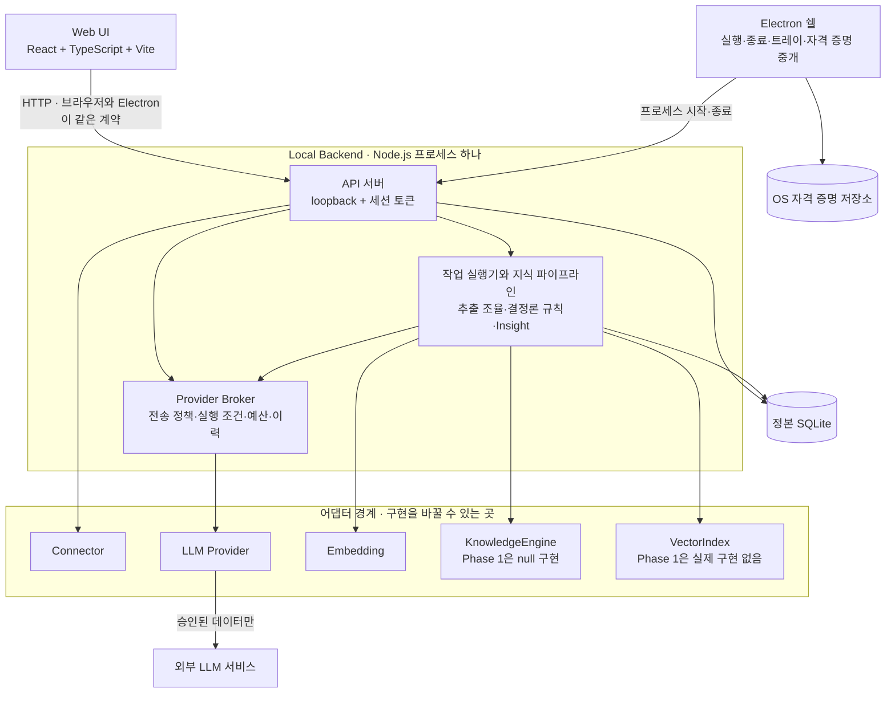
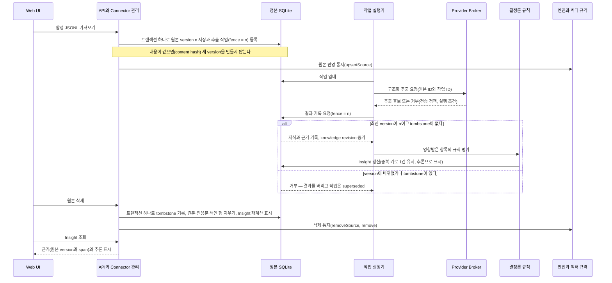

# 아키텍처 (잠정)

- 날짜: 2026-11-21 / 상태: **잠정 — 배포처 검증 대기**
- 관련: 이슈 #15(R06), #16(V01), #17(V02), #37(R07). 요구사항 원문 [original-design.md](design/original-design.md), 근거 [OSS_EVALUATION.md](OSS_EVALUATION.md), [CLI Provider 조사](research/2026-11-21-cli-provider-terms-and-isolation.md), 결정 기록 [adr/](adr/README.md)

이 문서는 Phase 1 개발을 시작할 수 있도록 구조를 잠정으로 정한다. **아무것도 실행해 보지 않고 쓴 문서다.** 엔진, CLI, Windows 설치 파일의 실행 검증은 배포처에서만 할 수 있으므로, 실행 근거가 필요한 결정은 모두 잠정이며 [9절 가정 표](#9-가정-표)에 걸려 있다. 가정이 틀리면 무엇을 바꾸는지도 그 표에 적었다. 확정은 R07(#37)에서 한다.

## 사용자 확인이 필요한 결정

아래 셋은 **정해진 것이 아니다.** 개발이 멈추지 않도록 잠정으로 고른 쪽을 따라 진행하고 있을 뿐이며, 사용자가 다르게 정하면 적힌 작업을 다시 한다.

| 결정 | 잠정으로 고른 쪽 | 원 설계와 어긋날 수 있는 곳 | 번복되면 다시 하는 작업 |
|---|---|---|---|
| 지식의 정본을 누가 갖는가([ADR 0002](adr/0002-authority-in-product-records.md)) | 제품이 SQLite에 갖고 엔진은 투영 | 7절 "기존 Knowledge Engine의 로컬 저장소를 우선 사용", 15절 "동일 기능을 제공한다면 중복 저장소를 추가하지 않는다". 제품의 기록이 7절의 필수 기능 다섯 가지(시간·유효 기간, 관계별 근거, 사실의 변경·대체, 상충 관리, 삭제 시 파생 지식 갱신)를 직접 구현하게 된다 | V02의 지식 스키마와 그 위의 작업(V02-T02, T05~T09) |
| 정본 SQLite를 암호화하지 않고 시작하는가([ADR 0010](adr/0010-encryption-at-rest.md)) | 평문으로 시작. 비밀 값은 OS 자격 증명 저장소, 실제 업무 데이터는 OS 디스크 암호화가 확인된 PC에서만 | 17절 "로컬 데이터 암호화" | V01-T03(드라이버 교체와 그 앞의 드라이버 조사) |
| Embedding 모델을 설치 파일에 넣지 않는가([ADR 0006](adr/0006-embedding.md)) | 넣지 않고 설치 뒤에 준비 | 1절 "설치 파일 하나만 설치하면 사용" | V01-T14(모델 준비 방식)와 패키징 구성 |

첫째 결정은 [OSS_EVALUATION 6절 1번](OSS_EVALUATION.md)이 "사용자가 R06에서 판단할 문제"로 넘긴 것이다. 실행 비교(R03)가 배포처로 옮겨지면서 근거가 아직 없어 이 문서도 판단하지 못했다. 사용자가 지금 정할 수도 있고 R07까지 기다릴 수도 있다.

## 0. 처음 나오는 말

| 말 | 뜻 |
|---|---|
| 정본 | 서로 다른 저장소의 내용이 어긋났을 때 옳다고 보는 쪽. 잃으면 다시 만들 수 없는 데이터 |
| 투영(projection) | 정본에서 계산해 만든 사본. 지우고 정본에서 다시 만들 수 있다. 검색 색인이 대표적이다 |
| 어댑터 | 바뀔 수 있는 부품(엔진, Provider 등) 앞에 두는 고정된 접속 규격과 그 구현. 부품을 바꿔도 규격을 쓰는 쪽 코드는 그대로다 |
| 계약 테스트 | 어댑터의 모든 구현이 같은 규격을 지키는지 확인하는 공용 테스트 묶음. 새 구현은 이 묶음을 통과해야 한다 |
| test double | 테스트에서 실제 부품 대신 끼우는 대역(가짜 Provider 등). 이것의 성공은 실제 부품의 성공이 아니다. 테스트 빌드에만 들어 있다 |
| Provider | 생성형 LLM을 호출하는 통로. Claude Code CLI, Codex CLI, API 키로 쓰는 HTTP 엔드포인트가 각각 하나의 Provider다 |
| Broker | 모든 Provider 호출이 반드시 지나는 관문. 전송 허용 여부, 시간 제한, 예산, 이력 기록을 한곳에서 처리한다 |
| 외부 전송(egress) | 데이터가 사용자 PC 밖으로 나가는 일. CLI가 로컬에서 실행되어도 추론 요청은 외부 서버로 간다 |
| 배포 빌드 / 개발 빌드 / 테스트 빌드 | 배포 빌드는 설치 파일로 묶어 사용자에게 주는 실행본. 개발 빌드는 개발자가 소스에서 띄운 실행. 테스트 빌드는 자동 테스트가 대역을 끼워 띄운 실행. 어느 것인지는 **빌드할 때 코드에 박히는 값 하나**로 정해지고, 그 값이 없으면 배포 빌드로 본다 |
| 합성 목록 | 저장소에 든 지어낸 테스트 자료의 내용 해시를 빌드할 때 모아 둔 목록. 어떤 원본이 "합성" 등급인지는 이 목록과의 대조로만 정해진다 |
| 씨앗 데이터 | 테스트를 시작할 때 미리 넣어 두는 데이터 |
| 카나리 | 새어 나가면 안 되는 자리에 심어 두는 눈에 띄는 문자열. 로그나 파일에서 이 문자열이 발견되면 누출이다 |
| loopback | 자기 PC 안에서만 닿는 주소(127.0.0.1). 다른 기기에서는 접속할 수 없다 |
| 근거(Evidence) | 지식이 나온 자리. 원본의 어느 version, 몇 번째 글자부터 몇 번째 글자 앞까지(span)인지 가리킨다. 글자 수는 유니코드 코드 포인트로 센다 |
| knowledge revision | 정본의 지식이 바뀔 때마다 1씩 오르는 번호. 투영이 정본을 어디까지 반영했는지 비교하는 데 쓴다 |
| version fence | 작업이 시작할 때 본 원본 version 번호를, 결과를 쓸 때 다시 대조하는 검사. 그 사이 원본이 바뀌었으면 결과를 버린다 |
| tombstone | "이 원본은 삭제되었다(또는 권한이 철회되었다)"는 표식. 내용 없이 식별자, version, 시각, 사유만 남긴다. 지운 데이터가 늦게 끝난 작업이나 재수집으로 되살아나는 것을 막는다 |
| 임대(lease) | 작업 실행기가 작업 하나를 "기한까지 내가 처리한다"고 잡아 두는 것. 기한이 지나면 다른 실행이 다시 집을 수 있다 |
| outbox | 정본을 고친 트랜잭션 안에 함께 적어 두는 "투영에 반영할 일" 목록. 중간에 꺼져도 목록이 남아 이어서 반영한다 |
| 사이드카 | 앱 본체 옆에서 따로 실행되는 보조 프로세스(예: Python이나 Go로 만든 엔진) |
| IPC / preload | IPC는 Electron에서 화면과 쉘이 주고받는 메시지. preload는 화면에 꼭 필요한 기능만 골라 노출하는 작은 스크립트 |
| CSP | 화면이 어디에서 스크립트·이미지를 불러올 수 있는지 제한하는 브라우저 규칙 |

## 1. 맥락

제품은 메일·메신저·Wiki 형태의 업무 정보를 가져와 지식을 뽑고, 서로 연결하고, 여러 출처를 종합한 Insight를 근거와 함께 보여 주는 로컬 우선 데스크톱 앱이다(원 설계 1절). Phase 1의 목표는 그 가치를 한 줄기로 증명하는 것이다: 합성 출처 3개 → 추출 → 연결 → "의존 업무 지연" Insight → 근거 화면(이슈 #1 설계 분석 12번).

세 가지 사실이 구조를 정했다.

1. **실행으로 확인된 엔진이 없다.** 시간 유효성, 원문 span 수준의 근거, 삭제 시 파생물 제거를 모두 갖추었다고 실행으로 확인된 후보가 없다([OSS_EVALUATION 6절 1번](OSS_EVALUATION.md)). 후보 3개(LightRAG, cognee, sage-wiki)는 보류 상태로 배포처 실행을 기다린다(같은 문서 5.1절).
2. **구독 로그인 CLI를 제품이 자동 실행해도 되는지는 벤더 문구가 모호하거나 불리하다**([CLI Provider 조사 3절](research/2026-11-21-cli-provider-terms-and-isolation.md)). 격리 플래그도 한 번도 실행해 보지 않았다(같은 문서 4~5절).
3. **Windows 동작은 전부 미검증이다**(OSS_EVALUATION 0절, 8절).

그래서 뒤집힐 수 있는 선택(엔진, Provider, 벡터 저장, embedding)은 모두 어댑터 뒤에 두고, 제품이 직접 갖는 것은 "무엇이 옳은가"를 정하는 기록으로 한정했다.

## 2. 구성요소



읽는 법: 화면은 백엔드의 HTTP API만 안다. Electron 쉘은 화면을 띄우고 백엔드 프로세스를 켜고 끄는 일, 그리고 OS 기능(자격 증명 저장소, 트레이, 알림) 중개만 한다. 지식 처리 로직은 전부 백엔드에 있으므로 브라우저 개발 환경에서도 똑같이 돈다(원 설계 2절 "Web First, Desktop Ready").

**모듈형 모놀리식**이란 프로세스는 하나지만 내부를 모듈로 나누고 모듈끼리는 정해진 규격으로만 부른다는 뜻이다([ADR 0001](adr/0001-modular-monolith-and-stack.md)). 저장소 배치는 원 설계 3절을 따른다.

| 디렉터리 | 내용 |
|---|---|
| `apps/web` | Web UI |
| `apps/desktop` | Electron 쉘(main, preload) |
| `backend/` | API 서버, Connector 관리, 작업 큐·실행기, 스케줄러 |
| `knowledge-engine/` | 제품의 지식 파이프라인(추출 조율, 결정론 규칙, Insight)과 KnowledgeEngine 어댑터. 이름과 달리 **엔진 구현을 두는 곳이 아니다**(3.2절) |
| `providers/` | LLM Provider 구현, Broker, 전송 정책, Embedding |
| `storage/` | SQL 드라이버 포트, 마이그레이션, 정본 저장 모듈, VectorIndex |
| `packages/contracts` | API와 어댑터의 계약 타입·스키마(화면과 백엔드가 공유) |
| `packages/testkit` | 계약 테스트 묶음과 test double. 배포 빌드에 들어가지 않는다 |
| `fixtures/` | 합성 데이터. 품질 평가용 골든 데이터는 R05가 `eval/golden/`에 둔다 |
| `site/` | **배포처 포크 전용 자리.** 공용 저장소에는 안내문만 둔다([ownership.md](ownership.md)) |

## 3. 프로세스 모델

| | 개발 | 프로덕션(설치본) |
|---|---|---|
| 화면 | 브라우저 → Vite 개발 서버 | Electron 창 → 백엔드가 내주는 빌드된 화면 |
| 백엔드 | 개발자가 띄운 Node.js 프로세스, 고정 포트 | Electron 쉘이 자기 안에 든 Node 런타임으로 띄우는 별도 프로세스, 실행 때마다 고르는 빈 포트 |
| 세션 토큰 전달 | 개발 스크립트가 백엔드와 개발 서버에 같은 값을 준다(개발 빌드에만 존재) | 쉘이 만들어 **부모와 자식 프로세스 사이의 전용 통로**로 백엔드에 넘긴다. 명령줄 인자와 환경 변수로는 넘기지 않는다(같은 사용자의 다른 프로세스가 읽을 수 있다). 화면에는 preload의 검증된 IPC 하나로 준다 |
| 백그라운드 작업 | 백엔드 프로세스 안의 작업 실행기. Phase 1은 한 번에 하나씩 처리한다 | 같음 |
| 비밀 값 | 환경 변수로만 읽고 저장하지 않는다 | 쉘이 OS 자격 증명 저장소를 중개하고 같은 전용 통로로 호출 직전에 넘긴다 |

- 화면이 쓰는 것은 "백엔드 주소 + 토큰" 두 값뿐이다. 값을 어디서 받는지만 다르고 API 계약은 같다(V01-C1).
- 원 설계 16절은 프로덕션에 "Background Knowledge Worker"를 따로 그렸다. Phase 1에서는 **백엔드 프로세스 안의 작업 실행기**로 둔다. 따로 떼어야 한다는 측정 근거가 생기면 그때 뗀다. Electron에 든 Node로 백엔드를 별도 프로세스로 띄우는 구체적 방식은 V01에서 정하며 Windows 동작은 가정 A18이다.
- 쉘은 single instance lock(앱을 두 번 켜도 하나만 실행), 정상 종료 시 백엔드 종료 대기, 백엔드가 죽었을 때 재시작을 맡는다.
- 설치 파일을 만드는 일은 R04(#13)가 맡는다. V01은 그 입력인 **프로덕션 빌드 산출물**(백엔드, 화면, 쉘의 묶음)까지 만든다.
- 사이드카(Python 또는 Go 엔진)는 Phase 1에 없다. 언어 선택은 미결이다([ADR 0011](adr/0011-sidecar-language.md)).

### 3.1 CLI Provider를 실행해도 되는 경우

네 가지 입력이 판정을 정한다. **어느 것도 호출하는 쪽이 값을 넘겨서 정할 수 없다.**

| 입력 | 어디서 오는가 |
|---|---|
| 빌드 종류 | 빌드할 때 코드에 박히는 값 하나. 그 값이 없거나 알 수 없는 값이면 **배포 빌드**로 본다. 설정, 환경 변수, 요청으로 바꿀 수 없고, 배포 빌드에는 개발용 예외 코드 자체가 들어 있지 않다 |
| 검증된 조합 목록 | 격리 검증(R02)을 통과한 조합을 적은 **읽기 전용 빌드 자원**. 항목은 CLI 이름, **정확한 버전 하나**, OS, 인자 프로필 이름, 검증한 날짜다. 인자 프로필의 내용은 코드에 고정된 상수이고 목록은 그 이름만 가리킨다. 사용자 데이터 폴더의 설정, 환경 변수, 설정 API로는 항목을 더할 수 없다. 공용 저장소의 목록은 비어 있고, 배포처가 R02를 실행한 뒤 포크에서 채워 다시 빌드한다 |
| 호출 종류 | Broker가 **작업 기록**으로 판정한다. 작업 실행기가 꺼낸 작업에서 나온 호출은 전부 "백그라운드"다. 사용자가 가져오기 버튼을 눌러 등록된 추출 작업도 백그라운드다. "사용자 호출"은 화면의 요청 하나가 끝나기 전에 그 자리에서 실행되는 호출뿐이며 Phase 1에는 설정 화면의 **연결 시험** 하나가 있다 |
| 데이터 등급 | Broker가 요청에 든 원본 ID로 **정본에서 계산**한다. "합성"은 원본의 내용 해시가 합성 목록에 있을 때만 붙는다. 파일 경로, 레코드의 필드, Connector의 주장으로는 붙지 않는다 |

| 실행본 | 조합이 목록에 **있다** | 목록에 **없다** |
|---|---|---|
| **배포 빌드** | 사용자 호출은 실행. 백그라운드 호출은 백그라운드 설정까지 켜져 있을 때만 실행(기본 끔) | **전부 차단.** 사용자 호출도 백그라운드 호출도 실행하지 않는다 |
| **개발 빌드** | 배포 빌드와 같다 | 다음을 모두 만족하는 호출만 실행: 사용자 호출이다, 입력이 전부 "합성" 등급이고 악성 변형이 아니다, 고정된 최소 권한 인자 프로필을 쓴다, "격리 미검증"을 표시한다, **그 호출 한 번에 대해** 사용자가 확인했다(확인은 저장되지 않는다) |

- CLI의 버전을 읽지 못하거나 해석하지 못하면 "목록에 없다"로 처리한다.
- test double은 테스트 빌드에만 있다. 가짜 CLI도 예외 없이 같은 판정을 지나며, 테스트 빌드가 자기 목록 자원에 가짜 CLI의 버전을 넣어 둔다.
- **판정을 거치지 않는 CLI 실행은 둘뿐이다**: 버전 조회, 그리고 CLI가 로그인 상태를 알려 주는 명령(Codex는 문서에 있다. Claude Code에 같은 명령이 있는지는 근거 문서에 없으며 가정 A22다). 둘 다 고정된 인자로, 입력 없이, 문서 내용 없이, 빈 임시 디렉터리와 최소 환경 변수와 시간 제한으로 실행한다. 연결 시험을 포함한 나머지는 전부 판정을 지난다.
- API 키 Provider는 CLI가 아니라 HTTP 호출이므로 이 표의 대상이 아니다. 전송 정책과 동의는 똑같이 적용된다([ADR 0005](adr/0005-llm-providers.md)).

### 3.2 제품이 직접 하는 일과 엔진의 일 — 선 긋기

원 설계 2절은 Knowledge Engine, Graph, Vector, LLM Wiki, Memory Management를 다시 구현하지 말라고 한다. Phase 1은 제3자 엔진 없이 가므로([ADR 0003](adr/0003-phase1-without-engine.md)) 이 선을 넘지 않도록 양쪽을 적어 둔다. **이 선 자체가 사용자 확인 대상이다**(맨 위 표의 첫째 결정).

| 제품이 직접 한다(기록과 정책) | 하면 선을 넘는다(엔진의 일) |
|---|---|
| 원본 version, 근거 span, 지식 항목, 사실, 관계를 **행으로 저장** | 문서를 chunk로 나누고 embedding으로 찾아 추출 문맥을 조립하는 검색 파이프라인 |
| 원본 하나당 구조화 출력 **호출 1회**(형식 오류 시 재시도 1회)로 추출 요청 | 보충 추출 반복, 병합 요약, 다단계 추출 프레임워크 |
| 기존 항목의 이름·별칭이 원문에 **글자 그대로 들어 있는지**로 후보를 찾아 LLM에 보여 주고, 결과를 후보(candidate)로 기록. 별칭은 그 항목에 이미 기록된 이름과 사용자 교정에서만 온다. 비교 전에 유니코드 정규화, 대소문자 통일, 공백 정리만 한다. 키워드 색인이나 그 순위로 후보를 찾지 않는다 | 유사도 점수·군집으로 개체를 합치는 해소(entity resolution) 알고리즘 |
| **같은 행인지의 판정**: 두 사실은 항목 ID, 사실 종류, 정규화한 값이 모두 같을 때만 같은 행이다. 두 관계는 주체 ID, 관계 유형, 대상 ID가 모두 같을 때만 같은 행이다. 같은 행이면 근거만 더한다 | 뜻이 비슷한 사실을 하나로 합치는 병합, 값이 다른 사실 사이의 상충 해소 |
| **대체(supersession)**: 원본의 새 version이 오면 이전 version의 근거를 떼고, 근거가 0이 된 행의 상태를 superseded로 바꾼다 | 내용을 비교해 어느 사실이 어느 사실을 대체했는지 추론 |
| **삭제 전파**: 원본이 지워지면 그 근거를 지우고, 근거가 0이 된 행을 지운다. 근거 개수를 세는 일이다 | — |
| 날짜 비교, 상태 변경, 의존 관계 충돌, 중복 검사 같은 **결정론 규칙**(원 설계 10절) | 일반 그래프 탐색, 그래프 순위·군집 알고리즘 |
| 정해진 질의의 **깊이 1 조인**(예: "A가 의존하는 B"). 재귀 질의를 쓰지 않는다 | 깊이가 정해지지 않은 관계 탐색 |
| 근거·시간·상태·교정 이력 관리 | 근사 최근접 색인, 벡터 점수 계산, Wiki 페이지 합성·병합, 기억 통합(consolidation) 파이프라인 |

오른쪽 칸의 기능이 필요해지면 직접 만들지 않고 KnowledgeEngine 어댑터 뒤에 엔진을 꽂는다. **위험을 숨기지 않는다**: 왼쪽 칸도 얇은 추출 파이프라인이고, "대체"와 "삭제 전파"는 조사에서 엔진을 평가한 바로 그 기능(OSS_EVALUATION 1절 탈락 조건 ③)이다. Phase 3(개체 해소, 시간 그래프, 충돌 처리)에서 오른쪽으로 번지려는 압력이 가장 크다.

## 4. 데이터의 정본과 투영

원 설계 15절은 "저장소별 Single Source of Truth를 명확히 정의한다"고 요구한다. 잠정 결정은 **제품이 정본 기록을 SQLite에 갖고, 지식 엔진·벡터 색인·Wiki는 정본에서 다시 만들 수 있는 투영으로 둔다**는 것이다([ADR 0002](adr/0002-authority-in-product-records.md)).

| 데이터 | 저장 위치 | 지위 | 잃었을 때 |
|---|---|---|---|
| 원본 version, 메타데이터(출처 식별자, content hash, access_scope), 수집 cursor | 정본 SQLite | **정본** | 커넥터로 다시 수집. 로컬 import는 사용자가 다시 넣어야 한다 |
| 근거(원본 version + span + 인용문) | 정본 SQLite | **정본** | 복구 불가 |
| 지식 항목, 사실, 관계: 유형, 인식 유형(명시 사실/사용자 승인/추론/가설), 상태, 유효 시각, 관측 시각 | 정본 SQLite | **정본** | 추출을 다시 돌리면 일부 복원. 사용자 교정은 복구 불가 |
| 사용자 교정·승인, 피드백·선호 | 정본 SQLite | **정본**(Phase 1에는 입력 화면이 없다) | 복구 불가 |
| Insight | 정본 SQLite | **정본**. 내용은 규칙으로 다시 계산할 수 있다 | 재계산 |
| 작업(job)과 스케줄 상태 | 정본 SQLite | **정본**(운영 상태) | 미완료 작업을 원본에서 다시 등록 |
| 설정, 동의 기록, 전송 정책 | 정본 SQLite | **정본** | 사용자가 다시 설정 |
| Provider 호출 이력(본문 없음) | 정본 SQLite | **정본**(감사용) | 복구 불가 |
| tombstone(내용 없음) | 정본 SQLite | **정본** | 삭제된 데이터가 되살아날 수 있음 |
| 키워드 검색 색인 | 정본 SQLite 파일 안 | 투영. 정본과 같은 트랜잭션으로 갱신 | 정본에서 재구축 |
| 벡터 색인 | 별도 파일. **Phase 1에는 실제 구현이 없다** | 투영 | 지우고 정본 + embedding으로 재구축 |
| 지식 엔진 내부 저장소 | 엔진이 쓰는 디렉터리 | 투영. Phase 1에는 없음 | 정본에서 재구축 |
| 그래프 저장소 | — | 도입하면 **투영**이다. Phase 1에는 없고 관계는 정본의 행이다 | 정본에서 재구축 |
| Wiki 페이지 | Phase 4(K01)에서 정함 | 투영 | 정본에서 재생성 |
| 원본 파일과 첨부(원 설계 15절 "Local File Storage") | **Phase 1에는 없다.** JSONL의 본문은 정본 SQLite에 들어간다. 파일 저장은 Phase 2(I02)에서 정한다 | — | — |
| Embedding 모델 파일 | 모델 캐시 디렉터리 | 캐시 | 다시 받거나 다시 반입 |
| 비밀 값(API 키) | OS 자격 증명 저장소 | 정본. SQLite·파일·로그·백업에 넣지 않는다 | 사용자가 다시 입력 |
| 로그 | 로그 디렉터리 | 정본 아님. 민감 값 제거 후 기록 | 영향 없음 |

원 설계와의 긴장은 맨 위 "사용자 확인이 필요한 결정"에 적었다. 실행 결과나 사용자 판단이 "엔진이 정본"을 지지하면 지식 항목·사실·관계 테이블을 엔진 쪽으로 넘기고 제품은 원본·작업·피드백·교정만 갖는 구조로 바꾼다(가정 A09).

## 5. 어댑터 경계

아래 다섯 규격은 **스케치**다. 정확한 타입은 V01 구현(Provider, Embedding, KnowledgeEngine, VectorIndex)과 V02·I01(Connector)에서 확정한다(이슈 #1 설계 분석 3번). 모든 구현은 `packages/testkit`의 계약 테스트를 통과해야 하고, 각 경계에는 test double이 하나씩 있다.

### 5.1 Provider

원 설계 4절의 인터페이스에 이슈 #1이 요구한 요청 정보(request ID, 작업 종류, 데이터 등급, 전송 정책, 스키마 버전, 예산, 취소, 재시도 가능 여부)를 더했다. 상위 코드가 Broker에 넘기는 것과 Broker가 Provider에 넘기는 것을 나눈 이유는, 등급과 호출 종류를 부르는 쪽이 적어 넣을 수 없게 하기 위해서다.

```typescript
// 상위 코드 → Broker. 등급도 호출 종류도 여기에는 없다
interface BrokerRequest {
  taskKind: 'extract' | 'connection-test'   // Phase 1이 쓰는 두 가지뿐이다
  sourceVersionIds: string[]                // 입력에 든 원본. Broker가 이 ID로 정본에서 등급을 계산한다
  origin: { jobId: string } | { userActionId: string }   // Broker가 이 기록으로 사용자 호출인지 백그라운드인지 판정한다
  schemaVersion: number
  budget: { timeoutMs: number; maxOutputTokens?: number }
  retryable: boolean
  input: { instructions: string; untrustedDocuments: UntrustedDocument[] }   // 지시와 가져온 문서를 섞지 않는다
}

// Broker → Provider. Broker가 채운 값이 더해진다
interface LLMRequest extends Omit<BrokerRequest, 'sourceVersionIds' | 'origin'> {
  requestId: string
  trigger: 'user' | 'background'
  dataClassification: DataClassification   // 원본들의 access_scope 중 가장 엄격한 값. '합성'은 합성 목록과 대조해 붙는다
  egress: EgressDecision                   // 허용 결정, 목적지, 정책 버전
}

interface LLMProvider {
  readonly id: 'claude-code' | 'codex' | 'openai-compatible' | 'local-model'
  readonly transport: 'cli' | 'http'
  detect(): Promise<ProviderInfo>              // 설치 여부, 경로, 버전. 판정 없이 허용된 고정 인자만 쓴다
  checkAuthentication(): Promise<AuthStatus>   // 자격 증명 파일은 읽지 않는다. 알 수 없으면 'unknown'
  checkHealth(): Promise<HealthStatus>         // 모델을 부르지 않는다. 모델을 부르는 확인은 연결 시험이며 Broker를 지난다
  getCapabilities(): ProviderCapabilities      // structuredOutput, cancel, egress: 'external' | 'local'
  generate(req: LLMRequest, signal: AbortSignal): Promise<LLMResponse>
  generateStructured<T>(req: StructuredRequest<T>, signal: AbortSignal): Promise<StructuredResponse<T>>
  cancel(requestId: string): Promise<void>
}
```

구현은 네 가지다. `ClaudeCodeProvider`, `CodexProvider`(원 설계대로), `OpenAICompatibleProvider`(API 키. **필수 경로**), `LocalModelProvider`(계약만 있고 "미구현" 상태를 돌려준다). 상위 코드는 Provider를 직접 부르지 않고 Broker만 부른다. Broker는 호출마다 ① 등급과 호출 종류 계산 ② 동의와 전송 정책 검사 ③ CLI 실행 조건(3.1절) ④ 동시 실행·예산 ⑤ 시간 제한과 취소 ⑥ 응답 스키마 검증 ⑦ 본문 없는 이력 기록을 순서대로 한다.

### 5.2 Embedding

생성형 LLM과 분리한 별도 계약이다(원 설계 4절).

```typescript
interface EmbeddingProvider {
  describe(): { modelId: string; revision: string; dimension: number; maxTokens: number; license: string; egress: 'local' | 'external' }
  status(): Promise<'ready' | 'model-missing' | 'preparing' | { unavailable: string }>
  prepare(source: { kind: 'download' } | { kind: 'local-pack'; path: string }, signal: AbortSignal): Promise<void>   // 고정한 revision과 파일 해시가 맞을 때만 준비 완료
  embed(texts: string[], kind: 'document' | 'query', signal?: AbortSignal): Promise<Float32Array[]>
}
```

- 공용 저장소의 구현은 로컬에서 계산하므로 `egress`가 `'local'`이다. 포크가 원격 서비스를 부르는 구현을 넣으면 `'external'`이어야 하고, 그 경우 embedding 입력도 LLM 호출과 같은 동의·전송 정책 검사를 지난다(이슈 #1 설계 분석 5번, [ADR 0014](adr/0014-egress-policy-and-consent.md)).
- 모델이 없거나 받을 수 없으면 `status()`가 그 사실을 알리고 키워드 검색은 계속 동작한다(V01-C6). `modelId`와 `revision`이 바뀌면 벡터 색인을 통째로 다시 만든다.

### 5.3 KnowledgeEngine

제3자 지식 엔진을 꽂는 자리다. 엔진은 **후보를 제안하고 관련 문맥을 찾아 줄 뿐**이고, 무엇이 지식으로 기록되는지는 제품이 정본에 쓰면서 정한다.

```typescript
interface KnowledgeEngine {
  readonly id: string
  capabilities(): { propose: boolean; relatedContext: boolean; spanEvidence: boolean; temporal: boolean }
  health(): Promise<HealthStatus>
  appliedRevision(): Promise<number | null>            // 엔진이 반영한 정본의 knowledge revision
  upsertSource(input: EngineSourceInput, fence: VersionFence, revision: number): Promise<void>
  removeSource(ref: SourceVersionRef, fence: VersionFence, revision: number): Promise<void>   // 이 원본에서만 나온 파생물이 엔진 안에 남지 않아야 한다
  proposeKnowledge(ref: SourceVersionRef): Promise<KnowledgeCandidate[]>    // capabilities().propose가 false면 Unsupported 오류
  relatedContext(query: ContextQuery): Promise<ContextHit[]>               // 결과는 정본의 ID나 원본 참조를 달고 온다
  rebuild(sources: AsyncIterable<EngineSourceInput>, revision: number): Promise<void>
}
```

**파이프라인이 이 규격을 부르는 자리**(V02에서 구현한다. 부르는 자리가 없으면 구현을 바꿔 끼워도 아무것도 달라지지 않으므로 교체 시험이 의미가 없다):

| 때 | 호출 |
|---|---|
| 원본 version을 정본에 저장한 뒤 | `upsertSource` |
| 추출 직전, `capabilities().propose`가 참일 때 | `proposeKnowledge`. 돌아온 후보는 LLM 추출 결과와 **같은 검증**(인용문 대조)을 거쳐 candidate로 기록된다 |
| 원본이 새 version으로 바뀌거나 삭제·권한 철회된 뒤 | `removeSource`, 그리고 `VectorIndex.remove` |
| 시작할 때 `appliedRevision()`이 정본의 knowledge revision과 다르면 | `rebuild` |

Phase 1에는 `NullKnowledgeEngine`(아무것도 하지 않고 모든 능력이 false)과 테스트용 메모리 구현이 있다. 계약 테스트는 "삭제한 원본을 가리키는 결과가 다시 나오지 않는다", "낡은 fence는 거부된다", "rebuild를 두 번 해도 결과가 같다", "없는 능력을 있다고 하지 않는다"를 확인한다. null 구현만으로는 이 테스트가 공허하게 통과하므로 메모리 구현이 함께 있어야 한다.

### 5.4 VectorIndex

```typescript
interface VectorIndex {
  status(): Promise<'ready' | 'rebuilding' | { unavailable: string }>
  embeddingSpace(): Promise<{ modelId: string; revision: string; dimension: number } | null>
  appliedRevision(): Promise<number | null>
  reset(space: { modelId: string; revision: string; dimension: number }): Promise<void>   // 재구축의 시작점
  upsert(items: { ref: IndexedRef; vector: Float32Array }[], revision: number): Promise<void>
  remove(refs: IndexedRef[], revision: number): Promise<void>
  search(query: Float32Array, k: number): Promise<{ ref: IndexedRef; score: number }[]>
}
// IndexedRef는 언제나 정본의 ID다. 색인은 본문을 갖지 않는다.
```

**Phase 1에는 규격, 계약 테스트, 테스트용 메모리 구현(fake)만 있다.** 제품의 기본 구성은 `unavailable`을 돌려주는 빈 구현에 묶이고, 키워드 검색으로 동작한다. 네이티브 벡터 모듈은 V01에 넣지 않는다. sqlite-vec는 배포처에서 확인할 잠정 후보다([ADR 0004](adr/0004-embedded-storage.md), 가정 A08). Phase 1에서 제품 코드가 이 규격을 부르는 자리는 둘이다: 상태 API가 읽는 `status()`, 그리고 삭제 때의 `remove()`(5.3절 표).

정본 SQLite 쪽에는 드라이버를 바꿀 수 있도록 좁은 **SQL 드라이버 포트**(열기, 실행, 트랜잭션)를 둔다.

### 5.5 Connector

원 설계 5절의 인터페이스에 삭제 사건, cursor 만료, 나눠 받기, 전체 재스캔, 능력 선언, 스키마 버전을 더했다. 원 설계의 `sync()`는 Connector가 아니라 Connector 관리 모듈의 일로 옮겼다. 관리 모듈이 `getChanges`를 반복해 부르고, 받은 것을 저장한 **뒤에** cursor를 확정한다.

```typescript
interface Connector {
  readonly manifest: { type: string; schemaVersion: number; capabilities: { incremental: boolean; deletes: boolean; accessScope: boolean; fullRescan: boolean } }
  initialize(config: unknown): Promise<void>   // 미구현 연동은 '미구현, 배포처 후속'이라는 Unavailable 오류로 실패한다
  healthCheck(): Promise<HealthStatus>
  getChanges(cursor: string | null, opts: { limit: number; signal: AbortSignal }): Promise<ChangeSet>
  getDocument(externalId: string): Promise<SourceRecord | null>
}
type Change =
  | { kind: 'upsert'; record: SourceRecord }
  | { kind: 'delete' | 'access-revoked'; externalId: string; version: number; at: string }
interface ChangeSet { changes: Change[]; nextCursor: string; hasMore: boolean; cursorExpired?: boolean }   // cursorExpired면 전체 재스캔
```

원본의 정체는 `connector_instance_id + external_id`이고 content hash는 내용 중복을 찾는 데만 쓴다. 내용이 같아도 출처·권한·시점이 다르면 따로 보존한다(이슈 #1 설계 분석 2번). Connector는 데이터 등급을 정하지 못한다. access_scope를 채울 뿐이고 등급은 Broker가 계산한다. 공용 저장소는 JSONL import와 테스트 Connector를 구현하고, 실제 메일·메신저·Wiki 수집기는 배포처 포크가 이 계약으로 구현한다.

## 6. 수집에서 Insight까지



- **version fence가 걸리는 곳**: 작업 결과를 정본에 쓰는 순간. 검사와 쓰기가 같은 트랜잭션 안에 있어야 한다. 엔진과 벡터 규격을 부를 때도 "이 변경이 어느 knowledge revision의 것인가"를 함께 넘겨, 낡은 변경이 최신 상태를 덮어쓰지 못하게 한다.
- **tombstone이 걸리는 곳**: 삭제나 권한 철회를 받는 순간 기록하고, ① 진행 중이던 작업의 결과 쓰기 ② 같은 원본의 그 version 이하 재수집 ③ 투영 갱신과 검색 결과 반환에서 확인한다.
- **삭제는 숨기는 것이 아니라 지우는 것이다**: 그 원본의 모든 version의 본문, 그 원본을 가리키는 근거와 인용문, 키워드 색인의 행을 지운다. 근거가 0이 된 지식은 지우고, 다른 원본도 근거로 가진 지식은 남긴다. 남는 것은 내용 없는 tombstone뿐이다. 권한 철회도 같은 방식으로 지운다(원 설계 17절 "원본 삭제와 파생 지식 삭제 동기화", V02).
- **추론과 사실의 구분**: 규칙이 만든 Insight는 인식 유형이 "추론"이다. 화면은 이를 확정 사실처럼 보이지 않게 표시한다(원 설계 10절, V02-C2).
- **근거의 위치는 코드가 계산한다**: LLM에게서는 인용문만 받는다. 코드가 원문에서 그 인용문을 찾아 시작과 끝을 유니코드 코드 포인트로 계산하며, LLM이 돌려준 숫자는 쓰지 않는다. 인용문이 원문에 없거나 두 군데 이상에 있으면 그 지식은 기록하지 않는다. 단위는 R05의 골든 데이터와 같다.

## 7. 실패와 복구

여러 저장소를 한 트랜잭션처럼 믿지 않는다(이슈 #1 설계 분석 1번). 원칙은 셋이다: **정본을 먼저, 한 트랜잭션으로 쓴다. 투영은 나중에 따라온다. 어긋나면 투영을 버리고 다시 만든다**([ADR 0013](adr/0013-failure-recovery.md)).

| 일어난 일 | 결과 상태 | 복구 |
|---|---|---|
| 가져오기 도중 꺼짐 | 저장된 원본까지만 남고 cursor는 그 뒤에 확정되므로 앞서지 않는다 | 다시 실행하면 같은 원본은 hash로 걸러진다 |
| 추출 도중 꺼짐 | 작업이 임대된 채 남는다 | 재시작 때 임대가 만료된 작업을 다시 집는다. 결과는 fence로 다시 검사 |
| 정본 기록 뒤, 엔진·벡터 규격 통지 전 꺼짐 | 투영이 반영한 revision이 정본보다 뒤처진다 | 재시작 때 두 번호를 비교해 다르면 `rebuild` |
| 투영 파일 손상 | 색인을 못 쓴다 | 투영을 비우고 정본에서 재구축. 그동안 `rebuilding` 상태를 알리고 키워드 검색은 유지 |
| 추출 중 원본이 수정·삭제됨 | 낡은 결과가 도착한다 | fence와 tombstone이 쓰기를 거부 |
| Provider 시간 초과·오류 | 호출 실패 | Broker가 재시도 가능 여부에 따라 간격을 늘려 재시도하고, 한도를 넘으면 작업을 실패로 남겨 화면에 보인다. CLI는 프로세스 트리까지 종료(가정 A04) |
| 전송 거부, 동의 없음, CLI 실행 조건 불충족 | 호출하지 않음 | 작업을 보류로 두고 이유를 보인다. **다른 Provider로 몰래 넘어가지 않는다** |
| Embedding 모델 없음, 모델 해시 불일치, 벡터 색인 사용 불가 | 벡터 검색 불가 | 상태를 알리고 키워드 검색으로 동작 |
| 정본 SQLite 손상 | 정본 손실 | 백업에서 복원(Phase 7 H01). Phase 1에는 백업 기능이 없으므로 합성 데이터만 다룬다 |

Phase 1의 투영 동기화는 "정본을 쓴 뒤 통지하고, 놓친 것은 revision 비교로 찾아 재구축"이다. outbox는 재구축 비용이 커지는 시점(벡터에 실제 지식을 색인하는 작업)에서 넣는다. Phase 1의 키워드 색인은 정본과 같은 트랜잭션이다.

## 8. 보안 모델

초기 slice부터 적용하고 Phase 7은 부정 테스트와 장시간 증명을 완성하는 단계다(이슈 #1 설계 분석 11번, [ADR 0008](adr/0008-security-baseline.md)).

| 경계 | 통제 |
|---|---|
| 네트워크 → Local API | 127.0.0.1에만 바인딩. 실행마다 새로 만드는 세션 토큰. `Host` 헤더가 자기 주소가 아니면 거부(다른 사이트가 주소를 속여 접근하는 것을 막는다). `Origin`이 허용 목록에 없으면 거부 |
| 화면 → 쉘 | contextIsolation 켬, sandbox 켬, nodeIntegration 끔. preload는 정해진 함수만 노출하고 모든 IPC 입력을 스키마로 검증. 화면에서 임의 셸 실행·파일 접근 불가 |
| 화면이 불러오는 것 | CSP로 자기 출처만 허용. 외부 URL 이동과 새 창을 막는다. 외부 링크는 `https` 주소만, 사용자 확인 뒤 OS 브라우저로 연다 |
| 가져온 내용 | **신뢰하지 않는 데이터.** 화면에는 글자로만 그린다(HTML로 해석하지 않으므로 그 안의 스크립트와 원격 자원은 실행·로드되지 않는다). LLM에는 지시와 구획을 나눠 넣고, 응답은 스키마로 검증하며, LLM의 출력은 후보일 뿐 명령이 아니다 |
| 백엔드 → 외부 LLM | 모든 Provider에 동의와 전송 정책 적용. 동의는 Provider, 목적지, 정책 버전에 묶인다. 거부가 우선. 요약·관련 문맥·외부 embedding 입력 같은 파생 데이터도 원본의 access_scope를 물려받는다. HTTP Provider의 주소는 `https`여야 한다(loopback은 개발·테스트 빌드에서만 예외). CLI 호출도 화면과 이력에 "외부 전송"으로 표시한다([ADR 0014](adr/0014-egress-policy-and-consent.md)) |
| 백엔드 → CLI 프로세스 | 3.1절의 판정을 지난 호출만 실행한다. 셸 없이 인자 배열로, 입력은 stdin, 작업마다 빈 임시 디렉터리, 최소 환경 변수, 세션을 디스크에 남기지 않는 옵션, 바깥에서 거는 시간 제한과 프로세스 트리 종료. 제품은 CLI의 로그인 파일을 읽거나 복사하지 않는다. 인자 배열 초안은 [CLI Provider 조사 5절](research/2026-11-21-cli-provider-terms-and-isolation.md)이며 **전부 미실행**이다 |
| 저장된 데이터 | 비밀 값은 OS 자격 증명 저장소에만. 데이터 디렉터리는 OS 사용자별. 로그는 민감 값 제거. **Phase 1의 정본 SQLite는 파일 단위 암호화를 하지 않으며** 그 범위와 이유는 [ADR 0010](adr/0010-encryption-at-rest.md)에 있다 |
| 접근 범위를 넘는 연결 | Phase 1의 사용자는 그 PC의 한 사람이고 가져온 원본은 모두 그 사람의 것이다. Insight는 근거가 된 원본 중 가장 엄격한 access_scope를 물려받는다. 범위가 다른 원본 사이의 연결을 막는 규칙(원 설계 17절)은 Phase 1에 없으며 I04(#21)와 S02(#23)에서 정한다 |
| 설치본 | 번들한 네이티브 모듈의 서명과 Windows의 차단 동작은 미검증이다(OSS_EVALUATION 4.7절 4~5번, 가정 A14) |

## 9. 가정 표

"확인 방법"의 R02·R03·R04는 배포처에서 실행하는 검증 작업(이슈 #11, #12, #13)이고 `-C<n>`은 그 이슈의 완료 기준이다. 결과는 R07(#37)에서 이 표와 하나씩 대조한다. 그 이슈들의 기준에 들어 있지 않은 확인은 누가 언제 하는지를 따로 적었다.

| ID | 가정 | 걸려 있는 결정 | 확인 방법 | 틀렸을 때 바뀌는 것 |
|---|---|---|---|---|
| A01 | 배포 환경에서 사용자의 구독 로그인 CLI를 제품이 호출하는 것이 허용된다. "배포처에서 두 CLI를 쓸 수 있다"는 것은 **사용자의 진술(2026-11-21)이며 문서 근거가 없다.** 벤더 문구는 모호하거나 불리하다 | ADR 0005 | R02-C4 | CLI Provider를 배포처 설정으로 끄고 API 키 Provider만 쓴다 |
| A02 | `claude -p`의 최소 권한 인자 배열이 구독 로그인과 함께 동작하고 도구·MCP·hooks·작업 디렉터리 밖 읽기를 막는다 | ADR 0005, 3.1절 | R02-C2, R02-C3 | 그 버전은 검증된 조합 목록에 들어가지 못하고, 배포 빌드는 그 CLI를 실행하지 않는다 |
| A03 | `codex exec`의 최소 권한 인자 배열이 셸·MCP·웹 검색을 막고 읽기 범위를 제한한다(`read-only`만으로는 읽기를 막지 못한다) | ADR 0005, 3.1절 | R02-C2, R02-C3 | A02와 같음(Codex CLI) |
| A04 | Windows에서 제품이 CLI의 자식 프로세스 트리를 시간 제한에 맞춰 끝낼 수 있다 | ADR 0005, 7절 | R02-C3 | OS가 Windows인 항목을 목록에 넣지 않는다. Windows에서는 API 키 Provider만 쓴다 |
| A05 | CLI의 구조화 출력 옵션이 도구를 뺀 상태에서도 동작한다 | 5.1절 `generateStructured` | R02-C1 | 그 Provider는 일반 응답을 받아 제품이 JSON을 꺼내 스키마로 검증한다(검증은 어느 경우든 제품이 한다) |
| A06 | 배포처에 쓸 수 있는 OpenAI 호환 엔드포인트와 키가 있고 구조화 출력을 지원한다 | ADR 0005 | 배포처 설정 S05, R02 기록 | 스키마를 지시문으로 요구하고 검증으로 걸러 낸다. 엔드포인트가 아예 없으면 LLM 기능 없이 탐색만 동작 |
| A07 | better-sqlite3의 미리 빌드된 바이너리가 Electron 설치본 안에서 재빌드 없이 로드된다 | ADR 0004 | R04-C1, R03-C4 | 패키징에 재빌드 단계를 넣거나 SQL 드라이버 포트 뒤의 드라이버를 바꾼다 |
| A08 | sqlite-vec 확장(`vec0.dll`)이 Windows에서 서명·차단 문제 없이 로드된다 | ADR 0004(벡터 구현 후보) | R03-C4, R04-C2 | VectorIndex의 구현으로 앱 수준 전수 비교나 LanceDB를 고른다(OSS_EVALUATION 4.8절 차선). Phase 1에는 실제 구현이 없으므로 Phase 1 코드는 바뀌지 않는다 |
| A09 | "제품 기록이 정본, 엔진은 투영" 구조가 "엔진이 정본"보다 근거·시간·삭제·교정 요구를 잘 충족한다 | ADR 0002 | R03-C1, R03-C4. 그리고 사용자 판단 | 지식 항목·사실·관계의 정본을 엔진으로 넘기고 중복 테이블을 없앤다 |
| A10 | 원본당 구조화 호출 1회의 추출로 Phase 1 흐름이 성립하고, 이 방식이 엔진 재구현으로 번지지 않는다 | ADR 0003 | R03-C1, R03-C2 | KnowledgeEngine 어댑터에 보류 후보(LightRAG, cognee, sage-wiki) 중 실행을 통과한 것을 꽂는다 |
| A11 | bge-m3(int8 ONNX)가 Transformers.js로 Electron 설치본 안에서 CPU로 돌고 속도·메모리가 받아들일 만하다 | ADR 0006 | R03-C3, R04-C2 | 차선 모델(multilingual-e5-base)이나 차선 런타임으로 바꾼다(OSS_EVALUATION 4.8절) |
| A12 | 배포처에서 모델 파일을 받을 수 있다(외부에서 내려받거나 내부로 반입) | ADR 0006 | R03-C3, 배포처 설정 S09 | 로컬 팩 반입만 쓴다. 그것도 안 되면 키워드 검색만 제공 |
| A13 | NSIS 설치본이 깨끗한 Windows 11에서 Node·Python·Docker 없이 설치·실행·제거된다 | ADR 0001, ADR 0007 | R04-C1 | 패키징 구성을 고치거나 차선 패키저를 검토(OSS_EVALUATION 4.8절) |
| A14 | 번들한 네이티브 모듈을 서명할 수 있고 Windows의 차단(SmartScreen, Smart App Control)을 넘는 배포 방법이 있다 | ADR 0007 | R04-C3 | 배포처의 내부 배포 채널·허용 목록에 의존한다 |
| A15 | 자동 업데이트(electron-updater)가 배포처 네트워크·정책에서 동작한다 | ADR 0007 | R04-C3은 미확정 사항을 **기록**할 뿐 업데이트를 실행해 보지 않는다. 실제 확인은 H02(#33) | 자동 업데이트를 설정으로 끄고 수동 교체 절차를 쓴다 |
| A16 | Electron 쉘이 OS 자격 증명 저장소를 쓸 수 있고, 그 방식이 비밀 값을 앱의 일반 파일에 남기지 않는다 | ADR 0010 | 방식의 조사와 기록은 사외에서 V01-T11이 한다. 배포처 Windows에서의 동작은 배포처 설정 S11 | API 키를 저장하지 못하므로 API 키 Provider를 "사용 불가"로 표시한다(평문 저장으로 넘어가지 않는다) |
| A17 | 쓰는 SQLite 드라이버 빌드에 전문 검색 기능이 들어 있고 한국어 질의에 쓸 만하다 | ADR 0004, V01-C3 | 기능이 들어 있는지는 사외에서 V01-T03의 테스트가 확인한다. 한국어 품질은 R05의 기준으로 X01(#30)에서 잰다 | 토크나이저 설정을 바꾸거나 단순 부분 일치 검색으로 내린다 |
| A18 | Electron에 든 Node 런타임으로 백엔드를 별도 프로세스로 띄우고, 종료·중복 실행 방지가 Windows에서 동작한다 | ADR 0001, 3절 | R04-C1. 절전 복귀는 R04의 기준에 없으며 H02(#33)에서 확인 | 백엔드를 따로 묶은 실행 파일로 넣는다 |
| A19 | 배포처 PC가 디스크 암호화 같은 저장 데이터 보호를 OS 수준에서 제공한다 | ADR 0010 | 배포처 설정 S11 | 정본 SQLite의 파일 단위 암호화를 넣기 전에는 실제 업무 데이터를 넣지 않는다 |
| A20 | 정본 SQLite 파일이 갑작스러운 종료, 읽기와 쓰기의 동시 진행에서 손상 없이 견딘다 | ADR 0013 | R03-C4 | 쓰기 방식 설정을 바꾸거나 드라이버를 바꾼다. 백업(H01)의 우선순위를 올린다 |
| A21 | 실제 Provider가 근거 인용문을 원문과 글자 하나 다르지 않게 돌려준다. test double은 언제나 정확한 인용문을 주므로 사외 테스트로는 이 실패를 볼 수 없다 | 6절, V02의 추출 | 배포처 설정 S14의 실행, R03-C2 | 공백과 유니코드 정규화를 허용하는 대조로 바꾼다. 그래도 맞지 않는 항목은 계속 버린다 |
| A22 | Claude Code에 로그인 파일을 읽지 않고도 로그인 상태를 알려 주는 명령이 있다. Codex의 명령은 조사 문서에 있고 Claude Code의 것은 없다 | 3.1절, 5.1절 `checkAuthentication` | R02-C1 | Claude Code의 인증 상태를 "알 수 없음"으로 표시하고, 판정을 지난 첫 호출의 결과로만 안다 |

## 변경 이력

| 날짜 | 변경 내용 | 대상 | 사유 |
|---|---|---|---|
| 2026-11-21 | 최초 작성(잠정) | 이 문서 | R06-C1, R06-C2, R06-C4 |
| 2026-11-21 | 배포 빌드는 검증된 CLI 조합만 실행(사용자 호출 포함), 개발 모드는 합성 데이터에 한해 예외. Phase 1의 VectorIndex는 규격과 fake만. 구성요소 그림 정리 | 0절, 2절, 3.1절, 4절, 5.1절, 5.4절, 7~9절 | 조정자 판정 1·2 반영, 이슈 #16 V01-C4 개정 |
| 2026-11-21 | "사용자 확인이 필요한 결정" 절 추가. CLI 판정의 네 입력을 호출하는 쪽이 정할 수 없게 다시 씀(빌드 값 하나와 기본값, 읽기 전용 목록, 작업 기록으로 판정하는 호출 종류, 합성 목록). test double의 상시 허용 삭제, 판정 없는 CLI 실행 두 가지 명시. 선 긋기 표에 같은 행 판정·대체·삭제 전파 추가. 엔진·벡터 규격을 부르는 자리 명시. 삭제를 지우기로, span을 코드 포인트와 코드 계산으로. Embedding의 egress, 동의의 범위, 쉘과 백엔드 사이 통로, 외부 링크 규칙. 가정 A20~A22 추가와 A15~A18의 확인 방법 수정. 용어 추가 | 전 절 | 독립 검토 F01~F04, F07~F12, F14, F15, F17~F19, F21 |
