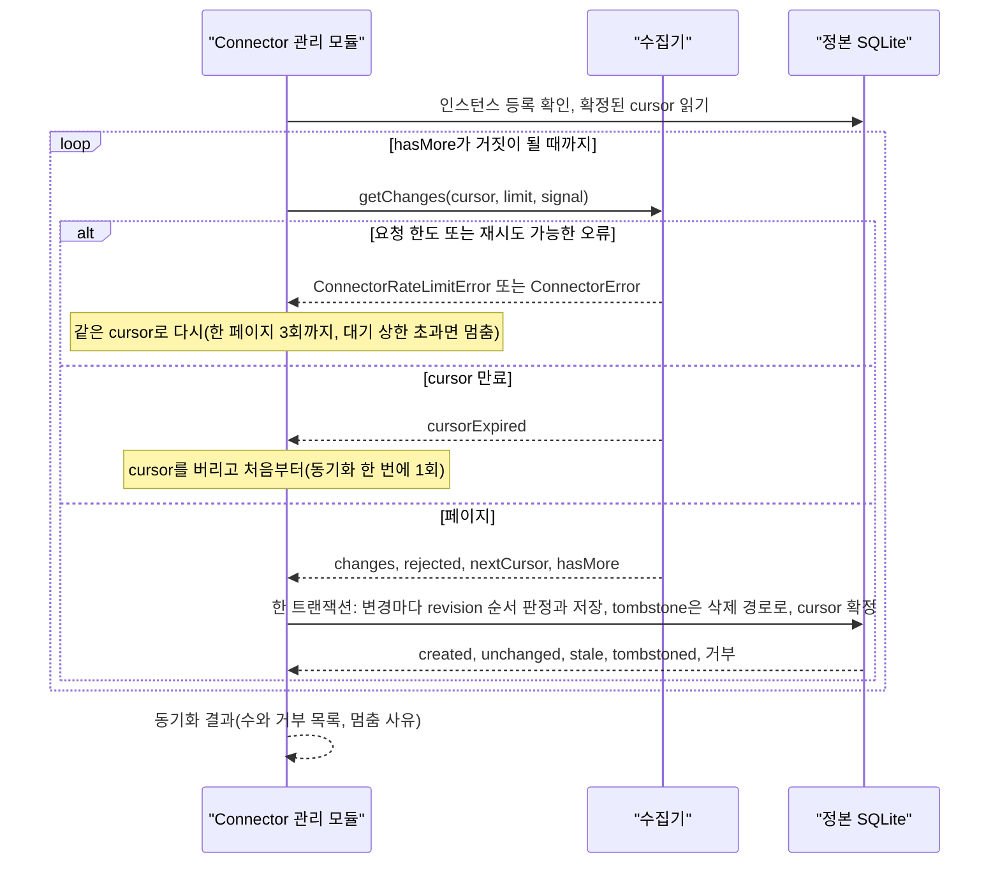
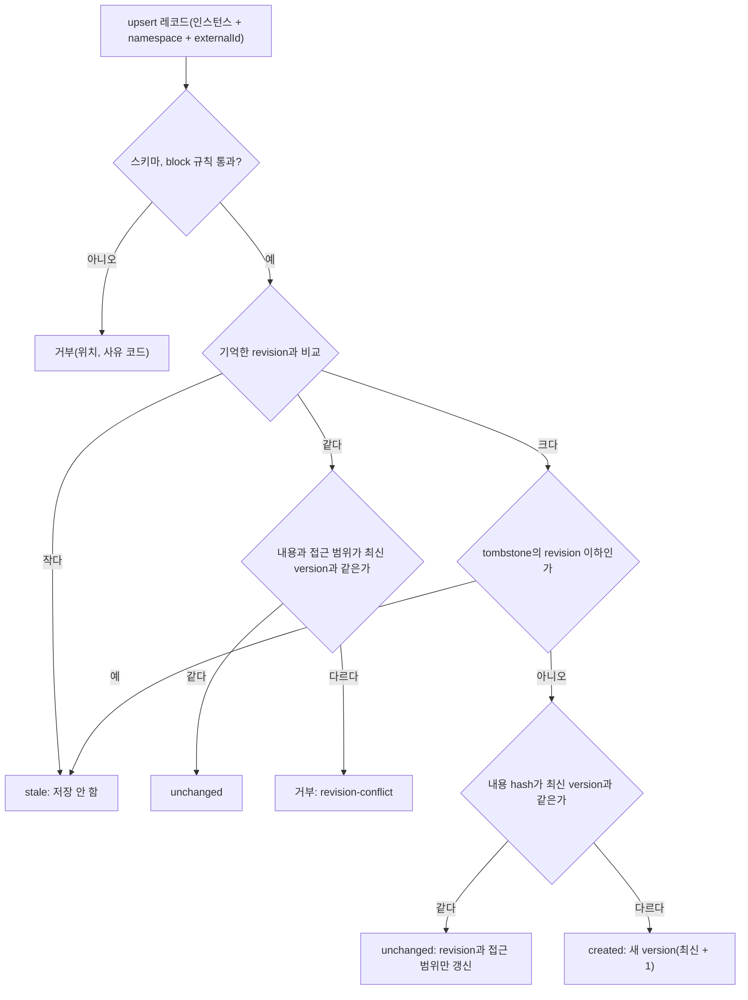
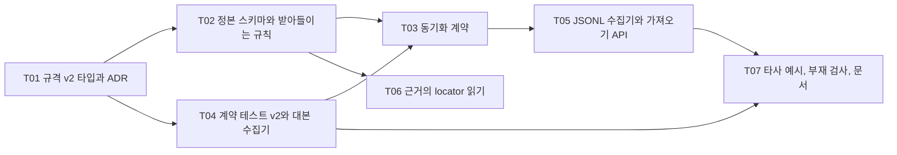

# 스펙: I01 Connector SDK, Source/Evidence 계약, JSONL·API 가져오기

- 날짜: 2026-11-21 / 상태: 초안
- 관련: 이슈 #18(I01), 총괄 #1, Phase 2 #4, 선행 #17(V02). 함께 진행 중인 [V01 spec](2026-11-21-V01-vertical-skeleton.md)·[V02 spec](2026-11-21-V02-vertical-slice.md), I02(#19)·I03(#20)·I04(#21). [ARCHITECTURE 5.5절·6~7절](../ARCHITECTURE.md), [ADR 0002](../adr/0002-authority-in-product-records.md)·[0012](../adr/0012-upstream-and-fork-ownership.md)·[0013](../adr/0013-failure-recovery.md)·[0014](../adr/0014-egress-policy-and-consent.md), [ownership.md](../ownership.md), [site-setup.md](../site-setup.md)

낯선 말은 [ARCHITECTURE 0절](../ARCHITECTURE.md#0-처음-나오는-말)에 풀이가 있다(정본, 계약 테스트, test double, tombstone, version fence, 변경 순번, 근거). 이 spec에서 새로 쓰는 말은 아래 표에 있다. `V01-…`·`V02-…`는 그 spec의 번호, `S…`는 site-setup.md의 체크리스트 번호다.

| 말 | 뜻 |
|---|---|
| SDK | 배포처 포크나 다른 개발자가 수집기(Connector)를 만들 때 따르는 규격 묶음. 타입(`@pki/contracts`), 규격을 지키는지 확인하는 계약 테스트(`@pki/testkit`), 사용 문서로 이루어진다. 실행되는 서버나 라이브러리가 아니다 |
| cursor | 수집기가 "여기까지 넘겼다"를 나타내는 표시. 제품은 내용을 해석하지 않고 그대로 보관했다가 다음에 돌려준다 |
| checkpoint | cursor를 정본에 확정해 저장하는 일. 받은 원본을 저장한 **뒤에만** 한다 |
| full rescan(전체 재스캔) | cursor를 버리고 처음부터 다시 받는 일. cursor가 만료되었을 때의 복구 방법이다 |
| capability(능력 선언) | 수집기가 자기가 할 수 있는 일(변경분만 주기, 삭제 사건 내기, 접근 범위 채우기, 전체 재스캔)을 미리 밝힌 값 |
| rate limit / backoff | rate limit은 원 시스템이 "잠시 뒤에 다시 오라"고 거절하는 것, backoff는 실패한 뒤 기다리는 시간을 점점 늘려 다시 시도하는 것 |
| namespace | 한 수집기 인스턴스 안에서 원본 식별자(external id)가 유일한 범위. 예: 위키 공간 하나, 편지함 하나. JSONL에서는 그 줄의 `connector_instance_id` 값이다 |
| revision | **원 시스템 쪽**의 개정 번호. 같은 원본에 대해 커질수록 새 것이다. 제품이 저장할 때 매기는 **version**(1, 2, 3…, V02-T02)과 다르다. 늦게 도착한 옛 revision을 가려내는 데 쓴다 |
| 역순 도착 | 같은 원본의 더 작은 revision이 더 큰 revision보다 늦게 도착하는 일 |
| block / locator | block은 정규화된 본문의 코드 포인트 구간 `[시작, 끝)` 하나를 원래 형식의 자리(PDF 쪽, DOCX 문단, XLSX 시트와 셀, CSV 레코드, HTML 요소 경로, 텍스트 줄)에 대응시킨 것. locator는 그 "원래 형식의 자리"다. 문서 정규화(I02)가 만든다 |

## 배경

V01은 Connector 규격의 첫 모양(`packages/contracts/src/connector.ts`)과 계약 테스트, 합성 자료를 내는 테스트 Connector를 만들었고, V02는 그 위에 JSONL 가져오기 하나를 붙여 수직 흐름을 증명한다. V02는 "Connector 규격의 확정과 SDK 문서화"를 이 작업으로 넘겼다(V02 비목표).

지금 규격으로는 실제 수집기를 만들 수 없다. 원본 레코드가 `externalId`, `title`, `body` 셋뿐이라 접근 범위(access_scope), 원 시스템의 개정 번호, 작성자·참여자·시각 같은 출처 정보를 실을 자리가 없다. 삭제·권한 철회 사건(`delete`, `access-revoked`)은 타입만 있고 저장 경로가 없다. 원 시스템의 요청 한도나 일시적 오류를 알릴 방법도 없고, 계약 테스트는 페이지 크기와 cursor의 기본 성질만 본다. 배포처 포크가 실제 메일·메신저·Wiki 수집기(S01~S04)를 만들기 전에 이 규격이 확정되어야 포크의 구현이 공용 저장소의 변경에 깨지지 않는다([ownership.md 7절](../ownership.md)).

문서 정규화(I02)는 PDF·DOCX·XLSX 같은 파일을 "정규화된 본문 + 구간별 원래 자리(block)"로 바꾸고, 그것을 원본 레코드와 근거에 싣는 방법은 이 작업에 맡겼다. 근거(Evidence)가 글자 위치뿐 아니라 "몇 쪽, 어느 시트의 어느 셀"까지 가리키게 하는 것이 이슈의 I01-C2다.

## 목표

- 배포처 포크가 `@pki/contracts`와 `@pki/testkit`만 보고 수집기를 만들 수 있고, 계약 테스트가 그 수집기의 규격 위반을 위반 종류별로 찾아낸다.
- 동기화가 중간에 끊기거나, cursor가 만료되거나, 원 시스템이 요청 한도로 거절해도 원본이 빠지거나 두 번 들어가지 않는다.
- 원본 레코드가 출처(수집기 인스턴스, namespace, 원 시스템의 revision, 작성자·시각)와 접근 범위를 싣고, 삭제·권한 철회 사건이 정본의 삭제 경로(V02-R12)로 이어진다.
- JSONL 파일과 로컬 가져오기 API가 같은 규칙으로 동작한다: 형식이 틀린 레코드는 그 레코드만 거부되어 위치가 보고되고, 같은 것을 다시 넣어도 늘지 않고, 늦게 온 옛 revision은 최신을 덮지 않으며, 내용이 같아도 출처가 다른 원본은 합쳐지지 않는다.
- 근거가 변하지 않는 원본 version과 코드 포인트 구간을 가리키고, 그 version에 block이 있으면 원래 형식의 자리(쪽, 문단, 시트와 셀, 요소 경로, 줄)까지 알려 준다.
- 공용 저장소에는 실제 메일·메신저·Wiki 클라이언트가 없다는 것을 테스트가 확인한다.

## 비목표 (배포처에서 후속 진행)

**공용 저장소의 뒤 작업으로 넘기는 것**

- PDF·DOCX·XLSX·CSV·HTML 등 파일의 파싱과 정규화, 폴더 감시, 첨부 저장, 스레드·댓글 순서 복원: I02(#19). 이 spec은 I02가 만든 block을 원본 레코드에 싣는 **자리**와 근거에서 읽는 **규칙**만 정한다.
- 주기적 동기화(스케줄), 동기화 사이의 재시도·dead-letter(끝내 실패한 작업을 따로 모아 두기), 여러 수집기의 동시 실행, 우선순위, 절전 복구: I03(#20). 이 spec의 재시도는 **동기화 한 번 안에서** 한 페이지를 다시 받는 것뿐이다.
- 삭제·권한 철회의 파생 지식 전파, tombstone 보존 기간, 삭제한 원본의 복원, tombstone 뒤에 온 더 큰 revision을 받을지의 사유별 정책(출처 삭제·철회, 사용자 삭제): I04(#21). 이 spec은 사건을 받아 V02-R12의 삭제 경로에 넘기고, I04가 그 판정에 쓸 출처의 순서 값(`revision`)을 정본에 남기는 데서 멈춘다.
- 전체 재스캔에서 "안 보이는 원본"을 삭제로 추정하는 일: **어느 작업에서도 하지 않는다**(I01이 정한다). 재스캔이 한 원본을 돌려주지 않은 이유가 삭제인지, 권한 범위·필터·원 시스템의 일시적 누락인지 제품이 가를 수 없고, 잘못 추정하면 되돌릴 수 없는 삭제가 된다. 삭제를 알 수 있는 수집기는 `deletes`를 참으로 선언하고 tombstone 사건을 명시적으로 낸다. 폴더 감시의 맞춰 보기(I02-C3)는 파일 시스템이 부재를 직접 확인할 수 있으므로 이 줄의 대상이 아니다.
- 다른 프로세스(사용자가 만든 스크립트 등)가 가져오기 API를 부를 수 있게 하는 별도 자격 증명: 후속 이슈 필요(아래 미해결 질문 7). 이 spec의 API는 기존 API와 같은 인증으로 화면과 테스트가 쓴다.
- 원본의 출처 정보(작성자, 참여자 등)를 Provider로 보내는 일: 하지 않는다. Provider로 가는 필드는 제목과 본문뿐이다([ADR 0014](../adr/0014-egress-policy-and-consent.md)).
- V01 규격(schemaVersion 1)으로 만든 수집기를 계속 받아 주는 호환 층: 두지 않는다. 지금 v1 구현은 공용 저장소의 테스트 Connector와 미구현 표시뿐이고 이 작업에서 함께 옮긴다. 포크의 실제 수집기는 아직 없다(S01~S03 미착수).

**배포처 후속 항목**(1개. [site-setup.md의 배포처 설정 체크리스트](../site-setup.md#배포처-설정-체크리스트)와 번호로 대응한다. S16·S17은 I02, S19 이후는 I03·I04가 쓰기로 조정했다)

| 번호 | 항목 |
|---|---|
| S18 | 실제 수집기로 SDK v2 계약 판정과 실제 동기화를 실행하고 기록(요청 한도, cursor 만료, 대량 페이지, access_scope 채우기) |

실제 메일·메신저·Wiki 수집기의 구현과 인증·권한 매핑 자체는 이미 S01~S04(V01)가 갖고 있으므로 여기서 다시 세지 않는다. S18은 그 수집기가 이 spec의 규격 v2를 실제 원 시스템을 상대로 지키는지를 배포처에서만 확인할 수 있어서 따로 둔다.

## 요구사항

**규격과 버전**

- **I01-R1 규격 버전.** Connector 규격의 버전 `CONNECTOR_SDK_VERSION = 2`를 `@pki/contracts`에 둔다. 수집기의 `manifest.schemaVersion`은 자기가 구현한 규격 버전이다. Connector 관리 모듈은 지원하는 버전(2)이 아닌 수집기를 초기화하지 않고 상태를 `unavailable`(사유 코드 `unsupported-sdk-version`)로 둔다. 호환이 깨지는 변경이므로 새 ADR에 바뀐 점과 포크가 옮겨 가는 방법을 적는다([ownership.md 7절](../ownership.md)). 계약 테스트는 규격과 같은 PR에서 바뀐다.
- **I01-R2 Connector의 메서드.** 수집기는 `initialize`, `healthCheck`, `getChanges`, `getDocument`를 구현한다. 이슈 C1의 `sync`는 수집기의 메서드가 아니라 **Connector 관리 모듈의 동기화 계약**이다([ARCHITECTURE 5.5절](../ARCHITECTURE.md)이 이미 그렇게 옮겼다). `healthCheck`는 예외를 던지지 않고 `ok` 또는 `unavailable`(사유)을 돌려준다. `getDocument`는 `{namespace, externalId}`로 그 원본의 가장 최근 revision을 돌려주고, 모르거나 삭제된 원본이면 `null`이다. 초기화 전에 부른 `getChanges`·`getDocument`는 실패한다.
- **I01-R3 능력 선언.** `capabilities`는 V01의 넷(`incremental`, `deletes`, `accessScope`, `fullRescan`)을 그대로 둔다. 선언과 행동이 맞아야 한다: `deletes`가 거짓이면 삭제·철회 사건을 내지 않는다. `accessScope`가 참이면 모든 upsert 레코드에 비어 있지 않은 `accessScope`가 있고, 거짓이면 그 필드가 없다. `incremental`이 참이면 마지막 cursor로 다시 물었을 때 새 변경이 없다.
- **I01-R4 실패의 종류.** 수집기는 실패를 두 오류로 알린다: `ConnectorError`(다시 시도해도 되는지 `retryable`)와 `ConnectorRateLimitError`(기다릴 시간 `retryAfterMs`). 미구현 표시의 `ConnectorNotImplementedError`는 그대로 둔다. 관리 모듈은 수집기 오류의 **문구를 API 응답, 동기화 결과, 로그에 옮기지 않고** 사유 코드만 남긴다(문구에 원 시스템의 내용이 섞일 수 있다. V01 Broker와 같은 규칙).

**원본 레코드와 변경**

- **I01-R5 원본 레코드 v2.** 수집기가 내는 `SourceRecord`는 엄격한 스키마(모르는 필드는 거부)이며 다음을 갖는다.
  - 정체: `namespace`(빈 문자열 허용, 그 인스턴스에 범위가 하나뿐이면 빈 문자열), `externalId`.
  - 순서: `revision`(1 이상의 정수. 같은 `namespace + externalId`에서 원 시스템이 새로 고칠 때마다 커진다).
  - 형식 버전: `schemaVersion`(정수 2. `manifest.schemaVersion`과 같아야 한다).
  - 내용: `title`, `body`(정규화된 본문), 선택 `blocks`(I01-R7).
  - 접근 범위: 선택 `accessScope`(문자열 배열. I01-R3의 규칙).
  - 출처 정보(모두 선택): `sourceType`, `sourceUrl`, `author`, `participants`, `threadId`, `createdAt`, `updatedAt`(UTC 오프셋이 붙은 ISO-8601), `metadata`(문자열 키의 객체).
  - **수집기 인스턴스 ID는 레코드에 없다.** 관리 모듈이 동기화하는 인스턴스의 ID를 붙인다. 레코드가 자기 인스턴스를 주장할 수 있으면 다른 인스턴스의 원본으로 끼어들 수 있기 때문이다.
  - **데이터 등급, 합성 여부, 악성 표시를 실을 필드가 없다.** 스키마가 거부한다. 등급은 Broker가 정본에서 계산한다([ADR 0014](../adr/0014-egress-policy-and-consent.md)). `namespace`, `metadata`, `accessScope`의 어떤 값도 등급이나 합성 판정에 쓰이지 않는다.
- **I01-R6 변경과 tombstone 사건.** `Change`는 `upsert`(레코드 하나) 또는 tombstone 사건(`kind`가 `delete` 또는 `access-revoked`, `namespace`, `externalId`, `revision`, `at`)이다. tombstone 사건에는 내용이 없다. `ChangeSet`은 V01의 `changes`, `nextCursor`, `hasMore`, `cursorExpired`에 `rejected`(수집기가 스스로 걸러 낸 항목의 위치와 사유 코드 목록, 기본 빈 목록)를 더한다. 위치는 수집기가 정하는 짧은 표시(예: `line:12`)이며 **내용을 담지 않는다.**
- **I01-R7 block.** `blocks`는 본문의 코드 포인트 구간 `[start, end)`과 locator의 목록이다. 구간은 정수, `0 ≤ start < end ≤ 본문의 코드 포인트 수`, `start` 순으로 정렬되고 서로 겹치지 않는다(빈틈은 허용). 어긋나면 그 레코드를 거부한다. locator는 **I02의 위치표를 그대로** 쓴다([I02 spec "위치표의 모양"](2026-11-21-I02-document-normalization.md#위치표의-모양), I02 세션과 합의). `format`으로 가르는 구별 합집합이며 필드 이름과 번호의 기준까지 같다.

  | `format` | 필드 | 번호의 기준 |
  |---|---|---|
  | `pdf` | `page` | 쪽 1부터 |
  | `docx` | `paragraph`, 선택 `style`, 선택 `headingLevel`, 선택 `table: { index, row, cell }` | 문단(빈 문단 포함)·표·행·칸 0부터 |
  | `xlsx` | `sheet`, 선택 `cell`(A1 형식), 선택 `row`, 선택 `column` | 행·열 1부터. 시트 이름 블록은 `cell`이 없다 |
  | `csv` | `record`, `line`(레코드가 시작하는 원문의 줄), `field` | 모두 1부터 |
  | `html` | `path`(요소 경로, 예: `body>div[1]>p[2]`), `line` | 형제 번호와 줄 1부터 |
  | `markdown` | `line`, `node`(노드 종류), 선택 `depth`(제목 수준) | 줄 1부터 |
  | `txt`, `json` | `line` | 줄 1부터 |

  I02가 이 모양을 바꾸면 I01의 스키마도 같은 PR 묶음에서 바꾼다(한쪽만 바뀌면 I02-B의 옮기기 테스트가 실패한다).

  메일·메신저·Wiki 글처럼 원래 자리가 따로 없는 원본은 `blocks`가 없고, 근거는 코드 포인트 구간만 갖는다.

**정본에 받아들이는 규칙**

- **I01-R8 원본의 정체와 provenance.** 원본의 정체는 `connector_instance_id + namespace + externalId`이다. 이 셋 중 하나라도 다르면 내용(content hash)이 같아도 **다른 원본**이며, 각자의 접근 범위, revision, 출처 정보, version, 근거를 따로 갖는다. content hash는 **한 원본 안에서** 새 version을 만들지 판단하는 데만 쓴다(V01-R7, [ARCHITECTURE 5.5절](../ARCHITECTURE.md)).
- **I01-R9 revision 순서.** 원본마다 받아들인 가장 큰 revision을 정본에 기억한다(tombstone 사건 포함, 삭제 뒤에도 남는다). upsert 하나는 다음 차례로 판정한다.
  1. revision이 기억한 값보다 작다 → **옛것**(`stale`): 저장하지 않는다. 오류가 아니다.
  2. revision이 기억한 값과 같다: 내용과 접근 범위가 최신 version과 같으면 `unchanged`, 다르면 **revision 충돌**(`revision-conflict`)로 그 레코드를 거부한다.
  3. revision이 더 크다: 그 원본에 tombstone이 있으면 tombstone의 revision 이하는 막는다(V02-R12). 그보다 큰 revision을 받을지는 tombstone의 사유에 따른 I04의 정책이 정한다(I04 초안: 출처의 삭제·철회 뒤에는 더 큰 revision을 "출처가 다시 만든 원본"으로 받고, 사용자 삭제 뒤에는 모두 막는다). 출처 사건으로 생긴 tombstone은 그 사건의 revision을 갖고, 화면의 사용자 삭제로 생긴 tombstone은 출처의 revision이 없으므로 그때까지 기억한 revision을 적는다. 내용(제목, 본문, block)의 hash가 최신 version과 같으면 새 version을 만들지 않고(`unchanged`) revision과 접근 범위만 갱신한다. 다르면 새 version을 만든다(`created`. version 번호는 V02-T02의 규칙대로 최신 + 1).

  tombstone 사건은 revision이 기억한 값보다 작으면 `stale`로 버리고, 같거나 크면 받아들여 V02-R12의 삭제 경로에 넘긴다. 정본에 없던 원본에 대한 tombstone 사건도 원본 행과 tombstone을 남겨, 나중에 도착한 옛 upsert가 되살아나지 않게 한다. 한 페이지 안의 역순, 페이지 사이의 역순, 동기화 사이의 역순은 같은 규칙이다.
- **I01-R10 version에 딸린 것.** 본문, 제목, block, 출처 정보, 레코드의 `schemaVersion`, revision은 **원본 version**에 붙어 저장되고 version과 함께 바뀌지 않는다. 원본 행에는 정체(인스턴스, namespace, external id), 기억한 revision, 현재 접근 범위만 남는다. 그래서 V02-R12의 삭제가 version을 지우면 작성자와 참여자 같은 출처 정보도 함께 지워진다. 접근 범위는 정규화(중복 제거, 정렬)한 JSON 배열로 V01의 `sources.access_scope` 열에 둔다.
- **I01-R11 부분 실패.** 레코드 단위 실패와 페이지 단위 실패를 나눈다.
  - 레코드 단위: 스키마 위반, revision 충돌, block 위반, (JSONL) 줄 형식 오류는 그 레코드만 거부하고 위치와 사유 코드를 동기화 결과에 남긴다. 나머지 레코드는 저장되고 cursor는 그 페이지 뒤로 확정된다. 거부 목록에는 필드의 값을 넣지 않는다.
  - 페이지 단위: `ChangeSet`의 겉모양(`changes`, `nextCursor`, `hasMore`)이 스키마에 맞지 않거나 저장 트랜잭션이 실패하면 그 페이지의 어느 것도 저장되지 않고 cursor는 그대로다. 같은 동기화를 다시 돌리면 같은 결과가 된다(멱등).

**동기화 계약(Connector 관리 모듈)**

- **I01-R12 페이지와 checkpoint.** 관리 모듈은 `getChanges`를 `limit`(기본 100)으로 반복해 부르고, 한 페이지의 저장과 다음 cursor의 확정을 **한 트랜잭션**으로 한다(V01, [ADR 0013](../adr/0013-failure-recovery.md) 결정 1). 수집기는 `limit`보다 많이 돌려주지 않는다. `hasMore`가 참인데 `nextCursor`가 그대로면 진행 없음(`no-progress`)으로 멈춘다. 취소 신호(`AbortSignal`)가 오면 확정된 페이지까지 남기고 멈추며, 다음 동기화는 그 cursor에서 이어진다.
- **I01-R13 cursor 만료와 전체 재스캔.** `cursorExpired`가 오면 cursor를 버리고 처음부터 다시 받는다. 동기화 한 번에 전체 재스캔은 한 번뿐이고, 재스캔 중에 다시 만료되면 `cursor-expired`로 멈춘다(V01의 동작을 규격으로 고정한다). 재스캔으로 다시 받은 원본은 I01-R9로 걸러져 늘지 않는다. `fullRescan`이 거짓인 수집기가 만료를 알리면 재스캔하지 않고 `cursor-expired`로 멈춘다.
- **I01-R14 요청 한도와 backoff.** 같은 cursor로 한 페이지를 다시 받는 재시도는 동기화 한 번 안에서 다음 값으로 한다(잠정, 값은 한 상수에 둔다): `ConnectorRateLimitError`는 `retryAfterMs`만큼(상한 60초) 기다린다. 상한을 넘는 대기를 요구하면 기다리지 않고 `rate-limited`로 멈춘다. `retryable`인 `ConnectorError`는 1초부터 두 배씩(상한 30초) 기다린다. 한 페이지의 시도는 모두 3회까지다. 재시도할 수 없는 오류나 횟수 초과는 `connector-error`로 멈춘다. 어느 경우든 cursor는 마지막으로 확정된 값에 남는다. 기다리는 시간은 주입한 시계로 재며 테스트는 실제로 기다리지 않는다. 동기화 사이의 재시도와 일정은 I03이다.
- **I01-R15 동기화 결과.** 동기화 결과에는 받은 변경 수, `created`, `unchanged`, `stale`, `tombstoned`, 거부 목록(위치, 사유 코드), 멈췄다면 멈춘 사유 코드가 들어간다. 사유 코드는 닫힌 목록이다(거부: `invalid-json`, `schema`, `content-hash-mismatch`, `revision-conflict`, `invalid-blocks`. 멈춤: `unsupported-sdk-version`, `invalid-page`, `no-progress`, `cursor-expired`, `rate-limited`, `connector-error`, `aborted`).

**JSONL과 로컬 가져오기 API**

- **I01-R16 JSONL 형식 v1.** 한 줄은 V02-T01의 `ImportRecordSchema`(R05 골든 데이터의 모양, `schema_version` `"1"`)를 따른다. 이 spec은 줄 형식을 바꾸지 않는다. 줄은 다음처럼 옮긴다: `connector_instance_id` → `namespace`, `external_id` → `externalId`, `version` → `revision`, `content` → `body`, `access_scope` → `accessScope`, 나머지 출처 필드는 같은 이름의 camelCase, `operation`의 `upsert`/`delete`/`revoke` → `upsert`/`delete`/`access-revoked`(V02-R2). `id`와 `content_hash`는 레코드에 싣지 않는다. `content_hash`가 `content`의 sha256과 다르면 그 줄을 `content-hash-mismatch`로 거부한다. `malicious` 표시는 싣지 않는다(V02 "T01이 넘기는 것" 2). JSON으로 읽을 수 없는 줄은 `invalid-json`, 스키마에 맞지 않는 줄은 `schema`이며 위치는 `line:<줄 번호>`(1부터)다.
- **I01-R17 JSONL 수집기.** 종류 `jsonl-import`인 수집기가 설정의 파일 하나를 읽는다. cursor는 `<파일 내용의 sha256>:<넘긴 줄 수>`이며, 파일 내용이 바뀌어 hash가 다르면 `cursorExpired`를 알린다(그래서 고친 파일을 다시 넣으면 전체 재스캔이 되고 I01-R9가 중복을 거른다). 능력은 `incremental`, `deletes`, `accessScope`, `fullRescan` 모두 참이다(`accessScope`가 참이므로 줄의 `access_scope`가 빈 배열이면 그 줄을 `schema`로 거부한다). 레코드의 `schemaVersion`은 2다(JSONL 줄의 `schema_version` `"1"`은 **파일 형식**의 버전이고 레코드 규격의 버전과 따로 오른다).
- **I01-R18 로컬 가져오기 API.** `POST /api/imports`가 `{ instanceId, content }`(JSONL 텍스트)를 받아 I01-R16과 같은 해석, I01-R9~R11과 같은 저장 규칙으로 처리하고 I01-R15의 결과를 돌려준다. 기존 API와 같은 경로표(`@pki/contracts`의 `routes`), 같은 인증(토큰, loopback, 허용 Origin)을 쓴다. `instanceId`가 처음이면 종류 `jsonl-import`로 등록하고, 이미 다른 종류로 등록되어 있으면 거부한다(V01의 `registerConnectorInstance`). 본문 크기 상한을 둔다(잠정 10 MiB, 넘으면 413). 요청 하나는 한 페이지로 다루어 한 트랜잭션에 저장한다. 파일 수집기와 API는 **같은 해석 함수와 같은 저장 함수**를 쓴다.

**검증 수단과 문서**

- **I01-R19 계약 테스트 v2.** `@pki/testkit`이 두 가지를 낸다: ① `checkConnector(create, scenario)` — 수집기를 돌려 보고 규격 위반을 위반 코드의 목록으로 돌려준다(테스트 프레임워크와 무관) ② `connectorContract(name, create, scenario)` — ①을 vitest 묶음으로 감싼 것. `scenario`는 최소한 초기화 설정 하나를 갖고, 선택으로 "나중 상태" 설정(원 시스템이 바뀐 뒤)을 갖는다. 묶음이 보는 것: manifest와 규격 버전, 초기화 뒤 healthy, 초기화 전 실패, `limit` 준수, 페이지 크기와 무관한 같은 결과, 정체마다 한 번, 진행 없는 `hasMore` 금지, 마지막 cursor 뒤 변경 없음(incremental), 레코드 스키마와 `schemaVersion`, 능력 선언과 행동의 일치(I01-R3), revision이 1 이상, block 규칙, `getDocument`의 일치와 `null`, 취소된 신호의 거부, "나중 상태"가 있으면 이전 cursor에서 이어 받거나 만료를 알리고 재스캔했을 때 바뀐 원본의 revision이 커졌는지와 삭제가 tombstone 사건으로 나오는지(`deletes`가 참일 때). 미구현 표시에 돌리면 위반 대신 `not-implemented` 하나를 돌려준다.
- **I01-R20 테스트 Connector와 대역.** 공용 저장소의 수집기(`test-fixtures`, `jsonl-import`, `site-*` 미구현 표시)를 규격 v2로 옮기고 모두 계약 테스트를 돈다. 관리 모듈의 동기화를 시험하려고, 정해 둔 페이지·오류·요청 한도·만료·역순·tombstone을 차례로 내는 대본 수집기(test double)를 `@pki/testkit`에 둔다. 제품 구성에는 들어가지 않는다(V01-T07의 경계 규칙).
- **I01-R21 타사 수집기 예시.** `packages/connector-example/`에 공개 진입점(`@pki/contracts`, `@pki/testkit`)만 의존하는 작은 수집기 패키지를 둔다(비공개, 제품 구성에 없음). 지어낸 메모리 자료를 내며, 자기 테스트에서 `connectorContract`를 돈다. 포크가 `site/connectors/` 안에서 할 일과 같은 모양이다. 일부러 규격을 어긴 변형 셋(진행 없는 cursor, 능력 선언과 다른 삭제 사건, 초기화 전 응답)에 `checkConnector`를 돌리면 각각 기대한 위반 코드가 나온다.
- **I01-R22 실제 클라이언트 부재.** 제품 구성의 수집기 종류가 정확히 `test-fixtures`, `jsonl-import`, `site-mail`, `site-messenger`, `site-wiki`이고, `site-*`는 초기화하면 `미구현, 배포처 후속`으로 실패한다(V01-R18). 공용 저장소의 수집기 구현 파일은 네트워크 모듈(`node:net`, `node:http`, `node:https`, `node:tls`, `node:dgram`)과 전역 `fetch`를 쓰지 않는다. 둘 다 테스트가 확인한다.
- **I01-R23 근거의 위치 읽기.** 근거를 읽는 정본 함수와 API 응답은 근거마다 원본 version, 코드 포인트 구간, 인용문, 그리고 그 version에 block이 있으면 **구간의 시작이 들어 있는 block의 locator**를 돌려준다. locator는 근거 행에 따로 저장하지 않고 version의 block에서 읽을 때 계산한다(근거의 기준은 언제나 version과 코드 포인트 구간이고, locator는 보여 주기 위한 값이다). 시작이 어느 block에도 없으면 locator는 null이다.
- **I01-R24 문서.** SDK 사용 문서 `docs/connector-sdk.md`를 쓴다: 규격, 정본에 받아들이는 규칙(I01-R8~R11), 동기화 계약, 오류와 재시도, 계약 테스트 돌리는 법, 자격 증명은 OS 자격 증명 저장소에 두고 레코드·설정 파일·로그에 넣지 않는다는 규칙, 포크가 v1에서 옮기는 법(ADR을 가리킴). [site-setup.md](../site-setup.md)의 `## 배포처 설정 체크리스트`에 S18을 더하고 그 절의 번호 범위 안내에 이 spec을 더한다(제목은 그대로 둔다). 문서 대응 테스트(`tooling/docs/site-setup.test.ts`)에 이 spec을 더한다. README에는 한 줄과 링크만 둔다. ARCHITECTURE 5.5절의 스케치를 v2로 고친다.

## 인터페이스 / 설계 개요

### 규격 v2의 모양(잠정, I01-T01에서 확정)

```typescript
export const CONNECTOR_SDK_VERSION = 2;

type NativeLocator =                    // I02 spec "위치표의 모양"과 같다
  | { format: "pdf"; page: number }
  | { format: "docx"; paragraph: number; style?: string; headingLevel?: number;
      table?: { index: number; row: number; cell: number } }
  | { format: "xlsx"; sheet: string; cell?: string; row?: number; column?: number }
  | { format: "csv"; record: number; line: number; field: number }
  | { format: "html"; path: string; line: number }
  | { format: "markdown"; line: number; node: string; depth?: number }
  | { format: "txt" | "json"; line: number };
type Block = { start: number; end: number; locator: NativeLocator }; // 본문의 코드 포인트 [start, end)

interface SourceRecord {               // 엄격: 모르는 필드는 거부. 등급·합성·악성 필드 없음
  namespace: string; externalId: string; revision: number; schemaVersion: 2;
  title: string; body: string; blocks?: Block[];
  accessScope?: string[];
  sourceType?: string; sourceUrl?: string; author?: string; participants?: string[];
  threadId?: string; createdAt?: string; updatedAt?: string; metadata?: Record<string, unknown>;
}
type Change =
  | { kind: "upsert"; record: SourceRecord }
  | { kind: "delete" | "access-revoked"; namespace: string; externalId: string; revision: number; at: string };
interface ChangeSet { changes: Change[]; nextCursor: string; hasMore: boolean; cursorExpired?: boolean;
                      rejected?: { at: string; code: RejectCode }[] }

interface Connector {
  readonly manifest: { type: string; schemaVersion: number;
                       capabilities: { incremental: boolean; deletes: boolean; accessScope: boolean; fullRescan: boolean } };
  initialize(config: unknown): Promise<void>;
  healthCheck(): Promise<HealthStatus>;                       // 던지지 않는다
  getChanges(cursor: string | null, opts: { limit: number; signal: AbortSignal }): Promise<ChangeSet>;
  getDocument(ref: { namespace: string; externalId: string }): Promise<SourceRecord | null>;
}
// 실패: ConnectorError(retryable), ConnectorRateLimitError(retryAfterMs), ConnectorNotImplementedError

interface EvidenceView {               // 읽기 전용. 저장은 V02의 근거 행 그대로
  sourceVersionId: number; version: number; span: { start: number; end: number }; quote: string;
  locator: NativeLocator | null;
}
```

V01과 달라지는 점: 레코드의 필드가 늘었다(정체에 `namespace`, 순서에 `revision`, 형식 버전, block, 접근 범위, 출처 정보). tombstone 사건의 `version`이 `revision`이 되고 `namespace`가 붙었다. `ChangeSet`에 `rejected`가 생겼다. `getDocument`가 `namespace`를 받는다. 오류 두 종류가 생겼다.

### 동기화 한 번의 흐름

I01-R12~R14를 합친 것이다. 페이지 저장과 cursor 확정이 같은 트랜잭션이라는 것, 재시도와 재스캔이 어디로 되돌아가는지가 핵심이다.



### upsert 하나를 받아들이는 판정

I01-R9를 그린 것이다. 저장 함수가 이 순서로 판정하며, 같은 함수를 수집기 동기화와 가져오기 API가 함께 쓴다.



### 정본 스키마의 변경(잠정, 마이그레이션 번호는 V02 머지 뒤 다음 번호)

| 테이블 | 바뀌는 것 |
|---|---|
| `sources` | `namespace`(NOT NULL, 기존 행은 빈 문자열), `last_revision`(받아들인 가장 큰 revision). 유일 키가 `(connector_instance_id, namespace, external_id)`로 바뀐다(재생성) |
| `source_versions` | `revision`, `record_schema_version`, `meta`(출처 정보 JSON), `blocks`(JSON). 기존 행의 `revision`은 그 행의 `version`, `record_schema_version`은 1 |
| `evidence` | 바뀌지 않는다. locator는 읽을 때 계산한다(I01-R23) |

content hash는 제목, 본문, block을 묶어 계산한다(block이 없으면 지금 값과 같도록 기존 계산을 유지한다. 합성 목록의 hash는 제목과 본문만 쓰므로 바뀌지 않는다). 출처 정보만 바뀐 레코드는 새 version을 만들지 않는다.

### 작업 분해

한 작업이 PR 하나다. **이 표는 잠정이며 V02 머지 뒤 조정자가 다시 맞춘다**(아래 "V02 머지 후 재확인").



| ID | 내용 | 요구사항 | 기준 | 선행 | 테스트 |
|---|---|---|---|---|---|
| I01-T01 | `@pki/contracts`의 규격 v2(레코드, 변경, `ChangeSet.rejected`, block과 locator, 오류 두 종류, `CONNECTOR_SDK_VERSION`, `EvidenceView`), 새 ADR(규격 v2와 포크의 이전 방법), ARCHITECTURE 5.5절 스케치 갱신 | R1, R2, R4~R7, R24(ADR·ARCHITECTURE) | C1(버전), C2(필드) | **V02-T04**(V02의 JSONL 수집기가 v1 규격 위에서 먼저 머지되어야 함께 옮길 수 있다) | 스키마 단위 테스트: 모르는 필드·등급 필드 거부, `schemaVersion` 불일치 거부, block 규칙(겹침, 범위 밖, 정렬, 코드 포인트), I02 위치표의 형식 여덟 가지와 I02 fixture 결과의 통과 |
| I01-T02 | 정본 마이그레이션(위 표), upsert·tombstone 사건의 받아들이는 함수(I01-R8~R11), tombstone 사건을 V02-R12의 삭제 경로에 넘김 | R8~R11 | C2(정체·provenance), C3(중복·역순·부분 실패) | I01-T01, **V02-T02**, **V02-T08** | 이전 스키마에서 올리는 마이그레이션 테스트, 판정 그림의 갈래마다 단위 테스트, 같은 내용·다른 namespace가 두 원본으로 남는 테스트, 삭제 뒤 출처 정보가 파일에 남지 않는 카나리 테스트 |
| I01-T03 | 관리 모듈의 동기화 v2: 규격 버전 검사, 레코드 단위 검증과 거부, 페이지 트랜잭션과 checkpoint, 재스캔 1회, 요청 한도와 backoff(주입한 시계), 취소, 결과와 사유 코드, 오류 문구를 옮기지 않음 | R1, R4, R12~R15 | C1 | I01-T02, I01-T04 | 대본 수집기로 각 경우의 통합 테스트(아래 기준별 표) |
| I01-T04 | `@pki/testkit`의 `checkConnector`·`connectorContract` v2와 대본 수집기, `test-fixtures`와 `site-*` 미구현 표시를 v2로 옮김 | R3, R19, R20 | C1(계약), C4(suite) | I01-T01 | 공용 수집기들이 묶음 통과, 미구현 표시가 `not-implemented` 하나 |
| I01-T05 | JSONL 해석 함수(I01-R16), `jsonl-import` 수집기(V02-T04의 구현을 v2로 옮기고 이름을 맞춤), `POST /api/imports`, 골든 데이터와 V02 fixture의 가져오기 | R16~R18 | C3 | I01-T03, **V02-T04**, **V02-T01** | JSONL 계약 테스트 묶음(아래 C3 행), API 인증·크기 상한 테스트, 수집기와 API가 같은 결과를 내는 테스트 |
| I01-T06 | 근거를 읽는 정본 함수와 API 응답의 locator(I01-R23) | R23 | C2(span·page·sheet) | I01-T02, **V02-T05**(근거 행을 쓰는 곳), **V02-T10**(근거 API) | locator 형식 여덟 가지와 block 없음, 시작이 빈틈에 있을 때 null, 새 version 뒤에도 지난 근거가 이전 version의 block으로 계산됨 |
| I01-T07 | 타사 수집기 예시 패키지와 위반 변형 셋, 제품 수집기 종류와 네트워크 모듈 부재 검사, `docs/connector-sdk.md`, site-setup S18과 문서 대응 테스트, README 한 줄 | R21, R22, R24 | C4, H1, H2 | I01-T04, I01-T05 | 예시가 묶음 통과, 위반 변형마다 기대 코드, 부재 검사의 빨간 변이(네트워크 import를 넣으면 실패), `docs.site-setup` |

## 완료 기준 (테스트 가능한 형태)

C1~C4는 이슈 #18의 문장 그대로다. H1·H2는 배포처로 넘어가는 프로젝트의 spec 양식이 요구하는 두 기준이며 이 spec에만 둔다.

- [ ] **I01-C1** (R1~R4, R12~R15, R19): initialize/sync/getChanges/getDocument/healthCheck와 capability, cursor checkpoint, rate/backoff, pagination, full-rescan 계약을 버전 관리한다. cursor는 durable 저장 뒤에만 확정하고 cursor 만료는 full-rescan으로 복구한다.
- [ ] **I01-C2** (R5~R10, R23): SourceRecord 필드에 connector_instance_id·source namespace·operation/tombstone·schema_version·access_scope를 보강한다. Evidence는 immutable source version과 span/page/sheet를 가리킨다.
- [ ] **I01-C3** (R8, R9, R11, R16~R18): JSONL/Local Ingestion API에서 스키마 오류/중복/역순/부분실패를 계약 테스트한다. 동일 content라도 원본 identity/권한/provenance를 합치지 않는다.
- [ ] **I01-C4** (R19~R22): 타사 connector fixture가 계약 suite를 실행할 수 있고 실제 메일·메신저·Wiki client는 공용 구현에 없다.
- [ ] **I01-H1** (R24): 이 spec의 "배포처 후속 항목" 1개(S18)에 대해 site-setup.md의 `## 배포처 설정 체크리스트` 아래에 같은 번호의 항목이 정확히 한 번 있고 그 절의 이 spec 번호 범위 안 항목 수가 1이면 통과하고, 없거나 수가 다르면 문서 대응 테스트가 실패한다.
- [ ] **I01-H2** (R19, R22): `site-mail`, `site-messenger`, `site-wiki` 각각에 대해 ① `site-check`가 `미구현, 배포처 후속`을 출력하고 0이 아닌 값으로 끝나고 ② `checkConnector`가 위반 대신 `not-implemented` 하나를 돌려준다(종류마다 2건, 모두 6건).

**기준을 읽는 법**

- **C1의 `sync`**: 수집기의 메서드가 아니라 관리 모듈의 동기화 계약으로 충족한다(I01-R2). "버전 관리"는 `CONNECTOR_SDK_VERSION`, 지원하지 않는 버전의 거부, ADR의 이전 방법, 같은 PR에서 바뀌는 계약 테스트다.
- **C2의 `connector_instance_id`**: 수집기가 레코드에 적는 필드가 아니라 관리 모듈이 동기화하는 인스턴스에서 붙여 **저장된 원본**이 갖는 값이다(I01-R5). JSONL 줄의 `connector_instance_id`는 `namespace`가 된다(I01-R16). **`operation/tombstone`**은 `Change`의 `kind`와 tombstone 사건이다. **`schema_version`**은 레코드의 `schemaVersion`이고 version마다 저장된다. **`span/page/sheet`**는 코드 포인트 구간과 locator(`pdf`의 `page`, `xlsx`의 `sheet`)다.
- **C3의 "계약 테스트"**는 JSONL 해석과 가져오기 API에 대한 테스트 묶음이다. 수집기 계약 묶음(C1·C4)과 다르다.
- **C4의 "공용 구현에 없다"**는 I01-R22의 두 검사(제품 수집기 종류의 정확한 집합, 수집기 구현의 네트워크 모듈 부재)로 판정한다. 의존성 이름 목록 대조는 쓰지 않는다(이름을 바꾸면 빠져나간다).

### 기준별 증명 테스트

테스트 수준의 뜻은 [V01 spec](2026-11-21-V01-vertical-skeleton.md#기준별-증명-테스트)과 같다. 모든 자료는 합성이다.

| 기준 | 테스트 | 수준 | 확인하는 것 |
|---|---|---|---|
| C1 | `connector.contract.v2` | 단위 | 공용 수집기 셋(`test-fixtures`, `jsonl-import`, `connector-example`)이 `connectorContract` v2를 통과 |
| C1 | `connector.sdk-version` | 통합 | `schemaVersion` 1인 수집기는 초기화되지 않고 상태가 `unavailable`(`unsupported-sdk-version`), 동기화 요청은 `connector-unavailable` |
| C1 | `sync.checkpoint` | 통합 | 대본 수집기의 둘째 페이지 저장 트랜잭션을 실패시키면 첫 페이지와 그 cursor만 남음. 다시 동기화하면 둘째 페이지부터 이어 받고 원본 수가 기대값과 같음. 둘째 페이지 도중 취소하면 결과가 `aborted`이고 cursor는 첫 페이지 뒤 |
| C1 | `sync.rescan` | 통합 | 만료를 알리면 처음부터 다시 받고 원본이 늘지 않음. 재스캔 중 다시 만료면 `cursor-expired`. `fullRescan`이 거짓이면 재스캔 없이 `cursor-expired` |
| C1 | `sync.backoff` | 통합 | 요청 한도(1초) 뒤 성공하면 같은 cursor로 2회 호출, 기다린 시간 1초(주입한 시계). 상한을 넘는 `retryAfterMs`는 기다리지 않고 `rate-limited`. 재시도 가능한 오류 3회면 대기 1초·2초 뒤 `connector-error`. 재시도할 수 없는 오류는 1회에 멈춤. 모든 경우 cursor가 마지막 확정값 |
| C1 | `sync.pagination` | 통합 | `limit`보다 많이 돌려준 페이지는 `invalid-page`로 저장 없음. 진행 없는 `hasMore`는 `no-progress` |
| C1 | `sync.redaction` | 통합 | 수집기 오류의 문구에 카나리를 넣어도 API 응답, 동기화 결과, 로그에 카나리가 없음 |
| C2 | `source-record.schema` | 단위 | 필드 규칙, 모르는 필드와 `dataClass`·`synthetic`·`malicious` 거부, `schemaVersion` 불일치 거부, `accessScope` 능력 규칙, block 규칙과 locator 형식 여덟 가지 |
| C2 | `source-record.grade` | 통합 | `namespace`나 `metadata`나 `accessScope`에 `synthetic`을 적은 레코드가 합성 등급을 받지 않음 |
| C2 | `source.provenance` | 통합 | 저장된 원본이 인스턴스 ID, namespace, externalId, revision, 출처 정보를 갖고, 새 version 뒤에도 이전 version의 revision·출처 정보·block이 그대로 |
| C2 | `source.tombstone` | 통합 | `delete`·`access-revoked` 사건이 V02-R12의 삭제로 이어지고(본문·출처 정보 카나리가 파일에서 사라짐), 처음 보는 원본의 tombstone 사건 뒤 옛 revision upsert가 들어오지 않음 |
| C2 | `evidence.locator` | 통합 | 근거 API가 version, 코드 포인트 구간, 인용문, locator를 돌려줌. 형식 여덟 가지 각각, block 없는 원본은 null, 시작이 빈틈이면 null, 이모지가 든 본문에서도 코드 포인트 단위 |
| C3 | `import.schema-errors` | 통합 | JSON이 아닌 줄, 필드가 빠진 줄, 빈 `access_scope`, hash 불일치 줄이 각각 `line:<번호>`와 맞는 코드로 거부되고 나머지 줄은 저장됨. 거부 목록에 줄의 값(카나리)이 없음 |
| C3 | `import.duplicate` | 통합 | 같은 파일을 두 번 넣으면 둘째는 모두 `unchanged`이고 원본·version 수가 그대로. 같은 줄이 한 파일에 두 번 있으면 둘째는 `unchanged`. 같은 revision에 다른 내용이면 `revision-conflict` |
| C3 | `import.out-of-order` | 통합 | revision 2 뒤에 온 revision 1은 `stale`이고 최신 version과 `getDocument`가 revision 2 그대로. 한 파일 안, 두 파일 사이, 파일과 API 사이 모두 같음. 삭제(revision 2) 뒤에 온 revision 1 upsert는 되살아나지 않음 |
| C3 | `import.partial-failure` | 통합 | 저장 트랜잭션을 실패시키면 그 요청의 어느 줄도 저장되지 않고 cursor 그대로. 다시 넣으면 실패 없는 경우와 같은 결과 |
| C3 | `import.identity` | 통합 | 골든 `mail.jsonl`(namespace `conn-mail-01`과 `conn-mail-02`)의 내용이 같은 두 원본이 두 원본으로 남고, 각자의 접근 범위·revision·출처 정보를 가짐. 같은 externalId를 두 인스턴스로 넣어도 두 원본 |
| C3 | `import.api` | 통합 | 토큰 없음·다른 Origin·loopback 밖 요청 거부, 크기 상한 초과 413, 다른 종류로 등록된 `instanceId` 거부. 같은 JSONL을 파일 수집기와 API로 넣은 결과(수, 거부 목록)가 같음 |
| C3 | `import.golden` | 통합 | 골든 세 파일과 V02 fixture를 거부 0건으로 가져오고 삭제·철회 줄이 tombstone이 됨 |
| C4 | `connector-example.contract` | 단위 | 예시 패키지가 자기 테스트에서 묶음을 통과하고, 그 패키지의 의존성이 `@pki/contracts`와 `@pki/testkit`뿐 |
| C4 | `connector-example.violations` | 단위 | 위반 변형 셋에 `checkConnector`가 각각 기대한 위반 코드를 돌려줌(묶음이 위반을 놓치지 않는다는 빨간 쪽 증거) |
| C4 | `connectors.public-only` | 단위 | 제품 구성의 수집기 종류가 정확히 다섯. 수집기 구현 파일에 네트워크 모듈 import나 `fetch`가 있으면 실패(검사에 일부러 넣은 변이로 빨간 쪽 확인) |
| H1 | `docs.site-setup` | 단위 | S18이 체크리스트에 한 번 있고 이 spec 범위의 항목 수가 1 |
| H2 | `site-check`, `connector.not-implemented` | 통합 | 세 종류 각각에서 알림과 0이 아닌 종료 값, `checkConnector`의 `not-implemented` 하나 |

### 사외에서 충족할 수 있는 것, 배포처 실행을 기다리는 것

| 기준 | 사외 | 남는 것 |
|---|---|---|
| C1 | **충족 가능**(대본 수집기와 공용 수집기) | 실제 원 시스템의 요청 한도, cursor 만료, 대량 페이지에서의 동작은 대본이 흉내 낸 것뿐이다: S18 |
| C2 | **충족 가능** | 실제 수집기가 access_scope와 revision을 원 시스템에서 올바로 채우는지: S04, S18. 실제 PDF·XLSX에서 block이 맞는지: I02 |
| C3 | **충족 가능** | — |
| C4 | **충족 가능** | 포크가 `site/connectors/`에서 실제로 묶음을 도는 것: S18 |
| H1, H2 | **충족 가능** | — |

대본 수집기의 결과를 실제 수집기의 결과로 적지 않는다.

## 미해결 질문

**작업을 막는 것**

1. **V02 머지가 T01·T02·T05·T06을 막는다.** 이 spec은 진행 중인 V02 작업의 결과를 전제로 썼다(아래 재확인 목록). V02-T04가 머지되기 전에 규격을 v2로 바꾸면 T04의 JSONL 수집기가 깨진다.

**V02 머지 후 재확인**(각 항목이 어긋나면 이 spec을 고친 뒤 작업을 시작한다)

2. **V02-T01 `ImportRecordSchema`**(진행 중인 작업 공간에서 읽음): I01-R16은 그 필드와 `operation` 대응, `malicious`를 싣지 않는 규칙, 골든 원본이 모두 통과한다는 테스트를 전제로 한다. `content_hash` 불일치를 줄 오류로 볼지는 T01이 T04에 넘겼다. 이 spec은 거부(`content-hash-mismatch`)로 정했으니, T04가 다르게 정했으면 둘 중 하나로 맞춘다.
3. **V02-T02 스키마 v5**: 원본 version의 번호를 제품이 원본마다 1, 2, 3…으로 매기고, 작업이 `source_id + fence_version + lease_until`을 가지며, tombstone이 `source_id`당 한 행이고 version(제품 번호)을 갖는다는 것을 전제로 한다. 이 spec은 원 시스템의 번호를 `revision`이라는 다른 이름으로 따로 두어 둘이 섞이지 않게 했다. 마이그레이션 번호는 v5 다음 번호다.
4. **V02-T04 JSONL 수집기**: 그 종류 이름, 줄의 `connector_instance_id`를 어디에 옮겼는지, `version`을 어떻게 썼는지, 화면의 가져오기가 파일 경로를 받는지 내용을 받는지. I01-T05는 그 구현을 v2로 옮기며 이름과 경로를 이 spec(`jsonl-import`, `namespace`, `revision`, `POST /api/imports`)에 맞추거나, T04의 것이 더 낫다면 이 spec을 고친다. 합성 등급을 받을 수 있는 종류 목록(`providers/src/broker.ts`, V01 "T07이 넘기는 것" 6)에 이 종류가 들어갔는지도 본다.
5. **V02-T08 삭제 경로와 V02-T05·T10의 근거**: tombstone 사건을 넘길 함수의 모양, 근거 API의 응답 모양.
6. **I02 spec(진행 중, 아직 `main`에 없음)**: I01-R7의 위치표 표와 위 링크는 I02 spec의 "위치표의 모양"(c613fbc)을 옮긴 것이다. I02가 머지될 때 모양이 그대로인지, 링크가 살아 있는지 본다. ADR 번호 0015도 I02가 쓴다.

**사용자가 정하면 바뀌는 것**

7. **다른 프로세스가 가져오기 API를 쓰는 방법.** 지금 API 토큰은 화면에 주는 값이라 사용자의 스크립트가 쓸 수 없다. 가져오기 전용 자격 증명(발급, 범위, 철회)은 보안 결정이라 이 spec에서 정하지 않고 후속 이슈로 둔다. 그 전까지 외부 도구는 JSONL 파일을 만들어 화면에서 넣는다.

## 잠정 결정과 가정

| 결정·가정 | 고른 쪽과 이유 | 바꾸려면 |
|---|---|---|
| `sync`의 자리 | 관리 모듈. ARCHITECTURE 5.5절이 이미 옮겼고, cursor 확정을 정본 트랜잭션과 묶으려면 저장하는 쪽이 반복을 쥐어야 한다 | 수집기에 `sync`를 두면 cursor 확정 시점을 수집기가 정하게 되어 ADR 0013 결정 1과 부딪친다 |
| 원 시스템 번호의 이름 `revision`(필수) | 제품의 version(V02-T02)과 섞이지 않게 다른 이름. 역순 판정과, I04가 "늦게 도착한 예전 것"과 "출처가 다시 만든 새 것"을 가르는 일은 원 시스템이 준 번호로만 할 수 있다. 그래서 선택이 아니라 필수 필드다 | 원 시스템에 정수 번호가 없으면 수집기가 수정 시각을 밀리초 정수로 옮긴다(문서에 적는다). 문자열 번호가 필요해지면 규격 v3 |
| 같은 revision에 다른 내용은 거부 | 원 시스템의 약속 위반이며, 어느 쪽이 맞는지 제품이 정할 근거가 없다 | 나중 것을 이기게 하려면 I01-R9의 2를 바꾼다 |
| 더 작은 revision의 tombstone 사건은 버림, 같으면 적용 | 옛 삭제 사건이 그 뒤 복원된 원본을 지우면 안 된다. 같은 revision의 삭제는 흔한 표현(마지막으로 본 revision에 대한 삭제)이다 | I04가 삭제를 더 보수적으로(언제나 적용) 정하면 그 갈래를 바꾼다 |
| JSONL 줄의 `connector_instance_id` → `namespace` | 골든 `mail.jsonl` 한 파일에 두 인스턴스(`conn-mail-01`, `conn-mail-02`)가 있다. 파일 하나를 제품의 인스턴스 하나로 가져오면서 출처 구분을 잃지 않는 길이다. 레코드가 제품의 인스턴스를 주장하지 못하게 하는 효과도 있다 | 파일의 인스턴스마다 제품 인스턴스를 만들려면 I01-R16과 R18을 바꾼다 |
| 출처 정보는 version에, 접근 범위는 원본 행에 | 출처 정보에는 사람 정보가 있어 삭제 때 함께 지워져야 한다. 접근 범위는 "지금" 누가 볼 수 있는지라 최신 하나만 의미가 있고 Broker가 원본 행에서 읽는다(V01-T07) | 접근 범위의 이력이 필요해지면 version으로 옮긴다 |
| 출처 정보만 바뀐 레코드는 새 version이 아님 | 근거가 가리키는 것은 제목·본문·block이다. `updatedAt`만 바뀌어도 version이 늘면 근거가 이유 없이 "지난 근거"가 된다 | hash에 출처 정보를 넣는다 |
| locator는 읽을 때 계산 | 근거 행을 V02 그대로 두고, block을 version과 함께 지우면 locator도 따라 사라진다 | 읽기가 느리면 근거 행에 저장한다(측정 전) |
| 구간이 block 여러 개에 걸치면 시작 block의 locator | 화면에서 "어디서 시작하는가"를 보이면 충분하다. 구간 자체가 정본이다 | 끝 block까지 보여 주려면 `EvidenceView`에 `endLocator`를 더한다 |
| 재시도 값(3회, 1초부터 두 배 상한 30초, 요청 한도 대기 상한 60초), API 본문 상한 10 MiB, 페이지 100 | V01 Broker의 기본값과 같은 모양. 실제 원 시스템에서 재지 않았다 | 한 상수를 고친다. 실제 값은 S18에서 잰다 |
| v1 호환 층 없음 | v1 구현은 공용 저장소의 것뿐이고 이 작업에서 함께 옮긴다. 쓰는 사람이 없는 호환 층은 지울 수 없는 코드가 된다 | 포크에 v1 수집기가 생긴 뒤라면 ADR에 호환 기간을 정한다 |
| block 위반은 레코드 거부 | 틀린 block으로 저장하면 근거가 엉뚱한 쪽을 가리킨다 | block만 버리고 본문은 받게 하려면 I01-R7을 바꾼다 |
| 마이그레이션이 큰 원본 수에서 걸리는 시간 | 재지 않았다(`sources` 재생성) | — |
| block JSON의 크기(셀이 많은 XLSX) | 재지 않았다. I02의 실제 형식 fixture로 잰다 | 크면 별도 테이블로 옮긴다 |

## 후속(다른 문서의 고칠 곳)

이 spec을 쓰는 동안 다른 작업이 맡고 있어 고치지 않은 문서다. 해당 작업(괄호)에서 고친다.

- [ARCHITECTURE 5.5절](../ARCHITECTURE.md)의 코드 스케치와 "원본의 정체는 `connector_instance_id + external_id`" 문장을 v2(namespace 포함)로(I01-T01).
- [site-setup.md](../site-setup.md)의 S18 항목과 번호 범위 안내(I01-T07). S01~S03의 "Connector 규격"이 v2를 뜻하도록 한 줄 덧붙인다.
- [ownership.md 2절](../ownership.md)의 Connector 행에 "revision과 namespace 채우기"를 더한다(I01-T07).
- 새 ADR(Connector 규격 v2). 0015는 I02가 쓰므로 그 다음 빈 번호(I01-T01 머지 때 확인).

## 변경 이력

| 날짜 | 변경 내용 | 대상 | 사유 |
|---|---|---|---|
| 2026-11-21 | 최초 작성(초안). locator는 I02 spec의 위치표와 같은 모양, 배포처 후속 번호는 S18(I02·I03·I04와 조정) | 이 문서 | 이슈 #18의 구현 spec |
| 2026-11-21 | `revision`이 I04의 재유입 판정에 쓰이는 출처 순서 값임을 명시, tombstone 뒤 더 큰 revision은 I04의 사유별 정책에 맡김, 부재로 삭제를 추정하지 않는다고 I01이 정함 | 비목표, R9, 잠정 결정 | I04 초안(27bf45f)의 가정과 대조 |
