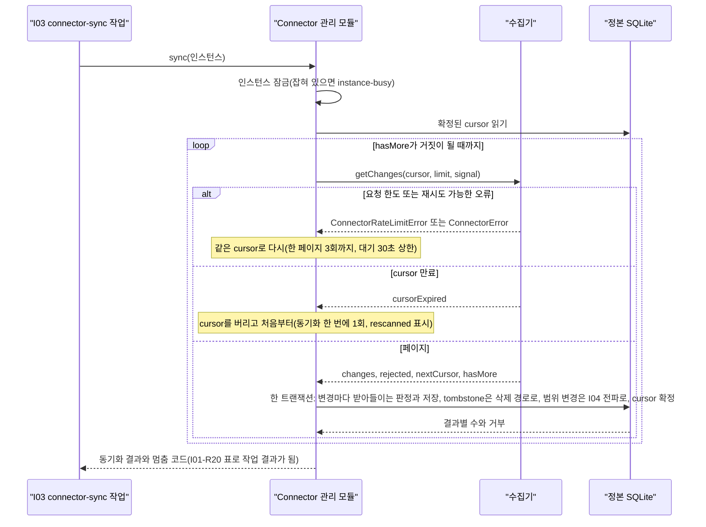
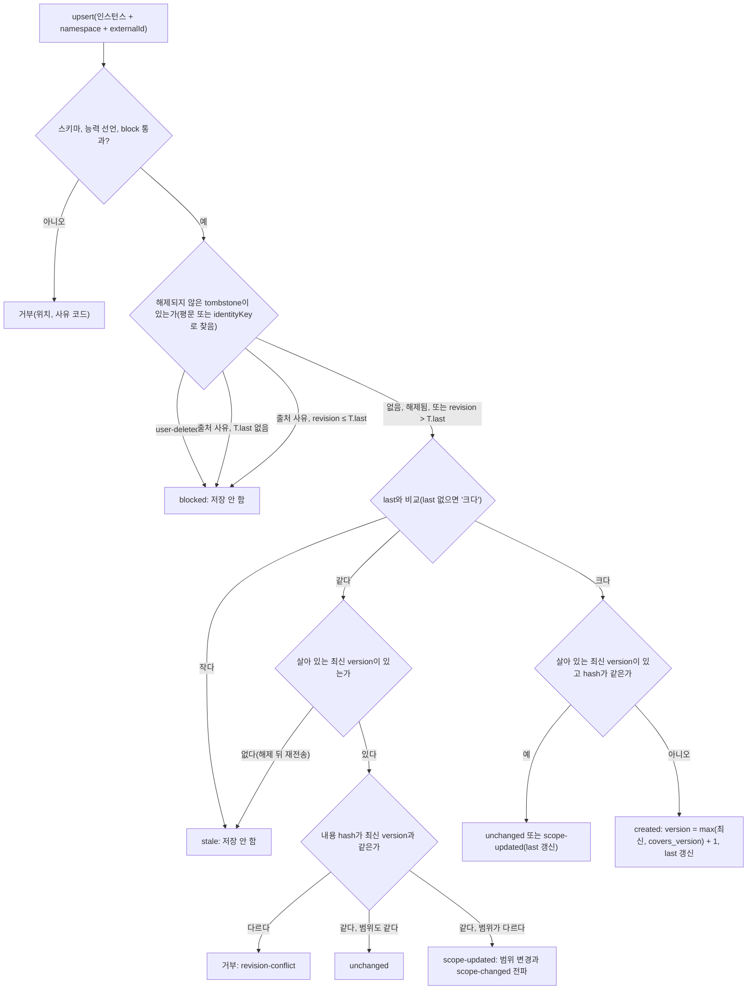
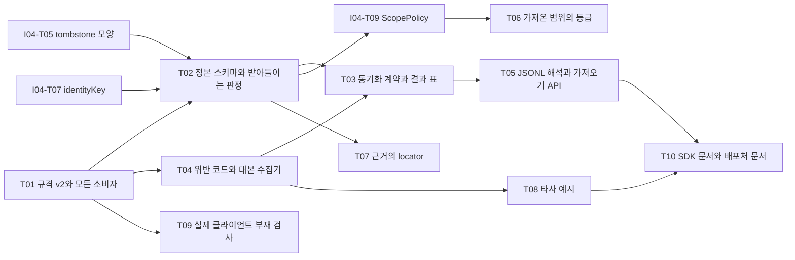

# 스펙: I01 Connector SDK, Source/Evidence 계약, JSONL·API 가져오기

- 날짜: 2026-11-21 / 상태: 확정
- 관련: 이슈 #18(I01), 총괄 #1, Phase 2 #4, 선행 #17(V02). [V01 spec](2026-11-21-V01-vertical-skeleton.md)·[V02 spec](2026-11-21-V02-vertical-slice.md)(특히 "T01이 넘기는 것", "T02가 넘기는 것"), 함께 쓰는 I02(#19)·I03(#20)·I04(#21) spec. [ARCHITECTURE 5.5절·6~8절](../ARCHITECTURE.md), [ADR 0002](../adr/0002-authority-in-product-records.md)·[0012](../adr/0012-upstream-and-fork-ownership.md)·[0013](../adr/0013-failure-recovery.md)·[0014](../adr/0014-egress-policy-and-consent.md), [ownership.md](../ownership.md), [site-setup.md](../site-setup.md)

낯선 말은 [ARCHITECTURE 0절](../ARCHITECTURE.md#0-처음-나오는-말)에 풀이가 있다(정본, 계약 테스트, test double, tombstone, version fence, 변경 순번, 근거). 이 spec에서 새로 쓰는 말은 아래 표에 있다. `V01-…`·`V02-…`·`I03-…`·`I04-…`는 그 spec의 번호, `S…`는 site-setup.md의 체크리스트 번호다.

| 말 | 뜻 |
|---|---|
| SDK | 배포처 포크나 다른 개발자가 수집기(Connector)를 만들 때 따르는 규격 묶음. 타입(`@pki/contracts`), 규격을 지키는지 확인하는 계약 테스트(`@pki/testkit`), 공용 도우미(`@pki/connector-sdk`: JSONL 해석, 동기화 결과 표), 사용 문서로 이루어진다. 실행되는 서버가 아니다 |
| cursor | 수집기가 "여기까지 넘겼다"를 나타내는 표시. 제품은 내용을 해석하지 않고 그대로 보관했다가 다음에 돌려준다 |
| checkpoint | cursor를 정본에 확정해 저장하는 일. 받은 원본을 저장한 **뒤에만** 한다 |
| full rescan(전체 재스캔) | cursor를 버리고 처음부터 다시 받는 일. cursor가 만료되었을 때의 복구 방법이다 |
| capability(능력 선언) | 수집기가 자기가 할 수 있는 일(변경분만 주기, 삭제 사건 내기, 접근 범위 채우기, 전체 재스캔, 재스캔 때 삭제 알리기)을 미리 밝힌 값 |
| rate limit / backoff | rate limit은 원 시스템이 "잠시 뒤에 다시 오라"고 거절하는 것, backoff는 실패한 뒤 기다리는 시간을 점점 늘려 다시 시도하는 것 |
| namespace | 한 수집기 인스턴스 안에서 원본 식별자(external id)가 유일한 범위. 예: 위키 공간 하나, 편지함 하나. JSONL에서는 그 줄의 `connector_instance_id` 값이다 |
| revision | **원 시스템이 매긴** 개정 번호. 같은 원본에서 커질수록 새 것이다. 원 시스템에서 온 것들의 **도착 순서를 가리는 데만** 쓴다 |
| version | **제품이 매긴** 원본 version 번호(1, 2, 3…, V02-T02). 저장된 원본 version 하나를 가리키며 fence, 근거, tombstone이 덮는 범위에 쓴다. revision과 섞지 않는다 |
| 역순 도착 | 같은 원본의 더 작은 revision이 더 큰 revision보다 늦게 도착하는 일 |
| block / locator | block은 정규화된 본문의 코드 포인트 구간 `[시작, 끝)` 하나를 원래 형식의 자리(PDF 쪽, DOCX 문단, XLSX 시트와 셀, CSV 레코드, HTML 요소 경로, 텍스트 줄)에 대응시킨 것. locator는 그 "원래 형식의 자리"다. 문서 정규화(I02)가 만든다 |
| 구별 합집합 | 몇 가지 모양 가운데 하나인 값. 어느 모양인지는 정해진 필드 하나의 값(여기서는 `format`)으로 갈린다 |

## 배경

V01은 Connector 규격의 첫 모양(`packages/contracts/src/connector.ts`)과 계약 테스트, 합성 자료를 내는 테스트 Connector를 만들었다. V02는 그 위에 JSONL 가져오기 하나를 붙여 수직 흐름을 증명한다. V02는 "Connector 규격의 확정과 SDK 문서화"를 이 작업으로 넘겼다(V02 비목표).

지금 규격으로는 실제 수집기를 만들 수 없다. 원본 레코드가 `externalId`, `title`, `body` 셋뿐이라 접근 범위(access_scope), 원 시스템의 개정 번호, 작성자·참여자·시각 같은 출처 정보를 실을 자리가 없다. 삭제·권한 철회 사건은 타입만 있고 저장 경로가 없으며, 내용은 그대로이고 볼 수 있는 사람만 바뀌는 경우는 표현할 길이 없다. 원 시스템의 요청 한도나 일시적 오류를 알릴 방법도 없고, 계약 테스트는 페이지 크기와 cursor의 기본 성질만 본다. 배포처 포크가 실제 메일·메신저·Wiki 수집기(S01~S04)를 만들기 전에 이 규격이 확정되어야 포크의 구현이 공용 저장소의 변경에 깨지지 않는다([ownership.md 7절](../ownership.md)).

문서 정규화(I02)는 PDF·DOCX·XLSX 같은 파일을 "정규화된 본문 + 구간별 원래 자리(block)"로 바꾸고, 그것을 원본 레코드와 근거에 싣는 방법은 이 작업에 맡겼다. 근거(Evidence)가 글자 위치뿐 아니라 "몇 쪽, 어느 시트의 어느 셀"까지 가리키게 하는 것이 이슈의 I01-C2다.

## 목표

- 배포처 포크가 `@pki/contracts`, `@pki/testkit`, `@pki/connector-sdk`만 보고 수집기를 만들 수 있고(포크의 `site/connectors/`는 셋 모두를 import해도 된다. 셋 다 규격 버전 규칙의 대상이다), 계약 테스트가 규격 위반을 **정해진 위반 코드별로** 찾아낸다.
- 동기화가 중간에 끊기거나, cursor가 만료되거나, 원 시스템이 요청 한도로 거절해도 원본이 빠지거나 두 번 들어가지 않는다. cursor가 만료된 동안의 삭제를 놓칠 수 있는 수집기라면 그 사실이 결과에 드러난다.
- 원본 레코드가 출처(수집기 인스턴스, namespace, 원 시스템의 revision, 작성자·시각)와 접근 범위를 싣는다. 삭제·권한 철회 사건은 정본의 삭제 경로로, 접근 범위의 변경은 I04의 무효화 경로로 이어진다.
- 지운 원본은 늦게 온 옛 사건이나 같은 것의 재전송으로 되살아나지 않는다.
- JSONL 파일과 로컬 가져오기 API가 같은 규칙으로 동작한다. 그 규칙은 다음과 같다.
  - 형식이 틀린 레코드는 그 레코드만 거부되고 위치가 보고된다.
  - 같은 것을 다시 넣어도 늘지 않는다.
  - 늦게 온 옛 revision은 최신을 덮지 않는다.
  - 내용이 같아도 출처가 다른 원본은 합쳐지지 않는다.
  - 가져온 자료가 스스로 적은 접근 범위로 등급이 느슨해지지 않는다.
- 근거는 변하지 않는 원본 version과 코드 포인트 구간을 가리킨다. 그 version에 block이 있으면 원래 형식의 자리(쪽, 문단, 시트와 셀, 요소 경로, 줄)까지 알려 준다.
- 공용 저장소에 실제 메일·메신저·Wiki 클라이언트가 없다는 것을 테스트가 확인한다.

## 비목표 (배포처에서 후속 진행)

**공용 저장소의 뒤 작업으로 넘기는 것**

- PDF·DOCX·XLSX·CSV·HTML 등 파일의 파싱과 정규화, 폴더 감시, 첨부 저장, 스레드·댓글 순서 복원: I02(#19). 이 spec은 I02가 만든 block을 원본 레코드에 싣는 **자리**와 근거에서 읽는 **규칙**만 정한다.
- 주기적 동기화의 일정, 동기화 사이의 재시도·dead-letter(끝내 실패한 작업을 따로 모아 두기), 여러 작업의 동시 실행·우선순위, 절전 복구: I03(#20). 이 spec은 동기화 한 번이 무엇을 하고 어떤 코드로 멈추는지, 그리고 그 코드를 I03이 어떻게 받는지의 표(I01-R20)를 정한다.
- tombstone 행의 모양(덮는 version, 사유, 해제 시각. 다음 version 번호의 기준은 `covers_version`이다), 파생 지식 전파, 보존 기간, 복원과 해제, 지운 원본 식별자의 해시: I04(#21). 이 spec은 원 시스템에서 온 것을 **받아들일지의 판정**(I01-R10~R12)을 갖고, 판정에 쓰는 tombstone의 값은 I04의 것을 읽는다.
- 원본 version의 정리: 하지 않는다. 지난 version은 원본이 지워질 때까지 남는다([ADR 0013](../adr/0013-failure-recovery.md) "결과", 원 설계의 문서 version 관리).
- 다른 프로세스(사용자가 만든 스크립트 등)가 가져오기 API를 부를 수 있게 하는 별도 자격 증명: 후속 이슈 필요(미해결 질문 6). 이 spec의 API는 기존 API와 같은 인증으로 화면과 테스트가 쓴다.
- 원본의 출처 정보(작성자, 참여자 등)를 Provider로 보내는 일: 하지 않는다. Provider로 가는 필드는 제목과 본문뿐이다([ADR 0014](../adr/0014-egress-policy-and-consent.md)).
- V01 규격(schemaVersion 1)으로 만든 수집기를 계속 받아 주는 호환 층: 두지 않는다. 지금 v1 구현은 공용 저장소의 것뿐이고(테스트 Connector, 미구현 표시, 테스트 대역) I01-T01에서 함께 옮긴다. 포크의 실제 수집기는 아직 없다(S01~S03 미착수).

**어느 작업에서도 하지 않는 것**(I01이 정한다)

- **전체 재스캔에서 "안 보이는 원본"을 제품이 삭제로 추정하는 일.** 재스캔이 한 원본을 돌려주지 않은 이유가 삭제인지, 권한 범위·필터·원 시스템의 일시적 누락인지 제품은 가를 수 없다. 잘못 추정하면 되돌릴 수 없는 삭제가 된다.
  - 삭제를 알 수 있는 수집기는 `deletes`를 참으로 선언하고 tombstone 사건을 명시적으로 낸다.
  - 재스캔이 그동안의 삭제를 빠짐없이 다시 알려 주는 수집기는 `deletionsOnRescan`을 참으로 선언한다(I01-R3). 방법은 둘이다. 삭제 사건이 원 시스템에 남아 재스캔 때 다시 읽히는 경우(JSONL의 `delete` 줄, 삭제 기록을 주는 원 시스템)가 하나고, 수집기가 자기가 낸 정체의 기록을 스스로 갖고 대조하는 경우가 다른 하나다. 어느 쪽이든 원 시스템을 아는 수집기의 판단이지 제품의 추정이 아니다.
  - 그렇지 않은 수집기는 재스캔 뒤 결과에 "만료된 동안의 삭제를 놓쳤을 수 있음"이 표시된다(I01-R17).
  - 폴더 감시의 맞춰 보기(I02-C3)는 파일 시스템이 부재를 직접 확인할 수 있으므로 이 줄의 대상이 아니다. I04 spec은 이 규칙을 I01에 기대하지 않고 이 줄을 가리킨다.

**배포처 후속 항목**(1개. [site-setup.md의 배포처 설정 체크리스트](../site-setup.md#배포처-설정-체크리스트)와 번호로 대응한다. S16·S17은 I02, S19·S20은 I03, S21 이후는 I04가 쓴다)

| 번호 | 항목 |
|---|---|
| S18 | 실제 수집기로 SDK v2 계약 판정과 실제 동기화를 실행하고 기록한다. 기록할 것은 다음과 같다. ① 요청 한도 ② cursor 만료와 그 동안의 삭제 ③ 대량 페이지 ④ access_scope와 revision 채우기 ⑤ 가져오기 인스턴스와 범위가 없는 원본의 등급 매핑 |

실제 메일·메신저·Wiki 수집기의 구현과 인증·권한 매핑 자체는 이미 S01~S04(V01)가 갖고 있으므로 여기서 다시 세지 않는다. S18을 따로 둔 이유는, 그 수집기가 이 spec의 규격 v2를 실제 원 시스템을 상대로 지키는지 배포처에서만 확인할 수 있기 때문이다.

## 요구사항

**규격과 버전**

- **I01-R1 규격 버전.** Connector 규격의 버전 `CONNECTOR_SDK_VERSION = 2`를 `@pki/contracts`에 둔다. 수집기의 `manifest.schemaVersion`은 자기가 구현한 규격 버전이다.
  - Connector 관리 모듈은 지원하는 버전(2)이 아닌 수집기를 초기화하지 않고, 상태를 `unavailable`로 둔다. 사유 코드는 `unsupported-sdk-version`이며, 상태 목록과 `site-check`에 보인다. 그 인스턴스의 동기화 요청은 기존 API 오류 `connector-unavailable`로 답한다.
  - 호환이 깨지는 변경이므로 새 ADR에 바뀐 점과 포크가 옮겨 가는 방법을 적는다([ownership.md 7절](../ownership.md)).
  - 규격, 그 규격을 쓰는 모든 구현, 계약 테스트는 **같은 PR**에서 바뀐다(I01-T01).
- **I01-R2 Connector의 메서드.** 수집기는 `initialize`, `healthCheck`, `getChanges`, `getDocument`를 구현한다.
  - 이슈 C1의 `sync`는 수집기의 메서드가 아니라 **Connector 관리 모듈의 동기화 계약**이다(I01-R16~R21). [ARCHITECTURE 5.5절](../ARCHITECTURE.md)이 이미 그렇게 옮겼다.
  - `healthCheck`는 예외를 던지지 않고 `ok` 또는 `unavailable`(사유)을 돌려준다.
  - `getDocument`는 `{namespace, externalId}`로 그 원본의 가장 최근 revision을 돌려주고, 모르거나 삭제된 원본이면 `null`이다.
  - 초기화 전에 부른 `getChanges`·`getDocument`는 실패한다.
- **I01-R3 능력 선언.** `capabilities`는 V01의 넷(`incremental`, `deletes`, `accessScope`, `fullRescan`)에 `deletionsOnRescan`을 더한다. 선언과 행동이 맞아야 한다.
  - `deletes`가 거짓이면 `delete`·`access-revoked` 사건을 내지 않는다.
  - `accessScope`가 참이면 모든 upsert 레코드에 비어 있지 않은 `accessScope`가 있다. 거짓이면 그 필드가 없고 `scope-change` 사건도 내지 않는다.
  - `incremental`이 참이면 마지막 cursor로 다시 물었을 때 새 변경이 없다.
  - `deletionsOnRescan`이 참이면 `deletes`와 `fullRescan`도 참이다. 이때 처음부터 다시 받는 재스캔은 그 전 cursor 이후에 지워진 원본을 모두 `delete` 사건으로 낸다. 그 사건의 revision은 그 정체로 낸 마지막 upsert의 revision 이상이다. 스스로 대조하는 수집기는 자기가 낸 정체의 기록을 자기 저장소에 둔다(SDK는 저장소를 주지 않는다).
  - 관리 모듈은 선언과 어긋난 변경을 받으면 그 변경을 `capability-violation`으로 거부한다(I01-R14).
- **I01-R4 실패의 종류.** 수집기는 실패를 두 오류로 알린다. `ConnectorError`는 다시 시도해도 되는지(`retryable`)를 갖고, `ConnectorRateLimitError`는 기다릴 시간(`retryAfterMs`)을 갖는다. 미구현 표시의 `ConnectorNotImplementedError`는 그대로 둔다. 관리 모듈은 수집기 오류의 **문구를 API 응답, 동기화 결과, 로그에 옮기지 않고** 사유 코드만 남긴다. 문구에 원 시스템의 내용이 섞일 수 있기 때문이며, V01 Broker와 같은 규칙이다.

**원본 레코드와 변경**

- **I01-R5 원본 레코드 v2.** 수집기가 내는 `SourceRecord`는 엄격한 스키마다. 모르는 필드는 거부한다. 필드는 다음과 같다.
  - 정체: `namespace`, `externalId`. `namespace`는 빈 문자열을 허용하며, 그 인스턴스에 범위가 하나뿐이면 빈 문자열이다.
  - 순서: `revision`. 1 이상의 안전한 정수이며, 같은 `namespace + externalId`에서 원 시스템이 고칠 때마다 커진다.
  - 형식 버전: `schemaVersion`. 정수 2이며 `manifest.schemaVersion`과 같아야 한다.
  - 내용: `title`, `body`(정규화된 본문), 선택 `blocks`(I01-R7).
  - 접근 범위: 선택 `accessScope`. 문자열 배열이며 I01-R3의 규칙을 따른다. 정본에 저장된 범위의 모양은 `string[] | null`이고, `null`은 "알 수 없음"이며 가장 엄격한 것으로 다룬다(I04 인터페이스 블록과 같다).
  - 출처 정보: 모두 선택이다. `sourceType`, `sourceUrl`, `author`, `participants`, `threadId`, `createdAt`, `updatedAt`(UTC 오프셋이 붙은 ISO-8601), `metadata`(문자열 키의 객체).
  - **수집기 인스턴스 ID는 레코드에 없다.** 관리 모듈이 동기화하는 인스턴스의 ID를 붙인다. 레코드가 자기 인스턴스를 주장할 수 있으면 다른 인스턴스의 원본으로 끼어들 수 있기 때문이다.
  - **데이터 등급, 합성 여부, 악성 표시를 실을 필드가 없다.** 스키마가 거부한다. 등급은 Broker가 정본에서 계산한다([ADR 0014](../adr/0014-egress-policy-and-consent.md)).
  - **`accessScope`는 등급의 입력이다.** 배포처는 Broker의 `grade`에서 범위를 자기 등급으로 바꾼다(ADR 0014, S04, S08, V01 "T07이 넘기는 것" 7). 그래서 가져오기로 들어온 범위는 I01-R15의 제한을 받는다.
  - 합성 등급은 합성 목록으로만 붙는다(V01-R7). `namespace`와 `metadata`는 어떤 판정에도 쓰이지 않는다.
- **I01-R6 변경 사건.** `Change`는 다음 넷 가운데 하나다.

  | `kind` | 내용 | 뜻 |
  |---|---|---|
  | `upsert` | 레코드 하나 | 새로 생기거나 고쳐진 원본 |
  | `scope-change` | `namespace`, `externalId`, `revision`, `accessScope`, `at` | 내용은 그대로이고 볼 수 있는 사람만 바뀜(넓어지든 좁아지든) |
  | `delete` | `namespace`, `externalId`, `revision`, `at` | 원 시스템에서 지워짐 |
  | `access-revoked` | `namespace`, `externalId`, `revision`, `at` | 이 PC의 사용자가 더는 그 원본을 볼 수 없음 |

  `delete`와 `access-revoked`를 묶어 **tombstone 사건**이라 부른다. 셋 다 내용이 없다.

  `ChangeSet`은 V01의 `changes`, `nextCursor`, `hasMore`, `cursorExpired`에 `rejected`를 더한다. `rejected`는 수집기가 스스로 걸러 낸 항목의 목록이며 기본은 빈 목록이다. 항목은 위치 `at`과 사유 코드 `code`를 갖는다.
  - `at`은 `^[a-z][a-z0-9-]{0,15}:[0-9]{1,9}$` 모양만 받는다(예: `line:12`). 길이 상한이 있고 내용을 담을 수 없는 모양이다.
  - 어긋난 `at`은 `change:<그 페이지 안의 순번>`으로 바꾼다. 그 사실은 수집기 위반(`rejected-position-invalid`)으로 계약 테스트가 잡는다.
- **I01-R7 block.** `blocks`는 본문의 코드 포인트 구간 `[start, end)`과 locator의 목록이다.
  - 구간은 정수이고 `0 ≤ start < end ≤ 본문의 코드 포인트 수`다. `start` 순으로 정렬되고 서로 겹치지 않는다. 빈틈은 허용한다.
  - 어긋나면 그 레코드를 `invalid-blocks`로 거부한다.
  - locator는 **I02의 위치표를 그대로** 쓴다(I02 spec "위치표의 모양", I02 세션과 합의). `format` 값으로 모양이 갈리는 구별 합집합이며, 필드 이름과 번호의 기준까지 같다.

  | `format` | 필드 | 번호의 기준 |
  |---|---|---|
  | `pdf` | `page` | 쪽 1부터 |
  | `docx` | `paragraph`, 선택 `style`, 선택 `headingLevel`, 선택 `table: { index, row, cell }` | 문단(빈 문단 포함)·표·행·칸 0부터 |
  | `xlsx` | `sheet`, 선택 `cell`(A1 형식), 선택 `row`, 선택 `column` | 행·열 1부터. 시트 이름 블록은 `cell`이 없다 |
  | `csv` | `record`, `line`(레코드가 시작하는 원문의 줄), `field` | 모두 1부터 |
  | `html` | `path`(요소 경로, 예: `body>div[1]>p[2]`), `line` | 형제 번호와 줄 1부터 |
  | `markdown` | `line`, `node`(노드 종류), 선택 `depth`(제목 수준) | 줄 1부터 |
  | `txt`, `json` | `line` | 줄 1부터 |

  메일·메신저·Wiki 글처럼 원래 자리가 따로 없는 원본은 `blocks`가 없고, 근거는 코드 포인트 구간만 갖는다.

  I01의 테스트는 I01이 만든 합성 block으로 이 모양을 확인한다. I02 결과물에 기대지 않는다. I02 결과가 이 스키마를 통과하는지는 I02-B의 옮기기 테스트가 본다. I02가 모양을 바꾸면 두 스키마를 같은 PR 묶음에서 바꾼다.

**정본에 받아들이는 규칙**

- **I01-R8 원본의 정체와 provenance.** 원본의 정체는 `connector_instance_id + namespace + externalId`이다.
  - 이 셋 중 하나라도 다르면 내용(content hash)이 같아도 **다른 원본**이다. 각자 접근 범위, revision, 출처 정보, version, 근거를 따로 갖는다.
  - content hash는 **한 원본 안에서** 새 version을 만들지 판단하는 데만 쓴다(V01-R7, [ARCHITECTURE 5.5절](../ARCHITECTURE.md)).
  - 지워진 원본의 식별자는 I04가 키를 쓴 해시로 바꾼다. 그래서 원본을 찾을 때는 평문 정체로 먼저 찾고, 없으면 I04의 `identityKey(instance, namespace, externalId)`(I04-T07)로 지워진 원본을 찾는다. 해시로 찾지 않으면 지운 원본이 새 원본 행으로 되살아난다.
  - **해시로 찾은 원본 행에 레코드를 받아들이면**(해제 뒤, 또는 출처가 다시 만든 원본) 같은 트랜잭션에서 그 행의 `namespace`·`external_id`를 레코드의 평문으로 다시 쓴다. 살아 있는 원본은 언제나 평문 정체를 갖는다. 그래야 다음 도착이 평문으로 찾히고 `getDocument`와 출처 표시가 맞는다. 이 일은 I01의 것이며 I04가 가리킨다.
- **I01-R9 두 번호.** 받아들이는 판정에서 원 시스템의 **revision**은 도착 순서를 가리는 데만 쓰고, 제품의 **version**은 새 version의 번호를 매기는 데만 쓴다. 두 번호를 비교하거나 서로 대신 쓰지 않는다.
  - 원본 version마다의 revision은 **V02-T04가 더하는 `source_versions.revision`**(NULL 허용 정수, V02-T04의 마이그레이션)에 담긴다. I01은 이 열을 다시 정의하지 않고 그대로 쓴다.
  - 정본은 원본마다 받아들인 가장 큰 revision(`sources.last_revision`)을 기억한다. 삭제와 해제 뒤에도 남는다. I01-T02의 마이그레이션이 더한다(소유자 하나).
  - tombstone은 지울 때의 revision(`last_revision`)과 덮는 version(`covers_version`)을 따로 갖는다. 두 열과 사유·해제 시각을 포함한 tombstone의 모양은 **I04-T05**의 것이다. I01은 그 열을 읽고 이 spec의 규칙대로 값을 넘긴다.
  - 새 version의 번호는 `max(최신 version, tombstone의 covers_version) + 1`이다. 모든 version이 지워진 뒤에도 정해지며, V02-T02의 트리거(tombstone version 이하 거부)와 I04-R8을 지킨다.
  - JSONL 줄의 `version`은 revision이 된다. 제품 version으로 저장하지 않는다.
- **I01-R10 upsert 하나의 판정.** 스키마, 능력 선언, block 검사를 통과한 upsert는 다음 차례로 판정한다. 아래 "upsert 하나를 받아들이는 판정" 그림과 같다. `last`는 원본 행의 `sources.last_revision`, `T.last`는 tombstone의 `last_revision`이다.
  0. **tombstone 문.** 그 원본에 **해제되지 않은** tombstone이 있으면 먼저 사유로 가른다.
     - `user-deleted`: 사용자가 해제(I04)하기 전까지 모두 막는다.
     - `source-deleted`·`access-revoked`: `T.last`가 없으면(규격 v1 시절 원본) 해제 전까지 모두 막는다. 있으면 그보다 **큰** revision만 통과하고, 같거나 작으면 막는다.
     - 막힌 것은 `blocked`로 세고 저장하지 않는다. 같은 것의 재전송이나 늦게 온 옛것이 지운 원본을 되살리지 않는다.
     - **해제된** tombstone은 문이 되지 않는다. 그 원본의 도착은 아래 1~3단계를 `last`로 판정한다(`last`는 지우기와 해제 뒤에도 남는다). 해제 뒤의 판정은 I01의 것이고 I04가 가리킨다.
  1. revision이 `last`보다 작다: `stale`(옛것)이다. 저장하지 않으며 오류가 아니다. `last`가 없으면(처음 보는 원본, 규격 v1 시절 원본) 1단계와 2단계를 건너뛴다.
  2. revision이 `last`와 같다.
     - 살아 있는 최신 version이 없다(해제 뒤의 재전송): `stale`이다. 해제된 원본은 `last`보다 큰 revision부터 받는다.
     - 내용 hash가 최신 version과 같다: 접근 범위도 같으면 `unchanged`다. 다르면 `scope-updated`이며 I01-R12의 범위 변경을 적용한다.
     - 내용 hash가 다르다: `revision-conflict`로 그 레코드를 거부한다.
  3. revision이 더 크다(또는 1단계를 건너뛰었다).
     - 살아 있는 최신 version이 있고 내용 hash가 같으면 새 version을 만들지 않는다. `last`를 갱신하고, 범위가 다르면 `scope-updated`, 같으면 `unchanged`다.
     - 그렇지 않으면 `created`다. I01-R9의 번호로 새 version을 만들고 `last`를 갱신한다. 해시로 찾은 행이면 평문 정체를 되돌린다(I01-R8).
  - 내용 hash는 제목, 본문, block을 묶어 계산한다. block이 없으면 지금 값(`[제목, 본문]`)과 같다.
  - 한 페이지 안의 역순, 페이지 사이의 역순, 동기화 사이의 역순, 파일과 API 사이의 역순은 모두 같은 규칙이다.
  - V02-T02의 tombstone 트리거는 이 판정이 놓친 경우를 막는 뒷문으로 남는다. 그 트리거가 거부하면 버그이므로 페이지 단위 실패가 된다(I01-R14).
- **I01-R11 tombstone 사건의 판정.** I01은 받아들이기로 판정한 tombstone 사건을 I04의 **`applyTombstone(tx, w)`**(I04-T05, 인자 모양은 I04 설계 개요 블록의 `TombstoneWrite`)로 기록한다. 넘기는 값은 사유와 `lastRevision`이다. **`covers_version`은 넘기지 않는다.** `applyTombstone`이 그 원본의 지금 최신 version(처음 보는 원본이면 0)과 기존 값 가운데 큰 것으로 정한다. tombstone이 실제로 바뀌면 `applyTombstone`이 그 안에서 `propagate`를 부르므로 I01이 따로 부르지 않는다. 해제는 I04의 `liftTombstone`이며 I01은 부르지 않는다.
  - **`delete`** → 사유 `source-deleted`.
    - revision이 `last`보다 작으면 적용하지 않는다. `stale-tombstone`으로 따로 센다. 동기화 결과, 가져오기 결과, I03 작업 기록에 보인다. 놓친 삭제가 조용히 묻히지 않게 하려는 것이다.
    - 같거나 크면 적용한다.
  - **`access-revoked`** → 사유 `access-revoked`. revision과 상관없이 **언제나 적용한다**. 권한은 순서보다 앞선다.
  - 적용할 때 **두 `last_revision`을 함께** `max(사건의 revision, last, T.last)`로 올린다. 원본 행의 `sources.last_revision`과 tombstone의 `last_revision`이다.
  - **이미 tombstone이 있는 원본**에 더 큰 revision의 출처 tombstone 사건이 오면, `covers_version`이 그대로여도 `last_revision`을 올린다. 그래야 "r4 삭제 뒤 늦게 온 r3 upsert"가 0단계에서 막힌다. 내용이 바뀌지 않으므로 변경 순번은 올리지 않는다. 이 규칙은 I01의 것이며 I04가 맞췄다.
  - 같은 사유, 같은 `last_revision`이면 `unchanged`다. 멱등이며 I04의 멱등 규칙과 같다.
  - **처음 보는 원본에 대한 tombstone 사건**도 원본 행과 tombstone을 남긴다(`applyTombstone`이 `covers_version`을 0으로 정한다). 나중에 도착한 옛 upsert가 0단계에서 막히게 하려는 것이다. 이 원본 행은 처음부터 **키 있는 해시 정체**(`identityKey`)로만 쓰고 평문 `namespace`·`externalId`를 쓰지 않는다. R8의 해시 찾기가 이 행을 찾는다.
  - `user-deleted` tombstone이 있는 원본에 출처 tombstone 사건이 오면 사유는 `user-deleted`로 남고 `last_revision`만 올린다.
  - 화면의 사용자 삭제는 출처 사건이 아니다. 사유 `user-deleted`로 쓰고 `last_revision`은 비운다(`null`, I04 결정). 이 쓰기는 V02-T08의 몫이다(합의됨). 해제 전까지는 사유가 모두 막으므로 revision이 필요 없고, 해제 뒤의 판정은 `sources.last_revision`으로 한다(I01-R10).
- **I01-R12 접근 범위의 변경.** `scope-change` 사건과 I01-R10의 `scope-updated`는 같은 처리를 받는다. 범위를 쓰는 쪽은 I01이고, 전파하는 쪽은 I04다.
  - tombstone 문(0단계)과 revision 비교는 upsert와 같다: 막히면 `blocked`, `last`보다 작으면 `stale`. 같은 revision에서도 받아들인다.
  - 살아 있는 version이 없는 원본이면 `stale`이다.
  - 받아들이면 I01이 원본 행의 접근 범위를 바꾸고 `last`를 갱신한다. 새 내용 version은 만들지 않는다.
  - 같은 트랜잭션에서 I04의 `propagate`(I04-T01)를 변경 종류 **`scope-changed`**로 부른다. 범위가 넓어지든 좁아지든 같다. I04가 계보를 따라 파생물의 보이기와 전송 등급을 다시 판정하고, 범위를 묶을 수 없어 빠졌던 것은 넓어질 때 다시 계산한다(I04-T09).
  - 범위를 하나도 볼 수 없게 된 경우(사용자가 더는 볼 수 없음)는 `scope-change`가 아니라 `access-revoked` 사건이다.
- **I01-R13 version에 딸린 것.** 본문, 제목, block, 출처 정보, 레코드의 `schemaVersion`, revision은 **원본 version**에 붙어 저장되고 version과 함께 바뀌지 않는다.
  - 원본 행에는 정체(인스턴스, namespace, external id), `last_revision`, 현재 접근 범위, 범위의 출처 표시(I01-R15)만 남는다.
  - 그래서 V02-R12의 삭제가 version을 지우면 작성자와 참여자 같은 출처 정보도 함께 지워진다.
  - 접근 범위는 정규화(중복 제거, 정렬)한 JSON 배열로 V01의 `sources.access_scope` 열에 둔다. 범위가 없는 레코드는 `null`(알 수 없음)이다.
  - 출처 정보만 바뀐 레코드는 새 version을 만들지 않는다.
- **I01-R14 부분 실패.** 레코드 단위 실패와 페이지 단위 실패를 나눈다.
  - **레코드 단위**: 다음은 그 레코드만 거부하고 위치와 사유 코드를 결과에 남긴다. 나머지는 저장되고, 수집기 동기화라면 cursor는 그 페이지 뒤로 확정된다. 거부 목록에 필드의 값은 넣지 않는다.
    - 스키마 위반
    - `revision-conflict`
    - `invalid-blocks`
    - `capability-violation`
    - `scope-change-content-mismatch`(I01-R22)
    - (JSONL) 줄 형식 오류
  - **페이지 단위**: 다음은 그 페이지(가져오기 API라면 그 요청)의 어느 것도 저장하지 않는다. 수집기 동기화라면 cursor는 그대로다. 같은 것을 다시 하면 같은 결과가 된다(멱등).
    - `ChangeSet`의 겉모양(`changes`, `nextCursor`, `hasMore`)이 스키마에 맞지 않을 때
    - `limit`보다 많이 돌려줬을 때
    - 저장 트랜잭션이 실패했을 때(트리거의 거부 포함). 동기화는 `storage-failed`로 멈추고, 가져오기 API는 500과 오류 코드 `storage-failed`로 답한다

**접근 범위와 등급**

- **I01-R15 가져온 범위는 등급을 느슨하게 만들지 못한다.** 실제 수집기가 원 시스템에서 읽은 범위는 그 수집기의 책임으로 믿는다(S04). 가져오기(`jsonl-import`의 파일과 `POST /api/imports`)의 범위는 **사용자가 적은 값**이다. 그 원본은 `sources.scope_claimed`로 표시된다.
  - 원본의 범위는 화면 표시와 I04의 보이기 판정에 그대로 쓴다. 골든 데이터의 권한 시나리오는 이 값으로 돈다.
  - **인스턴스의 범위**(`configured_scope`)는 **배포처 설정**이다. 파일 `site/config/connector-scopes.json`(인스턴스 ID → 범위)에 두는 빌드 자원이다. 빌드 때 묶이고 실행 중에는 읽기만 한다는 점에서 검증된 CLI 목록(`providers/src/verified-cli-combinations.json`)과 같은 성격이지만 위치는 포크의 자리다. 설정 API와 화면은 이 값을 쓰지도 보이지도 않는다. 공용 저장소는 이 파일을 내보내지 않으며, 파일이 없거나 그 인스턴스가 없으면 "알 수 없음"(`null`)이다.
  - **등급 계산**에서 Broker는 표시된 원본의 범위 등급을 이렇게 정한다. I04 인터페이스 블록의 `ScopePolicy.compare(적은 범위, 인스턴스 범위)`(I04-T09)를 쓴다. I01은 그 블록의 이름(`compare`, `strictest`, `atLeastAsStrict`, `combinable`)만 쓰며, 이름과 타입이 바뀌면 이 절이 따른다.
    - `stricter` 또는 `equal`: 적은 범위의 등급.
    - `looser`: 인스턴스 범위의 등급.
    - `incomparable`, 또는 인스턴스 범위가 "알 수 없음"(`null`): **가장 엄격한 등급**(D18).
  - 이 규칙은 범위에서 나오는 등급에만 걸린다. 합성 등급은 지금처럼 합성 목록과의 대조로만 붙는다(V01-R7). 그래서 저장소의 합성 자료를 가져오면 여전히 합성 등급이다.
  - 공용 저장소의 범위 등급은 언제나 일반 하나이므로, 공용 저장소에서 결과는 바뀌지 않는다. 배포처는 `site/config/connector-scopes.json`에 인스턴스 범위를 두고, 가장 엄격한 등급은 Broker의 `grade` 매핑에서 정한다(S08, S18).

**동기화 계약(Connector 관리 모듈)**

- **I01-R16 페이지와 checkpoint.** 관리 모듈은 `getChanges`를 `limit`(기본 100)으로 반복해 부르고, 한 페이지의 저장과 다음 cursor의 확정을 **한 트랜잭션**으로 한다(V01, [ADR 0013](../adr/0013-failure-recovery.md) 결정 1). 이 트랜잭션은 I04의 `canonicalTransaction`(타입 `CanonicalTx`, I04-T05)으로 연다. 그 안에서 `applyTombstone`을 부르기 때문이다(일반 `SqlDriver.transaction`으로는 그 입구를 부를 수 없다).
  - `hasMore`가 참인데 `nextCursor`가 그대로면 `no-progress`로 멈춘다.
  - 취소 신호(`AbortSignal`)가 오면 확정된 페이지까지 남기고 `aborted`로 멈춘다. 다음 동기화는 그 cursor에서 이어진다.
- **I01-R17 cursor 만료와 전체 재스캔.** `cursorExpired`가 오면 cursor를 버리고 처음부터 다시 받는다.
  - 동기화 한 번에 전체 재스캔은 한 번뿐이다. 재스캔 중에 다시 만료되면 `cursor-expired`로 멈춘다(V01의 동작을 규격으로 고정한다).
  - `fullRescan`이 거짓인 수집기가 만료를 알리면 재스캔하지 않고 `cursor-expired`로 멈춘다.
  - 재스캔으로 다시 받은 원본은 I01-R10으로 걸러져 늘지 않는다.
  - 재스캔한 동기화의 결과에는 `rescanned: true`가 붙는다. 수집기의 `deletionsOnRescan`이 거짓이면 `deletionsMayBeMissed: true`도 붙는다. 그러면 Sources 화면의 그 인스턴스 상태와 I03 작업 기록에 "만료된 동안 지워진 원본을 놓쳤을 수 있음"이 보인다. 이 표시는 다음 재스캔이 끝날 때까지 남는다.
  - 화면에 보이는 자리와 담당은 둘이다. ① Sources 화면의 인스턴스 상태: Connector 목록 API의 `ConnectorSummary`에 `deletionsMayBeMissed`를 더하고 화면이 표지를 보인다(I01-T03). ② Activity 화면의 동기화 기록: 동기화 결과의 `staleTombstone`, `deletionsMayBeMissed`, `blocked` 수를 I03이 작업 기록에 담아 보인다(I03-R23, I03-T11).
  - 재스캔이 한 동기화 안에서 끝나지 않으면(멈춤, 취소) `connector_instances.rescan_pending`에 남긴다. 다음 동기화가 그 재스캔을 끝낼 때 두 표시를 붙인다.
  - 이것이 C1의 "cursor 만료는 full-rescan으로 복구한다"가 보장하는 범위다. 살아 있는 원본은 모두 복구되고, 삭제의 복구는 `deletionsOnRescan`인 수집기에서만 된다.
- **I01-R18 요청 한도와 backoff.** 같은 cursor로 한 페이지를 다시 받는 재시도는 동기화 한 번 안에서 다음 값으로 한다. 값은 잠정이며 한 상수에 둔다.
  - `ConnectorRateLimitError`: `min(retryAfterMs, 30초)` 기다린다(V01 Broker의 요청 한도 대기 상한 30초와 같다).
  - `retryable`인 `ConnectorError`: 1초부터 두 배씩 기다리되 30초를 넘지 않는다.
  - 한 페이지의 시도는 모두 3회까지다. 요청 한도로 소진되면 `rate-limited`, 재시도 가능한 오류로 소진되면 `connector-error`, 재시도할 수 없는 오류는 첫 번째에 `connector-failed`로 멈춘다.
  - 어느 경우든 cursor는 마지막으로 확정된 값에 남는다. 기다리는 시간은 주입한 시계로 재며, 테스트는 실제로 기다리지 않는다.
- **I01-R19 동기화 결과.** 결과에는 다음이 들어간다.
  - 받은 변경 수
  - `created`, `unchanged`, `scopeUpdated`, `stale`, `staleTombstone`, `blocked`, `tombstoned`
  - 거부 목록(위치, 사유 코드)
  - `rescanned`, `deletionsMayBeMissed`
  - 멈췄다면 멈춘 사유 코드. `rate-limited`이면 마지막 `retryAfterMs`도 붙는다

  코드는 닫힌 목록이다.
  - **거부**: `invalid-json`, `schema`, `content-hash-mismatch`, `revision-conflict`, `invalid-blocks`, `capability-violation`, `scope-change-content-mismatch`.
  - **멈춤**: `invalid-page`, `no-progress`, `cursor-expired`, `rate-limited`, `connector-error`, `connector-failed`, `aborted`, `instance-busy`, `storage-failed`. `storage-failed`는 페이지 저장 트랜잭션의 실패(트리거의 거부 포함, I01-R14)다. 그 페이지는 저장되지 않고 cursor는 그대로다.

  `unsupported-sdk-version`은 멈춤 코드가 아니라 인스턴스 상태의 사유다(I01-R1).
- **I01-R20 정해진 동기화는 I03의 작업이다.** 주기적으로 끌어오는 동기화는 I03의 작업 종류 `connector-sync`로 돌며, 그 작업이 이 관리 모듈의 동기화를 부른다. 멈춤 코드가 I03의 결과로 옮겨지는 표는 **이 spec이 정하고 I03이 가리킨다.** 결과는 `retry`, `held`, `dead_letter`, `done` 넷 가운데 하나이며, 멈춤 코드(I01-R19)와 인스턴스 상태마다 한 행이 있다. `done`은 I03의 `succeeded`로 닫힌다.

  | 동기화의 끝 | I03 결과 | 시도 | 다음 실행 | 이유 |
  |---|---|---|---|---|
  | 멈추지 않고 끝남(거부·`stale-tombstone`·`deletionsMayBeMissed`가 있어도) | `done` | — | 다음 주기 | 레코드 단위의 일은 결과에 남았고, 다시 돌려도 같다 |
  | `rate-limited` | `retry` | 씀 | I03 backoff와 결과의 `retryAfterMs` 가운데 늦은 쪽 | 시간이 지나면 풀린다 |
  | `connector-error` | `retry` | 씀 | I03 backoff | 수집기가 재시도해도 된다고 했다 |
  | `instance-busy` | `retry` | **쓰지 않음** | 1분 뒤 | 같은 인스턴스의 가져오기가 끝나면 풀린다. 수집기를 부르지 않았다 |
  | `aborted` | `retry` | 씀 | I03 backoff | 임대 상실이나 실행 시간 초과는 실행기의 사정이다. 취소 표시가 있는 작업이면 I03 실행기가 그 표시로 `cancelled`로 닫는다(I03 소유, 이 표의 결과보다 앞선다) |
  | `connector-failed` | `dead_letter` | — | 없음 | 수집기가 재시도할 수 없다고 했다 |
  | `invalid-page` | `dead_letter` | — | 없음 | 수집기의 규격 위반이다. 다시 돌려도 같다 |
  | `no-progress` | `dead_letter` | — | 없음 | 수집기의 규격 위반이다. 다시 돌려도 같다 |
  | `cursor-expired` | `dead_letter` | — | 없음 | 재스캔도 만료되었거나 재스캔할 수 없는 수집기다. 수집기나 설정을 고쳐야 한다 |
  | `storage-failed` | `retry`, 시도가 다하면 `dead_letter` | 씀 | I03 backoff | 디스크 사정이면 다시 하면 풀린다. 트리거의 거부처럼 늘 같은 실패면 시도가 다해 포기한 작업(dead_letter)으로 남아 보인다 |
  | 인스턴스가 `unavailable`(초기화 실패, `unsupported-sdk-version`) | `held` | 쓰지 않음 | 그 인스턴스의 설정이 바뀌거나 앱이 갱신될 때, 그리고 I03의 시간당 묶음 재점검 | 설정이나 수집기가 바뀌어야 풀린다 |
  | 인스턴스가 `not-implemented`(`site-*`) | `held` | 쓰지 않음 | 그 인스턴스의 설정이 바뀌거나 앱이 갱신될 때, 그리고 I03의 시간당 묶음 재점검 | 포크가 실제 구현을 등록해야 풀린다 |

  `held`인 주기는 I03이 "멈춤"과 그 이유로 보인다. 처리기는 I03의 처리기 결과 `held(reason)`를 돌려주며, 이유 코드는 인스턴스 상태의 사유다.

  "시도"는 I03의 시도 수다. `connector-sync`는 Provider가 아니라 수집기(밖의 원 시스템)를 부르므로, 수집기를 부른 실행의 실패(`rate-limited`, `connector-error`, `aborted`, `storage-failed`)는 시도를 쓴다. 수집기를 부르지 않은 실행(`instance-busy`, `held`)은 쓰지 않는다. I03의 "Provider를 부르지 않으면 시도를 쓰지 않는다"는 이 종류에서 "수집기"로 읽는다. "I03 backoff"에는 I03의 하한(요청 한도의 5분 하한 포함)이 그대로 걸린다.

  이 표는 코드 상수 하나(`SYNC_OUTCOMES`, `packages/connector-sdk`)로도 두고 I03의 테스트가 그것을 읽는다. 문서와 상수가 어긋나면 `sync.outcome-map`이 실패한다.
- **I01-R21 인스턴스 하나에 동기화 하나.** 한 인스턴스에서 동시에 도는 동기화와 가져오기는 하나뿐이다. 관리 모듈이 인스턴스마다 잠금을 쥔다. 백엔드는 프로세스 하나다(V01 단일 실행).
  - 잠금이 잡혀 있을 때 정해진 동기화는 `instance-busy`로 멈추고(I03 `retry`, 시도를 쓰지 않음, 1분 뒤), 가져오기 API는 409(`instance-busy`)로 답한다. `instance-busy`와 `storage-failed`는 `@pki/contracts`의 API 오류 코드 목록에 더한다(I01-T03).
  - 잠금은 정상 종료, 예외, 취소, 시간 초과의 **모든 경로에서 풀린다**(`finally`). 잠금을 쥔 채 예외가 나도 다음 동기화와 가져오기는 막히지 않는다.
  - 사용자가 시작한 가져오기는 **요청 안에서 동기로** 끝난다. I03의 큐에 들어가는 것은 가져오기가 등록한 추출 작업이지 가져오기 자체가 아니다.

**JSONL과 로컬 가져오기 API**

- **I01-R22 JSONL 형식 v1.** 한 줄은 V02-T01의 `ImportRecordSchema`를 따른다(머지됨. R05 골든 데이터의 모양, `schema_version` `"1"`). 이 spec은 `operation`에 `access-revoked` 하나를 더하는 것 말고는 줄 형식을 바꾸지 않는다. 값을 더하는 것뿐이라 기존 파일은 그대로 유효하므로 `schema_version`은 `"1"`로 둔다. 골든 검사기 `eval/scorer/validate.py`의 `OPERATIONS`도 같은 작업에서 같은 값을 더한다(스키마가 그 검사기를 옮긴 것이라 둘은 늘 같다). 해석 함수는 새 공용 패키지 `packages/connector-sdk`(`@pki/connector-sdk`)에 둔다(I01-R24). 줄은 다음처럼 옮긴다.
  - 필드는 다음 표처럼 옮긴다.

    | JSONL 줄 | 옮겨 가는 곳 | 비고 |
    |---|---|---|
    | `connector_instance_id` | `namespace` | 제품의 인스턴스 ID가 아니다(I01-R5) |
    | `external_id` | `externalId` | |
    | `version` | `revision` → `source_versions.revision`(V02-T04의 열) | **제품 `version`으로 저장하지 않는다**(I01-R9) |
    | `title`, `content` | `title`, `body` | |
    | `access_scope` | `accessScope` | 가져온 범위(I01-R15) |
    | `source_type`, `source_url`, `author`, `participants`, `thread_id`, `created_at`, `updated_at`, `metadata` | 같은 이름의 camelCase | 출처 정보(version에 저장) |
    | `operation` | `Change.kind` | 아래 |
    | `schema_version` | 싣지 않음 | 파일 형식의 버전(I01-R23) |
    | `id`, `content_hash`, `malicious` | 싣지 않음 | `content_hash`는 아래 검사에만, `malicious`는 V02 "T01이 넘기는 것" 2 |

  - `operation`: `upsert` → `upsert`, `delete` → `delete`, `access-revoked` → `access-revoked`(새 값. 이 PC의 사용자가 그 원본을 더는 볼 수 없음).
  - `revoke` → `scope-change`. 골든 데이터의 정의가 "내용은 그대로, `access_scope`가 좁아짐"이기 때문이다(eval/golden README).
    - 줄의 `content` hash가 그 원본의 최신 version과 다르면 `scope-change-content-mismatch`로 거부한다.
    - 최신 version이 없으면 `stale`이다.
    - **넘겨받는 방식**(V02 세션과 합의): V02-T04는 `revoke` → `access-revoked`를 **내보낸 대응 함수 하나**(`operation`을 변경 종류로 옮기는 함수)에 두고, 그 대응의 fixture 테스트를 "I01 대기 잠정"으로 표시한다. V02-C3④는 JSONL 글자가 아니라 변경 수준(`access-revoked`)으로 시험한다. I01-T05가 그 함수 하나를 `revoke` → `scope-change`로 바꾸고, 잠정 테스트를 뒤집고, `access-revoked` 값을 더해 V02-C3④가 계속 원본을 갖게 한다. V02 spec을 고치는 요청이 아니라 I01의 작업이다.
  - `content_hash`가 `content`의 sha256과 다르면 그 줄을 `content-hash-mismatch`로 거부한다. V02 "T01이 넘기는 것" 1이 이 판정을 T04에 넘겼고, I01이 거부로 정한다.
  - JSON으로 읽을 수 없는 줄은 `invalid-json`, 스키마에 맞지 않는 줄은 `schema`다. 위치는 `line:<줄 번호>`(1부터)다.
- **I01-R23 JSONL 수집기.** 종류 `jsonl-import`인 수집기가 설정의 파일 하나를 읽는다.
  - cursor는 `<파일 내용의 sha256>:<넘긴 줄 수>`이다. 파일 내용이 바뀌어 hash가 다르면 `cursorExpired`를 알린다. 그래서 고친 파일을 다시 넣으면 전체 재스캔이 되고 I01-R10이 중복을 거른다.
  - 같은 파일을 그대로 다시 동기화하면 cursor가 끝에 있으므로 변경이 0건이다.
  - 능력은 다섯 모두 참이다. `accessScope`가 참이므로 줄의 `access_scope`가 빈 배열이면 그 줄을 `schema`로 거부한다. `deletionsOnRescan`이 참인 것은 삭제가 파일 안의 `delete` 줄로 남아 재스캔 때 다시 읽히기 때문이다. 그래서 파일을 고칠 때마다 `deletionsMayBeMissed`가 붙는 소음이 없다. 파일에서 줄이 사라진 것은 삭제가 아니다. 삭제는 `delete` 줄로 적는다(사용자가 줄을 지우고 `delete` 줄을 적지 않으면 그 원본은 남는다. SDK 문서에 적는다).
  - 레코드의 `schemaVersion`은 2다. JSONL 줄의 `schema_version` `"1"`은 **파일 형식**의 버전이고 레코드 규격의 버전과 따로 오른다.
- **I01-R24 로컬 가져오기 API.** `POST /api/imports`는 `{ instanceId, content }`(JSONL 텍스트)를 받는다. I01-R22와 같은 해석, I01-R10~R15와 같은 저장 규칙으로 처리하고 I01-R19의 결과를 돌려준다.
  - 기존 API와 같은 경로표(`@pki/contracts`의 `routes`)와 같은 인증(토큰, loopback, 허용 Origin)을 쓴다.
  - `instanceId`가 처음이면 종류 `jsonl-import`로 등록하고, 이미 다른 종류로 등록되어 있으면 거부한다(V01의 `registerConnectorInstance`).
  - 본문 크기에 상한을 둔다. 잠정 10 MiB이며, 넘으면 413이다. 같은 인스턴스의 동기화가 돌고 있으면 409 `instance-busy`다(I01-R21). 저장 트랜잭션이 실패하면 500과 오류 코드 `storage-failed`다(I01-R14).
  - 요청 하나는 한 트랜잭션에 저장한다. cursor는 없다. 이 트랜잭션도 I04의 `canonicalTransaction`(`CanonicalTx`, I04-T05)으로 연다(I01-R16과 같은 이유).
  - 파일 수집기와 API는 **같은 해석 함수와 같은 저장 함수**를 쓴다.
    - 해석 함수(줄 → 변경, `content_hash` 검사 포함)는 새 패키지 `@pki/connector-sdk`에 둔다. 어댑터 경계(V01-T07) 밖의 순수 라이브러리이며, Connector를 구현하지 않으므로 `src/adapters/`가 없다. `node:crypto`를 쓸 수 있다. `@pki/contracts`는 지금처럼 의존성 없이 남는다.
    - `tooling/eslint/module-boundary.js`에 규칙 하나를 더한다: `@pki/connector-sdk`는 어댑터 구현과 backend 어디서나 import할 수 있고, 이 패키지는 `@pki/contracts`와 `zod`, 허용된 `node:` 모듈만 import한다.
    - 저장 함수는 관리 모듈의 페이지 저장(I01-T03)이다. `jsonl-import` 어댑터는 저장소에 닿지 않고 변경만 낸다. API 처리기는 해석 함수로 만든 변경을 같은 페이지 저장 함수에 넘긴다.
  - 화면의 가져오기(V02-T04)는 이 API를 쓴다. V02-T04는 아직 착수 전이다(재확인 1).

**검증 수단과 문서**

- **I01-R25 계약 테스트 v2.** `@pki/testkit`이 두 가지를 낸다.
  - `checkConnector(create, scenario)`: 수집기를 돌려 보고 규격 위반을 위반 코드의 목록으로 돌려준다. 테스트 프레임워크와 무관하다.
  - `connectorContract(name, create, scenario)`: 위 함수를 vitest 묶음으로 감싼 것이다.

  `scenario`는 초기화 설정 하나와, 선택으로 "나중 상태" 설정(원 시스템이 바뀐 뒤)을 갖는다. 위반 코드는 아래 닫힌 목록이다.

  | 코드 | 잡는 것 |
  |---|---|
  | `manifest-invalid` | manifest의 종류·능력이 빠지거나 틀림, `deletionsOnRescan`인데 `deletes`·`fullRescan`이 거짓 |
  | `sdk-version-mismatch` | `schemaVersion`이 2가 아니거나 레코드의 `schemaVersion`과 다름 |
  | `responds-before-init` | 초기화 전 `getChanges`·`getDocument`가 성공함 |
  | `unhealthy-after-init` | 초기화 뒤 `healthCheck`가 `ok`가 아님 |
  | `health-threw` | `healthCheck`가 예외를 던짐 |
  | `limit-exceeded` | 한 페이지가 `limit`보다 많음 |
  | `page-size-dependent` | 페이지 크기에 따라 받은 원본이 다름 |
  | `duplicate-identity` | 한 번 읽는 동안 같은 정체가 두 번 upsert됨 |
  | `no-progress` | `hasMore`인데 cursor가 그대로 |
  | `changes-after-final-cursor` | `incremental`인데 마지막 cursor 뒤에 변경이 나옴 |
  | `record-schema` | 레코드가 스키마에 맞지 않음(등급·인스턴스 필드 포함) |
  | `invalid-blocks` | block 규칙 위반 |
  | `capability-deletes` | `deletes`가 거짓인데 tombstone 사건을 냄 |
  | `capability-access-scope` | `accessScope` 선언과 레코드·`scope-change`가 어긋남 |
  | `revision-not-increasing` | "나중 상태"에서 바뀐 원본의 revision이 커지지 않음 |
  | `tombstone-revision-below-upsert` | tombstone 사건의 revision이 그 정체로 낸 마지막 upsert의 revision보다 작음 |
  | `rescan-deletion-missing` | `deletionsOnRescan`인데 "나중 상태"에서 사라진 원본이 재스캔에서 `delete`로 나오지 않음 |
  | `rejected-position-invalid` | `rejected[].at`이 I01-R6의 모양이 아님 |
  | `get-document-mismatch` | `getDocument`가 마지막으로 낸 레코드와 다름 |
  | `get-document-unknown` | 모르는 정체에 `null`이 아님 |
  | `abort-ignored` | 이미 취소된 신호로 부른 `getChanges`가 성공함 |

  미구현 표시에 돌리면 위반 대신 `not-implemented` 하나를 돌려준다.

  구조상 함께 일어나는 위반은 다음 규칙으로 하나만 보고한다.
  - `health-threw`가 나면 `unhealthy-after-init`은 보지 않는다.
  - `sdk-version-mismatch`를 먼저 보고, `manifest-invalid`는 버전을 보지 않는다.
  - `limit-exceeded`·`duplicate-identity`·`no-progress`가 난 읽기는 `page-size-dependent`와 비교하지 않는다. `no-progress`가 나면 그 읽기를 끝까지 읽어야 하는 검사(`changes-after-final-cursor`, `get-document-*`, "나중 상태" 검사)를 건너뛴다.

  `@pki/testkit`의 자기 테스트는 **코드마다 그 위반 하나를 주된 원인으로 갖는 대역 하나**를 둔다. `checkConnector`가 위 규칙을 적용한 뒤 **정확히 그 코드 하나**를 돌려주는지 확인한다. 묶음이 위반을 놓치지 않는다는 빨간 쪽 증거다.
- **I01-R26 테스트 Connector와 대역.** 공용 저장소의 수집기(`test-fixtures`, `jsonl-import`, `site-*` 미구현 표시)와 테스트 대역을 규격 v2로 옮기고, 모두 계약 테스트를 돈다.
  - 관리 모듈의 동기화를 시험하려고 대본 수집기(test double)를 `@pki/testkit`에 둔다. 정해 둔 페이지·오류·요청 한도·만료·역순·tombstone·범위 변경을 차례로 낸다.
  - 제품 구성에는 들어가지 않는다(V01-T07의 경계 규칙).
- **I01-R27 타사 수집기 예시.** `packages/connector-example/`에 공개 진입점(`@pki/contracts`, `@pki/testkit`)만 의존하는 작은 수집기 패키지를 둔다. 비공개이며 제품 구성에 없다. 수집기는 V01-T07 규칙대로 `src/adapters/`에 둔다.
  - 지어낸 메모리 자료를 내고, 자기 테스트에서 `connectorContract`를 돈다. 포크가 `site/connectors/` 안에서 할 일과 같은 모양이다.
  - 일부러 규격을 어긴 변형 셋에 `checkConnector`를 돌리면 각각 그 코드가 나온다. 변형은 진행 없는 cursor(`no-progress`), 능력 선언과 다른 삭제 사건(`capability-deletes`), 초기화 전 응답(`responds-before-init`)이다.
- **I01-R28 실제 클라이언트 부재.** 다음 두 가지를 테스트가 확인한다.
  - **제품 빌드**의 수집기 종류는 정확히 `jsonl-import`, `site-mail`, `site-messenger`, `site-wiki`다. `test-fixtures`는 개발·테스트 구성에만 있고, V01-T15가 제품 구성에서 뺀다(재확인 4). `site-*`는 초기화하면 `미구현, 배포처 후속`으로 실패한다(V01-R18).
  - **검사 대상 파일**은 공용 저장소가 갖는 수집기 경로뿐이다: `backend/src/adapters/`, `packages/connector-example/src/`, `packages/connector-sdk/src/` 아래의 스크립트 파일(`.ts`, `.tsx`, `.js`, `.mjs`, `.cjs`). 이 파일들의 import는 허용 목록에 있는 것만 쓴다.
    - 허용 목록은 같은 검사 대상 안의 상대 경로, `@pki/contracts`, `@pki/connector-sdk`, `zod`, `node:crypto`, `node:fs`, `node:fs/promises`, `node:path`이다. 테스트 파일에만 `@pki/testkit`과 `vitest`를 더 허용한다.
    - 동적 `import()`, `require`, 전역 `fetch`·`XMLHttpRequest`·`WebSocket`은 쓰지 않는다.
    - 이름이 아니라 허용 목록으로 거르므로, 메일·메신저 SDK 패키지를 들여와도 걸린다.
  - **`site/`는 이 검사의 대상이 아니다.** 포크는 `site/connectors/`에 네트워크를 쓰는 실제 수집기를 두고, `site/` 밖을 고치지 않는다([ownership.md 3절](../ownership.md)). 그래서 `site/`는 공용 저장소가 내보내는 자리 표시 파일의 목록(지금은 `site/README.md` 하나)으로만 따로 검사한다. 그 목록의 파일은 있어야 하고 스크립트가 아니어야 한다. 목록 밖의 파일(포크가 더한 것)은 보지 않는다. 포크에서도 이 검사는 그대로 통과한다.
  - **남는 빈틈**(정적 검사가 잡지 못하는 것): 계산한 이름의 전역 접근(`globalThis["fe" + "tch"]`), `eval`과 `new Function`, 허용된 `node:fs`로 소켓이나 장치 파일을 여는 것. 독립 검토에서 본다. 이 검사는 "실수로 들여온 실제 클라이언트"를 막는 것이지 일부러 숨긴 코드를 막는 것이 아니다.
- **I01-R29 근거의 위치 읽기.** 근거를 읽는 정본 함수와 API 응답은 근거마다 원본 version, 코드 포인트 구간, 인용문을 돌려준다. 그 version에 block이 있으면 **구간의 시작이 들어 있는 block의 locator**도 돌려준다.
  - locator는 근거 행에 따로 저장하지 않는다. version의 block에서 읽을 때 계산한다. 근거의 기준은 언제나 version과 코드 포인트 구간이고, locator는 보여 주기 위한 값이다.
  - 시작이 어느 block에도 없으면 locator는 null이다.
- **I01-R30 문서.** SDK 사용 문서 `docs/connector-sdk.md`를 쓴다. 다음을 담는다.
  - 규격
  - 두 번호(I01-R9)와 받아들이는 규칙(I01-R8~R15)
  - 동기화 계약과 I03 결과 표
  - 오류와 재시도
  - 계약 테스트 돌리는 법과 위반 코드 표
  - 원 시스템에 정수 revision이 없을 때 옮기는 법(수정 시각을 밀리초 정수로)
  - 자격 증명은 OS 자격 증명 저장소에 두고 레코드·설정 파일·로그에 넣지 않는다는 규칙
  - 포크가 v1에서 옮기는 법(ADR을 가리킨다)

  나머지 문서 갱신은 "후속"의 표대로 담당 작업이 한다.

## 인터페이스 / 설계 개요

### 규격 v2의 모양(잠정, I01-T01에서 확정)

```typescript
export const CONNECTOR_SDK_VERSION = 2;

type NativeLocator =                    // I02 spec "위치표의 모양"과 같다
  | { format: "pdf"; page: number }
  | { format: "docx"; paragraph: number; style?: string; headingLevel?: number;
      table?: { index: number; row: number; cell: number } }
  | { format: "xlsx"; sheet: string; cell?: string; row?: number; column?: number }
  | { format: "csv"; record: number; line: number; field: number }
  | { format: "html"; path: string; line: number }
  | { format: "markdown"; line: number; node: string; depth?: number }
  | { format: "txt" | "json"; line: number };
type Block = { start: number; end: number; locator: NativeLocator }; // 본문의 코드 포인트 [start, end)

interface SourceRecord {               // 엄격: 모르는 필드는 거부. 등급·합성·악성·인스턴스 필드 없음
  namespace: string; externalId: string; revision: number; schemaVersion: 2;
  title: string; body: string; blocks?: Block[];
  accessScope?: string[];
  sourceType?: string; sourceUrl?: string; author?: string; participants?: string[];
  threadId?: string; createdAt?: string; updatedAt?: string; metadata?: Record<string, unknown>;
}
type Ref = { namespace: string; externalId: string; revision: number; at: string };
type Change =
  | { kind: "upsert"; record: SourceRecord }
  | ({ kind: "scope-change"; accessScope: string[] } & Ref)
  | ({ kind: "delete" | "access-revoked" } & Ref);
interface ChangeSet { changes: Change[]; nextCursor: string; hasMore: boolean; cursorExpired?: boolean;
                      rejected?: { at: string; code: RejectCode }[] }   // at: ^[a-z][a-z0-9-]{0,15}:[0-9]{1,9}$

interface Connector {
  readonly manifest: { type: string; schemaVersion: number;
    capabilities: { incremental: boolean; deletes: boolean; accessScope: boolean;
                    fullRescan: boolean; deletionsOnRescan: boolean } };
  initialize(config: unknown): Promise<void>;
  healthCheck(): Promise<HealthStatus>;                       // 던지지 않는다
  getChanges(cursor: string | null, opts: { limit: number; signal: AbortSignal }): Promise<ChangeSet>;
  getDocument(ref: { namespace: string; externalId: string }): Promise<SourceRecord | null>;
}
// 실패: ConnectorError(retryable), ConnectorRateLimitError(retryAfterMs), ConnectorNotImplementedError

interface EvidenceView {               // 읽기 전용. 저장은 V02의 근거 행 그대로
  sourceVersionId: number; version: number; span: { start: number; end: number }; quote: string;
  locator: NativeLocator | null;
}
```

V01과 달라지는 점은 다음과 같다.
- 레코드의 필드가 늘었다. 정체에 `namespace`, 순서에 `revision`이 들어갔고 형식 버전, block, 접근 범위, 출처 정보가 생겼다.
- 변경에 `scope-change`가 생겼다. tombstone 사건의 `version`이 `revision`이 되고 `namespace`가 붙었다.
- `ChangeSet`에 `rejected`, 능력에 `deletionsOnRescan`이 생겼다.
- `getDocument`가 `namespace`를 받는다.
- 오류 두 종류가 생겼다.

### 동기화 한 번의 흐름

I01-R16~R21을 합친 것이다. 핵심은 두 가지다. 페이지 저장과 cursor 확정이 같은 트랜잭션이라는 것, 그리고 재시도와 재스캔이 어디로 되돌아가는지다. 페이지 단위 실패와 취소는 그림에서 생략했고 I01-R14·R16에 있다.



### upsert 하나를 받아들이는 판정

I01-R10을 그린 것이다. 저장 함수가 이 순서로 판정하며, 수집기 동기화와 가져오기 API가 같은 함수를 쓴다. `last`는 원본 행의 `sources.last_revision`, `T.last`는 tombstone의 `last_revision`이다.



### 정본 스키마의 변경(잠정. 마이그레이션 번호는 다음 빈 번호이며 머지 순서로 정한다)

| 테이블 | 바뀌는 것 |
|---|---|
| `sources` | `namespace`(NOT NULL, 기존 행은 빈 문자열)를 더하고 유일 키를 `(connector_instance_id, namespace, external_id)`로 바꾼다. 다시 만든다(I01-T01). `last_revision`(받아들인 가장 큰 revision, 기존 행은 NULL), `scope_claimed`(가져오기 범위 표시)를 더한다(I01-T02) |
| `source_versions` | `revision`은 **V02-T04의 마이그레이션이 더한다**(NULL 허용 정수, JSONL 레코드의 `version`에서 채움). I01은 그대로 쓴다. I01은 `record_schema_version`(기존 행은 1), `meta`(출처 정보 JSON), `blocks`(JSON)를 더한다. 변경 금지 트리거가 UPDATE를 막으므로 v5처럼 **다시 만들어** 옮긴다(행 ID와 `revision` 값은 그대로. I01-T02) |
| `connector_instances` | `configured_scope`(배포처 설정에서 읽은 인스턴스 범위, I01-R15), `rescan_pending`(I01-R17) |
| `tombstones` | I01은 바꾸지 않는다. `covers_version`, `last_revision`, 사유 셋(`source-deleted`, `access-revoked`, `user-deleted`), `lifted_at`은 **I04-T05**가 더한다. 다음 version 번호의 기준은 `covers_version`이며 따로 열을 두지 않는다 |
| `evidence` | 바뀌지 않는다. locator는 읽을 때 계산한다(I01-R29) |

### 작업 분해

한 작업이 PR 하나다. **이 표는 잠정이며, 조정자가 V02-T04·T08 머지 뒤 다시 맞춘다.** 규격을 바꾸는 PR(T01)이 그 규격을 쓰는 모든 구현과 기존 계약 테스트를 함께 옮긴다. 그래서 어느 머지 뒤에도 `main`의 빌드와 테스트가 깨지지 않는다.

**T01과 T02 사이**(새 판정이 들어오기 전)의 동작은 다음과 같이 정한다.
- 원본의 정체에는 T01부터 `namespace`가 들어간다(`sources` 재생성이 T01에 있다). 그래서 이 사이에도 namespace만 다른 두 원본이 부딪치지 않는다.
- 레코드의 revision은 V02-T04의 `source_versions.revision`에 넣는다. 제품 version으로 쓰지 않는다(D1).
- tombstone 사건은 V02-T08의 삭제를 그대로 따른다(그래서 T01은 V02-T08을 기다린다). 사건의 revision을 제품 version 자리에 넘기지 않고, 그때의 최신 제품 version을 넘긴다.
- 출처 정보와 block은 T02의 열이 생길 때까지 저장하지 않는다. 계약 테스트는 레코드 모양만 본다.

**T01이 넘기는 것**(I01-T01에서 정한 것. 잠정 표시가 없으면 확정). T02~T10이 이어받는 결합 지점이다. 바꿀 때는 이 절과 `packages/contracts/src/connector.test.ts`, `backend/src/connector-v2.test.ts`, `storage/src/migrations.test.ts`의 v11 묶음을 함께 고친다.

1. **규격의 자리와 이름.** `packages/contracts/src/connector.ts`에 `CONNECTOR_SDK_VERSION`, `SourceRecordSchema`, `NativeLocatorSchema`, `BlockSchema`, `ChangeSchema`, `ChangeSetSchema`, `REJECT_CODES`(I01-R19의 거부 코드 일곱), `ConnectorError`·`ConnectorRateLimitError`, `EvidenceViewSchema`가 있다. 본문이 있어야 판정하는 두 규칙은 스키마 밖의 함수다: block 구간은 `blocksValid(body, blocks)`(코드 포인트로 셈, `invalid-blocks`의 판정), `rejected[].at`의 모양은 `rejectedPositionValid(at)`. `ChangeSetSchema`는 어긋난 `at`도 받아들이므로 `change:<n>`으로 바꾸는 일은 T03이 이 함수로 한다. `rejected`는 스키마의 기본값이 빈 목록이고, 수집기가 돌려주는 타입 `ChangeSet`은 그것을 빼도 되는 입력 타입이다.
2. **값의 제한(이 PR에서 정함).** `accessScope`는 비어 있지 않은 배열이고 원소도 빈 문자열이 아니다(`scope-change`의 범위도 같다. 하나도 볼 수 없게 된 것은 `access-revoked`). 사건의 `at`과 레코드의 `createdAt`·`updatedAt`은 UTC 오프셋이 붙은 ISO-8601만 받는다(`ISO_WITH_OFFSET`, `ImportRecordSchema`와 같은 식 하나). `rejected[].code`는 `REJECT_CODES` 밖의 값이면 페이지 스키마 위반이다. locator의 번호 하한은 위치표의 기준(1부터 또는 0부터)이고, `docx`의 `headingLevel`은 0 이상, `xlsx`의 `cell`은 `A1` 형식이다. `ConnectorRateLimitError`는 음수·무한·NaN인 `retryAfterMs`를 `RangeError`로 거부한다.
3. **버전 검사.** `backend/src/connectors.ts`의 `initializeConnector(connector, config)`가 관리 모듈과 `site-check`가 함께 쓰는 입구다. 버전이 다르면 `initialize`를 부르지 않고 `{ state: "unavailable", reason: "unsupported-sdk-version" }`이다. manifest를 읽을 수 없는 수집기(없음, 던지는 getter)도 같은 결과이고 그 인스턴스만 그렇게 된다. 던진 문구는 남기지 않는다(검토 B-S2). 목록 API의 `ConnectorSummary`에 선택 필드 `reason`(지금은 이 값 하나)이 생겼다. `site-check`는 `siteCheck(kind, factory)`의 한 줄(`<kind>: unsupported-sdk-version`)을 출력하고 1로 끝난다. 화면은 아직 `reason`을 보이지 않는다(상태 이름만 보임).
4. **정본(스키마 v12).** `sources`를 다시 만들어 `namespace TEXT NOT NULL`(기본값 없음)과 유일 키 `(connector_instance_id, namespace, external_id)`를 둔다. 이전 원본은 빈 namespace다. 저장소의 `saveSourceRecord`는 `StoredRecord.namespace`가 없으면 `""`로 쓰고, `findSourceId(db, instance, namespace, externalId)`는 namespace를 반드시 받는다. I04-T01의 v10(`invalidations`)과 I03-T01의 v11(`jobs` 재생성)이 먼저 머지되어 v12다. `jobs`와 `invalidations`도 `sources`를 가리키며, 다시 만든 뒤에도 그 참조와 행이 그대로다(v12 테스트).
5. **T02 전까지의 동작.** ① `scope-change`를 받으면 그 페이지가 실패한다(`scope-change is not stored before I01-T02`). 공용 저장소의 수집기는 이 사건을 내지 않는다(JSONL `revoke`는 T05까지 `access-revoked`). ② tombstone 사건은 사건의 `namespace`로 원본을 찾아 V02-T08의 `deleteSourceWithNotice`를 부르며, tombstone의 version은 그 원본의 최신 제품 version이고 사건의 `revision`은 쓰지 않는다. ③ upsert의 `revision`은 지금처럼 `source_versions.revision`에 들어가고, V02-T04의 잠정 규칙(같거나 작은 revision에 다른 내용이면 `revision-not-newer`)이 그대로 돈다. `revision`이 필수가 되었으므로 같은 원본의 내용을 바꾸는 대역은 revision을 올린다.
6. **화면 삭제와 목록.** 저장된 원본 목록·검색(`SourceSummary`)에 `namespace`가 있고, `POST /api/sources/delete`는 `{ connectorId, namespace, externalId }`(namespace 필수, 빈 문자열 허용)로 원본을 정확히 하나 가리킨다. namespace를 빼면 400이다. 같은 external id가 두 namespace에 있으면 목록에 두 줄이 보이고(화면은 빈 문자열이 아닌 namespace를 `namespace / externalId`로 보임) 각각 자기 원본만 지운다(검토 B-S1).
7. **공용 수집기.** `test-fixtures`는 빈 namespace, 줄의 `revision`(없으면 1)을 쓴다. `jsonl-import`는 파일의 `connector_instance_id`마다 제품 인스턴스 하나인 V02 구조가 그대로라 namespace가 `""`이고, 정체·revision·내용만 싣는다(출처 정보와 `accessScope`, I01-R23의 cursor와 능력 다섯 모두 참은 T05). 두 수집기와 `site-*`의 `deletionsOnRescan`은 거짓이다. `changeKindOf`의 반환 타입은 `scope-change`를 뺀 것이며 T05가 넓힌다. **T05가 `connector_instance_id`를 namespace로 옮길 때**, V02·T01 정체(인스턴스 = 줄의 `connector_instance_id`, namespace `""`)로 이미 저장된 원본을 새 정체로 옮기거나 그 정체로 찾아야 한다. 그러지 않으면 같은 파일을 다시 가져올 때 원본이 둘이 되고, 지운 원본의 tombstone이 새 정체의 같은 내용을 막지 못한다. T05는 이 옮기기와 그 테스트(다시 가져와도 원본 수가 그대로, 지운 원본이 되살아나지 않음)를 함께 낸다(검토 A-S2).
8. **계약 묶음.** `@pki/testkit`의 `connectorContract`는 v1 검사를 v2로 옮긴 것이다: 버전이 `CONNECTOR_SDK_VERSION`, 능력 다섯이 불리언이고 `deletionsOnRescan`이면 `deletes`·`fullRescan`, 한 번 읽는 동안 `namespace + externalId`마다 한 번, 레코드의 `schemaVersion`이 manifest와 같음, `getDocument({namespace, externalId})`가 같은 레코드이고 다른 namespace나 모르는 정체는 `null`. 위반 코드와 `checkConnector`는 T04다.

**T04가 넘기는 것**(I01-T04에서 정한 것. **잠정**: T03·T08이 쓰면서 바꿀 수 있고, 바꿀 때는 이 절과 `packages/testkit/src/connector.contract.test.ts`, `packages/testkit/src/scripted-connector.test.ts`를 함께 고친다).

1. **자리와 이름.** `@pki/testkit`이 `checkConnector`, `connectorContract`, `CONNECTOR_VIOLATION_CODES`(I01-R25 표의 21개, 표의 순서), 타입 `ConnectorViolationCode`·`ConnectorCheckCode`(위반 코드와 `not-implemented`)·`ConnectorScenario`, 대본 수집기 `ScriptedConnector`와 그 대본 타입을 낸다. 자기 테스트가 R25 표를 이 문서에서 읽어 상수와 대조한다.
2. **시나리오.** `ConnectorScenario`는 `{ config, later?, maxPages? }`다. `later`가 있으면 새 인스턴스를 `create()`로 만들어 그 설정으로 초기화하고 처음부터(cursor `null`) 읽는 것을 재스캔으로 본다. 앱을 다시 켠 뒤의 재스캔과 같은 모양이라, 스스로 대조하는 수집기는 그 기록을 인스턴스 밖(설정이 가리키는 저장소)에 둬야 통과한다. `maxPages`는 한 읽기가 가져갈 페이지 수의 상한이다(기본 `PAGE_CAP` = 10,000, 잠정). 상한에 닿으면 위반이 아니라 시나리오 오류로 던진다. 양의 정수가 아닌 값(`NaN`, 0, 음수, 소수, 무한대)도 시나리오 오류다. 처음 보는 cursor가 이어지는 것은 진행이므로 `no-progress`로 적지 않는다. 그보다 큰 수집기는 `maxPages`를 올린다. `connectorContract(name, create, scenario)`는 `checkConnector`의 결과가 빈 목록인지 보는 vitest 묶음이다. 기존 호출(`test-fixtures`, `jsonl-import`)은 `{ config }`로 바뀌었다.
3. **결과.** `checkConnector`는 겹침 없이 `CONNECTOR_VIOLATION_CODES`의 순서로 정렬한 코드 목록을 돌려준다. 문구나 레코드 내용은 싣지 않는다. 초기화가 `ConnectorNotImplementedError`로 실패하면 `["not-implemented"]`만 돌려준다. 그 밖의 초기화 실패나 읽기 도중의 예외는 시나리오가 틀린 것으로 보고 던진다(위반 코드가 아니다).
4. **검사의 차례와 억제(R25 억제 규칙의 구현).**
   - manifest를 읽을 수 없으면(객체가 아니거나 getter가 던짐) `manifest-invalid` 하나로 끝난다. `schemaVersion`이 2가 아니면 그 버전으로 다른 검사를 하지 않고 `sdk-version-mismatch`(와 버전 밖의 `manifest-invalid`. `capabilities`가 객체가 아닌 것도 여기에 든다)로 끝난다. 버전이 2인데 `capabilities`가 객체가 아니면 `manifest-invalid` 하나로 끝난다. 레코드의 `schemaVersion`이 2가 아니거나 manifest와 다르면 `record-schema`가 아니라 `sdk-version-mismatch`다(스키마는 그 필드를 2로 바꿔 놓고 본다).
   - 읽기는 같은 인스턴스로 두 번(`limit` 1000과 1)이다. 한 읽기 안에서 `hasMore`인 페이지의 다음 cursor가 앞서 본 것이면(제자리 포함) `no-progress`(마지막 페이지(`hasMore` 거짓)가 받은 cursor를 그대로 돌려주는 것은 정지가 아니다)이고 그 읽기는 끝나지 않은 것으로 친다. 그 페이지의 변경은 접지 않는다. 같은 페이지를 되풀이하는 수집기가 `duplicate-identity`까지 함께 보고되지 않게 하려는 것이다(R25 "구조상 함께 일어나는 위반은 하나만"). 페이지 모양이 스키마에 맞지 않아도(`record-schema`) 그 읽기는 끝나지 않은 것이다.
   - `page-size-dependent`는 두 읽기가 모두 끝났고 어느 쪽에도 `limit-exceeded`·`duplicate-identity`·`no-progress`가 없을 때만, 두 읽기의 변경 전체를 순서와 무관하게 비교한다.
   - `changes-after-final-cursor`, `get-document-*`, "나중 상태" 검사는 `limit` 1000의 읽기가 끝났을 때만 한다. "나중 상태" 검사는 재스캔 읽기도 끝났을 때만 한다.
5. **판정의 세부(잠정).**
   - `get-document-mismatch`: 한 정체의 마지막 변경이 upsert면 그 레코드와 같아야 하고(키 순서 무관), tombstone 사건이면 `null`이어야 한다. 마지막 변경이 `scope-change`이면 그 앞 마지막 upsert와 revision·`accessScope`를 뺀 내용이 같고 `accessScope`가 사건의 범위와 같아야 한다. revision은 보지 않는다(범위만 바뀐 레코드의 revision을 규격이 정하지 않았다). 같은 읽기에서 upsert 없이 `scope-change`만 나온 정체는 `null`이 아니기만 하면 된다(남은 빈틈). 예외: 같은 읽기에서 tombstone 사건 뒤에 늦게 온 `scope-change`는 원본을 되살리지 않으므로 `null`이어야 한다(R2, R10의 역순 도착). `rescan-deletion-missing`도 그 정체를 살아 있다고 보지 않는다. `getDocument`가 던져도 위반이다.
   - `get-document-unknown`: 모르는 정체(`""`, `contract-unknown-external-id`)와, 첫 레코드의 externalId를 다른 namespace로 물은 것이 모두 `null`이어야 한다.
   - `revision-not-increasing`: 처음 읽기와 재스캔에 모두 upsert로 나온 정체에서 `revision`과 `accessScope`를 뺀 레코드가 다르면 revision이 커져야 한다. 범위만 다른 같은 revision은 R10의 `scope-updated`라 위반이 아니다. 비교하는 내용에는 출처 정보(`updatedAt`, `metadata` 등)도 들어 있다. R10의 content hash(제목·본문·block)보다 넓다. 같은 revision에서 출처 정보만 바뀐 것도 위반으로 잡는다. 그러지 않으면 제품이 그 변경을 소리 없이 버린다.
   - `tombstone-revision-below-upsert`: 처음 읽기부터 재스캔까지 이어서, 그 정체로 앞서 낸 마지막 upsert보다 작은 revision의 tombstone 사건.
   - `rescan-deletion-missing`: `deletionsOnRescan`이면, 처음 읽기 끝에 살아 있던(upsert된 적이 있고 마지막 변경이 tombstone 사건이 아닌) 정체가 재스캔에 upsert로도 `delete`로도 나오지 않으면 위반이다. `access-revoked`는 대신하지 않는다.
   - `abort-ignored`, `responds-before-init`: 이미 취소된 신호로 부른 `getChanges`, 초기화 전의 `getChanges(null)`·`getDocument`는 실패해야 한다(성공하면 위반). 초기화 전 검사는 따로 만든 인스턴스로 한다.
   - `capability-deletes`는 `delete`와 `access-revoked` 모두, `capability-access-scope`는 범위가 빠진 레코드와 능력 없이 범위를 단 레코드, 능력 없이 낸 `scope-change` 모두다. 페이지 크기 비교는 tombstone 사건을 포함한 변경 전체이고, tombstone 사건은 `duplicate-identity`를 세지 않는다(같은 읽기의 delete 뒤 upsert는 중복이 아니다).
   - 정의의 갈래마다 빨간 대역이나 초록 사례가 하나씩 있다(`contract-suite.red, clause by clause`). 이 절을 바꾸면 그 사례도 함께 바꾼다.
6. **대본 수집기 `ScriptedConnector`.** 관리 모듈의 동기화 테스트(T03)가 쓰는 대역이다. 제품 구성에 들어가지 않는다(`@pki/testkit`은 개발 의존성뿐).
   - 생성자는 manifest(`type`, `schemaVersion`, `capabilities`의 일부)를 받고, 대본은 `initialize(config)`의 설정 `{ entries, pageSize?, faults?, beforeAnswer? }`로 받는다. 그래서 `checkConnector`의 `later`에 다른 대본을 줄 수 있다.
   - `entries`는 `Change`와 거부 항목 `{ kind: "rejected", at, code }`의 차례다. 한 페이지는 `min(pageSize, limit)`개의 항목(기본 `pageSize` 2)이고, 거부 항목은 그 페이지의 `rejected`로 나간다. cursor는 `offset:<n>`이고 모르는 cursor에는 `cursorExpired` 페이지(`changes` 빔, `hasMore` 거짓)로 답한다.
   - `faults`는 호출을 가로채는 차례 목록이다. 항목마다 맞출 cursor(`cursor` 키가 없으면 아무 cursor), 횟수(`times`, 기본 1), 그리고 던질 오류(`raise`: `ConnectorError`, `ConnectorRateLimitError` 등) 또는 만료(`expire`) 하나를 갖는다. 맞는 첫 항목이 답하고 횟수를 쓴다.
   - 이미 취소된 신호의 호출은 기록하지 않고 바로 실패한다. 그 밖의 `getChanges`는 `calls`(cursor, limit)에 남고, 답하기 전에 `beforeAnswer(call)`을 기다린 뒤 신호를 다시 본다. 그래서 테스트가 "둘째 페이지 도중 취소"나 저장 실패의 시점을 정할 수 있다.
   - `getDocument`는 대본 전체를 접은 상태다: 가장 큰 revision의 upsert(역순 도착의 옛것은 원 시스템의 최신을 바꾸지 않는다, R2), 뒤따른 `scope-change`의 범위, tombstone 뒤에는 `null`(그 뒤의 upsert는 다시 살린다). 그래서 역순을 담은 대본은 `get-document-mismatch`가 날 수 있다. 계약 묶음을 통과하는 대본은 정체마다 revision이 커지는 차례다.
   - 대본 수집기 자신이 `connectorContract`를 통과하며, 21개 빨간 대역은 이것을 바탕으로 한 곳씩만 어긴 것이다.

같이 진행할 수 있는 작업은 다음과 같다.
- T01 뒤: T04, T09. T02는 T01과 I04의 tombstone·해시 작업(I04-T05, I04-T07)을 함께 기다린다.
- T02 뒤: T06(I04-T09도 기다림), T07. T03은 T02와 T04를 함께 기다린다.
- T04 뒤: T08(T02·T03과 나란히).

I04와의 순서는 한 방향이다. I04-T05(tombstone 모양)는 I01에 기대지 않고, I01-T02가 I04-T05를 기다린다. I04-T09(`ScopePolicy`와 `scope-changed`)는 I01-T02(범위 변경 사건)를 기다리고, I01-T06이 I04-T09를 기다린다.



| ID | 내용 | 요구사항 | 기준 | 선행 | 테스트 |
|---|---|---|---|---|---|
| I01-T01 | 다음을 한 PR에 담는다. ① `@pki/contracts`의 규격 v2(레코드, 네 변경, `rejected`, block과 locator, 능력, 오류 두 종류, `CONNECTOR_SDK_VERSION`, `EvidenceView`) ② 이를 쓰는 모든 구현의 이전(`test-fixtures`, `site-*`, `jsonl-import`, 관리 모듈, 테스트 대역) ③ 기존 `connectorContract` 검사의 v2 이전 ④ 규격 버전 검사(I01-R1) ⑤ `sources`의 `namespace`와 유일 키(위 "T01과 T02 사이") ⑥ 새 ADR, ARCHITECTURE 5.5절 | R1, R2, R4~R7 | C1(버전), C2(필드) | **V02-T04**, **V02-T08**(T01과 T02 사이의 tombstone 사건이 V02의 삭제 경로를 쓴다) | `source-record.schema`, `connector.sdk-version`, `interim.identity`, 기존 계약·동기화 테스트가 v2로 통과, `pnpm typecheck` |
| I01-T02 | 정본 마이그레이션(위 표의 I01-T02 몫), 정체 찾기(평문과 `identityKey`), upsert·범위 변경·tombstone 사건의 판정(I01-R8~R14, 해제 뒤 포함), 두 `last_revision` 올리기, 새 version 번호, tombstone 사건을 `applyTombstone`으로(`covers_version`은 넘기지 않음), 범위 변경을 `propagate`의 `scope-changed`로 | R8~R14 | C2(정체·provenance), C3(중복·역순·부분 실패) | I01-T01, **V02-T04**(`source_versions.revision`), **V02-T08**, **I04-T05**(tombstone 모양 전부, `last_revision`·`lifted_at` 포함), **I04-T07**(`identityKey`), **I04-T01**(`propagate`) | `arrival.decision`, `source.provenance`, `source.tombstone`, `scope.change`, 마이그레이션 테스트 |
| I01-T03 | 관리 모듈의 동기화 v2. 레코드 단위 검증과 `capability-violation`, `at` 정리, 페이지 트랜잭션과 checkpoint, 재스캔 1회와 `rescanned`·`deletionsMayBeMissed`·`rescan_pending`, 요청 한도와 backoff(주입한 시계), 결과의 `retryAfterMs`, 취소, 오류 문구를 옮기지 않음, 인스턴스 잠금(모든 경로에서 풂), `@pki/contracts` 오류 코드에 `instance-busy`·`storage-failed`, 새 패키지 `@pki/connector-sdk`와 module-boundary 규칙, I03 결과 표의 상수 `SYNC_OUTCOMES`, `storage-failed`, `ConnectorSummary.deletionsMayBeMissed`와 Sources 화면 표지 | R14, R16~R21 | C1 | I01-T02, I01-T04, **I04-T05**(`canonicalTransaction`) | `sync.*`(아래 기준별 표) |
| I01-T04 | `@pki/testkit`의 `checkConnector`·`connectorContract` v2, 위반 코드 21개와 억제 규칙, 코드마다 빨간 대역 하나, 대본 수집기 | R3, R25, R26 | C1(계약), C4(suite) | I01-T01 | `contract-suite.red`, `connector.contract.v2` |
| I01-T05 | `@pki/connector-sdk`의 JSONL 해석 함수(I01-R22), `operation`에 `access-revoked` 더하기(`ImportRecordSchema`와 그 짝인 `eval/scorer/validate.py`의 `OPERATIONS`·테스트를 같은 PR에서. 둘은 같은 어휘를 유지한다), V02-T04의 대응 함수를 `revoke` → `scope-change`로 바꾸고 V02의 잠정 테스트를 뒤집음, `jsonl-import` 수집기의 v2 동작(cursor와 능력), `POST /api/imports`(409·413 포함), 골든 데이터와 V02 fixture의 가져오기 | R22~R24 | C3 | I01-T03, **V02-T04**, **I04-T05**(`canonicalTransaction`) | `import.*` |
| I01-T06 | 가져온 범위의 등급(I01-R15). `site/config/`의 인스턴스 범위를 `connector_instances.configured_scope`로 읽음, Broker `grade`가 `scope_claimed` 원본에 `ScopePolicy.compare`의 규칙을 씀, 설정 API에 그 값이 없음 | R15 | C2(access_scope) | I01-T02, **I04-T09**(`ScopePolicy.compare`) | `scope.claimed-grade` |
| I01-T07 | 근거를 읽는 정본 함수와 API 응답의 locator(I01-R29) | R29 | C2(span·page·sheet) | I01-T02, **V02-T05**, **V02-T10** | `evidence.locator` |
| I01-T08 | `packages/connector-example/`와 위반 변형 셋 | R27 | C4 | I01-T04 | `connector-example.contract`, `connector-example.violations` |
| I01-T09 | 제품 빌드의 수집기 종류 검사, 공용 경로의 import 허용 목록 검사(빨간 변이 넷), `site/` 자리 표시 목록 검사 | R28 | C4 | I01-T01, V01-T15(재확인 4) | `connectors.public-only` |
| I01-T10 | `docs/connector-sdk.md`, site-setup S18과 번호 범위 안내·S08 문장, 문서 대응 테스트, ownership.md 2·3절, README 한 줄 | R30 | H1 | I01-T05, I01-T08 | `docs.site-setup` |

H2(`site-*` 미구현 표시)는 T01(종류와 `site-check`)과 T04(`not-implemented`)가 함께 충족한다.

## 완료 기준 (테스트 가능한 형태)

C1~C4는 이슈 #18의 문장 그대로다. H1·H2는 배포처로 넘어가는 프로젝트의 spec 양식이 요구하는 두 기준이며 이 spec에만 둔다.

- [ ] **I01-C1** (R1~R4, R16~R21, R25): initialize/sync/getChanges/getDocument/healthCheck와 capability, cursor checkpoint, rate/backoff, pagination, full-rescan 계약을 버전 관리한다. cursor는 durable 저장 뒤에만 확정하고 cursor 만료는 full-rescan으로 복구한다.
- [ ] **I01-C2** (R5~R13, R15, R29): SourceRecord 필드에 connector_instance_id·source namespace·operation/tombstone·schema_version·access_scope를 보강한다. Evidence는 immutable source version과 span/page/sheet를 가리킨다.
- [ ] **I01-C3** (R8, R10, R11, R14, R22~R24): JSONL/Local Ingestion API에서 스키마 오류/중복/역순/부분실패를 계약 테스트한다. 동일 content라도 원본 identity/권한/provenance를 합치지 않는다.
- [ ] **I01-C4** (R25~R28): 타사 connector fixture가 계약 suite를 실행할 수 있고 실제 메일·메신저·Wiki client는 공용 구현에 없다.
- [ ] **I01-H1** (R30): 문서 대응 테스트가 다음 조건으로 판정한다.
  - 통과: site-setup.md의 `## 배포처 설정 체크리스트` 아래에 S18 항목이 정확히 한 번 있고, 그 절의 이 spec 번호 범위 안 항목 수가 1이다.
  - 실패: 항목이 없거나 수가 다르다.
- [ ] **I01-H2** (R25, R28): `site-mail`, `site-messenger`, `site-wiki` 각각에서 두 가지가 성립한다(종류마다 2건, 모두 6건).
  - `site-check`가 `미구현, 배포처 후속`을 출력하고 0이 아닌 값으로 끝난다.
  - `checkConnector`가 위반 대신 `not-implemented` 하나를 돌려준다.

**기준을 읽는 법**

- **C1**
  - `sync`는 수집기의 메서드가 아니라 관리 모듈의 동기화 계약으로 충족한다(I01-R2).
  - "버전 관리"는 다음을 말한다. `CONNECTOR_SDK_VERSION`, 지원하지 않는 버전의 거부, ADR의 이전 방법, 같은 PR에서 바뀌는 계약 테스트.
  - "cursor 만료는 full-rescan으로 복구"가 덮는 범위는 I01-R17이 정한다. 살아 있는 원본은 언제나 복구된다. 만료된 동안의 삭제는 `deletionsOnRescan`인 수집기에서만 복구되고, 아니면 `deletionsMayBeMissed`로 드러난다.
- **C2**
  - `connector_instance_id`는 수집기가 레코드에 적는 필드가 아니다. 관리 모듈이 동기화하는 인스턴스에서 붙여 **저장된 원본**이 갖는 값이다(I01-R5). JSONL 줄의 `connector_instance_id`는 `namespace`가 된다(I01-R22).
  - `operation/tombstone`은 `Change`의 네 `kind`와 tombstone 사건이다(I01-R6, R11).
  - `schema_version`은 레코드의 `schemaVersion`이고 version마다 저장된다.
  - `access_scope`는 레코드의 `accessScope`, 그 변경(I01-R12), 가져온 범위의 제한(I01-R15)이다.
  - `span/page/sheet`는 코드 포인트 구간과 locator다(`pdf`의 `page`, `xlsx`의 `sheet`).
- **C3**
  - "계약 테스트"는 JSONL 해석과 가져오기 API에 대한 테스트 묶음(`import.*`)이다. 수집기 계약 묶음(C1·C4)과 다르다.
- **C4**
  - "공용 구현에 없다"는 I01-R28의 두 검사로 판정한다. 하나는 제품 빌드의 수집기 종류가 정확한 집합인지, 다른 하나는 검사 대상 파일의 import가 허용 목록 안인지다.

### 기준별 증명 테스트

테스트 수준의 뜻은 [V01 spec](2026-11-21-V01-vertical-skeleton.md#기준별-증명-테스트)과 같다. 모든 자료는 합성이다. 담당 작업은 위 표의 "테스트" 칸이다.

| 기준 | 테스트 | 수준 | 확인하는 것 |
|---|---|---|---|
| C1 | `connector.contract.v2` | 단위 | 공용 수집기 셋(`test-fixtures`, `jsonl-import`, `connector-example`)이 `connectorContract` v2를 통과 |
| C1, C4 | `contract-suite.red` | 단위 | 위반 코드 21개 각각에 대해, 그 위반을 주된 원인으로 갖는 대역에 `checkConnector`를 돌리면 억제 규칙을 적용한 뒤 정확히 그 코드 하나가 나옴. 억제 규칙의 각 줄도 한 건씩(예: 예외를 던지는 `healthCheck`는 `health-threw`만) |
| C1 | `connector.sdk-version` | 통합 | `schemaVersion` 1인 수집기는 초기화되지 않음. 상태가 `unavailable`(사유 `unsupported-sdk-version`)이고 동기화 요청은 `connector-unavailable` |
| C1 | `sync.checkpoint` | 통합 | ① 대본 수집기의 둘째 페이지 저장 트랜잭션을 실패시키면 동기화가 `storage-failed`로 멈추고 첫 페이지와 그 cursor만 남음 ② 다시 동기화하면 둘째 페이지부터 이어 받고 원본 수가 기대값과 같음 ③ 둘째 페이지 도중 취소하면 `aborted`이고 cursor는 첫 페이지 뒤 |
| C1 | `sync.rescan` | 통합 | ① 만료를 알리면 처음부터 다시 받고 원본이 늘지 않으며 `rescanned` ② `deletionsOnRescan`이 거짓이면 `deletionsMayBeMissed`, 참이면 그 수집기의 `delete`로 삭제가 반영되고 표시 없음 ③ 재스캔 중 다시 만료면 `cursor-expired` ④ `fullRescan`이 거짓이면 재스캔 없이 `cursor-expired` ⑤ 재스캔 도중 멈춘 동기화 뒤 다음 동기화가 재스캔을 끝내면 그 결과에 두 표시가 붙음(`rescan_pending`) ⑥ `jsonl-import`의 고친 파일은 `rescanned`이지만 `deletionsMayBeMissed`가 없음 |
| C1 | `sync.backoff` | 통합 | ① 요청 한도(1초) 뒤 성공하면 같은 cursor로 2회 호출, 기다린 시간 1초(주입한 시계) ② `retryAfterMs`가 60초여도 30초 기다림 ③ 요청 한도 3회면 `rate-limited`이고 결과에 마지막 `retryAfterMs` ④ 재시도 가능한 오류 3회면 대기 1초·2초 뒤 `connector-error` ⑤ 재시도할 수 없는 오류는 1회에 `connector-failed` ⑥ 모든 경우 cursor가 마지막 확정값 |
| C1 | `sync.pagination` | 통합 | `limit`보다 많이 돌려준 페이지는 `invalid-page`로 저장 없음. 진행 없는 `hasMore`는 `no-progress` |
| C1 | `sync.redaction` | 통합 | 수집기 오류의 문구와 `rejected[].at`에 카나리를 넣어도 API 응답, 동기화 결과, 로그에 카나리가 없음. 어긋난 `at`은 `change:<n>`으로 바뀜 |
| C1 | `sync.outcome-map` | 단위 | ① 상수 `SYNC_OUTCOMES`가 I01-R20 표의 모든 행(결과, 시도, 다음 실행)과 같음. 문서의 표를 읽어 대조한다 ② I01-R19의 멈춤 코드와 인스턴스 상태가 모두 한 행씩 있음. 빠지면 실패 ③ 결과는 `retry`, `held`, `dead_letter`, `done` 가운데 하나 ④ `instance-busy`는 시도를 쓰지 않고 1분 뒤 ⑤ `storage-failed`는 시도를 쓰는 `retry`이고 시도가 다하면 `dead_letter` ⑥ `unavailable`·`not-implemented`는 처리기 결과 `held(reason)` |
| C1 | `sync.activity-fields` | 통합 | 만료 뒤 재스캔한 `deletionsOnRescan` 거짓 인스턴스가 Connector 목록 API에서 `deletionsMayBeMissed: true`이고, 동기화 결과에 `staleTombstone`·`blocked` 수가 들어 있음(I03이 읽는 필드) |
| C1 | `sync.exclusive` | 통합 | ① 동기화가 잠금을 쥔 동안 가져오기 API는 409 `instance-busy` ② 가져오기가 쥔 동안 동기화는 `instance-busy` ③ 저장 중 예외, 취소, 수집기 예외가 난 뒤에도 잠금이 풀려 다음 가져오기가 성공함 |
| C1 | `sync.capability-violation` | 통합 | `deletes`가 거짓인 대본 수집기의 `delete`, `accessScope`가 참인데 범위가 빠진 upsert, `accessScope`가 거짓인데 낸 `scope-change`가 각각 `capability-violation`으로 거부되고 같은 페이지의 나머지는 저장됨 |
| C2 | `source-record.schema` | 단위 | ① 필드 규칙, 모르는 필드와 `dataClass`·`synthetic`·`malicious`·`connectorInstanceId` 거부 ② `schemaVersion` 불일치 거부 ③ block 규칙과 locator 형식 여덟 가지(I01이 만든 합성 block) ④ `at` 모양 |
| C2 | `interim.identity` | 통합 | T01만 들어간 상태에서 같은 externalId·다른 namespace의 두 레코드가 두 원본으로 남고, tombstone 사건이 사건의 revision이 아니라 최신 제품 version으로 V02의 삭제를 부름(T01과 T02 사이) |
| C2 | `arrival.decision` | 단위 | 판정 그림의 갈래마다 1건. 특히 다음을 본다. ① upsert r1 → delete r1 → upsert r1 재전송이 `blocked` ② delete r2 뒤 upsert r3은 `created`이고 version = covers_version + 1(트리거에 걸리지 않음) ③ `user-deleted` 뒤 r9도 `blocked` ④ v1 시절 원본(T.last 없음)의 tombstone 뒤 모두 `blocked` ⑤ 지운 원본을 `identityKey`로 찾아 새 행을 만들지 않음 ⑥ 같은 revision·같은 내용·다른 범위는 `scope-updated` ⑦ 같은 revision·다른 내용은 `revision-conflict` ⑧ **해제 뒤**: T.last = 3이면 r3은 `stale`, r4는 `created`. `last`가 없는 원본을 해제하면 다음 레코드가 `created` ⑨ r4 `delete`가 먼저, r3 upsert가 늦게 오면 r3은 `blocked`(tombstone의 `last_revision`이 4로 오름) ⑩ 이미 지운 원본에 더 큰 revision의 `delete`가 오면 두 `last_revision`이 오르고 `covers_version`과 변경 순번은 그대로 ⑪ delete r2 뒤 r3이 `created`되면 그 행의 `namespace`·`external_id`가 평문으로 돌아오고, 다음 r4는 평문으로 찾혀 행이 하나뿐이며, `source.provenance`와 `getDocument`가 평문 정체를 돌려줌. 해제 뒤 받아들인 경우도 같음 |
| C2 | `source.tombstone` | 통합 | ① `delete`·`access-revoked`가 삭제 경로로 이어짐(본문·출처 정보 카나리가 파일에서 사라짐) ② 처음 보는 원본의 tombstone 사건(covers_version 0) 뒤 옛 upsert가 `blocked`이고, 그 사건의 externalId 카나리가 데이터베이스 파일 어디에도 평문으로 없음(`identityKey`로만 저장) ③ 기억한 revision보다 작은 `delete`는 적용되지 않고 `staleTombstone` 1 ④ 같은 조건의 `access-revoked`는 적용됨 |
| C2 | `scope.change` | 통합 | ① `scope-change` 사건이 원본 행의 범위만 바꾸고 version 수는 그대로이며, `propagate`가 `scope-changed`로 1회 불림. 넓어질 때와 좁아질 때 모두 ② 같은 revision이면 받아들임, 작은 revision이면 `stale`, tombstone이 막으면 `blocked` ③ 살아 있는 version이 없으면 `stale` |
| C2 | `scope.claimed-grade` | 통합 | 배포처 흉내 등급 매핑(범위 → 등급)과 흉내 `ScopePolicy`를 끼우고 확인한다. ① 적은 범위가 `looser`이면 인스턴스 범위의 등급 ② `equal`·`stricter`이면 적은 범위의 등급 ③ `incomparable`이면 가장 엄격한 등급 ④ 인스턴스 범위가 "알 수 없음"(공용 기본)이면 가장 엄격한 등급 ⑤ 수집기(가져오기가 아닌 종류)의 범위는 그대로 등급이 됨 ⑥ 설정 API의 응답과 쓰기 요청에 인스턴스 범위 필드가 없고, 넣어 보내면 거부 ⑦ 합성 목록에 든 자료를 `jsonl-import`로 넣으면 여전히 합성 등급 ⑧ `namespace`나 `metadata`에 `synthetic`을 적어도 합성이 아님 |
| C2 | `source.provenance` | 통합 | 저장된 원본이 인스턴스 ID, namespace, externalId, revision, 출처 정보를 가짐. 새 version 뒤에도 이전 version의 revision·출처 정보·block이 그대로 |
| C2 | `evidence.locator` | 통합 | 근거 API가 version, 코드 포인트 구간, 인용문, locator를 돌려줌. 확인하는 경우는 다음과 같다. 형식 여덟 가지 각각(합성 block), block 없는 원본은 null, 시작이 빈틈이면 null, 이모지가 든 본문에서도 코드 포인트 단위, 새 version 뒤의 지난 근거가 이전 version의 block으로 계산됨 |
| C3 | `import.schema-errors` | 통합 | ① JSON이 아닌 줄, 필드가 빠진 줄, 빈 `access_scope`, hash 불일치 줄, 최신 version과 내용이 다른 `revoke` 줄(`scope-change-content-mismatch`)이 각각 `line:<번호>`와 맞는 코드로 거부되고 나머지 줄은 저장됨 ② 살아 있는 version이 없는 원본의 `revoke` 줄은 `stale` ③ 거부 목록에 줄의 값(카나리)이 없음 |
| C3 | `import.duplicate` | 통합 | **파일 수집기**는 같은 파일을 다시 동기화하면 변경 0건이고 원본·version 수가 그대로다. **API**로 같은 내용을 다시 보내면 결과는 다음과 같다. ① upsert는 모두 `unchanged` ② 이미 적용된 `delete`·`access-revoked`는 `unchanged`(멱등) ③ `revoke` 줄의 `scope-change`는 `unchanged` ④ 원본·version·tombstone 수가 그대로. 한 파일 안에 같은 줄이 두 번 있으면 둘째는 `unchanged`. 같은 revision에 다른 내용이면 `revision-conflict` |
| C3 | `import.out-of-order` | 통합 | ① revision 2 뒤에 온 revision 1은 `stale`이고 최신 version과 `getDocument`가 revision 2 그대로. 한 파일 안, 두 파일 사이, 파일과 API 사이 모두 같다 ② 삭제(revision 2) 뒤에 온 revision 1·2 upsert는 `blocked`이고 API 결과의 `blocked`가 2 ③ revision 3은 새 원본 version이 됨 |
| C3 | `import.partial-failure` | 통합 | **파일 수집기**는 저장 트랜잭션을 실패시키면 그 페이지의 어느 줄도 저장되지 않고 cursor가 그대로다. **API**는 실패한 요청의 어느 줄도 저장되지 않고 500과 오류 코드 `storage-failed`로 답한다. 두 경로 모두 다시 하면 실패 없는 경우와 같은 결과 |
| C3 | `import.identity` | 통합 | ① 골든 `mail.jsonl`(namespace `conn-mail-01`과 `conn-mail-02`)의 내용이 같은 두 원본이 두 원본으로 남고, 각자의 접근 범위·revision·출처 정보를 가짐 ② 같은 externalId를 두 인스턴스로 넣어도 두 원본 |
| C3 | `import.api` | 통합 | ① 토큰 없음·다른 Origin·loopback 밖 요청 거부, 크기 상한 초과 413, 다른 종류로 등록된 `instanceId` 거부, 동기화 중이면 409 `instance-busy`(응답 스키마가 `@pki/contracts`의 오류 코드) ② 같은 JSONL을 파일 수집기와 API로 넣은 결과(수, 거부 목록)가 같음 ③ 두 경로가 같은 해석 함수 객체와 같은 페이지 저장 함수를 부름(스파이로 확인) |
| C3 | `import.golden` | 통합 | 골든 세 파일과 V02 fixture를 거부 0건으로 가져옴. `delete` 줄은 tombstone, `revoke` 줄은 `scope-change`(범위가 좁아지고 내용 version은 그대로) |
| C3 | `import.revoke-switch` | 단위·통합 | ① V02-T04의 대응 함수가 `revoke` → `scope-change`, `access-revoked` → `access-revoked`를 돌려줌(V02의 잠정 테스트를 뒤집은 것). `eval/scorer/validate.py`가 `access-revoked` 줄을 받아들이고, 스키마와 검사기의 `operation` 어휘가 같음 ② `access-revoked` 줄은 tombstone(사유 `access-revoked`)이 됨 ③ V02-C3④의 시험이 그대로 통과 |
| C4 | `connector-example.contract` | 단위 | 예시 패키지가 자기 테스트에서 묶음을 통과하고, 그 패키지의 의존성이 `@pki/contracts`와 `@pki/testkit`뿐 |
| C4 | `connector-example.violations` | 단위 | 위반 변형 셋에 `checkConnector`가 각각 I01-R27의 코드를 돌려줌 |
| C4 | `connectors.public-only` | 단위 | ① 제품 빌드의 수집기 종류가 정확히 넷 ② 공용 경로의 import가 허용 목록 안 ③ 검사에 일부러 넣은 변이 넷(허용 목록 밖 패키지의 정적 import, 동적 `import()`, `require`, 전역 `fetch`)이 각각 실패를 일으킴 ④ `site/`의 자리 표시 목록(`site/README.md`)이 있고 스크립트가 아님 ⑤ 검사기를 저장소의 **임시 복사본**(검사 뿌리를 주입)에 돌린다. 그 복사본의 `site/connectors/`에 `fetch`를 쓰는 파일을 두어도 검사가 통과함(포크의 자리를 보지 않음). 저장소 트리에는 아무것도 쓰지 않는다 |
| H1 | `docs.site-setup` | 단위 | S18이 체크리스트에 한 번 있고 이 spec 범위의 항목 수가 1 |
| H2 | `site-check`, `connector.not-implemented` | 통합 | 세 종류 각각에서 알림과 0이 아닌 종료 값, `checkConnector`의 `not-implemented` 하나 |

요구사항마다 테스트가 있다.

| 요구사항 | 테스트 |
|---|---|
| R1 | `connector.sdk-version` |
| R2 | `connector.contract.v2` |
| R3 | `contract-suite.red`, `connector.contract.v2`, `sync.capability-violation` |
| R4 | `sync.backoff`, `sync.redaction` |
| R5, R7 | `source-record.schema`, `import.revoke-switch`(검사기와 스키마의 같은 어휘) |
| R6 | `source-record.schema`, `sync.redaction` |
| R8 | `import.identity`, `arrival.decision` ⑤, `source.tombstone` ②, `interim.identity` |
| R9, R10 | `arrival.decision`, `import.out-of-order` |
| R11 | `source.tombstone`, `arrival.decision` ⑨⑩ |
| R12 | `scope.change`, `import.schema-errors` ②, `import.golden` |
| R13 | `source.provenance` |
| R14 | `import.partial-failure`, `sync.checkpoint`, `sync.capability-violation`, `import.schema-errors` |
| R15 | `scope.claimed-grade` |
| R16 | `sync.checkpoint`, `sync.pagination` |
| R17 | `sync.rescan`, `sync.activity-fields` |
| R18 | `sync.backoff` |
| R19 | `sync.*`, `import.out-of-order` ②(`blocked` 수) |
| R20 | `sync.outcome-map`(I01-T03) |
| R21 | `sync.exclusive`, `import.api` ① |
| R22, R23, R24 | `import.*`, `import.revoke-switch` |
| R25, R26 | `contract-suite.red`, `connector.contract.v2` |
| R27 | `connector-example.*` |
| R28 | `connectors.public-only` |
| R29 | `evidence.locator` |
| R30 | `docs.site-setup` |

### 사외에서 충족할 수 있는 것, 배포처 실행을 기다리는 것

| 기준 | 사외 | 남는 것 |
|---|---|---|
| C1 | **충족 가능**(대본 수집기와 공용 수집기) | 실제 원 시스템의 요청 한도, cursor 만료, 대량 페이지에서의 동작은 대본이 흉내 낸 것뿐이다: S18 |
| C2 | **충족 가능** | 실제 수집기가 access_scope와 revision을 원 시스템에서 올바로 채우는지: S04, S18. 배포처의 등급 매핑에서 가져온 범위가 느슨해지지 않는지: S18. 실제 PDF·XLSX에서 block이 맞는지: I02 |
| C3 | **충족 가능** | — |
| C4 | **충족 가능** | 포크가 `site/connectors/`에서 실제로 묶음을 도는 것: S18 |
| H1, H2 | **충족 가능** | — |

대본 수집기의 결과를 실제 수집기의 결과로 적지 않는다.

## 미해결 질문

**머지된 V02에서 확인한 사실**(재확인이 끝난 것)

- V02-T01(#53): `ImportRecordSchema`의 필드, `operation`, `malicious`는 싣지 않는다는 규칙, 골든 원본이 모두 통과한다는 테스트는 I01-R22가 전제한 그대로다. `content_hash` 불일치의 처리는 T01이 T04에 넘겼고, I01이 거부로 정했다.
- V02-T04(착수 전, V02 세션과 합의): `source_versions.revision`(NULL 허용 정수, 마이그레이션 번호는 머지 순서로 정함)을 더하고 JSONL 레코드의 `version`으로 채우며, 도착 순서에만 쓰고 제품 `version`에는 쓰지 않는다. I01은 이 열 위에 짓는다. `revoke`의 대응은 내보낸 함수 하나에 두고 그 테스트를 "I01 대기 잠정"으로 표시한다(I01-R22). 화면 삭제는 `user-deleted`, 출처 사건은 `source-deleted`·`access-revoked`로 쓴다(V02-T08).
- V02-T02(#55): 원본 version 번호는 원본마다 1부터이고, tombstone의 version 이하를 트리거가 거부하며, 행 ID를 다시 쓰지 않는다. 작업은 `source_id + fence_version + lease_until`을 갖는다. tombstone은 `source_id`당 한 행이다. 지우기 전에 영향받는 것을 모으는 일과 FTS 흔적을 지우는 일은 T08의 몫이다. I01의 마이그레이션 번호는 다음 빈 번호이며 머지 순서로 정한다. "T02가 넘기는 것" 2의 "T04는 레코드의 version을 그대로 저장한다"는 위 합의로 "revision 열에 저장"이 되었다. V02 세션이 자기 문서에 반영한다.

**작업을 막는 것**

1. **V02-T04·T08(착수 전)이 I01-T01·T05를 막는다.** 규격 v2는 V02-T04의 JSONL 수집기를 함께 옮겨야 한다. V02-T04를 이 spec의 규칙(`jsonl-import`, `namespace`, `revision`, `POST /api/imports`)대로 만들면 옮기는 일이 줄어든다. 조정자가 V02 세션에 전한다. 합성 등급을 받을 수 있는 종류 목록(`providers/src/broker.ts`, V01 "T07이 넘기는 것" 6)에 이 종류가 들어가는지도 본다.
2. **V02-T08·T05·T10이 I01-T02·T07을 막는다.** 확인할 것은 tombstone 사건을 넘길 함수, 근거 행을 쓰는 곳, 근거 API의 모양이다.
3. **I04가 I01-T02·T06을 막는다.** I01-T02는 I04-T05(tombstone 모양 전부)·I04-T07(`identityKey`)·I04-T01(`propagate`)·I04-T05(`applyTombstone`)를, I01-T06은 I04-T09(`ScopePolicy.compare`)를 기다린다. I04-T05는 I01에 기대지 않는다(I04가 반영함).
4. **V01-T15(머지 전)**: 제품 빌드에서 `test-fixtures`를 빼는 작업이다. I01-T09의 종류 검사는 T15가 정한 제품 구성을 대상으로 한다. T15가 아직 없으면 그 검사는 T15와 함께 들어간다. (V01-T15가 정한 제품 구성: `backend/src/composition.ts`의 `connectorKinds`·`productConnectors()`, 테스트 Connector는 `fixtureConnectors()`에만. V01 spec "T15가 넘기는 것" 4항)
5. **I02 spec(아직 `main`에 없음)**: I01-R7의 위치표는 I02 spec "위치표의 모양"(c613fbc)을 옮긴 것이다. I02가 머지될 때 모양이 그대로인지 본다. ADR 0015는 I02가 쓴다.

**사용자가 정하면 바뀌는 것**

6. **다른 프로세스가 가져오기 API를 쓰는 방법.** 지금 API 토큰은 화면에 주는 값이라 사용자의 스크립트가 쓸 수 없다. 가져오기 전용 자격 증명(발급, 범위, 철회)은 보안 결정이라 이 spec에서 정하지 않고 후속 이슈로 둔다. 그 전까지 외부 도구는 JSONL 파일을 만들어 화면에서 넣는다.

## 잠정 결정과 가정

| 결정·가정 | 고른 쪽과 이유 | 바꾸려면 |
|---|---|---|
| `sync`의 자리 | 관리 모듈. ARCHITECTURE 5.5절이 이미 옮겼고, cursor 확정을 정본 트랜잭션과 묶으려면 저장하는 쪽이 반복을 쥐어야 한다 | 수집기에 `sync`를 두면 cursor 확정 시점을 수집기가 정하게 되어 ADR 0013 결정 1과 부딪친다 |
| 두 번호(revision과 version) | 도착 순서는 원 시스템의 번호로만 가릴 수 있다. version은 제품이 매겨야 지운 뒤에도 tombstone 위로 번호가 정해진다. 섞으면 원 시스템 번호가 트리거에 걸린다 | V02-T04가 레코드 번호를 version으로 쓰게 하려면 I01-R9와 판정 그림을 바꾼다(V02 세션과 이미 반대로 합의함) |
| `revision`은 필수 | I04가 "늦게 온 옛것"과 "출처가 다시 만든 것"을 가르는 값이다. 선택으로 두면 그 판정이 늘 "해제 전까지 막음"이 된다 | 원 시스템에 정수 번호가 없으면 수집기가 수정 시각을 밀리초 정수로 옮긴다. 문자열 번호가 필요해지면 규격 v3 |
| tombstone 문을 revision 비교보다 먼저 | 같은 revision의 재전송이 지운 뒤 "같다" 갈래로 가 살아 있지 않은 version과 비교되는 일을 막는다 | — (순서를 바꾸면 C3 역순 테스트가 실패한다) |
| 같은 revision에 다른 내용은 거부 | 원 시스템의 약속 위반이며, 어느 쪽이 맞는지 제품이 정할 근거가 없다 | 나중 것을 이기게 하려면 I01-R10의 2단계를 바꾼다 |
| 작은 revision의 `delete`는 적용하지 않고 따로 셈, `access-revoked`는 언제나 적용 | 옛 삭제가 그 뒤 다시 만든 원본을 지우면 안 된다. 다만 놓친 삭제는 보여야 한다. 권한을 잃은 것은 순서와 상관없이 지금 사실이다 | 삭제도 언제나 적용하려면 I01-R11의 `delete` 갈래를 바꾼다 |
| JSONL `revoke` → `scope-change` | 골든 데이터의 정의(내용 그대로, 범위 좁아짐)를 지킨다. 지우면 권한 시나리오의 뜻이 사라진다 | V02-R2처럼 지우기로 두려면 I01-T05에서 V02의 대응 함수를 바꾸지 않는다. 사용자가 더는 볼 수 없는 경우는 새 `access-revoked` 줄로 적는다 |
| 범위 변경은 방향과 상관없이 `scope-changed` | 좁아졌는지는 배포처의 범위 체계를 알아야 판단할 수 있고, 넓어질 때도 묶을 수 없어 빠졌던 파생물을 다시 계산해야 한다 | — |
| 가져온 범위는 증명될 때만 믿음, 비교할 수 없으면 가장 엄격 | 사용자가 적은 범위로 등급을 낮춰 민감한 글을 내보내는 길을 막는다. 인스턴스 범위는 배포처 설정이라 사용자가 고칠 수 없다. 화면 표시는 적은 값 그대로 둔다 | 배포처가 가져오기를 믿을 수 있는 경로로 정하면 `scope_claimed` 표시를 끈다 |
| JSONL 줄의 `connector_instance_id` → `namespace` | 골든 `mail.jsonl` 한 파일에 두 인스턴스(`conn-mail-01`, `conn-mail-02`)가 있다. 파일 하나를 제품 인스턴스 하나로 가져오면서 출처 구분을 잃지 않는 길이다. 레코드가 제품 인스턴스를 주장하지 못하게 하는 효과도 있다 | 파일의 인스턴스마다 제품 인스턴스를 만들려면 I01-R22와 R24를 바꾼다 |
| 출처 정보는 version에, 접근 범위는 원본 행에 | 출처 정보에는 사람 정보가 있어 삭제 때 함께 지워져야 한다. 접근 범위는 "지금" 누가 볼 수 있는지라 최신 하나만 의미가 있고 Broker가 원본 행에서 읽는다(V01-T07) | 접근 범위의 이력이 필요해지면 version으로 옮긴다 |
| 출처 정보만 바뀐 레코드는 새 version이 아님 | 근거가 가리키는 것은 제목·본문·block이다. `updatedAt`만 바뀌어도 version이 늘면 근거가 이유 없이 "지난 근거"가 된다 | hash에 출처 정보를 넣는다 |
| 사용자가 시작한 가져오기는 요청 안에서 동기 | 결과(거부 줄)를 바로 보여 줄 수 있고 V02-T04의 한 트랜잭션과 같다 | 큰 파일이 문제가 되면 I03의 작업으로 옮긴다 |
| locator는 읽을 때 계산, 시작 block의 것 | 근거 행을 V02 그대로 두고, block을 version과 함께 지우면 locator도 따라 사라진다. 구간 자체가 정본이다 | 읽기가 느리면 근거 행에 저장한다. 끝 block까지 보여 주려면 `EvidenceView`에 `endLocator`를 더한다 |
| 재시도 값(3회, 1초부터 두 배 상한 30초, 요청 한도 대기 상한 30초), API 본문 상한 10 MiB, 페이지 100 | V01 Broker와 같은 상한이다. 실제 원 시스템에서 재지 않았다 | 한 상수를 고친다. 실제 값은 S18에서 잰다 |
| v1 호환 층 없음 | v1 구현은 공용 저장소의 것뿐이고 T01에서 함께 옮긴다. 쓰는 사람이 없는 호환 층은 지울 수 없는 코드가 된다 | 포크에 v1 수집기가 생긴 뒤라면 ADR에 호환 기간을 정한다 |
| block 위반은 레코드 거부 | 틀린 block으로 저장하면 근거가 엉뚱한 쪽을 가리킨다 | block만 버리고 본문은 받게 하려면 I01-R7을 바꾼다 |
| 이미 지운 원본에 더 큰 revision의 출처 tombstone이 오면 `last_revision`을 올림 | 올리지 않으면 "r4 삭제, 늦게 온 r3"이 지운 내용을 되살린다 | — |
| `deletionsOnRescan`을 "재스캔이 삭제를 빠짐없이 다시 알림"으로 정의 | JSONL처럼 삭제가 원 시스템에 남는 수집기는 대조 없이도 참이고, 파일을 고칠 때마다 경고가 뜨는 소음을 없앤다 | 대조하는 수집기만 참으로 하려면 I01-R3의 정의를 좁힌다 |
| 해석 함수는 새 패키지 `@pki/connector-sdk` | 어댑터와 API가 함께 쓰려면 어댑터 경계 밖이어야 하고, `@pki/contracts`는 의존성 없이(화면에서도 쓰임) 남아야 한다 | 패키지를 늘리지 않으려면 해석 함수를 순수하게 만들어 `contracts`에 두고 hash 검사를 주입한다 |
| 마이그레이션이 큰 원본 수에서 걸리는 시간 | 재지 않았다. `sources`와 `source_versions`를 다시 만든다. 가정으로만 둔다 | 길면 원본 수를 재고 단계별 마이그레이션으로 나눈다 |
| block JSON의 크기(셀이 많은 XLSX) | 재지 않았다. I02의 실제 형식 fixture로 잰다 | 크면 별도 테이블로 옮긴다 |

## 후속(다른 문서의 고칠 곳)

이 spec을 쓰는 동안 다른 작업이 맡고 있어 고치지 않은 문서다. 담당 작업에서 고친다.

| 대상 | 고칠 것 | 담당 |
|---|---|---|
| [ARCHITECTURE 5.5절](../ARCHITECTURE.md) | 코드 스케치를 v2로 고친다. "원본의 정체는 `connector_instance_id + external_id`"에 namespace를 넣는다. "JSONL Connector는 `revoke`를 `access-revoked`로"를 `scope-change`로 바꾼다 | I01-T01 |
| [ADR 0013](../adr/0013-failure-recovery.md) 결정 4 | tombstone 문장은 **I04가 고친다**(소유자 하나). I01의 도착 규칙(I01-R10)을 가리키는 문장이 들어가는지만 본다 | I04 |
| [ADR 0014](../adr/0014-egress-policy-and-consent.md) "데이터 등급과 나가는 글" | **I04가 고친다**(소유자 하나). 가져온 범위의 등급 규칙(I01-R15)을 가리키는 문장이 들어가는지만 본다 | I04 |
| 새 ADR "Connector 규격 v2" | 바뀐 점, 두 번호, 도착 판정, 포크의 이전 방법. 0015는 I02가 쓰므로 그 다음 빈 번호 | I01-T01 |
| [ownership.md](../ownership.md) | 2절 Connector 행에 "revision·namespace 채우기, 범위 변경 사건, `deletionsOnRescan` 선언, `@pki/connector-sdk` 사용 가능"을 더한다. 3절에 "공용 저장소의 import 검사는 `site/`를 보지 않는다(I01-R28)"와 `site/config/connector-scopes.json`을 더한다 | I01-T10 |
| [site-setup.md](../site-setup.md) | S18 항목과 번호 범위 안내를 더한다. S01~S03의 "Connector 규격"이 v2를 뜻하도록 한 줄을 덧붙인다. S08에 "`site/config/connector-scopes.json`의 인스턴스 범위와, 범위를 모를 때의 가장 엄격한 등급"을 더한다 | I01-T10 |
| V02 spec(소유: V02 세션) | 두 번호, `revoke` 대응을 내보낸 함수 하나에 두는 것, `user-deleted`는 V02 세션과 합의되었다. 규격 v2의 변경 모양(변경의 `revision`, `namespace`, 정체)은 "T02가 넘기는 것" 2, "T04가 넘기는 것" 3, "T08이 넘기는 것" 4에 I01-T01이 반영했다(소유 세션의 허락). `revoke`를 `scope-change`로 바꾸는 일은 I01-T05의 작업이다 | I01-T01(반영함), I01-T05 |

## 변경 이력

| 날짜 | 변경 내용 | 대상 | 사유 |
|---|---|---|---|
| 2026-11-21 | 최초 작성(초안). locator는 I02 spec의 위치표와 같은 모양, 배포처 후속 번호는 S18(I02·I03·I04와 조정) | 이 문서 | 이슈 #18의 구현 spec |
| 2026-11-21 | `revision`이 I04의 재유입 판정에 쓰이는 출처 순서 값임을 명시, 부재로 삭제를 추정하지 않는다고 I01이 정함 | 비목표, R9, 잠정 결정 | I04 초안(27bf45f)의 가정과 대조 |
| 2026-11-21 | 페이지 트랜잭션(R16)과 가져오기 요청 트랜잭션(R24)을 I04의 `canonicalTransaction`으로 열고, T03·T05의 선행에 I04-T05를 더함 | R16, R24, 작업 분해(T03·T05) | I04 ee7512a의 인터페이스 블록 |
| 2026-11-21 | 조정자 D35 반영: tombstone은 I04의 `applyTombstone`으로 기록하고 `covers_version`은 넘기지 않음(전파는 그 안에서), 화면 삭제의 `last_revision`은 `null`, 끝난 I03·I04 후속 행 삭제, `storage-failed`를 계약 오류 코드와 R24 응답에 | R11, R21, R24, 작업 분해(T02·T03), 후속 | 조정자 D35, 검토 L1·L2 |
| 2026-11-21 | 3차 검토(A P1~P7)와 통합 검토, 조정자 D30·D32 반영. 해시로 찾은 행에 받아들이면 평문 정체를 되돌림(R8, R10). 멈춤 코드 `storage-failed`와 결과 표 행(R14, R19, R20). T01이 V02-T08을 기다림. 인스턴스 범위의 실제 위치 `site/config/connector-scopes.json`(R15). `ImportRecordSchema`와 `validate.py`를 함께(R22, T05). 검사 ⑤를 임시 복사본에서. 포크의 `@pki/connector-sdk` 사용. 범위 값 `string[] \| null`과 I04 블록의 이름. tombstone 쓰기 입구와 `lastRevision`은 I04 블록. `held`의 풀림과 처리기 결과. Activity·Sources 화면 필드. 시도 규칙의 "수집기". `sources.last_revision` 소유자 I01-T02. "번호의 최고값" 삭제. ADR 0013·0014는 I04가 고침. 낡은 후속 정리 | 요구사항, 작업 분해, 기준별 테스트, 미해결 질문, 후속 | 검토 3차, 통합 검토, D30·D32 |
| 2026-11-21 | 2차 검토(A N1~N10, B G1~G14)와 조정자 결정 D22~D28 반영. tombstone 모양은 I04-T05 소유로 되돌리고 의존을 한 방향으로(R9, 작업 분해). `site/`를 import 검사에서 뺌(R28). 해석 함수를 새 패키지 `@pki/connector-sdk`에(R22, R24). 이미 지운 원본의 더 큰 revision 사건은 `last_revision`을 올림, 처음 보는 원본의 tombstone은 해시 정체로만(R11). 해제 뒤의 도착 판정, 같은 revision이고 살아 있는 version이 없으면 `stale`(R10, 그림). 인스턴스 범위는 배포처 설정이고 비교할 수 없으면 가장 엄격(R15). `scope-changed`로 이름을 바꿈(R12). JSONL `revoke` 전환을 I01-T05의 작업으로, `access-revoked` 줄을 더함(R22). `instance-busy`는 시도를 쓰지 않는 1분 뒤 재시도, 결과 표에 시도·다음 실행 칸과 상수(R20). 잠금 해제, 409 오류 코드, `retryAfterMs`(R19, R21, R24). 위반 억제 규칙(R25). `deletionsOnRescan` 정의와 재스캔 표시 유지(R3, R17, R23). T01과 T02 사이의 동작. 빠진 테스트 보충. 고정 마이그레이션 번호 제거 | 요구사항 전반, 그림, 작업 분해, 기준별 테스트, 미해결 질문, 후속 | 검토 2차, 조정자 D22~D28 |
| 2026-11-21 | `source_versions.revision`은 V02-T04의 v6 열을 그대로 씀(재정의 없음), `sources.last_revision`·`tombstones.last_revision`은 I01이 더함, JSONL 필드 대응을 표로(`version` → revision), 멈춤 코드 표의 결과를 `retry`·`held`·`dead_letter`·`done`으로 하고 코드마다 한 행 | R9, R20, R22, 스키마 표, 작업 분해(T02) | 조정자: V02 세션과의 합의, I03의 `connector-sync` |
| 2026-11-21 | 두 독립 검토와 조정자 결정(D1~D3, D12, D15~D20) 반영. 두 번호를 나눔(R9). 도착 판정을 tombstone 문부터 다시 씀(R10, 그림). tombstone 사건의 판정(`stale-tombstone`, 철회는 언제나 적용)(R11). 범위 변경 사건과 JSONL `revoke`의 뜻(R6, R12, R22). 가져온 범위의 등급 제한(R5, R15). `deletionsOnRescan`과 만료 창의 표시(R3, R17). 재시도 상한을 30초로(R18). I03 결과 표와 인스턴스 잠금(R20, R21). 위반 코드 목록과 빨간 대역(R25). 허용 목록 검사와 제품 빌드 종류(R28). `at` 제한(R6). 작업을 열 개로 나누고 T01이 모든 소비자를 옮기게 함. 머지된 V02 사실로 재확인 항목을 바꿈. 후속을 표로 | 요구사항, 설계 개요, 작업 분해, 완료 기준, 미해결 질문, 후속 | 검토 A F1~F12, 검토 B F1~F18, 조정자 결정 |
| 2026-11-22 | "T01이 넘기는 것" 추가: 규격의 자리와 이름, 이 PR에서 정한 값의 제한, 버전 검사 입구와 `reason`, 스키마 v10(namespace, 기본값 없음), T02 전까지의 동작, 화면 삭제의 빈 namespace, 공용 수집기의 namespace와 능력, 계약 묶음의 v2 검사 | 작업 분해 | I01-T01 구현 |
| 2026-11-22 | T01 검토 반영: "T01이 넘기는 것" 6을 namespace가 든 목록과 삭제 요청으로 고침, 3에 읽을 수 없는 manifest, 7에 T05가 V02 정체의 원본을 옮길 의무, 후속의 V02 행을 반영함으로 | 작업 분해(T01이 넘기는 것), 후속 | I01-T01 검토 A-S2·A-S3·B-S1·B-S2 |
| 2026-11-22 | "T01이 넘기는 것" 4의 스키마 번호를 v12로(I04-T01의 v10, I03-T01의 v11 뒤), `jobs`·`invalidations`의 참조 유지 | 작업 분해(T01이 넘기는 것) | origin/main 재기반 |
| 2026-11-22 | "작업을 막는 것" 4에 V01-T15가 정한 제품 구성의 위치(`connectorKinds`·`productConnectors()`, 테스트 Connector는 `fixtureConnectors()`)를 적음 | 작업을 막는 것 4 | V01-T15 독립 검토 B-F7 |
| 2026-11-22 | "T04가 넘기는 것" 추가(잠정): 위반 코드 상수와 결과의 모양, 시나리오의 "나중 상태"는 새 인스턴스의 처음부터 읽기, 검사 차례와 억제 규칙의 구현, 판정 세부(마지막 변경이 `scope-change`인 정체는 `getDocument` 비교 제외 등), 대본 수집기의 대본·오류 주입·호출 기록 | 작업 분해(T04가 넘기는 것) | I01-T04 구현 |
| 2026-11-22 | T04 검토 반영(잠정 유지): 되풀이 페이지의 정지는 `no-progress` 하나(그 페이지를 접지 않음), 읽을 수 있는 버전은 `capabilities`가 없어도 먼저 보고, 페이지 상한 `maxPages`(기본 10,000)는 위반이 아닌 시나리오 오류, `scope-change` 뒤 `getDocument`는 내용과 사건의 범위로 비교, 비교 내용이 출처 정보를 포함함을 명시, 정의의 갈래별 사례 | 작업 분해(T04가 넘기는 것) | I01-T04 검토 F1~F6 |
| 2026-11-22 | T04 재검토 반영(잠정 유지): tombstone 뒤 늦게 온 `scope-change`의 정체는 `getDocument`가 `null`이고 재스캔에서 살아 있지 않음, 마지막 페이지의 같은 cursor는 정지가 아님, `maxPages`는 양의 정수만 | 작업 분해(T04가 넘기는 것) | I01-T04 재검토 D1~D3 |
