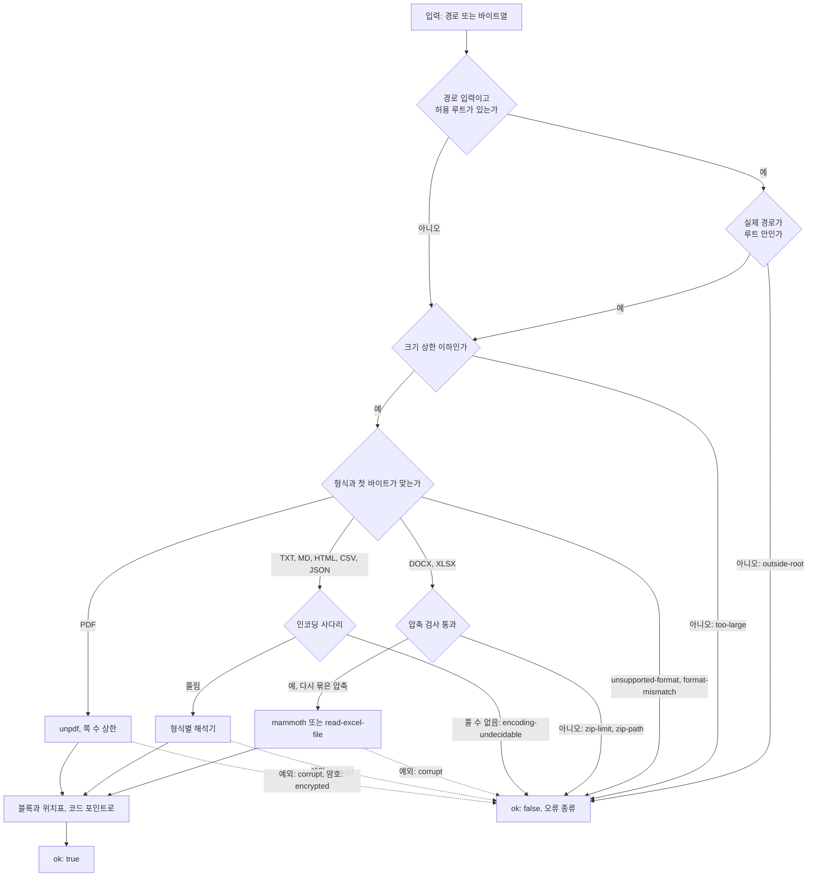
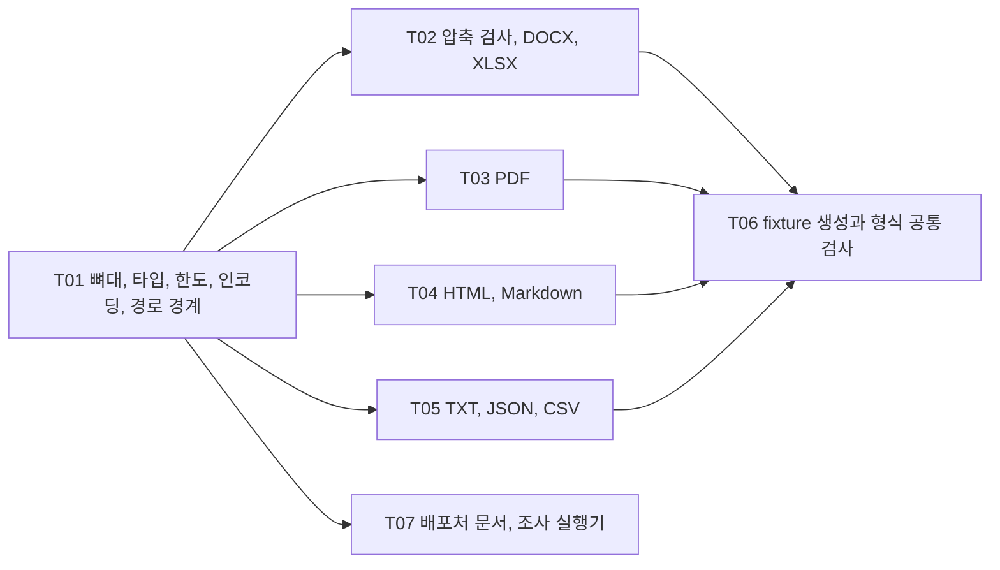

# 스펙: I02-A 문서 정규화 — 파일 하나를 글과 위치 지도로

- 날짜: 2026-11-21 / 상태: 확정(잠정 결정 포함 — 미해결 질문 참조)
- 관련: 이슈 #19(I02)의 첫 조각, 선행 #18(I01), 총괄 #1, Phase 2 #4. [ADR 0015 문서 파싱 구성](../adr/0015-document-parsing-stack.md), [ADR 0008 보안 기준선](../adr/0008-security-baseline.md), [ADR 0009 라이선스](../adr/0009-license.md), [V02 spec](2026-11-21-V02-vertical-slice.md), [site-setup.md](../site-setup.md)

낯선 말은 [ARCHITECTURE 0절](../ARCHITECTURE.md#0-처음-나오는-말)에 풀이가 있다. 이 문서에서 새로 쓰는 말 셋:

- **정규화**: 형식이 제각각인 파일(PDF, Word 문서, 엑셀 등)을 "글 한 덩어리"로 바꾸는 일. 사람이 여러 나라 말로 된 서류를 한 언어로 옮겨 적는 것과 비슷하다. 다만 옮겨 적은 글만 남기면 "원래 몇 쪽, 어느 칸에 있던 말인가"를 잃으므로 아래의 위치 지도를 함께 만든다.
- **블록과 위치표(locator)**: 정규화한 글의 한 구간(`[시작, 끝)`)이 원본 파일의 어디(PDF의 몇 쪽, 엑셀의 어느 시트·어느 칸)에서 왔는지 적은 표지. 책의 색인이 "이 낱말은 37쪽"이라고 알려 주는 것과 같다. 다른 점은 색인이 낱말을 가리키는 데 비해 블록은 글의 구간을 가리킨다는 것이다.
- **코드 포인트**: 유니코드 글자 하나의 번호. 한글 한 자도, 이모지 하나도 코드 포인트 하나다. JavaScript 문자열의 `.length`는 이모지를 둘로 세므로(UTF-16) 위치를 셀 때 쓰지 않는다. 근거(Evidence)의 위치도 코드 포인트로 센다(V02-R3).

## 배경

이슈 #19는 PDF·Markdown·TXT·HTML·DOCX·XLSX·CSV·JSON 파일과 폴더를 가져오는 일을 맡는다. 지금 제품은 JSONL만 가져온다(V01·V02). 이슈의 일은 크게 셋이다: ① 형식마다 글과 위치를 뽑기(I02-C1) ② 폴더 승인·감시·이름 바꾸기·symlink·대형·손상·악성 파일을 안전하게 다루기(I02-C2) ③ 스레드·참여자 순서와 감시 누락 뒤의 맞춰 보기(I02-C3).

이 가운데 폴더 감시와 원본 저장은 I01(#18)이 정할 Connector 규격과 근거(Evidence)의 위치 모양에 기댄다. I01 spec(`docs/specs/2026-11-21-I01-connector-sdk.md`)이 이제 들어와 있고, 그 Evidence의 위치표(`NativeLocator`)는 이 spec의 "위치표의 모양"을 그대로 따른다. 구현은 아직 시작 전이고 V02는 같은 정본 테이블을 바꾸는 중이다. 그래서 이 spec은 **그 규격에 기대지 않는 부분만** 먼저 떼어 낸다: 파일 하나를 받아 정규화한 결과를 돌려주는 순수한 모듈이다. 정본 저장소, 계약(`packages/contracts`), 구성 지점(`backend/src/composition.ts`)을 건드리지 않으므로 V02·I01과 같은 파일을 두고 부딪히지 않는다. 이 조각을 I02-A, 그 뒤의 폴더·감시·저장 쪽을 I02-B로 부른다.

이 모듈이 신뢰하지 않는 파일을 처음 여는 자리라는 점이 중요하다. 압축 폭탄(작은 파일이 풀면 수 GB가 되는 것), 압축 안의 `../` 경로, 스크립트와 원격 자원이 든 HTML, 깨진 파일이 모두 여기로 들어온다. ADR 0008은 가져온 내용을 "신뢰하지 않는 데이터로 표시하고 글자로만 그린다"고 정했다. 이 spec은 그 원칙을 파일을 여는 단계까지 앞당긴다.

## 목표

- 8개 형식의 합성 fixture를 정규화하면, 형식마다 정해 둔 글과 위치표가 나온다. 블록의 구간은 코드 포인트로 세며, 한글과 이모지가 든 문서에서도 구간의 글이 원본 요소의 글과 정확히 같다.
- 텍스트 형식은 BOM → 엄격한 UTF-8 → EUC-KR(CP949) 순서로 풀고, 무엇으로 풀었는지 결과에 적는다. 어느 것으로도 깨끗이 풀리지 않으면 깨진 글을 내지 않고 실패를 돌려준다.
- DOCX·XLSX는 압축을 푸는 라이브러리에 넘기기 **전에** 압축 검사를 통과해야 한다. 크기 상한, 손상 파일, 형식 불일치가 모두 정해진 종류의 실패 결과로 돌아오며 모듈이 예외로 죽지 않는다.
- 정규화하는 동안 스크립트가 실행되지 않고, 네트워크 요청이 0건이다.
- 한도 값은 모두 설정이며, 아무 설정 없이 로컬에서 도는 기본값을 갖는다.

## 비목표 (배포처에서 후속 진행)

**공용 저장소의 뒤 작업으로 넘기는 것**

- 폴더 scope 승인 화면, 폴더 감시, rename/move/debounce, 감시 누락 뒤의 맞춰 보기(reconciliation): I02-B(#19). I01(#18)의 Connector 규격이 정해진 뒤 한다. 이 조각의 symlink 처리는 **주어진 경로 하나**에 대한 것뿐이다.
- 스레드·참여자·댓글의 시간 순서 복원(I02-C3): I02-B(#19).
- 정규화 결과를 SourceRecord와 근거(Evidence)로 옮기고 정본에 저장하는 일: I01(#18)과 V02(#17)가 규격과 저장을 갖는다. 이 조각은 `packages/contracts`, `storage/`, `backend/src/composition.ts`를 **고치지 않고** 자기 출력 타입만 정한다. 옮길 때 다시 확인할 것은 아래 "I02-B에서 다시 확인할 것"에 적었다.
- 원본 파일과 첨부의 보관(원 설계 15절 "Local File Storage", ARCHITECTURE 194행): I02-B.
- OCR(스캔한 PDF의 글자 인식), 그림 속 글자: 하지 않는다. 글자 층이 없는 쪽은 한계 표시로 알린다.
- Docling 같은 고품질 문서 처리 사이드카: 선택적인 뒷날의 경로로만 남긴다([ADR 0011](../adr/0011-sidecar-language.md), [ADR 0015](../adr/0015-document-parsing-stack.md)).
- 화면: 이 조각에는 화면이 없다. 앱의 설정 화면에 한도를 노출하는 일도 I02-B에서 가져오기 경로와 함께 한다.
- 구형 형식(`.doc`, `.xls`, `.ppt`, `.hwp`, `.hwpx`, `.rtf`)과 PowerPoint: 지원하지 않는다. 들어오면 "지원하지 않는 형식" 실패로 알린다(I02A-R1).
- 성능 목표(EVALUATION의 "신규 문서 처리 p95 ≤ 3 s")의 측정: 가져오기 경로가 생기는 I02-B에서 잰다.

**배포처 후속 항목**(2개. 각각 [site-setup.md의 배포처 설정 체크리스트](../site-setup.md#배포처-설정-체크리스트)와 번호로 대응한다)

| 번호 | 항목 |
|---|---|
| S16 | 배포처의 npm 미러에서 문서 파서 의존성 설치 확인 |
| S17 | 실제 업무 문서로 형식별 정규화 결과 확인(문서 보안(DRM) 파일 포함) |

## 요구사항

**입력과 경계**

- **I02A-R1 입력과 형식 결정.** 공개 함수 `normalizeDocument(input, options?)` 하나를 둔다. 입력은 파일 경로이거나 바이트열이며, 형식을 선언할 수 있다. 선언이 없으면 확장자로 정한다(`.pdf`, `.md`·`.markdown`, `.txt`, `.html`·`.htm`, `.docx`, `.xlsx`, `.csv`, `.json`, 대소문자 무관). 이진 형식은 내용의 첫 바이트로 한 번 더 확인한다: PDF는 `%PDF-`, DOCX·XLSX는 ZIP 서명(`PK\x03\x04`)과 각자의 본문 항목(`word/document.xml`, `xl/workbook.xml`). 맞지 않으면 `format-mismatch`다. 확장자를 모르거나 구형 형식이면 `unsupported-format`이며 메시지에 그 확장자와 "지원하지 않는 형식"을 적는다.
- **I02A-R2 경로 하나의 경계.** 경로 입력에 허용 루트(`allowedRoot`)가 주어지면 symlink를 끝까지 따라간 실제 경로가 허용 루트의 실제 경로 **안**에 있어야 한다(문자열 앞부분 비교가 아니라 경로 구성 단위로 비교한다. `/data/a`는 `/data/ab` 안이 아니다). 밖이면 `outside-root`다. 일반 파일이 아니면(디렉터리, 장치 등) `not-a-file`이다. 파일은 한 번 연 핸들에서 크기를 확인하고 그 핸들로만 읽는다(확인과 읽기 사이에 파일이 바뀌는 틈을 줄인다). 열 때 마지막 구성 요소가 symlink이면 거부하고(`O_NOFOLLOW`), 읽기를 막지 않게(`O_NONBLOCK`) 연다. 확인 뒤 FIFO로 바꿔치기한 파일에서 열기가 멈춰 서지 않게 하려는 것이다. 중간 디렉터리가 확인 뒤에 symlink로 바뀌는 틈은 남는다.
- **I02A-R3 크기 상한.** 입력 바이트가 `maxFileBytes`를 넘으면 파서를 부르기 전에 `too-large`다. 경로 입력은 상한보다 많이 읽지 않는다. PDF의 쪽 수가 `pdf.maxPages`를 넘으면 쪽을 읽기 전에 `too-large`다.
- **I02A-R4 압축 검사.** DOCX·XLSX는 파서에 넘기기 전에 압축 검사를 거친다.
  - 중앙 디렉터리만 읽고 먼저 거른다: 항목 수 > `zip.maxEntries`, 한 항목의 선언 크기 > `zip.maxEntryBytes`, 선언 크기 합 > `zip.maxTotalBytes`, 크기가 `zip.ratioMinBytes` 이상인 항목의 압축률 > `zip.maxRatio`, 암호화된 항목. 걸리면 `zip-limit`(어느 한도인지 `detail.limit`에 적는다)이다.
  - 항목 이름이 절대 경로, `..` 구간, 역슬래시, 드라이브 문자(`C:`), NUL을 가지거나 같은 이름이 둘 이상이면(`detail.rule: "duplicate"`) `zip-path`다. 이 모듈은 디스크에 풀지 않지만, 그런 이름은 정상 문서에 없으므로 거부한다.
  - 그다음 항목을 하나씩 실제로 풀며 바이트를 센다. 실제 크기가 선언과 다르거나 한도를 넘으면 그 자리에서 멈추고 `zip-limit`이다(선언 크기는 거짓일 수 있다). 이 비교와 바이트 세기는 이 모듈이 직접 한다. yauzl의 크기 검증(`validateEntrySizes`)은 끈다.
  - 파서는 원래 바이트가 아니라 **검사를 통과한 항목만으로 다시 묶은 압축**을 받는다. 원래 압축의 중앙 디렉터리와 로컬 헤더가 서로 다른 내용을 가리키게 만든 파일이 파서에서 다른 내용으로 읽히는 길을 막는다. 그림과 포함 개체(`word/media/`, `xl/media/`, `embeddings/`)는 풀어서 크기를 세고 한계 표시에 쓰지만 다시 묶은 압축에는 넣지 않는다(파서가 쓰지 않는 바이트를 메모리에 두 번 들고 있지 않기 위해서다, 검토 B3).
- **I02A-R5 실패는 결과로.** 입력 때문에 생기는 실패는 모두 `{ ok: false, error }`로 돌아오며 `normalizeDocument`의 Promise는 거부되지 않는다. 오류 종류는 다음이 전부다: `unsupported-format`, `format-mismatch`, `outside-root`, `not-a-file`, `read-failed`, `too-large`, `zip-limit`, `zip-path`, `encoding-undecidable`, `encrypted`, `corrupt`. 파서가 던진 예외는 형식 모듈의 경계에서 `corrupt`로 바뀐다. `detail`에는 라이브러리의 메시지를 넣지 않고 안정된 종류나 코드(예외의 이름, csv-parse의 코드 등)만 넣는다. 라이브러리 메시지는 문서 안의 태그 이름·칸 주소·개체 이름을 되풀이하기 때문이다. 한도 설정 자체가 잘못된 것(아래 R19)은 입력 탓이 아니라 호출한 코드의 잘못이므로 예외로 알린다.
- **I02A-R6 데이터로만 읽기.** 어느 형식이든 정규화 중에 스크립트를 실행하지 않고, 네트워크에 연결하지 않으며, 입력 말고 다른 파일을 열지 않는다. HTML의 `script`·`style`·`noscript`·`template`·`iframe`·`object`·`embed`·`svg` 안의 내용은 글에 넣지 않는다. `src`·`href` 같은 주소는 따라가지 않는다. Markdown 안의 HTML은 해석하지 않고 **글자 그대로** 글에 넣는다. DOCX의 외부 연결(외부 그림 등)은 열지 않는다(mammoth의 `externalFileAccess`를 끈다).

**글과 위치**

- **I02A-R7 인코딩 사다리.** TXT·Markdown·HTML·CSV·JSON은 다음 순서로 푼다.
  1. BOM이 있으면 그 인코딩(UTF-8, UTF-16LE, UTF-16BE)으로 푼다.
  2. 없으면 엄격한 UTF-8(잘못된 바이트가 하나라도 있으면 실패)로 푼다.
  3. 실패하면 EUC-KR(CP949)로 푼다. 풀이는 `iconv-lite`의 `cp949`가 한다. 표준(WHATWG)의 `euc-kr`은 CP949 확장 글자까지 포함한다고 알려졌지만 저장소가 고정한 Node 24.22.3의 `TextDecoder("euc-kr")`는 확장 글자(예: 바이트 `8C 63` "똠")를 풀지 못해 쓰지 않는다([ADR 0015](../adr/0015-document-parsing-stack.md) 변경 이력). 결과는 다음을 **모두** 만족할 때만 받아들인다: 대체 문자(U+FFFD)가 없다, 한글 음절이 하나 이상 있다, ASCII·한글·CJK 문장 부호·전각 글자 밖의 글자 비율이 `encoding.fallbackMaxForeignRatio` 이하다.
  4. 어느 것도 아니면 `encoding-undecidable`이다. 깨진 글을 결과로 내지 않는다.

  결과에 `encoding: { name, method }`를 적는다(`name`: `utf-8`, `utf-16le`, `utf-16be`, `euc-kr` / `method`: `bom`, `strict`, `fallback`). 3번으로 풀었으면 한계 표시 `text.encoding-fallback`을 단다(추정이기 때문이다). HTML의 `<meta charset>` 선언은 쓰지 않는다.
- **I02A-R8 정규 텍스트.** 결과의 `text`는 위치의 기준이 되는 글 하나다. BOM은 빼고 줄바꿈(`\r\n`, `\r`)은 `\n`으로 바꾼다. 유니코드 정규화(NFC 등)는 하지 않는다(원문의 글자를 그대로 둔다). 같은 바이트와 같은 한도를 넣으면 언제나 깊은 비교로 같은 결과가 나온다(나중에 같은 원본을 다시 넣었을 때 내용 해시가 같아야 하기 때문이다, V02-C3).
- **I02A-R9 블록.** `blocks`의 각 항목은 `start`, `end`(코드 포인트, `[start, end)`)와 `locator`를 갖는다. 블록은 시작 순서대로 정렬되고 서로 겹치지 않으며 `0 ≤ start < end ≤ text의 코드 포인트 수`다. 블록의 글(`text`를 그 구간으로 자른 것)은 그 원본 요소에서 뽑은 글과 정확히 같다. 블록 사이의 글은 구분자뿐이다: 같은 행의 칸 사이는 `\t`, PDF의 쪽 사이와 XLSX의 시트 사이는 `\n\n`, 그 밖의 블록 사이는 `\n`. 글이 없는 요소(빈 문단, 빈 칸)는 블록도 줄도 만들지 않는다. 공백뿐인 칸(CSV)도 글이 없는 것으로 보아 블록도 글도 만들지 않는다. 단, TXT와 JSON은 원문을 그대로 글로 두므로 빈 줄이 글에 남는다(블록만 만들지 않는다).

**형식별 추출**(위치표의 모양은 아래 "인터페이스"의 표가 기준이다)

- **I02A-R10 PDF.** 쪽마다 글자 층의 글을 뽑는다. 한 쪽의 글은 글 조각을 차례로 잇고 줄 끝 표시가 있는 조각 뒤에 `\n`을 둔다. 블록은 쪽 하나이며 위치표는 1부터 세는 쪽 번호다. 글자 층이 없는 쪽은 블록을 만들지 않고 한계 표시 `pdf.page-without-text`에 그 쪽 번호들을 적는다. 암호가 걸린 PDF는 `encrypted`다. PDF 라이브러리는 `eval`을 쓰지 않게 하고 글꼴·주소를 내려받지 않게 연다.
- **I02A-R11 DOCX.** 본문의 문단을 문서 순서대로(표 안의 문단 포함) 뽑는다. 블록은 문단 하나이고 위치표는 본문 안의 문단 번호(0부터, 빈 문단 포함해 센다), 스타일 이름, 제목 수준(스타일이 "heading N"이면 N), 표 안이면 표 번호·행·칸(0부터)이다. 머리글·바닥글·각주·메모·그림은 넣지 않으며, 문서에 그것들이 있으면 각각 한계 표시를 단다.
- **I02A-R12 XLSX.** 모든 시트를 통합 문서의 순서대로 뽑는다. 시트마다 시트 이름을 블록 하나로 먼저 두고, 그 뒤 값이 있는 칸마다 블록 하나를 둔다. 위치표는 시트 이름, A1 형식의 칸 주소, 1부터 세는 행·열 번호다. 값은 문자열은 그대로, 수는 JavaScript의 기본 수 표기로, 참·거짓은 `TRUE`·`FALSE`로, 날짜는 ISO-8601로 적는다. 수식은 파일에 저장된 마지막 계산값을 쓴다. 수식·병합된 칸·숨긴 시트가 있으면 각각 한계 표시를 단다.
- **I02A-R13 CSV.** 인코딩 사다리로 푼 뒤 레코드마다 값이 있는 칸(비어 있지 않고 공백뿐이지 않은 칸)을 `\t`로 이어 한 줄로 둔다. 빈 칸과 공백뿐인 칸은 글에도 탭에도 넣지 않고, 값 있는 칸이 하나도 없는 레코드는 줄을 만들지 않는다(XLSX가 빈 칸을 건너뛰는 것과 같다). 칸 번호는 원래 자리의 번호를 그대로 쓴다. 블록은 값이 있는 칸 하나이며 위치표는 1부터 세는 레코드 번호, 그 레코드가 시작하는 원문의 줄 번호, 칸 번호다. 첫 줄을 머리글로 따로 다루지 않는다. 레코드마다 칸 수가 다르면 한계 표시를 단다. 닫히지 않은 따옴표처럼 해석할 수 없는 CSV는 `corrupt`다.
- **I02A-R14 HTML.** 문서 나무를 만들되 실행하지 않고, R6에서 뺀 요소를 건너뛰며 글을 모은다. 블록은 블록 수준 요소(문단, 제목, 목록 항목, 표의 칸, `div` 등) 하나에 직접 속한 글의 덩어리이며, 연속된 공백은 하나로 줄인다(`pre` 안은 그대로). 위치표는 요소 경로(`body>div[1]>p[2]`처럼 같은 이름의 형제 가운데 몇 번째인지)와 그 글이 시작하는 원문의 줄 번호다. 뺀 요소가 있거나 외부 주소가 있으면 그 수를 한계 표시로 단다.
- **I02A-R15 Markdown.** Markdown 구문 나무를 만들어 말단 블록(제목, 문단, 코드 블록, HTML 블록)마다 블록 하나를 둔다. 블록의 글은 그 노드의 글자 내용이다(링크는 글만, 그림은 대체 글만, 주소는 버린다). 위치표는 시작 줄 번호, 노드 종류, 제목이면 수준이다. HTML 블록과 문장 안의 HTML은 글자 그대로 남기고 한계 표시를 단다. 주소를 버렸으면 그 수를 한계 표시로 단다. 표·각주 같은 GFM 확장은 해석하지 않는다(일반 문단의 글로 남는다).
- **I02A-R16 TXT와 JSON.** 푼 글을 그대로 `text`로 둔다. 블록은 빈 줄이 아닌 줄 하나이며 위치표는 1부터 세는 줄 번호다. JSON은 먼저 해석해 보고 해석되지 않으면 `corrupt`다. JSON의 구조는 펼치지 않는다.

**메타데이터와 한계**

- **I02A-R17 메타데이터.** 얻을 수 있으면 `title`, `author`, `created`, `modified`(ISO-8601)를 채운다: PDF는 문서 정보(Info)의 Title·Author·CreationDate·ModDate, DOCX·XLSX는 `docProps/core.xml`의 제목·작성자·만든 날·고친 날, HTML은 `<title>`과 `<meta name="author">`. 없는 값은 빈 문자열이 아니라 **필드를 두지 않는다**. 그 밖에 PDF는 쪽 수, XLSX는 시트 이름 목록을 둔다.
- **I02A-R18 형식별 한계 표시.** 결과의 `limitations`는 `{ code, count?, pages? }`의 목록이다. 코드는 아래 "한계 표시 코드" 표의 것이 전부이며 코드 상수 `LIMITATION_CODES`와 같다. 표의 각 코드는 그것을 일으키는 합성 fixture가 하나 이상 있다(이슈 I02-C1 "지원 한계를 형식별 fixture로 명시"). 늘 그런 형식의 성질(예: PDF의 읽는 순서)은 결과에 달지 않고 같은 표의 "늘 있는 한계"에 적는다.
- **I02A-R19 한도는 설정.** 모든 한도는 한 설정 객체에 있고 공개 상수 `DEFAULT_LIMITS`가 로컬 기본값이다. 호출하는 쪽은 일부만 덮어쓸 수 있다. 0 이하, 정수가 아닌 값(비율 제외), `NaN`은 `TypeError`로 거부한다.

**fixture, 의존성, 문서**

- **I02A-R20 합성 fixture.** 형식별 정상·한계·손상 fixture를 `fixtures/documents/`에 둔다. 내용은 모두 지어낸 것이다. 이진 파일(DOCX, XLSX, PDF)과 EUC-KR·UTF-16 파일은 손으로 고치지 않고, 커밋한 생성 스크립트가 같은 바이트를 만든다(압축 항목의 시각과 PDF의 날짜를 고정한다). 압축 폭탄, `../` 항목, 크기를 속인 항목 같은 공격 입력은 파일로 커밋하지 않고 테스트가 같은 생성 함수로 메모리에서 만든다. 이 디렉터리에는 `.jsonl`을 두지 않으며, 합성 목록 생성기는 `fixtures/` 맨 위의 `.jsonl`만 읽으므로 합성 목록은 바뀌지 않는다(`providers/src/build-synthetic-manifest.ts`의 `jsonlFiles`). `fixtures/documents/`는 `.prettierignore`에 넣는다(일부러 BOM, CRLF, 깨진 HTML을 둔다). 저장소 맨 위의 `.gitattributes`가 `fixtures/documents/**`를 `-text`로 두어(줄바꿈 변환 없음), Windows의 `core.autocrlf=true` 체크아웃에서도 커밋한 바이트가 생성기의 출력과 같다. 이진 PDF는 줄바꿈이 바뀌면 xref 위치가 깨진다.
- **I02A-R21 의존성.** 새 의존성은 정확한 버전으로 고정하고 라이선스를 PR과 ADR 0015에 적는다([ADR 0009](../adr/0009-license.md)). 모두 npm 레지스트리의 패키지이며 tarball 주소나 git 주소로 받지 않는다(배포처는 npm 미러로 설치한다). 설치 스크립트와 네이티브 모듈이 없는 것만 쓴다(`pnpm-workspace.yaml`의 `allowBuilds`에 새 항목이 생기지 않는다).
- **I02A-R22 배포처 문서와 조사 실행기.**
  - [site-setup.md](../site-setup.md)의 `## 배포처 설정 체크리스트` 아래에 S16, S17을 더하고, 번호 대응 문장에 이 spec과 그 범위(S16~S17)를 더한다(제목은 그대로 둔다).
  - S17에 쓰는 조사 실행기 `pnpm --filter @pki/document-normalize survey <폴더>`를 둔다. 폴더 아래의 일반 파일을 정규화하고(symlink는 따라가지 않고 센다) 형식별 성공 수, 오류 종류별 수, 한계 코드별 수, 인코딩별 수만 JSON으로 출력한다. **파일 이름과 글은 출력하지 않는다.** 폴더가 이 저장소 안에 있으면 `배포처 후속`으로 시작하는 알림을 출력하고 0이 아닌 값으로 끝난다(저장소의 합성 자료로 낸 결과가 S17의 결과로 기록되는 길을 막는다).
  - [ADR 0015](../adr/0015-document-parsing-stack.md)를 두고 [REUSE_AND_BUILD.md](../REUSE_AND_BUILD.md)의 "문서 파싱" 행을 그 결정으로 고친다. README에는 아무것도 더하지 않는다(사용자가 쓰는 명령이 생기지 않았다).

## 인터페이스 / 설계 개요

### 패키지

새 작업 공간 패키지 `@pki/document-normalize`를 `packages/document-normalize/`에 둔다. `packages/*`는 이미 작업 공간에 들어 있으므로 `pnpm-workspace.yaml`은 그대로이고 루트 `tsconfig.json`에 참조 하나만 더한다. 이 패키지는 어댑터 규격을 구현하지 않는 순수 라이브러리이므로 `src/adapters/`가 없다. 다른 `@pki/*` 패키지에 기대지 않는다(계약 패키지를 고치지 않기 위해 자기 타입을 갖는다).

왜 최상위 `ingest/`가 아닌가: 최상위 패키지(`storage/`, `providers/`)는 어댑터 구현을 갖는 영역이다. 폴더 감시 Connector는 I02-B에서 생기며, 그때 그것이 이 패키지에 기대게 하면 된다. 지금 `ingest/`를 만들면 아직 없는 Connector를 위한 자리를 미리 파는 셈이다.

### 공개 함수와 타입 (잠정. T01에서 확정)

```ts
type DocumentFormat = "pdf" | "markdown" | "txt" | "html" | "docx" | "xlsx" | "csv" | "json";

type NormalizeInput =
  | { kind: "path"; path: string; allowedRoot?: string; format?: DocumentFormat }
  | { kind: "bytes"; bytes: Uint8Array; name?: string; format?: DocumentFormat };

function normalizeDocument(
  input: NormalizeInput,
  options?: { limits?: PartialLimits },
): Promise<NormalizeResult>;

type NormalizeResult =
  | { ok: true; document: NormalizedDocument }
  | { ok: false; error: { code: NormalizeErrorCode; message: string; detail?: Record<string, string | number> } };

interface NormalizedDocument {
  format: DocumentFormat;
  text: string;                       // 위치의 기준이 되는 정규 텍스트
  blocks: { start: number; end: number; locator: Locator }[];  // 코드 포인트, [start, end)
  metadata: { title?: string; author?: string; created?: string; modified?: string; pageCount?: number; sheetNames?: string[] };
  encoding?: { name: "utf-8" | "utf-16le" | "utf-16be" | "euc-kr"; method: "bom" | "strict" | "fallback" };
  limitations: { code: LimitationCode; count?: number; pages?: number[] }[];
}

function codePointSlice(text: string, start: number, end: number): string;  // 블록의 글을 꺼내는 도우미
```

### 위치표의 모양

| 형식 | 위치표 | 번호의 기준 |
|---|---|---|
| PDF | `{ format: "pdf", page }` | 쪽 1부터 |
| DOCX | `{ format: "docx", paragraph, style?, headingLevel?, table?: { index, row, cell } }` | 문단·표·행·칸 0부터 |
| XLSX | `{ format: "xlsx", sheet, cell?, row?, column? }` (시트 이름 블록은 `cell` 없음) | `cell`은 `A1` 형식, 행·열 1부터 |
| CSV | `{ format: "csv", record, line, field }` | 모두 1부터 |
| HTML | `{ format: "html", path, line }` | 경로의 형제 번호와 줄 1부터 |
| Markdown | `{ format: "markdown", line, node, depth? }` | 줄 1부터 |
| TXT, JSON | `{ format: "txt" \| "json", line }` | 줄 1부터 |

### 한도 기본값

| 설정 | 기본값 | 무엇을 막는가 |
|---|---|---|
| `maxFileBytes` | 52,428,800 (50 MiB) | 큰 파일 전체를 메모리에 올리는 것 |
| `zip.maxEntries` | 5,000 | 항목 수 폭탄 |
| `zip.maxEntryBytes` | 33,554,432 (32 MiB) | 한 항목의 압축 폭탄 |
| `zip.maxTotalBytes` | 134,217,728 (128 MiB) | 여러 항목에 나눈 압축 폭탄 |
| `zip.maxRatio` | 200 | 압축률이 비정상인 항목 |
| `zip.ratioMinBytes` | 1,048,576 (1 MiB) | 작은 XML의 높은 압축률을 오탐하지 않게, 이 크기 이상인 항목에만 압축률을 본다 |
| `pdf.maxPages` | 2,000 | 쪽 수 폭탄 |
| `encoding.fallbackMaxForeignRatio` | 0.1 | EUC-KR로 "풀리기는 하는" 다른 인코딩의 파일 |

압축 한도를 낮춘 까닭: 검사를 통과한 항목을 모두 메모리에 쥐고 다시 묶으므로 한 파일의 최대 메모리가 `zip.maxTotalBytes`의 두 배 남짓이 된다. 검토 측정에서 한도가 256 MiB일 때 287 KB DOCX가 618 MiB, 4개 시트가 든 28 MB XLSX가 1.94 GiB(최대 상주 메모리)까지 올랐다. 8 GiB 데스크톱에서 폴더를 훑는 I02-B에는 높으므로 128 MiB와 32 MiB로 낮췄다. 낮춘 값에서 4×30 MiB 시트 XLSX(14.8 MB)를 `/usr/bin/time -l`로 재면 최대 상주 메모리가 **1.04 GiB**이고(18.2 s), 10 ms 간격 표집으로는 423 MiB(재측정에서는 293 MiB)로 보였다. 표집은 최대치를 놓치므로 이 문서는 1.04 GiB를 쓴다. 옛 기본값의 1.94 GiB보다 낮지만 8 GiB 데스크톱에서 폴더를 훑는 I02-B에는 여전히 크고, 남은 비용은 파서가 쓰므로 "I02-B에서 다시 확인할 것" 4번의 작업자 `resourceLimits`가 받는다.

기본값은 배포처 값이 아니라 로컬에서 도는 값이다. 이 조각에서는 값을 넘기는 쪽이 테스트뿐이다. 앱의 설정으로 잇는 일은 I02-B가 가져오기 경로와 함께 한다.

### 한계 표시 코드

| 코드 | 형식 | 언제 달리는가 | 늘 있는 한계(달지 않음) |
|---|---|---|---|
| `text.encoding-fallback` | TXT·MD·HTML·CSV·JSON | EUC-KR로 추정해 풀었을 때 | UTF-16은 BOM이 있을 때만 알아본다. 그 밖의 옛 인코딩(Shift_JIS, Latin-1 등)은 `encoding-undecidable` |
| `pdf.page-without-text` | PDF | 글자 층이 없는 쪽이 있을 때(`pages`에 쪽 번호) | 읽는 순서는 파일 안의 그리기 순서다. 다단·표의 구조는 남지 않는다. 글자 대응표(ToUnicode)가 없는 글꼴의 글은 깨질 수 있다. OCR 없음 |
| `docx.images-omitted` | DOCX | 그림이 있을 때 | 글상자·도형 안의 글, 변경 추적은 보장하지 않는다 |
| `docx.headers-footers-omitted` | DOCX | 머리글·바닥글이 있을 때 | |
| `docx.notes-omitted` | DOCX | 각주·미주가 있을 때 | |
| `docx.comments-omitted` | DOCX | 메모가 있을 때(댓글 순서 복원은 I02-B) | |
| `xlsx.formula-cached-value` | XLSX | 수식 칸이 있을 때 | 수의 표시 형식(쉼표, 통화)은 남지 않는다. 그림·차트 없음 |
| `xlsx.merged-cells` | XLSX | 병합된 칸이 있을 때(값은 왼쪽 위 칸에만) | |
| `xlsx.hidden-sheet` | XLSX | 숨긴 시트가 있을 때(그 시트도 글에 들어간다) | |
| `csv.ragged-rows` | CSV | 레코드마다 칸 수가 다를 때 | 머리글을 따로 알아보지 않는다 |
| `html.elements-removed` | HTML | R6의 요소를 뺐을 때(`count`) | 화면에 숨긴 글(CSS)도 글에 들어간다 |
| `html.external-references-ignored` | HTML | 외부 주소가 있을 때(`count`) | |
| `markdown.raw-html-as-text` | Markdown | HTML이 글자 그대로 남았을 때 | GFM 표·각주는 일반 문단 |
| `markdown.external-references-ignored` | Markdown | 링크·그림 주소를 버렸을 때(`count`: 주소가 나온 횟수. 정의 `[x]: url`과 그것을 쓰는 참조 각각을 따로 센다) | |
| — | JSON | — | 구조를 펼치지 않고 원문을 글로 둔다 |

### 한 파일이 지나가는 길

경계 검사는 모두 파서보다 앞에 있다. 파서는 검사를 통과한 바이트만 본다.



### I02-B에서 다시 확인할 것

이 조각이 일부러 정하지 않고 넘기는 것이다. I01(#18)의 규격이 정해지면 하나씩 맞춰 본다.

1. **SourceRecord로 옮기기.** `body`는 `text`를 그대로, `title`은 `metadata.title`이 없으면 파일 이름. V02-R3의 근거 위치는 `body`의 코드 포인트이므로 `blocks`의 구간을 그대로 쓸 수 있다. I01-C2의 "span/page/sheet"가 위치표를 어떻게 담을지(근거 행의 열인가, 원본 version의 부속 데이터인가)는 I01이 정한다.
2. **내용 해시.** 지금 정본의 해시는 제목과 본문으로 계산한다(`storage/src/sources.ts`). 파서의 버전을 올려 같은 파일의 `text`가 바뀌면 새 version이 생긴다. 이것을 받아들일지 정한다.
3. **합성 등급.** `fixtures/documents/`의 자료는 합성 목록에 없으므로, 앱으로 가져오면 "합성"이 아닌 일반 등급이 된다. 문서 fixture를 합성으로 다룰 필요가 생기면 합성 목록 생성기를 넓힌다.
4. **시간 상한 없이는 가져오기에 넣지 않는다(검토 B2, 오케스트레이터가 위험으로 받아들임).** I02-A의 `normalizeDocument`는 제품 쪽 호출자가 없고, 파서에는 시간 상한이 없다. 검토의 실측: 24 KB Markdown이 14 s(micromark의 제곱 시간), 3.1 MB PDF가 CPU 359 s(PDF.js가 3 GiB로 펴지는 압축 흐름을 끝까지 푼다). 최초의 제품 호출자(I02-B의 가져오기·폴더 훑기)는 폴더 훑기가 나가기 전에, 정규화를 `worker_threads`(`resourceLimits` 포함)나 utility process에서 제한 시간을 두고 돌려야 하며, 시간 초과를 알리는 새 오류 코드(R5의 목록에 더한다)를 정한다. 이것이 없으면 작은 파일 하나가 백엔드를 멈춘다.
5. **원본 파일 보관과 삭제.** 원본을 보관하면 ADR 0013의 삭제 경로(모든 version의 내용 삭제)가 그 파일까지 따라가야 한다.

### 작업 분해

한 PR 안의 작업이다(작업마다 커밋). T01이 공개 타입, 한도, 도우미, 그리고 형식 모듈의 빈 자리(`unsupported-format`을 돌려주는 임시 구현)를 먼저 만든다. 그 뒤 T02~T05와 T07은 서로 다른 파일만 고치므로 동시에 할 수 있다. **새 의존성과 `pnpm-lock.yaml`은 T01이 한 번에 넣는다**(여럿이 동시에 lockfile을 고치면 충돌한다). 경로는 `packages/document-normalize/`를 `pkg/`로 줄여 적는다.



| ID | 산출물과 파일 | 요구사항 | 기준 | depends_on | 검증 증거 |
|---|---|---|---|---|---|
| I02A-T01 | `pkg/package.json`(의존성 전부와 `survey`·`build:fixtures` 스크립트), `pkg/tsconfig.json`, 루트 `tsconfig.json`, `pnpm-lock.yaml`, `.prettierignore`, `pkg/src/{index,types,limits,text-builder,encoding,input,detect,normalize}.ts`, `pkg/src/formats/*.ts`의 임시 구현 8개, 각 `*.test.ts`, `tooling/workspace/lockfile-registry.test.ts` | R1, R2, R3(파일), R5, R7, R8, R9(도우미), R19, R21 | C2(도우미), C3, C5(파일·경로), C6(형식 결정·거부 안 됨), C11, C12 | — | `pnpm typecheck`·`pnpm lint`·대상 테스트 출력. 인코딩 사다리의 각 단계를 지우면 빨개지는 테스트 |
| I02A-T02 | `pkg/src/zip-guard.ts`, `pkg/src/ooxml-core.ts`, `pkg/src/formats/docx.ts`, `pkg/src/formats/xlsx.ts`, `pkg/src/testing/ooxml-builder.ts`, 각 `*.test.ts` | R4, R6(DOCX), R11, R12, R17(OOXML), R18(DOCX·XLSX) | C1(DOCX·XLSX), C4, C6(DOCX·XLSX), C8(DOCX·XLSX), C9(DOCX·XLSX) | T01 | 압축 검사의 검사 항목마다 그 줄을 지우면 빨개지는 테스트. 거부된 입력에서 파서 호출 0회 |
| I02A-T03 | `pkg/src/formats/pdf.ts`, `pkg/src/testing/pdf-builder.ts`, `pdf.test.ts` | R3(쪽 수), R6(PDF), R10, R17(PDF), R18(PDF) | C1(PDF), C2(PDF), C5(쪽 수), C6(PDF), C8(PDF), C9(PDF) | T01 | 한글·이모지 PDF의 쪽별 글과 구간, 쪽 수 상한, 손상 PDF 테스트 출력 |
| I02A-T04 | `pkg/src/formats/html.ts`, `pkg/src/formats/markdown.ts`, 각 `*.test.ts` | R6(HTML·MD), R14, R15, R17(HTML), R18(HTML·MD) | C1(HTML·MD), C7(형식별), C8(HTML), C9(HTML·MD) | T01 | 스크립트 표식이 생기지 않고 스크립트 본문이 글에 없는 테스트, 요소 경로·줄 번호 테스트 |
| I02A-T05 | `pkg/src/formats/txt.ts`, `json.ts`, `csv.ts`, 각 `*.test.ts` | R13, R16, R18(CSV·텍스트) | C1(TXT·JSON·CSV), C3(형식 연결), C6(JSON·CSV), C9(CSV·텍스트) | T01 | EUC-KR CSV의 위치표, 잘못된 JSON, 닫히지 않은 따옴표 테스트 |
| I02A-T06 | `pkg/src/testing/generate-fixtures.ts`, `fixtures/documents/*`, `fixtures/README.md`, `pkg/src/fixtures.test.ts`, `pkg/src/safety.test.ts` | R6(형식 공통), R8, R18(대응), R20 | C6(손상 묶음), C7, C9, C10 | T02, T03, T04, T05 | 생성 두 번의 바이트 같음, 커밋본과 같음, 전 fixture의 네트워크 요청 0, 전 손상 fixture에서 거부 없음 |
| I02A-T07 | `pkg/src/survey.ts`, `survey.test.ts`, `docs/site-setup.md`, `tooling/docs/site-setup-i02.test.ts`, `docs/REUSE_AND_BUILD.md` | R22 | H1, H2 | T01 | 문서 대응 테스트, 조사 실행기의 거부 1건과 내용 비노출 테스트 |

T07의 문서 대응 테스트는 V01의 `tooling/docs/site-setup.test.ts`를 고치지 않고 새 파일로 둔다. 그 파일은 V02-T01이 넓히는 중이라 같은 파일을 고치면 부딪힌다. 두 테스트를 하나로 합치는 일은 V02-T01이 들어온 뒤의 정리로 남긴다.

## 완료 기준 (테스트 가능한 형태)

이슈 #19의 C1~C3은 I02 전체의 기준이다. 아래 I02A-C1~C12는 이 조각의 기준이며, 이슈 기준과의 관계는 그 아래 표에 적었다. H1·H2는 이 프로젝트가 배포처로 넘어가는 프로젝트라서 spec 양식이 요구하는 두 기준이다.

- [ ] **I02A-C1** (R9~R16): 8개 형식의 정상 fixture를 정규화하면, 형식마다 테스트에 적어 둔 `text`, 블록의 수, 블록마다의 위치표와 글이 그대로 나온다. 모든 결과가 R9의 블록 조건(정렬, 겹치지 않음, 범위 안, 구간의 글 = 요소의 글)을 만족한다.
- [ ] **I02A-C2** (R8, R9, R10): 한글, 이모지(UTF-16에서 두 단위), 결합 문자가 든 문서(TXT, PDF, XLSX 각 하나)에서 각 블록의 `codePointSlice`가 기대한 요소의 글과 같고, 이모지 뒤의 블록 하나 이상에서 `start`가 UTF-16 위치와 다르다. 구간을 UTF-16으로 세도록 바꾸면 이 테스트가 실패한다.
- [ ] **I02A-C3** (R7): UTF-8 BOM, UTF-16LE BOM, UTF-16BE BOM, BOM 없는 UTF-8, EUC-KR, CP949 확장 글자(예: "똠")가 든 파일이 바르게 풀리고 `encoding`이 각각 맞게 적힌다. Latin-1로 쓴 글, 잘못된 바이트열, EUC-KR로 오류 없이 풀리지만 한글이 하나도 없는 바이트열은 `encoding-undecidable`이고 `text`가 없다. 성공한 모든 텍스트 fixture의 결과에 U+FFFD가 없다.
- [ ] **I02A-C4** (R4): ① 선언 크기가 `zip.maxEntryBytes`를 넘는 항목 ② 선언 크기 합이 `zip.maxTotalBytes`를 넘는 압축 ③ 항목 수가 `zip.maxEntries`를 넘는 압축 ④ 압축률이 `zip.maxRatio`를 넘는 항목 ⑤ 암호화된 항목 ⑥ 실제로 풀린 크기가 선언보다 큰 항목은 각각 `zip-limit`(그 한도의 이름이 `detail.limit`)이고, ⑦ `../`, 절대 경로, 역슬래시, 드라이브 문자를 가진 항목은 각각 `zip-path`다. ①~⑦ 모두에서 DOCX·XLSX 파서의 호출이 0회다. 각 경우는 그 검사 한 줄을 지우면 실패한다. ⑥에서 푼 바이트 수는 한도에 한 번 읽는 크기를 더한 값을 넘지 않는다. 한도 바로 아래의 정상 문서는 통과한다.
- [ ] **I02A-C5** (R2, R3): 바이트열 입력이 `maxFileBytes`와 같으면 통과하고 1바이트 더 크면 `too-large`이며 파서 호출이 0회다. 경로 입력이 상한을 넘으면 `too-large`이고 읽은 바이트가 상한에 한 번 읽는 크기를 더한 값을 넘지 않는다. 허용 루트 밖을 가리키는 symlink, `..`로 루트를 벗어나는 경로, 이름이 루트로 시작하는 형제 디렉터리(`/root-a`에 대한 `/root-ab`)는 `outside-root`이고, 루트 안을 가리키는 symlink는 통과한다. 디렉터리는 `not-a-file`이다. 쪽 수가 `pdf.maxPages`를 넘는 PDF는 `too-large`다.
- [ ] **I02A-C6** (R1, R5): 형식마다 하나 이상의 손상 입력(잘린 PDF, ZIP이 아닌 `.docx`, `word/document.xml`이 없는 ZIP, 망가진 XLSX, 잘못된 JSON, 닫히지 않은 따옴표의 CSV)이 정해진 오류 종류로 돌아온다. 확장자와 첫 바이트가 다르면 `format-mismatch`, 구형 형식 6종은 각각 `unsupported-format`이다. 모든 손상·거부 fixture에서 `normalizeDocument`의 Promise가 거부되지 않는다. 파서가 던지도록 만든 대역에서도 결과는 `corrupt`다.
- [ ] **I02A-C7** (R6): 테스트가 `fetch`, `http`·`https`의 `request`·`get`, `net.connect`·`createConnection`, `tls.connect`, `dns.lookup`을 감시한 채 모든 fixture(스크립트·이벤트 처리기·원격 그림·원격 CSS·`iframe`이 든 HTML, 원격 그림과 `<script>`가 든 Markdown, 외부 그림 연결이 든 DOCX, 링크가 든 PDF 포함)를 정규화하면 호출이 0건이다(같은 테스트 안에서 감시가 실제 호출을 잡는다는 양성 대조 1건을 함께 둔다). HTML의 스크립트가 세우려는 전역 표식이 생기지 않고, 스크립트 본문의 문자열이 `text`에 없다. Markdown의 `<script>`는 `text`에 글자 그대로 있다.
- [ ] **I02A-C8** (R17): DOCX·XLSX의 제목·작성자·만든 날·고친 날, PDF의 Title·Author·CreationDate, HTML의 제목·작성자가 fixture에 적은 값과 같고 날짜는 ISO-8601이다. 메타데이터가 없는 fixture의 결과에는 그 필드가 없다(빈 문자열이 아니다).
- [ ] **I02A-C9** (R18): `LIMITATION_CODES`의 코드마다 그것을 내는 fixture가 하나 이상 있고, fixture 묶음 전체를 정규화해서 나온 코드의 집합이 `LIMITATION_CODES`와 같다. 이 spec의 "한계 표시 코드" 표에 적힌 코드의 집합도 `LIMITATION_CODES`와 같다(표와 코드가 어긋나면 실패).
- [ ] **I02A-C10** (R8, R20): 모든 fixture를 두 번 정규화한 결과가 깊은 비교로 같다. 생성 스크립트를 두 번 돌린 출력이 바이트 단위로 같고 커밋된 `fixtures/documents/`와 같다. 합성 목록 테스트(`synthetic-manifest.test.ts`)가 그대로 통과한다.
- [ ] **I02A-C11** (R19): `DEFAULT_LIMITS`로 통과하는 fixture가 `maxFileBytes`를 그보다 작게 덮어쓰면 `too-large`가 된다. 한도에 0, 음수, `NaN`, 정수가 아닌 바이트 수를 주면 `TypeError`다.
- [ ] **I02A-C12** (R21): `pnpm-lock.yaml`의 어떤 패키지도 tarball 주소나 git 주소로 받지 않는다(그런 해석이 하나라도 있으면 테스트가 실패한다). 이 패키지의 의존성은 모두 정확한 버전이다. `pnpm-workspace.yaml`의 `allowBuilds`는 이 작업 앞과 같다.
- [ ] **I02A-H1** (R22): 이 spec의 "배포처 후속 항목" 2개 각각에 대해 site-setup.md의 `## 배포처 설정 체크리스트` 아래에 같은 번호의 항목이 정확히 한 번 있고, 체크리스트가 밝힌 이 spec의 범위(S16~S17)에 든 항목 수가 2이면 통과한다. 하나라도 없거나 수가 다르면 문서 대응 테스트가 실패한다.
- [ ] **I02A-H2** (R22): 조사 실행기를 이 저장소 안의 폴더에 실행하면 `배포처 후속`으로 시작하는 알림을 출력하고 0이 아닌 값으로 끝난다(1건). S16은 실행할 제품 경로가 없는 설치 확인이므로 이 기준의 경우가 아니며, 양식의 "미구현 경로" 기준을 V02-H2처럼 "사외 실행이 배포처 결과로 기록되는 길을 막는다"로 적용했다. 저장소 밖의 임시 폴더에서는 0으로 끝나고, 그 안 파일의 이름과 글에 넣은 표식 문자열이 출력에 없다.

### 이슈 기준과의 관계

| 이슈 기준 | 이 조각이 충족하는 부분 | 남는 부분(I02-B) |
|---|---|---|
| I02-C1 형식별 표·시트·페이지·인코딩·첨부 metadata·근거 위치 보존, 형식별 한계 fixture | 표·시트·페이지·인코딩·위치표·메타데이터·한계 fixture(C1~C3, C8, C9) | 첨부(메일 첨부 등)의 metadata, 근거(Evidence)에 위치표를 싣는 것(I01 규격 뒤) |
| I02-C2 폴더 scope 승인, rename/move/debounce, symlink 경계, 대형·손상 파일, HTML script·remote resource, 압축 폭탄 | 경로 하나의 symlink 경계, 대형·손상 파일, HTML 스크립트·원격 자원, 압축 폭탄(C4~C7) | 폴더 scope 승인, rename/move/debounce, 폴더를 훑을 때의 symlink 경계 |
| I02-C3 스레드·참여자·댓글 시간 순서, watcher 누락 뒤 reconciliation, 원본 임의 실행 없음 | 정규화 단계의 "원본 임의 실행 없음"(C7) | 나머지 전부 |

이 조각이 끝나도 이슈 #19의 기준은 어느 것도 전부 충족되지 않는다. 이슈의 체크 상자는 I02-B가 끝난 뒤 채운다.

### 기준별 증명 테스트

| 기준 | 테스트 | 수준 | 확인하는 것 |
|---|---|---|---|
| C1 | `formats/<형식>.test.ts`의 정상 경우 | 단위 | 형식별 기대 `text`·블록·위치표 |
| C1 | `safety.test.ts`의 블록 조건 | 통합 | 모든 fixture 결과의 R9 조건 |
| C2 | `text-builder.test.ts`, `txt.test.ts`, `pdf.test.ts`, `xlsx.test.ts`의 한글·이모지 경우 | 단위 | 코드 포인트 구간과 UTF-16 위치의 차이 |
| C3 | `encoding.test.ts` | 단위 | 사다리의 각 단계, 거부 3종, U+FFFD 없음 |
| C4 | `zip-guard.test.ts` | 단위 | ①~⑦, 파서 호출 0회, 정상 문서 통과 |
| C5 | `input.test.ts`, `pdf.test.ts` | 단위 | 크기 경계, 읽은 바이트, symlink·형제 디렉터리, 쪽 수 |
| C6 | `detect.test.ts`, `normalize.test.ts`, 형식별 손상 경우, `safety.test.ts`의 손상 묶음 | 단위·통합 | 오류 종류, Promise 거부 없음 |
| C7 | `html.test.ts`, `markdown.test.ts`, `safety.test.ts`의 네트워크 감시 | 단위·통합 | 표식 없음, 스크립트 본문 없음, 요청 0건, 양성 대조 |
| C8 | 형식별 메타데이터 경우 | 단위 | 값 일치, 없는 필드 |
| C9 | `safety.test.ts`의 한계 코드 대응 | 통합 | 코드·fixture·spec 표의 세 집합이 같음 |
| C10 | `fixtures.test.ts`, `safety.test.ts`의 결정론, 기존 `synthetic-manifest.test.ts` | 통합 | 생성 바이트 같음, 결과 같음 |
| C11 | `limits.test.ts` | 단위 | 덮어쓰기, 잘못된 값 |
| C12 | `tooling/workspace/lockfile-registry.test.ts` | 단위 | tarball·git 해석 없음, 정확한 버전 |
| H1 | `tooling/docs/site-setup-i02.test.ts` | 단위 | S16·S17 대응, 범위의 항목 수 |
| H2 | `survey.test.ts` | 통합 | 저장소 안 거부, 저장소 밖 내용 비노출 |

### 사외에서 충족할 수 있는 것, 배포처 실행을 기다리는 것

| 기준 | 사외 | 남는 것 |
|---|---|---|
| C1~C12 | **충족 가능**(개발 OS, 저장소가 고정한 Node 24) | Windows 11에서의 실행과, 설치본의 Electron 안 Node에서의 실행은 이 조각에서 확인하지 않는다(정규화를 부르는 앱 경로가 아직 없다). Electron 45.4.1의 Node는 24.22.3이며(Electron 배포 목록, 2026-11-21 조회) 백엔드는 `utilityProcess`로 그 Node에서 돈다(`apps/desktop/src/main.ts`). EUC-KR 풀기가 설치본에서 되는지는 S17에서 본다 |
| H1, H2 | **충족 가능** | — |
| (배포처) | — | S16: 미러에서의 설치. S17: 실제 문서의 결과, 특히 문서 보안(DRM)으로 감싼 파일이 `corrupt`·`format-mismatch`로 알려지는지 |

## 미해결 질문

**작업을 막는 것**: 없음.

**진행은 하되 번복되면 다시 하는 것**(잠정으로 고른 쪽. 바꾸려면 ADR 0015와 이 spec을 고친다)

1. **XLSX는 read-excel-file.** SheetJS의 최신판은 npm 레지스트리에 없고(npm의 `xlsx`는 2022년 0.18.5에 멈춤) 자기 CDN의 tarball로만 나온다. 배포처가 npm 미러로 설치한다면 그 주소에 닿지 못할 수 있어 고르지 않았다. read-excel-file은 칸 주소 대신 행·열 번호를 주지만, 0부터 센 배열 위치가 시트의 실제 행·열과 같다는 것을 직접 확인했다(`C3`에 넣은 값이 `data[2][2]`). 바꾸면 T02의 `xlsx.ts`만 다시 한다.
2. **DOCX의 문단 번호는 mammoth의 문서 나무를 걸어서 센다.** mammoth는 위치를 주지 않는다. 표·각주까지 정확한 위치가 필요해지면 OOXML을 직접 걷는 쪽으로 바꾼다(T02).
3. **CSV와 XLSX의 글은 칸을 `\t`로 이은 것, Markdown의 글은 구문을 뺀 것.** 원문 그대로가 아니다. 근거의 인용문이 이 글에서 나오므로, 원문 그대로를 원하면 형식 모듈의 글 만들기 규칙만 바꾸면 된다.
4. **유니코드 정규화를 하지 않는다.** macOS에서 만든 문서는 한글이 풀어 쓴 형태(NFD)일 수 있다. 정규화는 비교할 때만 하는 것으로 두었다(ADR 0003 범위 제한 3).
5. **한도 기본값**(위 표). 실제 문서에서 너무 빡빡하거나 느슨하면 S17의 결과로 고친다.

**남는 위험**(받아들이고 기록한다)

6. **파서의 시간·메모리는 묶이지 않는다.** 위 "I02-B에서 다시 확인할 것" 4번과 같다. 파일 크기·압축·쪽 수 상한은 입력의 크기를 묶을 뿐 파서가 쓰는 시간을 묶지 않는다. I02-A 안에서는 호출자가 테스트뿐이어서 받아들였고, 첫 제품 호출자 전에 풀어야 한다. 검토의 재현 입력(24 KB Markdown, 3.1 MB PDF)은 그 시험에 쓴다. 메모리도 같다: 낮춘 기본 한도에서 4×30 MiB 시트 XLSX의 최대 상주 메모리는 1.04 GiB(`/usr/bin/time -l`)이고 표집은 423 MiB로 보였다(한도 표 아래 설명).

## 변경 이력

| 날짜 | 변경 내용 | 대상 | 사유 |
|---|---|---|---|
| 2026-11-21 | 최초 작성(초안) | 이 문서 | 이슈 #19의 첫 조각. 폴더·감시·저장과 I01 규격에 기대지 않는 정규화만 먼저 고정 |
| 2026-11-21 | 확정 | 이 문서 | 오케스트레이터 검토: 범위(정규화만)·기준·작업 분해 확인, 막는 질문 없음 |
| 2026-11-21 | R7 3단계의 풀이를 내장 `TextDecoder`에서 `iconv-lite`로 고치고 의존성 목록에 iconv-lite, @xmldom/xmldom, @types/mdast를 더한다(차이 D1·D2, T01 실측) | R7, R21(의존성), [ADR 0015](../adr/0015-document-parsing-stack.md) | Node 24.22.3의 `TextDecoder("euc-kr")`가 CP949 확장 글자를 풀지 못해 C3의 "똠"이 내장만으로는 통과할 수 없다. 나머지 둘은 pnpm의 엄격한 배치(직접 의존성)와 타입 때문이다. `pdfjs-dist`는 unpdf가 담고 있어 필요하지 않다 |
| 2026-11-21 | 검토 반영(1차): R4에 같은 이름 항목 거부(`zip-path`, `detail.rule: "duplicate"`)와 크기 검증을 직접 한다는 것, R2에 열 때 `O_NONBLOCK`과 남는 틈, R5에 `detail`에 라이브러리 메시지를 넣지 않는다는 것을 적고, 한도 표를 `zip.maxEntryBytes` 32 MiB, `zip.maxTotalBytes` 128 MiB로 고친다. R9·R13을 CSV가 XLSX처럼 빈 칸과 공백뿐인 칸에 블록·탭·줄을 만들지 않는 것으로 맞춘다. "I02-B에서 다시 확인할 것" 4번(재배열 전 5번)과 미해결 질문 6번에 파서의 시간 상한 없음(실측 24 KB .md 14 s, 3.1 MB PDF 359 s)과 I02-B의 작업자 격리 의무를 적는다 | R2, R4, R5, R9, R13, 한도 표, I02-B에서 다시 확인할 것, 미해결 질문 | 검토 A5, B2, B3, B4, B6, B7. 한도는 최대 메모리 618 MiB·1.94 GiB 측정에서, CSV는 R9와 XLSX와의 불일치에서 나왔다. B2는 오케스트레이터가 위험으로 받아들였다. 루트 `.gitattributes`(`fixtures/documents/** -text`)를 더해 R20을 Windows의 autocrlf 체크아웃에서도 지킨다(검토 A3) |
| 2026-11-21 | R4에 그림·포함 개체를 다시 묶은 압축에서 뺀다는 것을 적음. 큰 XLSX(시트 4×30 MiB)의 처리 시간이 약 35 s로 늘어난 측정은 "I02-B에서 다시 확인할 것" 4번(시간 상한)과 같은 대응을 받음 | R4 | 재작업 1의 B3 변경이 spec에 빠져 있었음(오케스트레이터 대조) |
| 2026-11-21 | 재검토 반영(2차): 한도 표 아래에 낮춘 기본값에서 4×30 MiB 시트 XLSX의 최대 상주 메모리가 1.04 GiB(표집은 423 MiB)임을 적고 위험 6번에 같은 수치를 더한다. "I02-B에서 다시 확인할 것"의 번호를 1~5로 잇고(옛 5·6번이 4·5번) 이 문서 안의 참조를 맞춘다. `markdown.external-references-ignored`의 `count`가 정의와 참조를 따로 센다고 적고, "I01은 아직 시작 전"을 I01 spec이 들어왔다는 것으로 고친다. 스캐너(R11·R12의 한계 검사)가 처리 명령(`?>`로 끝남), DOCTYPE(따옴표 글자와 내부 부분 집합 안의 `>`), CDATA(글로 취급), 속성값의 문자 참조(다섯 기본 개체와 숫자 참조)를 읽도록 고쳤다(코드 `ooxml-core.ts`의 변경이고 요구사항 문구는 그대로다) | 한도 표, 위험 6번, I02-B에서 다시 확인할 것, R15, 배경 | 검토 B D1·D2·D3, 검토 A N1·N2. 한 문서에서 유효한 XML이 `xlsx.hidden-sheet`와 `docx.headers-footers-omitted`를 숨길 수 있었다 |
