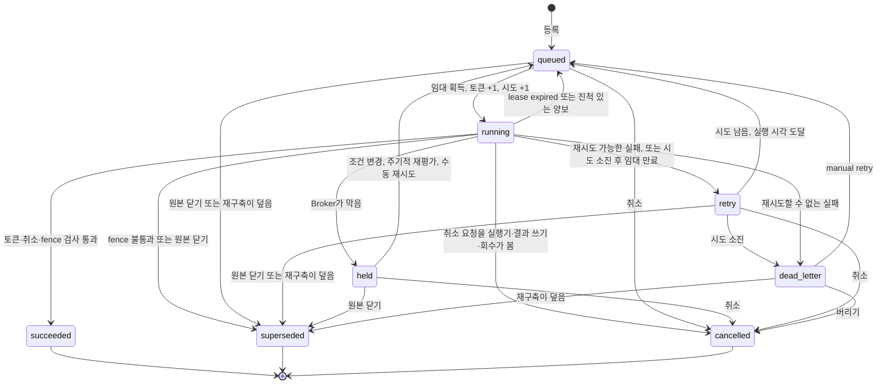
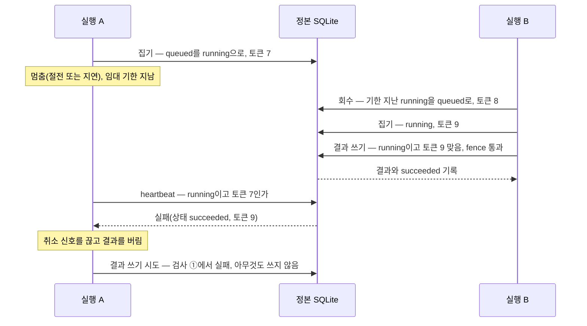
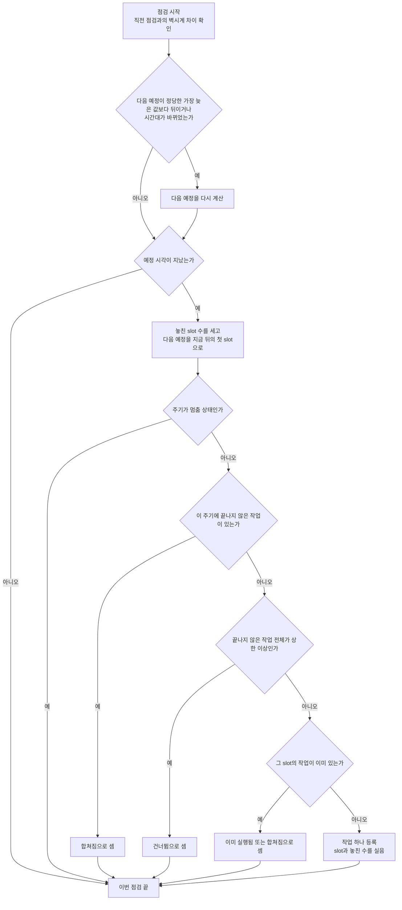
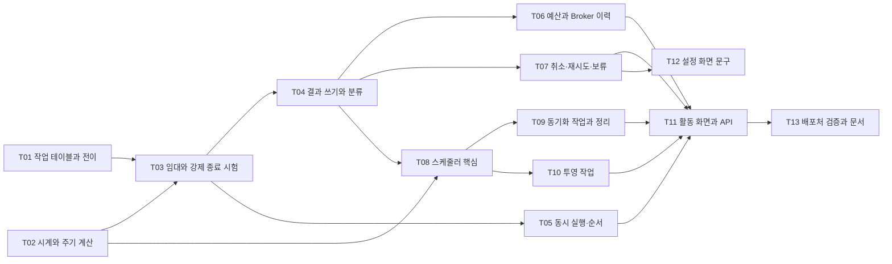

# 스펙: I03 Persistent Queue·Scheduler·재시도와 절전 복구

- 날짜: 2026-11-21 / 상태: 확정
- 관련: 이슈 #20(I03), 총괄 #1, Phase 2 #4, 선행 #18(I01)·#17(V02), 후속 #21(I04)·#33(H02). [V01 spec](2026-11-21-V01-vertical-skeleton.md), [V02 spec](2026-11-21-V02-vertical-slice.md)("T02가 넘기는 것"), [ARCHITECTURE.md](../ARCHITECTURE.md), [ADR 0005](../adr/0005-llm-providers.md)("사용자 확인 결과"), [ADR 0013](../adr/0013-failure-recovery.md), [ADR 0014](../adr/0014-egress-policy-and-consent.md), [site-setup.md](../site-setup.md). 함께 작성 중인 I01·I04 spec과 맞춘 결정은 본문에 그 spec을 가리켜 적는다.

낯선 말은 [ARCHITECTURE 0절](../ARCHITECTURE.md#0-처음-나오는-말)에 풀이가 있다. `S19`·`S20`은 site-setup.md 체크리스트에 **새로 넣을** 번호다(S16·S17은 I02, S18은 I01, S21 이후는 I04가 쓴다). `I03-A…`는 이 spec이 새로 세우는 가정이며 ARCHITECTURE 9절의 가정 표에 옮겨 적을 대상이다.

## 배경

제품은 사람이 자리에 없어도 지식을 계속 갱신해야 한다(원 설계 9절 Event Processing, 최종 시나리오 FS14 "재시작 작업 재개"). 그러려면 작업이 프로그램 메모리가 아니라 **정본 SQLite에** 살아 있어야 하고, 같은 작업이 두 번 실행되더라도 결과는 한 번만 남아야 한다(이슈 #20 배경: "작업 상태는 내구성 저장, 실효적 중복 방지는 idempotency로 보장한다").

V02는 이 가운데 가장 작은 조각을 만든다. V02-T02(머지됨)가 작업 테이블을 원본(`source_id`), 등록할 때의 version(`fence_version`), 임대 기한(`lease_until`)으로 다시 만들었고 `(종류, 원본, fence version)`마다 한 번만 등록되게 했다(V02 "T02가 넘기는 것" 3항). V02-T03(검토 중, `feat/v02-t03-job-runner` b316454)이 그 위에 실행기(`backend/src/job-runner.ts`)를 만든다: 기한이 있는 **임대(lease)**로 집고(`leaseNextJob`), 한 번에 하나씩 처리하고, 재시작하면 기한이 지난 작업을 다시 집고, 결과를 쓰는 순간 원본 version이 그대로인지 확인한다(`closeJob`이 `isFenceCurrent`로 검사하는 version fence). 상태는 `queued`·`leased`·`done`·`superseded`·`held`·`failed`이고, 보류·실패의 이유 코드를 담는 `jobs.reason` 열을 더한다. V02는 스케줄러, 재시도 정책의 일반화, 여러 작업의 동시 처리, 절전 복구를 이 작업으로 넘겼다(V02 비목표). I03은 V02-T03의 실행기를 **대체하지 않고 넓힌다**.

주 대상은 Windows 11 노트북이다. 여기서는 다음이 평범하게 일어난다.

- **절전·최대 절전**: 뚜껑을 닫으면 프로세스가 통째로 멈췄다가 몇 시간 뒤 깨어난다. 그 사이 예정된 주기 실행은 여러 번 지나가 있고, 임대 기한도 지나 있다.
- **강제 종료**: 작업 관리자에서 끝내기, 전원 차단, Windows 업데이트 재부팅. 쓰던 트랜잭션은 반영되지 않거나 통째로 반영된다.
- **시계 변화**: 시간대 변경, 일광 절약 시간, 시각 동기화로 벽시계가 앞뒤로 뛴다. 배터리가 다 닳은 뒤 켜진 PC의 시계가 틀려 있다가 나중에 뒤로 바로잡히는 일도 있다.

비유하면 이 작업은 "식당 주문표"다. 주문(작업)은 종이(정본)에 적혀 있어 주방장(실행기)이 쓰러져도 남는다. 주방장은 주문표에 "내가 몇 시까지 만든다"는 집게(임대)와 번호표(임대 토큰)를 꽂는다. 다른 주방장이 그 주문을 이어받으면 번호표가 바뀌므로, 먼저 쓰러졌던 주방장이 뒤늦게 요리를 내와도 번호가 맞지 않아 손님상에 오르지 않는다. 비유가 맞지 않는 곳: 실제로는 "요리"(Provider 호출)는 두 번 만들어질 수 있고 비용도 두 번 든다. 막는 것은 **상에 두 번 오르는 것**(정본에 두 번 기록되는 것)이다.

## 목표

- 작업이 queued·running·retry·held·succeeded·superseded·cancelled·dead_letter 가운데 정확히 한 상태에 있고, 정해진 전이 말고는 상태가 바뀌지 않는다.
- 실행 중에 프로세스를 강제로 끝내고 다시 켜면 그 작업이 다시 집혀 끝나며, 정본에 남는 결과는 한 번뿐이다. 사용자가 취소한 작업은 다시 실행되지 않는다.
- 10분·1시간·매일·매주 주기를 고를 수 있고, 재시작·절전·시계 변화 뒤 놓친 실행이 **주기 하나당 한 번으로 합쳐져** 실행된다. 끝나지 않은 작업과 포기한 작업 모두 정해진 상한을 넘어 쌓이지 않는다.
- 우선순위, 공정성, 동시 실행 상한, 호출·시간 예산, 취소, 지수 backoff, 요청 한도, 수동 재시도가 동작하고, 그 상태를 활동 화면에서 볼 수 있다.
- 스케줄러가 만든 작업도 백그라운드 호출이며, 백그라운드 설정과 전송 정책을 우회하는 길이 없다. API 키 Provider가 사용자가 없을 때도 동의·전송 정책 안에서 돈다는 것을 설정 화면이 밝힌다.
- 지운 원본의 내용을 투영(엔진·벡터)에서 빼는 작업이 끝내 실패해도, 그 투영이 다시 만들어질 때까지 표식이 남는다.

## 비목표 (배포처에서 후속 진행)

**공용 저장소의 뒤 작업으로 넘기는 것**

- 삭제·권한 철회가 파생물 전체로 전파되는 범위, 결과 쓰기 함수 `commitDerived`의 몸(`assertFresh`·`assertLineage`·`combinable`)과 읽기 차단(`visible`)의 정의, 투영 제거가 무엇을 지우는지: I04(#21). I03은 그 함수를 부르는 자리, 투영 작업의 실행과 분류, 원본 하나의 끝나지 않은 작업을 닫는 함수를 준다.
- Connector의 cursor, pagination, full rescan, 동기화 한 번 안의 재시도, 동기화가 멈춘 이유의 코드: I01(#18). I03은 그 코드를 작업 결과로 옮기는 쪽만 맡고, 대응표는 I01 spec에 있다.
- 폴더 감시가 만드는 작업: I02(#19). I02는 I03의 등록 함수를 쓴다.
- Reflection, Digest, 알림처럼 주기 실행이 필요한 기능 자체: K02(#26), P02(#28). I03은 그 기능들이 쓸 주기와 작업 문맥(예산, checkpoint)만 만든다.
- 백업 복원 뒤의 재처리 순서: H01(#32)과 I04. I03은 "이 투영을 다시 만들라"는 요청 함수만 준다.
- 절전을 막아 PC를 깨워 두는 것(전원 관리 차단): 하지 않는다. 노트북 배터리와 사용자 기대에 어긋난다. 깨어난 뒤 따라잡는다.
- 오래 기다린 낮은 우선순위 작업의 우선순위를 올리는 것(aging): 하지 않는다. 사용자 한 명의 PC에서 높은 우선순위 작업이 끝없이 들어오는 경우가 없다. 굶주림이 관측되면 그때 넣는다.
- 여러 PC나 여러 프로세스가 한 대기열을 나눠 쓰는 것: 하지 않는다. 백엔드는 하나다(ARCHITECTURE 3절). 임대 토큰은 그래도 둘이 동시에 도는 비정상 상황에서 결과가 두 번 쓰이지 않게만 막는다.
- 스케줄 전용 끄기 스위치를 HTTP Provider에 따로 두는 것: 하지 않는다. 주기를 끄는 것(R18)과 동의 철회로 같은 효과를 낸다. 사용자가 원하면 뒤에 넣는다.
- 백그라운드 실행기를 별도 프로세스로 떼는 것: 측정 근거가 생기면 그때(ARCHITECTURE 3절).
- Windows 설치본의 OS 생명주기 전체(업데이트 중 종료, 로그오프, 빠른 시작): H02(#33).

**배포처 후속 항목**(2개. 각각 [site-setup.md의 배포처 설정 체크리스트](../site-setup.md#배포처-설정-체크리스트)에 같은 번호로 넣는다. 넣는 일은 I03-T13)

| 번호 | 항목 |
|---|---|
| S19 | Windows 11 설치본에서 강제 종료·절전·최대 절전·시계 변경·시간대 변경 시나리오를 실행하고 기록 |
| S20 | 배포처 Provider의 요금·한도와 실제 수집기에 맞춰 호출 예산과 수집 주기의 값을 정함 |

## 요구사항

**작업의 상태와 저장**

- **I03-R1 상태와 전이.** 작업의 상태는 여덟 가지다: `queued`(대기), `running`(실행 중), `retry`(재시도 대기), `held`(보류), `succeeded`(성공), `superseded`(낡음), `cancelled`(취소), `dead_letter`(포기). 이슈 #20의 여섯 상태에 V02가 이미 쓰는 둘을 더했다: fence에 걸려 닫힌 `superseded`(V02-R5), 전송 정책·동의·실행 조건·크기 초과로 호출하지 않은 `held`(ADR 0014 "보류", V02-R8). fence에 걸린 작업은 `cancelled`+사유가 아니라 `superseded`로 닫는다. 사용자가 취소한 것과 fence가 닫은 것을 활동 화면에서 구분하기 위해서다. 전이는 아래 "작업 한 건의 상태" 그림과 표에 있는 것뿐이며, 저장 모듈의 함수만 상태를 바꾼다. 그림에 없는 전이를 요청하면 거부한다. 데이터베이스는 상태 값을 CHECK로 묶는다. `succeeded`·`superseded`·`cancelled`는 끝 상태다.
- **I03-R2 작업 테이블의 일반화.** V02-T02·T03이 만든 작업 테이블을 새 마이그레이션으로 넓힌다. 마이그레이션 번호는 이 spec에 적지 않는다: **다음 빈 번호(머지 순서로 정함)**다. SQLite는 NOT NULL을 풀 수 없으므로 V02-T02처럼 테이블을 다시 만든다. 더하는 것: 원본이 없는 작업(Connector 동기화, 투영 재구축, 정리)을 위해 원본 ID를 비울 수 있게 하고(원본 fence를 쓰는 종류는 CHECK로 원본을 요구), **대상**(투영 이름, Connector 인스턴스 ID. 없으면 빈 문자열), **등록할 때의 변경 순번**(등록하는 트랜잭션이 자기 쓰기를 마친 **뒤에** 읽은 값. 삭제 트랜잭션이 등록하는 `projection-remove`라면 tombstone을 쓴 뒤의 값이다. R7이 비교한다), 시도 횟수, 다음에 실행해도 되는 시각, 임대 주인과 **임대 토큰**, 마지막 heartbeat, 우선순위, 공정성 키, 주기 ID와 그 주기의 예정 시각(slot), checkpoint, **결과 수**(종류마다 정한 스키마의 개수·표시만. `connector-sync`는 I01-R19 결과의 `staleTombstone`·`blocked`·`rescanned`·`deletionsMayBeMissed` 같은 값. 글은 넣지 않는다), 보류할 때의 **정책 지문**(정책 버전과 검증된 조합 목록·기본 Provider의 값을 묶은 것. R16이 비교한다), 취소 요청 표시, 만든·바꾼·끝난 시각. 보류·실패의 이유 코드는 새 열을 두지 않고 V02-T03의 `reason` 열을 그대로 쓴다. V02-T03의 상태 값은 옮길 때 이름을 바꾼다: `leased` → `running`, `done` → `succeeded`, `failed` → `dead_letter`(V02의 실패는 다시 시도하지 않는 끝이었으므로 사용자가 수동 재시도할 수 있는 포기로 옮긴다), 나머지는 그대로. **이름을 바꾸면 V02-T03의 Broker 출처 검사가 깨진다**: `providers/src/broker.ts`의 준비 단계가 `job.status !== "leased"`이면 `origin-not-leased`로 거부하므로, 고치지 않으면 모든 작업 출처 호출이 거부되어 포기로 간다. 같은 작업(I03-T01)에서 그 검사를 "상태가 `running`이고 요청의 출처에 실린 임대 토큰이 행의 토큰과 같다"로 바꾼다. 그래서 `BrokerRequest.origin`의 작업 출처는 `{ jobId, leaseToken }`이 되고, 낡은 실행기(R4)의 호출도 Broker에서 거부된다. **옮길 때 채우는 값**: V02의 `lease_until`(ISO 문자열)을 UTC 밀리초 정수로 바꾼다(SQLite는 어떤 TEXT든 INTEGER보다 크게 정렬하므로 그대로 두면 기한 비교가 늘 틀린다). 시도 횟수는 V02 행에 값이 있으면 그 값, 없으면 0. 끝난 시각(보존의 기준)은 끝 상태로 옮겨지는 행(`done`·`failed`·`superseded`)에만 마이그레이션 시각으로 채운다(V02 행에는 바뀐 시각이 없다. 그 행은 마이그레이션 뒤 30일에 지워진다). 끝나지 않은 행은 비워 둔다. 정책 지문은 비워 두고, 비어 있는 것은 "바뀌었음"으로 본다(V02의 보류 작업은 처음 시작할 때 한 번 다시 평가된다. 단 `too-large`는 R16대로 자동으로 풀지 않으므로 비어 있어도 그대로다). 임대 토큰은 V02-T03(스키마 v6)의 값 그대로다(0으로 되돌리면 토큰이 줄어, 옮기기 전의 토큰을 쥔 실행기가 다시 집힌 작업의 토큰과 우연히 맞을 수 있다. 토큰은 오르기만 해야 한다). 대상은 빈 문자열, 우선순위는 `user`, 등록할 때의 변경 순번은 마이그레이션 때의 변경 순번이다. 중복 등록 방지는 셋이다: 원본 작업은 `(종류, 대상, 원본, fence version)`(V02의 키에 대상을 더했다. 투영 제거는 투영마다 하나여야 하기 때문이다. 이 넓히기는 I03 자신의 마이그레이션이며 V02-T03·T04의 등록 코드는 대상의 기본값 빈 문자열 덕분에 바뀌지 않는다), 주기 작업은 `(주기, slot)`, 원본이 없는 종류는 부분 유일 색인 `(종류, 대상) WHERE source_id IS NULL AND 상태가 끝나지 않은 것`(조건에 `source_id IS NULL`이 있어 대상이 빈 문자열인 원본 작업을 묶지 않는다)(SQLite의 UNIQUE는 NULL끼리 겹치지 않으므로 따로 둔다. 투영마다 끝나지 않은 재구축은 하나). "지금 실행"은 주기 ID를 싣고 등록되므로 주기당 하나의 색인을 함께 지난다. 등록이 키에 걸리면 기존 작업의 상태를 돌려주고 성공으로 여기지 않는다(V02 "T02가 넘기는 것" 3항). 한 주기에 **끝나지 않은 작업**(R21)은 최대 하나다(부분 유일 색인). 작업 행에는 원본의 글, Provider의 오류 문구가 들어가지 않는다.
- **I03-R3 원본 하나의 작업 닫기.** 저장 모듈은 `supersedeOpenJobs(sourceId)`를 준다. 그 원본의 `queued`·`retry`·`held`·`running` 작업을 `superseded`(코드 `source-closed`)로 바꾸고 임대 토큰을 1 올린다. 부르는 쪽의 트랜잭션 안에서 돈다. I04의 삭제·권한 철회 트랜잭션이 이것을 부른다(I04 spec). 투영 제거·투영 재구축 종류(R7)는 건드리지 않는다(원본이 지워진 **뒤에** 할 일이기 때문이다). `running`이던 작업의 실행기는 다음 heartbeat에서 상태가 `running`이 아님을 보고 멈추고, 결과 쓰기도 R6 ①에서 실패한다. `dead_letter`는 건드리지 않는다(수동 재시도하면 fence가 다시 닫는다).

**임대, 효과, checkpoint**

- **I03-R4 임대 토큰과 heartbeat.** 작업을 집는 것은 한 문장의 조건부 갱신이며 즉시 쓰기 잠금(`BEGIN IMMEDIATE`)을 잡는 트랜잭션에서 한다. 지금의 저장 규격 `SqlDriver.transaction(fn)`은 지연 잠금만 열 수 있으므로 `transaction(fn, { immediate: true })` 선택지를 더한다(better-sqlite3의 `.immediate()`. I03-T01). I04-T10이 같은 선택지 객체에 `beforeCommit`(커밋 직전 갈고리)을 더하며, `{ immediate: true, beforeCommit }`처럼 둘을 함께 줄 수 있어야 한다. 한 프로세스 안에서는 트랜잭션이 동기라 섞이지 않으므로 이 선택지는 비정상적으로 두 백엔드가 떴을 때(I03-A3) 읽기 뒤 쓰기로 올리다 `SQLITE_BUSY`가 나는 것을 줄이려는 것이다. 집기: `queued`이고 실행해도 되는 시각이 지났고 **취소 요청이 없으면** `running`으로 바꾸고, 임대 토큰을 1 올리고, 임대 주인(프로세스가 켜질 때마다 새로 만드는 실행기 ID)과 임대 기한을 쓰고, 시도 횟수를 1 올린다. 취소 요청이 있는 `queued` 작업은 집지 않고 `cancelled`로 닫는다. 실행 중에는 임대 길이의 4분의 1마다 heartbeat로 기한을 늘리는데, 이것도 "상태가 `running`이고 토큰이 내가 가진 값과 같을 때만"의 조건부 갱신이다. 실패하면(누가 다시 집었거나 닫았다) 실행기는 그 작업의 취소 신호를 끊고 결과를 쓰지 않는다. 기한이 지나 있더라도 상태와 토큰이 그대로면 heartbeat는 성공한다(절전에서 깨어난 같은 실행기가 계속하는 경우).
- **I03-R5 임대 회수.** 실행기는 시작할 때와 매 점검 때 임대를 회수한다. 회수 대상은 `running`이면서 ① 기한이 지났거나 ② 기한이 지금보다 **임대 길이보다 더 미래**인 작업이다(②는 정상 동작에서 생길 수 없고 벽시계가 뒤로 간 경우다). 지금 실행기가 메모리에 붙잡고 있는 작업은 회수하지 않고 heartbeat로 처리한다. 회수는 임대 토큰을 1 올린다. 취소 요청이 있는 작업은 `cancelled`로, 시도가 남은 작업은 `queued`로, 소진된 작업은 `retry`(오류 코드 `lease-expired`)로 간다. 시도 횟수는 집을 때 올라가므로 실행할 때마다 프로세스를 죽이는 작업(poison job)도 정해진 횟수 뒤 `dead_letter`에 이른다. (I03-T03 **잠정**: ②의 경계는 임대 길이의 2배이고 지금 시각은 쓰기 잠금을 잡은 뒤 읽는다. 백엔드가 둘 떴을 때(I03-A3) 다른 쪽이 잠금을 기다리는 사이 쓴 heartbeat를 벽시계 역행으로 보지 않기 위해서다. 기한이 비어 있는 `running` 행도 회수한다. 둘 다 "I03-T03이 넘기는 것" 2항이며 확정은 T04가 한다.)
- **I03-R6 효과는 한 번만.** 작업 종류마다 결과를 정본에 쓰는 일은 **한 트랜잭션**(`BEGIN IMMEDIATE`)이고, 그 트랜잭션은 맨 처음 ① 상태가 `running`이고 토큰이 내가 가진 값이며 ② 취소 요청이 없고 ③ 그 종류의 fence를 통과하는지 확인한다. 원본에서 나온 결과를 쓰는 종류의 ③은 **`commitDerived`** 하나를 부르는 것이다. 이 함수의 몸은 두 단계로 바뀐다: I03-T04는 같은 이름과 모양으로 V02의 fence(`isFenceCurrent`: 작업의 원본 version이 아직 최신이고 tombstone이 없다)를 감싼 얇은 함수를 내고, I04-T06이 그 몸을 I04의 `assertFresh`(그 version이 아직 있고 최신이며 tombstone에 덮이지 않았다) + `assertLineage`(계보의 다른 원본 version이 아직 있다) + `combinable`(범위 정책)로 바꾼다. 부르는 자리는 그대로다. 그래서 I03-T04는 I04를 기다리지 않고, I04-T06이 I03-T04 뒤에 온다. I03은 fence를 따로 정의하지 않는다. ①이 틀리면 아무것도 쓰지 않는다. ②가 틀리면 결과를 버리고 `cancelled`로 닫는다. ③의 fence가 틀리면 결과를 버리고 `superseded`로 닫는다(`combinable`이 항목 하나를 빼는 것은 I04가 정하며 작업을 닫지 않는다). 통과하면 결과와 `succeeded`를 같은 트랜잭션에서 쓴다. 정본 밖의 효과는 Provider 호출뿐이며 이것은 효과로 치지 않고 예산으로 센다(R14). Connector 동기화는 ADR 0013 결정 1대로 cursor를 원본을 저장한 **뒤에** 확정하므로, 같은 동기화가 두 번 돌아도 다시 받은 레코드는 I01-R10의 도착 판정에서 걸러진다.
- **I03-R7 투영 작업.** 투영(엔진, 벡터 색인)에 대한 일은 두 종류로 실행기에서 돈다. 둘 다 원본 version fence를 쓰지 않는다(원본이 지워진 뒤에 하는 일이라 쓰면 언제나 `superseded`가 된다). 실행 쪽(종류, 분류, 표식 확인, 강제 재구축)은 I03-T10이, 무엇을 지우는지의 의미와 지운 내용이 파일에 남지 않는다는 시험은 I04-T04가 맡는다.
  - **`projection-remove`**: 등록은 I04가 삭제 트랜잭션 안에서 한다(대상 = 투영 이름, 원본, fence version = tombstone이 덮는 version `covers_version`). 무엇을 지우는지는 I04가 정한다: 그 원본의 `covers_version` 이하 version에서 나온 항목만 지우고, 다시 들어온 더 새 version의 항목은 건드리지 않는다. I03은 `covers_version`을 처리기에 넘기고 결과를 분류한다(I04 spec의 규칙을 I03-T10이 구현한다): `AdapterUnavailableError`는 그 투영의 구현이 **스스로 영구히 없다고 밝힌** 경우에만 `succeeded`(코드 `adapter-unavailable`로 건너뜀을 기록. ARCHITECTURE 5.4절)다. 이것은 실행 중의 오류가 아니라 등록된 구현의 고정된 능력, 곧 I04 등록부 종류의 `permanentlyAbsent` 표시(I04-T01이 규격에 두고 I04-T04가 null 엔진·빈 벡터 색인에 단다)로 판정한다. 그 밖의 구현이 이 오류를 내면(멈춘 사이드카일 수 있다) 재시도할 수 있는 실패이며, 끝나지 않은 제거가 표식으로 남는다. 건너뜀으로 끝내면 표식이 사라져 강제 재구축이 일어나지 않기 때문이다. `StaleFenceError`는 낡은 작업이라는 뜻이 **아니다**. 그 사이 투영에 더 새 순번이 반영된 것이므로(예: 해제 뒤 새 version이 반영됨) 처리기가 **지금 fence로 다시 보낸다**. 지금 fence는 그 원본의 정본 최신 version이다(I04 spec. 새 getter는 없다): 엔진은 그 값으로 `removeSource`, 벡터 색인은 이미 낡은 ref를 빼고 나머지를 다시 보낸다. 여전히 `covers_version` 이하에서 나온 항목만 지운다. 다시 보낸 `removeSource`가 오류 없이 끝나면 `succeeded`다. 다시 보내기를 한 실행 안에서 끝내지 못하면 재시도할 수 있는 실패다. 그 밖의 오류 → 재시도할 수 있는 실패.
  - **`projection-rebuild`**: 대상 투영 하나를 비우고 정본에서 다시 만든다(V02-R13의 `rebuild`). 투영마다 끝나지 않은 것은 하나다(R2의 부분 유일 색인). 재구축은 시작할 때 정본을 읽는 한 트랜잭션에서 변경 순번 `S`를 기록하고 그 시점의 정본으로 만든다. 끝나면 같은 트랜잭션에서 그 투영의 `projection-remove` 가운데 **등록할 때의 변경 순번이 `S` 이하인 것**만(끝나지 않았거나 포기한 것) `superseded`(코드 `covered-by-rebuild`)로 닫는다. 재구축이 도는 사이 들어온 삭제의 제거 작업은 순번이 `S`보다 크므로 남아서 재구축 뒤에 돈다. 재구축이 이미 읽어 들인 원본이 그 뒤 지워져도 내용이 투영에 남지 않는 것은 이 규칙 때문이다. 이 규칙은 순서 하나에 기댄다: 삭제 트랜잭션은 tombstone을 쓴 **뒤에** 변경 순번을 읽어 제거 작업에 적는다(R2). 쓰기 전 값을 적으면 재구축이 `S`를 기록한 직후 커밋된 삭제의 제거가 `S`와 같은 번호를 받아 닫혀 버린다.
  - **표식**: 끝나지 않은 `projection-remove`와 `dead_letter`인 `projection-remove`가 그 투영이 지운 내용을 아직 가지고 있을 수 있다는 **정본 안의 표식**이다. 변경 순번의 비교(ADR 0013 결정 7)는 이 경우를 놓친다. 투영이 기억하는 것은 마지막으로 반영한 순번뿐이라, 실패한 제거 뒤에 다른 통지가 성공하면 번호가 같아지기 때문이다. 그래서 ① 시작할 때 그 투영에 끝나지 않았거나 포기한(`dead_letter`) `projection-remove`가 있으면 ② 스케줄러의 점검마다 그 투영에 포기한 `projection-remove`가 있거나, **등록된 지 1시간이 넘도록 끝나지 않은** `projection-remove`가 있으면(막힌 것), 반영 순번과 관계없이 `projection-rebuild`를 등록한다. 점검에서 막 등록된 제거까지 세지 않는 것은, 그것은 아직 재시도 중이라 매 점검마다 재구축을 부르면 평범한 삭제마다 재구축이 일어나기 때문이다(I04 spec도 같은 규칙을 적는다). 재구축이 끝날 때까지 그 투영에서 읽는 결과는 I04의 읽기 차단(`visible`)이 걸러 낸다. 투영이 오래 내려가 있으면 재구축도 포기되고 점검마다 다시 등록될 수 있다. 그 반복은 재구축 작업 자신의 backoff로만 늦춰지므로, 활동 화면은 "재구축 반복 중(투영 사용 불가)"을 보인다.
  - **요청 함수**: `requestProjectionRebuild(target)`. 백업 복원과 원장 재적용 뒤(H01, I04)처럼 순번 비교가 아니라 반드시 다시 만들어야 할 때 부른다.
  - 두 종류 모두 Provider를 부르지 않으므로 `held`가 되지 않는다. 동시 실행 묶음 `projection`(상한 1), 우선순위 `user`(삭제 직후 검색에서 빠져야 한다)다.
- **I03-R8 checkpoint.** 여러 단계로 나뉘는 작업은 단계마다 그 단계의 결과와 checkpoint를 R6과 같은 검사를 거친 한 트랜잭션으로 쓴다. 다시 집힌 작업은 checkpoint부터 잇는다. checkpoint에는 **ID, 번호, 개수만** 들어가고 원본의 글이나 Provider 응답은 들어가지 않는다(삭제 때 지울 대상을 늘리지 않기 위해. ADR 0013 결정 5). 크기는 4 KiB 이하이고, 종류마다 정한 스키마에 맞지 않거나 크기를 넘으면 쓰기를 거부한다. 끝 상태가 되면 checkpoint를 비운다.

**결과의 분류와 재시도**

- **I03-R9 결과의 분류.** 실행 한 번의 결과는 아래 "실행 결과가 가는 곳" 표대로 다음 상태가 된다. 표에 없는 결과(처리기가 던진 예외 포함)는 재시도할 수 있는 실패 `handler-error`다. 저장하는 것은 코드뿐이며 예외 문구는 저장하지 않는다(입력이 섞일 수 있다. V01-R13).
- **I03-R10 지수 backoff.** 재시도할 수 있는 실패는 `retry`로 가고 다음 실행 시각을 `min(30초 × 2^(시도−1), 1시간)` 뒤로 잡는다. 요청 한도(`rate-limited`)이면 그 값과 5분 가운데 긴 쪽이다. 지연에 무작위 값을 섞지 않는다(사용자 한 명이라 몰림이 없고, 테스트가 결정론적이어야 한다). Broker 안의 재시도(요청 하나에 최대 3회, V01 `DEFAULT_LIMITS`)는 그대로이고, 작업의 시도 한 번은 그 전체다.
- **I03-R11 시도 소진.** 시도 상한은 종류마다 정하며 기본 5회다. `retry`에서 나가는 판정은 한 곳에서만 한다: 시도가 남았으면 실행 시각이 된 뒤 `queued`, 소진됐으면 곧바로 `dead_letter`. 재시도할 수 없는 실패는 `running`에서 바로 `dead_letter`로 간다. **외부 호출(Provider나 수집기)을 하지 않은 실행은 시도를 쓰지 않는다**: `held`, `budget-exhausted`, `instance-busy`(R19), 진척 있는 양보(R14)는 집을 때 올린 시도를 같은 트랜잭션에서 되돌린다. `connector-sync`의 각 정지 코드가 시도를 쓰는지는 I01의 대응표(`SYNC_OUTCOMES`)가 정하며 같은 원칙이다: 수집기를 부른 실행은 시도를 쓰고, `instance-busy`와 `held`는 쓰지 않는다. 페이지 저장 실패(`storage-failed`. tombstone 트리거의 거부 포함)도 그 표의 한 행이며, 시도를 쓰는 `retry`이고 소진되면 포기다. 프로세스가 죽어 결과를 쓰지 못한 실행은 되돌리지 않는다(poison job을 끝내기 위해).
- **I03-R12 수동 재시도, 버리기, 취소.** 사용자는 ① 포기한(`dead_letter`) 작업과 보류된(`held`) 작업을 다시 시도할 수 있고(시도 횟수를 0으로 되돌리고, 취소 요청 표시를 지우고, 우선순위 "사용자"로 `queued`. 다시 실행될 때 R6의 fence를 다시 지나고, 보류의 조건이 그대로면 Broker가 다시 막는다) ② 포기한 작업을 버릴 수 있고(`cancelled`) ③ `queued`·`retry`·`held`·`running` 작업을 취소할 수 있다. `queued`·`retry`·`held`의 취소는 즉시 `cancelled`다. `running`의 취소는 취소 요청 표시를 쓰고, 같은 프로세스의 실행기가 그 작업을 붙잡고 있으면 그 자리에서 취소 신호를 끊는다(heartbeat를 기다리지 않는다). 신호는 작업 문맥을 거쳐 Broker 요청까지 간다(R14). **`running`에서 나가는 모든 길**은 실행기가 결과를 쓰기 전에 표시를 먼저 본다: 성공, 보류, 재시도, 포기, 양보 가운데 어느 결과든 표시가 있으면 `cancelled`로 닫는다(토큰 조건부). 결과 쓰기 트랜잭션(R6 ②), 다음 heartbeat, 회수(R5)도 같다. 그래서 취소한 작업은 어느 경로로도 다시 Provider를 부르지 않는다. 원본 닫기(R3)가 먼저 `superseded`로 만든 작업에는 취소가 "이미 끝남"을 돌려준다. 이미 `succeeded`인 작업의 취소도 "이미 끝남"이고 아무것도 바꾸지 않는다.

**동시 실행, 순서, 예산**

- **I03-R13 동시 실행, 우선순위, 공정성.**
  - **동시 실행**: 실행기는 전체 상한(기본 2, 설정 `jobs.maxConcurrent`로 1~4) 안에서 작업을 함께 돌린다. 종류마다 **동시 실행 묶음**이 코드 상수로 정해져 있고 묶음마다 상한이 있다. 지식을 쓰는 종류(V02의 추출과 그 뒤의 지식 작업)는 묶음 `knowledge`, **상한 1**이다. V02-R4의 이유(세 출처가 동시에 추출되면 같은 대상이 두 항목이 된다)가 개체 해소(S02) 전까지 그대로이기 때문이며 설정으로 바꿀 수 없다. `connector-sync`는 Connector 인스턴스마다 상한 1(같은 cursor를 둘이 진행하지 않게. R19). `projection-remove`와 `projection-rebuild`는 묶음 `projection`, 상한 1(제거와 재구축이 같은 투영에서 겹치지 않게). 정리 작업은 묶음 `maintenance`, 상한 1. Provider 호출은 이와 별도로 Broker의 동시 실행 상한(2)을 지난다.
  - **우선순위**: 세 단계다. `user`는 사용자가 시작한 일(수동 재시도, "지금 실행")과 투영 작업(R7), `scheduled`는 주기 작업, `maintenance`는 정리 작업이다.
  - **집는 순서**: ① 우선순위가 높은 것 ② 같은 우선순위에서는 **공정성 키**(Connector 인스턴스, 원본이 없으면 종류)마다 돌아가며 — 가장 오래전에 집힌 키부터 ③ 같은 키 안에서는 실행해도 되는 시각, 그다음 등록 순서. 묶음 상한이 찬 작업은 건너뛰고 그다음 후보를 본다(앞의 작업이 막혀도 뒤의 다른 묶음 작업이 집힌다). 그래서 한 Connector가 작업 100개를 쌓아도 다른 Connector의 작업이 그 뒤에 줄 서지 않는다. 키별 "마지막으로 집힌 때"는 메모리에만 두고 재시작하면 처음부터 센다.
- **I03-R14 예산.**
  - **실행 시간**: 작업의 실행 한 번에 시간 제한이 있다(기본 10분, 종류마다 정함). 넘으면 취소 신호를 끊고 재시도할 수 있는 실패 `run-timeout`이다. 이 시간은 프로세스 안의 단조 시계로 잰다.
  - **작업당 호출 수**: 처리기는 Broker를 직접 받지 않고 작업 문맥이 감싼 Broker를 받는다. 감싼 Broker는 실행 한 번에서 Broker **요청** 수를 센다(기본: 추출 2 — V02-R6의 1회와 스키마 불일치 재요청 1회. Broker 요청 하나는 Provider 시도를 최대 3번 하므로 실행 한 번의 Provider 시도는 최대 6번이다). 넘으면 Provider를 부르지 않고 `job-budget-exhausted`로 막는다. 처리기는 checkpoint를 쓰고 "양보"를 돌려줄 수 있다. 진척 있는 양보는 시도를 쓰지 않고 1분 뒤 `queued`가 된다. checkpoint가 바뀌지 않은 양보는 재시도할 수 있는 실패로 센다(진척 없는 양보가 끝없이 반복되지 않게).
  - **전체 호출 예산**: Broker의 시간창 예산(1시간에 60회, `DEFAULT_LIMITS`)은 지금 메모리에만 있고, 이력 행은 호출이 **끝난 뒤** 쓴다. 그래서 재시작하면 0부터 다시 세고, 호출 중에 죽으면 그 호출은 세지 않는다. I03은 `providers/src/broker.ts`를 고친다: Provider를 부르기 **전에** `provider_calls`에 결과 `started` 행을 쓰고 끝나면 그 행을 결과로 고친다. 시작할 때 Broker는 시간창 안의 실제 시도 행(`started` 포함. `blocked`·`budget-exhausted` 제외)으로 예산을 채우고, 죽은 프로세스가 남긴 `started` 행은 `interrupted`로 고친다(세는 것은 그대로). 예산이 소진된 호출은 시도를 쓰지 않는 `retry`이며, 다음 실행 시각은 Broker가 새로 주는 `budgetUsage()`의 "가장 오래된 시도가 시간창에서 빠지는 때"(최대 1시간 뒤)다. `budgetUsage()`는 활동 화면(R22)도 쓴다.
  - **취소 신호의 전달**: 지금의 `broker.call(raw)`는 취소 신호를 받지 않고, 안에서 재시도를 최대 3번 하며 그 사이 최대 30초를 기다린다. 그래서 작업을 취소하거나 원본을 닫아도 Broker 안의 재시도가 그 글을 다시 보낼 수 있다. I03은 `broker.call`이 `AbortSignal`을 받게 고친다: 시도마다 그 앞에서 확인하고, 기다리는 동안 끊기면 바로 멈추고, Provider의 `generateStructured`에 넘긴다. 취소, 원본 닫기, 실행 시간 초과, 임대 상실이 이 신호를 끊는다.
  - **취소된 호출의 결과**: 바깥 신호로 끊긴 요청의 Broker 결과는 `{ status: "cancelled" }`이고, 그 시도의 이력 결과는 `cancelled`다. 지금처럼 `timeout`으로 적지 않는다(Broker 자신의 시간 제한만 `timeout`). 이미 Provider에 보낸 시도(`started` 행이 있는 것)는 예산에 센다. 보내기 전에 끊긴 요청은 행도 예산도 남기지 않는다.
  - **이력 행의 변경이 닿는 곳**(`broker.ts` 밖): `CallOutcome`에 `started`·`interrupted`·`cancelled`를 더하고, `CallRecorder`에 시작 행을 쓰는 동작과 그 행을 결과로 고치는 동작을 더하고, `providers/src/call-recorder.ts`의 결과 목록에 세 값을 넣고(빠지면 `unrecognized`로 저장된다), 저장 모듈(`storage/src/listing.ts`)에 행을 고치는 함수와 시작 때 남은 `started`를 `interrupted`로 바꾸는 함수를 더한다. `provider_calls`의 결과 열에는 값 목록 CHECK가 없고, 시작 행은 전송 판정 뒤에 쓰므로 목적지·정책 버전이 있어 기존 CHECK를 지난다. 그래서 마이그레이션은 필요 없다. 활동 화면의 호출 이력은 `started`를 "진행 중", `interrupted`를 "중단됨"으로 보이고 예산에 센다.
  - **예산과 시계 역행**: 메모리의 시도 시각과 이력에서 읽은 시도 시각 가운데 지금보다 미래인 것은 지금으로 당긴다. 그래서 벽시계가 한 시간 넘게 뒤로 가도 예산이 시계가 따라잡을 때까지 잠기지 않고, 길어야 시간창 하나 뒤에 풀린다.
- **I03-R15 백그라운드 설정과 전송 정책을 우회하지 않는다.** 실행기와 스케줄러가 부르는 모든 Provider 호출은 Broker를 지나고, 그 출처는 작업 기록이므로 **언제나 백그라운드 호출**이다(ADR 0005 결정 6). 수동 재시도와 "지금 실행"도 작업을 다시 대기열에 넣을 뿐이라 백그라운드다. 실행기와 스케줄러는 사용자 동작 기록을 만들 수 없다(V01-T09의 issuer를 받지 않는다. 구성 지점 테스트로 확인). Broker가 막으면(동의 없음, 전송 거부, 백그라운드 설정 꺼짐, 검증되지 않은 CLI, Provider 없음 등) Provider를 부르지 않고 작업을 `held`로 두며 사유 코드를 남긴다. **다른 Provider로 넘어가지 않는다.** 백그라운드 설정은 지금 CLI Provider만 막는다(`execution-gate.ts`: HTTP 전송 방식은 실행 조건 판정을 지나지 않는다). 그래서 **API 키 Provider는 사용자가 자리에 없을 때도 동의와 전송 정책이 허용하는 한 주기 작업을 실행한다.** 이것은 I03이 처음 만드는 동작이며 R17의 문구가 밝힌다.
- **I03-R16 보류의 해제.** `held` 작업은 세 길로 다시 평가된다. 다시 평가한다는 것은 `held → queued`로 되돌리는 것이며, 그 자체는 Broker를 부르지 않고 시도를 쓰지 않는다. 다시 허용될지는 집힌 뒤 Broker가 다시 판정한다(V01 "T07이 넘기는 것" 3항. 다시 막히면 R11대로 시도를 되돌린다). ① **사건**: 동의를 주거나 거두기, 전송 규칙(정책 버전) 변경, 백그라운드 설정 변경, 기본 Provider 변경, API 키 Provider의 설정(주소·키) 변경. 사유 코드마다 어느 사건이 그것을 풀 수 있는지 표로 정하고, 해당하는 작업만, **그 설정·동의를 쓰는 트랜잭션 안에서** 되돌린다(쓰기와 해제 사이에 죽어도 놓치지 않게). ② **주기적 재평가**: 믿을 만한 사건이 없는 사유 — `cli-not-verified`·`unverified-*`·`cli-unknown`(CLI를 고치거나 앱 갱신으로 검증된 목록이 바뀜), `capabilities-unavailable`·`structured-output-unsupported`(Provider가 고쳐짐), `no-provider` — 는 시작할 때 한 번과 그 뒤 1시간마다 다시 본다. 작업마다 되돌려 Broker를 지나게 하지 않는다(보류 작업이 1000개면 시간마다 CLI 버전 조회 1000번과 이력 1000행이 된다). 대신 **(사유, Provider)마다 Broker의 사전 판정 한 번**(`broker.precheck({ providerId, taskKind })`)을 한다. 사전 판정은 문서가 없으므로 백그라운드 호출이고 가장 엄격한 등급이며 악성 변형일 수 있다고 보고 판정한다(그래서 `unverified-not-synthetic`·`unverified-malicious`는 통과하지 않고, 잘못 통과해도 되돌린 작업이 다시 막힐 뿐이다). 실제 호출과 같은 판정(전송, 실행 조건, 기능)을 하되 `provider_calls`에 아무것도 쓰지 않고, CLI의 버전 조회는 Provider마다 1시간에 한 번까지만 한다(그 결과를 1시간 기억한다). 통과한 (사유, Provider)의 작업만 한꺼번에 `queued`로 되돌린다. ②′ **수집기 보류**: `connector-sync`가 I01의 대응표대로 `held`가 되는 사유(인스턴스 `unavailable`, `not-implemented`)는 그 인스턴스의 설정이 바뀔 때(사건, 같은 트랜잭션), 앱 버전이 바뀐 채 시작할 때(지난 실행이 기록한 앱 버전과 비교), 그리고 1시간마다 인스턴스 상태 확인(`healthCheck`. 인스턴스마다 한 번)이 `ok`일 때 되돌린다. ③ **정책 지문**: 시작할 때 지금의 정책 지문(R2)이 보류할 때 행에 적은 값과 다르면 정책 사유의 작업을 되돌린다(배포처 규칙처럼 프로세스 밖에서 바뀌는 것). 그 밖의 사유는 시작만으로 되돌리지 않는다(재시작마다 보류 작업이 모두 Broker를 지나는 일을 막는다). 사용자는 보류된 작업을 직접 다시 시도할 수도 있다(R12 ①). 크기 초과 보류(V02-R8)는 자동으로 되돌리지 않는다.
- **I03-R17 백그라운드 설정 화면의 문구.** 설정 화면 "백그라운드 실행"의 설명을 고친다(ADR 0005 "사용자 확인 결과": "설정 화면이 이 사실을 밝혀야 한다 … 이 문구 수정은 … I03의 작업으로 넘긴다"). 문구에는 다음 세 가지가 들어가야 한다: 켜면 가져오기 뒤의 추출뿐 아니라 **자리에 없을 때** 정해진 주기에 따라 **자동으로** 도는 작업도 허용된다, 검증되지 않은 CLI 조합은 이 설정과 관계없이 백그라운드로 실행하지 않는다, **API 키** Provider는 이 설정과 관계없이 동의와 전송 정책이 허용하는 범위에서 자동으로 실행된다. 문구 예: "켜면 격리가 검증된 CLI 조합이 백그라운드 작업을 실행합니다. 여기에는 가져오기 뒤의 추출과, 사용자가 자리에 없을 때 정해진 주기에 따라 자동으로 도는 작업이 모두 들어갑니다. 검증되지 않은 조합은 이 설정과 관계없이 백그라운드로 실행하지 않습니다. API 키 Provider는 이 설정과 관계없이, 동의하고 전송 정책이 허용한 범위에서 같은 작업을 자동으로 실행합니다. 기본값은 끔입니다."

**스케줄러**

- **I03-R18 주기.** 주기는 `(종류, 대상)` 하나에 하나다. 고를 수 있는 값은 10분, 1시간, 매일(로컬 시각 하나), 매주(요일 하나와 로컬 시각 하나)다. 10분·1시간 주기의 slot은 UTC 기준 시각의 배수다(로컬 시간대가 30분 단위로 어긋난 곳에서는 1시간 주기가 로컬 :30에 돈다). 기본 주기는 둘이다: 사용할 수 있는 Connector 인스턴스마다 `connector-sync` **1시간**, 정리 작업 **매일 03:00**. "사용할 수 있는" 인스턴스는 상태가 `ok`이고 끌어올 설정이 있는 것이다. 상태가 `unavailable`이거나 `not-implemented`(`site-*`)인 인스턴스, API로만 받는 `jsonl-import` 인스턴스(끌어올 파일 설정이 없다. I01 spec)에는 기본 주기를 만들지 않는다. 사용자는 주기를 바꾸거나 끄고 다시 켤 수 있고 "지금 실행"을 누를 수 있다. 주기는 정본 SQLite의 주기 테이블에 있다(재시작 뒤에도 남는다). 주기 행은 매일·매주 slot을 계산한 시간대를 함께 저장한다.
- **I03-R19 Connector 동기화 작업.** 주기적인 끌어오기 동기화는 작업 종류 `connector-sync`로 돌며, 처리기는 I01의 Connector 관리자 `sync`를 부른다. 사용자가 시작한 JSONL·파일 가져오기는 지금처럼 **API 요청 안에서 동기로** 돈다(V02-T04의 트랜잭션). 인스턴스마다 배타적이다: 그 인스턴스의 동기화가 실행 중이면 가져오기 요청은 409를 돌려주고, 가져오기가 진행 중이면 동기화는 정지 코드 `instance-busy`로 끝나 **시도를 쓰지 않는 `retry`**(1분 뒤)가 된다. 동기화가 멈춘 이유의 코드마다 다음 상태(`retry`, `held`, 포기, 성공)와 시도 증감은 **I01 spec의 동기화 정지 코드 대응표**를 따르며, `instance-busy`의 행도 그 표가 위와 같이 적는다. I03은 그 표를 다시 적지 않는다.
- **I03-R20 놓친 실행의 합치기(bounded coalescing).** 스케줄러는 점검할 때 예정 시각이 지난 주기마다 ① 놓친 slot을 센다: 저장된 다음 예정 시각 `d`부터 지금 `t`까지 `d ≤ s ≤ t`인 slot `s`의 수(양끝 포함) ② 다음 예정 시각을 **`t`보다 뒤의 첫 slot**으로 옮기고 ③ 그 주기에 끝나지 않은 작업이 없으면 마지막 slot(`t` 이하에서 가장 늦은 것)으로 작업을 **하나만** 넣는다(놓친 수를 함께). 끝나지 않은 작업이 있으면 넣지 않고 "합쳐짐"으로 센다. `(주기, slot)` 키에 걸리면(시계 보정 뒤 같은 slot이 다시 계산된 경우) 기존 작업이 끝났으면 "이미 실행됨"으로, 끝나지 않았으면 "합쳐짐"으로 세고, 어느 쪽도 새 작업으로 여기지 않는다. 그래서 8시간 절전 뒤 10분 주기는 48번이 아니라 1번 돈다. 한 주기의 작업이 **어떤 이유로든** 포기(`dead_letter`)가 되면 그 주기를 "멈춤"(마지막 오류 코드)으로 바꾸고, 사용자가 다시 켤 때까지 작업을 넣지 않는다(같은 실패가 주기마다 쌓이지 않게. 멈춘 이유는 활동 화면에 보인다). 주기의 작업이 **보류**(`held`)이면 그 주기는 조용히 합치지 않고 "멈춤(보류: 사유)"으로 보인다. 다음 예정은 계속 옮기고 놓친 slot은 "보류 중 합쳐짐"으로 센다. 보류가 풀려 작업이 끝나면 멈춤 표시가 사라진다. **예외는 정리 작업의 주기**다. 이것이 멈추면 포기한 작업을 30일 뒤 지우는 보존(R21)이 멈춰 포기한 작업의 상한이 무너진다. 그래서 정리 주기는 멈추지 않고 다음 slot에 다시 돌며, 포기가 생기면 활동 화면에 경고를 남긴다.
- **I03-R21 상한과 보존.**
  - **끝나지 않은 작업**은 `queued`·`running`·`retry`·`held`다. 주기 하나에 그것은 최대 하나다(R2).
  - 끝나지 않은 작업 전체가 상한(기본 1000) 이상이면 스케줄러는 주기 작업을 넣지 않고 그 slot을 "건너뜀(대기열 가득)"으로 센다. 사용자가 시작한 가져오기와 그 추출은 거부하지 않는다(입력 크기만큼만 생기고 원본 version마다 하나로 묶인다). 상한의 90%를 넘으면 활동 화면이 경고한다.
  - **정리 작업**은 끝난 지 30일이 지난 `succeeded`·`superseded`·`cancelled`·`dead_letter` 작업 행을 지운다. 예외는 R7의 표식인 `dead_letter`인 `projection-remove`이며, 그 투영의 재구축이 그것을 닫을 때까지 남긴다. 주기가 멈춰 있으므로 한 주기가 만드는 `dead_letter`는 하나뿐이고, 30일 뒤 지워진다. 호출 이력(`provider_calls`)의 보존은 이 작업의 범위가 아니다.
- **I03-R22 시간의 단절.** 스케줄러는 30초마다 점검하고, 시작할 때와 **시간 단절**을 알아챘을 때 곧바로 점검한다. 시간 단절은 직전 점검과의 벽시계 차이가 점검 간격의 2배를 넘거나 음수인 경우다(절전에서 깨어남, 시계가 앞뒤로 뜀). 이 판정은 단조 시계가 절전 시간을 세는지에 기대지 않는다(I03-A1). 저장된 미래 시각이 상식적인 범위를 넘으면 **시계가 뒤로 간 것**으로 보고 바로잡는다: 주기의 다음 예정 시각이 **정당하게 가질 수 있는 가장 늦은 값**보다 뒤면 지금 기준으로 다시 계산하고(그 값은 지금 뒤의 첫 slot과, 마지막으로 실행한 slot이 지금 이전이면 그 slot보다 주기의 절반 이상 뒤인 첫 slot 가운데 늦은 것이며, 저장된 시간대로 계산한다. "지금 + 한 주기"를 기준으로 삼지 않는 것은 아래 시간대 변경 규칙이 다음 예정을 한 주기 반 가까이 뒤로 잡을 수 있고 일광 절약이 끝나기 전날의 하루는 25시간이라, 그 기준이면 정당한 값을 다음 점검이 역행으로 보고 되돌리기 때문이다), 작업의 다음 실행 시각이 지금보다 backoff 상한보다 더 뒤면 지금 + 상한으로 당기고, 임대 기한은 R5 ②를, 예산은 R14를 따른다. 매일·매주 주기의 slot은 점검할 때마다 그 시점의 시간대로 로컬 달력에서 계산한다. 시간대가 주기 행에 저장된 것과 다르면, 다음 예정 시각을 새 시간대의 slot 가운데 **마지막으로 실행한 slot보다 주기의 절반 이상 뒤이고 옛 다음 예정보다 주기의 절반 넘게 앞서지 않는 첫 것**으로 다시 잡고(새 시간대로 계산한 위의 가장 늦은 값을 넘지 않는다) 저장된 시간대를 바꾼다(앞 조건은 같은 날 옛 시간대 03:00과 새 시간대 03:00에 두 번 도는 일을, 뒤 조건은 이미 센 slot을 다시 세는 일을 막는다). 일광 절약으로 없는 로컬 시각은 그 뒤의 첫 유효 시각으로, 두 번 있는 로컬 시각은 앞의 것 한 번으로 본다. 저장하는 시각은 모두 UTC다.

**보이기**

- **I03-R23 활동 화면과 API.** 활동 화면에 작업 영역을 더한다: 상태별 개수, 작업 목록(종류, 대상의 ID와 이름, 상태, 시도/상한, 다음 실행 시각, 보류·오류 사유 코드와 그 뜻), 주기 목록(주기, 마지막 실행, 다음 예정, 합쳐진 수, 건너뛴 수, 멈춤 사유), 투영의 재구축 대기 표시(R7), Broker 예산 사용량(`budgetUsage()`), 끝나지 않은 작업이 상한의 90%를 넘으면 경고, **다른 spec이 주는 값**: I04 상태 API의 `invalidations`(최근 무효화 기록 수)와 `scopePolicyDrops`(범위 정책으로 빠진 항목 수)(I04-R4), `connector-sync` 작업의 결과 수에 남은 `staleTombstone`·`blocked` 수와 `rescanned`·`deletionsMayBeMissed` 표시(I01-R19. "만료된 동안 지워진 원본을 놓쳤을 수 있음" 문장은 I01의 것을 쓴다). 동작: 취소, 다시 시도, 버리기, 주기 바꾸기·끄기·다시 켜기, 지금 실행. API는 V01의 세션 토큰과 Origin 검사를 그대로 지나고, 응답에 원본의 글과 Provider의 문구가 없다.

**검증 수단과 문서**

- **I03-R24 강제 종료 시험.** 테스트 빌드 전용 작업 종류(`test-effect`)를 둔다. 이 종류는 결과 쓰기 트랜잭션에서 효과 행 하나를 쓰고, 그 전에 정본 밖의 실행 기록 파일에 "실행했다"를 한 줄 남기며, 시험이 정한 지점에서 멈춰 기다릴 수 있다. 시험은 백엔드를 자식 프로세스로 띄워 그 지점에서 **강제로 끝내고**(`SIGKILL`. Windows에서 Node가 이 신호를 받으면 프로세스를 바로 끝낸다는 것은 Node 문서의 설명이며, 이 저장소에서 Windows로 실행해 보지는 않았다. S19) 다시 띄운다. 자식 프로세스의 임대 길이와 heartbeat 간격은 **테스트 빌드에서만** 짧게 줄 수 있다(예: 2초). 그래서 시험은 2분을 기다리지 않는다. 배포 빌드와 개발 빌드에는 이 종류와 이 조절 기능이 없다.
- **I03-R25 배포처 검증 실행기.** 같은 시나리오(실행 중 강제 종료, 절전과 최대 절전에서 깨어남, 시계를 앞뒤로 옮김, 시간대 변경)를 Windows 설치본에서 돌리고 결과를 기록하는 실행기와 절차서를 둔다. 실행 기록에는 OS, 앱 버전, 시나리오, 관찰한 상태 전이, 효과 행 수, 합쳐진 slot 수가 들어간다. 실행기는 Windows 설치본이 아니거나 절전 시나리오의 수동 확인 기록이 없으면 `배포처 후속`으로 시작하는 알림을 출력하고 0이 아닌 값으로 끝난다. "Windows 설치본인가"를 묻는 확인은 테스트 빌드에서 바꿔 끼울 수 있게 두어, Windows가 아닌 개발 PC의 테스트도 두 번째 경우(설치본이지만 수동 기록 없음)에 닿게 한다.
- **I03-R26 문서.** site-setup.md 체크리스트에 S19·S20을 넣고 실행 중 설정 표에 `jobs.maxConcurrent`를 더한다. 문서 대응 테스트에 이 spec의 배포처 후속 항목을 더한다. ARCHITECTURE와 ADR은 아래 "후속: 다른 문서에 필요한 고침"대로 고친다.

## 인터페이스 / 설계 개요

### 작업 한 건의 상태

이슈 #20의 그림에 있는 전이는 모두 그대로다. 아래 표에서 굵게 적은 것이 이 spec이 더한 전이다.



| 전이 | 출처 | 일어나는 때 |
|---|---|---|
| queued → running | 이슈 | R4의 조건부 갱신이 성공 |
| running → succeeded | 이슈 | R6의 세 검사를 통과하고 결과를 씀 |
| running → retry | 이슈 | 재시도할 수 있는 실패(R9), 또는 시도가 소진된 작업의 임대 회수(R5) |
| retry → queued | 이슈 | 시도가 남았고 다음 실행 시각이 지남(R11) |
| retry → dead_letter | 이슈 | 시도 소진(R11). 판정하는 곳은 여기 하나다 |
| running → queued | 이슈 | 임대 회수, 시도 남음, 취소 요청 없음(R5). **진척 있는 양보**(R14, R19)도 이 전이를 쓴다 |
| running → cancelled | 이슈 | `running`에서 나가는 모든 길에서 실행기가 취소 요청을 먼저 봄, 결과 쓰기·heartbeat·회수가 봄(R12, R6 ②, R5) |
| queued → cancelled | 이슈 | 사용자 취소, 또는 집을 때 취소 요청을 봄(R12, R4) |
| dead_letter → queued | 이슈 | 수동 재시도(R12 ①) |
| **running → superseded** | V02-R5, R3 | fence 불통과(R6 ③), `StaleFenceError`(R7), 원본 닫기(R3) |
| **queued·retry·held → superseded** | R3, R7 | 원본 닫기(`source-closed`). queued·retry인 `projection-remove`는 재구축이 덮음(`covered-by-rebuild`) |
| **dead_letter → superseded** | R7 | `dead_letter`인 `projection-remove`를 재구축이 덮음 |
| **running → held**, **held → queued** | ADR 0014, R15, R16, R12 | Broker가 막음 / 막은 조건의 사건, 주기적 재평가, 정책 지문 변경, 수동 재시도 |
| **running → dead_letter** | R11 | 재시도할 수 없는 실패 |
| **held·retry → cancelled**, **dead_letter → cancelled** | R12 | 취소, 버리기 |

"시도 소진"을 `retry → dead_letter` 한 곳에서만 판정하는 것이 이 그림의 핵심이다. 재시도할 수 있는 실패든 임대 만료든 시도가 바닥나면 같은 길로 포기에 이르므로 포기 조건이 두 군데로 갈라지지 않는다. 그리고 취소 요청이 있는 작업은 집기·회수·결과 쓰기·heartbeat 네 곳 모두에서 `cancelled`로 닫히므로, 취소된 작업이 다시 실행되는 길이 없다.

### 두 실행이 한 작업을 다투는 경우

R4~R6의 임대 토큰이 막는 순서다. 정상 동작에서 백엔드는 하나지만, 절전에서 깨어난 실행기가 늦게 돌아오거나(같은 실행기) 비정상적으로 백엔드가 둘 뜬 경우(I03-A3)에 이렇게 된다.



A가 이미 Provider를 불렀다면 그 호출은 일어난 것이고 예산에 세어진다(R14). 정본에는 B의 결과만 한 번 남는다.

### 실행 결과가 가는 곳

| 실행 결과 | 다음 상태 | 시도 | 비고 |
|---|---|---|---|
| 처리기 성공, R6 통과 | succeeded | 씀 | |
| 어느 결과든 취소 요청 표시가 있음, 또는 Broker `cancelled` | cancelled | 씀 | R12. 아래 행보다 먼저 본다 |
| 처리기 `held(사유)`(`connector-sync`의 인스턴스 `unavailable`·`not-implemented`) | held(그 사유) | 되돌림 | R16 ②′, I01 대응표 |
| `commitDerived`의 fence 불통과(새 version이 왔거나, 원본이 지워졌거나 덮임, I04-T06 뒤에는 계보의 다른 원본도), 또는 Broker `rejected: missing-source` | superseded | 씀 | R6 ③ |
| 결과 쓰기에서 취소 요청을 봄 | cancelled | 씀 | R6 ② |
| 결과 쓰기에서 상태·토큰 불일치 | (쓰지 않음) | — | 다른 실행이 잡았거나 닫힘 |
| Broker `blocked`(동의 없음, 전송 거부, `cli-*`, `unverified-*`, `no-provider`, 구조화 출력 없음, 기능 조회 실패) | held(그 사유) | **되돌림** | R15, R16. 다른 Provider로 넘기지 않음 |
| Broker `blocked: budget-exhausted` | retry(예산이 풀리는 때) | **되돌림** | R14 전체 호출 예산 |
| `job-budget-exhausted` 뒤 양보, checkpoint 진척 | queued(1분 뒤) | 되돌림 | R14 |
| 진척 없는 양보 | retry | 씀 | R14 |
| `connector-sync`의 `instance-busy`(가져오기 진행 중) | retry(1분 뒤) | **되돌림** | R19. I01 표의 행 |
| Broker `failed: timeout`·`provider-error` | retry | 씀 | R10 |
| Broker `failed: rate-limited` | retry(최소 5분) | 씀 | R10 |
| Broker `failed: invalid-output` | dead_letter | 씀 | V02-R6이 이미 한 번 다시 물었다. 같은 원본으로 다시 물어 비용을 더 쓰지 않는다. 수동 재시도는 가능(번복 가능한 선택, 미해결 질문 10) |
| Broker `rejected`(그 밖의 사유) | dead_letter | 씀 | 코드의 잘못이다 |
| V02 크기 초과 | held(`too-large`) | 되돌림 | 자동으로 되돌리지 않음 |
| `connector-sync`의 정지 코드(`storage-failed` 포함) | I01 spec의 대응표(`SYNC_OUTCOMES`)대로 | 표대로 | R19. 수집기를 불렀으면 씀 |
| 투영 `AdapterUnavailableError`, 구현이 영구히 없다고 밝힌 것(null 엔진, 빈 벡터 색인) | succeeded(`adapter-unavailable`) | 씀 | R7. 건너뜀 |
| 투영 `AdapterUnavailableError`, 그 밖의 구현 | retry | 씀 | R7. 멈춘 사이드카일 수 있다. 표식이 남는다 |
| 투영 `StaleFenceError` | (같은 실행 안에서 원본의 정본 최신 version을 fence로 다시 보냄) → 다시 보낸 `removeSource`가 오류 없이 끝나면 succeeded, 못 끝내면 retry | 씀 | R7. 낡은 작업이 아니다 |
| 투영의 그 밖의 오류 | retry | 씀 | R7. 소진되면 dead_letter이고 표식이 됨 |
| 실행 시간 초과 | retry(`run-timeout`) | 씀 | R14 |
| 처리기 예외 | retry(`handler-error`) | 씀 | 문구는 저장하지 않음 |

### 작업 문맥 (I03-T04가 확정: "I03-T04가 넘기는 것" 1·2항이 아래 표의 `commit`과 결과 이름을 대신함)

V02-T03의 처리기 규격을 넓힌다. 처리기는 문맥 하나를 받고 결과 하나를 돌려준다.

| 문맥이 주는 것 | 뜻 |
|---|---|
| 작업 ID, 종류, 대상, 원본과 fence version, slot, 놓친 slot 수 | 읽기 전용 |
| 취소 신호 | 취소, 실행 시간 초과, 임대 상실 때 끊긴다. Broker 호출에 넘긴다 |
| 감싼 Broker | 작업 기록을 출처로 넣고 요청 수를 센다. 처리기는 출처를 고를 수 없다 |
| `commit(쓰기)` | R6의 검사 뒤 처리기의 쓰기와 `succeeded`를 한 트랜잭션에서 |
| `checkpoint(값, 쓰기)` | R8. 같은 검사 뒤 단계 결과와 checkpoint를 한 트랜잭션에서 |
| 마지막 checkpoint | 다시 집힌 작업이 잇는 지점 |

처리기의 결과는 `committed`, `superseded`, `yield`, `held(사유)`, `fail(코드, 재시도 가능 여부)` 다섯이다. `held`는 처리기가 외부 호출 없이 "지금은 할 수 없다"를 알 때 쓴다(지금은 `connector-sync`의 인스턴스 상태뿐이다). Broker의 결과를 그대로 돌려주면 실행기가 위 표로 분류한다.

**`commitDerived`의 모양(정본은 I04의 등록 규격 블록, I04 `80f50a0`).** I03-T04의 임시 함수는 아래 모양을 그대로 쓴다. I04가 블록을 고치면 이 사본도 같이 고친다.

```typescript
interface DerivedItem {
  kind: string                         // 등록된 종류
  itemKey: string                      // 같은 행 판정 키(V02-R8)
  lineage: readonly SourceVersionRef[] // 이 항목의 계보
  write(tx: SqlDriver): void           // 검사를 지난 항목만 불린다
}
interface ScopePolicyDrop {            // scope_policy_drops 테이블의 한 행과 같다(내용 없음)
  sourceId: number; version: number; kind: string; itemKeyHash: string; reason: 'scope-policy'; at: string
}
type CommitResult =
  | { status: 'committed'; written: number; dropped: readonly ScopePolicyDrop[] }
  | { status: 'stale'; cause?: 'missing' | 'not-latest' | 'covered' | 'lineage-covered' }  // 작업은 superseded
function commitDerived(
  tx: SqlDriver,
  input: {
    source: { sourceId: number; version: number } | null    // 작업이 입력으로 받은 원본 version(없는 작업은 null)
    items: readonly DerivedItem[]
  },
): CommitResult
```

I03-T04의 임시 본문은 `source`가 있으면 V02의 `isFenceCurrent`만 적용하고(불통과면 `stale`. `cause`는 더 새 version이 있으면 `'not-latest'`, 아니고 그 원본에 tombstone이 있으면 `'covered'`, 둘 다 아니면 `'missing'`. "I03-T04가 넘기는 것" 5항), 모든 `items`를 쓰며 `dropped`는 빈 목록이다.

### 작업 종류와 대상

중복 키 `(종류, 대상, 원본, fence version)`의 "대상"에 들어가는 값이다. 대상이 다르면 같은 원본·version의 같은 종류 작업도 따로 등록된다.

| 종류 | 대상 | 원본 / fence version | 묶음 | 등록하는 곳 |
|---|---|---|---|---|
| `extract`(V02) | 빈 문자열 | 원본 / 등록 때의 version | `knowledge` | V02-T04(가져오기), `connector-sync` |
| `extract`(범위가 넓어진 뒤 다시 추출) | `scope-recompute:<무효화 기록 ID>` | 원본 / 그 원본의 지금 최신 version | `knowledge` | I04-T09(범위 변경 전파). 범위 정책으로 빠졌던 항목의 기록은 I04의 테이블(`scope_policy_drops`)에 있고 작업 행에 없으므로 I03의 보존이 지우지 않는다. 우선순위는 `scheduled`. 범위가 잇달아 두 번 바뀌면 같은 version에 작업이 둘 생겨 차례로 돌고 두 번째는 쓸모가 없지만, 결과는 `commitDerived`의 같은 행 판정으로 한 번만 남으므로 받아들인다 |
| `projection-remove` | 투영 이름(`engine`, `vector`) | 원본 / tombstone의 `covers_version` | `projection` | I04-T03·T04(삭제 트랜잭션) |
| `projection-rebuild` | 투영 이름 | 없음 | `projection` | I03-T10(표식), `requestProjectionRebuild` |
| `connector-sync` | Connector 인스턴스 ID | 없음 | 인스턴스마다 | I03-T09(주기, 지금 실행) |
| `maintenance` | 빈 문자열 | 없음 | `maintenance` | I03-T09(주기) |
| `test-effect`(테스트 빌드만) | 시험이 정함 | 시험이 정함 | 시험이 정함 | 시험 |

### 스케줄러의 점검 한 번

주기 하나에 대해 점검할 때마다 아래 순서로 판정한다. 시작할 때와 시간 단절 뒤에도 같다. 주기와 관계없는 일(임대 회수, 재시도 대기 작업 올리기, 투영 표식 확인)은 같은 점검에서 주기 판정보다 먼저 한다.



다음 예정 시각을 옮기는 일(E)은 작업을 넣든 안 넣든 언제나 한다. 그래서 어떤 경우에도 같은 slot을 두 번 세지 않고, 주기 작업의 수는 주기 수를 넘지 않는다.

### 시계

실행기와 스케줄러는 시계를 직접 읽지 않고 주입된 시계 하나를 쓴다. 모양은 Broker가 이미 주입받는 `{ now(), sleep(ms) }`(`providers/src/broker.ts`)에 단조 시계 `monotonic()`을 더한 것이다. 벽시계 `now()`는 저장하는 모든 시각(UTC 밀리초), 단조 시계는 실행 시간 제한과 heartbeat 간격에 쓴다. 같은 시계 하나를 Broker에도 넘긴다. 테스트는 가짜 시계로 절전(점검 없이 벽시계만 몇 시간 앞으로), 시계 역행, 일광 절약을 흉내 낸다. 시간대는 점검할 때마다 `Intl.DateTimeFormat().resolvedOptions().timeZone`으로 읽는다(테스트는 시간대를 주입한다).

### 기본값 (잠정. 바꾸는 곳)

| 값 | 기본 | 바꾸는 곳 |
|---|---|---|
| 전체 동시 실행 | 2 | 설정 `jobs.maxConcurrent`(1~4) |
| 묶음 상한 | `knowledge` 1, Connector 인스턴스마다 1, `projection` 1, `maintenance` 1 | 종류별 상수. `knowledge`는 S02 뒤 재검토 |
| 우선순위 | 투영 작업·수동 재시도·지금 실행 `user`, 주기 `scheduled`, 정리 `maintenance` | 종류별 상수 |
| 임대 길이 / heartbeat | 2분 / 30초(테스트 빌드는 줄일 수 있음) | 작업 기본값 상수 한 곳 |
| 시도 상한 | 5 | 실행기의 종류별 설정 `kinds[종류].maxAttempts`("I03-T04가 넘기는 것" 8항) |
| backoff | 30초부터 2배, 상한 1시간, 요청 한도 최소 5분, 무작위 없음 | 작업 기본값 상수 |
| 실행 한 번의 시간 제한 | 10분 | 실행기의 종류별 설정 `kinds[종류].runTimeoutMs`("I03-T04가 넘기는 것" 9항) |
| 작업당 Broker 요청 수(추출) | 2 | 종류별 상수 |
| 점검 간격 / 시간 단절 판정 | 30초 / 2배 초과 또는 음수 | 작업 기본값 상수 |
| 끝나지 않은 작업 상한 / 경고 | 1000 / 90% | 작업 기본값 상수 |
| 막힌 투영 제거의 기준 | 등록 뒤 1시간 | 작업 기본값 상수 |
| 보류의 주기적 재평가 | 시작 때 한 번, 그 뒤 1시간마다(사건 없는 사유만) | 작업 기본값 상수 |
| `instance-busy` 대기 | 1분, 시도 쓰지 않음 | I01의 정지 코드표 |
| 기본 주기 | Connector 동기화 1시간, 정리 매일 03:00 | 활동 화면, 주기 API |
| 보존 | 끝난 지 30일(투영 표식 예외) | 작업 기본값 상수 |
| Broker 시간창 예산 | 1시간에 60회 | V01 `DEFAULT_LIMITS`(그대로) |

### 사용자 동작으로 시작한 추출을 구분하는 방법 (선택지로만 기록. 채택하지 않음)

ADR 0005 "사용자 확인 결과"는 "사용자가 방금 시작한 가져오기에서 나온 추출"을 부르는 쪽이 속일 수 없게 구분하는 방법(예: 쉘이 사용자 조작에서만 발급하는 1회용 승인)이 I03의 스케줄러 설계에서 나오면 그 절을 고치기로 했다. 검토한 후보와 위조 분석이다.

- **후보**: 가져오기를 처리하는 API 요청 안에서, 사용자 동작 기록 issuer(API 계층 전용, V01-T09)가 "가져오기 승인"을 발급하고 그 요청이 등록한 추출 작업들에만 묶는다. 승인은 정본에 남고(작업은 요청보다 오래 산다) 작업마다 한 번만 쓰이며, 짧은 기한(예: 10분) 뒤에는 무효다. Broker는 작업 기록과 함께 이 승인을 보고 "사용자 가져오기의 추출"로 판정한다. 더 강한 변형은 Electron 쉘의 기본 파일 선택 창에서 사용자가 고른 경우에만 쉘이 승인을 발급하는 것이다.
- **위조 분석**: ① 화면(renderer)에서 오는 요청은 세션 토큰만 있으면 누구든 같은 모양으로 보낼 수 있다. 가져온 문서가 화면에서 스크립트를 실행하는 결함(V02-R15가 막으려는 것)이 하나라도 있으면 그 스크립트가 가져오기 API를 불러 승인을 받는다. 그래서 API 계층 발급만으로는 "사람이 눌렀다"가 아니라 "화면이 요청했다"를 증명한다. ② 승인이 정본 행이면 백엔드 안의 어떤 코드든 그 행을 쓸 수 있다. 스케줄러·실행기·Connector 동기화 코드가 승인 테이블에 쓰지 못하게 V01-T09의 `pki/gate-inputs` lint와 같은 방식으로 막아야 한다. ③ 주기적인 Connector 동기화에서 나온 추출은 어떤 경우에도 승인을 받지 않아야 하는데, 동기화도 같은 저장 함수를 지나므로 등록 경로를 나눠야 한다. ④ 쉘 발급 변형은 ①을 막지만 브라우저 개발 실행에는 쉘이 없어 그 경로에서는 승인이 없다(백그라운드로 남는다). 쉘과 백엔드 사이 전용 통로의 무결성은 A18과 함께 미검증이다.
- **판단**: ①이 남는 API 발급 변형은 이 구분의 목적(격리가 검증되지 않은 CLI에 사람이 고른 문서만 넣는다)을 지키지 못한다. 쉘 발급 변형은 ①을 막지만 ②~④의 새 신뢰 경계가 필요하고 Windows 검증 전이다. 그래서 I03은 채택하지 않고, 스케줄러가 이 구분 없이도 동작하게 둔다. 다시 연다면 쉘 발급 변형을 ADR 0005의 개정으로 다루고, 위조 시험(화면 스크립트가 승인을 얻지 못함, 동기화 추출이 승인을 얻지 못함)을 완료 기준에 넣는다.

### 작업 분해 (잠정. 조정자가 확정 후 다시 맞춤)

한 작업이 PR 하나다. 그림은 I03 안의 선후만 그렸고, 다른 spec에 대한 선행은 표가 기준이다.



| ID | 내용 | 요구사항 | 기준 | 선행 | 테스트 |
|---|---|---|---|---|---|
| I03-T01 | 작업 테이블 마이그레이션(다음 빈 번호. 원본 없는 작업, 대상, 등록 때 변경 순번, 시도, 실행 시각, 임대 주인·토큰, 우선순위, 공정성 키, 주기·slot, checkpoint, 정책 지문, 취소 요청, 시각들, 상태 CHECK, V02-T03의 `reason` 재사용, 세 중복 방지와 주기당 하나 색인), V02-T03 상태 이름 옮기기(시각 형식 바꿈과 채우는 값), Broker 출처 검사를 `running`과 임대 토큰으로(`providers/src/broker.ts`, `BrokerRequest.origin`), 전이 함수, `supersedeOpenJobs`, `SqlDriver.transaction`의 `immediate` 선택지(I04-T10이 같은 메서드에 `beforeCommit` 갈고리를 더하므로 두 선택지가 함께 쓰일 수 있는 모양으로. 먼저 머지되는 쪽이 선택지 객체를 만들고 뒤의 쪽이 항목을 더한다) | R1, R2, R3, R4(잠금) | C1 | **V02-T03 머지** | `jobs.transitions`, `jobs.migration`, `jobs.migration-v02-status`, `jobs.register-conflict`, `jobs.unique-sourceless`, `jobs.supersede-open`, `transaction.immediate` |
| I03-T02 | 주입 시계(Broker의 시계 모양 확장), 주기의 slot 계산(네 가지 주기, UTC 정렬, 로컬 시각, 일광 절약, 시간대 변경), 놓친 slot 세기, 시계 역행 보정 규칙 | R18(계산), R20(세기), R22(계산) | C2 | 없음 | `schedule.slots`, `schedule.dst`, `schedule.tz-change`, `clock.regression` |
| I03-T03 | 집기(`BEGIN IMMEDIATE`, 취소 표시 확인), heartbeat(상태·토큰 조건), 임대 회수(토큰 증가, 취소 표시), 테스트 빌드의 임대 길이 조절, `test-effect` 종류와 자식 프로세스 강제 종료 시험 장치 | R4, R5, R24 | C1 | T01, T02 | `lease.token`, `lease.heartbeat-after-expiry`, `lease.reclaim`, `kill.resume`, `effect.once`, `poison` |
| I03-T04 | 작업 문맥, `commit`(R6의 세 검사, V02 fence를 감싼 `commitDerived`)과 `checkpoint`, 결과 분류 표, backoff, 시도 소진과 되돌림, 실행 시간 제한, 주입 시계 `Clock`(T02)을 실행기에 꽂고 등록·heartbeat 간격에 씀(I03-T03이 넘김) | R6, R8, R9, R10, R11, R14(실행 시간) | C1, C3 | T03 | `effect.fence-new-version`, `checkpoint.resume`, `checkpoint.limits`, `jobs.no-content`, `outcome.mapping`, `backoff`, `attempts.refund`, `run-timeout` |
| I03-T05 | 동시 실행 묶음과 전체 상한, 설정 `jobs.maxConcurrent`, 우선순위·공정성 순서, 막힌 묶음 건너뛰기. (I03-T04가 넘김) 집기 요청에 종류별 시도 상한 `maxAttempts`를 그대로 싣고, 처리기를 기다리지 않고 끝난 실행(시간 초과, 임대 상실, 단계가 닫음)을 쥔 작업 목록에서 뺀다("I03-T04가 넘기는 것" 8·9항) | R13 | C3 | T03 | `concurrency.groups`, `priority.fairness` |
| I03-T06 | 작업당 요청 예산과 양보, `providers/src/broker.ts` 수정(`AbortSignal` 인자, `started` 행을 먼저 쓰고 고침, 시작 때 이력에서 예산 복원, `interrupted`, 미래 시각 당김, `budgetUsage()`), 그 밖의 파일(`CallOutcome`, `CallRecorder`, `call-recorder.ts`, `storage/src/listing.ts`의 고침·바꿈 함수, 이력 목록의 표시), `budget-exhausted` 처리 | R14(예산, 신호, 이력) | C3 | T04 | `budget.job`, `budget.restart`, `budget.kill-mid-call`, `budget.clock-regression`, `cancel.broker-retry`, `broker.cancelled-outcome` |
| I03-T07 | 취소(대기·실행 중·회수, 나가는 모든 길의 표시 확인), 수동 재시도(포기·보류)·버리기, 보류 해제 표·같은 트랜잭션 해제·(사유, Provider)마다의 사전 판정(`broker.precheck`)·정책 지문, 실행기·스케줄러가 사용자 동작 기록을 받지 않는 구성 | R12, R15, R16 | C3 | T04 | `cancel`, `cancel.flag-exits`, `cancel.kill-after-flag`, `manual-retry`, `held.release`, `held.precheck`, `background.gate` |
| I03-T08 | 주기 테이블, 점검(30초, 시작, 시간 단절), 합치기, slot 키 충돌, 주기 멈춤, 끝나지 않은 작업 상한과 경고 값, 주기 API(바꾸기·끄기·다시 켜기·지금 실행), 시계 역행 때 저장된 작업 실행 시각을 `clampRunAt`으로 당기기(R22, I03-T03이 넘김) | R18, R20, R21(상한), R22 | C2 | T02, T04 | `coalesce.sleep`, `coalesce.restart`, `clock.jump`, `backlog.bound`, `schedule.pause`, `schedule.config` |
| I03-T09 | `connector-sync` 종류(I01 관리자 호출, I01 정지 코드표 적용, 처리기 `held`와 수집기 보류의 해제, 결과 수 저장, 인스턴스 배타와 409), "사용할 수 있는" 인스턴스의 기본 주기와 정리 주기, 정리 작업과 보존 (I03-T04가 넘김) `instance-busy`를 위한 처리기 결과 `defer(code, delayMs)`와 그 분류 행(시도를 되돌리는 `retry`. "I03-T04가 넘기는 것" 3항) | R18(기본 주기), R19, R21(보존) | C2 | T08, **I01-T03**(`SYNC_OUTCOMES`) | `connector-sync.exclusive`, `connector-sync.stop-codes`, `connector-sync.held`, `schedule.defaults`, `retention` |
| I03-T10 | `projection-remove` 실행과 분류(`permanentlyAbsent` 종류만 건너뜀, `StaleFenceError`는 원본의 정본 최신 version으로 다시 보냄), `projection-rebuild` 종류(읽은 변경 순번 기록), 시작·점검의 표식 확인(포기, 1시간 넘게 막힘), 재구축이 순번 이하만 덮기, `requestProjectionRebuild`, ADR 0013 결정 7 고침 (I03-T04가 넘김) 건너뜀 `adapter-unavailable`을 위한 처리기 결과 `succeeded`의 선택 항목 `code`와 그 분류 행(닫기 값의 `reason`으로 저장. "I03-T04가 넘기는 것" 3항) | R7 | C1 | T08, **I04-T01**(`DerivativeKind.permanentlyAbsent`. 시험은 그 표시를 단 대역 종류로) | `projection.classify`, `projection.stale-reissue`, `projection.newer-version`, `projection.rebuild-race`, `projection.fallback`, `projection.request` |
| I03-T11 | 활동 화면의 작업·주기·투영·예산 영역과 동작, I04 무효화 기록 수와 I01 동기화 결과 수의 표시, 작업 API, E2E | R23 | C3 | T05, T06, T07, T09, T10, **I04-T01**(상태 API의 무효화 기록 수) | `jobs.api`, `activity.e2e` |
| I03-T12 | 설정 화면 "백그라운드 실행" 문구 | R17 | C3 | T07 | `settings.background-text` |
| I03-T13 | 배포처 검증 실행기와 절차서, site-setup S19·S20과 `jobs.maxConcurrent`, 문서 대응 테스트 확장, ARCHITECTURE·ADR 고침 | R25, R26 | H1, H2 | T11, **R04(#13)의 사외 준비물** | `docs.site-setup`, `site-verify.refuse` |

**함께 진행할 수 있는 것**: T02는 V02-T03을 기다리지 않고 지금 시작할 수 있다(순수 계산이다). T01은 V02-T03이 머지되면 시작한다. T03이 머지되면 T04와 T05를 함께 진행한다. T04가 머지되면 T06, T07, T08을 함께 진행한다. T08이 머지되면 T09와 T10을 함께 진행한다. T12는 T07 뒤라면 언제든 된다. 나머지는 위 그림의 순서다. T04는 8개 테스트로 가장 크지만 모두 결과 쓰기와 분류라는 한 경로라 나누지 않는다(나눈다면 backoff·시도 되돌림·실행 시간을 떼어 낸다).

**I04와의 선후**(양쪽 spec이 같은 번호를 적는다): I04-T03(`supersedeOpenJobs` 호출)은 I03-T01 뒤, I04-T04(`projection-remove`의 의미와 소거 시험)는 I03-T10 뒤, I04-T06(`commitDerived`의 몸을 바꿈)은 I03-T04 뒤, I04-T06의 `fence.fresh` ⑤(수동 재시도)는 I03-T07 뒤. I03이 I04를 **직접** 기다리는 작업은 T10(I04-T01의 `permanentlyAbsent`)과 T11(I04-T01의 상태 API) 둘이다. 간접으로는 T09가 I01-T03을 기다리고, I01-T03은 I01-T02를 거쳐 I04-T01·T05·T07을 기다린다. 그래서 T09와 그 뒤의 T11·T13은 I04의 그 작업들이 머지된 뒤에 끝난다. 주기 테이블은 I04-R3의 "운영" 닫힌 목록에 들어가야 한다: I04-T02가 먼저 머지되면 I03-T08이 그 목록에 한 줄을 더하고, I03-T08이 먼저면 I04-T02가 목록을 만들 때 넣는다.

**I03-T01이 넘기는 것**. T01이 정한 것(잠정 표시가 없으면 확정)과 T03·T04·T07·T08·T10·I04-T03·I04-T10이 이어받는 결합 지점이다. 바꿀 때는 이 절과 `storage/src/jobs.test.ts`, `storage/src/migrations.test.ts`("schema v11"), `providers/src/broker.inputs.test.ts`(`broker.origin-running`), `backend/src/held-migration.test.ts`, `packages/testkit/src/sql-driver.contract.ts`(`transaction.immediate`)를 함께 고친다.

1. **마이그레이션.** 지금 번호는 v11이다(v10은 I04-T01의 `invalidations`. 머지 순서로 다시 매겨질 수 있다. 테스트는 `migrations.length`로 최신을 읽는다). 열: `target`(기본 ''), `source_id`·`fence_version`(둘 다 있거나 둘 다 없음), `status`(여덟 값 CHECK), `reason`(V02-T03 그대로), `attempts`, `run_after`, `lease_owner`, `lease_token`, `lease_until`, `heartbeat_at`, `priority`(`user`·`scheduled`·`maintenance` CHECK), `fairness_key`, `schedule_id`·`slot`(둘 다 있거나 둘 다 없음), `checkpoint`, `result_counts`, `policy_fingerprint`, `cancel_requested`(0·1), `registered_change_seq`, `created_at`, `updated_at`, `finished_at`, 그리고 V02-T05의 `dropped_quotes`·`dropped_other`. 시각은 모두 UTC 밀리초 정수다(`StoredJob.leaseUntil`도 숫자). 원본을 요구하는 종류는 `extract`·`projection-remove` 둘이다(CHECK). 중복 방지는 `UNIQUE (kind, target, source_id, fence_version)`, `UNIQUE (schedule_id, slot)`, 부분 유일 색인 `jobs_open_sourceless (kind, target)`(원본 없음·끝나지 않음), `jobs_open_per_schedule (schedule_id)`(끝나지 않음)다. **잠정**: 주기 테이블이 아직 없어 `schedule_id`에는 외래 키가 없다. T08이 주기 테이블을 만들 때 테이블을 다시 만들어 외래 키를 걸지, 없이 둘지 정한다.
2. **옮길 때 채운 값.** R2에 적힌 값이다(원본 행이 없는 작업도 버리지 않는다: 외래 키가 켜져 있으면 마이그레이션 전체가 실패하고, 꺼져 있으면 그 행이 남고 공정성 키는 종류다): `leased`→`running`, `done`→`succeeded`, `failed`→`dead_letter`, `lease_until`은 ISO 문자열에서 밀리초로, 시도 0, 토큰은 그대로, 대상 '', 우선순위 `user`, 공정성 키는 원본의 Connector 인스턴스, 등록 순번은 마이그레이션 때의 변경 순번, 만든·바꾼·실행 시각은 마이그레이션 시각, 끝난 시각은 `done`·`failed`·`superseded`였던 행에만. 정책 지문은 비운다. **"비어 있으면 바뀌었음"은 지금 V02의 장치로 낸다**: 마이그레이션이 설정 `jobs.held-policy-version`을 지우므로 첫 시작의 `releaseOnPolicyChange`가 보류 작업을 한 번 되돌리고(`source-too-large` 제외), 그 뒤 시작은 되돌리지 않는다. 정책 지문을 쓰고 비교하는 일은 T07이며, 그때 이 설정 행과 함께 바꾼다.
3. **전이.** `JOB_STATUSES`, `OPEN_JOB_STATUSES`, `JOB_TRANSITIONS`(그림 그대로), `isJobTransition`. `transitionJob(db, id, { from, to, reason?, leaseToken?, raiseToken?, at? })`은 행이 `from`에 있을 때(토큰을 주면 그 토큰일 때)만 옮기고 옮겼는지를 돌려준다. 그림에 없는 전이와 코드가 아닌 사유는 `RangeError`이고 행은 그대로다. `running`으로 들어가는 유일한 전이(집기)는 임대를 쓰는 `leaseNextJob`만 한다. `running`에서 나가면 임대 기한·주인을 지운다. `succeeded`·`superseded`·`cancelled`·`dead_letter`로 들어갈 때 끝난 시각을 쓰고, 그 밖으로 가면 지운다(수동 재시도한 포기 작업은 보존 시계가 멈춘다). checkpoint는 세 끝 상태에서 비운다(R8). `closeJob`, `requeueHeldJobs`, `supersedeOpenJobs`, 집기·회수가 이 규칙을 같이 쓴다.
4. **등록.** `registerJob(db, { kind, target?, sourceId?, fenceVersion?, priority?, schedule?: { id, slot }, at? })`. V02의 호출은 그대로 된다. 등록 순번은 이 함수가 부르는 쪽 트랜잭션 안에서 읽는다(부르는 쪽이 자기 쓰기를 먼저 하면 R2의 "쓰기 뒤의 값"이 된다). 공정성 키는 원본이 있으면 그 Connector 인스턴스, 없으면 종류다. 셋 가운데 어느 키에 걸려도 `{ registered: false, existing }`이다. **잠정**: `at`의 기본값은 벽시계다. 주입 시계(T02)는 T04가 등록에 넘긴다(I03-T03이 T04로 넘김: "I03-T03이 넘기는 것" 4항).
5. **집기(I03-T03이 대신함: "I03-T03이 넘기는 것" 1·2·5항. 아래는 T01 때의 모양).** `leaseNextJob`은 `transaction(fn, { immediate: true })` 안에서 먼저 그 종류의 기한 지난 `running`을 `queued`로 회수하고(토큰 +1), 가장 오래된 `queued`를 집는다(토큰 +1, 시도 +1, 기한, `heartbeat_at`, 받으면 `owner`). 그래서 다시 집힌 작업의 토큰은 2 오른다(경합 그림의 8, 9). 아직 `run_after`와 취소 요청은 보지 않고(설정하는 코드가 없다), 시도 소진·미래 기한의 회수(R5)와 실행기 ID는 T03이다. 실행기는 `owner`를 아직 넘기지 않는다.
6. **heartbeat.** `heartbeatJob(db, { id, leaseToken }, { now, leaseMs })`은 `running`이고 토큰이 같을 때만 기한을 늘리고(기한이 지났어도) 성공 여부를 돌려준다. 실행기에 묶는 것은 T03이다(I03-T03이 묶음: "I03-T03이 넘기는 것" 4항).
7. **원본 닫기.** `supersedeOpenJobs(db, sourceId, at?)`는 부르는 쪽 트랜잭션 안에서 R3대로 닫고 닫은 수를 돌려준다. `projection-remove`·`projection-rebuild`와 `dead_letter`는 건드리지 않는다. I04-T03이 삭제·철회 트랜잭션에서 부른다.
8. **결과(I03-T04가 대신함: "I03-T04가 넘기는 것" 3·4항. 아래는 T01 때의 모양).** `closeJob(db, lease, closing, at?)`은 즉시 잠금 트랜잭션에서 돈다(지연 잠금이면 작업 행을 읽은 뒤 다른 연결의 쓰기 잠금을 만나 기다리지 않고 바로 `SQLITE_BUSY`가 된다. 검토 B-W1). 결과는 `succeeded`·`held`·`dead_letter`·`superseded`이고 V02와 같은 뜻이다: 실행기와 추출 처리기의 실패는 지금도 다시 시도하지 않는 `dead_letter`다(`handler-error`, `write-error`, `invalid-reason`, Broker의 `failed`·`rejected`). `retry`로 가는 분류는 T04의 결과 표다. 원본이 없는 작업에는 fence를 보지 않는다.
9. **Broker 출처.** `BrokerRequest.origin`의 작업 출처는 `{ jobId, leaseToken }`이다(이름이 `lease`에서 바뀜). Broker는 작업이 `running`이고 `leaseToken`이 행의 토큰과 같을 때만 받고, 아니면 `origin-not-leased`(이름은 그대로)로 거부한다. 원본 닫기와 회수가 토큰을 올리므로 그 뒤 낡은 실행기의 호출도 거부된다.
10. **트랜잭션 선택지.** `SqlDriver.transaction(fn, options?)`의 `options`는 `TransactionOptions` 객체이고 지금 항목은 `immediate` 하나다. I04-T10은 같은 객체에 `beforeCommit`을 더한다. 드라이버 계약 테스트에 `transaction.immediate`가 있다(두 번째 연결은 `busy_timeout = 0`이라 기다리지 않는다).

**T02가 넘기는 것**. T02가 정한 것(잠정 표시가 없으면 확정)과 T03·T04·T08이 이어받는 결합 지점이다. 바꿀 때는 이 절과 `backend/src/schedule.test.ts`·`backend/src/clock.test.ts`를 함께 고친다.

1. **시계.** `backend/src/clock.ts`의 `Clock`은 Broker의 시계 모양(`BrokerDeps["clock"]`에서 이름만 붙인 `BrokerClock`. `broker.ts`는 고치지 않았다)에 `monotonic()`을 더한 것이고, 기본값 `systemClock`은 `Date.now`, `setTimeout`, `performance.now`다. `Clock`은 그대로 Broker에 넘길 수 있다. 시간대는 시계에 넣지 않고 `systemTimeZone()`으로 점검마다 따로 읽는다(테스트는 계산 함수에 시간대를 직접 준다). 실행기·스케줄러에 시계를 꽂는 일은 T03·T08이다(I03-T03이 실행기 몫을 T04로 넘김: 실행기는 T04, 스케줄러는 T08. "I03-T03이 넘기는 것" 4항).
2. **주기와 slot.** `backend/src/schedule.ts`의 `Period`는 `every-10-minutes`, `hourly`, `daily`(로컬 시각 `{ hour, minute }`), `weekly`(요일 0=일요일~6과 로컬 시각) 넷이다. 계산 함수는 모두 순수하며 시각(UTC 밀리초)과 IANA 시간대를 받는다: `slotAtOrBefore`, `nextSlotAfter`(언제나 엄밀히 뒤), `countSlots(from, to)`(양끝 포함), `dueSlots(nextDue, now)`(R20 ①②③: 놓친 수, 작업을 넣을 마지막 slot, 다음 예정). 범위 밖의 시각·요일과 알 수 없는 시간대는 `RangeError`다. 다음 예정이 slot 격자에 있지 않아 범위 안에 slot이 없으면(주기를 막 바꾼 경우) `slot`은 비고 다음 예정만 옮긴다. 일광 절약의 없는 시각은 그 전환 순간(뉴욕 3월 둘째 일요일의 02:30 → 03:00), 두 번 있는 시각은 앞의 것이다.
3. **점검 B·C 단계.** `reconcileNextDue`가 "다음 예정이 정당한 가장 늦은 값보다 뒤이거나 시간대가 바뀌었는가"(R22)를 한 번에 판정한다. 정당한 가장 늦은 값은 `nextSlotAfter(지금)`과, 마지막 실행 slot이 지금 이전이면 그 slot + 주기의 절반 이상인 첫 slot 가운데 늦은 것이다(주기의 길이는 명목 길이: 매일 24시간, 매주 7일). 시계 역행이 먼저이며 저장된 시간대로 판정한다: 저장된 다음 예정이 그 값보다 뒤면 **지금 이상인 첫 slot**(지금과 같으면 곧바로 예정이 지난 것이 된다)으로 다시 잡는다. 이때는 시간대가 바뀌었어도 마지막 실행 slot을 보지 않는다(시계가 뒤로 가면 그 slot이 미래라 주기가 시계를 기다리며 멈추기 때문이며, 같은 slot의 두 번 실행은 `(주기, slot)` 키가 막는다). 시계가 마지막 실행 slot보다 앞으로 돌아가면 한 주기보다 적게 돌아가도 역행이다. 역행이 아니고 매일·매주 주기의 시간대가 바뀌었으면, 새 시간대에서 `max(마지막 실행 slot + 주기의 절반, 저장된 다음 예정 − 주기의 절반)` 이상인 첫 slot을 새 시간대의 정당한 가장 늦은 값으로 자른 것이다(앞 항은 두 번 실행을, 뒤 항은 이미 센 slot의 재계산을 막는다. 한 번도 돌지 않은 주기는 뒤 항만 쓴다. 자르기 덕분에 다음 점검이 그 값을 역행으로 보지 않는다. 잠정). 10분·1시간 주기는 시간대가 바뀌어도 저장할 시간대만 바꾼다. 결과의 `zone`을 주기 행에 저장한다. 같은 날의 slot을 여러 번 풀어 쓰므로 풀어 쓴 로컬 시각을 (시간대, 로컬 시각)마다 최대 4096개 기억한다.
4. **작업의 실행 시각.** `clampRunAt(runAt, now)`은 지금 + `BACKOFF_MAX_MS`(1시간)보다 뒤인 실행 시각을 그 값으로 당긴다. T04의 backoff 상한은 이 상수를 쓴다. 임대 기한(R5 ②)과 예산(R14)의 역행 보정, 시간 단절의 판정(점검 간격의 2배 초과 또는 음수)은 T02에 넣지 않았다(T03·T06·T08).

**I03-T03이 넘기는 것**. T03이 정한 것(**잠정** 표시가 없으면 확정)과 T04·T05·T07·T08이 이어받는 결합 지점이다. "I03-T01이 넘기는 것" 5항(집기)과 6항(heartbeat의 실행기 연결)을 대신한다. 바꿀 때는 이 절과 `storage/src/jobs.test.ts`(`lease.pick`, `lease.reclaim`, `lease.heartbeat-after-expiry`), `backend/src/job-runner.test.ts`(`lease.token`, `lease.test-build`), `backend/src/job-kill.test.ts`(`kill.resume`, `effect.once`, `poison`)를 함께 고친다.

1. **집기.** `leaseNextJob(db, { kinds, now, leaseMs, owner?, holding?, maxAttempts? })`는 즉시 잠금 트랜잭션(`BEGIN IMMEDIATE`) 하나에서(`now`가 함수이면 잠금을 잡은 뒤 한 번 읽는다. 실행기는 함수를 넘긴다) 차례로 ① 임대를 회수하고(2항) ② 재시도 대기 작업을 내보내고(3항) ③ 취소 요청이 있는 `queued`를 `cancelled`로 닫고 ④ 실행 시각(`run_after`)이 지났고 취소 요청이 없는 `queued` 가운데 ID가 가장 작은 것을 집는다(토큰 +1, 시도 +1, 기한, `heartbeat_at`, 주인). 집는 UPDATE는 `status = 'queued' AND run_after <= 지금`을 스스로 다시 조건으로 건다(취소 요청이 있는 작업은 같은 트랜잭션의 ③에서 이미 닫혔다). 모든 단계는 `kinds`(처리기가 있는 종류) 안에서만 한다. 우선순위와 공정성의 순서는 T05다.
2. **회수.** `reclaimLeases(db, { kinds, now, leaseMs, holding?, maxAttempts? })`가 회수하는 것은 `running`이면서 기한이 지났거나(`lease_until <= 지금`) 기한이 `지금 + CLOCK_REGRESSION_LEASES × leaseMs`보다 뒤인(벽시계가 뒤로 간) 작업 가운데 `holding`(실행기가 메모리에 쥔 작업 ID)에 없는 것이다. **잠정**: 여유는 임대 길이의 2배(`CLOCK_REGRESSION_LEASES = 2`)이고 지금 시각은 쓰기 잠금을 잡은 뒤 읽는다. 다른 백엔드가 이쪽이 잠금을 기다리는 사이 heartbeat로 `그 시각 + leaseMs`를 쓰면 1배 경계로는 건강한 임대를 역행으로 회수하기 때문이다(검토 RA-1, I03-A3). 확정은 T04. 회수는 토큰을 1 올리고, 취소 요청이 있으면 `cancelled`(사유 없음. **잠정**: R12가 코드를 정하지 않았다. 취소의 사유 코드는 T07이 정한다), 시도가 상한보다 적으면 `queued`, 상한에 이르렀으면 `retry`(사유 `lease-expired`)로 보낸다. 시도는 되돌리지 않는다(R11: 죽은 실행은 시도를 쓴다). 집기가 같은 트랜잭션에서 회수를 먼저 부르므로, R5의 "시작할 때와 매 점검 때"는 실행기가 깨어날 때(시작, 폴링, `wake`)마다 집기를 부르는 것으로 채운다. **잠정**: 기한이 비어 있는 `running` 행도 회수한다(R5에 없는 경우다. 그대로 두면 아무도 다시 집지 않는다. 확정은 시도·결과 분류를 맡는 T04가 한다). **중간 영향**: 집기가 이제 실행 시각을 보므로, 벽시계가 뒤로 가면 옛 벽시계로 등록된 작업은 시계가 따라잡을 때까지 집히지 않는다. 저장된 실행 시각을 R22대로 당기는 일은 T08의 점검이 한다.
3. **재시도 내보내기(I03-T04가 backoff와 종류별 상한을 더함: "I03-T04가 넘기는 것" 7·8항. 아래는 T03 때의 모양).** `releaseRetryJobs(db, { kinds, now, maxAttempts? })`가 `retry`에서 나가는 판정을 하는 유일한 곳이다(R11): 시도가 상한에 이르렀으면 `dead_letter`(사유는 그대로, 예: `lease-expired`), 아니면 실행 시각이 지난 뒤 `queued`(사유를 지운다). 상한의 기본은 `DEFAULT_MAX_ATTEMPTS = 5`이며 지금은 요청 하나에 한 값이다(종류별 상수는 T04).
4. **heartbeat(시계와 heartbeat 실패 뒤의 처리는 I03-T04가 대신함: "I03-T04가 넘기는 것" 9·10항. 아래는 T03 때의 모양).** 실행기는 작업을 집으면 `heartbeatMs`(임대 길이의 4분의 1)마다 `heartbeatJob`을 부른다. 거짓이 돌아오면(다시 집혔거나 닫혔다) 그 작업의 취소 신호를 끊고(처리기의 두 번째 인자 `{ signal }`의 `AbortSignal`) 처리기가 돌려준 결과는 쓰이지 않는다(`closeJob`이 상태·토큰 검사에서 거부하고 실행 결과는 `not-leased`다. 토큰은 오르기만 하고 상태가 `running`으로 돌아가려면 다시 집혀 토큰이 올라야 하므로, heartbeat가 실패한 임대로는 이 검사를 지날 수 없다). heartbeat가 던진 데이터베이스 오류(잠긴 파일 등)는 `onError`로 보내고 임대를 잃은 것으로 보지 않는다(다음 heartbeat와 기한이 정한다). 타이머는 `setInterval`이고 작업이 끝나면 지운다. heartbeat에서 취소 요청을 보는 것은 T07이다. **잠정**: 주입 시계 `Clock`(T02)은 아직 실행기에 꽂지 않았다. 벽시계는 지금처럼 `now()`이고 heartbeat 간격은 타이머가 잰다. 실행기에 꽂는 일은 T04 하나가 맡는다(실행 시간 제한 `run-timeout`에 단조 시계가 필요하다. 작업 분해 표의 T04 행). 스케줄러의 시계는 T08이다.
5. **실행기 ID.** `createJobRunner`가 불릴 때마다 `randomUUID()`로 새로 만들어 집기의 `owner`로 쓴다. 백엔드는 켜질 때 실행기를 하나 만들므로 프로세스가 켜질 때마다 새 ID다. 지금 실행기는 한 번에 하나씩 돌리므로 집을 때 쥔 작업이 없어 `holding`을 넘기지 않는다(T05가 동시 실행을 더할 때 쥔 작업 ID를 넘긴다).
6. **기본값과 테스트 빌드의 조절.** `DEFAULT_LEASE_MS`는 2분, heartbeat는 그 4분의 1인 30초다(V02-T03의 잠정값 10분을 바꿨다. heartbeat가 생겨 긴 실행도 임대를 잃지 않는다). 임대 길이와 더할 처리기는 `createJobRunner`의 `testBuild: { leaseMs?, pollMs?, handlers? }`로만 바꾼다. 폴링 간격은 원래부터 일반 선택지 `pollMs`이기도 하며, `testBuild.pollMs`는 그것을 직접 줄 수 없는 `bootBackend` 경로를 위한 것이다. `createJobRunner`는 `BUILD_KIND === "test"`일 때만 `testRunnerSettings(testBuild)`로 들어가고 그 밖에는 기본값이다. 이 비교는 번들러가 빌드 값을 쓴 뒤 상수가 되므로 배포·개발 묶음에서는 그 갈래가 접혀 없어진다(V01-T15의 `execution-gate.ts`와 같은 방식). `productRunner`와 `bootBackend`도 같은 비교 안에서만 `testBuild`를 넘긴다. 그래서 `leaseMs`는 더 이상 일반 선택지가 아니다. `handlers`는 데이터베이스를 받아 처리기를 돌려주는 함수이고 테스트 빌드에서만 불린다. 확인하는 곳: `apps/desktop/build/bundle.test.ts`가 `bootBackend`를 배포 빌드와 개발 빌드로 묶으면 `testBuild`·`testRunnerSettings`·`createTestEffectHandler`·`test_effects`가 없고(실행기의 `lease-expired`는 있다) 테스트 빌드로 묶으면 `testRunnerSettings`가 있음을 본다. 빌드 검사(`FORBIDDEN_FILES`)는 `backend/src/test-effect.ts`와 `backend/src/job-kill.child.ts`를 경로로 거부하고, 산출물 검사(`artifact.contents`)의 표식에 `createTestEffectHandler`·`test_effects`를 더했다.
7. **`test-effect`.** `backend/src/test-effect.ts`의 `createTestEffectHandler(db, { runLog, pause?, pauseInWrite? })`. 처리기는 정본 밖의 실행 기록 파일에 `<작업 ID> <시도>` 한 줄을 덧붙인 뒤, 대상이 `pause`에 들어 있으면 취소 신호가 끊길 때까지 기다리고(시험이 그 지점에서 죽인다), 아니면 결과 쓰기 트랜잭션에서 `test_effects`에 작업 ID 한 행을 쓴다. 이 테이블은 처리기를 만들 때 `CREATE TABLE IF NOT EXISTS`로 만든다. 마이그레이션에 없으므로 배포 정본에는 생기지 않는다. 유일 제약이 없어 두 번 쓰면 두 행이 남고, 그래서 효과 행 수가 중복을 드러낸다. 대상이 `pauseInWrite`에 있으면 결과 쓰기 트랜잭션 안에서 효과 행을 쓴 뒤 `<실행 기록>.write`에 작업 ID를 적고 `Atomics.wait`로 프로세스를 멈춘다(커밋 전, 쓰기 잠금을 쥔 채).
8. **강제 종료 시험 장치.** `backend/src/job-kill.test.ts`는 백엔드를 자식 프로세스로 띄운다. 자식은 `vitest run --config vitest.job-kill.config.ts`이고, 저장소 루트의 이 설정은 `vitest.config.ts`의 빌드 값 정의를 그대로 가져와(그래서 자식도 테스트 빌드다) `job-kill.child.ts` 하나를 스레드 풀 하나로 돌린다(프로세스가 하나다). `job-kill.child.ts`는 `bootBackend`를 짧은 임대(1초, 폴링 100ms)와 `test-effect` 처리기로 띄운다. 시험은 실행 기록 파일의 줄을 보고 `SIGKILL`로 죽이고 다시 띄운다. 자식은 자기 프로세스 묶음에서 돌며, 끝난 뒤 그 묶음에 남은 프로세스가 있으면 죽이고 시험을 실패시킨다. `effect.once`의 "결과 쓰기 트랜잭션 직후"는 그 뒤에 등록한 작업의 실행 기록 줄로 안다(실행기는 한 번에 하나씩 돌므로 다음 작업을 집기 전에 앞 작업의 결과가 커밋됐다). `effect.rollback`은 결과 쓰기 트랜잭션 안에서 죽여, 다음 열기가 되돌린 뒤 효과 행이 0이고 작업이 `running`(시도 1)이며 다시 띄운 뒤 효과 행이 1임을 본다(검토 RA-2. 효과가 트랜잭션 밖에서 쓰이면 빨개진다). 이 장치는 POSIX 프로세스 묶음(`process.kill(-pid)`)에 기대므로 Windows에서는 사유를 적고 건너뛴다(S19·R04가 장치를 맞춘다). Windows에서는 돌려 보지 않았다(S19).

**I03-T04가 넘기는 것 / 잠정 결정**. T04가 정한 것(**잠정** 표시가 없으면 확정)과 T05·T06·T07·T08·T09·T10·I04-T06이 이어받는 결합 지점이다. "I03-T01이 넘기는 것" 8항(결과)과 "작업 문맥" 절의 잠정 모양, "I03-T03이 넘기는 것" 3항·4항의 잠정 부분을 대신한다. 바꿀 때는 이 절과 `storage/src/jobs.test.ts`(`outcome.mapping`의 저장 쪽, `checkpoint.limits`, `attempts.refund`의 저장 쪽), `backend/src/job-outcomes.test.ts`(`outcome.mapping`, `backoff`), `backend/src/job-runner.test.ts`(`effect.fence-new-version`, `checkpoint.resume`, `jobs.no-content`, `attempts.refund`, `run-timeout`), `knowledge-engine/src/extraction.test.ts`(처리기가 Broker 결과를 그대로 돌려줌), `backend/src/version-propagation.test.ts`(실패한 추출이 `retry`로 감)를 함께 고친다. **잠정**: `checkpoint.resume`은 `SIGKILL` 장치가 아니라 실행기 수준에서 본다(2단계 뒤 멈춘 실행의 연결을 닫고 새 연결의 실행기가 임대 만료 뒤 다시 집는다. `job-runner.test.ts`의 재시작 시험과 같은 방식). 단계의 쓰기와 checkpoint가 한 트랜잭션이라는 것은 저장 쪽 시험(쓰기가 던지면 둘 다 되돌려짐)과 T03의 `effect.rollback`(같은 `checkedWrite` 경로의 결과 쓰기를 커밋 전에 죽임)이 본다. 자식 프로세스 장치로 옮기려면 `test-effect`에 단계 대상을 더하고 `RunnerTestBuild`에 종류별 설정을 넘긴다. 스키마는 바꾸지 않았다(마이그레이션 없음. I03-T01의 열 `attempts`·`run_after`·`checkpoint`·`cancel_requested`를 쓴다).

1. **결과 쓰기(`commit`)는 처리기가 돌려준 값을 실행기가 쓴다.** "작업 문맥" 표의 `commit(쓰기)`를 문맥의 메서드로 두지 않았다. 처리기는 `{ status: "succeeded", write }`(또는 `items`)를 돌려주고 실행기가 `closeJob`으로 R6의 한 트랜잭션에 쓴다(V02-T03의 모양 그대로). 이유: 처리기가 결과를 쓴 뒤 그와 어긋나는 결과를 돌려줄 수 없고(쓰기와 닫기가 한 길), 한 실행에서 두 번 쓸 수 없으며, V02의 추출 처리기와 강제 종료 시험(`effect.rollback`)이 이미 이 모양이다. 문맥이 주는 것은 `signal`(임대 상실·실행 시간 초과 때 끊김), `lastCheckpoint`(마지막 checkpoint 또는 null), `checkpoint(값, 쓰기?)` 셋이다. **감싼 Broker(요청 수 세기, 출처 넣기)는 T06**이 문맥에 더한다. 바꾸려면 `JobRunContext`에 `commit`을 더하고 `closeJob`을 그 안에서 부르면 된다(저장 쪽은 그대로).
2. **처리기의 결과**(`backend/src/job-outcomes.ts`의 `JobResult`). `succeeded`(쓰기 또는 `items`. 표의 `committed`), `superseded`, `yield`, `held(reason)`, `fail(code, retryable)`, 그리고 **Broker의 `ok`가 아닌 결과 그대로**(`blocked`·`rejected`·`failed`). V02의 `{ status: "dead_letter", reason }`은 `fail(code, retryable: false)`로 바꿨다. 추출 처리기는 Broker 결과를 스스로 옮기지 않고 그대로 돌려준다.
3. **분류는 한 함수다.** `classifyResult(result, { attempts, now, progressed })`가 "실행 결과가 가는 곳" 표를 저장 모듈의 닫기 값(`JobClosing`)으로 옮긴다. 표에 없어 T04가 정한 코드: 처리기 예외 `handler-error`(retry), 결과 쓰기 함수의 예외 `write-error`(**retry로 바꿈**. V02에서는 포기였다. I01의 `storage-failed`와 같은 원칙이다. 잠긴 파일은 여전히 작업을 `running`에 둔다), 진척 없는 양보 `yield-no-progress`(retry), 코드가 아닌 사유 `invalid-reason`(포기. 코드의 잘못), 실행 시간 초과 `run-timeout`(retry). `blocked: budget-exhausted`는 시도를 되돌리는 `retry`이며 **잠정**으로 다음 실행을 `BACKOFF_MAX_MS`(1시간. R14의 "최대 1시간 뒤") 뒤로 잡는다. T06이 `budgetUsage()`의 시각으로 바꾼다. Broker의 `cancelled` 결과는 아직 없다(T06이 결과와 표의 그 행을 더한다). 선언된 결과가 아닌 값(값 없음, 모르는 상태, `write`도 `items`도 없는 `succeeded`, 사유가 빠진 결과)은 처리기 예외와 같이 `handler-error`(retry)다(R9. 작업이 `running`에 남지 않는다). 이 함수에 종류별 갈래를 두지 않는다. `connector-sync`의 정지 코드(T09)와 투영 오류(T10)는 각 처리기가 결과로 옮기는데, **표의 두 행은 지금의 다섯 결과로는 낼 수 없어 결과 모양을 더해야 한다**: ① `instance-busy`(1분 뒤 `retry`, 시도 되돌림) — 지금 되돌리는 `retry`는 Broker의 `budget-exhausted`로만 닿는다. **T09**가 처리기 결과 `defer(code, delayMs)`(외부 호출 없이 미룸)와 그 분류 행을 더한다. 저장 쪽 닫기 값 `retry`(`refund: true`, `runAfter`)는 이미 있어 `closeJob`은 바꾸지 않는다. ② `succeeded(adapter-unavailable)`(건너뜀을 코드로 남기는 성공) — 지금 `succeeded`는 코드를 싣지 않는다. **T10**이 처리기 결과의 `succeeded`에 선택 항목 `code`를 더하고, 분류 행이 그것을 닫기 값의 `reason`으로 옮긴다(`closeJob`이 저장하는 것은 닫기 값의 `reason`뿐이다. 닫기 값에 `reason`이 있으면 그대로 저장하므로 `succeeded` 닫기 값의 타입에 선택 항목 `reason`을, 분류에 한 행을 더하면 된다). `defer`와 `fail`의 `code`도 같은 길로 닫기 값의 `reason`이 된다. 그 밖의 정지 코드와 투영 오류는 `held`·`fail(code, retryable)`·`succeeded`로 옮겨진다.
4. **`closeJob`(R6).** 즉시 잠금 트랜잭션 하나에서 차례로 ① 상태 `running`·토큰 일치(아니면 `not-leased`, 아무것도 쓰지 않음) ② 취소 요청 표시(있으면 **어느 닫기 값이든** 버리고 `cancelled`. 사유 없음) ③ `commitDerived`(낡았으면 **어느 닫기 값이든** 버리고 `superseded`)를 본다. 닫기 값은 `succeeded`(`write` 또는 `items`), `held`(시도를 언제나 되돌림), `dead_letter`, `superseded`, `retry`(`reason`, `runAfter`, `refund?`), `queued`(`runAfter`. 진척 있는 양보이며 시도를 되돌림)다. 되돌림은 시도를 1 내리되 0 아래로 가지 않는다. ②가 모든 닫기 값에 걸리므로 R12의 "`running`에서 나가는 모든 길"의 저장 쪽은 이것으로 채워진다. T07은 heartbeat·API와 `cancel.flag-exits` 시험, 취소의 사유 코드를 맡는다.
5. **`commitDerived`(임시 본문).** `storage/src/jobs.ts`에 있고 타입은 `storage/src/derivatives.ts`의 `CommitDerived` 그대로다. `source`가 있으면 `isFenceCurrent`만 보고(불통과면 `stale`. `cause`는 차례로: 더 새 version이 있으면 `not-latest`, 아니고 tombstone 행이 있으면 `covered`, 둘 다 아니면 `missing`. 더 새 version을 먼저 보는 것은 I04-T05 뒤에는 해제된 tombstone의 행이 남아, 행이 있다는 것만으로는 덮였다고 할 수 없기 때문이다. **I04-T06**이 `assertFresh`로 바꿀 때 `covers_version`과 해제 여부로 정확히 가른다. T04의 시험은 version들을 먼저 저장한 뒤 그 아래 version을 덮는 tombstone 행을 두어 순서만 본다. **해제된 덮개의 원인 시험(`lifted_at`이 있고 작업의 version이 `covers_version`보다 큰 경우)은 I04-T05의 스키마(v13)에서만 쓸 수 있으므로 I04-T06이 맡는다**), 통과하면 모든 `items`의 `write`를 차례로 부르고 `{ status: "committed", written, dropped: [] }`를 돌려준다. `closeJob`과 `checkpointJob`은 작업의 원본·fence version을 `source`로(없는 종류는 `null`) 넘겨 **언제나** 이 함수를 부른다. 처리기가 `write` 하나만 돌려주면 `closeJob`이 그것을 항목 하나(`kind`는 작업 종류, `itemKey`는 `job:<ID>`, 계보는 그 원본 version)로 감싼다(**잠정**: 임시 본문은 `kind`·`itemKey`를 보지 않는다). **I04-T06**은 이 함수의 몸만 바꾸고, 추출 경로를 옮길 때 처리기가 `items`를 직접 돌려주게 한다. 부르는 자리(`closeJob`, `checkpointJob`)는 그대로다. `stale`의 `cause`는 지금 저장하지 않는다(작업 사유는 비어 있다).
6. **checkpoint(R8).** `checkpointJob(db, lease, { fields, value, write? }, at)`는 4항과 같은 세 검사 뒤 단계의 쓰기와 checkpoint를 한 트랜잭션에 쓴다(`saved`. 검사에 걸리면 `not-leased`·`cancelled`·`superseded`이고 뒤의 둘은 작업을 닫는다). **값은 종류가 밝힌 필드 이름만 가진 평평한 객체이고 값은 0 이상의 안전한 정수뿐이다**(ID, 번호, 개수). 문자열을 받지 않으므로 원본의 글이 구조적으로 들어갈 수 없다(`jobs.no-content`). 키를 정렬한 JSON으로 저장하며 UTF-8 4096바이트를 넘거나 밝히지 않은 필드·정수가 아닌 값이 있으면 `RangeError`이고 이전 checkpoint는 그대로다. 필드는 실행기의 종류별 설정(`kinds[종류].checkpointFields`)이 준다. 밝히지 않은 종류는 checkpoint를 쓸 수 없다. 문자열 ID가 필요한 종류(T09의 인스턴스 ID 등)는 대상 열이나 자기 테이블의 행 ID를 쓴다(**잠정**. 바꾸려면 `checkpointJob`의 값 검사에 코드 모양 문자열을 허용한다). `dead_letter`는 checkpoint를 지우지 않는다(수동 재시도가 잇는다. T01의 `FINAL` 그대로).
7. **backoff(R10).** `backoffMs(attempt, code?)` = `min(30초 × 2^(attempt−1), BACKOFF_MAX_MS)`, `code`가 `rate-limited`이면 그 값과 5분 가운데 긴 쪽. `attempt`는 집을 때 올린 뒤의 시도 수(첫 실행은 1)다. 무작위 없음. 다음 실행 시각은 주입 시계의 벽시계 + 이 값이다.
8. **시도(R11).** 상한은 `LeaseRequest.maxAttempts`가 수 하나이거나 **종류별 표**(`{ 종류: 상한 }`, 없는 종류는 `DEFAULT_MAX_ATTEMPTS` 5)이고, 회수(`reclaimLeases`)와 `retry`에서 나가는 판정(`releaseRetryJobs`)이 같은 값을 쓴다. 실행기는 종류별 설정 `kinds[종류].maxAttempts`를 넘긴다. 지금 제품 종류는 모두 기본값이다. `retry → dead_letter`를 판정하는 곳은 여전히 `releaseRetryJobs` 하나다(재시도할 수 있는 실패가 마지막 시도에서 나도 `retry`를 거쳐 다음 집기에서 포기가 된다. 그 사이 사유 코드는 그대로). `held`·`budget-exhausted`·진척 있는 양보는 4항의 되돌림으로 시도를 쓰지 않는다.
9. **실행 시간 제한(R14).** 종류별 `kinds[종류].runTimeoutMs`(기본 `DEFAULT_RUN_TIMEOUT_MS` 10분). 실행기는 heartbeat로 깨어날 때마다 주입 시계의 `monotonic()`으로 실행 시간을 재고, 넘으면 취소 신호를 끊고 **처리기가 돌아오기를 기다리지 않고** 작업을 `retry`(`run-timeout`)로 닫는다. 신호를 무시하는 처리기가 대기열을 막지 않게 하기 위해서다. 늦게 돌아온 결과는 버린다(그 임대로는 4항 ①을 지날 수 없다). 그래서 판정의 해상도는 heartbeat 간격(30초)이다. **작업을 잃은 실행도 같은 방식으로 끝낸다**: heartbeat가 실패했거나(다시 집혔거나 닫힘) checkpoint 단계의 검사가 작업을 닫았으면, 신호를 끊고 처리기를 기다리지 않고 실행을 끝낸다(실행 결과는 `not-leased`, 단계가 닫았으면 그 답 `cancelled`·`superseded`. 아무것도 쓰지 않는다). heartbeat 타이머가 실행 시간 판정도 맡고 있어, 이렇게 하지 않으면 임대를 잃은 뒤에는 시간 초과가 다시는 걸리지 않고 실행기가 멈춘다(검토 A-F1). T05가 동시 실행을 더한 뒤에도 끝난 실행은 쥔 작업 목록에서 빠져야 한다. 기다리지 않은 처리기는 돌고 있어도 어느 상한에도 세어지지 않는다(그 처리기의 쓰기는 4항 ①에서 막힌다).
10. **시계.** `createJobRunner`의 `now` 선택지를 `clock: Clock`(기본 `systemClock`)으로 바꿨다. 저장하는 모든 시각(집기, heartbeat, 닫기, 다음 실행 시각)은 `clock.now()`, 실행 시간은 `clock.monotonic()`이다. 등록: `syncConnector`의 선택지 `clock`이 `registerJob`의 `at`이 되고, `bootBackend`가 실행기와 Connector 관리자에 같은 `systemClock`을 넘긴다. **잠정**: heartbeat를 깨우는 것은 여전히 런타임의 `setInterval`이다. `Clock.sleep`은 취소할 수 없어, 그것으로 재면 작업이 끝난 뒤에도 최대 30초의 대기가 남아 종료를 붙잡기 때문이다. `setInterval`은 Node에서 벽시계가 아닌 단조 시계로 돌므로 벽시계가 뛰어도 간격은 그대로다. 바꾸려면 `Clock`에 취소할 수 있는 대기를 더한다(T06이 Broker의 대기에 `AbortSignal`을 더할 때 함께 할 수 있다). Broker에는 아직 이 시계를 넘기지 않는다(기본값이 같은 시스템 시계다. T06이 `broker.ts`를 고칠 때 넘긴다). 스케줄러의 시계는 T08이다.
11. **T03의 잠정 셋을 확정한다.** 벽시계 역행 회수의 경계는 임대 길이의 2배(`CLOCK_REGRESSION_LEASES = 2`), 지금 시각은 쓰기 잠금을 잡은 뒤 읽는다, 기한이 비어 있는 `running` 행은 회수한다(시도가 남았으면 `queued`, 소진됐으면 `retry`(`lease-expired`), 취소 요청이 있으면 `cancelled`. 기한 지난 행과 같은 세 갈래). 코드는 바꾸지 않았다.
12. **추출의 Broker 안 재시도는 그대로 꺼 둔다(잠정).** `knowledge-engine/src/extraction.ts`의 요청은 여전히 `retryable: false`다. 일시적 실패(`timeout`·`provider-error`·`rate-limited`)는 이제 작업의 `retry`가 backoff 뒤 다시 한다. R14의 "Broker 요청 하나는 Provider 시도를 최대 3번"을 추출에 켜는 일은 요청 예산을 세는 T06이 정한다(켜면 실행 한 번의 Provider 호출 수와 E2E의 호출 수 기대가 바뀐다).

**I03-T05가 넘기는 것**. T05가 정한 것(**잠정** 표시가 없으면 확정)과 T04·T07·T09·T11·T13·I04-T04가 이어받는 결합 지점이다. "I03-T03이 넘기는 것" 1항 ④의 집는 순서(ID가 가장 작은 것)와 5항의 "한 번에 하나씩"을 대신한다. 바꿀 때는 이 절과 `storage/src/job-concurrency.test.ts`, `backend/src/job-concurrency.test.ts`(둘 다 `concurrency.groups`, `priority.fairness`)를 함께 고친다. 마이그레이션은 더하지 않았다(우선순위와 공정성 키 열은 I03-T01의 것이다). `storage/src/migrations.test.ts`의 `jobs.migration-v02-status` 시험 하나는 기대를 바꿨다: 옮겨진 `running` 추출 작업이 임대를 쥐고 있는 동안에는 다른 추출 작업이 집히지 않는다(묶음 `knowledge`).

1. **묶음의 상수.** `storage/src/job-concurrency.ts`의 `JOB_KIND_GROUPS`가 종류를 묶음에 잇고 `JOB_GROUP_CAPS`가 묶음의 상한을 갖는다(도는 행의 묶음 이름은 `jobGroup`이, 후보의 이름은 같은 표에서 만든 `JOB_GROUP_SQL`이 짓는다. 둘이 같은 이름을 내는지는 테스트가 종류마다 견준다. 검토 F3): `extract` → `knowledge`(1), `projection-remove`·`projection-rebuild` → `projection`(1), `maintenance` → `maintenance`(1), `connector-sync` → 대상(Connector 인스턴스 ID)마다 따로인 `connector-sync:<대상>`(각 1). `jobGroup(kind, target)`이 묶음의 이름과 상한을 돌려준다. 새 종류를 더하는 작업은 이 표에 한 줄을 더한다. **잠정**: 표에 없는 종류(테스트 빌드의 `test-effect` 포함. "작업 종류와 대상" 표의 "시험이 정함"을 이렇게 정했다)는 그 종류만의 묶음 `kind:<종류>`, 상한 1이다. 표에 넣는 것을 잊은 종류가 저절로 동시에 돌지 않게 하려는 것이며, 강제 종료 시험(`job-kill.test.ts`)이 기대는 "`test-effect`는 한 번에 하나"도 그대로다. 함께 돌려야 하는 종류는 표에 묶음과 상한을 적는다.
2. **상한을 세는 곳.** 상한은 실행기의 메모리가 아니라 **데이터베이스의 `running` 행**으로 센다. 집기 트랜잭션(`BEGIN IMMEDIATE`) 안에서 회수·재시도 내보내기·취소 닫기를 마친 뒤, 종류와 주인을 가리지 않고 `running`인 행 전부를 세어 ① 그 수가 전체 상한 이상이면 아무것도 집지 않고 ② 묶음마다 센 수가 그 묶음의 상한 이상인 묶음의 후보를 뺀다. 그래서 같은 파일을 여는 실행기가 둘이어도(I03-A3) 상한이 지켜지고, 두 실행기가 동시에 집어도 쓰기 잠금이 하나씩 세게 한다(`storage/src/job-concurrency.test.ts`의 스레드 둘·셋 경합 시험). **따라오는 것**: 죽은 백엔드가 남긴 `running` 행은 임대가 회수될 때까지(길어야 임대 길이) 그 묶음과 전체 상한의 한 자리를 차지한다. 결과 쓰기가 데이터베이스 오류로 실패해 `running`으로 남은 작업도 같다(전에는 다음 작업이 바로 돌았다). **잠정**: 이 실행기에 처리기가 없는 종류의 `running` 행도 센다. 그런 행은 이 실행기가 회수하지 않으므로, 처리기가 사라진 종류의 행이 `running`으로 남아 있으면 자리를 계속 차지한다(지금은 생길 길이 없다. 생기면 세는 범위를 `kinds`로 좁힌다).
3. **집는 순서.** `storage/src/job-concurrency.ts`의 `pickDueJob`이 후보(처리기가 있는 종류, `queued`, 실행 시각이 지남, 묶음이 차지 않음) 가운데 하나를 고른다: ① 우선순위(`user` → `scheduled` → `maintenance`) ② 공정성 키가 마지막으로 집힌 차례가 이른 것(한 번도 집히지 않은 키가 맨 앞) ③ 실행 시각 ④ ID(등록 순서). 묶음이 찬 작업은 후보에서 빠지므로 맨 앞 작업이 막혀도 뒤의 다른 묶음 작업이 집힌다. 묶음이 차서 건너뛴 키는 집힌 것이 아니므로 차례를 잃지 않는다.
4. **공정성의 기억.** `leaseNextJob`의 `lastClaimed`(공정성 키 → 마지막으로 집힌 차례. 클수록 최근)를 실행기가 메모리에 쥐고 넘긴다. 실행기는 집을 때마다 1씩 오르는 차례 번호를 그 작업의 공정성 키에 적는다(벽시계가 아니라 차례 번호다. 같은 밀리초의 집기 둘도 순서가 갈리고 시계 역행과 무관하다). 재시작하면 비어 있다(R13). **따라오는 것**: 차례는 우선순위를 가리지 않고 키마다 하나다. 실행기가 둘이면 각자의 기억으로 돌아가며 집는다. **`connector-sync`의 키**: 동기화 작업은 원본이 없으므로 R13의 글자대로 공정성 키가 종류(`connector-sync`)이고, 모든 인스턴스의 동기화가 차례 하나를 나눠 쓴다(인스턴스를 가르는 것은 묶음이지 차례가 아니다). 그래도 한 인스턴스가 다른 인스턴스를 굶기지 않는다: 인스턴스마다 끝나지 않은 동기화는 하나뿐이라(R2의 부분 유일 색인) 한 인스턴스가 줄을 쌓을 수 없고, 같은 키 안에서는 실행 시각과 등록 순서대로 집히므로 먼저 기다린 인스턴스가 먼저다. 동기화가 등록한 추출 작업은 원본의 Connector 인스턴스가 키라서 R13의 "A 100개 뒤의 B"는 그쪽에서 지켜진다. 동기화의 키를 인스턴스로 바꾸려면 `registerJob`의 키 계산(I03-T01 4항)을 고친다(검토 F4).
5. **전체 상한과 설정.** `leaseNextJob`의 `maxConcurrent`(기본 `DEFAULT_MAX_CONCURRENT = 2`. 1 이상의 정수가 아니면 `RangeError`). 실행기는 **집을 때마다** 설정 `jobs.maxConcurrent`(`backend/src/job-runner.ts`의 `JOBS_MAX_CONCURRENT_SETTING`)를 `readMaxConcurrent(db)`로 읽는다. 그래서 값을 바꾸면 다시 켜지 않아도 다음 집기부터 적용되고, 줄여도 이미 도는 작업은 끊지 않는다. **잠정**: 1~4의 정수(`"1"`~`"4"`)가 아닌 값(없음, `0`, `5`, `2.5`, 글자)은 가까운 값으로 맞추지 않고 기본 2로 읽는다(잘못된 값이 조용히 4가 되지 않게). 기본 2는 배포처 값이 아니라 설정 없이 로컬에서 도는 값이다. **하지 않은 것**: 이 설정을 쓰는 설정 API와 화면은 없다(지금은 `settings` 표의 값을 읽기만 한다). site-setup.md의 실행 중 설정 표에 이 키를 더하는 일과 문서 대응 테스트의 확장은 T13이다(`providers/src/site-setup-keys.test.ts`는 `@pki/providers`가 내보내는 `*_SETTING`만 보므로 backend의 이 상수는 그 테스트에 걸리지 않는다. T13이 backend의 키까지 보게 넓힌다).
6. **실행기.** `createJobRunner`는 이제 여러 작업을 함께 돌린다. `wake()`는 상한이 허락하는 만큼 집어 돌리고, 하나가 닫힐 때마다 **그리고 도는 동안 `wake()`가 다시 불릴 때마다(폴링 포함)** 다시 집으며, 집을 것도 도는 것도 없으면 끝난다. 그래서 작업이 도는 중에 등록된 다른 묶음의 작업, 올린 `jobs.maxConcurrent`, 기한이 지난 임대의 회수(R5)가 도는 작업이 닫히기를 기다리지 않는다(검토 F1: 전에는 도는 작업이 하나라도 있으면 그것이 닫힐 때까지 새로 집지 않았다). `runOnce()`는 지금 집을 수 있는 작업 하나를 집어 그것이 닫힐 때 끝난다. 앞선 `runOnce()`를 기다리지 않으며, 상한이 차 있으면 기다리지 않고 `undefined`다(전에는 줄을 섰다). `stop()`은 먼저 부른 `runOnce()`의 집기와 도는 작업이 모두 닫힐 때까지 기다린다. 집기는 부른 쪽의 호출 안에서 바로 돌지 않고 한 박자 뒤에 돈다(전의 실행기도 그랬다. 바로 돌면 가져오기 뒤의 `wake()`가 `backend/src/boot.test.ts`의 두 시험을 깨뜨린다). 실행기는 메모리에 쥔 작업 ID를 집기의 `holding`으로 넘긴다(R5: 쥔 작업은 임대 기한이 지났어도 회수하지 않고 heartbeat가 정한다). `wake()`가 돌린 작업의 닫기가 데이터베이스 오류로 실패하면 `onError`로 보내고 나머지를 계속 집는다(그 작업은 `running`으로 남아 2항대로 자리를 차지하다가 임대가 끝나면 회수된다).
7. **우선순위를 정하는 곳.** 집기는 행의 `priority`만 본다. 값은 등록하는 쪽이 `registerJob`의 `priority`로 넘긴다(기본 `user`): 주기 작업은 `scheduled`, 정리는 `maintenance`(T09), 투영 작업은 `user`(I04-T04·T10), 범위 변경 뒤의 다시 추출은 `scheduled`(I04-T09). 수동 재시도(T07·T11)는 `dead_letter → queued`로 되돌릴 때 우선순위를 `user`로 올려야 "수동 재시도가 먼저"(C3)가 주기 작업에도 성립한다. 지금 `transitionJob`은 우선순위를 바꾸지 않으므로 그 고침은 수동 재시도를 만드는 작업의 것이다.
8. **뒤 작업이 지킬 것.** ① I04-T04: `projection-remove`는 종류 이름을 그대로 써야 묶음 `projection`에 든다(대상이 `engine`과 `vector`로 달라도 한 번에 하나다). 같은 묶음의 `projection-rebuild`와 겹치지 않는 것은 집기가 보장하므로 처리기가 따로 잠그지 않는다. ② I03-T11(작업 목록·수동 조작): 줄 선 작업이 "왜 안 도는지"를 보이려면 `jobGroup`과 `running` 행으로 판단한다(막힌 묶음은 상태가 아니라 집을 때의 계산이다. 행에 남지 않는다). 수동 재시도는 7항대로 우선순위를 올린다. ③ T04: 실행기의 `run`·`attempt`는 건드리지 않았다. 시계를 꽂을 때 집기의 `now`와 heartbeat는 그대로 그 시계를 쓰면 된다. ④ T09: `connector-sync`의 대상은 Connector 인스턴스 ID여야 묶음이 인스턴스마다 갈린다.
9. **T04의 실행 시간 제한과 합친 동작(잠정. 검토 F2).** T04의 `run-timeout`은 처리기가 끝나기를 기다리지 않고 작업을 닫는다. 그 순간 이 실행기의 쥔 작업 목록과 데이터베이스의 `running` 행에서 그 작업이 빠지므로 묶음과 전체 상한의 자리가 **풀린다**. 취소 신호를 따르지 않는 처리기는 그 뒤에도 프로세스 안에서 계속 돌 수 있고, 그동안 같은 묶음의 다음 작업(예: 두 번째 추출)이 시작될 수 있다. 의도한 동작은 이렇다: **상한은 임대를 쥔 실행을 센다. 버려진 처리기는 세지 않는다.** 버려진 처리기의 쓰기는 임대 토큰과 fence가 막는다(`closeJob`·`commit`의 토큰 검사, Broker의 출처 검사. R4·R6). 그래서 V02-R4가 막으려던 "같은 대상이 두 항목이 되는" 쓰기는 생기지 않지만, 버려진 처리기가 Provider 호출을 이어 가는 비용은 남는다(신호를 Broker에 넘기는 T06이 줄인다). 자리를 처리기가 실제로 끝날 때까지 붙잡는 쪽을 고르면 멈춘 처리기 하나가 묶음을 영영 막으므로 고르지 않았다. **합친 결과(T04 위에 쌓음)**: 따로 더한 코드는 없다. T04의 실행이 처리기를 기다리지 않고 끝나면("I03-T04가 넘기는 것" 9항) 실행의 약속이 끝나면서 쥔 작업 목록에서 빠지고, 닫힌 행이 `running`에서 나가 자리가 풀리며, 실행기는 곧바로 다시 집는다. 임대를 잃은 실행(heartbeat 실패, 단계가 닫음)도 같다. `claim()`의 집기 요청은 T04의 종류별 시도 상한 `maxAttempts`를 그대로 싣고 지금 시각은 T04의 주입 시계다. 시험: `backend/src/job-concurrency.test.ts`의 "a run that ended without its handler" 둘(시간이 넘은, 돌아오지 않는 처리기 뒤에 같은 묶음의 다음 작업이 시작되고 늦은 결과는 쓰이지 않음. 임대를 잃은 실행도 같음). **따라오는 것**: 임대를 잃은 경우에는 행이 `running`에서 나간 때부터 다음 heartbeat(임대 길이의 4분의 1)까지 처리기의 신호가 아직 끊기지 않았는데도 자리는 이미 풀려 있다(2항: 상한은 행으로 센다).

**I03-T06가 넘기는 것 / 잠정 결정**. T06이 정한 것(**잠정** 표시가 없으면 확정)과 T07·T08·T13·T10이 이어받는 결합 지점이다. 바꿀 때는 이 절과 `providers/src/broker.budget.test.ts`(`broker.cancelled-outcome`, `cancel.broker-retry`, `budget.restart`, `budget.clock-regression`), `providers/src/budget-kill.test.ts`(`budget.kill-mid-call`), `backend/src/job-budget.test.ts`(`budget.job`, `budget.restart`의 작업 쪽)를 함께 고친다. 스키마는 바꾸지 않았다(`provider_calls.outcome`에 값 제약이 없다).

1. **`broker.call(요청, signal?)`.** 신호는 ① 호출 맨 앞(요청 검증 전) ② 시도마다 판정(`decide`) 앞과 뒤(CLI 버전 조회가 기다리는 사이 끊길 수 있다) ③ Provider 시도 중(`generateStructured`에 넘기는 신호를 연결하고 `provider.cancel`을 부른다) ④ 재시도 대기 중에 본다. 판정 뒤의 확인이 `started` 행을 쓰기 전이므로 보내기 전에 끊긴 요청은 행도 예산도 남기지 않는다. 결과는 `{ status: "cancelled" }`(요청 ID 없음. 맨 앞에서 끊기면 아직 없다). **잠정**: 재시도 대기는 `clock.sleep(ms, signal)`에 신호를 넘기되, 신호를 무시하는 시계(시험의 가짜)여도 끊기면 곧바로 돌아오도록 신호와 겨룬다. `systemClock.sleep`은 신호가 끊기면 타이머를 지우고 돌아온다(T04 10항이 남긴 "취소할 수 있는 대기").
2. **`CallRecorder`.** 세 메서드를 더했다. `begin(항목)`은 결과 `started`의 행을 쓰고 결과를 고치는 함수를 돌려준다(저장 쪽 `insertProviderCall`이 행 ID를 돌려주고 `finishProviderCall`이 `outcome = 'started'`인 행만 고친다). `attemptTimes(afterMs)`는 시간창 안의 시도 시각(`started`·`interrupted` 포함, `blocked`·`budget-exhausted` 제외), `interruptStarted()`는 `started`를 `interrupted`로 바꾸고 수를 준다(저장 쪽 `listAttemptTimes`, `interruptStartedCalls`). 이력의 시각은 기록기의 시계다. Broker와 기록기는 같은 시계를 받아야 한다(제품은 둘 다 시스템 시계). `CallOutcome`에 `started`·`interrupted`·`cancelled`를 더했고 `blocked`·`budget-exhausted`는 시도가 아니다.
3. **시작 때 예산 복원(`createBroker`).** 먼저 `interruptStarted()`, 다음 `attemptTimes(지금 − 시간창)`으로 메모리 예산을 채운다. **잠정**: Broker는 프로세스에 하나라는 전제다. 같은 데이터베이스에 두 Broker가 동시에 살면 나중 것이 먼저 것의 진행 중 행을 `interrupted`로 고친다(예산에는 세어지므로 한도는 지켜지고 결과만 틀린다. 시험에서만 일어난다).
4. **미래 시각 당김.** 지금보다 뒤로 적힌 시도(벽시계가 뒤로 갔거나 이력에서 읽은 것)는 예산을 볼 때마다 지금으로 당겨 센다. 그래서 풀리는 때는 늦어도 지금 + 시간창이다. 이력 행의 시각은 고치지 않는다. 재시작 때마다 그 시점으로 다시 당겨지므로 시계를 되돌린 채 재시작을 반복하면 풀림이 그만큼 미뤄진다(한 번의 되돌림당 시간창 하나가 아니라 재시작마다 시간창 하나. 잠정).
5. **`budgetUsage()`** = `{ used, maxCalls, windowMs, resetsAt }`. `resetsAt`은 가장 오래된 시도 시각 + 시간창이고 시도가 없으면 `null`이다. 활동 화면의 쓰임(R22)은 T12가 맡는다.
6. **작업 문맥의 감싼 Broker.** `JobRunContext.broker`(`backend/src/job-broker.ts`의 `jobBroker`)는 실행 한 번의 요청 수를 세고(`kinds[종류].maxRequests`, 기본 `DEFAULT_MAX_REQUESTS` 2), 한도를 넘는 요청은 Broker를 부르지 않고 `{ status: "blocked", requestId: "", reason: "job-budget-exhausted" }`로 막으며, 실행의 신호를 모든 요청에 넘긴다(임대 상실, 실행 시간 초과, 취소 신호가 Broker 안의 재시도까지 멈춘다). 거부된 요청(`rejected` 등)도 센다. 실행기에 Broker가 없으면(`createJobRunner`의 `broker` 선택지) 부르는 처리기는 `handler-error`다. 추출 처리기(`createExtractHandler`)는 더 이상 Broker를 선택지로 받지 않고 문맥의 것을 쓴다(`handler(job, { broker })`). 제품 실행기(`productRunner`)가 Broker를 실행기에 넘긴다.
7. **결과 분류의 추가 행.** `blocked: budget-exhausted`는 시도를 되돌리는 `retry`이며 다음 실행 시각은 `budgetUsage().resetsAt`을 `[지금, 지금 + BACKOFF_MAX_MS]`로 자른 값이다(알 수 없으면 지금 + 1시간. T04의 잠정을 대신함). `blocked: job-budget-exhausted`를 처리기가 그대로 돌려주면 **양보**로 본다(checkpoint가 움직였으면 1분 뒤 `queued`에 시도를 되돌리고, 아니면 `yield-no-progress` 재시도. 그대로 두면 일반 `blocked`처럼 `held`가 되어 사용자가 풀 때까지 멈추는 것을 막는다). Broker `cancelled`는 **잠정**으로 시도를 쓰는 `retry`(`cancelled`)다: 표의 "Broker `cancelled` → cancelled"는 취소 요청 표시가 있을 때 `closeJob`의 ②가 이미 채우고(표시가 없는 `cancelled`는 실행 시간 초과나 임대 상실뿐이며 그 결과는 실행기가 버린다), 닫기 값에 `cancelled`를 더하는 것은 T07이 정한다.
8. **추출의 Broker 안 재시도(T04 12항)는 계속 꺼 둔다(잠정).** 요청 예산 2는 "한 번과 스키마 불일치 재요청 한 번"이라 Provider 시도는 최대 2번이고, `retryable: false`를 켜는 일은 하지 않았다(켜면 시도가 최대 6번이 되어 일시 실패가 작업 재시도 없이 Broker 안에서 돌고 E2E 호출 수 기대가 바뀐다). 요청 예산을 쓰는 첫 종류가 생기는 T09·T10이 다시 정한다.
9. **이력 표시.** API는 결과 코드(`started`, `interrupted`, `cancelled`)를 그대로 준다. 활동 화면이 `진행 중`·`중단됨`·`취소됨`으로 읽어 준다(`apps/web/src/activity-text.ts`). **잠정**: `budget.kill-mid-call`의 "이력 API가 '중단됨'으로 돌려줌"을 API는 코드, 화면은 문구로 나눠 채웠다.
10. **자식 프로세스 시험.** `budget.kill-mid-call`은 `providers/e2e/budget-kill.child.ts`를 `node`로 직접 띄워(파일 데이터베이스, 영영 답하지 않는 Provider) 이력에 `started` 행이 보이면 `SIGKILL`하고, 같은 파일 위에 새 Broker를 만들어 `interrupted`와 예산 1을 본다. 백엔드 전체를 죽이는 `job-kill` 장치에는 올리지 않았다(그 장치의 처리기는 Provider를 부르지 않는다). 프로세스 그룹이 없으므로 Windows에서도 도는 구조지만 Windows 실행은 확인하지 않았다(S19).

### 후속: 다른 문서에 필요한 고침 (이 spec에서는 고치지 않음)

| 문서 | 고칠 것 | 맡는 작업 |
|---|---|---|
| ADR 0013 결정 7 | "변경 순번이 같으면 아무것도 하지 않는다"에 예외를 더함: 시작할 때 끝나지 않았거나 포기한 `projection-remove`가 있으면, 점검 때 포기했거나 1시간 넘게 막힌 것이 있으면 순번과 관계없이 재구축하고, 재구축은 읽은 순번 이하의 제거만 덮음(R7). 이 고침의 주인은 I03-T10 하나다(I04-T04는 가리키기만 한다) | I03-T10 |
| ADR 0013 결정 9 | "Phase 1의 실행기는 한 번에 하나씩" → 묶음 `knowledge`는 1, 전체는 설정값. 임대 토큰으로 낡은 실행의 쓰기를 막음, 놓친 주기의 합치기, 시계 역행 보정을 더함 | I03-T13 |
| ARCHITECTURE 3절 표 "백그라운드 작업" | 동시 실행 묶음, 스케줄러가 같은 프로세스 안에 있음, `connector-sync`와 동기 가져오기의 배타 | I03-T13 |
| ARCHITECTURE 5.1절 | Broker가 `AbortSignal`을 받고, 호출 전에 `started` 이력을 쓰고, `budgetUsage()`를 준다는 것(I03-T06이 같은 PR에서 고침) | I03-T06 |
| ARCHITECTURE 7절 실패 표 | 절전에서 깨어남, 시계 변화, poison job, 예산 소진, 투영 제거의 끝내 실패 행. 이 표의 고침은 I03이 하나의 주인이다(I04·I01은 행 내용을 I03-T13에 넘긴다) | I03-T13 |
| ARCHITECTURE 9절 가정 표 | I03-A1~A5를 다음 A 번호로 옮김 | I03-T13 |
| ADR 0005 "사용자 확인 결과" 다시 열 조건 | I03이 쉘 발급 승인을 검토하고 채택하지 않았다는 것과 그 근거(이 spec의 "선택지로만 기록") | I03-T13 |
| ADR 0014 | I03은 고치지 않는다. 주기 작업은 Broker의 판정을 그대로 지나며 "판정은 호출 직전마다"와 맞다. ADR 0014의 고침은 I04-T09가 맡는다. ADR 0013 결정 4도 I04 몫이다 | — |
| ownership.md | 고칠 것 없음. 주기·예산의 값은 S20으로 배포처가 정하고, 그 위치는 기존 "설정 값" 칸에 든다 | — |
| site-setup.md | S19·S20, 실행 중 설정 `jobs.maxConcurrent` | I03-T13 |
| `provider_calls` 보존 | 이 작업의 범위가 아니다(R21). 이력은 시도마다 한 행이라 계속 쌓인다. 보존 기간과 정리를 정하는 일은 H01(#32, 운영 데이터)이 맡는다 | H01 |
| 새 ADR | 두지 않는다. 바뀌는 결정은 모두 ADR 0013의 결정 7·9 안이다 | — |

**V02 담당(세션 nohdol-harness-10)에게 보내는 변경 요청**: 없다. 앞선 초안의 세 요청은 이렇게 정리됐다. ① 상태 이름: V02-T03이 자기 이름(`leased`·`done`·`failed`)을 쓰고 I03-T01이 옮길 때 바꾼다(R2). ② 중복 키 넓히기: I03 자신의 마이그레이션이다(R2, 조정자 결정 D21). 대상의 기본값이 빈 문자열이라 V02의 등록 코드는 바뀌지 않는다. ③ 삭제 트랜잭션의 `supersedeOpenJobs` 호출과 투영 제거 등록: I04-T03·T04가 V02-T08의 전파를 등록부로 옮기면서 한다(I04 spec).

## 완료 기준 (테스트 가능한 형태)

C1~C3은 이슈 #20의 문장 그대로다. H1·H2는 이 프로젝트가 배포처로 넘어가는 프로젝트라서 spec 양식이 요구하는 두 기준이며 이 spec에만 둔다.

- [ ] **I03-C1** (R1~R9, R24): queued/running/retry/dead-letter/cancelled/succeeded, lease/heartbeat/checkpoint를 정의한다. 강제종료 후 lease 회수와 재처리로 효과 중복이 없다.
- [ ] **I03-C2** (R18~R22): 10분/1시간/일간/주간 기본 주기를 설정 가능하게 하고 재시작·절전·시계 변화 후 누락분을 bounded coalescing한다. 무한 backlog를 막는다.
- [ ] **I03-C3** (R10~R17, R23): 우선순위/공정성/동시 실행/호출·시간 예산·취소·exponential backoff·rate limit·수동 retry와 Activity 가시성을 검증한다.
- [ ] **I03-H1** (R26): 이 spec의 "배포처 후속 항목" 2개 각각에 대해 site-setup.md의 `## 배포처 설정 체크리스트` 아래에 같은 번호(S19, S20)의 항목이 있으면 통과하고, 하나라도 없거나 수가 다르면 문서 대응 테스트가 실패한다.
- [ ] **I03-H2** (R25): 배포처 검증 실행기를 ① Windows 설치본이 아닌 환경에서 ② Windows 설치본으로 보이게 한 테스트 빌드에서 절전 시나리오의 수동 확인 기록 없이 실행하면 각각 `배포처 후속`으로 시작하는 알림을 출력하고 0이 아닌 값으로 끝난다(경우마다 1건, 모두 2건).

**기준을 읽는 법**

- **C1의 "효과 중복이 없다"**: 정본에 남는 결과가 한 번이라는 뜻이다. Provider 호출이 두 번 일어나는 것은 막지 못하며, 그것은 예산으로 센다(R14). 시험은 실행 기록 파일로 "두 번 실행됐다"를 보이고 효과 행으로 "한 번 남았다"를 보인다. 둘을 함께 보여야 이 기준이 시험된 것이다(한 번만 실행됐다면 중복 방지를 시험한 것이 아니다).
- **C1의 여섯 상태**: 이 spec은 `held`와 `superseded`를 더해 여덟이다. 이슈의 여섯은 그대로 있고 이슈 그림의 전이도 모두 있다.
- **C2의 "절전"**: 사외에서는 가짜 시계로 흉내 낸다. 실제 Windows 절전·최대 절전에서 같은 결과가 나오는지는 S19 뒤에 충족된다.
- **C2의 "무한 backlog"**: 끝나지 않은 작업(R21의 네 상태)은 주기마다 하나와 전체 상한으로, 포기한 작업은 주기 멈춤과 30일 보존으로 묶인다. 둘 다 세야 이 기준이 시험된 것이다.
- **C3의 "Activity 가시성"**에는 R17의 설정 화면 문구도 넣었다. 사용자가 무엇이 자동으로 도는지 아는 것이 이 기준의 뜻에 들기 때문이다.

### 기준별 증명 테스트

테스트 수준의 뜻은 [V01 spec](2026-11-21-V01-vertical-skeleton.md#기준별-증명-테스트)과 같다. 테스트 이름 옆 괄호는 그것을 만드는 작업이다.

| 기준 | 테스트 | 수준 | 확인하는 것 |
|---|---|---|---|
| C1 | `jobs.transitions`(T01) | 단위 | 8×8 상태 쌍 전부: 그림의 전이만 성공하고 나머지는 거부되며 행이 그대로. 데이터베이스에 목록 밖의 상태를 직접 쓰면 CHECK가 거부 |
| C1 | `jobs.migration`(T01) | 통합 | V02 스키마의 작업(대기, 보류, 낡음)이 새 스키마에서 같은 상태와 원본·fence version을 지니고 대상은 빈 문자열 |
| C1 | `jobs.register-conflict`(T01) | 통합 | 같은 `(종류, 대상, 원본, fence version)`을 두 번 등록하면 두 번째는 기존 작업의 상태를 돌려주고 "새로 등록됨"이 아님. 대상이 다른 두 `projection-remove`는 둘 다 등록됨 |
| C1 | `jobs.supersede-open`(T01) | 통합 | 원본 X의 queued·retry·held·running 작업이 모두 `superseded`(`source-closed`)가 되고 토큰이 오름. X의 `projection-remove`와 `dead_letter` 작업, 다른 원본의 작업은 그대로. 닫힌 running 작업의 heartbeat와 결과 쓰기는 실패 |
| C1 | `lease.token`(T03) | 통합 | 실행기 둘(가짜 시계)이 같은 데이터베이스를 씀: "두 실행이 한 작업을 다투는 경우" 그림의 순서대로 A의 heartbeat와 결과 쓰기가 실패하고 효과 행은 1 |
| C1 | `lease.heartbeat-after-expiry`(T03) | 통합 | 같은 실행기가 기한이 지난 뒤 heartbeat하면 토큰이 그대로라 성공하고 기한이 늘어남. 상태가 `running`이 아니면 토큰이 같아도 실패 |
| C1 | `lease.reclaim`(T03) | 통합 | 기한이 지난 임대, 지금보다 임대 길이보다 더 미래인 임대(시계 역행)가 회수되고 토큰이 오름. 지금 실행기가 붙잡은 작업은 회수되지 않음. 시도가 소진된 작업은 `retry`를 거쳐 `dead_letter`. 취소 표시가 있으면 `cancelled` |
| C1 | `kill.resume`(T03) | 통합(자식 프로세스) | `test-effect` 작업 3개 중 하나의 처리 도중 백엔드를 강제 종료하고 다시 띄우면(테스트 빌드의 짧은 임대): 셋 다 `succeeded`, 효과 행 3, 실행 기록 파일에 중단된 작업이 2번, 그 작업의 시도 2 |
| C1 | `effect.once`(T03) | 통합(자식 프로세스) | 결과 쓰기 트랜잭션 직후 강제 종료하면 다시 띄워도 그 작업은 다시 실행되지 않음(실행 기록 1번) |
| C1 | `poison`(T03) | 통합(자식 프로세스) | 집힐 때마다 프로세스를 죽이는 작업이 다섯 번째 회수 뒤 `retry`를 거쳐 `dead_letter`(코드 `lease-expired`)에 이르고 다른 작업은 계속 끝남 |
| C1 | `effect.fence-new-version`(T04) | 통합 | 추출이 Provider 응답을 기다리는 사이 같은 원본의 새 version이 들어오면 결과 쓰기가 `commitDerived`(T04의 감싼 함수)에서 실패해 `superseded`, 효과 행 0. 원본이 지워진 경우도 같음. 계보의 다른 원본이 지워진 경우는 I04-T06의 `fence.fresh` ④가 같은 자리에서 시험한다 |
| C1 | `transaction.immediate`(T01) | 단위 | `transaction(fn, { immediate: true })`가 시작하자마자 쓰기 잠금을 잡음(다른 연결의 쓰기가 그 사이 `SQLITE_BUSY`). 선택지를 주지 않으면 지금과 같은 지연 잠금 |
| C1 | `jobs.unique-sourceless`(T01) | 통합 | 같은 투영의 `projection-rebuild`를 두 번 등록하면 끝나지 않은 것은 하나. 끝난 뒤에는 다시 등록됨. 같은 주기의 "지금 실행" 두 번도 하나 |
| C1 | `jobs.migration-v02-status`(T01) | 통합 | V02-T03 모양의 행(`leased`·`done`·`failed`·`held`·`superseded`, ISO 문자열 `lease_until`)이 `running`·`succeeded`·`dead_letter`·`held`·`superseded`로 옮겨지고 `reason`이 그대로. `lease_until`이 정수 밀리초라 기한이 지난 `running` 행이 회수되고 지나지 않은 행은 회수되지 않음. 시도·끝난 시각·토큰(옮기기 전 값 그대로)·대상이 R2의 채우는 값. 옮겨진 `held` 행은 처음 시작 때 한 번 다시 평가되고 `too-large` 행은 그대로 |
| C1 | `broker.origin-running`(T01) | 통합 | 옮긴 뒤 `running`이고 토큰이 맞는 작업 출처의 추출 호출은 Broker를 지남. 토큰이 다르거나(낡은 실행기) 상태가 `running`이 아니면 `origin-not-leased`로 거부되고 Provider 호출 0 |
| C1 | `checkpoint.resume`(T04) | 통합 | 3단계 작업이 2단계 뒤 멈춘 채 그 실행의 데이터베이스 연결을 닫으면(프로세스 강제 종료가 아니다. 잠정: "I03-T04가 넘기는 것" 머리말) 새 연결의 실행기가 임대 만료 뒤 다시 집어 3단계부터 이음. 단계마다 효과 행 1. 프로세스가 죽어도 커밋되지 않은 쓰기가 남지 않는다는 것은 T03의 `effect.rollback`·`kill.resume`이 본다 |
| C1 | `checkpoint.limits`(T04) | 단위 | 4 KiB를 넘는 checkpoint, 종류의 스키마에 없는 필드가 든 checkpoint는 쓰기가 거부되고 이전 checkpoint가 그대로 |
| C1 | `jobs.no-content`(T04) | 통합 | 처리기가 원본 본문이 든 예외를 던지고 checkpoint에 본문을 넣으려 해도, 작업 행과 checkpoint에 그 카나리 문자열이 없음 |
| C1·C3 | `outcome.mapping`(T04) | 단위 | "실행 결과가 가는 곳" 표의 행마다 다음 상태, 시도 증감, 저장된 코드 |
| C1 | `projection.classify`(T10) | 통합 | `permanentlyAbsent`를 단 대역 종류(빈 벡터 색인·null 엔진의 자리)에 대한 `projection-remove`는 한 번에 `succeeded`(`adapter-unavailable`)이고 재시도하지 않음. `permanentlyAbsent`가 없는 대역 종류(멈춘 사이드카)가 `AdapterUnavailableError`를 내면 `retry`이고 표식이 남아, 포기 뒤 재구축이 등록됨. 그 밖의 오류는 `retry`와 backoff |
| C1 | `projection.stale-reissue`(T10) | 통합 | 대역 투영에서: 원본의 v1~v3을 지운 제거가 실패 → 해제 → v4가 투영에 반영 → 다시 시도한 제거가 `StaleFenceError` → 원본의 정본 최신 version(v4)을 fence로 다시 보냄 → v1~v3의 항목은 없고 v4의 항목은 남으며 작업은 `succeeded`(`superseded`가 아님) |
| C1 | `projection.rebuild-race`(T10) | 통합 | 재구축이 원본 X를 읽어 들인 뒤(변경 순번 `S` 기록) 사용자가 X를 지우면, 재구축이 끝날 때 그 삭제의 `projection-remove`(순번 > `S`)는 닫히지 않고 남아 뒤에 돌며, 끝나면 X의 카나리가 투영에 없음. `S` 이하의 포기한 제거는 닫힘. 재구축이 `S`를 기록한 직후 커밋된 삭제의 제거도(tombstone 뒤의 순번이라 `S`+1 이상) 닫히지 않음 |
| C1 | `projection.newer-version`(T10) | 통합 | 대역 투영에서: version 1·2를 지운 tombstone(`covers_version` 2) 뒤 version 3이 다시 들어와 반영된 다음 `projection-remove`가 늦게 돌아도 version 3의 항목은 남고 1·2의 항목만 없어짐 |
| C1 | `projection.fallback`(T10) | 통합 | `projection-remove`가 포기된 뒤 다른 원본의 통지가 성공해 반영 순번이 정본과 같아져도 ① 재시작하면 ② 재시작 없이 다음 점검에서 `projection-rebuild`가 등록되어 실행되고, ③ 포기하지 않았지만 등록된 지 1시간이 넘은 제거가 있으면 다음 점검에서 재구축이 등록되고 1시간이 안 된 것만 있으면 등록되지 않으며, 지운 원본의 카나리가 투영에 없으며, 그 `dead_letter`는 `superseded`(`covered-by-rebuild`). 재구축 전까지 그 투영의 결과는 `visible`을 거침(I04의 함수를 대역으로) |
| C1 | `projection.request`(T10) | 통합 | `requestProjectionRebuild`를 두 번 불러도 끝나지 않은 재구축은 하나. 순번이 같아도 재구축이 실행됨 |
| C2 | `schedule.slots`(T02) | 단위 | 10분·1시간(UTC 배수)·매일·매주에서 임의 시각의 다음 slot과 `d ≤ s ≤ t`인 slot 수. +05:30 시간대의 1시간 slot이 로컬 :30 |
| C2 | `schedule.dst`(T02) | 단위 | 일광 절약이 있는 시간대를 주입: 없는 02:30은 그 뒤 첫 유효 시각, 두 번 있는 01:30은 한 번. Asia/Seoul에서는 언제나 24시간 간격 |
| C2 | `schedule.tz-change`(T02) | 단위 | 매일 03:00 주기가 Asia/Seoul의 03:00에 돈 뒤 시간대를 Europe/London으로 바꾸면 같은 날 London 03:00에 다시 돌지 않고 다음 날 London 03:00이 다음 예정. 그 뒤 30초마다 점검을 이어도(두 주기 반) 역행이 보고되지 않고 slot마다 한 번만 돈다(London→New York 25시간 하루 전날, New York→Shanghai 23시간 하루, 한 번도 돌지 않은 주기 포함) |
| C2 | `clock.regression`(T02) | 단위 | 다음 예정이 정당한 가장 늦은 값(R22)보다 뒤면 다시 계산(지금 + 한 주기보다 뒤인 값을 포함하며, 시계가 마지막 실행 slot보다 앞으로 돌아가면 한 주기보다 적어도), 다음 실행 시각이 지금 + backoff 상한보다 뒤면 당김 |
| C2 | `coalesce.sleep`(T08) | 통합 | 10분 주기, 다음 예정이 `t0`+10분일 때 가짜 시계로 점검 없이 `t0`+8시간으로: 작업 1개, 놓친 slot 48(`t0`+10분 ~ `t0`+8시간, 양끝 포함), 다음 예정 `t0`+8시간10분. 매주 주기를 3주 건너뛰어도 1개 |
| C2 | `coalesce.restart`(T08) | 통합 | 백엔드를 끈 채 2시간 뒤 다시 켜면 1시간 주기에서 작업 1개. 같은 주기의 작업이 `retry`나 `held`로 남아 있으면 새로 넣지 않고 "합쳐짐" 1 |
| C2 | `clock.jump`(T08) | 통합 | 벽시계를 하루 뒤로 돌려도 다음 점검에서 예정이 지금 기준으로 다시 잡혀 주기가 멈추지 않음. 다시 앞으로 돌아와 이미 실행한 slot이 다시 계산되면 "이미 실행됨"으로 세고 새 작업 없음. 하루 앞으로 뛰면 주기마다 1개 |
| C2 | `backlog.bound`(T08) | 통합 | 끝나지 않은 작업을 상한까지 채우면 주기 작업이 들어가지 않고 "건너뜀"이 늘며, 사용자 가져오기는 받아들여짐. 어떤 점검 순서에서도 주기당 끝나지 않은 작업 ≤ 1. 90%에서 경고 값이 켜짐 |
| C2 | `schedule.pause`(T08) | 통합 | 시도 소진(재시도 가능한 실패 5번)으로 포기한 주기도, 재시도할 수 없는 실패로 포기한 주기도 멈추고 다음 slot에 작업이 생기지 않음. 멈춤 사유가 마지막 오류 코드. 다시 켜면 생김. 정리 작업의 주기는 포기해도 멈추지 않고 다음 slot에 돌며 경고를 남김 |
| C2 | `schedule.config`(T08) | 통합(API) | 네 주기로 바꾸기, 끄기, 다시 켜기, 지금 실행(우선순위 `user`). 재시작 뒤에도 바꾼 값이 남음 |
| C2 | `connector-sync.exclusive`(T09) | 통합 | 인스턴스 A의 동기화 작업이 실행 중일 때 A로 가져오기 요청을 보내면 409. 가져오기가 진행 중일 때 집힌 A의 동기화는 시도를 쓰지 않고 1분 뒤 `queued`. 인스턴스 B의 동기화는 막히지 않음 |
| C2 | `connector-sync.stop-codes`(T09) | 단위 | I01의 `SYNC_OUTCOMES`의 행마다 동기화 작업의 다음 상태와 시도 증감이 표와 같음(상수를 테스트가 직접 읽음). `storage-failed`는 시도를 쓰는 `retry`이고 다섯 번째에 포기, `instance-busy`·`held`는 시도 0 |
| C2 | `connector-sync.held`(T09) | 통합 | 인스턴스가 `unavailable`이면 동기화 작업이 처리기 `held`로 보류되고 시도 0, 주기는 "멈춤(보류: 사유)"으로 보이고 놓친 slot은 "보류 중 합쳐짐". 인스턴스 설정을 고치는 트랜잭션에서 `queued`로 풀림. 앱 버전이 바뀐 채 시작해도 풀림. 1시간 점검에서 `healthCheck`가 `ok`이면 풀림 |
| C2 | `schedule.defaults`(T09) | 통합 | 상태가 `ok`이고 끌어올 설정이 있는 인스턴스마다 1시간 동기화 주기, 정리 매일 03:00. `site-*`, `unavailable`, API로만 받는 `jsonl-import`에는 주기 없음 |
| C2 | `retention`(T09) | 통합 | 31일 전에 끝난 `succeeded`·`cancelled`·`superseded`·`dead_letter`는 지워지고 29일 전 것은 남음. 31일 전의 `dead_letter`인 `projection-remove`는 재구축이 닫기 전까지 남음 |
| C3 | `concurrency.groups`(T05) | 통합 | 전체 2에서 `knowledge` 작업 둘은 동시에 돌지 않고, `knowledge` 하나와 동기화 하나는 함께 돎. 같은 Connector 동기화 둘, `projection-remove`와 `projection-rebuild`는 동시에 돌지 않음. 맨 앞 후보의 묶음이 차 있으면 뒤의 다른 묶음 작업이 집힘. 설정 1이면 무엇이든 하나 |
| C3 | `priority.fairness`(T05) | 통합 | 주기 작업 대기 중 수동 재시도나 `projection-remove`를 넣으면 그것이 먼저. Connector A 작업 100개 뒤에 B 작업 1개를 넣으면 B가 다음 두 번의 집기 안에 집힘 |
| C3 | `backoff`(T04) | 단위 | 시도 1~8의 대기 30초, 1분, 2분 … 상한 1시간. `rate-limited`는 최소 5분. 같은 입력에 같은 값 |
| C3 | `attempts.refund`(T04) | 통합 | 백그라운드 설정이 꺼진 채 보류와 해제를 10번 반복해도 시도는 0. 그 뒤 재시도 가능한 실패가 나면 시도 4번이 남음. `budget-exhausted`도 시도를 쓰지 않음 |
| C3 | `run-timeout`(T04) | 통합 | 가짜 단조 시계로 10분을 넘기면 취소 신호가 끊기고 `retry`(`run-timeout`) |
| C3 | `budget.job`(T06) | 통합 | 추출 작업의 세 번째 Broker 요청은 Provider에 가지 않음. checkpoint를 진척시킨 양보는 시도를 쓰지 않고, 진척 없는 양보는 시도를 씀 |
| C3 | `budget.restart`(T06) | 통합 | 시간창 안에서 60회를 쓴 뒤 재시작하면 61번째 시도는 `budget-exhausted`. 그 작업은 시도를 쓰지 않은 `retry`이고 다음 실행 시각은 `budgetUsage()`가 주는 때 |
| C3 | `budget.kill-mid-call`(T06) | 통합(자식 프로세스) | Provider 호출 도중 강제 종료하면 이력에 `started` 행이 남고(결과 열이 `unrecognized`가 아님), 재시작 때 `interrupted`로 고쳐지며 그 시도가 예산에 세어지고, 활동 화면의 이력 API가 "중단됨"으로 돌려줌 |
| C3 | `broker.cancelled-outcome`(T06) | 단위 | 바깥 신호로 끊긴 요청의 Broker 결과가 `cancelled`, 보낸 시도의 이력 결과가 `cancelled`이고 예산에 셈. Broker 자신의 시간 제한은 여전히 `timeout`. 보내기 전에 끊기면 이력 행 0 |
| C3 | `cancel.broker-retry`(T06) | 통합 | Provider가 첫 시도에 `provider-error`를 돌려 Broker가 재시도 대기에 들어간 사이 작업을 취소하면, 그 뒤 Provider 호출이 하나도 없고 Broker 결과는 취소로 끝남. 원본 닫기와 실행 시간 초과도 같음 |
| C3 | `budget.clock-regression`(T06) | 통합 | 60회를 쓴 뒤 벽시계를 3시간 뒤로 돌려도 예산이 3시간 동안 잠기지 않고, 늦어도 시간창 하나(1시간) 뒤에 풀림. 재시작 뒤 이력에서 읽어도 같음 |
| C3 | `cancel`(T07) | 통합 | 대기·재시도·보류 작업 취소는 즉시 `cancelled`. 실행 중 취소는 같은 프로세스에서 바로 취소 신호가 끊기고 최종 상태 `cancelled`, 효과 행 0, 그 뒤 Provider 호출 0. 끝난 작업 취소는 "이미 끝남"이고 상태 그대로 |
| C3 | `cancel.flag-exits`(T07) | 단위 | 취소 표시가 있는 `running` 작업의 결과가 성공·보류·재시도·포기·양보 가운데 무엇이든 최종 상태 `cancelled`. 표시가 있는 포기 작업을 수동 재시도하면 표시가 지워져 집기에서 닫히지 않음 |
| C3 | `cancel.kill-after-flag`(T07) | 통합(자식 프로세스) | 실행 중 작업에 취소 표시를 쓴 직후 백엔드를 강제 종료하고 다시 띄우면 회수가 그 작업을 `cancelled`로 닫고 Provider 호출이 더 일어나지 않음 |
| C3 | `manual-retry`(T07) | 통합 | 포기한 작업과 보류된 작업을 다시 시도하면 시도 0, 우선순위 사용자, `queued`. 그 사이 원본이 바뀌었으면 다시 실행된 결과는 `superseded`. 보류 조건이 그대로면 다시 `held`이고 시도 0. 버리기는 `cancelled` |
| C3 | `held.release`(T07) | 통합 | 동의 없음으로 보류된 작업은 Provider 호출 0. 동의를 주면 그 사유의 작업만, 동의를 쓰는 트랜잭션 안에서 `queued`가 되고 다음 시도에서 실행됨(동의 쓰기 직후 강제 종료해도 해제가 남음). 백그라운드 설정 변경은 `cli-background-off` 작업만 풂. `no-consent` 작업은 재시작만으로 풀리지 않음(정책 지문이 그대로일 때). 정책 지문이 바뀐 채 시작하면 정책 사유의 작업이 풀림. `cli-not-verified` 작업은 시작 때와 가짜 시계로 1시간 뒤 점검에서 풀리고 다시 막히면 시도 0. 해제는 Broker를 부르지 않음(해제만으로 이력 행이 생기지 않음). 크기 초과 보류는 그대로. 막혔을 때 다른 Provider가 호출되지 않음 |
| C3 | `held.precheck`(T07) | 통합 | `cli-not-verified`로 보류된 작업 200개가 같은 Provider에 걸려 있을 때, 1시간 점검 한 번에 CLI 버전 조회 1번, `provider_calls` 행 0, 사전 판정이 막으면 200개 모두 그대로 `held`이고 시도 0. 목록이 바뀐 대역에서 사전 판정이 통과하면 200개가 한꺼번에 `queued` |
| C3 | `background.gate`(T07) | 통합 | 배포 빌드처럼 판정하는 테스트 빌드에서 백그라운드 설정이 꺼져 있으면 주기 작업과 수동 재시도 작업의 CLI 호출이 `cli-background-off`로 보류됨. 같은 조건에서 동의와 전송 규칙이 허용한 API 키 Provider(HTTP 대역)로는 주기 작업이 실행됨. 동의를 거두면 그 HTTP 호출도 보류됨. 실행기·스케줄러의 구성에 사용자 동작 기록 issuer가 없음 |
| C3 | `jobs.api`(T11) | 통합(API) | 토큰 없음·다른 Origin은 거부. 응답에 원본의 글과 Provider 문구가 없음(카나리) |
| C3 | `activity.e2e`(T11) | Playwright E2E | 활동 화면에서 상태별 개수, 보류 사유, 다음 실행 시각, 주기의 합쳐진 수와 멈춤 사유(보류 포함), 투영의 재구축 대기, 예산 사용량, 대기열 경고, 무효화 기록 수(대역 상태 API), 동기화 결과의 `staleTombstone`·`blocked` 수와 "놓쳤을 수 있음" 표시를 보고, 취소·다시 시도·버리기·지금 실행이 화면에 반영됨 |
| C3 | `settings.background-text`(T12) | 단위(컴포넌트) | 백그라운드 설정 설명에 "자리에 없을 때", "자동으로", "API 키" 세 문자열이 모두 들어 있음 |
| H1 | `docs.site-setup`(T13) | 단위 | 비목표 표의 번호 2개(S19, S20)가 체크리스트에 모두 있음 |
| H2 | `site-verify.refuse`(T13) | 통합 | 두 경우 각각에서 알림 문자열과 0이 아닌 종료 값. 두 번째 경우는 테스트 빌드의 설치본 확인 대역으로 닿음 |

요구사항마다 테스트가 있다: R1~R3(T01), R4·R5·R24(T03), R6·R8~R11(T04), R7(T10), R12·R15·R16(T07), R13(T05), R14(T04·T06), R17(T12), R18·R20·R22(T02·T08), R19(T09), R21(T08·T09), R23(T11), R25·R26(T13).

### 사외에서 충족할 수 있는 것, 배포처 실행을 기다리는 것

| 기준 | 사외 | 남는 것 |
|---|---|---|
| C1 | **충족 가능**(개발 OS, 자식 프로세스 강제 종료) | Windows 설치본에서의 강제 종료와 전원 차단: S19. 정본 SQLite가 강제 종료를 견디는 것 자체는 A20(S13) |
| C2 | **부분.** 재시작과 시계 변화는 충족 가능. 절전은 가짜 시계로 흉내 낸 결과뿐 | **미충족**: 실제 Windows 절전·최대 절전에서 깨어난 뒤의 합치기와 임대 처리, 실행 중 시간대 변경(I03-A1, A3, A5). S19 뒤에 충족 |
| C3 | **충족 가능**(test double Provider) | 실제 Provider의 요청 한도 응답 형태와 값: 배포처 Provider를 쓸 때(S20) |
| H1, H2 | **충족 가능** | — |

가짜 시계로 흉내 낸 결과를 실제 절전의 결과로 적지 않는다.

### 가정

| 번호 | 가정 | 근거가 되는 곳 | 확인 | 틀리면 |
|---|---|---|---|---|
| I03-A1 | 절전에서 깨어나면 Node의 타이머가 다시 돌고 벽시계가 실제 시각으로 돌아온다. 단조 시계가 절전 시간을 세는지는 OS마다 달라 **설계가 기대지 않는다** | R22 | S19 | 쉘의 전원 이벤트(Electron `powerMonitor`의 resume)를 백엔드에 전달해 점검을 깨운다 |
| I03-A2 | 실행 시간 제한과 Broker 시간 제한이 절전 중에 지나간 것으로 보여도, 깨어난 뒤 취소 신호와 CLI 프로세스 트리 종료가 동작한다(A04와 연결) | R14 | S19 | 깨어남을 알아챈 뒤 진행 중 호출을 모두 취소하고 재시도로 돌린다 |
| I03-A3 | 백엔드는 언제나 하나다(쉘의 single instance lock, A18). 둘이 돌더라도 임대 토큰이 결과 중복을 막지만 Provider 호출은 두 번 날 수 있고, 두 프로세스의 쓰기 잠금 경합은 `SQLITE_BUSY`(재시도할 수 있는 실패)로 나타난다 | R4~R6 | S10, S19 | 실행기 시작 시 정본에 실행기 행을 두고 살아 있는 다른 실행기가 있으면 대기한다 |
| I03-A4 | Windows에서 Node 프로세스 강제 종료가 트랜잭션 중간 상태를 남기지 않는다(SQLite의 원자성. A20) | R6 | S13, S19 | 쓰기 방식 설정을 바꾸고 H01의 백업 우선순위를 올린다 |
| I03-A5 | 실행 중에 Windows 시간대를 바꾸면 Node의 `Intl`이 새 시간대를 돌려준다. 프로세스가 시작할 때의 값에 묶여 있을 수 있다 | R22 | S19 | 매일·매주 주기는 다음 재시작부터 새 시간대를 따른다고 화면에 알린다 |

## 미해결 질문

**작업을 막는 것**

1. **V02-T03이 아직 없다.** I03-T01과 그 뒤 작업은 V02-T03의 실행기 위에 쌓는다. T02는 지금 시작할 수 있다.
2. (닫힘) I03-T04는 I04를 기다리지 않는다. V02 fence를 감싼 `commitDerived`를 내고, I04-T06이 그 몸을 바꾼다(R6). 이것이 I03-T04와 I04-T06 사이의 순환을 끊는 계획이다.
3. **I01의 정지 코드 대응표가 I03-T09를 막는다.**
4. **R04(#13)의 사외 준비물이 I03-T13을 막는다.** 배포처 검증 실행기는 설치본을 대상으로 한다.

**머지된 사실(V02-T02, #55)** — 앞선 초안의 재확인 항목 가운데 이것으로 닫힌 것

- 작업 테이블은 `source_id`, `fence_version`, `status`, `lease_until`과 `UNIQUE (kind, source_id, fence_version)`를 갖고, 상태 값에는 CHECK가 없다. 등록 충돌은 성공이 아니다(V02 "T02가 넘기는 것" 3항). I03-T01은 이 위에서 다시 만든다.
- 원본 version 번호는 원본마다 1부터 세고, tombstone 이하 version은 트리거가 거부한다(같은 절 1항). 그래서 `covers_version`보다 큰 version만 다시 들어온다(R7의 `projection.newer-version`이 기대는 사실).
- 변경 순번은 원본 version 저장과 tombstone 쓰기에서만 오른다(같은 절 4항).

**V02-T03 머지 후 재확인**(검토 중인 b316454에서 읽은 사실. 머지본에서 다시 본다)

5. 실행기는 `backend/src/job-runner.ts`의 `createJobRunner`이고 처리기는 `(job) => Promise<JobResult>`다. "작업 문맥"은 이 처리기의 인자를 넓힌다.
6. 상태는 `queued`·`leased`·`done`·`superseded`·`held`·`failed`, 이유 코드는 스키마의 `jobs.reason` 열이다. R2의 옮기기 표가 이것에 기댄다.
7. 집기는 `leaseNextJob`(`queued`이거나 `leased`이면서 기한이 지난 것을 `leased`로)이고 기본 임대는 10분, 점검 30초다. I03은 heartbeat를 더하므로 기본 임대를 2분으로 줄인다.
8. 결과는 `closeJob`이 `isFenceCurrent`로 검사한 뒤 같은 자리에서 쓴다. R6은 그 앞에 토큰과 취소 검사를 더하고, fence 호출을 `commitDerived`로 감싼다.
9. 한 번에 하나씩 처리하는 것은 실행기 전체의 상한이다. I03은 이것을 묶음 `knowledge`의 상한 1로 옮긴다.

**진행은 하되 번복되면 다시 하는 것**

10. 이 spec이 이유와 함께 정한 선택들. 바꾸면 해당 요구사항과 테스트를 함께 고친다.
    - `invalid-output` → `dead_letter`(R9 표). 다시 시도하게 하려면 표의 그 행을 `retry`로 바꾼다(비용: 실행 한 번에 Provider 시도 최대 6번).
    - backoff에 무작위 값 없음(R10). 여러 백엔드가 생기면 넣는다.
    - 보존 30일(R21). 기본값 표의 상수 하나다.
    - 투영 작업의 우선순위 `user`(R7, R13). 사용자 작업을 늦춘다는 불만이 나오면 `scheduled`로 내린다. 그동안 읽기 차단이 지운 내용을 가린다.
    - 점검 때 재구축 사유인 "막힌 제거"의 기준 1시간(R7. 조정자 결정 D24). 기본값 상수 하나다.
    - 1시간 주기의 UTC 배수 정렬(R18). 로컬 정각이 필요하면 slot 계산 한 곳을 바꾼다.
    - HTTP Provider에 스케줄 전용 끄기 스위치를 두지 않음(비목표).
11. **가져오기 뒤의 추출을 백그라운드 호출로 보는 것**은 ADR 0005 "사용자 확인 결과"(#54, 머지됨)가 닫힌 쪽으로 정했다. 사용자가 나중에 다르게 정하면 ADR 0005의 그 절과 함께 R15·R17과 `background.gate`를 다시 한다. 구분 방법의 후보는 "선택지로만 기록" 절.

**다른 spec과 맞출 것**: 없다. I01의 정지 코드표와 409, I04의 `commitDerived`·`permanentlyAbsent`·`invalidations`·`scopePolicyDrops`·`scope-recompute` 대상은 위 본문이 각 spec의 현재 판을 가리킨다.

## 변경 이력

| 날짜 | 변경 내용 | 대상 | 사유 |
|---|---|---|---|
| 2026-11-21 | 최초 작성(초안) | 이 문서 | 이슈 #20의 구현 spec |
| 2026-11-21 | 투영 제거 작업의 fence 예외와 재시도 | 요구사항, 결과 표, 테스트, 작업 분해 | I04 초안의 가정 |
| 2026-11-21 | 독립 검토 두 건과 조정자 결정 반영: 원본 닫기 함수와 그 전이(R3), 실행 중 취소의 주인과 집기·회수의 취소 확인(R4·R5·R12), fence를 `assertFresh` 호출로(R6), 투영 작업 두 종류와 분류·표식·재구축(R7), 보류는 시도를 쓰지 않고 조건이 바뀔 때만 해제(R11·R16), 묶음 `projection`과 우선순위(R13), Broker의 `started` 이력·예산 복원·시계 역행·`budgetUsage()`(R14), API 키 Provider의 무인 실행 명시와 설정 문구(R15·R17), Connector 동기화 작업과 409 배타(R19), 끝나지 않은 작업의 정의·주기 멈춤·포기 작업 보존(R21), slot 키 충돌·UTC 정렬·시간대 변경(R18·R20·R22), 테스트 빌드의 짧은 임대와 설치본 확인 대역(R24·R25), 경합 순서 그림, T03 분할과 작업 13개, 병행 가능한 작업, 테스트 추가, 후속 문서 고침과 V02 변경 요청, 머지된 사실로 재확인 항목 정리 | 전체 | 독립 검토 A A1~A15, B F1~F15·M1~M7, 조정자 결정 D8~D15 |
| 2026-11-21 | 2차 독립 검토와 조정자 결정 반영: 재구축은 읽은 변경 순번 이하의 제거만 덮음(R7), `StaleFenceError`는 지금 fence로 다시 보냄(R7), 점검의 재구축 사유에 1시간 넘게 막힌 제거(R7), R6③을 `commitDerived` 감싼 함수로 하고 I04-T06이 몸을 바꿈(순환 끊기), Broker `AbortSignal`과 이력 행 변경이 닿는 파일 목록(R14), 보류의 같은 트랜잭션 해제·주기적 재평가·정책 지문·수동 재시도(R16·R12), 나가는 모든 길의 취소 표시 확인(R12), 원본 없는 종류의 부분 유일 색인(R2), `SqlDriver.transaction`의 `immediate` 선택지(R4), `instance-busy`는 시도를 쓰지 않는 retry(R19), 정리 주기는 멈추지 않음(R20), V02-T03의 `reason` 열과 상태 이름 재사용, 마이그레이션 번호를 적지 않음, V02 변경 요청 없앰, I04와의 선후 번호, T12 선행 수정 | 전체 | 2차 독립 검토 A N1~N8, B N1~N12, 조정자 결정 D11'·D21·D24·D25·D26 |
| 2026-11-21 | 3차 검토·통합 검토와 조정자 결정 반영: 상태 이름 바꾸기에 Broker 출처 검사(`running`과 임대 토큰)와 옮길 때 채우는 값(시각 형식, 시도, 끝난 시각, 정책 지문)(R2), 보류 재평가는 (사유, Provider)마다 기록 없는 사전 판정(R16), 수집기 보류와 처리기 `held`, 보류된 주기의 멈춤 표시(R16·R20), 등록 때 변경 순번은 쓰기 뒤의 값(R2·R7), 취소된 호출의 `cancelled` 결과(R14), `instance-busy`의 시도 되돌림(R11), 부분 유일 색인 조건, R17 참조, `AdapterUnavailableError`는 영구 불가를 밝힌 구현만 건너뜀(R7), 작업 종류와 대상 표(`scope-recompute`), `commitDerived`의 기대 모양, 활동 화면의 I04·I01 값, "사용할 수 있는" 인스턴스, 작업 번호로 선행 표기, I04 간접 대기와 운영 목록 순서, 보존 후속 주인 | 요구사항, 설계 개요, 작업 분해, 완료 기준, 후속 | 3차 검토 A R3-M1·M2·L1~L3, 통합 검토 H1·M3~M6·L1·L7~L11, 조정자 결정 D29·D31·D32 |
| 2026-11-21 | 통합 검토 2차와 조정자 결정 D34·D35 반영: `commitDerived`를 I04 블록(80f50a0) 그대로 옮김, 낡은 fence는 원본의 정본 최신 version으로 다시 보내고 `removeSource`가 끝나면 성공, I03-T10이 I04-T01의 `permanentlyAbsent`를 기다림, 다시 추출 대상 `scope-recompute:<무효화 기록 ID>`, 활동 화면의 `invalidations`·`scopePolicyDrops`, 끝난 다른 spec 요청 정리, 검토 A의 L-a~L-e | R2, R7, R16, R23, 작업 분해, 미해결 질문 | 통합 검토 R2-M1~M3·R2-L3·R2-L4, 검토 A L-a~L-e, 조정자 결정 D34·D35 |
| 2026-11-21 | 결과 표의 `StaleFenceError` 행을 R7과 맞춤, 임시 `commitDerived`의 `cause` 구분(`covered`·`not-latest`), `transaction`의 `immediate`와 I04의 `beforeCommit`이 함께 쓰이는 모양 | 결과 표, `commitDerived`의 모양, R4, I03-T01 | 통합 검토 3차 |
| 2026-11-22 | "I03-T01이 넘기는 것" 추가: 작업 테이블 마이그레이션의 열과 중복 방지, 옮길 때 채운 값과 첫 시작의 보류 재평가(설정 `jobs.held-policy-version` 지움), 전이 함수와 끝난 시각, 등록·집기·heartbeat·원본 닫기의 모양, 결과는 T04 전까지 V02 뜻 그대로, Broker 출처 `{ jobId, leaseToken }`, `TransactionOptions` | 작업 분해(I03-T01이 넘기는 것) | I03-T01 구현 |
| 2026-11-22 | I03-T01 검토 반영: R2의 옮길 때 임대 토큰을 0이 아니라 V02 값 그대로로 고침(토큰은 오르기만 함), `jobs.migration-v02-status` 기준을 맞춤, "I03-T01이 넘기는 것" 2항(원본 행이 없는 작업도 버리지 않음)·8항(`closeJob`의 즉시 잠금) | R2, 완료 기준, 작업 분해(I03-T01이 넘기는 것) | I03-T01 독립 검토 A F1·F5, B W1 |
| 2026-11-22 | I03-T02 구현의 결합 지점("T02가 넘기는 것"): `Clock`과 `systemClock`·`systemTimeZone`, `Period`와 slot 계산 함수, 점검 B·C 단계를 한 함수로 하고 시계 역행을 시간대 변경보다 먼저 판정, 한 번도 돌지 않은 주기의 시간대 변경 기준(잠정), `clampRunAt`과 `BACKOFF_MAX_MS` | 작업 분해 | I03-T02 구현 |
| 2026-11-22 | I03-T02 검토 반영: 시계 역행의 기준을 "지금 + 한 주기"에서 "정당한 가장 늦은 값"으로 바꾸고 시간대 변경의 다음 예정에 옛 다음 예정 − 주기의 절반 하한과 그 값의 상한을 둠(시간대 변경 직후 다음 점검이 정당한 값을 역행으로 되돌리던 결함), 한 번도 돌지 않은 주기의 기준을 바꿈 | R22, 점검 그림, 증명 테스트, "T02가 넘기는 것" 3항 | I03-T02 독립 검토 F1·F2 |
| 2026-11-22 | I03-T03 구현의 결합 지점("I03-T03이 넘기는 것", 일부 잠정): 집기의 순서(회수 → 재시도 내보내기 → 취소 요청 닫기 → 실행 시각과 취소 요청을 보는 집기), 회수의 세 갈래와 기한 경계, `retry`에서 나가는 판정 한 곳(잠정), heartbeat 실패 때 취소 신호와 결과 버림, 실행기 ID, 임대 기본 2분과 테스트 빌드에서만 받는 `testBuild` 조절(배포 묶음에서 접히는 `BUILD_KIND` 비교, 묶음·빌드·산출물 검사에 표식과 경로를 더함), `test-effect` 처리기와 자식 프로세스 강제 종료 장치 | 작업 분해 | I03-T03 구현 |
| 2026-11-22 | I03-T03 검토 반영(잠정): 벽시계 역행 회수의 경계를 임대 길이의 2배로 하고 지금 시각을 쓰기 잠금 뒤에 읽음(R5 주석, 넘기는 것 1·2), 결과 쓰기 트랜잭션 안의 강제 종료 시험 `effect.rollback`, 개발 묶음 검사, 실행기 시계는 T04·저장된 실행 시각 당기기는 T08로 담당을 하나씩 정함(T04·T08 행, T01 4항, T02 1항), T01 5·6항에 대신함 표시, 취소 사유 없음(T07)과 기한 없는 회수(T04)의 확정 담당, `pollMs` 문구, 강제 종료 시험의 Windows 건너뜀 | R5, 작업 분해, I03-T01·T02·T03이 넘기는 것 | I03-T03 독립 검토 A RA-1~4, B F3~F8 |
| 2026-11-22 | I03-T04 구현의 결합 지점("I03-T04가 넘기는 것 / 잠정 결정"): 결과 쓰기는 처리기가 돌려준 값을 실행기가 `closeJob`으로 씀(문맥의 `commit` 메서드 없음), 처리기 결과와 분류 함수, `closeJob`의 세 검사 순서와 닫기 값·시도 되돌림, 임시 `commitDerived`의 자리와 감싸기, checkpoint는 밝힌 필드의 정수만, backoff 함수, 종류별 시도 상한, 실행 시간 초과는 처리기를 기다리지 않음, 실행기·등록의 `Clock`(heartbeat를 깨우는 타이머는 잠정), T03의 잠정 셋 확정, 추출의 Broker 안 재시도는 그대로 | 작업 분해, 작업 문맥 제목 | I03-T04 구현 |
| 2026-11-22 | I03-T04 검토 반영: 임대를 잃었거나 checkpoint 단계가 작업을 닫은 실행은 처리기를 기다리지 않고 끝냄(9항), 선언되지 않은 결과는 `handler-error`(3항), `instance-busy`와 `succeeded(adapter-unavailable)`에 필요한 결과 모양과 맡는 작업(T09의 `defer`, T10의 `succeeded`의 `code`)(3항), 임시 `commitDerived`의 `cause` 순서(더 새 version 먼저, `missing`)(5항, `commitDerived`의 모양), `checkpoint.resume` 기준을 시험이 하는 일(연결 닫기)로 고침, T01 8항·T03 3·4항에 대신함 표시, 기본값 표의 바꾸는 곳을 실행기의 `kinds` 설정으로 | "I03-T04가 넘기는 것" 3·5·9항, 증명 테스트, 기본값, "I03-T01이 넘기는 것" 8항, "I03-T03이 넘기는 것" 3·4항 | I03-T04 독립 검토 A F1·F2, B F1~F7 |
| 2026-11-22 | I03-T04 재검토 반영: 처리기의 `code`가 닫기 값의 `reason`으로 저장된다는 것(3항), T04가 넘기는 의무를 받는 행 T05·T09·T10에 "(I03-T04가 넘김)"으로 적음. 실행기는 실행의 끝(시간 초과, 임대 상실)을 처리기가 돌려줄 수 없는 값으로 구분 | "I03-T04가 넘기는 것" 3항, 작업 분해 표 T05·T09·T10 | I03-T04 재검토 A R2-N1, B N1·N2 |
| 2026-11-22 | I03-T05 구현의 결합 지점("I03-T05가 넘기는 것", 일부 잠정): 묶음 상수와 표에 없는 종류의 묶음, 상한을 데이터베이스의 `running` 행으로 셈, 집는 순서와 공정성 차례 번호, `jobs.maxConcurrent`를 집을 때마다 읽고 범위 밖 값은 기본 2, 실행기의 동시 실행과 `runOnce`·`stop`의 뜻, 우선순위는 등록하는 쪽이 정함, I04-T04·I03-T11·T04·T09·T13이 지킬 것 | 작업 분해 | I03-T05 구현 |
| 2026-11-22 | I03-T05 검토 반영: 도는 중의 `wake()`·폴링이 곧바로 다시 집음(전에는 도는 작업이 닫힐 때까지 새 작업·올린 상한·임대 회수가 기다렸다), 쿼리와 코드의 묶음 이름 대조, `connector-sync`가 공정성 차례 하나를 나눠 쓰는 것과 굶지 않는 이유, T04의 실행 시간 제한과 합칠 때 자리가 풀리는 동작(잠정)과 합치는 작업의 할 일 | "I03-T05가 넘기는 것" 1·4·6·9항 | I03-T05 독립 검토 F1~F4 |
| 2026-11-22 | I03-T05를 I03-T04 위에 쌓음: 두 절과 이력을 모두 둠, "I03-T05가 넘기는 것" 9항을 합친 동작으로 고침(처리기를 기다리지 않고 끝난 실행은 자리를 풀고 늦은 쓰기는 임대 토큰이 막음. 잠정), 집기 요청에 T04의 `maxAttempts`와 주입 시계, 합친 코드의 시험 둘 | "I03-T05가 넘기는 것" 9항 | 조정자 결정(쌓기 규칙), I03-T05 독립 검토 F2 |
| 2026-11-22 | I04-T05와의 시험 병합 반영: `cause` 순서 시험의 준비를 tombstone 표현과 무관하게 고침(version들을 먼저 저장. I04-T05 뒤에는 해제되지 않은 tombstone 너머의 저장이 거부되어 준비가 성립하지 않았다), 해제된 덮개의 원인 시험은 I04-T06 몫으로 적음 | "I03-T04가 넘기는 것" 5항 | I03-T04와 I04-T05(PR #85)의 시험 병합에서 `storage/src/jobs.test.ts` 한 건 실패 |
| 2026-11-22 | I03-T06 구현의 결합 지점("I03-T06가 넘기는 것 / 잠정 결정"): `broker.call`의 `AbortSignal`(시도 앞뒤·시도 중·재시도 대기)과 `cancelled` 결과, `started` 이력을 먼저 쓰고 고침, 시작 때 `interrupted` 고침과 이력에서 예산 복원, 미래 시각 당김, `budgetUsage()`, 작업 문맥의 감싼 Broker(요청 수 세기, `job-budget-exhausted`)와 그 분류, `budget-exhausted`의 다음 실행 시각, 이력 표시 문구, ARCHITECTURE 5.1절 | "I03-T06가 넘기는 것", 결과 표 분류, ARCHITECTURE 5.1 | I03-T06 구현 |
