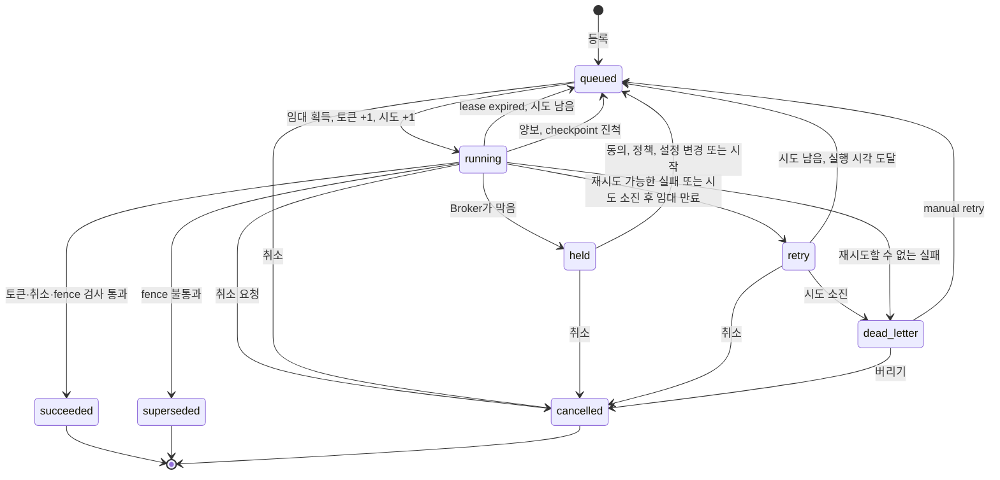
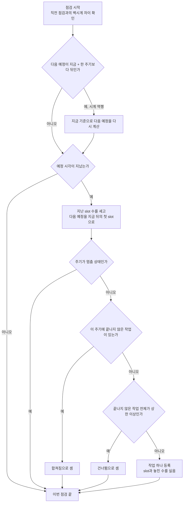
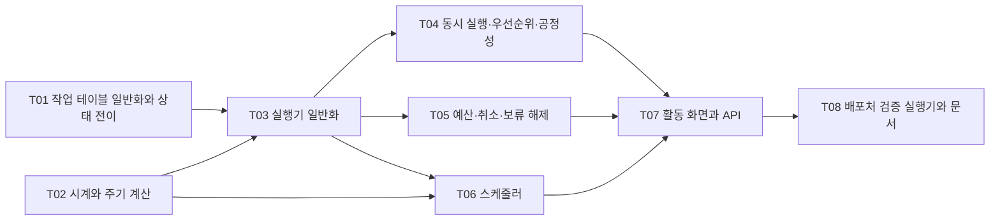

# 스펙: I03 Persistent Queue·Scheduler·재시도와 절전 복구

- 날짜: 2026-11-21 / 상태: 초안
- 관련: 이슈 #20(I03), 총괄 #1, Phase 2 #4, 선행 #18(I01)·#17(V02), 후속 #21(I04)·#33(H02). [V01 spec](2026-11-21-V01-vertical-skeleton.md), [V02 spec](2026-11-21-V02-vertical-slice.md), [ARCHITECTURE.md](../ARCHITECTURE.md), [ADR 0005](../adr/0005-llm-providers.md), [ADR 0013](../adr/0013-failure-recovery.md), [ADR 0014](../adr/0014-egress-policy-and-consent.md), [site-setup.md](../site-setup.md)

낯선 말은 [ARCHITECTURE 0절](../ARCHITECTURE.md#0-처음-나오는-말)에 풀이가 있다. `S19`·`S20`은 site-setup.md 체크리스트에 **새로 넣을** 번호다(S16·S17은 I02, S18은 I01이 쓴다). `I03-A…`는 이 spec이 새로 세우는 가정이며 ARCHITECTURE 9절의 가정 표에 옮겨 적을 대상이다.

## 배경

제품은 사람이 자리에 없어도 지식을 계속 갱신해야 한다(원 설계 9절 Event Processing, 최종 시나리오 FS14 "재시작 작업 재개"). 그러려면 작업이 프로그램 메모리가 아니라 **정본 SQLite에** 살아 있어야 하고, 같은 작업이 두 번 실행되더라도 결과는 한 번만 남아야 한다(이슈 #20 배경: "작업 상태는 내구성 저장, 실효적 중복 방지는 idempotency로 보장한다").

V02는 이 가운데 가장 작은 조각을 만든다(V02-R4·R5, V02-T03). 작업을 기한이 있는 **임대(lease)**로 집고, 한 번에 하나씩 처리하고, 재시작하면 기한이 지난 작업을 다시 집고, 결과를 쓰는 순간 원본 version이 그대로인지 확인한다(version fence). V02는 스케줄러, 재시도 정책의 일반화, 여러 작업의 동시 처리, 절전 복구를 이 작업으로 넘겼다(V02 비목표).

주 대상은 Windows 11 노트북이다. 여기서는 다음이 평범하게 일어난다.

- **절전·최대 절전**: 뚜껑을 닫으면 프로세스가 통째로 멈췄다가 몇 시간 뒤 깨어난다. 그 사이 예정된 주기 실행은 여러 번 지나가 있고, 임대 기한도 지나 있다.
- **강제 종료**: 작업 관리자에서 끝내기, 전원 차단, Windows 업데이트 재부팅. 쓰던 트랜잭션은 반영되지 않거나 통째로 반영된다.
- **시계 변화**: 시간대 변경, 일광 절약 시간, 시각 동기화로 벽시계가 앞뒤로 뛴다.

비유하면 이 작업은 "식당 주문표"다. 주문(작업)은 종이(정본)에 적혀 있어 주방장(실행기)이 쓰러져도 남는다. 주방장은 주문표에 "내가 몇 시까지 만든다"는 집게(임대)와 번호표(임대 토큰)를 꽂는다. 다른 주방장이 그 주문을 이어받으면 번호표가 바뀌므로, 먼저 쓰러졌던 주방장이 뒤늦게 요리를 내와도 번호가 맞지 않아 손님상에 오르지 않는다. 비유가 맞지 않는 곳: 실제로는 "요리"(Provider 호출)는 두 번 만들어질 수 있고 비용도 두 번 든다. 막는 것은 **상에 두 번 오르는 것**(정본에 두 번 기록되는 것)이다.

## 목표

- 작업이 queued·running·retry·held·succeeded·superseded·cancelled·dead_letter 가운데 정확히 한 상태에 있고, 정해진 전이 말고는 상태가 바뀌지 않는다.
- 실행 중에 프로세스를 강제로 끝내고 다시 켜면 그 작업이 다시 집혀 끝나며, 정본에 남는 결과는 한 번뿐이다.
- 10분·1시간·매일·매주 주기를 고를 수 있고, 재시작·절전·시계 변화 뒤 놓친 실행이 **주기 하나당 한 번으로 합쳐져** 실행된다. 대기열은 정해진 상한을 넘지 않는다.
- 우선순위, 공정성, 동시 실행 상한, 호출·시간 예산, 취소, 지수 backoff, 요청 한도, 수동 재시도가 동작하고, 그 상태를 활동 화면에서 볼 수 있다.
- 스케줄러가 만든 작업도 백그라운드 호출이며, 백그라운드 설정과 전송 정책을 우회하는 길이 없다.

## 비목표 (배포처에서 후속 진행)

**공용 저장소의 뒤 작업으로 넘기는 것**

- 삭제·권한 철회가 파생물 전체(Wiki, 벡터, Insight, 캐시)로 전파되는 범위와 정리 작업의 내용: I04(#21). I03은 fence와 임대 토큰이 결과 쓰기를 막는 **자리**와, 원본 하나의 끝나지 않은 작업을 한꺼번에 superseded로 닫는 함수만 준다.
- Connector의 cursor, pagination, full rescan, Connector 자체의 요청 한도 신호의 형태: I01(#18). I03은 그 신호를 작업의 재시도로 바꾸는 쪽만 맡는다.
- 폴더 감시가 만드는 작업: I02(#19). I02는 I03의 등록 함수를 쓴다.
- Reflection, Digest, 알림처럼 주기 실행이 필요한 기능 자체: K02(#26), P02(#28). I03은 그 기능들이 쓸 주기와 작업 문맥(예산, checkpoint)만 만든다.
- 절전을 막아 PC를 깨워 두는 것(전원 관리 차단): 하지 않는다. 노트북 배터리와 사용자 기대에 어긋난다. 깨어난 뒤 따라잡는다.
- 오래 기다린 낮은 우선순위 작업의 우선순위를 올리는 것(aging): 하지 않는다. 사용자 한 명의 PC에서 높은 우선순위 작업이 끝없이 들어오는 경우가 없다. 굶주림이 관측되면 그때 넣는다.
- 여러 PC나 여러 프로세스가 한 대기열을 나눠 쓰는 것: 하지 않는다. 백엔드는 하나다(ARCHITECTURE 3절). 임대 토큰은 그래도 둘이 동시에 도는 비정상 상황에서 결과가 두 번 쓰이지 않게만 막는다.
- 백그라운드 실행기를 별도 프로세스로 떼는 것: 측정 근거가 생기면 그때(ARCHITECTURE 3절).
- Windows 설치본의 OS 생명주기 전체(업데이트 중 종료, 로그오프, 빠른 시작): H02(#33).

**배포처 후속 항목**(2개. 각각 [site-setup.md의 배포처 설정 체크리스트](../site-setup.md#배포처-설정-체크리스트)에 같은 번호로 넣는다. 넣는 일은 I03-T08)

| 번호 | 항목 |
|---|---|
| S19 | Windows 11 설치본에서 강제 종료·절전·최대 절전·시계 변경 시나리오를 실행하고 기록 |
| S20 | 배포처 Provider의 요금·한도와 실제 수집기에 맞춰 호출 예산과 수집 주기의 값을 정함 |

## 요구사항

**작업의 상태와 저장**

- **I03-R1 상태와 전이.** 작업의 상태는 여덟 가지다: `queued`(대기), `running`(실행 중), `retry`(재시도 대기), `held`(보류), `succeeded`(성공), `superseded`(낡음), `cancelled`(취소), `dead_letter`(포기). 이슈 #20의 여섯 상태에 V02가 이미 쓰는 둘을 더했다: fence에 걸려 닫힌 `superseded`(V02-R5), 전송 정책·동의·실행 조건·크기 초과로 호출하지 않은 `held`(ADR 0014 "보류", V02-R8). 전이는 아래 "작업 한 건의 상태" 그림과 표에 있는 것뿐이며, 저장 모듈의 함수만 상태를 바꾼다. 그림에 없는 전이를 요청하면 거부한다. 데이터베이스는 상태 값을 CHECK로 묶는다. `succeeded`·`superseded`·`cancelled`는 끝 상태이고, `dead_letter`는 수동 재시도와 버리기로만 나간다.
- **I03-R2 작업 테이블의 일반화.** V02가 만든 작업 테이블(원본 ID, fence version, 상태, 임대 기한)을 새 마이그레이션으로 넓힌다: 원본이 없는 작업(Connector 동기화, 정리 작업)을 위해 원본 ID를 비울 수 있게 하고(원본 fence를 쓰는 종류는 CHECK로 원본을 요구), 시도 횟수, 다음에 실행해도 되는 시각, 임대 주인과 **임대 토큰**, 마지막 heartbeat, 우선순위, 공정성 키, 주기 ID와 그 주기의 예정 시각(slot), checkpoint, 마지막 오류 **코드**, 보류 사유 **코드**, 취소 요청 표시, 만든·바꾼·끝난 시각을 더한다. 중복 등록 방지 키는 둘이다: 원본 작업은 V02 그대로 `(종류, 원본, fence version)`, 주기 작업은 `(주기, slot)`. 그리고 한 주기에 끝나지 않은 작업은 최대 하나다(부분 유일 색인). 작업 행에는 원본의 글, Provider의 오류 문구가 들어가지 않는다.

**임대, 효과, checkpoint**

- **I03-R3 임대 토큰과 heartbeat.** 작업을 집는 것은 한 문장의 조건부 갱신이다: `queued`이고 실행해도 되는 시각이 지났으면 `running`으로 바꾸고, 임대 토큰을 1 올리고, 임대 주인(프로세스가 켜질 때마다 새로 만드는 실행기 ID)과 임대 기한을 쓰고, 시도 횟수를 1 올린다. 실행 중에는 임대 길이의 4분의 1마다 heartbeat로 기한을 늘리는데, 이것도 "토큰이 내가 가진 값과 같을 때만"의 조건부 갱신이다. 실패하면(누가 이미 다시 집었다) 실행기는 그 작업의 취소 신호를 끊고 결과를 쓰지 않는다. 기한이 지나 있더라도 토큰이 그대로면 heartbeat는 성공한다(절전에서 깨어난 같은 실행기가 계속하는 경우).
- **I03-R4 임대 회수.** 실행기는 시작할 때와 매 점검 때 임대를 회수한다. 회수 대상은 `running`이면서 ① 기한이 지났거나 ② 기한이 지금보다 **임대 길이보다 더 미래**인 작업이다(②는 정상 동작에서 생길 수 없고 벽시계가 뒤로 간 경우다). 단, 지금 실행기가 메모리에 붙잡고 있는 작업은 회수하지 않고 heartbeat로 처리한다. 회수된 작업은 시도가 남았으면 `queued`, 소진됐으면 `retry`(오류 코드 `lease-expired`)로 간다. 시도 횟수는 집을 때 올라가므로, 실행할 때마다 프로세스를 죽이는 작업(poison job)도 정해진 횟수 뒤 `dead_letter`에 이른다.
- **I03-R5 효과는 한 번만.** 작업 종류마다 결과를 정본에 쓰는 일은 **한 트랜잭션**이고, 그 트랜잭션은 맨 처음 ① 상태가 `running`이고 토큰이 내가 가진 값이며 ② 취소 요청이 없고 ③ 그 종류의 fence(원본 작업이면 V02-R5의 version과 tombstone 검사)를 통과하는지 확인한다. ①·②가 틀리면 아무것도 쓰지 않고 끝난다. ③이 틀리면 결과를 버리고 `superseded`로 닫는다. 통과하면 결과와 `succeeded`를 같은 트랜잭션에서 쓴다. 정본 밖의 효과는 Provider 호출뿐이며 이것은 효과로 치지 않고 예산으로 센다(R12). Connector 동기화의 cursor는 ADR 0013 결정 1대로 원본을 저장한 트랜잭션에서 확정되므로 같은 동기화가 두 번 돌아도 원본은 content hash로 걸러진다.
- **I03-R6 checkpoint.** 여러 단계로 나뉘는 작업은 단계마다 그 단계의 결과와 checkpoint를 R5와 같은 검사를 거친 한 트랜잭션으로 쓴다. 다시 집힌 작업은 checkpoint부터 잇는다. checkpoint에는 **ID, 번호, 개수만** 들어가고 원본의 글이나 Provider 응답은 들어가지 않는다(삭제 때 지울 대상을 늘리지 않기 위해. ADR 0013 결정 5). 크기는 4 KiB 이하이고, 종류마다 정한 스키마에 맞지 않으면 쓰기를 거부한다. 끝 상태가 되면 checkpoint를 비운다.

**결과의 분류와 재시도**

- **I03-R7 결과의 분류.** 실행 한 번의 결과는 아래 "실행 결과가 가는 곳" 표대로 다음 상태가 된다. 표에 없는 결과(처리기가 던진 예외 포함)는 재시도할 수 있는 실패 `handler-error`다. 저장하는 것은 코드뿐이며 예외 문구는 저장하지 않는다(입력이 섞일 수 있다. V01-R13).
- **I03-R8 지수 backoff.** 재시도할 수 있는 실패는 `retry`로 가고 다음 실행 시각을 `min(30초 × 2^(시도−1), 1시간)` 뒤로 잡는다. 요청 한도(`rate-limited`)이면 그 값과 5분 가운데 긴 쪽이다. 지연에 무작위 값을 섞지 않는다(사용자 한 명이라 몰림이 없고, 테스트가 결정론적이어야 한다). Broker 안의 재시도(요청 하나에 최대 3회, V01 `DEFAULT_LIMITS`)는 그대로이고, 작업의 시도 한 번은 그 전체다.
- **I03-R9 시도 소진.** 시도 상한은 종류마다 정하며 기본 5회다. `retry`에서 나가는 판정은 한 곳에서만 한다: 시도가 남았으면 실행 시각이 된 뒤 `queued`, 소진됐으면 곧바로 `dead_letter`. 재시도할 수 없는 실패는 `running`에서 바로 `dead_letter`로 간다.
- **I03-R10 수동 재시도와 취소.** 사용자는 ① `dead_letter` 작업을 다시 시도할 수 있고(시도 횟수를 0으로 되돌리고 우선순위 "사용자"로 `queued`) ② `queued`·`retry`·`held`·`running` 작업을 취소할 수 있고 ③ `dead_letter` 작업을 버릴 수 있다(`cancelled`). 실행 중인 작업의 취소는 취소 요청 표시를 쓰고, 실행기가 heartbeat 때 이를 보고 취소 신호를 끊는다. 결과 쓰기 트랜잭션도 표시를 확인하므로(R5 ②) 취소 뒤에 결과가 들어가지 않는다. 이미 `succeeded`인 작업의 취소는 "이미 끝남"을 돌려주고 아무것도 바꾸지 않는다.

**동시 실행, 순서, 예산**

- **I03-R11 동시 실행.** 실행기는 전체 상한(기본 2, 설정 `jobs.maxConcurrent`로 1~4) 안에서 작업을 함께 돌린다. 종류마다 **동시 실행 묶음**이 코드 상수로 정해져 있고 묶음마다 상한이 있다: 지식을 쓰는 종류(V02의 추출과 그 뒤의 지식 작업)는 묶음 `knowledge`에 들어가 **상한 1**이다. V02-R4의 이유(세 출처가 동시에 추출되면 같은 대상이 두 항목이 된다)가 개체 해소(S02) 전까지 그대로이기 때문이며, 이 상한은 설정으로 바꿀 수 없다. Connector 동기화는 Connector 인스턴스마다 상한 1이다(같은 cursor를 둘이 진행하지 않게). 정리 작업은 묶음 `maintenance`, 상한 1. Provider 호출은 이와 별도로 Broker의 동시 실행 상한(2)을 지난다.
- **I03-R12 우선순위와 공정성.** 우선순위는 세 단계다: `user`(사용자가 시작한 가져오기, 수동 재시도, "지금 실행"), `scheduled`(주기), `maintenance`(정리). 집는 순서는 ① 우선순위가 높은 것 ② 같은 우선순위에서는 **공정성 키**(Connector 인스턴스, 원본이 없으면 종류)마다 돌아가며 — 가장 오래전에 집힌 키부터 ③ 같은 키 안에서는 실행해도 되는 시각, 그다음 등록 순서. 그래서 한 Connector가 작업 100개를 쌓아도 다른 Connector의 작업이 그 뒤에 줄 서지 않는다. 키별 "마지막으로 집힌 때"는 메모리에만 두고 재시작하면 처음부터 센다.
- **I03-R13 예산.**
  - **실행 시간**: 작업의 실행 한 번에 시간 제한이 있다(기본 10분, 종류마다 정함). 넘으면 취소 신호를 끊고 재시도할 수 있는 실패 `run-timeout`이다. 이 시간은 프로세스 안의 단조 시계로 잰다.
  - **작업당 호출 수**: 처리기는 Broker를 직접 받지 않고 작업 문맥이 감싼 Broker를 받는다. 감싼 Broker는 실행 한 번의 호출 수를 세고(기본: 추출 2 — V02-R6의 1회 + 스키마 불일치 재요청 1회와 같다), 넘으면 Provider를 부르지 않고 `job-budget-exhausted`로 막는다. 처리기는 checkpoint를 쓰고 "양보"를 돌려줄 수 있다. 양보는 시도를 쓰지 않고 1분 뒤 `queued`가 되지만, checkpoint가 바뀌지 않은 양보는 재시도할 수 있는 실패로 센다(진척 없는 양보가 끝없이 반복되지 않게).
  - **전체 호출 예산**: Broker의 시간창 예산(1시간에 60회, `DEFAULT_LIMITS`)은 지금 메모리에만 있어 재시작하면 0부터 다시 센다. Broker가 시작할 때 호출 이력(`provider_calls`)에서 시간창 안의 실제 시도 수로 예산을 채운다. 그래서 재시작이 예산을 되살리지 않는다. 예산이 소진된 호출(`budget-exhausted`)은 시도를 쓰지 않는 `retry`이며, 다음 실행 시각은 시간창에서 가장 오래된 시도가 빠지는 때(최대 1시간 뒤)다.
- **I03-R14 백그라운드 설정과 전송 정책을 우회하지 않는다.** 실행기와 스케줄러가 부르는 모든 Provider 호출은 Broker를 지나고, 그 출처는 작업 기록이므로 **언제나 백그라운드 호출**이다(ADR 0005 결정 6). 수동 재시도와 "지금 실행"도 작업을 다시 대기열에 넣을 뿐이라 백그라운드다. 실행기와 스케줄러는 사용자 동작 기록을 만들 수 없다(V01-T09의 issuer를 받지 않는다. 구성 지점 테스트로 확인). Broker가 막으면(동의 없음, 전송 거부, 백그라운드 설정 꺼짐, 검증되지 않은 CLI, Provider 없음 등) Provider를 부르지 않고 작업을 `held`로 두며 사유 코드를 남긴다. **다른 Provider로 넘어가지 않는다.** 동의·전송 규칙·백그라운드 설정·기본 Provider가 바뀔 때와 시작할 때, 정책 사유로 보류된 작업을 `queued`로 되돌린다. 다시 허용될지는 다음 시도에서 Broker가 다시 판정한다(판정은 시도마다. V01 "T07이 넘기는 것" 3항). 크기 초과 보류(V02-R8)는 자동으로 되돌리지 않는다.
- **I03-R15 백그라운드 설정 화면의 문구.** 설정 화면 "백그라운드 실행"의 설명을 고친다. 켜면 가져오기 직후의 추출뿐 아니라 **사용자가 자리에 없을 때 주기에 따라 자동으로 도는 실행도** 허용된다는 것을 적는다(ADR 0005 "원 설계와의 긴장": 이 스위치는 둘을 구분하지 않는다). 문구 예: "켜면 격리가 검증된 CLI 조합이 백그라운드 작업을 실행합니다. 여기에는 가져오기 뒤의 추출과, 사용자가 자리에 없을 때 정해진 주기에 따라 자동으로 도는 작업이 모두 들어갑니다. 검증되지 않은 조합은 이 설정과 관계없이 백그라운드로 실행하지 않습니다. 기본값은 끔입니다."

**스케줄러**

- **I03-R16 주기.** 주기는 `(종류, 대상)` 하나에 하나다. 고를 수 있는 값은 10분, 1시간, 매일(로컬 시각 하나), 매주(요일 하나와 로컬 시각 하나)다. 기본 주기는 둘이다: 사용할 수 있는 Connector 인스턴스마다 동기화 **1시간**, 정리 작업 **매일 03:00**. "미구현"을 돌려주는 Connector(`site-*`)에는 기본 주기를 만들지 않는다. 사용자는 주기를 바꾸거나 끌 수 있고 "지금 실행"을 누를 수 있다. 주기는 정본 SQLite의 주기 테이블에 있다(재시작 뒤에도 남는다).
- **I03-R17 놓친 실행의 합치기(bounded coalescing).** 스케줄러는 점검할 때 예정 시각이 지난 주기마다 ① 지난 slot의 수를 세고 ② 다음 예정 시각을 **지금보다 뒤의 첫 slot**으로 옮기고 ③ 그 주기에 끝나지 않은 작업이 없으면 작업을 **하나만** 넣는다(놓친 slot 수와 마지막 slot을 함께). 끝나지 않은 작업이 있으면 넣지 않고 "합쳐짐"으로 센다. 그래서 8시간 절전 뒤 10분 주기는 48번이 아니라 1번 돈다. 한 주기의 작업이 재시도할 수 없는 실패로 `dead_letter`가 되면 그 주기를 "멈춤"(사유 코드)으로 바꾸고, 사용자가 다시 켤 때까지 작업을 넣지 않는다(같은 실패가 주기마다 쌓이지 않게).
- **I03-R18 대기열 상한.** 주기 하나에 끝나지 않은 작업은 최대 하나다(R2). 그리고 끝나지 않은 작업 전체가 상한(기본 1000) 이상이면 스케줄러는 주기 작업을 넣지 않고 그 slot을 "건너뜀(대기열 가득)"으로 센다. 사용자가 시작한 가져오기는 거부하지 않는다(입력 크기만큼만 생기고 원본 version마다 하나로 묶인다).
- **I03-R19 시간의 단절.** 스케줄러는 30초마다 점검하고, 시작할 때와 **시간 단절**을 알아챘을 때 곧바로 점검한다. 시간 단절은 직전 점검과의 벽시계 차이가 점검 간격의 2배를 넘거나 음수인 경우다(절전에서 깨어남, 시계가 앞뒤로 뜀). 이 판정은 단조 시계가 절전 시간을 세는지에 기대지 않는다(I03-A1). 저장된 미래 시각이 상식적인 범위를 넘으면 **시계가 뒤로 간 것**으로 보고 바로잡는다: 주기의 다음 예정 시각이 지금보다 한 주기보다 더 뒤면 지금 기준으로 다시 계산하고, 작업의 다음 실행 시각이 지금보다 backoff 상한보다 더 뒤면 지금 + 상한으로 당기고, 임대 기한은 R4 ②를 따른다. 매일·매주 주기의 slot은 점검할 때마다 그 시점의 시간대로 로컬 달력에서 계산한다. 일광 절약으로 없는 로컬 시각은 그 뒤의 첫 유효 시각으로, 두 번 있는 로컬 시각은 앞의 것 한 번으로 본다. 저장하는 시각은 모두 UTC다.
- **I03-R20 보존.** 정리 작업은 끝난 지 30일이 지난 `succeeded`·`superseded`·`cancelled` 작업 행을 지운다. `dead_letter`는 사용자가 다시 시도하거나 버릴 때까지 남긴다. 호출 이력(`provider_calls`)의 보존은 이 작업의 범위가 아니다.

**보이기**

- **I03-R21 활동 화면과 API.** 활동 화면에 작업 영역을 더한다: 상태별 개수, 작업 목록(종류, 대상의 ID와 이름, 상태, 시도/상한, 다음 실행 시각, 보류·오류 사유 코드와 그 뜻), 주기 목록(주기, 마지막 실행, 다음 예정, 합쳐진 수, 건너뛴 수, 멈춤 사유), Broker 예산 사용량(시간창 안의 시도 수/상한), 대기열이 상한에 가까우면 경고. 동작: 취소, 다시 시도, 버리기, 주기 바꾸기·끄기, 지금 실행. API는 V01의 세션 토큰과 Origin 검사를 그대로 지나고, 응답에 원본의 글과 Provider의 문구가 없다.

**검증 수단과 문서**

- **I03-R22 강제 종료 시험.** 테스트 빌드 전용 작업 종류(`test-effect`)를 둔다. 이 종류는 결과 쓰기 트랜잭션에서 효과 행 하나를 쓰고, 그 전에 정본 밖의 실행 기록 파일에 "실행했다"를 한 줄 남기며, 시험이 정한 지점에서 멈춰 기다릴 수 있다. 시험은 백엔드를 자식 프로세스로 띄워 그 지점에서 **강제로 끝내고**(`SIGKILL`. Windows에서는 Node가 프로세스를 즉시 종료시키는 같은 호출) 다시 띄운다. 배포 빌드와 개발 빌드에는 이 종류가 없다.
- **I03-R23 배포처 검증 실행기.** 같은 시나리오(실행 중 강제 종료, 절전과 최대 절전에서 깨어남, 시계를 앞뒤로 옮김, 시간대 변경)를 Windows 설치본에서 돌리고 결과를 기록하는 실행기와 절차서를 둔다. 실행 기록에는 OS, 앱 버전, 시나리오, 관찰한 상태 전이, 효과 행 수, 합쳐진 slot 수가 들어간다. 실행기는 Windows 설치본이 아니거나 절전 시나리오의 수동 확인 기록이 없으면 `배포처 후속`으로 시작하는 알림을 출력하고 0이 아닌 값으로 끝난다.
- **I03-R24 문서.** site-setup.md 체크리스트에 S19·S20을 넣고 실행 중 설정 표에 `jobs.maxConcurrent`를 더한다. 문서 대응 테스트에 이 spec의 배포처 후속 항목을 더한다. ARCHITECTURE와 ADR 0013에 필요한 고침은 아래 "다른 문서에 필요한 고침"에 적은 대로 그 문서의 소유자와 맞춘다.

## 인터페이스 / 설계 개요

### 작업 한 건의 상태

이슈 #20의 그림에 있는 전이는 모두 그대로다. 아래 표에서 굵게 적은 것이 이 spec이 더한 전이다.

| 전이 | 출처 | 일어나는 때 |
|---|---|---|
| queued → running | 이슈 | R3의 조건부 갱신이 성공 |
| running → succeeded | 이슈 | R5의 세 검사를 통과하고 결과를 씀 |
| running → retry | 이슈 | 재시도할 수 있는 실패(R7), 또는 시도가 소진된 작업의 임대 회수(R4) |
| retry → queued | 이슈 | 시도가 남았고 다음 실행 시각이 지남(R9) |
| retry → dead_letter | 이슈 | 시도 소진(R9). 판정하는 곳은 여기 하나다 |
| running → queued(lease expired) | 이슈 | 임대 회수, 시도 남음(R4) |
| running → cancelled, queued → cancelled | 이슈 | R10 |
| dead_letter → queued(manual retry) | 이슈 | R10 ① |
| **running → superseded** | V02-R5 | fence 불통과 |
| **running → held**, **held → queued** | ADR 0014, R14 | Broker가 막음 / 막은 조건이 바뀜 |
| **running → dead_letter** | R9 | 재시도할 수 없는 실패 |
| **held·retry → cancelled**, **dead_letter → cancelled** | R10 | 취소, 버리기 |
| **running → queued(양보)** | R13 | 작업당 호출 예산에 막혀 checkpoint를 진척시키고 양보 |

"시도 소진"을 `retry → dead_letter` 한 곳에서만 판정하는 것이 이 그림의 핵심이다. 재시도할 수 있는 실패든 임대 만료든 시도가 바닥나면 같은 길로 포기에 이르므로, 포기 조건이 두 군데로 갈라지지 않는다.

### 실행 결과가 가는 곳

| 실행 결과 | 다음 상태 | 시도 | 비고 |
|---|---|---|---|
| 처리기 성공, R5 통과 | succeeded | 씀 | |
| fence 불통과, 또는 Broker `rejected: missing-source`(원본이 지워짐) | superseded | 씀 | V02-R5 |
| Broker `blocked`(동의 없음, 전송 거부, `cli-*`, `unverified-*`, `no-provider`, 구조화 출력 없음, 기능 조회 실패) | held(그 사유) | 씀 | R14. 다른 Provider로 넘기지 않음 |
| Broker `blocked: budget-exhausted` | retry | **되돌림** | R13 전체 호출 예산 |
| `job-budget-exhausted` 뒤 양보, checkpoint 진척 | queued(1분 뒤) | 되돌림 | R13 |
| 진척 없는 양보 | retry | 씀 | R13 |
| Broker `failed: timeout`·`provider-error` | retry | 씀 | R8 |
| Broker `failed: rate-limited` | retry(최소 5분) | 씀 | R8 |
| Broker `failed: invalid-output` | dead_letter | 씀 | V02-R6이 이미 한 번 다시 물었다. 같은 원본으로 다시 물어 비용을 더 쓰지 않는다. 수동 재시도는 가능 |
| Broker `rejected`(그 밖의 사유) | dead_letter | 씀 | 코드의 잘못이다 |
| V02 크기 초과 | held(`too-large`) | 씀 | 자동으로 되돌리지 않음 |
| Connector `connector-unavailable` | dead_letter | 씀 | 그 주기는 멈춤(R17) |
| 실행 시간 초과 | retry(`run-timeout`) | 씀 | R13 |
| 처리기 예외 | retry(`handler-error`) | 씀 | 문구는 저장하지 않음 |
| 토큰 불일치, 취소 요청 | (쓰지 않음) | — | 이미 다른 실행이 잡았거나 취소됨 |

### 작업 문맥 (잠정. T03에서 확정)

V02-T03의 처리기 규격을 넓힌다. 처리기는 문맥 하나를 받고 결과 하나를 돌려준다.

| 문맥이 주는 것 | 뜻 |
|---|---|
| 작업 ID, 종류, 대상, fence version, slot, 놓친 slot 수 | 읽기 전용 |
| 취소 신호 | 취소, 실행 시간 초과, 임대 상실 때 끊긴다. Broker 호출에 넘긴다 |
| 감싼 Broker | 작업 기록을 출처로 넣고 호출 수를 센다. 처리기는 출처를 고를 수 없다 |
| `commit(쓰기)` | R5의 검사 뒤 처리기의 쓰기와 `succeeded`를 한 트랜잭션에서 |
| `checkpoint(값, 쓰기)` | R6. 같은 검사 뒤 단계 결과와 checkpoint를 한 트랜잭션에서 |
| 마지막 checkpoint | 다시 집힌 작업이 잇는 지점 |

처리기의 결과는 `committed`, `superseded`, `yield`, `fail(코드, 재시도 가능 여부)` 넷이다. Broker의 결과를 그대로 돌려주면 실행기가 위 표로 분류한다.

### 스케줄러의 점검 한 번

주기 하나에 대해 점검할 때마다 아래 순서로 판정한다. 시작할 때와 시간 단절 뒤에도 같다.

다음 예정 시각을 옮기는 일(E)은 작업을 넣든 안 넣든 언제나 한다. 그래서 어떤 경우에도 같은 slot을 두 번 세지 않고, 작업 수는 주기 수를 넘지 않는다.

### 시계

실행기와 스케줄러는 시계를 직접 읽지 않고 주입된 시계 하나를 쓴다: 벽시계(UTC 밀리초, 저장하는 모든 시각), 단조 시계(실행 시간 제한, heartbeat 간격), 기다리기. 테스트는 가짜 시계로 절전(점검 없이 벽시계만 몇 시간 앞으로), 시계 역행, 일광 절약을 흉내 낸다. 시간대는 점검할 때마다 `Intl.DateTimeFormat().resolvedOptions().timeZone`으로 읽는다(테스트는 시간대를 주입한다).

### 기본값 (잠정. 바꾸는 곳)

| 값 | 기본 | 바꾸는 곳 |
|---|---|---|
| 전체 동시 실행 | 2 | 설정 `jobs.maxConcurrent`(1~4) |
| `knowledge` 묶음 동시 실행 | 1 | 바꿀 수 없음(S02 뒤 재검토) |
| 임대 길이 / heartbeat | 2분 / 30초 | 작업 기본값 상수 한 곳 |
| 시도 상한 | 5 | 종류별 상수 |
| backoff | 30초부터 2배, 상한 1시간, 요청 한도 최소 5분 | 작업 기본값 상수 |
| 실행 한 번의 시간 제한 | 10분 | 종류별 상수 |
| 작업당 호출 수(추출) | 2 | 종류별 상수 |
| 점검 간격 / 시간 단절 판정 | 30초 / 2배 초과 또는 음수 | 작업 기본값 상수 |
| 대기열 상한 | 1000 | 작업 기본값 상수 |
| 기본 주기 | Connector 동기화 1시간, 정리 매일 03:00 | 활동 화면, 주기 API |
| 보존 | 끝난 지 30일 | 작업 기본값 상수 |

### 사용자 동작으로 시작한 추출을 구분하는 방법 (선택지로만 기록. 채택하지 않음)

ADR 0005는 "사용자가 방금 시작한 가져오기에서 나온 추출"을 부르는 쪽이 속일 수 없게 구분하는 방법이 생기면 다시 열기로 했다. 스케줄러를 설계하면서 검토한 후보와 위조 분석이다.

- **후보**: 가져오기를 처리하는 API 요청 안에서, 사용자 동작 기록 issuer(API 계층 전용, V01-T09)가 "가져오기 승인"을 발급하고 그 요청이 등록한 추출 작업들에만 묶는다. 승인은 정본에 남고(작업은 요청보다 오래 산다) 작업마다 한 번만 쓰이며, 짧은 기한(예: 10분) 뒤에는 무효다. Broker는 작업 기록과 함께 이 승인을 보고 "사용자 가져오기의 추출"로 판정한다. 더 강한 변형은 Electron 쉘의 기본 파일 선택 창에서 사용자가 고른 경우에만 쉘이 승인을 발급하는 것이다.
- **위조 분석**: ① 화면(renderer)에서 오는 요청은 세션 토큰만 있으면 누구든 같은 모양으로 보낼 수 있다. 가져온 문서가 화면에서 스크립트를 실행하는 결함(V02-R15가 막으려는 것)이 하나라도 있으면 그 스크립트가 가져오기 API를 불러 승인을 받는다. 그래서 API 계층 발급만으로는 "사람이 눌렀다"가 아니라 "화면이 요청했다"를 증명한다. ② 승인이 정본 행이면 백엔드 안의 어떤 코드든 그 행을 쓸 수 있다. 스케줄러·실행기·Connector 동기화 코드가 승인 테이블에 쓰지 못하게 V01-T09의 `pki/gate-inputs` lint와 같은 방식으로 막아야 한다. ③ 주기적인 Connector 동기화에서 나온 추출은 어떤 경우에도 승인을 받지 않아야 하는데, 동기화도 같은 저장 함수를 지나므로 등록 경로를 나눠야 한다. ④ 쉘 발급 변형은 ①을 막지만 브라우저 개발 실행에는 쉘이 없어 그 경로에서는 승인이 없다(백그라운드로 남는다). 쉘과 백엔드 사이 전용 통로의 무결성은 A18과 함께 미검증이다.
- **판단**: ①이 남는 API 발급 변형은 이 구분의 목적(격리가 검증되지 않은 CLI에 사람이 고른 문서만 넣는다)을 지키지 못한다. 쉘 발급 변형은 ①을 막지만 ②~④의 새 신뢰 경계가 필요하고 Windows 검증 전이다. 그래서 I03은 채택하지 않고, 스케줄러가 이 구분 없이도 동작하게 둔다. 다시 연다면 쉘 발급 변형을 ADR 0005의 개정으로 다루고, 위조 시험(화면 스크립트가 승인을 얻지 못함, 동기화 추출이 승인을 얻지 못함)을 완료 기준에 넣는다.

### 작업 분해 (잠정. 조정자가 확정 후 다시 맞춤)

한 작업이 PR 하나다. 그림은 I03 안의 선후만 그렸다.

| ID | 내용 | 요구사항 | 기준 | 선행 | 테스트 |
|---|---|---|---|---|---|
| I03-T01 | 작업 테이블 마이그레이션(원본 없는 작업, 시도, 실행 시각, 임대 주인·토큰, 우선순위, 공정성 키, 주기·slot, checkpoint, 오류·보류 코드, 취소 요청, 시각들, 상태 CHECK, 두 중복 키와 주기당 하나 색인), 전이 함수, V02 상태 값의 옮기기 | R1, R2 | C1 | **V02-T03 머지**, V02-T02 | `jobs.transitions`(모든 상태 쌍), `jobs.migration`(V02 스키마의 작업이 상태와 fence를 지닌 채 옮겨짐), `jobs.no-content` |
| I03-T02 | 주입 시계(벽·단조·기다리기), 주기의 slot 계산(네 가지 주기, 로컬 시각, 일광 절약), 놓친 slot 세기, 시계 역행 보정 규칙 | R19(계산), R16(주기 값) | C2 | 없음 | `schedule.slots`, `schedule.dst`, `clock.regression` |
| I03-T03 | 실행기 일반화: 임대 토큰, heartbeat, 임대 회수, 작업 문맥, commit·checkpoint, 결과 분류, backoff, 시도 소진, 실행 시간 제한, `test-effect` 종류와 강제 종료 시험 | R3~R9, R13(실행 시간), R22 | C1, C3(backoff) | T01, T02 | `lease.token`, `lease.reclaim`, `kill.resume`, `effect.once`, `checkpoint.resume`, `outcome.mapping`, `backoff`, `poison` |
| I03-T04 | 동시 실행 묶음과 전체 상한, 설정 `jobs.maxConcurrent`, 우선순위와 공정성 순서 | R11, R12 | C3 | T03 | `concurrency.groups`, `priority.fairness` |
| I03-T05 | 작업당 호출 예산과 양보, Broker 예산의 이력 복원, `budget-exhausted` 처리, 취소(대기·실행 중), 수동 재시도·버리기, 보류 해제, 실행기·스케줄러가 사용자 동작 기록을 받지 않는 구성 | R10, R13, R14 | C3 | T03 | `budget.job`, `budget.restart`, `cancel`, `manual-retry`, `held.release`, `background.gate` |
| I03-T06 | 주기 테이블, 기본 주기, 점검(30초, 시작, 시간 단절), 합치기, 주기 멈춤, 대기열 상한, 정리 작업과 보존 | R16~R20 | C2 | T02, T03 | `coalesce.sleep`, `coalesce.restart`, `clock.jump`, `backlog.bound`, `schedule.pause`, `retention` |
| I03-T07 | 활동 화면의 작업·주기·예산 영역과 동작, 작업·주기 API, 백그라운드 설정 문구 | R15, R21 | C3(가시성) | T04, T05, T06 | `jobs.api`(토큰·Origin·내용 없음), `activity.e2e`, `settings.background-text` |
| I03-T08 | 배포처 검증 실행기와 절차서, site-setup S19·S20과 `jobs.maxConcurrent`, 문서 대응 테스트 확장, ARCHITECTURE·ADR 0013 고침(소유자와 조정) | R23, R24 | H1, H2, C1·C2의 Windows 몫 | T07, **R04(#13)의 사외 준비물** | `docs.site-setup`, `site-verify.refuse` |

T02는 V02-T03을 기다리지 않고 바로 시작할 수 있다. 나머지는 V02-T03의 실행기가 머지된 뒤에 그 위에 쌓는다(대체하지 않는다).

### 다른 문서에 필요한 고침 (이 spec에서는 고치지 않음)

| 문서 | 고칠 것 |
|---|---|
| ADR 0013 결정 9 | "Phase 1의 실행기는 한 번에 하나씩" → 묶음 `knowledge`는 1, 전체는 설정값. 임대 토큰으로 낡은 실행의 쓰기를 막는다는 것, 놓친 주기의 합치기, 시계 역행 보정을 결정에 더함 |
| ARCHITECTURE 3절 표 "백그라운드 작업" | 동시 실행 묶음, 스케줄러가 같은 프로세스 안에 있음 |
| ARCHITECTURE 7절 실패 표 | 절전에서 깨어남, 시계 변화, 같은 작업을 죽이는 작업(poison), 예산 소진의 행 |
| ARCHITECTURE 9절 가정 표 | I03-A1~A5를 다음 번호로 옮김 |
| site-setup.md | S19·S20, 실행 중 설정 `jobs.maxConcurrent`(T08이 함) |
| ADR 0005 | 위의 "선택지로만 기록" 절을 다시 열 조건의 근거로 연결(ADR 소유자 판단) |

## 완료 기준 (테스트 가능한 형태)

C1~C3은 이슈 #20의 문장 그대로다. H1·H2는 이 프로젝트가 배포처로 넘어가는 프로젝트라서 spec 양식이 요구하는 두 기준이며 이 spec에만 둔다.

- [ ] **I03-C1** (R1~R7, R22): queued/running/retry/dead-letter/cancelled/succeeded, lease/heartbeat/checkpoint를 정의한다. 강제종료 후 lease 회수와 재처리로 효과 중복이 없다.
- [ ] **I03-C2** (R16~R20): 10분/1시간/일간/주간 기본 주기를 설정 가능하게 하고 재시작·절전·시계 변화 후 누락분을 bounded coalescing한다. 무한 backlog를 막는다.
- [ ] **I03-C3** (R8~R15, R21): 우선순위/공정성/동시 실행/호출·시간 예산·취소·exponential backoff·rate limit·수동 retry와 Activity 가시성을 검증한다.
- [ ] **I03-H1** (R24): 이 spec의 "배포처 후속 항목" 2개 각각에 대해 site-setup.md의 `## 배포처 설정 체크리스트` 아래에 같은 번호(S19, S20)의 항목이 있으면 통과하고, 하나라도 없거나 수가 다르면 문서 대응 테스트가 실패한다.
- [ ] **I03-H2** (R23): 배포처 검증 실행기를 ① Windows 설치본이 아닌 환경에서 ② 절전 시나리오의 수동 확인 기록 없이 실행하면 각각 `배포처 후속`으로 시작하는 알림을 출력하고 0이 아닌 값으로 끝난다(경우마다 1건, 모두 2건).

**기준을 읽는 법**

- **C1의 "효과 중복이 없다"**: 정본에 남는 결과가 한 번이라는 뜻이다. Provider 호출이 두 번 일어나는 것은 막지 못하며, 그것은 예산으로 센다(R13). 시험은 실행 기록 파일로 "두 번 실행됐다"를 보이고 효과 행으로 "한 번 남았다"를 보인다. 둘을 함께 보여야 이 기준이 시험된 것이다(한 번만 실행됐다면 중복 방지를 시험한 것이 아니다).
- **C1의 여섯 상태**: 이 spec은 `held`와 `superseded`를 더해 여덟이다. 이슈의 여섯은 그대로 있고 이슈 그림의 전이도 모두 있다.
- **C2의 "절전"**: 사외에서는 가짜 시계로 흉내 낸다. 실제 Windows 절전·최대 절전에서 같은 결과가 나오는지는 S19 뒤에 충족된다.

### 기준별 증명 테스트

테스트 수준의 뜻은 [V01 spec](2026-11-21-V01-vertical-skeleton.md#기준별-증명-테스트)과 같다.

| 기준 | 테스트 | 수준 | 확인하는 것 |
|---|---|---|---|
| C1 | `jobs.transitions` | 단위 | 8×8 상태 쌍 전부: 그림의 전이만 성공하고 나머지는 거부되며 행이 그대로. 데이터베이스에 목록 밖의 상태를 직접 쓰면 CHECK가 거부 |
| C1 | `jobs.migration` | 통합 | V02 스키마의 작업(대기, 보류, 낡음)이 새 스키마에서 같은 상태와 원본·fence version을 지님. `(종류, 원본, fence version)` 중복 등록은 여전히 하나 |
| C1 | `jobs.no-content` | 통합 | 처리기가 원본 본문이 든 예외를 던지고 checkpoint에 본문을 넣으려 해도, 작업 행과 checkpoint에 그 카나리 문자열이 없음(checkpoint 쓰기는 거부) |
| C1 | `lease.token` | 통합 | 실행기 둘(가짜 시계)이 같은 데이터베이스를 씀: A가 집고 멈춘 사이 기한이 지나 B가 다시 집어 끝냄. 깨어난 A의 heartbeat와 commit은 실패하고 효과 행은 1 |
| C1 | `lease.reclaim` | 통합 | 기한이 지난 임대, 지금보다 임대 길이보다 더 미래인 임대(시계 역행)가 회수되고, 지금 실행기가 붙잡은 작업은 회수되지 않음. 시도가 소진된 작업은 `retry`를 거쳐 `dead_letter` |
| C1 | `kill.resume` | 통합(자식 프로세스) | `test-effect` 작업 3개 중 하나의 처리 도중 백엔드를 강제 종료하고 다시 띄우면: 셋 다 `succeeded`, 효과 행 3, 실행 기록 파일에 중단된 작업이 2번, 그 작업의 시도 2 |
| C1 | `effect.once` | 통합 | commit 트랜잭션 직후 강제 종료하면 다시 띄워도 그 작업은 다시 실행되지 않음(실행 기록 1번) |
| C1 | `checkpoint.resume` | 통합 | 3단계 작업을 2단계 뒤에 강제 종료하면 다시 집힌 작업이 3단계부터 이음. 단계마다 효과 행 1 |
| C1·C3 | `outcome.mapping` | 단위 | "실행 결과가 가는 곳" 표의 행마다 다음 상태, 시도 증감, 저장된 코드 |
| C2 | `schedule.slots` | 단위 | 10분·1시간·매일·매주에서 임의 시각의 다음 slot과 두 시각 사이 slot 수 |
| C2 | `schedule.dst` | 단위 | 일광 절약이 있는 시간대를 주입: 없는 02:30은 그 뒤 첫 유효 시각, 두 번 있는 01:30은 한 번. Asia/Seoul에서는 언제나 24시간 간격 |
| C2 | `clock.regression` | 단위 | 다음 예정이 지금 + 한 주기보다 뒤면 다시 계산, 다음 실행 시각이 지금 + backoff 상한보다 뒤면 당김 |
| C2 | `coalesce.sleep` | 통합 | 10분 주기, 가짜 시계로 점검 없이 8시간 뒤로: 작업 1개, 놓친 slot 48, 다음 예정은 지금 뒤 첫 slot. 매주 주기를 3주 건너뛰어도 1개 |
| C2 | `coalesce.restart` | 통합 | 백엔드를 끈 채 2시간 뒤 다시 켜면 1시간 주기에서 작업 1개. 같은 주기의 작업이 `retry`로 남아 있으면 새로 넣지 않고 "합쳐짐" 1 |
| C2 | `clock.jump` | 통합 | 벽시계를 하루 뒤로 돌려도 다음 점검에서 예정이 지금 기준으로 다시 잡혀 주기가 멈추지 않음. 하루 앞으로 뛰면 주기마다 1개 |
| C2 | `backlog.bound` | 통합 | 끝나지 않은 작업을 상한까지 채우면 주기 작업이 들어가지 않고 "건너뜀"이 늘며, 사용자 가져오기는 받아들여짐. 어떤 점검 순서에서도 주기당 끝나지 않은 작업 ≤ 1 |
| C2 | `schedule.pause` | 통합 | `connector-unavailable`로 포기한 주기는 멈추고 다음 slot에 작업이 생기지 않음. 다시 켜면 생김. `site-*` Connector에는 기본 주기가 없음 |
| C2 | `retention` | 통합 | 31일 전에 끝난 `succeeded`·`cancelled`·`superseded`는 지워지고 29일 전 것과 `dead_letter`는 남음 |
| C2 | `schedule.config` | 통합(API) | 네 주기로 바꾸기, 끄기, 지금 실행. 재시작 뒤에도 바꾼 값이 남음 |
| C3 | `concurrency.groups` | 통합 | 전체 2에서 `knowledge` 작업 둘은 동시에 돌지 않고, `knowledge` 하나와 동기화 하나는 함께 돎. 같은 Connector 동기화 둘은 동시에 돌지 않음. 설정 1이면 무엇이든 하나 |
| C3 | `priority.fairness` | 통합 | 주기 작업 대기 중 사용자 작업을 넣으면 그것이 먼저. Connector A 작업 100개 뒤에 B 작업 1개를 넣으면 B가 다음 두 번의 집기 안에 집힘 |
| C3 | `backoff` | 단위 | 시도 1~8의 대기 30초, 1분, 2분 … 상한 1시간. `rate-limited`는 최소 5분. 같은 입력에 같은 값 |
| C3 | `poison` | 통합(자식 프로세스) | 집힐 때마다 프로세스를 죽이는 작업이 다섯 번째 회수 뒤 `dead_letter`(코드 `lease-expired`)에 이르고 다른 작업은 계속 끝남 |
| C3 | `budget.job` | 통합 | 추출 작업의 세 번째 호출은 Provider에 가지 않음. checkpoint를 진척시킨 양보는 시도를 쓰지 않고, 진척 없는 양보는 시도를 씀 |
| C3 | `budget.restart` | 통합 | 시간창 안에서 60회를 쓴 뒤 재시작하면 61번째 시도는 `budget-exhausted`. 그 작업은 시도를 쓰지 않은 `retry`이고 다음 실행 시각은 가장 오래된 시도가 시간창에서 빠지는 때 |
| C3 | `cancel` | 통합 | 대기·재시도·보류 작업 취소는 즉시 `cancelled`. 실행 중 취소는 취소 신호가 Broker와 Provider까지 닿고 효과 행 0. 끝난 작업 취소는 "이미 끝남"이고 상태 그대로 |
| C3 | `manual-retry` | 통합 | `dead_letter`를 다시 시도하면 시도 0, 우선순위 사용자, `queued`. 버리기는 `cancelled` |
| C3 | `held.release` | 통합 | 동의 없음으로 보류된 작업은 Provider 호출 0. 동의를 주면 `queued`가 되고 다음 시도에서 실행됨. 크기 초과 보류는 그대로. 막혔을 때 다른 Provider가 호출되지 않음 |
| C3 | `background.gate` | 통합 | 배포 빌드처럼 판정하는 테스트 빌드에서 백그라운드 설정이 꺼져 있으면 주기 작업과 수동 재시도 작업의 CLI 호출이 `cli-background-off`로 보류됨. 실행기·스케줄러의 구성에 사용자 동작 기록 issuer가 없음 |
| C3 | `jobs.api` | 통합(API) | 토큰 없음·다른 Origin은 거부. 응답에 원본의 글과 Provider 문구가 없음(카나리) |
| C3 | `activity.e2e` | Playwright E2E | 활동 화면에서 상태별 개수, 보류 사유, 다음 실행 시각, 주기의 합쳐진 수, 예산 사용량을 보고, 취소·다시 시도·지금 실행이 화면에 반영됨 |
| C3 | `settings.background-text` | 단위(컴포넌트) | 백그라운드 설정 설명에 "자리에 없을 때 … 자동으로 도는 작업"이 들어 있음 |
| H1 | `docs.site-setup` | 단위 | 비목표 표의 번호 2개(S19, S20)가 체크리스트에 모두 있음 |
| H2 | `site-verify.refuse` | 통합 | 두 경우 각각에서 알림 문자열과 0이 아닌 종료 값 |

### 사외에서 충족할 수 있는 것, 배포처 실행을 기다리는 것

| 기준 | 사외 | 남는 것 |
|---|---|---|
| C1 | **충족 가능**(개발 OS, 자식 프로세스 강제 종료) | Windows 설치본에서의 강제 종료와 전원 차단: S19. 정본 SQLite가 강제 종료를 견디는 것 자체는 A20(S13) |
| C2 | **부분.** 재시작과 시계 변화는 충족 가능. 절전은 가짜 시계로 흉내 낸 결과뿐 | **미충족**: 실제 Windows 절전·최대 절전에서 깨어난 뒤의 합치기와 임대 처리(I03-A1, A3). S19 뒤에 충족 |
| C3 | **충족 가능**(test double Provider) | 실제 Provider의 요청 한도 응답 형태: 배포처 Provider를 쓸 때(S20) |
| H1, H2 | **충족 가능** | — |

가짜 시계로 흉내 낸 결과를 실제 절전의 결과로 적지 않는다.

### 가정

| 번호 | 가정 | 근거가 되는 곳 | 확인 | 틀리면 |
|---|---|---|---|---|
| I03-A1 | 절전에서 깨어나면 Node의 타이머가 다시 돌고 벽시계가 실제 시각으로 돌아온다. 단조 시계가 절전 시간을 세는지는 OS마다 달라 **설계가 기대지 않는다** | R19 | S19 | 쉘의 전원 이벤트(Electron `powerMonitor`의 resume)를 백엔드에 전달해 점검을 깨운다 |
| I03-A2 | 실행 시간 제한과 Broker 시간 제한이 절전 중에 지나간 것으로 보여도, 깨어난 뒤 취소 신호와 CLI 프로세스 트리 종료가 동작한다(A04와 연결) | R13 | S19 | 깨어남을 알아챈 뒤 진행 중 호출을 모두 취소하고 재시도로 돌린다 |
| I03-A3 | 백엔드는 언제나 하나다(쉘의 single instance lock, A18). 둘이 돌더라도 임대 토큰이 결과 중복을 막지만 Provider 호출은 두 번 날 수 있다 | R3, R4 | S10, S19 | 실행기 시작 시 정본에 실행기 행을 두고 살아 있는 다른 실행기가 있으면 대기한다 |
| I03-A4 | Windows에서 Node 프로세스 강제 종료가 트랜잭션 중간 상태를 남기지 않는다(SQLite의 원자성. A20) | R5 | S13, S19 | 쓰기 방식 설정을 바꾸고 H01의 백업 우선순위를 올린다 |
| I03-A5 | 실행 중에 Windows 시간대를 바꾸면 Node의 `Intl`이 새 시간대를 돌려준다. 프로세스가 시작할 때의 값에 묶여 있을 수 있다 | R19 | S19 | 매일·매주 주기는 다음 재시작부터 새 시간대를 따른다고 화면에 알린다 |

## 미해결 질문

**작업을 막는 것**

1. **V02-T03이 아직 없다.** I03-T01과 T03~T08은 V02-T03의 실행기 위에 쌓는다. 그 사이 이 spec이 V02-T03에 대해 가정한 것은 아래 "V02-T03 머지 후 재확인"이며, 하나라도 다르면 이 spec을 먼저 고친다. T02는 지금 시작할 수 있다.
2. **R04(#13)의 사외 준비물이 I03-T08을 막는다.** 배포처 검증 실행기는 설치본을 대상으로 한다.

**V02-T03 머지 후 재확인**

3. 실행기가 놓인 곳과 처리기 규격(이 spec은 "작업 문맥"이 그것을 넓힌다고 가정).
4. V02가 쓰는 상태 값의 글자(`queued`, `running`, `succeeded`, `superseded`, 보류의 이름과 사유 표기). T01의 옮기기가 이 값에 기댄다.
5. 임대를 집는 방식(이 spec은 `lease_until` 비교의 조건부 갱신이라고 가정), 임대 길이, 재시작 때 회수하는 조건.
6. fence 검사가 결과 쓰기와 같은 트랜잭션에 있다는 것(V02-R5). R5는 그 앞에 토큰과 취소 검사를 더한다.
7. 크기 초과와 전송 거부를 어떤 상태와 사유로 남기는지. "실행 결과가 가는 곳" 표가 이것을 `held`로 옮긴다.
8. 작업을 한 번에 하나씩 처리하는 것이 실행기 전체의 상한인지(이 spec은 묶음 `knowledge`의 상한 1로 옮긴다).

**진행은 하되 번복되면 다시 하는 것**

9. **가져오기 뒤의 추출을 백그라운드 호출로 보는 것**(ADR 0005. 개정 중인 ADR이 이를 유지한다고 조정자가 알림). 다르게 정해지면 R14·R15와 `background.gate`를 다시 한다. 구분 방법의 후보는 위의 "선택지로만 기록" 절.

**다른 spec과 맞출 것**

10. I01의 Connector 규격이 요청 한도와 cursor 만료를 어떤 신호로 내는지. 이 spec은 그 신호가 동기화 작업의 `rate-limited`(backoff)와 재시도할 수 없는 실패(`connector-unavailable`)로 옮겨진다고 가정한다.
11. I04가 삭제·권한 철회 트랜잭션에서 그 원본의 끝나지 않은 작업을 `superseded`로 닫는 함수(I03-T01이 제공)를 부를지. 부르지 않아도 fence와 `missing-source`가 결과를 막지만, 지워진 원본의 작업이 대기열에 남는다.

## 변경 이력

| 날짜 | 변경 내용 | 대상 | 사유 |
|---|---|---|---|
| 2026-11-21 | 최초 작성(초안) | 이 문서 | 이슈 #20의 구현 spec |
