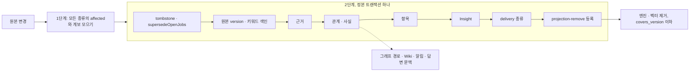
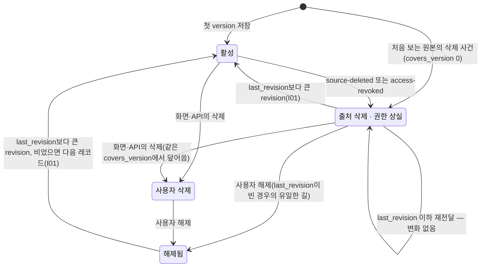
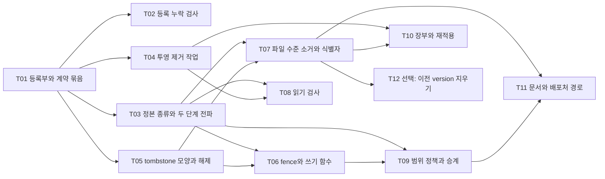

# 스펙: I04 수정·삭제·권한 철회와 파생 지식 무효화

- 날짜: 2026-11-21 / 상태: 초안
- 관련: 이슈 #21(I04), 총괄 #1, Phase 2 #4, 선행 #18(I01)·#20(I03), 후속 #22(S01), 실행 검증을 넘겨받는 #23(S02-C3)·#25(K01-C3)·#28(P02-C3)·#30(X01-C4)·#32(H01-C2). [V02 spec](2026-11-21-V02-vertical-slice.md)("T02가 넘기는 것"), I01 spec(작성 중, `docs/i01-spec`), I03 spec(작성 중, `docs/i03-spec`), [ARCHITECTURE.md](../ARCHITECTURE.md), [ADR 0002](../adr/0002-authority-in-product-records.md)·[0010](../adr/0010-encryption-at-rest.md)·[0013](../adr/0013-failure-recovery.md)·[0014](../adr/0014-egress-policy-and-consent.md), [site-setup.md](../site-setup.md)

낯선 말은 [ARCHITECTURE 0절](../ARCHITECTURE.md#0-처음-나오는-말)에 풀이가 있다. 이 spec이 새로 쓰거나 뜻을 좁히는 말은 아래와 같다.

| 말 | 뜻 |
|---|---|
| 파생물 | 원본 version에서 계산해 만든 모든 것. 근거, 사실·관계·항목, Insight, 키워드 색인 행, 엔진·벡터 투영, 그리고 나중의 그래프 경로·Wiki 페이지·알림·답변 문맥·캐시 |
| 계보(lineage) | 파생물 하나를 만든 원본 version들의 목록. "이것은 어느 원본에서 왔는가"의 답이다. 삭제 범위, access_scope, 전송 등급, fence가 모두 이 목록에서 계산된다 |
| 등록부 | 파생물의 종류마다 "원본 변경 하나가 무엇을 건드리는가, 계보는 무엇인가, 어떻게 지우거나 다시 계산하는가"를 등록한 코드의 목록 |
| version과 revision | **version**은 제품이 원본마다 1, 2, 3…으로 매기는 번호이고 저장된 version은 바뀌지 않는다(V02-T02). fence, 근거, tombstone이 덮는 범위는 이 번호로 비교한다. **revision**은 원 시스템이 주는 개정 번호다(I01). 원 시스템에서 늦게 도착한 것을 가려내는 데만 쓴다. 두 번호를 섞어 비교하지 않는다 |

## 배경

원 설계 17절은 "원본 삭제와 파생 지식 삭제 동기화"를, 이슈 #1 설계 분석 5번은 원본의 access_scope와 전송 정책이 요약·embedding 입력·그래프 경로 같은 파생 문맥에도 따라가야 한다고 요구한다.

V02(#17)는 이것을 한 흐름에서 처음 증명한다. 새 version이 오면 이전 근거를 "지난 근거"로 둔다(V02-R11, T07). 삭제와 권한 철회는 내용 없는 tombstone을 남기고, 그 원본의 모든 version과 근거와 근거 없는 지식을 **지운다**(V02-R12, T08). 엔진과 벡터 규격에는 삭제를 통지한다(V02-R13, T09). 다만 V02는 지금 있는 파생물을 하나씩 손으로 따라가는 구현이다. 파생물이 늘어날 때마다(S02의 그래프 경로, K01의 Wiki, P02의 알림, X01의 답변 문맥) 같은 일을 다시 손으로 하면, 하나만 빠뜨려도 지운 내용이 남는다.

비유하면 V02는 "이 방의 물건을 치웠다"이고, I04는 "새 방을 지으면 반드시 청소 목록에 올리게 하는 건축 규칙"이다. 규칙이 있어도 실제로 청소했는지는 방마다 따로 확인해야 하므로 뒤 작업의 C번호가 그 확인을 맡는다. 이 비유가 맞지 않는 곳도 있다. 건축 규칙은 목록에 없는 방을 사람이 찾아내지만, 여기서는 테스트가 찾아낸다. 그래서 테스트가 볼 수 있는 곳(정본 테이블, 데이터 디렉터리, 묶인 어댑터)까지만 보장한다(I04-R3).

V02가 I04로 넘긴 것: tombstone 보존 기간, 삭제한 원본의 복원, 지난 version의 정리, 접근 범위가 다른 원본 사이의 연결 제한(V02 비목표, ARCHITECTURE 8절, ADR 0013 결과).

**머지된 사실**(origin/main `05921be`, V02-T02 #55. V02 spec "T02가 넘기는 것")

- 원본 version 번호와 tombstone: 새 version은 최신 version보다, 그리고 tombstone의 version보다 커야 한다(트리거). 행 ID는 다시 쓰이지 않는다(1항).
- `jobs`는 `source_id`·`fence_version`·`lease_until`을 갖고 `(kind, source_id, fence_version)`이 유일하다(3항).
- 변경 순번은 트리거가 올린다(4항).
- 근거와 Insight의 근거 연결은 version을 지우면 cascade로 함께 지워진다. 그래서 영향받는 것은 **지우기 전에** 모아야 한다(5항).
- `PRAGMA secure_delete`는 연결마다 켜야 하고, FTS는 `secure-delete` 또는 `optimize`가 따로 필요하다. 카나리끼리는 앞부분이 겹치지 않아야 한다(6항).
- 지운 뒤에도 `sources` 행(식별자)은 남는다(7항).
- `tombstones.reason`은 `deleted`·`access-revoked` 둘이고 `version >= 1`이다(`storage/src/migrations.ts`).
- 정본 연결에는 `journal_mode` 설정이 없다. 그래서 SQLite 기본값인 롤백 저널(DELETE)로 동작한다.

**사전 측정**(제품 코드 아님. 임시 스크립트, better-sqlite3 13.2.0·SQLite 3.54.1, macOS). V01과 같은 모양의 외부 내용 FTS5 색인에 카나리를 넣고 지운 뒤 파일 바이트를 봤다. 독립 검토 A가 같은 결과를 재현했고 경우를 더했다.

| 설정 | 원문 카나리 | 소문자가 된 색인 낱말 |
|---|---|---|
| 기본 | 남음 | 남음 |
| `secure_delete` 켬 | 사라짐 | **남음** |
| 위 + FTS5 `secure-delete` | 사라짐 | 사라짐 |
| 지운 **뒤에** 두 설정을 켬 | 남음 | 남음 |
| 지운 뒤에 켜고 FTS `optimize` + `VACUUM` | 사라짐 | 사라짐 |
| `journal_mode=PERSIST`, `.db`는 깨끗함 | `-journal`에 남음 | `-journal`에 남음 |
| `external_id`에만 넣은 카나리 | 모든 설정에서 `.db`에 남음 | — |

설정을 켜는 것만으로는 이미 지운 것의 흔적이 사라지지 않는다. 식별자 열은 행을 지우지 않는 한 남는다. 이 측정은 근거일 뿐 완료 증거가 아니며, 같은 확인이 I04-R6·R7의 저장소 안 테스트가 된다.

## 목표

- 원본 하나가 삭제되거나 권한을 완전히 잃으면, 그 원본에서만 나온 파생물이 **등록된 모든 종류에서** 같은 규칙으로 지워진다. 다른 원본의 근거가 남은 지식은 남아 상태를 다시 판정받는다. 계보가 없는 행(예: 사용자가 직접 입력한 값)은 건드리지 않는다.
- 지운 내용(예전 version에만 있던 값, 출처 정보, 색인 낱말, 외부 식별자, 투영의 항목)은 데이터 디렉터리의 어느 파일 바이트에도 없다. 데이터 디렉터리 밖의 사본은 아래 "남는 위험" 표가 담당 작업과 함께 적는다.
- 지운 직후부터 검색, 탐색, Insight 목록과 근거 목록, 엔진 관련 문맥에 그 원본에서 나온 것이 나타나지 않는다. 투영이 아직 따라오지 못했어도 그렇다.
- 처리 중이던 작업, 늦게 끝난 작업, 수동 재시도, 늦게 도착한 수집 사건이 지운 것을 되살리지 못한다. 같은 삭제를 몇 번 다시 실행해도 결과가 같다.
- 파생물의 access_scope와 전송 등급은 계보에서 계산된다. 범위를 섞어도 되는지, 어느 범위가 더 엄격한지는 `ScopePolicy` 하나가 정한다.
- **정본 테이블, 데이터 디렉터리의 파일, 묶인 엔진·벡터 구현** 가운데 등록부에 없는 것이 생기면 테스트나 시작 검사가 실패한다. 메모리에만 있는 파생물과 데이터 디렉터리 밖의 파일은 이 기계 검사가 잡지 못한다(I04-R3, "남는 위험").

## 비목표 (배포처에서 후속 진행)

**공용 저장소의 뒤 작업으로 넘기는 것**

- 그래프 경로·여러 단계 근거의 무효화와 권한 교차 경로의 유출 방지 실행 검증: S02(#23) S02-C3. 범위가 좁아진 뒤 이미 합쳐진 항목을 다시 나누는 일도 S02의 병합 되돌리기·분리다.
- Wiki 페이지의 삭제·access_scope 승계·같은 knowledge revision 재생성: K01(#25) K01-C3.
- 알림·digest의 발송 직전 재검사와 중복 발송 방지: P02(#28) P02-C3.
- 검색 결과·답변 생성 직전의 재검사, Provider 문맥 최소화, 답변·인용·로그의 부정 테스트, 벡터 색인의 실제 쓰기·찾기 경로: X01(#30) X01-C4.
- 사용자 교정·승인 기록의 등록: S01(#22). S01이 교정 테이블을 만들 때 이 계약에 등록한다(등록표의 S01 행).
- 백업 파일의 생성과 실제 복원 실행: H01(#32) H01-C2. I04는 복원 뒤 재적용 **정책**과 그 정책을 실행하는 함수만 만든다.
- 정본 SQLite의 파일 단위 암호화: H01([ADR 0010](../adr/0010-encryption-at-rest.md)).
- 삭제한 원본의 **내용** 되살리기(실행 취소). 지운 내용은 남기지 않으므로 제품이 되살릴 수 없다. 해제(lift) 뒤 원본을 다시 받는 길만 있다(I04-R9).
- 여러 사용자, 사용자 계정별 열람 권한: 원 설계 범위 밖(한 PC의 한 사용자).
- 수집 사건의 모양과 도착 판정(tombstone 뒤에 온 레코드를 받을지의 결정 순서, revision 비교, 범위 변경 operation의 이름): I01(#18). **원본이 전체 재스캔에서 보이지 않는다는 이유로 제품이 삭제를 추정하지 않는다**(I01의 비목표). 수집기가 스스로 삭제를 알리는 경우만 있다(I01의 `deletionsOnRescan` 능력).
- 작업 상태 기계, 재시도 간격, 수동 재시도 화면, 작업 종류·묶음 표, `supersedeOpenJobs`의 구현, Activity 화면: I03(#20). I04는 그 함수를 부르고, 작업 종류 `projection-remove`의 의미를 정한다.
- 원본의 이전 version을 사용자가 지우는 기능은 선택 작업(I04-T12)이다. 자동 정리는 하지 않는다(I04-R10).

**남는 위험 — 데이터 디렉터리 밖의 사본**(이 spec이 지우지 않는 곳과 담당)

| 위치 | 지금의 상태 | 담당 |
|---|---|---|
| CLI Provider의 세션 기록(프롬프트에 원문이 들어 있다) | 세션을 디스크에 남기지 않는 옵션을 준다는 것이 ADR 0005·ARCHITECTURE 8절의 규칙이지만 **미실행**이다 | R02-C2·S07(격리 검증에서 세션 파일이 남지 않는지 확인) |
| Electron의 `userData`(Chromium 저장소) | API 응답은 `no-store`다. 다른 Chromium 저장소에 남는지는 확인하지 않았다 | H03(#34) 부정 테스트 |
| 로그 디렉터리 | 원문·프롬프트·응답을 기록하지 않는 규칙과 테스트가 있다(V01-R13) | V01(유지) |
| Provider 쪽 보관 | 제품이 통제하지 못한다. 동의 화면이 목적지를 보인다(ADR 0014) | 배포처 정책(S05·S08) |
| OS 백업, 볼륨 스냅샷, 지운 파일 조각, SSD 잔여 | 제품이 통제하지 못한다 | 배포처 디스크 암호화(S11) |

**배포처 후속 항목**(2개. [site-setup.md의 배포처 설정 체크리스트](../site-setup.md#배포처-설정-체크리스트)와 번호로 대응한다. S16·S17은 I02, S18은 I01, S19·S20은 I03이 쓴다)

| 번호 | 항목 |
|---|---|
| S21 | 배포처의 접근 범위 규칙: access_scope 사이의 엄격함 비교, 한 항목·한 Insight로 묶어도 되는 조합, 용도별 허용의 값과 그 구현(`scopePolicy: "site"`) |
| S22 | Windows 설치본에서 실제 수집기의 삭제·권한 상실 사건으로 무효화와 파일 소거를 실행하고 기록 |

## 요구사항

**무효화 계약**

- **I04-R1 등록부.** 파생물의 종류마다 등록 항목 하나를 둔다. 항목이 갖는 것:
  - ① 종류 이름 ② 층(R2의 순서) ③ 같은 층 안에서 이 종류가 행을 가리키는 다른 종류의 목록(`references`)
  - ④ 실행 위치(`storage`). `canonical`이면 tombstone 트랜잭션 안에서, `projection`이면 커밋 뒤 작업에서 실행한다. 키워드 색인은 정본 파일 안에 있고 같은 트랜잭션에서 지워지므로 `canonical`이다.
  - ⑤ `affected`: 원본 변경 하나가 건드리는 이 종류의 행 ⑥ `lineage`: 행 하나의 계보 ⑦ `invalidate`: 지우기 또는 다시 계산하기 ⑧ 이 종류가 데이터 디렉터리에 쓰는 경로(없으면 비움)
  
  모든 종류는 `packages/testkit`의 **무효화 계약 테스트 묶음**을 통과한다. 지금 있는 여덟 종류(원본 version과 키워드 색인, 근거, 사실, 관계, 항목, Insight, 엔진 투영, 벡터 투영)를 모두 등록한다. 등록은 코드의 목록 하나이며 실행 중에 바뀌지 않는다.
- **I04-R2 두 단계 전파와 순서.** `propagate(change)`는 두 단계다.
  - **1단계(모으기)**: 아무것도 지우기 전에 모든 종류의 `affected`를 불러, 영향받는 행과 그 계보를 모은다. 지운 뒤에는 cascade가 연결을 지워 모을 수 없다(V02 "T02가 넘기는 것" 5항).
  - **2단계(실행)**: 층 순서 `source → evidence → knowledge → item → insight → delivery`로 `invalidate`를 부르고, 마지막에 `projection` 종류의 작업을 등록한다. 각 종류는 1단계의 모음과, 아래 층이 이미 바뀐 현재 상태를 함께 받는다. 같은 층 안에서는 다른 종류의 행을 가리키는 종류가 **먼저** 실행된다. 예를 들어 그래프 경로는 관계보다 먼저 실행되며, 관계가 지워질지는 1단계 모음으로 판정한다.
  
  `canonical` 종류 전부는 tombstone 쓰기와 **한 트랜잭션**이다. 뒤에 등록되는 종류도 이 순서의 한 자리를 가져야 한다.
- **I04-R3 등록 누락의 차단.** 기계 검사는 셋이다.
  - **정본 테이블**: 스키마의 모든 테이블은 `원본`, `파생물 <종류>`, `운영` 가운데 하나로 분류된 목록에 있다. `파생물 <종류>`는 등록부에 같은 이름의 종류가 있어야 한다. `운영`은 **닫힌 목록**이다. 테이블마다 한 줄 이유를 달고(작업, 동의, 설정, Provider 호출 이력, tombstone, 번호, 무효화 기록, 수집기 인스턴스), `source_versions`·`evidence`·지식·Insight 테이블을 가리키는 외래 키나 그 ID를 담는 열이 있으면 실패한다.
  - **데이터 디렉터리**: 대표 흐름(V02의 가져오기 → 추출 → Insight)을 돌린 뒤 데이터 디렉터리의 모든 항목은 어느 종류의 경로이거나 고정된 운영 목록(정본 데이터베이스와 그 부속 파일, tombstone 장부, 장부 키 파일)에 있어야 한다.
  - **어댑터**: 제품 구성에 묶이는 `KnowledgeEngine`·`VectorIndex` 구현은 등록된 투영 종류여야 하며, 아니면 백엔드가 시작을 거부한다.
  
  메모리에만 있는 캐시와 데이터 디렉터리 밖의 파일은 이 검사가 잡지 못한다. 그런 것을 만드는 작업은 자기 spec에 등록을 적는다.
- **I04-R4 무효화 기록.** 전파 하나가 끝나면 내용 없는 무효화 기록 한 행을 남긴다. 기록에는 변경 순번, 원본의 내부 ID, 변경 종류와 사유, 종류별로 지운 수와 다시 계산한 수, 시각이 들어간다. 제목, 본문, 인용문, 외부 식별자, namespace는 넣지 않는다. 상태 API가 최근 기록의 수를 돌려준다. Activity 화면에 보이는 일은 I03이 이 API로 한다.

**삭제와 소거**

- **I04-R5 소거 범위.** 출처 삭제, 권한 상실, 사용자 삭제는 V02-R12의 범위를 모든 등록 종류로 넓힌다. 지우는 것:
  - 그 원본의 **모든 version**의 본문·제목·출처 정보(작성자·참여자·시각)·block(I01이 version에 붙이는 locator 목록)
  - 그 version들을 가리키는 근거와 인용문. locator는 근거 행에 따로 저장되지 않고 version의 block에서 계산되므로(I01-R23) version과 함께 사라진다.
  - 근거가 하나도 남지 않은 사실·관계(상태와 상관없이), 1단계에서 모은 항목 가운데 사실도 관계도 남지 않은 항목, 그 항목을 가리키는 Insight 행
  - 남는 Insight 가운데 설명 글이 지운 원본에서 나온 것의 설명 글(다시 계산한다)
  - 키워드 색인 행, 엔진·벡터 투영 속 그 원본의 항목
  
  종류마다 무엇을 지우는지는 그 종류의 `invalidate`가 정한다. 1단계 모음에 없는 행은 지우지 않는다.
- **I04-R6 파일 수준 소거.** 지운 내용은 데이터 디렉터리의 모든 파일 바이트에 남지 않는다. 대상은 정본 데이터베이스와 `-journal`·`-wal`·`-shm`, 그리고 각 종류가 R1 ⑧에 적은 경로다.
  - 정본은 연결을 열 때마다 `journal_mode = DELETE`(지금의 기본값을 명시해 고정한다)와 `secure_delete = ON`을 켠다.
  - 키워드 색인은 FTS5 `secure-delete` 옵션을 켠다(마이그레이션).
  - I04 이전에 지운 것의 흔적을 위해 마이그레이션이 한 번 FTS `optimize`와 `VACUUM`을 돌린다.
  
  `journal_mode`를 WAL로 바꾸는 작업은 소거 뒤 `wal_checkpoint(TRUNCATE)`의 결과를 확인해, 읽는 연결 때문에 끝나지 않았으면 다시 시도하는 단계를 이 요구사항에 더해야 한다. 판정은 카나리 테스트다. 파일을 쓰는 투영 구현은 계약 테스트 묶음의 "파일 카나리" 경우를 통과해야 등록된다.
- **I04-R7 지운 원본의 식별자.** 소거 트랜잭션에서 `sources.external_id`와 `namespace`를 그 원본 정체의 **키 있는 해시**로 바꾼다. 해시는 HMAC-SHA-256이고, 입력은 길이를 앞에 붙인 `(connector_instance_id, namespace, external_id)`다.
  - 키는 설치마다 만든 무작위 값이며, 다른 비밀 값처럼 OS 자격 증명 저장소에 둔다(ADR 0010, V01-T11).
  - 저장소를 쓸 수 없으면(브라우저 개발 환경, A16 실패) 데이터 디렉터리의 키 파일에 둔다. 소유자만 읽을 수 있게 하고, 백업 대상에서 뺀다. 이 경우 데이터 디렉터리를 읽을 수 있는 사람은 해시를 대조할 수 있다는 한계를 화면의 데이터 보호 항목에 보인다.
  - 들어오는 레코드가 지운 원본인지는 같은 해시로 찾는다. I01은 이 해시를 함수 `identityKey()`로 받는다.
- **I04-R8 남는 지식의 재평가.** 다른 원본의 근거가 남은 사실·관계는 지우지 않고 V02-R11과 같은 규칙으로 상태를 다시 판정한다. 남은 근거 중 **현재 근거**가 하나 이상이면 그대로이고, 지난 근거만 남으면 superseded다. 인식 유형은 바꾸지 않는다. 상태가 바뀐 행을 입력으로 쓰는 Insight는 다시 계산한다. 근거가 하나도 남지 않은 사용자 승인(user-approved) 행도 지운다(그 값은 지운 원본에서 왔다). 계보가 없는 행(1단계 모음에 들어가지 않는 행)은 이 규칙에 걸리지 않는다.

**tombstone과 보존**

- **I04-R9 tombstone의 모양.** I04가 스키마를 정하고, 도착 판정은 I01이 한다.
  - 열:
    - `covers_version`: 제품 version. 그 이하의 모든 version을 덮는다. 처음 보는 원본에 온 삭제 사건이면 0이다.
    - `last_revision`: 삭제 때의 출처 revision. 출처가 revision을 주지 않으면 비어 있다.
    - `reason`: `source-deleted` · `access-revoked` · `user-deleted` 중 하나.
    - `lifted_at`: 해제한 시각. 해제하지 않았으면 비어 있다.
  - 다음 제품 version은 `max(최신 version, covers_version) + 1`이다. 모든 version 행이 지워져도 이 규칙으로 정해진다. 기존 트리거(`version > tombstone`)는 이 열을 비교하도록 바꾼다.
  - **사유의 우선**: 같은 `covers_version`에서는 `user-deleted`가 출처 사유를 덮어쓴다. 출처 사유는 `user-deleted`를 덮어쓰지 못한다. 그 밖에는 더 큰 `covers_version`만 tombstone을 옮긴다. 같거나 낮은 것은 아무것도 바꾸지 않고 변경 순번도 올리지 않는다.
  - **해제(lift)**: 사용자만 할 수 있다(API 하나). `lifted_at`을 쓰고, 지운 내용은 돌아오지 않는다. 해제 뒤의 도착 판정은 I01 몫이다: `last_revision`보다 큰 revision을 받고, `last_revision`이 비었으면 다음 레코드를 받는다. 해제 중에 출처가 낸 revision도 같은 규칙을 따른다. 판정 기준은 도착 시각이 아니라 revision이다.
  - **기존 데이터**: I04 이전의 `deleted` 행은 출처 삭제인지 화면 삭제인지 구분할 수 없으므로 마이그레이션이 `user-deleted`로 옮긴다(되살아나지 않는 쪽). 사용자는 해제할 수 있다. `access-revoked` 행은 그대로 둔다.
  - 화면의 삭제 요청은 `user-deleted`를 쓴다. 이것은 V02-T08의 동작을 바꾸므로 V02 담당에게 변경을 요청한다("후속" 1).
- **I04-R10 보존.** tombstone은 **지우지 않는다**. 내용이 없고 행 하나가 작으며, 지우면 재수집과 백업 복원이 지운 데이터를 되살린다. 원본의 이전 version은 **남긴다**. 원 설계의 수집 기능 목록에 "문서 버전 관리"가 있고(`design/original-design.md`) ADR 0013도 이전 version을 문서 버전 관리용으로 남긴다. 이전 version은 tombstone이 덮을 때 함께 지워지거나, 사용자가 원본 하나에 대해 "이전 version 지우기"를 할 때 지워진다(선택 작업 I04-T12, 변경 종류 `old-versions-pruned`).

**경합과 반복 실행**

- **I04-R11 fence.** 등록부가 두 함수를 준다.
  - `assertFresh(sourceId, version)`: 그 version이 아직 있고, 그 원본의 **최신** version이며, tombstone에 덮이지 않았다. V02-R5의 "여전히 최신이고 tombstone이 없다"를 덮는 범위로 옮긴 것이다. 작업이 입력으로 받은 원본 version에 쓴다. I03은 결과를 쓰는 자리에서 자기 규칙을 다시 적지 않고 이 함수를 부른다.
  - `assertLineage(lineage)`: 계보에 든 다른 원본 version(연결 후보 항목의 근거 등)이 아직 있고 tombstone에 덮이지 않았다. 최신일 필요는 없다.
  
  파생물을 정본에 쓰는 모든 경로는 등록부의 쓰기 함수 `commitDerived` 하나를 지난다. 이 함수는 같은 트랜잭션에서 두 검사와 R14의 `combinable`을 한다. 하나라도 실패하면 결과 전체를 버리며, 이때 작업은 `superseded`로 닫힌다(I03). 실패 보관함의 수동 재시도도 같은 쓰기 함수를 지난다.
- **I04-R12 멱등 소거와 투영 제거 작업.** 같은 tombstone이 다시 오면 R9의 규칙대로 아무것도 바꾸지 않는다. 소거 트랜잭션은 I03의 `supersedeOpenJobs(sourceId)`를 불러 그 원본의 끝나지 않은 작업을 닫는다. 엔진·벡터 투영의 제거는 같은 트랜잭션에서 작업으로 등록하고 커밋 뒤 실행한다. 작업 종류 `projection-remove`, 묶음 `projection`(I03의 작업 종류 표). 이 작업의 의미:
  - **fence**: 원본 version fence를 쓰지 않는다(I03-R5a). 대신 tombstone의 `covers_version`을 싣고, 그 version 이하에서 나온 투영 항목만 지운다. 해제 뒤 다시 들어온 더 새 version의 항목은 건드리지 않는다.
  - **결과 분류**: 빈 구현이나 없는 투영의 `AdapterUnavailableError`는 "지울 것 없음, 건너뜀 기록"으로 끝낸다. `StaleFenceError`는 `superseded`다. 그 밖의 오류는 I03의 재시도를 따른다.
  - **포기한 경우**: 실패 보관함에 들어갔거나 끝나지 않은 `projection-remove`는 그 자체가 "이 투영은 믿을 수 없다"는 표식이다. 시작할 때와 스케줄러의 주기마다 이 표식을 확인한다. 표식이 있으면 변경 순번과 상관없이 그 투영 전체를 재구축하고, 재구축이 끝날 때까지 그 투영에서 읽은 결과는 R13의 검사로 거른다.
  
  같은 제거를 두 번 실행해도 결과가 같다. 시작할 때의 변경 순번 비교와 재구축(V02-R13)은 남는다. 소거 트랜잭션 도중 실패하면 정본은 아무것도 바뀌지 않는다.

**읽기 차단과 승계**

- **I04-R13 읽기 경로의 검사.** 파생물을 밖으로 내보내는 경로는 내보내기 직전에 등록부의 `visible(refs, purpose)`를 지난다. 계보의 원본 version 가운데 하나라도 없거나 tombstone에 덮였으면 그 결과를 빼고, `ScopePolicy.allows`가 그 용도를 허용하지 않아도 뺀다.
  - 지금 있는 경로: 키워드 검색, Sources 목록, 지식·탐색 API, Home의 Insight 목록, 근거 목록.
  - 엔진: 백엔드는 엔진을 등록부가 감싼 `KnowledgeEngine`으로만 받는다. 감싼 구현의 `relatedContext`가 결과에 `visible`을 적용한다. 지금은 제품 코드가 `relatedContext`를 부르지 않으므로(V02-C5) 이 경로의 검증은 감싼 구현을 직접 부르는 테스트뿐이다.
  - 뒤의 경로(알림 발송, 답변 문맥, 인용)도 같은 검사를 쓰며, 실행 검증은 P02-C3·X01-C4가 한다.
- **I04-R14 access_scope의 승계와 `ScopePolicy`.** 파생물의 access_scope는 **저장하지 않고 계보에서 계산한다**(계보에 든 원본들의 access_scope 집합). 범위의 판단은 규격 `ScopePolicy` 하나가 한다.
  - `compare(a, b)`는 `stricter`·`looser`·`equal`·`incomparable` 가운데 하나를 돌려준다. `strictest(scopes)`는 집합의 가장 엄격한 범위이고, 비교할 수 없는 것이 섞이면 "여러 범위 — 가장 엄격하게 다룸"이다. `combinable(scopes)`와 `allows(scopes, purpose)`는 참·거짓이다.
  - 공용 기본 구현: 같은 문자열은 `equal`이고 그 밖(빈 값 포함)은 `incomparable`이다. 비교할 수 없는 범위는 **가장 엄격한 것으로** 다룬다. `combinable`과 `allows`는 언제나 참이다(한 PC의 한 사용자, ARCHITECTURE 8절).
  - `combinable`이 걸리는 자리는 `commitDerived` 안이다(R11). 그래서 연결 후보로 근거를 더하는 쓰기, 같은 행에 근거를 더하는 쓰기(V02-R8), 엔진이 제안한 후보의 기록, Insight 규칙의 결과, 뒤의 그래프 경로가 모두 같은 검사를 지난다. 연결 후보 찾기(V02-R7)는 미리 걸러, 묶을 수 없는 항목을 후보로 보내지 않는다.
  - 로컬 가져오기가 적어 보낸 범위는 사용자가 주장한 값이다. 수집기 인스턴스의 범위보다 엄격하게만 바꿀 수 있고 느슨하게는 못 바꾼다. 이 판정은 I01이 `compare`로 한다.
  - 배포처 구현 자리 `scopePolicy: "site"`는 공용 저장소에서 `미구현, 배포처 후속` 오류로 시작을 멈춘다(S21).
- **I04-R15 범위가 좁아짐.** I01이 내는 범위 변경(같은 내용, 새 access_scope)은 새 version을 만들지 않고 원본의 범위만 바꾼다. 그리고 변경 종류 `scope-narrowed`로 전파한다. 내용을 지우지 않으며, 그 원본을 계보에 가진 Insight·delivery 종류를 다시 계산한다. 다시 계산할 때 `combinable`이 거짓이 되면 그 Insight는 생기지 않는다(해소된다). 표시 범위와 전송 등급은 계보에서 계산되므로 저절로 바뀐다. 이미 합쳐진 항목은 나누지 않는다(S02). 원 시스템에서 볼 수 있는 권한 자체를 잃은 경우는 범위 변경이 아니라 tombstone `access-revoked`다.
- **I04-R16 전송 정책의 승계.** Provider에 나가는 입력이 파생물이면(지금은 연결 후보의 이름, 뒤에는 요약·관련 문맥·embedding 입력), Broker는 등록부의 `lineage`로 그 원본들을 찾는다. 각 원본의 등급을 계산하고 가장 엄격한 것을 쓴다([ADR 0014](../adr/0014-egress-policy-and-consent.md)).
  - 부르는 쪽은 파생물의 ID만 넘긴다.
  - 계보가 비어 있으면 지금 Broker처럼 일반 등급이다(합성으로 보지 않는다, fail closed).
  - 등록부에 없는 종류의 ID를 넘기면 요청을 거부한다.
  - V02-R7이 연결 후보의 출처를 따로 찾던 코드는 이 경로로 바꾼다. 동작은 같아야 한다.

**복원**

- **I04-R17 백업 복원 뒤 tombstone 재적용 정책.** 정책은 다음과 같고, 실제 백업으로 하는 실행 검증은 H01-C2가 한다.
  - **장부**: tombstone을 쓰거나 해제할 때마다 데이터 디렉터리의 **tombstone 장부** 파일에 한 줄을 더한다. 한 줄에는 R7의 키 있는 해시, `covers_version`, `last_revision`, 사유, 해제 여부, 시각이 들어간다. 장부는 백업 대상이 아니고 복원이 덮어쓰지 않는다.
  - **순서**: 장부에 쓰고 fsync한 **뒤에** 소거 트랜잭션을 커밋한다. 커밋 전에 꺼져 장부에만 남은 줄은 재적용 때 그 삭제를 실행한다. 사용자나 출처가 요청한 삭제이므로 이 방향이 맞다. 반대 순서에서는 꺼지면 삭제가 장부에서 빠진다.
  - **재적용**: 복원한 데이터베이스는 화면·API·작업 실행기가 열리기 **전에** 재적용을 끝낸다. 장부와 복원본 자체의 tombstone을 합쳐, 같은 원본이면 R9의 우선 규칙으로 하나를 고른 뒤 적용한다. 재적용은 R5~R7의 소거와 같은 함수다. 끝나면 엔진·벡터 투영을 변경 순번과 상관없이 재구축한다. 복원본의 순번이 우연히 투영과 같아도 기록이 다를 수 있기 때문이다.
  - **장부나 키가 없을 때**(다른 PC에 백업만 가져옴): 백업 뒤의 삭제는 알 수 없다. 화면에 "백업 뒤의 삭제는 다시 수집해야 반영됨"을 알린다. 수집기가 전체 재스캔에서 삭제를 알리는 능력(`deletionsOnRescan`, I01)이 있으면 다음 동기화로 반영된다. 없으면 그 수집기의 원본은 반영되지 않을 수 있다고 함께 알린다.
  - I04는 장부 쓰기, 재적용 함수, 재적용 전 차단, 강제 재구축까지 만든다. 백업 파일 형식과 복원 화면은 H01이 만든다.

**문서와 배포처**

- **I04-R18 문서.** 아래 "후속"의 문서 변경을 표에 적힌 I04 작업이 그 작업의 PR에서 고친다.
  - [site-setup.md](../site-setup.md)의 `## 배포처 설정 체크리스트` 아래에 S21, S22를 더한다. 제목은 그대로 두고, 번호 대응 문장에 이 spec과 그 범위를 더한다.
  - V01의 문서 대응 테스트(`tooling/docs/site-setup.test.ts`)에 이 spec의 배포처 후속 항목을 더한다.
  - 확정된 `DerivativeKind`·`ScopePolicy` 규격은 ARCHITECTURE 5절에 새 소절로 옮긴다. 뒤 작업은 그 문장을 기준으로 등록한다.
  - README에는 아무것도 더하지 않는다(사용자가 쓰는 새 명령이 없다).
- **I04-R19 배포처 검증 실행기의 삭제 시나리오.** V02의 배포처 검증 실행기에 삭제 시나리오를 더한다. 합성 출처 3개를 가져온 뒤 하나는 출처 삭제, 하나는 권한 상실로 지우고, 데이터 디렉터리 전체에서 카나리를 찾는다. 기록에는 OS, 앱 버전, 수집기 종류, 종류별 지운 수, 카나리 발견 수가 들어간다. Windows 설치본이 아닌 환경에서 실행하면 `배포처 후속`으로 시작하는 알림을 출력하고 0이 아닌 값으로 끝난다.

## 인터페이스 / 설계 개요

### 전파 순서

1단계는 아무것도 지우지 않고 모든 종류의 영향받는 행을 모은다. 2단계는 아래 층부터 실행하고, 정본 종류 전부가 tombstone과 같은 트랜잭션이다. 점선은 뒤 작업이 같은 계약으로 붙일 자리다.



새 version(`new-version`), 범위 변경(`scope-narrowed`), 이전 version 지우기(`old-versions-pruned`)도 같은 `propagate`를 지난다. 다만 tombstone을 쓰지 않으며, 각 종류의 `affected`가 변경 종류에 따라 건드릴 행을 고른다.

### 원본 하나의 tombstone 상태

I04-R9를 그린 것이다. 상태에서 나가는 "받음"은 I01의 도착 판정이 정하며 지운 내용은 돌아오지 않는다.



### 등록 규격 (잠정. I04-T01에서 확정해 ARCHITECTURE 5절로 옮긴다)

```typescript
type Layer = 'source' | 'evidence' | 'knowledge' | 'item' | 'insight' | 'delivery' | 'projection'
type SourceChange =
  | { kind: 'new-version' | 'old-versions-pruned'; sourceId: number; version: number }
  | { kind: 'scope-narrowed'; sourceId: number }
  | { kind: 'source-deleted' | 'access-revoked' | 'user-deleted'; sourceId: number; coversVersion: number }
interface DerivedRef { kind: string; id: string }                 // 정본의 ID. 내용을 갖지 않는다
interface DerivativeKind {
  readonly kind: string
  readonly layer: Layer
  readonly references: readonly string[]                           // 같은 층에서 이 종류가 가리키는 종류
  readonly storage: 'canonical' | 'projection'
  readonly dataPaths: readonly string[]                            // 데이터 디렉터리 안 경로
  affected(tx: SqlDriver, change: SourceChange): Affected          // 1단계: 지우기 전
  lineage(db: SqlDriver, ref: DerivedRef): SourceVersionRef[]      // 범위·등급·fence의 유일한 입력
  invalidate(ctx: InvalidationContext, snapshot: Affected, change: SourceChange): { removed: number; recomputed: number }
}
// 등록부의 공용 함수: propagate, assertFresh, assertLineage, commitDerived, visible, scopesOf, identityKey
interface ScopePolicy {
  compare(a: string | null, b: string | null): 'stricter' | 'looser' | 'equal' | 'incomparable'
  strictest(scopes: ReadonlySet<string | null>): string | null | { incomparable: ReadonlySet<string | null> }
  combinable(scopes: ReadonlySet<string | null>): boolean
  allows(scopes: ReadonlySet<string | null>, purpose: 'display' | 'search' | 'notify' | 'answer'): boolean
}
```

`invalidate`는 같은 입력으로 두 번 불러도 결과가 같아야 한다. 투영 종류의 `invalidate`는 기존 `KnowledgeEngine.removeSource(ref)`(그 원본의 `ref.version` 이하를 지운다)와 `VectorIndex.remove`를 부르는 얇은 어댑터이며, 그 규격은 바꾸지 않는다.

### 무효화 계약 테스트 묶음

`packages/testkit`에 두고 등록된 모든 종류에 대해 실행한다.

- ① 그 종류의 행이 있는 원본을 지우면 계보가 그 원본뿐인 행이 사라진다.
- ② 다른 원본의 계보가 남은 행은 남는다.
- ③ 계보가 없는 행은 상관없는 원본의 삭제에 남는다.
- ④ 같은 변경으로 두 번 부르면 두 번째는 0건이다.
- ⑤ `lineage`가 가리키는 원본이 실제로 그 행을 만든 원본이다(행을 만든 fixture와 대조).
- ⑥ 낡은 입력이 거부된다. 정본 종류는 `commitDerived`의 fence에서, 투영 종류는 `covers_version`보다 낮은 제거나 지운 version 이하의 `upsertSource`가 `StaleFenceError`로 거부된다(V01-T12의 순서 규칙).
- ⑦ R1 ⑧에 경로가 있는 종류는 지운 뒤 그 경로에 카나리가 없다. 메모리 구현만 있는 종류(지금의 엔진·벡터)는 ⑦을 "해당 없음(경로 없음)"으로 보고한다.

### 등록표

| 종류 | 층 | 실행 위치 | 생기는 곳 | 실행 검증 |
|---|---|---|---|---|
| 원본 version, 키워드 색인 | source | canonical | V01·V02 | I04-C1 |
| 근거 | evidence | canonical | V02 | I04-C1 |
| 관계, 사실 | knowledge | canonical | V02 | I04-C1 |
| 항목 | item | canonical | V02 | I04-C1 |
| Insight | insight | canonical | V02 | I04-C1 |
| 엔진 투영 | projection | projection | V02-T09 | I04-C1(메모리 구현). 실제 엔진은 R07 |
| 벡터 투영 | projection | projection | V01(빈 구현) | I04-C1(fake). 실제 쓰기는 X01-C4 |
| 그래프 경로·여러 단계 근거 | knowledge(관계보다 먼저) | S02가 정함 | S02 | S02-C3 |
| Wiki 페이지 | projection | projection | K01 | K01-C3 |
| 알림, digest | delivery | P02가 정함 | P02 | P02-C3 |
| 답변 문맥, 인용, 답변 캐시 | delivery | X01이 정함 | X01 | X01-C4 |
| 사용자 교정·승인 기록 | knowledge | canonical | S01 | S01 spec에서 정함(이슈 #21에 C번호 없음) |

## 완료 기준 (테스트 가능한 형태)

C1~C3은 이슈 #21의 문장 그대로다. H1·H2는 이 프로젝트가 배포처로 넘어가는 프로젝트라서 spec 양식이 요구하는 두 기준이며 이 spec에만 둔다.

- [ ] **I04-C1** (R1, R2, R3, R4, R5, R13, R14, R15, R16): 원본→evidence→facts/semantic→graph/wiki/vector→insight/digest/cache의 영향 범위를 기록하고 tombstone 직후 검색·Q&A·알림에서 차단한다. 원본의 access_scope와 전송 정책은 요약·embedding 입력·graph path 등 파생물에 승계된다. 실행 검증은 이 시점에 존재하는 파생물(V02의 facts·관계·Insight·탐색)로 하고, 이후 생기는 파생물은 같은 무효화·승계 계약에 등록하여 S02-C3·K01-C3·P02-C3·X01-C4에서 각각 검증한다.
- [ ] **I04-C2** (R9, R11, R12): 처리 중 삭제/권한철회 및 stale job 결과의 재유입을 version fence로 막고 idempotent cleanup/rebuild를 테스트한다.
- [ ] **I04-C3** (R5, R6, R7, R8, R10, R17): 다른 유효 근거가 남은 사실은 근거 재평가하고 삭제 범위·retention을 검증하고 backup restore 후 tombstone 재적용 정책을 정의한다. 복구 실행 검증은 백업이 생기는 H01-C2(#32)에서 한다.
- [ ] **I04-H1** (R18): 이 spec의 "배포처 후속 항목" 2개 각각에 대해 site-setup.md의 `## 배포처 설정 체크리스트` 아래에 같은 번호의 항목이 있으면 통과하고, 하나라도 없거나 수가 다르면 문서 대응 테스트가 실패한다.
- [ ] **I04-H2** (R14, R19): ① `scopePolicy`를 `site`로 두고 백엔드를 시작하면 ② 삭제 시나리오 실행기를 Windows 설치본이 아닌 환경에서 실행하면, 각각 `배포처 후속`으로 시작하는 알림을 출력하고 0이 아닌 값으로 끝난다(경로마다 1건, 모두 2건).

**기준을 읽는 법**

- **C1의 "영향 범위를 기록"**은 I04-R4의 무효화 기록이다. 사슬에서 아직 없는 층(graph, wiki, vector 쓰기, digest, cache)은 등록표의 자리와 계약 묶음으로 충족하고, 실행 검증은 표의 C번호로 넘긴다. R3의 검사가 그 층이 생길 때 등록을 강제하되, 메모리에만 있는 캐시와 데이터 디렉터리 밖은 강제하지 못한다.
- **C1의 "Q&A·알림에서 차단"**: 두 기능이 아직 없다. I04에서 실행하는 것은 검색, 탐색, Insight·근거 목록, 감싼 엔진의 관련 문맥 차단이다. Q&A와 알림은 같은 `visible`을 써야 하며, X01-C4·P02-C3 전까지 미검증이다.
- **C1의 "요약·embedding 입력·graph path"**: 지금 Provider로 나가는 파생 입력은 연결 후보의 이름뿐이므로 그것으로 실행 검증한다. 요약(K01), embedding 입력(X01), 그래프 경로(S02)는 미검증으로 남는다.
- **C2의 "version fence"**는 R11의 두 검사와, R12의 `covers_version` fence다. "stale job"에는 새 version이 도착한 뒤 끝난 옛 version의 작업이 들어간다.
- **C3의 "retention"**은 R10이다. tombstone은 영구히 남고, 이전 version은 tombstone이나 사용자 요청 전까지 남는다. **"정의한다"**는 R17의 정책 문장과, 그 정책대로 동작하는 함수의 테스트(삭제 전 데이터베이스 사본에 재적용하면 처음 삭제와 같은 결과)다.

### 기준별 증명 테스트

테스트 수준의 뜻은 [V01 spec](2026-11-21-V01-vertical-skeleton.md#기준별-증명-테스트)과 같다. "빨간 경우"는 그 테스트가 지키는 장치를 빼면 실패한다는 것을 테스트 안에서 보이는 경우다.

| 기준 | 테스트 | 수준 | 확인하는 것 |
|---|---|---|---|
| C1 | `derivatives.contract` | 단위·통합 | 등록된 여덟 종류의 **실제 구현** 모두가 계약 묶음 ①~⑥을 통과. ⑦은 경로가 없는 종류에서 "해당 없음" |
| C1 | `derivatives.schema-coverage` | 단위 | 모든 테이블이 분류 목록에 있음. 빨간 경우 셋(임시 마이그레이션): 분류 안 된 테이블, 등록부에 없는 종류 이름의 표지, `evidence`를 가리키는 외래 키를 가진 `운영` 테이블 |
| C1 | `derivatives.data-dir` | 통합 | 대표 흐름 뒤 데이터 디렉터리의 모든 항목이 종류 경로나 운영 목록에 있음. 빨간 경우: 경로를 적지 않은 테스트 종류가 파일을 쓰면 실패 |
| C1 | `derivatives.unregistered-adapter` | 통합 | 등록되지 않은 엔진 구현, 등록되지 않은 벡터 구현을 각각 묶으면 백엔드가 시작을 거부(2건) |
| C1 | `propagate.two-phase` | 통합 | 1단계 모음이 지우기 전에 끝남(지우는 SQL보다 먼저). 2단계 호출 순서가 층 순서이고 같은 층에서 `references`가 있는 테스트 종류가 먼저. 도중 예외면 정본이 그대로 |
| C1 | `invalidate.record` | 통합 | 삭제 뒤 무효화 기록의 종류별 수가 맞고, 상태 API가 그 수를 돌려줌. 그 행과 응답에 fixture의 제목·본문·인용문·외부 식별자·namespace 문자열이 없음 |
| C1 | `read-gate` | 통합 | 테스트가 저장 모듈로 tombstone만 쓰고 소거는 하지 않은 상태(덮였지만 아직 남아 있음)를 만든다. 그 상태에서 키워드 검색, Sources 목록, 지식 API, Insight 목록, 근거 목록, 감싼 엔진의 `relatedContext` 여섯 경로 어디에도 그 원본에서 나온 것이 없음. 빨간 경우: 경로마다 `visible`을 빼면 그 경로의 경우가 실패(6건) |
| C1 | `read-gate.e2e` | Playwright E2E | 삭제 직후 Home·Sources·검색 화면에 그 원본과 그 Insight가 보이지 않음 |
| C1 | `scope.inherit` | 단위 | 범위 a, b의 근거를 가진 사실의 범위 집합이 {a, b}. b 원본이 권한 상실하면 {a}. 기본 정책에서 `strictest({a})`는 a, `strictest({a, b})`는 비교 불가(가장 엄격하게 다룸), `allows`는 참 |
| C1 | `scope.policy` | 통합 | a와 b를 묶을 수 없다는 테스트 정책에서: b 원본의 추출에 a 계보의 항목이 후보로 오지 않음. `commitDerived`가 a·b 계보를 함께 가진 Insight 쓰기와 근거 추가를 거부. 테스트 정책의 `allows(…, 'search')`가 거짓인 범위는 키워드 검색에서 빠짐. 기본 정책에서는 V02 흐름이 그대로 |
| C1 | `scope.narrowed` | 통합 | 범위 변경 뒤 새 version이 생기지 않고, 변경 종류 `scope-narrowed`의 무효화 기록이 남음. 묶을 수 없게 된 Insight가 해소. 표시 범위가 새 값 |
| C1 | `egress.derived-grade` | 통합 | 연결 후보 항목의 계보에 일반 등급 원본이 있으면 그 추출 호출의 등급이 일반(V02 `linking`과 같은 결과를 계보 경로로). 그 원본을 지운 뒤에는 그 후보가 오지 않음. 계보가 빈 ID는 일반 등급. 등록되지 않은 종류의 ID는 거부 |
| C2 | `fence.fresh` | 통합 | ① 추출 중 출처 삭제 → 결과 버림, 작업 superseded ② 추출 중 권한 상실 → 같음 ③ **추출 중 새 version 도착** → 옛 version의 결과 버림 ④ 계보의 다른 원본(후보 항목의 근거)만 삭제되어도 결과 전체를 버림 ⑤ 실패 보관함의 작업을 원본 삭제 뒤 수동 재시도해도 결과가 쓰이지 않음 |
| C2 | `tombstone.rules` | 통합 | 같은 `covers_version`의 `user-deleted`가 `source-deleted`를 덮어씀, 반대는 변화 없음. 낮거나 같은 tombstone은 변경 순번·행 수 그대로. 모든 version이 지워진 뒤 다음 version 번호가 `covers_version + 1`. 처음 보는 원본의 tombstone이 `covers_version` 0. 마이그레이션이 기존 `deleted`를 `user-deleted`로. 해제가 `lifted_at`을 쓰고 장부에 줄을 남김. 해제 뒤 다시 받은 version의 추출 작업이 fence에 걸리지 않음 |
| C2 | `purge.idempotent` | 통합 | 같은 삭제 사건 두 번 → 두 번째는 변경 순번, 행 수, 무효화 기록 모두 그대로. 소거 트랜잭션이 그 원본의 끝나지 않은 작업을 모두 superseded로 닫음 |
| C2 | `projection-remove` | 통합 | ① 처음에 실패하면 재시도되어 결국 제거 ② 두 번 실행해도 엔진 상태가 같음 ③ 해제 뒤 다시 들어온 더 새 version의 엔진 항목은 지워지지 않음 ④ 빈 벡터 색인에서 "건너뜀"으로 끝남 ⑤ 실패 보관함으로 간 뒤 변경 순번이 같아져도 재시작과 스케줄러 주기에서 그 투영의 재구축이 일어나고 카나리가 사라짐. 그 전까지 감싼 엔진의 결과에서 그 원본이 걸러짐 ⑥ 재구축을 두 번 해도 결과가 같음 |
| C3 | `reevaluate` | 통합 | 두 원본이 근거인 사실은 한 원본을 지운 뒤 남은 근거가 현재 근거면 상태 그대로이고, 지난 근거만이면 superseded. 그 사실을 쓰는 Insight가 다시 계산되고 지운 원본에서 온 설명 글이 남지 않음. 근거가 모두 사라진 user-approved 사실은 지워짐. 계보 없는 테스트 행은 남음 |
| C3 | `purge.canary-files` | 통합 | 파일 기반 데이터 디렉터리에서 다음 카나리(앞부분이 서로 겹치지 않음)가 삭제 뒤 `.db`·`-journal`·`-wal`·`-shm`과 종류 경로 어디에도 없음: ① 현재 version 본문 ② 예전 version에만 있던 값 ③ 색인을 거쳐 소문자가 된 낱말 ④ 인용문 ⑤ 출처 정보(작성자)와 block의 locator(시트 이름) ⑥ Insight 설명 글 ⑦ **외부 식별자와 namespace**. 권한 상실과 사용자 삭제도 같음. 빨간 경우: `secure_delete`를 끄면 ①이, FTS `secure-delete`를 끄면 ③이 실패 |
| C3 | `purge.legacy-residue` | 통합 | I04 이전 스키마에서 설정 없이 지운 데이터베이스에 마이그레이션을 돌리면 그 카나리가 파일에서 사라짐 |
| C3 | `retention` | 통합 | tombstone은 소거 뒤에도, 재시작 뒤에도 남음. 새 version이 와도 이전 version과 그 본문이 남음(근거 유무와 상관없이). tombstone이 덮으면 함께 사라짐 |
| C3 | `restore.reapply` | 통합 | 삭제 **전** 데이터베이스 사본을 "복원본"으로 열고 장부를 재적용하면 결과(행 수, 종류별 수, 카나리 부재)가 처음 삭제와 같음. 재적용을 두 번 해도 같음. 재적용이 끝나기 전에는 API가 응답하지 않음. 끝나면 투영 재구축이 호출됨(순번이 같아도). 장부 쓰기 뒤·커밋 전에 꺼진 경우를 흉내 내면 재적용이 그 삭제를 실행함. 해제 줄이 있으면 해제가 유지됨. 장부에 외부 식별자 문자열이 없음. 장부가 없으면 알림이 나옴 |
| H1 | `docs.site-setup` | 단위 | 비목표 표의 번호 2개가 체크리스트에 모두 있음 |
| H2 | `site-paths.refuse` | 통합 | 두 경로 각각에서 알림 문자열과 0이 아닌 종료 값 |
| (T12) | `versions.prune` | 통합 | 선택 작업을 하면: 이전 version 지우기 뒤 그 version의 카나리가 파일에서 사라지고, 지난 근거만 있던 사실이 지워지며, 최신 version은 남음 |

### 사외에서 충족할 수 있는 것, 배포처 실행을 기다리는 것

| 기준 | 사외 | 남는 것 |
|---|---|---|
| C1 | **부분.** 지금 있는 파생물로 충족 가능 | 뒤 층의 실행 검증(S02-C3, K01-C3, P02-C3, X01-C4). 실제 엔진·벡터 구현의 제거(R07, X01). 배포처 범위 정책의 값(S21) |
| C2 | **충족 가능**(개발 OS). 수동 재시도 경우는 I03 뒤 | 실제 수집기의 사건 순서(S22) |
| C3 | **부분.** 재평가, 소거, 보존, 재적용 함수 | 실제 백업 파일의 복원(H01-C2). Windows 설치본의 데이터 디렉터리에서의 파일 카나리(S22). 데이터 디렉터리 밖의 사본("남는 위험" 표의 담당) |
| H1, H2 | **충족 가능** | — |

## 작업 분해

한 작업이 PR 하나다. 그림은 I04 안의 선후만 그렸고, 다른 작업에 대한 선행은 표가 기준이다. 모든 작업은 V02-T07·T08·T09의 머지 뒤에 시작한다(미해결 질문 1). 테스트는 작업마다 먼저 실패하는 것으로 쓰고 구현을 붙인다.

**함께 진행할 수 있는 것**: T01 뒤에 T02·T03·T05가 함께 갈 수 있다. T03 뒤에 T06·T07·T09가 함께 갈 수 있다. T04는 T01과 I03만 기다린다.



| ID | 내용 | 요구사항 | 기준 | 선행 | 테스트 |
|---|---|---|---|---|---|
| I04-T01 | `DerivativeKind` 규격, 등록부의 `propagate`(두 단계)·`visible`·`scopesOf`, 계약 테스트 묶음(testkit), 무효화 기록 테이블과 상태 API의 수. 규격을 ARCHITECTURE 5절 새 소절로 옮김 | R1, R2, R4, R18(ARCHITECTURE 5절) | C1 | V02-T07, V02-T08, V02-T09 | `derivatives.contract`(대역 종류로 묶음 자체를 시험), `propagate.two-phase`(대역 종류), `invalidate.record` |
| I04-T02 | 테이블 분류 목록과 검사, 데이터 디렉터리 목록 검사, 어댑터 묶음 검사 | R3 | C1 | I04-T01 | `derivatives.schema-coverage`, `derivatives.data-dir`, `derivatives.unregistered-adapter` |
| I04-T03 | 원본 version·키워드 색인·근거·사실·관계·항목·Insight를 종류로 등록, V02-T07·T08의 손 전파를 등록부 전파로 바꿈(동작 유지), 남는 지식의 재평가, `supersedeOpenJobs` 호출 | R1, R2, R5, R8, R12(작업 닫기) | C1, C3 | I04-T01, **I03-T01**(`supersedeOpenJobs`) | `derivatives.contract`(정본 종류 실제 구현), V02의 `update.recompute`·`delete.purge`·`delete.propagate` 유지, `reevaluate`, `purge.idempotent`의 작업 닫기 |
| I04-T04 | 엔진·벡터를 투영 종류로 등록, `projection-remove`의 의미(covers_version fence, 결과 분류, 포기 표식과 강제 재구축), 감싼 `KnowledgeEngine`. ADR 0013 결정 7과 ARCHITECTURE 6·7절 고침 | R1, R12, R13(감싼 엔진), R18 | C1, C2 | I04-T01, **I03**(작업 종류·묶음 표, 실패 보관함, 스케줄러 주기) | `derivatives.contract`(투영 종류), `projection-remove`, V02의 `engine.calls`·`engine.restart` 유지 |
| I04-T05 | tombstone 마이그레이션(`covers_version`, `last_revision`, 사유 셋, `lifted_at`, 기존 `deleted` 옮기기, 버전 트리거), 사유 우선 규칙, 해제 API, 화면 삭제의 `user-deleted`. ADR 0013 결정 4와 ARCHITECTURE 0·6절의 tombstone 문장 고침 | R9, R12(멱등), R18 | C2 | I04-T01, **I01-T02**(`last_revision` 열과 도착 판정) | `tombstone.rules`, `purge.idempotent` |
| I04-T06 | `assertFresh`·`assertLineage`·`commitDerived`, 결과를 쓰는 모든 경로(V02-T05 추출, 규칙, 엔진 제안 기록)를 `commitDerived`로 옮김 | R11 | C2 | I04-T03, I04-T05, **I03**(결과 쓰기 자리) | `fence.fresh`(①~④ 먼저, ⑤는 I03의 수동 재시도 뒤) |
| I04-T07 | 연결마다 `journal_mode = DELETE`·`secure_delete`, FTS `secure-delete` 마이그레이션, 한 번의 `optimize`+`VACUUM`, 식별자 해시 교체와 `identityKey`, 키 보관(자격 증명 저장소, 없으면 키 파일), 카나리 검사 도구(testkit). ADR 0013 결정 5와 ARCHITECTURE 4절 고침 | R6, R7, R18 | C3 | I04-T03, I04-T05, **V01-T11**(자격 증명 저장소) | `purge.canary-files`, `purge.legacy-residue`, `retention` |
| I04-T08 | 읽기 경로 다섯 곳에 `visible` 적용(감싼 엔진은 T04) | R13 | C1 | I04-T03, I04-T04 | `read-gate`, `read-gate.e2e` |
| I04-T09 | `ScopePolicy` 규격과 기본 구현, 계보로 범위 계산, `commitDerived`의 `combinable`, 후보 미리 거르기, `scope-narrowed` 전파, Broker의 파생 입력 등급, `scopePolicy: "site"` 자리. ADR 0014와 ARCHITECTURE 8절 고침 | R14, R15, R16, R18 | C1, H2 ① | I04-T03, I04-T06, **I01**(범위 변경 operation) | `scope.inherit`, `scope.policy`, `scope.narrowed`, `egress.derived-grade`, `site-paths.refuse` ①, V02의 `linking` 유지 |
| I04-T10 | tombstone 장부(fsync 뒤 커밋), 재적용 함수, 재적용 전 API 차단, 강제 재구축, 장부 없음 알림 | R17 | C3 | I04-T04, I04-T07 | `restore.reapply` |
| I04-T11 | site-setup S21·S22, 문서 대응 테스트, 배포처 실행기의 삭제 시나리오 | R18, R19 | H1, H2 ② | I04-T07, I04-T09, V02-T12 | `docs.site-setup`, `site-paths.refuse` ② |
| I04-T12 | (선택) 원본 하나의 이전 version 지우기 API와 `old-versions-pruned` 전파 | R10 | C3(선택 부분) | I04-T07 | `versions.prune` |

## 미해결 질문

**작업을 막는 것**

1. **V02-T07·T08·T09가 아직 구현되지 않았다.** 이 spec은 그 세 작업을 일반화하는 확장이다. 구현이 아래 "다시 확인할 가정"과 다르면 T01·T03·T04의 범위가 바뀐다.
2. **I01의 `last_revision`과 도착 판정, 범위 변경 operation**이 T05·T09를 막는다. I01 초안은 `revision`과 원본별로 기억하는 가장 큰 revision을 둔다. 사유별 도착 규칙은 조정자 결정(D2·D16·D17)대로 I01이 적는다고 가정한다.
3. **I03의 `supersedeOpenJobs`와 `projection-remove` 종류·묶음**이 T03·T04를 막는다. I03 초안은 `superseded` 상태와 fence를 쓰지 않는 종류(I03-R5a)를 이미 두었다.

**진행은 하되 번복되면 다시 하는 것**(잠정 결정. 이유와 바꾸는 법)

4. **tombstone을 영구 보존**(R10). 이유: 내용이 없어 비용이 작고, 지우면 재수집·복원이 되살린다. 바꾸려면 "모든 수집기의 cursor가 tombstone 시각을 지났고 그 뒤 백업이 없음" 같은 조건으로 R10에 정리 단계를 더한다.
5. **이전 version은 자동으로 지우지 않는다**(R10). 이유: 원 설계의 "문서 버전 관리". 대가: 지운 원본이 아니면 예전 본문이 계속 남는다. 노출을 줄이려면 T12의 사용자 동작을 쓴다. 기간 기반 자동 정리가 필요해지면 설정 하나를 R10에 더한다.
6. **기존 `deleted` 행을 `user-deleted`로 옮긴다**(R9). 이유: 화면 삭제였을 수 있고, 잘못 옮기면 사용자가 지운 원본이 다음 동기화로 돌아온다. 대가: 출처 삭제였던 원본은 사용자가 해제해야 다시 받는다. 바꾸려면 마이그레이션에서 `source-deleted`로 옮긴다.
7. **access_scope를 저장하지 않고 계보에서 계산**(R14). 이유: 저장하면 원본의 권한이 바뀔 때마다 모든 파생물을 다시 써야 하고, 하나를 빠뜨리면 낡은 범위가 남는다. 읽기 비용이 커지면 계산 결과를 투영처럼 캐시하되 그 캐시도 등록부에 등록한다.
8. **공용 기본 정책은 "비교할 수 없으면 가장 엄격, 결합과 허용은 언제나 참"**(R14). ARCHITECTURE 8절의 전제(한 PC의 한 사용자)와 같다. 배포처가 S21에서 값을 정한다.
9. **근거가 모두 사라진 사용자 승인 지식도 지운다**(R8). 이유: 값이 지운 원본에서 왔다. S01이 사용자가 직접 입력한 값을 계보 없는 행으로 두면 이 규칙에 걸리지 않는다(계약 ③).
10. **투영 제거를 새 outbox 테이블이 아니라 작업 테이블의 작업으로**(R12). 이유: 작업 테이블이 이미 중복 등록 방지와 임대를 갖는다. ADR 0013 결정 8의 outbox가 들어오면 그쪽으로 옮긴다.
11. **식별자와 장부에 키 있는 해시를 쓴다**(R7, R17). 이유: 메시지 ID나 경로 같은 식별자는 짐작할 수 있어 키 없는 해시는 사전 대조로 풀린다. 키를 잃으면 장부를 대조할 수 없어 "장부 없음"과 같아진다. 키 없는 해시로 바꾸려면 R7의 해시 정의만 고치면 되지만, 그 경우 위 대조 위험을 받아들여야 한다.
12. **저널을 DELETE로 고정**(R6). 이유: 지금의 기본 동작을 바꾸지 않고 명시만 한다. WAL로 바꾸면 R6이 적은 checkpoint 단계를 더한다.
13. **장부에 먼저 쓰고 커밋**(R17). 이유: 반대 순서에서는 꺼지면 삭제가 장부에서 빠져 복원 때 되살아난다. 대가: 커밋되지 않은 삭제가 복원 때 실행될 수 있다(요청된 삭제이므로 받아들인다).

**다시 확인할 가정**("V02-T07/T08 머지 후 재확인", 형제 spec 확인)

- 가) V02-T08의 소거가 함수 하나(원본 ID, 사유, version)이고, "T02가 넘기는 것" 5항대로 지우기 전에 모은다. T03이 이것을 등록부의 두 단계로 감싼다.
- 나) V02-T03·T08의 fence가 "최신이고 tombstone이 없다"를 어떻게 구현했는지. T06이 `assertFresh`의 덮는 범위로 바꾸고, 해제 뒤 다시 받은 version이 막히지 않게 한다.
- 다) V02-T08이 "T02가 넘기는 것" 6항의 두 설정을 실제로 켰는지. T07의 `optimize`+`VACUUM`은 그와 상관없이 한 번 돈다.
- 라) V02-T07의 Insight 재계산이 "영향받은 항목"을 입력으로 받는다. T03의 재평가가 같은 입력을 쓴다.
- 마) V02-T09의 엔진 제거 호출이 커밋 뒤 직접 호출이다. T04가 이것을 작업으로 바꾼다.
- 바) I01 spec(작성 중): `identityKey()`를 받아 지운 원본을 찾는 것, version에 붙는 `meta`·`blocks`(R5가 함께 지운다), 근거의 locator를 저장하지 않고 계산하는 것(I01-R23), 범위 변경 operation의 이름, `deletionsOnRescan`.
- 사) I03 spec(작성 중): `supersedeOpenJobs`, `projection-remove`의 묶음 `projection`, 결과 쓰기 자리에서 `assertFresh`를 부르는 것, Activity가 상태 API의 무효화 기록 수를 보이는 것.
- 아) site-setup 번호 S21·S22는 조정자의 배정이다. 형제 spec이 확정될 때 다시 대조한다.

## 후속 — 다른 문서와 다른 작업에 넘기는 변경

이 spec의 커밋은 아래 문서를 고치지 않는다. 표의 I04 작업이 자기 PR에서 고치고, I04 밖의 담당에는 변경을 요청한다.

| 대상 | 고칠 곳 | 담당 |
|---|---|---|
| 1. V02 spec과 V02-T08 | 화면의 삭제 요청을 `user-deleted`로 기록. 지금 R2는 "V02-R12의 삭제가 된다", 스키마는 `deleted` | **V02 담당에게 변경 요청**(조정자가 전달함). 받아들여지지 않으면 I04-T05의 마이그레이션이 처리 |
| 2. V02 spec "T02가 넘기는 것" 2항 | "T04는 레코드의 version을 그대로 저장한다"는 D1(version은 제품이 매김, 레코드의 번호는 revision)과 어긋남 | **V02 담당에게 변경 요청**. I04의 `covers_version + 1` 규칙은 제품 번호를 전제로 함 |
| 3. ARCHITECTURE 0절 | 파생물·계보·등록부·revision 풀이 추가. tombstone 풀이를 "version 이하를 덮는 표식, 사유 셋, 해제" | I04-T05 |
| 4. ARCHITECTURE 4절 표 | 무효화 기록, tombstone 장부와 키 행 추가. 데이터 디렉터리 밖 사본의 담당 | I04-T07 |
| 5. ARCHITECTURE 5절 | 등록부 규격 새 소절 | I04-T01(규격), I04-T09(`ScopePolicy`) |
| 6. ARCHITECTURE 6·7절 | "tombstone이 없다"를 "덮지 않는다"로. 두 단계 전파. 투영 제거 작업과 포기 표식 | I04-T05(6절 문장), I04-T04(작업·7절 표) |
| 7. ARCHITECTURE 8절 | "접근 범위를 넘는 연결"의 I04 몫을 `ScopePolicy`로 | I04-T09 |
| 8. ADR 0013 | 결정 4(덮는 범위, 사유, 해제), 결정 5(파일 수준 소거, 식별자 해시), 결정 7(투영 제거 작업과 강제 재구축). 결과의 "I04에서 정한다" 두 줄을 이 spec으로 | I04-T05, I04-T07, I04-T04 |
| 9. ADR 0014 | 파생 입력의 등급은 등록부의 계보로 계산. access_scope 비교는 `ScopePolicy` | I04-T09 |
| 10. site-setup.md | S21, S22 | I04-T11 |
| 11. ownership.md | 해당 없음. 공용·배포처 경계가 바뀌지 않음(배포처 몫은 S21·S22로 site-setup에만 생김) | — |
| 12. 새 ADR | 해당 없음. 결정은 ADR 0013·0014의 고침으로 담는다. 등록부가 ADR 트리거(구조 결정)라는 판정이 나오면 T01이 ADR을 쓴다 | I04-T01(판정) |

## 변경 이력

| 날짜 | 변경 내용 | 대상 | 사유 |
|---|---|---|---|
| 2026-11-21 | 최초 작성(초안) | 이 문서 | 이슈 #21의 구현 spec. V02 비목표에서 넘어온 네 가지와 이슈의 C1~C3 |
| 2026-11-21 | origin/main(V02-T01 #53, V02-T02 #55, ADR #54) 위로 다시 씀. 두 단계 전파(H1, B2), `assertFresh`의 "최신" 조건(H2), 지운 원본의 식별자를 키 있는 해시로(H3), 이전 version 자동 정리 철회(H4), 한 번의 `optimize`+`VACUUM`과 저널 고정(M1, M2), 장부를 먼저 쓰고 커밋(M3), 복원 뒤 강제 재구축(M4), tombstone 사유 셋·우선·해제와 기존 `deleted` 옮기기(M5, M6, B12), version과 revision 구분(M7, B4), 감싼 엔진(M8), 데이터 디렉터리 밖 사본 표(M9), 범위 변경과 쓰기 경로의 `combinable`(M10), 등록 누락 검사 보강과 목표 문장 좁힘(B1), 읽기 검사의 빨간 경우(B3), `ScopePolicy.compare`·`strictest`(B5), 선행 보완(B6), 문서 변경의 담당 작업(B7). 자잘한 지적 L1~L6, B8~B15 반영. 사이트 번호 S21·S22 | 전체 | 독립 검토 A·B, 조정자 결정 D1~D8·D11·D15·D17·D18 |
