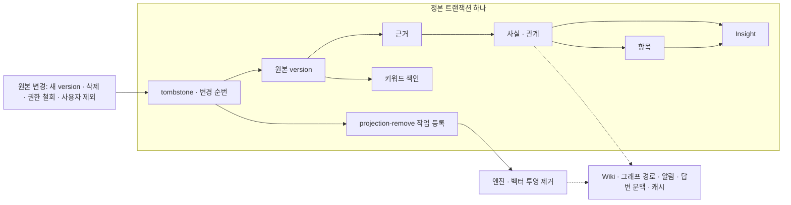
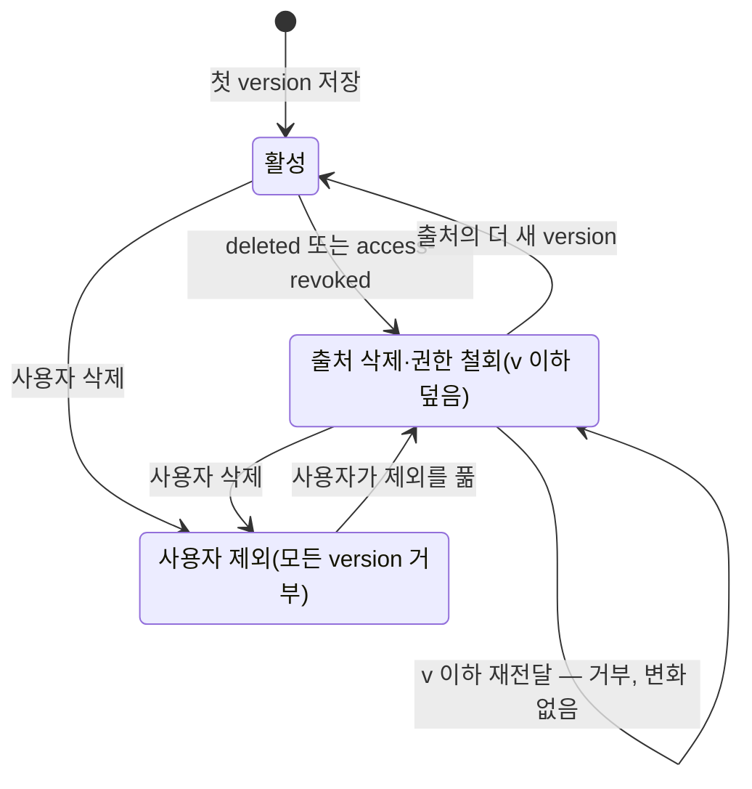
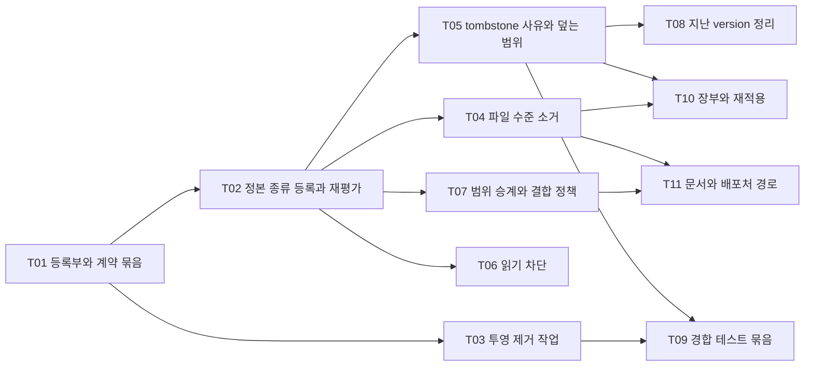

# 스펙: I04 수정·삭제·권한 철회와 파생 지식 무효화

- 날짜: 2026-11-21 / 상태: 초안
- 관련: 이슈 #21(I04), 총괄 #1, Phase 2 #4, 선행 #18(I01)·#20(I03), 후속 #22(S01), 실행 검증을 넘겨받는 #23(S02-C3)·#25(K01-C3)·#28(P02-C3)·#30(X01-C4)·#32(H01-C2). [V02 spec](2026-11-21-V02-vertical-slice.md), [ARCHITECTURE.md](../ARCHITECTURE.md), [ADR 0002](../adr/0002-authority-in-product-records.md)·[0010](../adr/0010-encryption-at-rest.md)·[0013](../adr/0013-failure-recovery.md)·[0014](../adr/0014-egress-policy-and-consent.md), [site-setup.md](../site-setup.md)

낯선 말은 [ARCHITECTURE 0절](../ARCHITECTURE.md#0-처음-나오는-말)에 풀이가 있다. 이 spec이 새로 쓰는 말은 아래 셋이다.

| 말 | 뜻 |
|---|---|
| 파생물 | 원본 version에서 계산해 만든 모든 것. 근거, 사실·관계·항목, Insight, 키워드 색인 행, 엔진·벡터 투영, 그리고 나중의 Wiki 페이지·알림·답변 문맥·캐시 |
| 계보(lineage) | 파생물 하나를 만든 원본 version들의 목록. "이것은 어느 원본에서 왔는가"의 답이다. 삭제 범위, access_scope, 전송 등급, fence가 모두 이 목록 하나에서 계산된다 |
| 파생물 종류 등록부 | 파생물의 종류마다 "원본 변경 하나가 무엇을 건드리는가, 계보는 무엇인가, 어떻게 지우거나 다시 계산하는가"를 한곳에 등록해 둔 목록. 새 기능이 파생물을 만들면 여기에 등록해야 한다 |

## 배경

원 설계 17절은 "원본 삭제와 파생 지식 삭제 동기화"를, 이슈 #1 설계 분석 5번은 원본의 access_scope와 전송 정책이 요약·embedding 입력·그래프 경로 같은 파생 문맥에도 따라가야 한다고 요구한다.

V02(#17)는 이것을 한 흐름에서 처음 증명한다. 새 version이 오면 이전 근거를 "지난 근거"로 두고(V02-R11, T07), 삭제와 권한 철회는 내용 없는 tombstone을 남기고 그 원본의 모든 version과 근거와 근거 없는 지식을 **지운다**(V02-R12, T08). 엔진과 벡터 규격에는 삭제를 통지한다(V02-R13, T09). 다만 V02는 지금 있는 파생물을 하나씩 손으로 따라가는 구현이다. 파생물이 늘어날 때마다(S02의 그래프 경로, K01의 Wiki, P02의 알림, X01의 답변 문맥) 같은 일을 다시 손으로 하면 하나만 빠뜨려도 지운 내용이 남는다.

비유하면 V02는 "이 방의 물건을 치웠다"이고, I04는 "새 방을 지을 때 반드시 청소 목록에 올리게 하는 건축 규칙"이다. 규칙이 있어도 실제로 청소했는지는 방마다 따로 확인해야 하므로, 뒤 작업의 C번호가 그 확인을 맡는다.

V02가 I04로 넘긴 것: tombstone 보존 기간, 삭제한 원본의 복원, 지난 version의 정리, 접근 범위가 다른 원본 사이의 연결 제한(V02 비목표, ARCHITECTURE 8절 "접근 범위를 넘는 연결", ADR 0013 결과).

**사전 측정 1건**(이 spec 작성 중, 제품 코드 아님). 제품과 같은 better-sqlite3 13.2.0(내장 SQLite 3.54.1)으로 V01과 같은 모양의 외부 내용 FTS5 색인에 카나리 문자열을 넣고 지운 뒤 파일 바이트를 확인했다.

| 설정 | 원문 카나리 | 소문자로 바뀐 색인 낱말 |
|---|---|---|
| 기본 | 파일에 남음 | 파일에 남음 |
| `secure_delete` 켬 + WAL checkpoint | 사라짐 | **파일에 남음** |
| 위 + FTS5 `secure-delete` 옵션 | 사라짐 | 사라짐 |

즉 "행을 지웠다"는 것만으로는 내용이 파일에서 사라지지 않고, 키워드 색인은 따로 손봐야 한다. 이 측정은 임시 스크립트였으므로 근거일 뿐 완료 증거가 아니다. 같은 확인이 I04-R5의 저장소 안 테스트가 된다.

## 목표

- 원본 하나를 지우거나 권한이 철회되면, 그 원본에서만 나온 파생물이 **모든 종류에서** 같은 규칙으로 지워지고, 다른 원본의 근거가 남은 지식은 남아 상태를 다시 판정받는다.
- 지운 내용(예전 version에만 있던 값, 키워드 색인의 낱말, 엔진·벡터 투영의 항목 포함)은 데이터 디렉터리의 어느 파일 바이트에도 없다.
- 지운 직후부터 검색, 탐색 화면, Insight 목록, 엔진의 관련 문맥 결과에 그 원본에서 나온 것이 나타나지 않는다. 투영이 아직 따라오지 못했어도 그렇다.
- 처리 중이던 작업, 늦게 끝난 작업, 수동 재시도, 늦게 도착한 수집 사건이 지운 것을 되살리지 못한다. 같은 삭제를 몇 번 다시 실행해도 결과가 같다.
- 파생물의 access_scope와 전송 등급은 계보에서 계산되고, 범위를 섞어도 되는지는 하나의 정책 규격이 정한다.
- 뒤에 생기는 파생물이 등록하지 않고 생기면 테스트가 실패한다.

## 비목표 (배포처에서 후속 진행)

**공용 저장소의 뒤 작업으로 넘기는 것**

- 그래프 경로·여러 단계 근거의 무효화와 권한 교차 경로의 유출 방지 실행 검증: S02(#23) S02-C3. I04는 등록 규격과 범위 정책 규격만 준다.
- Wiki 페이지의 삭제·access_scope 승계·같은 knowledge revision 재생성: K01(#25) K01-C3.
- 알림·digest의 발송 직전 재검사와 중복 발송 방지: P02(#28) P02-C3.
- 검색 결과·답변 생성 직전의 재검사, Provider 문맥 최소화, 답변·인용·로그의 부정 테스트, 벡터 색인의 실제 쓰기·찾기 경로: X01(#30) X01-C4.
- 사용자 교정·승인 기록(S01)의 등록: S01(#22). S01이 교정 테이블을 만들 때 이 계약에 등록한다(아래 "등록표"의 S01 행).
- 백업 파일의 생성과 실제 복원 실행, tombstone 장부를 백업에 넣는 일: H01(#32) H01-C2. I04는 복원 뒤 재적용 **정책**과 그 정책을 실행하는 재적용 함수만 만든다.
- 정본 SQLite의 파일 단위 암호화: H01([ADR 0010](../adr/0010-encryption-at-rest.md)).
- 삭제한 원본의 **내용** 되살리기(실행 취소). 지운 내용은 남기지 않으므로 제품이 되살릴 수 없다. 원본을 다시 받는 길만 있다(I04-R8).
- 여러 사용자, 사용자 계정별 열람 권한: 원 설계 범위 밖(한 PC의 한 사용자).
- 수집기가 사건을 내는 방식(cursor, 전체 재스캔에서 사라진 원본을 삭제로 보는 규칙): I01(#18). I04는 그 사건을 받은 뒤만 다룬다.
- 작업 상태 기계 자체, 재시도 간격, 수동 재시도 화면: I03(#20). I04는 그 경로가 fence를 다시 검사한다는 것만 요구한다.

**배포처 후속 항목**(2개. [site-setup.md의 배포처 설정 체크리스트](../site-setup.md#배포처-설정-체크리스트)와 번호로 대응한다. S16~S20은 I02·I01·I03이 쓰므로 I04는 S21부터 쓴다)

| 번호 | 항목 |
|---|---|
| S21 | 배포처의 접근 범위 결합 규칙: 어떤 access_scope끼리 한 항목·한 Insight로 묶어도 되는지의 값과 그 구현(`scopePolicy: "site"`) |
| S22 | Windows 설치본에서 실제 수집기의 삭제·권한 철회 사건으로 무효화와 파일 소거를 실행하고 기록 |

## 요구사항

**무효화 계약**

- **I04-R1 파생물 종류 등록부.** 파생물의 종류마다 등록 항목 하나를 둔다. 항목은 ① 종류 이름 ② 층(아래 R2의 순서) ③ 저장 위치(정본 또는 투영) ④ `affected`: 원본 변경 하나(새 version, 삭제, 권한 철회, 사용자 제외)가 건드리는 이 종류의 행 ⑤ `lineage`: 행 하나의 계보 ⑥ `invalidate`: 지우기 또는 다시 계산하기를 갖는다. 모든 종류는 `packages/testkit`의 **무효화 계약 테스트 묶음**을 통과한다. 지금 있는 종류(근거, 사실, 관계, 항목, Insight, 키워드 색인, 엔진 투영, 벡터 투영)를 모두 등록한다. 등록은 코드의 목록 하나이며 실행 중에 바뀌지 않는다.
- **I04-R2 전파 순서.** 원본 변경 하나는 층 순서대로 전파한다: 원본 version → 근거 → 사실·관계 → 항목 → Insight → 투영(키워드 색인은 같은 트랜잭션, 엔진·벡터는 커밋 뒤 작업). 아래 층의 결과가 위 층의 입력이므로 순서를 바꾸지 않는다(근거를 지운 뒤에야 "근거가 남지 않은 사실"을 셀 수 있다). 정본 층 전부는 tombstone 쓰기와 **한 트랜잭션**이다. 뒤에 등록되는 층도 이 순서표의 자리를 가져야 한다(설계 개요의 그림).
- **I04-R3 등록 누락의 차단.** 정본 SQLite의 모든 테이블은 `원본`, `파생물 종류 <이름>`, `운영`(작업, 동의, 설정, 호출 이력, tombstone, 번호, 무효화 기록) 가운데 하나로 분류된 목록에 있어야 한다. 목록에 없는 테이블이 스키마에 있으면 테스트가 실패한다. 제품 구성에 묶이는 `KnowledgeEngine`과 `VectorIndex` 구현도 등록된 투영 종류여야 하며, 등록되지 않은 구현을 묶으면 백엔드가 시작을 거부한다.
- **I04-R4 무효화 기록.** 원본 변경 하나의 전파가 끝나면 내용 없는 무효화 기록 한 행을 남긴다: 변경 순번, 원본의 내부 ID, 사유, 종류별로 지운 수와 다시 계산한 수, 시각. 제목, 본문, 인용문, 외부 식별자는 넣지 않는다. Activity 화면과 상태 API가 이 수를 보인다.

**삭제와 소거**

- **I04-R5 소거 범위.** 삭제, 권한 철회, 사용자 제외는 V02-R12의 범위를 모든 등록 종류로 넓힌다: 그 원본의 모든 version의 본문·제목, 그 version들을 가리키는 근거(인용문과 **위치표 전부**. 글자 span이든 I02의 쪽·시트·칸·요소 경로 위치표든 같다), 근거가 하나도 남지 않은 사실·관계(상태와 상관없이), 사실도 관계도 남지 않은 항목, 그 항목을 가리키는 Insight 행, 키워드 색인 행, 엔진·벡터 투영 속 그 원본의 항목. 종류마다 무엇을 지우는지는 그 종류의 `invalidate`가 정하고, 범위를 바꾸려면 등록 항목을 고친다.
- **I04-R6 파일 수준 소거.** 지운 내용은 데이터 디렉터리의 모든 파일(정본 데이터베이스와 `-wal`·`-shm`, 엔진·벡터 구현이 쓰는 디렉터리)의 바이트에 남지 않는다. 정본은 연결을 열 때 `secure_delete`를 켜고, 키워드 색인은 FTS5 `secure-delete` 옵션을 켜며(마이그레이션), 소거 트랜잭션 뒤에 WAL을 checkpoint해 비운다. 방법은 구현이 바꿀 수 있지만 판정은 카나리 테스트다. 파일을 쓰는 투영 구현은 계약 테스트 묶음의 "파일 카나리" 경우를 통과해야 등록된다.
- **I04-R7 남는 지식의 재평가.** 다른 원본의 근거가 남은 사실·관계는 지우지 않고 V02-R11과 같은 규칙으로 상태를 다시 판정한다: 남은 근거 중 **현재 근거**가 하나 이상이면 그대로, 지난 근거만 남으면 superseded. 인식 유형은 바꾸지 않는다. 상태가 바뀐 행을 입력으로 쓰는 Insight는 다시 계산한다. 사용자 승인(user-approved) 행도 근거가 하나도 남지 않으면 지운다(그 값은 지운 원본에서 온 내용이다).

**tombstone과 보존**

- **I04-R8 tombstone의 사유와 덮는 범위.** 사유는 셋이다: `deleted`(출처에서 삭제), `access-revoked`(출처에서 권한 철회), `user-excluded`(사용자가 화면이나 API에서 지움). tombstone은 그 원본의 **version v 이하**를 덮는다. 규칙:
  - 작업 결과 쓰기의 fence 검사는 "tombstone이 없다"가 아니라 "**tombstone이 이 version을 덮지 않는다**"다.
  - 덮이는 version의 재수집은 거부한다. 같은 사건의 재전달이나 늦게 도착한 예전 version이 여기에 걸린다.
  - `deleted`·`access-revoked`인 원본에 출처가 **더 새로운 version**을 내면(출처에서 다시 만들어졌거나 권한이 다시 주어졌다) 받아들인다. 그 version의 번호는 tombstone의 version보다 크게 매긴다. tombstone 행은 남아 그 아래를 계속 덮는다.
  - `user-excluded`인 원본은 출처가 새 version을 내도 받지 않는다. 사용자가 제외를 풀면(API 한 개) 그 뒤에 출처가 내는 version부터 받는다. 푼다고 지운 내용이 돌아오지 않는다.
  - 출처가 version의 순서를 알려 주지 못하는 수집기라면, 그 원본이 tombstone을 받은 뒤에는 사용자가 제외를 푼 경우처럼 명시적인 해제 없이는 다시 받지 않는다.
- **I04-R9 보존 기간.** tombstone은 **지우지 않는다**(내용이 없고 행 하나가 작다. 지우면 재수집과 백업 복원이 지운 데이터를 되살린다). 지난 version은 그것을 가리키는 근거가 하나라도 있는 동안 남기고, 최신이 아니면서 가리키는 근거가 하나도 없는 지난 version은 새 version의 전파가 끝나는 트랜잭션에서 지운다(키워드 색인 행 포함, 변경 순번은 올리지 않는다. 투영은 새 version 때 이미 그 version을 지웠다).

**경합과 반복 실행**

- **I04-R10 계보 fence.** 파생물을 정본에 쓰는 모든 경로는 쓰는 트랜잭션 안에서 그 결과의 계보에 든 원본 version마다 "아직 있고 tombstone에 덮이지 않았다"를 확인하고, 하나라도 아니면 결과 전체를 버린다. V02-R5의 검사는 이 규칙의 한 경우다. 이 검사는 등록부가 주는 함수 하나이며, 뒤의 종류(Wiki 생성, 요약, 답변 캐시)도 같은 함수를 쓴다. 실패 보관함의 수동 재시도(I03)도 다시 실행되는 것이므로 같은 검사를 지난다.
- **I04-R11 멱등 소거와 투영 제거 작업.** 같은 원본에 같거나 낮은 version의 삭제가 다시 오면 아무것도 바꾸지 않고 변경 순번도 올리지 않는다. 엔진·벡터 투영의 제거는 소거 트랜잭션 안에서 **작업으로 등록**하고(종류 `projection-remove`, 원본, tombstone의 version), 커밋 뒤 실행한다. 실패하면 작업이 재시도된다. 같은 제거를 두 번 실행해도 결과가 같다. 시작할 때의 변경 순번 비교와 재구축(V02-R13)은 그대로 남아 작업까지 잃은 경우를 덮는다. 소거 트랜잭션 도중 실패하면 정본은 아무것도 바뀌지 않은 상태로 남는다.

**읽기 차단과 승계**

- **I04-R12 읽기 경로의 차단.** 파생물을 밖으로 내보내는 모든 경로는 내보내기 직전에 등록부의 공용 검사(`visible`)를 지난다: 계보의 원본 version 가운데 하나라도 없거나 tombstone에 덮였으면 그 결과를 빼고, 범위 정책이 그 용도에 허용하지 않으면 뺀다. 지금 있는 경로: 키워드 검색과 Sources 목록, 지식·탐색 API, Home의 Insight 목록과 근거 목록, 엔진의 `relatedContext` 결과. 뒤의 경로(알림 발송, 답변 문맥, 인용)는 같은 검사를 써야 하며 그 실행 검증은 P02-C3·X01-C4가 한다.
- **I04-R13 access_scope의 승계.** 파생물의 access_scope는 **저장하지 않고 계보에서 계산한다**: 계보에 든 원본들의 access_scope 집합이다. 화면·API에 한 값을 보여야 할 때는 그 집합에서 가장 엄격한 것을 보인다(ARCHITECTURE 8절). 원본 하나가 권한 철회되면 그 원본이 계보에서 빠지므로 남은 파생물의 범위는 저절로 다시 계산된다.
- **I04-R14 범위 결합 정책.** 서로 다른 access_scope의 원본을 한 파생물로 묶어도 되는지는 규격 `ScopePolicy` 하나가 정한다. 공용 저장소의 기본 구현은 "모두 묶을 수 있음"이다(한 PC의 한 사용자, ARCHITECTURE 8절). 이 정책을 거치는 자리: ① V02-R7의 연결 후보 찾기(새 원본의 범위와 묶을 수 없는 범위가 계보에 있는 항목은 후보에서 뺀다) ② Insight 규칙의 평가(세 행의 계보 범위를 묶을 수 없으면 만들지 않는다) ③ 뒤의 그래프 경로(S02). 배포처 구현 자리 `scopePolicy: "site"`는 공용 저장소에서 `미구현, 배포처 후속` 오류를 낸다(S21).
- **I04-R15 전송 정책의 승계.** Provider에 나가는 입력이 파생물(연결 후보의 이름, 뒤의 요약·관련 문맥·embedding 입력)이면, Broker는 등록부의 `lineage`로 그 파생물의 원본들을 찾아 등급을 계산하고 가장 엄격한 것을 쓴다([ADR 0014](../adr/0014-egress-policy-and-consent.md)). 부르는 쪽은 파생물의 ID만 넘긴다. V02-R7이 연결 후보의 출처를 따로 찾던 코드는 이 경로로 바꾼다(동작은 같아야 한다).

**복원**

- **I04-R16 백업 복원 뒤 tombstone 재적용 정책.** 정책은 다음과 같고, 실행 검증은 H01-C2가 한다.
  - 소거와 같은 트랜잭션에서 **tombstone 장부**에 한 줄을 더한다: 원본 정체(`connector_instance_id + external_id`)의 SHA-256, version, 사유, 시각. 외부 식별자 자체는 넣지 않는다. 장부는 데이터 디렉터리 안 별도 파일이며 복원이 덮어쓰지 않는다.
  - 복원한 데이터베이스는 화면·API·작업 실행기가 열리기 **전에** 장부의 모든 줄과 복원본 자체의 tombstone을 합쳐(같은 원본이면 큰 version) 재적용한다. 재적용은 I04-R5·R6의 소거와 같은 함수다.
  - 다른 PC에 백업만 가져온 경우처럼 장부가 없으면 백업 뒤의 삭제는 알 수 없다. 이때 화면에 "백업 뒤의 삭제는 다시 수집해야 반영됨"을 알리고, 수집기의 다음 동기화가 낸 삭제 사건으로 반영한다.
  - I04에서는 장부 쓰기와 재적용 함수까지 만들고, 백업 파일 형식과 복원 화면은 H01이 만든다.

**문서와 배포처**

- **I04-R17 문서.** [site-setup.md](../site-setup.md)의 `## 배포처 설정 체크리스트` 아래에 S21, S22를 더하고 번호 대응 문장에 이 spec과 그 범위를 더한다(제목은 그대로 둔다). V01의 문서 대응 테스트에 이 spec의 배포처 후속 항목을 더한다. ARCHITECTURE와 ADR 0013에 고칠 곳은 아래 "다른 문서에 넘기는 변경"이며, 그 문서의 담당 작업에서 고친다. README에는 아무것도 더하지 않는다(사용자가 쓰는 새 명령이 없다).
- **I04-R18 배포처 검증 실행기의 삭제 시나리오.** V02의 배포처 검증 실행기에 삭제 시나리오를 더한다: 합성 출처 3개를 가져온 뒤 하나를 삭제, 하나를 권한 철회하고 데이터 디렉터리 전체에서 카나리를 찾는다. 기록에는 OS, 앱 버전, 수집기 종류, 종류별 지운 수, 카나리 발견 수가 들어간다. 실행 환경이 Windows 설치본이 아니면 `배포처 후속`으로 시작하는 알림을 출력하고 0이 아닌 값으로 끝난다.

## 인터페이스 / 설계 개요

### 전파 순서

굵은 테두리 안이 tombstone과 한 트랜잭션이다. 점선은 뒤 작업이 같은 계약으로 붙일 자리다.



### 원본 하나의 tombstone 상태

I04-R8을 그린 것이다. "다시 활성"은 지운 내용이 돌아오는 것이 아니라, 그 뒤에 출처가 낸 새 version을 받는 것이다.



### 등록 규격 (잠정. I04-T01에서 확정)

```typescript
type Layer = 'evidence' | 'knowledge' | 'item' | 'insight' | 'projection' | 'delivery'
type SourceChange =
  | { kind: 'new-version'; sourceId: number; version: number }
  | { kind: 'deleted' | 'access-revoked' | 'user-excluded'; sourceId: number; version: number }
interface DerivedRef { kind: string; id: string }          // 정본의 ID. 내용을 갖지 않는다
interface DerivativeKind {
  readonly kind: string
  readonly layer: Layer
  readonly storage: 'canonical' | 'projection'
  affected(tx: SqlDriver, change: SourceChange): DerivedRef[]
  lineage(db: SqlDriver, ref: DerivedRef): SourceVersionRef[]   // 범위·등급·fence의 유일한 입력
  invalidate(ctx: InvalidationContext, refs: DerivedRef[], change: SourceChange): { removed: number; recomputed: number }
}
// 등록부가 주는 공용 함수: propagate(change), assertFresh(tx, lineage), visible(refs, purpose), scopesOf(ref)
```

`invalidate`는 같은 입력으로 두 번 불러도 결과가 같아야 한다. 정본 종류는 `propagate`가 연 트랜잭션 안에서 불리고, 투영 종류는 `projection-remove` 작업 안에서 불린다. 투영 종류의 `invalidate`는 기존 `KnowledgeEngine.removeSource`·`VectorIndex.remove`를 부르는 얇은 어댑터이며 그 규격은 바꾸지 않는다.

```typescript
interface ScopePolicy {
  combinable(scopes: ReadonlySet<string | null>): boolean      // 기본 구현: 언제나 true
  allows(scopes: ReadonlySet<string | null>, purpose: 'display' | 'search' | 'notify' | 'answer'): boolean
}
```

access_scope가 비어 있는 원본(`null`)은 그 자체로 하나의 범위 값으로 다룬다.

### 무효화 계약 테스트 묶음

`packages/testkit`에 두고 등록된 모든 종류에 대해 실행한다. 경우는 다음이다: ① 그 종류의 행이 있는 원본을 지우면 계보가 그 원본뿐인 행이 사라진다 ② 다른 원본의 계보가 남은 행은 남는다 ③ 같은 변경으로 두 번 부르면 두 번째는 0건 ④ `lineage`가 가리키는 원본이 실제로 그 행을 만든 원본이다(행을 만든 fixture와 대조) ⑤ 낡은 fence의 쓰기가 거부된다 ⑥ 파일을 쓰는 종류는 지운 뒤 그 디렉터리에 카나리가 없다. 메모리 구현만 있는 종류(엔진·벡터)는 ⑥을 "해당 없음(파일 없음)"으로 보고한다.

### 등록표

| 종류 | 층 | 저장 | 생기는 곳 | 실행 검증 |
|---|---|---|---|---|
| 근거 | evidence | 정본 | V02 | I04-C1 |
| 사실, 관계 | knowledge | 정본 | V02 | I04-C1 |
| 항목 | item | 정본 | V02 | I04-C1 |
| Insight | insight | 정본 | V02 | I04-C1 |
| 키워드 색인 | projection(같은 트랜잭션) | 정본 파일 안 | V01 | I04-C1 |
| 엔진 투영 | projection | 투영 | V02-T09 | I04-C1(메모리 구현). 실제 엔진은 R07 |
| 벡터 투영 | projection | 투영 | V01(빈 구현) | I04-C1(fake). 실제 쓰기는 X01-C4 |
| 그래프 경로·여러 단계 근거 | knowledge | S02가 정함 | S02 | S02-C3 |
| Wiki 페이지 | projection | 투영 | K01 | K01-C3 |
| 알림, digest | delivery | S02 뒤 P02가 정함 | P02 | P02-C3 |
| 답변 문맥, 인용, 답변 캐시 | delivery | X01이 정함 | X01 | X01-C4 |
| 사용자 교정·승인 기록 | knowledge | 정본 | S01 | S01 spec에서 정함(이슈 #21에 C번호 없음) |

### 다른 문서에 넘기는 변경

이 spec은 아래 문서를 고치지 않는다. 각 문서의 담당 작업이 고친다.

| 문서 | 고칠 곳 |
|---|---|
| ARCHITECTURE 0절 | 파생물, 계보, 등록부 풀이 추가. tombstone 풀이를 "version v 이하를 덮는 표식, 사유 셋"으로 |
| ARCHITECTURE 4절 표 | 무효화 기록과 tombstone 장부 행 추가 |
| ARCHITECTURE 6절 | "tombstone이 없다"를 "tombstone이 덮지 않는다"로. 투영 제거가 작업으로 등록된다는 것 |
| ARCHITECTURE 8절 | "접근 범위를 넘는 연결"의 I04 몫을 `ScopePolicy`로 |
| ADR 0013 결정 4·5·7 | 덮는 범위, 파일 수준 소거 방법, 투영 제거 작업. 결과의 "I04에서 정한다" 두 줄을 이 spec으로 |
| ADR 0014 | 파생 입력의 등급은 등록부의 계보로 계산 |
| site-setup.md | S21, S22(I04-R17) |

## 완료 기준 (테스트 가능한 형태)

C1~C3은 이슈 #21의 문장 그대로다. H1·H2는 이 프로젝트가 배포처로 넘어가는 프로젝트라서 spec 양식이 요구하는 두 기준이며 이 spec에만 둔다.

- [ ] **I04-C1** (R1, R2, R3, R4, R5, R12, R13, R14, R15): 원본→evidence→facts/semantic→graph/wiki/vector→insight/digest/cache의 영향 범위를 기록하고 tombstone 직후 검색·Q&A·알림에서 차단한다. 원본의 access_scope와 전송 정책은 요약·embedding 입력·graph path 등 파생물에 승계된다. 실행 검증은 이 시점에 존재하는 파생물(V02의 facts·관계·Insight·탐색)로 하고, 이후 생기는 파생물은 같은 무효화·승계 계약에 등록하여 S02-C3·K01-C3·P02-C3·X01-C4에서 각각 검증한다.
- [ ] **I04-C2** (R8, R10, R11): 처리 중 삭제/권한철회 및 stale job 결과의 재유입을 version fence로 막고 idempotent cleanup/rebuild를 테스트한다.
- [ ] **I04-C3** (R5, R6, R7, R9, R16): 다른 유효 근거가 남은 사실은 근거 재평가하고 삭제 범위·retention을 검증하고 backup restore 후 tombstone 재적용 정책을 정의한다. 복구 실행 검증은 백업이 생기는 H01-C2(#32)에서 한다.
- [ ] **I04-H1** (R17): 이 spec의 "배포처 후속 항목" 2개 각각에 대해 site-setup.md의 `## 배포처 설정 체크리스트` 아래에 같은 번호의 항목이 있으면 통과하고, 하나라도 없거나 수가 다르면 문서 대응 테스트가 실패한다.
- [ ] **I04-H2** (R14, R18): ① `scopePolicy`를 `site`로 두고 백엔드를 시작하면 ② 삭제 시나리오 실행기를 Windows 설치본이 아닌 환경에서 실행하면, 각각 `배포처 후속`으로 시작하는 알림을 출력하고 0이 아닌 값으로 끝난다(경로마다 1건, 모두 2건).

**기준을 읽는 법**

- **C1의 "영향 범위를 기록"**은 I04-R4의 무효화 기록이다. 사슬의 이름 가운데 지금 없는 층(graph, wiki, vector 쓰기, digest, cache)은 등록표의 자리와 계약 테스트 묶음으로 충족하고 실행은 표의 C번호로 넘긴다. I04-R3의 분류 테스트가 그 층이 생길 때 등록을 강제한다.
- **C1의 "Q&A·알림에서 차단"**: 두 기능이 아직 없으므로 I04에서 실행하는 것은 검색, 탐색, Insight 목록, 엔진 관련 문맥의 차단이다. Q&A와 알림은 같은 `visible` 검사를 써야 하며 X01-C4·P02-C3이 실행 검증한다. 그 전까지 이 두 경로는 미검증이다.
- **C1의 "요약·embedding 입력·graph path"**: 지금 Provider로 나가는 파생 입력은 연결 후보의 이름뿐이므로 실행 검증은 그것으로 한다. 요약(K01), embedding 입력(X01), 그래프 경로(S02)는 미검증으로 남는다.
- **C3의 "정의한다"**는 I04-R16의 정책 문장과, 그 정책대로 동작하는 재적용 함수의 테스트(삭제 전 데이터베이스 사본에 재적용하면 처음 삭제와 같은 결과)다. 실제 백업 파일로 하는 복원은 H01-C2다.

### 기준별 증명 테스트

테스트 수준의 뜻은 [V01 spec](2026-11-21-V01-vertical-skeleton.md#기준별-증명-테스트)과 같다.

| 기준 | 테스트 | 수준 | 확인하는 것 |
|---|---|---|---|
| C1 | `derivatives.contract` | 단위 | 등록된 종류 8개 모두가 계약 묶음의 ①~⑤를 통과. ⑥은 파일이 없는 종류에서 "해당 없음" |
| C1 | `derivatives.schema-coverage` | 단위 | 스키마의 모든 테이블이 분류 목록에 있음. 분류되지 않은 테이블을 만드는 마이그레이션을 더하면 실패(테스트 안에서 임시 마이그레이션으로 확인) |
| C1 | `derivatives.unregistered-adapter` | 통합 | 등록되지 않은 엔진 구현을 묶으면 백엔드가 시작을 거부 |
| C1 | `invalidate.order` | 통합 | 삭제 한 번에 종류별 호출 순서가 R2의 층 순서이고 정본 층 전부가 한 트랜잭션(도중 예외면 아무것도 바뀌지 않음) |
| C1 | `invalidate.record` | 통합 | 삭제 뒤 무효화 기록에 종류별 수가 맞게 있고, 그 행에 fixture의 제목·본문·인용문·외부 식별자 문자열이 없음 |
| C1 | `read-gate` | 통합 | 엔진 제거 작업을 실행하기 **전**(투영이 아직 그 원본을 가짐)에 키워드 검색, Sources 목록, 지식 API, Insight 목록, `relatedContext` 결과 어디에도 그 원본에서 나온 것이 없음 |
| C1 | `read-gate.e2e` | Playwright E2E | 삭제 직후 Home·Sources·검색 화면에 그 원본과 그 Insight가 보이지 않음 |
| C1 | `scope.inherit` | 단위 | 범위 a, b의 근거를 가진 사실의 범위 집합이 {a, b}. b 원본을 권한 철회하면 {a} |
| C1 | `scope.policy` | 통합 | a와 b를 묶을 수 없다는 테스트 정책에서: b 원본의 추출에 a 계보의 항목이 연결 후보로 오지 않음, 계보 범위를 묶을 수 없는 세 행으로는 Insight가 생기지 않음. 기본 정책에서는 V02 흐름이 그대로 |
| C1 | `egress.derived-grade` | 통합 | 연결 후보 항목의 계보에 일반 등급 원본이 있으면 그 추출 호출의 등급이 일반(V02 `linking`과 같은 결과를 계보 경로로). 그 원본을 지운 뒤에는 그 후보가 오지 않음 |
| C2 | `fence.lineage` | 통합 | ① 추출 중 삭제 → 결과 버림, 작업 superseded ② 추출 중 권한 철회 → 같음 ③ 결과의 계보에 든 원본 둘 중 하나만 삭제되어도 결과 전체를 버림 |
| C2 | `fence.manual-retry` | 통합 | 실패 보관함에 있던 작업의 원본을 지운 뒤 수동 재시도하면 결과가 쓰이지 않음 |
| C2 | `tombstone.cover` | 통합 | v3 삭제 뒤: v2·v3 재전달 거부, `deleted` 원본에 출처 v4는 받아들여 새 version 번호가 tombstone보다 큼, `user-excluded`면 v4도 거부, 제외를 풀면 그 뒤의 v5를 받음. 늦게 도착한 v2 upsert도 거부. 다시 받은 version의 추출 작업이 fence에 걸리지 않음 |
| C2 | `purge.idempotent` | 통합 | 같은 삭제 사건 두 번 → 두 번째는 변경 순번, 행 수, 무효화 기록 모두 그대로 |
| C2 | `projection-remove.retry` | 통합 | 엔진 제거가 처음에 실패하면 작업이 재시도되어 결국 제거됨. 제거를 두 번 실행해도 엔진 상태가 같음. 작업이 없어진 경우에도 재시작의 변경 순번 비교가 재구축을 부름. 재구축을 두 번 해도 결과가 같음 |
| C3 | `reevaluate` | 통합 | 두 원본이 근거인 사실: 한 원본 삭제 뒤 남은 근거가 현재 근거면 상태 그대로, 지난 근거만이면 superseded. 그 사실을 쓰는 Insight가 다시 계산됨. 근거가 모두 사라진 user-approved 사실은 지워짐 |
| C3 | `purge.canary-files` | 통합 | 파일 기반 데이터 디렉터리에서 ① 현재 version의 카나리 ② 예전 version에만 있던 카나리 ③ 키워드 색인을 거쳐 소문자가 된 낱말 ④ 인용문과 위치표 속 카나리(시트 이름 같은 I02 위치표 포함)가 삭제 뒤 `.db`·`-wal`·`-shm`과 투영 디렉터리 바이트 어디에도 없음. 권한 철회와 사용자 제외도 같음 |
| C3 | `retention` | 통합 | tombstone은 소거 뒤에도, 재시작 뒤에도 남음. 근거가 있는 지난 version은 남고 근거가 없는 지난 version은 다음 version의 전파 뒤 사라짐(그 카나리도 파일에서 사라짐). 그때 변경 순번은 오르지 않음 |
| C3 | `restore.reapply` | 통합 | 삭제 **전** 데이터베이스 사본을 "복원본"으로 열고 장부를 재적용하면 결과(행 수, 무효화 기록의 종류별 수, 카나리 부재)가 처음 삭제와 같음. 재적용을 두 번 해도 같음. 재적용이 끝나기 전에는 API가 응답하지 않음. 장부에 외부 식별자 문자열이 없음 |
| H1 | `docs.site-setup` | 단위 | 비목표 표의 번호 2개가 체크리스트에 모두 있음 |
| H2 | `site-paths.refuse` | 통합 | 두 경로 각각에서 알림 문자열과 0이 아닌 종료 값 |

### 사외에서 충족할 수 있는 것, 배포처 실행을 기다리는 것

| 기준 | 사외 | 남는 것 |
|---|---|---|
| C1 | **부분.** 지금 있는 파생물로 충족 가능 | 뒤 층의 실행 검증(S02-C3, K01-C3, P02-C3, X01-C4). 실제 엔진·벡터 구현의 제거(R07, X01). 배포처 범위 정책의 값(S21) |
| C2 | **충족 가능**(개발 OS). 수동 재시도 경우는 I03 뒤 | 실제 수집기의 삭제·철회 사건 순서(S22) |
| C3 | **부분.** 재평가, 소거, 보존, 재적용 함수 | 실제 백업 파일의 복원(H01-C2). Windows 설치본의 데이터 디렉터리에서의 파일 카나리(S22) |
| H1, H2 | **충족 가능** | — |

## 작업 분해

한 작업이 PR 하나다. 그림은 I04 안의 선후만 그렸고, 다른 작업에 대한 선행은 표가 기준이다. **모든 작업은 V02-T07·T08·T09의 머지 뒤에 시작한다**(아래 "미해결 질문" 1).



| ID | 내용 | 요구사항 | 기준 | 선행 | 테스트 |
|---|---|---|---|---|---|
| I04-T01 | `DerivativeKind` 규격, 등록부(`propagate`, `assertFresh`, `visible`, `scopesOf`), 테이블 분류 목록, 계약 테스트 묶음(testkit), 무효화 기록 테이블 | R1, R2, R3, R4 | C1 | V02-T07, V02-T08, V02-T09 | `derivatives.contract`(메모리 대역 종류로), `derivatives.schema-coverage`, `invalidate.record` |
| I04-T02 | 근거·사실·관계·항목·Insight·키워드 색인을 종류로 등록하고 V02-T07·T08의 손 전파를 등록부 전파로 바꿈(동작 유지), 남는 지식의 재평가 | R1, R2, R5, R7 | C1, C3 | I04-T01 | V02의 `update.recompute`·`delete.purge`·`delete.propagate`가 그대로 통과, `invalidate.order`, `reevaluate` |
| I04-T03 | 엔진·벡터를 투영 종류로 등록, `projection-remove` 작업, 등록되지 않은 구현의 시작 거부 | R1, R3, R11 | C1, C2 | I04-T01, **I03(#20)의 작업 상태** | `projection-remove.retry`, `derivatives.unregistered-adapter`, V02의 `engine.calls`·`engine.restart` 유지 |
| I04-T04 | `secure_delete`, FTS5 `secure-delete` 마이그레이션, 소거 뒤 WAL checkpoint, 데이터 디렉터리 카나리 검사 도구(testkit) | R6 | C3 | I04-T02 | `purge.canary-files` |
| I04-T05 | tombstone 사유 셋(마이그레이션), 덮는 범위의 fence 검사, 재수집 규칙, 새 version 번호를 tombstone 위로, 제외 해제 API, 멱등 소거 | R8, R11 | C2 | I04-T02, **I01(#18)의 출처 version 필드** | `tombstone.cover`, `purge.idempotent` |
| I04-T06 | 읽기 경로 6곳에 `visible` 적용 | R12 | C1 | I04-T02 | `read-gate`, `read-gate.e2e` |
| I04-T07 | 계보로 범위 계산, `ScopePolicy`와 기본 구현, 연결 후보·Insight 규칙의 결합 검사, Broker의 파생 입력 등급을 계보로 | R13, R14, R15 | C1 | I04-T02 | `scope.inherit`, `scope.policy`, `egress.derived-grade`, V02의 `linking` 유지 |
| I04-T08 | 근거 없는 지난 version의 정리 | R9 | C3 | I04-T05 | `retention` |
| I04-T09 | 경합 테스트 묶음과 그것이 드러낸 수정 | R10, R11 | C2 | I04-T03, I04-T05, **I03(#20)의 수동 재시도** | `fence.lineage`, `fence.manual-retry` |
| I04-T10 | tombstone 장부 쓰기, 복원본 재적용 함수, 재적용 전 API 차단 | R16 | C3 | I04-T04, I04-T05 | `restore.reapply` |
| I04-T11 | site-setup S21·S22, 문서 대응 테스트, `scopePolicy: "site"` 자리, 배포처 실행기의 삭제 시나리오, "다른 문서에 넘기는 변경"을 담당 작업에 전달 | R14, R17, R18 | H1, H2 | I04-T04, I04-T07, V02-T12 | `docs.site-setup`, `site-paths.refuse` |

## 미해결 질문

**작업을 막는 것**

1. **V02-T07·T08·T09가 아직 구현되지 않았다.** 이 spec은 그 세 작업을 일반화하는 확장으로 썼고, 그 구현이 이 spec의 가정과 다르면 I04-T01·T02의 범위가 바뀐다. 머지 뒤 아래 "다시 확인할 가정"을 하나씩 대조한다.
2. **출처의 version 순서(I01, #18).** 지금 `SourceRecord`에는 version이 없고 제품이 원본마다 1, 2, …를 매긴다. 이 번호만으로는 "늦게 도착한 예전 version"과 "출처가 다시 만든 새 version"을 가를 수 없다(I04-R8). I01-C2가 출처가 주는 순서 값을 레코드에 넣는다고 가정한다. 넣지 않으면 tombstone을 받은 원본은 모두 사용자 해제 없이는 다시 받지 않는 쪽(R8의 마지막 줄)으로 동작한다. I04-T05가 막힌다.
3. **작업 상태(I03, #20).** fence에 걸린 작업을 닫는 상태로 V02는 `superseded`를 쓴다. I03의 상태 목록(queued, running, retry, dead-letter, cancelled, succeeded)에 이것이 없다. I03이 `superseded`를 두거나 `cancelled`에 사유 `fenced`를 붙인다고 가정하며, I04-T03·T09가 그 결과를 따른다.

**진행은 하되 번복되면 다시 하는 것**(잠정 결정. 바꾸는 법을 함께 적었다)

4. **tombstone을 영구 보존**(R9). 이유: 내용이 없어 보존 비용이 작고, 지우면 재수집·복원이 되살린다. 바꾸려면 "모든 수집기의 cursor가 tombstone 시각을 지났고 그 뒤 백업이 없음" 같은 조건을 정해 R9에 정리 단계를 더한다.
5. **근거 없는 지난 version을 지운다**(R9). 이유: 지식에 쓰이지 않는 예전 본문을 남겨 둘수록 지울 때까지의 노출이 길다. 원 설계가 문서 이력을 따로 요구하지 않는다. 문서 이력이 필요해지면 정리를 설정 하나로 끌 수 있게 R9를 고친다.
6. **사용자 삭제는 출처의 새 version도 막는다**(R8의 `user-excluded`). 이유: 사용자가 지운 것이 다음 동기화에서 돌아오면 사용자의 뜻에 어긋난다. 출처 삭제와 같게 다루려면 사유를 `deleted`로 합치면 된다.
7. **access_scope를 저장하지 않고 계보에서 계산**(R13). 이유: 저장하면 원본의 권한이 바뀔 때마다 모든 파생물을 다시 써야 하고, 하나를 빠뜨리면 낡은 범위가 남는다. 읽기 비용이 커지면 계산 결과를 투영처럼 캐시하되 그 캐시도 등록부에 등록한다.
8. **범위 결합의 공용 기본값은 "모두 묶을 수 있음"**(R14). ARCHITECTURE 8절의 Phase 1 전제(한 PC의 한 사용자)와 같다. 배포처가 S21에서 값을 정한다.
9. **근거가 모두 사라진 사용자 승인 지식도 지운다**(R7). 이유: 값이 지운 원본에서 왔다. S01이 "사용자가 직접 입력한 값"을 따로 두면 그 행은 원본 계보가 없으므로 이 규칙에 걸리지 않는다.
10. **투영 제거를 새 outbox 테이블이 아니라 기존 작업 테이블의 작업으로**(R11). 이유: 작업 테이블이 이미 중복 등록 방지와 임대를 갖는다. ADR 0013 결정 8의 outbox가 들어오면 그쪽으로 옮긴다.
11. **장부는 원본 정체의 SHA-256만 담는다**(R16). 이유: 외부 식별자(메일 제목이 섞일 수 있다)를 지운 뒤에도 남기지 않기 위해서다. 같은 정체를 복원본에서 다시 해시해 찾는다.

**다시 확인할 가정**("V02-T07/T08 머지 후 재확인", 그리고 형제 spec 확인)

- 가) V02-T08의 소거가 함수 하나(원본 ID, 사유, version)로 되어 있어 T02가 등록부 전파로 감쌀 수 있다.
- 나) V02-R5의 fence 검사 "tombstone이 없다"가 구현에서 `tombstones` 행의 존재로 되어 있다. 그렇다면 T05가 "덮는 범위" 비교로 바꾸고, 다시 받은 version의 작업이 막히지 않는 테스트를 더한다.
- 다) V02-T08이 파일 수준 소거를 어떤 방법으로 했는가. 위 사전 측정대로 `secure_delete`만 켰다면 키워드 색인 낱말이 남으므로 T04가 고친다.
- 라) V02-T07의 Insight 재계산이 "영향받은 항목"을 입력으로 받는다. T02의 재평가가 같은 입력을 쓴다.
- 마) V02-T02 브랜치의 스키마 v5: `jobs`가 `source_id`와 `fence_version`을 갖고 `UNIQUE (kind, source_id, fence_version)`이다. `projection-remove` 작업의 중복 방지가 여기에 기댄다. `tombstones.reason`의 CHECK가 두 값이라 T05의 마이그레이션이 표를 다시 만든다. `sources.access_scope`는 비어 있을 수 있다.
- 바) V02-T09의 엔진 제거 호출이 커밋 뒤 직접 호출이다. T03이 이것을 작업으로 바꾼다.
- 사) I01 spec(작성 중): `SourceRecord`의 access_scope, operation/tombstone 필드, 출처 version 순서 값, 그리고 근거 위치표 합집합의 모양. 위치표는 I02 spec(peer commit c613fbc의 "위치표의 모양")과 같다고 가정하며, I04는 위치표를 해석하지 않고 근거 행과 함께 지운다.
- 아) I03 spec(작성 중): fence에 걸린 작업의 종료 상태, 수동 재시도가 작업을 다시 실행하는 경로(같은 결과 쓰기 함수를 지나는가).
- 자) site-setup 번호: S16·S17은 I02, S18은 I01, S19·S20은 I03이 쓴다는 조정자 안내에 따라 S21·S22를 썼다. 형제 spec이 확정될 때 번호를 다시 대조한다.

## 변경 이력

| 날짜 | 변경 내용 | 대상 | 사유 |
|---|---|---|---|
| 2026-11-21 | 최초 작성(초안) | 이 문서 | 이슈 #21의 구현 spec. V02 비목표에서 넘어온 네 가지와 이슈의 C1~C3 |
