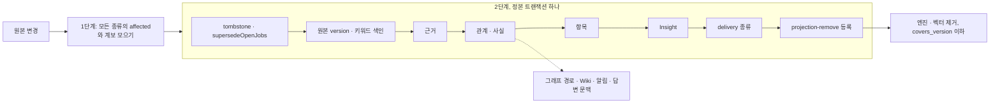
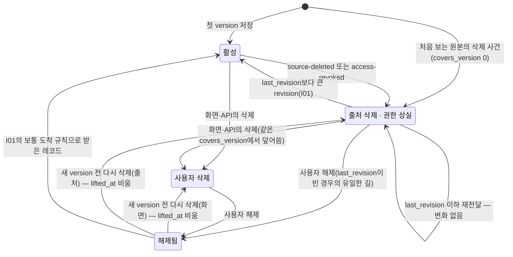
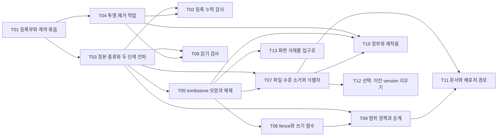

# 스펙: I04 수정·삭제·권한 철회와 파생 지식 무효화

- 날짜: 2026-11-21 / 상태: 확정
- 관련: 이슈 #21(I04), 총괄 #1, Phase 2 #4, 선행 #18(I01)·#20(I03), 후속 #22(S01), 실행 검증을 넘겨받는 #23(S02-C3)·#25(K01-C3)·#28(P02-C3)·#30(X01-C4)·#32(H01-C2). [V02 spec](2026-11-21-V02-vertical-slice.md)("T02가 넘기는 것"), I01 spec(작성 중, `docs/i01-spec`), I03 spec(작성 중, `docs/i03-spec`), [ARCHITECTURE.md](../ARCHITECTURE.md), [ADR 0002](../adr/0002-authority-in-product-records.md)·[0010](../adr/0010-encryption-at-rest.md)·[0013](../adr/0013-failure-recovery.md)·[0014](../adr/0014-egress-policy-and-consent.md), [site-setup.md](../site-setup.md)

낯선 말은 [ARCHITECTURE 0절](../ARCHITECTURE.md#0-처음-나오는-말)에 풀이가 있다. 이 spec이 새로 쓰거나 뜻을 좁히는 말은 아래와 같다.

| 말 | 뜻 |
|---|---|
| 파생물 | 원본 version에서 계산해 만든 모든 것. 근거, 사실·관계·항목, Insight, 키워드 색인 행, 엔진·벡터 투영, 그리고 나중의 그래프 경로·Wiki 페이지·알림·답변 문맥·캐시 |
| 계보(lineage) | 파생물 하나를 만든 원본 version들의 목록. "이것은 어느 원본에서 왔는가"의 답이다. 삭제 범위, access_scope, 전송 등급, fence가 모두 이 목록에서 계산된다 |
| 등록부 | 파생물의 종류마다 "원본 변경 하나가 무엇을 건드리는가, 계보는 무엇인가, 어떻게 지우거나 다시 계산하는가"를 등록한 코드의 목록 |
| version과 revision | **version**은 제품이 원본마다 1, 2, 3…으로 매기는 번호이고 저장된 version은 바뀌지 않는다(V02-T02). fence, 근거, tombstone이 덮는 범위는 이 번호로 비교한다. **revision**은 원 시스템이 주는 개정 번호다(I01). 원 시스템에서 늦게 도착한 것을 가려내는 데만 쓴다. 두 번호를 섞어 비교하지 않는다 |

## 배경

원 설계 17절은 "원본 삭제와 파생 지식 삭제 동기화"를, 이슈 #1 설계 분석 5번은 원본의 access_scope와 전송 정책이 요약·embedding 입력·그래프 경로 같은 파생 문맥에도 따라가야 한다고 요구한다.

V02(#17)는 이것을 한 흐름에서 처음 증명한다. 새 version이 오면 이전 근거를 "지난 근거"로 둔다(V02-R11, T07). 삭제와 권한 철회는 내용 없는 tombstone을 남기고, 그 원본의 모든 version과 근거와 근거 없는 지식을 **지운다**(V02-R12, T08). 엔진과 벡터 규격에는 삭제를 통지한다(V02-R13, T09). 다만 V02는 지금 있는 파생물을 하나씩 손으로 따라가는 구현이다. 파생물이 늘어날 때마다(S02의 그래프 경로, K01의 Wiki, P02의 알림, X01의 답변 문맥) 같은 일을 다시 손으로 하면, 하나만 빠뜨려도 지운 내용이 남는다.

비유하면 V02는 "이 방의 물건을 치웠다"이고, I04는 "새 방을 지으면 반드시 청소 목록에 올리게 하는 건축 규칙"이다. 규칙이 있어도 실제로 청소했는지는 방마다 따로 확인해야 하므로 뒤 작업의 C번호가 그 확인을 맡는다. 이 비유가 맞지 않는 곳도 있다. 건축 규칙은 목록에 없는 방을 사람이 찾아내지만, 여기서는 테스트가 찾아낸다. 그래서 테스트가 볼 수 있는 곳(정본 테이블, 데이터 디렉터리, 묶인 어댑터)까지만 보장한다(I04-R3).

V02가 I04로 넘긴 것: tombstone 보존 기간, 삭제한 원본의 복원, 지난 version의 정리, 접근 범위가 다른 원본 사이의 연결 제한(V02 비목표, ARCHITECTURE 8절, ADR 0013 결과).

**머지된 사실**(origin/main `05921be`, V02-T02 #55. V02 spec "T02가 넘기는 것")

- 원본 version 번호와 tombstone: 새 version은 최신 version보다, 그리고 tombstone의 version보다 커야 한다(트리거). 행 ID는 다시 쓰이지 않는다(1항).
- `jobs`는 `source_id`·`fence_version`·`lease_until`을 갖고 `(kind, source_id, fence_version)`이 유일하다(3항).
- 변경 순번은 트리거가 올린다(4항).
- 근거와 Insight의 근거 연결은 version을 지우면 cascade로 함께 지워진다. 그래서 영향받는 것은 **지우기 전에** 모아야 한다(5항).
- `PRAGMA secure_delete`는 연결마다 켜야 하고, FTS는 `secure-delete` 또는 `optimize`가 따로 필요하다. 카나리끼리는 앞부분이 겹치지 않아야 한다(6항).
- 지운 뒤에도 `sources` 행(식별자)은 남는다(7항).
- `tombstones.reason`은 `deleted`·`access-revoked` 둘이고 `version >= 1`이다(`storage/src/migrations.ts`).
- 정본 연결에는 `journal_mode` 설정이 없다. 그래서 SQLite 기본값인 롤백 저널(DELETE)로 동작한다.

**사전 측정**(제품 코드 아님. 임시 스크립트, better-sqlite3 13.2.0·SQLite 3.54.1, macOS). V01과 같은 모양의 외부 내용 FTS5 색인에 카나리를 넣고 지운 뒤 파일 바이트를 봤다. 독립 검토 A가 같은 결과를 재현했고 경우를 더했다.

| 설정 | 원문 카나리 | 소문자가 된 색인 낱말 |
|---|---|---|
| 기본 | 남음 | 남음 |
| `secure_delete` 켬 | 사라짐 | **남음** |
| 위 + FTS5 `secure-delete` | 사라짐 | 사라짐 |
| 지운 **뒤에** 두 설정을 켬 | 남음 | 남음 |
| 지운 뒤에 켜고 FTS `optimize` + `VACUUM` | 사라짐 | 사라짐 |
| `journal_mode=PERSIST`, `.db`는 깨끗함 | `-journal`에 남음 | `-journal`에 남음 |
| `external_id`에만 넣은 카나리 | 모든 설정에서 `.db`에 남음 | — |

설정을 켜는 것만으로는 이미 지운 것의 흔적이 사라지지 않는다. 식별자 열은 행을 지우지 않는 한 남는다. 이 측정은 근거일 뿐 완료 증거가 아니며, 같은 확인이 I04-R6·R7의 저장소 안 테스트가 된다.

## 목표

- 원본 하나가 삭제되거나 권한을 완전히 잃으면, 그 원본에서만 나온 파생물이 **등록된 모든 종류에서** 같은 규칙으로 지워진다. 다른 원본의 근거가 남은 지식은 남아 상태를 다시 판정받는다. 계보가 없는 행(예: 사용자가 직접 입력한 값)은 건드리지 않는다.
- 지운 내용(예전 version에만 있던 값, 출처 정보, 색인 낱말, 외부 식별자, 투영의 항목)은 데이터 디렉터리의 어느 파일 바이트에도 없다. 데이터 디렉터리 밖의 사본은 아래 "남는 위험" 표가 담당 작업과 함께 적는다.
- 지운 직후부터 검색, 탐색, Insight 목록과 근거 목록, 엔진 관련 문맥에 그 원본에서 나온 것이 나타나지 않는다. 투영이 아직 따라오지 못했어도 그렇다.
- 처리 중이던 작업, 늦게 끝난 작업, 수동 재시도, 늦게 도착한 수집 사건이 지운 것을 되살리지 못한다. 같은 삭제를 몇 번 다시 실행해도 결과가 같다.
- 파생물의 access_scope와 전송 등급은 계보에서 계산된다. 범위를 섞어도 되는지, 어느 범위가 더 엄격한지는 `ScopePolicy` 하나가 정한다.
- **정본 테이블, 데이터 디렉터리의 파일, 묶인 엔진·벡터 구현** 가운데 등록부에 없는 것이 생기면 테스트나 시작 검사가 실패한다. 메모리에만 있는 파생물과 데이터 디렉터리 밖의 파일은 이 기계 검사가 잡지 못한다(I04-R3, "남는 위험").

## 비목표 (배포처에서 후속 진행)

**공용 저장소의 뒤 작업으로 넘기는 것**

- 그래프 경로·여러 단계 근거의 무효화와 권한 교차 경로의 유출 방지 실행 검증: S02(#23) S02-C3. 범위가 좁아진 뒤 이미 합쳐진 항목을 다시 나누는 일도 S02의 병합 되돌리기·분리다.
- Wiki 페이지의 삭제·access_scope 승계·같은 knowledge revision 재생성: K01(#25) K01-C3.
- 알림·digest의 발송 직전 재검사와 중복 발송 방지: P02(#28) P02-C3.
- 검색 결과·답변 생성 직전의 재검사, Provider 문맥 최소화, 답변·인용·로그의 부정 테스트, 벡터 색인의 실제 쓰기·찾기 경로: X01(#30) X01-C4.
- 사용자 교정·승인 기록의 등록: S01(#22). S01이 교정 테이블을 만들 때 이 계약에 등록한다(등록표의 S01 행).
- 백업 파일의 생성과 실제 복원 실행: H01(#32) H01-C2. I04는 복원 뒤 재적용 **정책**과 그 정책을 실행하는 함수만 만든다.
- 정본 SQLite의 파일 단위 암호화: H01([ADR 0010](../adr/0010-encryption-at-rest.md)).
- 삭제한 원본의 **내용** 되살리기(실행 취소). 지운 내용은 남기지 않으므로 제품이 되살릴 수 없다. 해제(lift) 뒤 원본을 다시 받는 길만 있다(I04-R9).
- 여러 사용자, 사용자 계정별 열람 권한: 원 설계 범위 밖(한 PC의 한 사용자).
- 수집 사건의 모양과 도착 판정(tombstone 뒤에 온 레코드를 받을지의 결정 순서, revision 비교, 범위 변경 operation의 이름): I01(#18). **원본이 출처에서 보이지 않는다는 이유로 삭제를 추정하는 것은 I01이 금지한다**(I01의 규칙. I04가 그 규칙을 맡는 것이 아니다). 삭제는 수집기가 사건으로 알릴 때만 일어난다(전체 재스캔에서 스스로 알리는 수집기는 I01의 `deletionsOnRescan` 능력).
- 작업 상태 기계, 재시도 간격, 수동 재시도 화면, 작업 종류·묶음 표, `supersedeOpenJobs`의 구현, Activity 화면: I03(#20). I04는 그 함수를 부르고, 작업 종류 `projection-remove`의 의미를 정한다.
- 원본의 이전 version을 사용자가 지우는 기능은 선택 작업(I04-T12)이다. 자동 정리는 하지 않는다(I04-R10).

**남는 위험 — 데이터 디렉터리 밖의 사본**(이 spec이 지우지 않는 곳과 담당)

| 위치 | 지금의 상태 | 담당 |
|---|---|---|
| CLI Provider의 세션 기록(프롬프트에 원문이 들어 있다) | 세션을 디스크에 남기지 않는 옵션을 준다는 것이 ARCHITECTURE 8절의 규칙이지만 **미실행**이다 | R02-C2·S07(격리 검증에서 세션 파일이 남지 않는지 확인) |
| Electron의 `userData`(Chromium 저장소) | API 응답은 `no-store`다. 다른 Chromium 저장소에 남는지는 확인하지 않았다 | **담당 미정.** H03(#34)의 기준에 이 항목이 아직 없다. H03 spec에 넣도록 요청한다("후속" 13) |
| 로그 디렉터리 | 원문·프롬프트·응답을 기록하지 않는 규칙과 테스트가 있다(V01-R13) | V01(유지) |
| Provider 쪽 보관 | 제품이 통제하지 못한다. 동의 화면이 목적지를 보인다(ADR 0014) | 배포처 정책(S05·S08) |
| OS 백업, 볼륨 스냅샷, 지운 파일 조각, SSD 잔여 | 제품이 통제하지 못한다 | 배포처 디스크 암호화(S11) |

**배포처 후속 항목**(2개. [site-setup.md의 배포처 설정 체크리스트](../site-setup.md#배포처-설정-체크리스트)와 번호로 대응한다. S16·S17은 I02, S18은 I01, S19·S20은 I03이 쓴다)

| 번호 | 항목 |
|---|---|
| S21 | 배포처의 접근 범위 규칙: access_scope 사이의 엄격함 비교, 한 항목·한 Insight로 묶어도 되는 조합, 용도별 허용의 값과 그 구현(`scopePolicy: "site"`) |
| S22 | Windows 설치본에서 실제 수집기의 삭제·권한 상실 사건으로 무효화와 파일 소거를 실행하고 기록 |

## 요구사항

**무효화 계약**

- **I04-R1 등록부.** 파생물의 종류마다 등록 항목 하나를 둔다. 항목이 갖는 것:
  - ① 종류 이름 ② 층(R2의 순서) ③ 같은 층 안에서 이 종류가 행을 가리키는 다른 종류의 목록(`references`)
  - ④ 실행 위치(`storage`). `canonical`이면 tombstone 트랜잭션 안에서, `projection`이면 커밋 뒤 작업에서 실행한다. 키워드 색인은 정본 파일 안에 있고 같은 트랜잭션에서 지워지므로 `canonical`이다.
  - ⑤ `affected`: 원본 변경 하나가 건드리는 이 종류의 행 ⑥ `lineage`: 행 하나의 계보 ⑦ `invalidate`: 지우기 또는 다시 계산하기 ⑧ 이 종류가 데이터 디렉터리에 쓰는 경로(없으면 비움)
  
  모든 종류는 `packages/testkit`의 **무효화 계약 테스트 묶음**을 통과한다. 지금 있는 여덟 종류(원본 version과 키워드 색인, 근거, 사실, 관계, 항목, Insight, 엔진 투영, 벡터 투영)를 모두 등록한다. 등록은 코드의 목록 하나이며 실행 중에 바뀌지 않는다.
- **I04-R2 두 단계 전파와 순서.** `propagate(change)`는 두 단계다.
  - **1단계(모으기)**: 아무것도 지우기 전에 모든 종류의 `affected`를 불러, 영향받는 행과 그 계보를 모은다. 지운 뒤에는 cascade가 연결을 지워 모을 수 없다(V02 "T02가 넘기는 것" 5항).
  - **2단계(실행)**: 층 순서 `source → evidence → knowledge → item → insight → delivery`로 `invalidate`를 부르고, 마지막에 `projection` 종류의 작업을 등록한다. 각 종류는 1단계의 모음과, 아래 층이 이미 바뀐 현재 상태를 함께 받는다. 같은 층 안에서는 다른 종류의 행을 가리키는 종류가 **먼저** 실행된다. 예를 들어 그래프 경로는 관계보다 먼저 실행되며, 관계가 지워질지는 1단계 모음으로 판정한다.
  
  `canonical` 종류 전부는 tombstone 쓰기와 **한 트랜잭션**이다. 뒤에 등록되는 종류도 이 순서의 한 자리를 가져야 한다.
- **I04-R3 등록 누락의 차단.** 기계 검사는 셋이다.
  - **정본 테이블**: 스키마의 모든 테이블은 `원본`, `등록 종류 <종류>`, `운영` 가운데 하나로 분류된 목록에 있다. `원본`은 원본의 정체 행인 `sources` 하나다. `source_versions`와 `keyword_index`·`keyword_index_*`(FTS 부속 테이블)는 `등록 종류 source`다. `등록 종류 <종류>`는 등록부에 같은 이름의 종류가 있어야 한다. `운영`은 **닫힌 목록**이다. 테이블마다 한 줄 이유를 단다(작업, 주기(I03의 스케줄 테이블), 동의, 설정, Provider 호출 이력, tombstone, 번호, 무효화 기록, 해시 키, 수집기 인스턴스). 다음 둘 중 하나가 있으면 실패한다: `source_versions`·`evidence`·지식·Insight 테이블을 가리키는 외래 키, 또는 이름이 그 테이블의 ID 열(`source_version_id`, `evidence_id`, `fact_id`, `relation_id`, `item_id`, `insight_id`)인 열.
  - **데이터 디렉터리**: 대표 흐름(V02의 가져오기 → 추출 → Insight)을 돌린 뒤 데이터 디렉터리의 모든 항목은 어느 종류의 경로이거나 운영 목록에 있어야 한다. 운영 목록은 검사 옆의 코드에 두고, 지금(origin/main `00d5d7b`)의 항목에서 시작한다: `pki.sqlite`와 그 부속 파일(`-journal`·`-wal`·`-shm`), `models/`(embedding 모델 캐시, V01-T14), `secrets.json`(비밀 값, V01-T11)과 저장 중에 잠시 생기는 `secrets.json.*.tmp`, `cli-runs/`(CLI 실행마다 잠시 생기는 임시 폴더 `<PID>.<무작위>`, V01-T10. 실행이 끝나면 지우고, 강제 종료로 남은 것은 다음 시작 때 청소한다), 그리고 I04가 더하는 tombstone 장부. 새 운영 파일을 만드는 PR이 그 목록을 늘린다. 파생물을 쓰는 종류는 목록이 아니라 자기 경로(R1 ⑧)를 적어야 한다.
  - **어댑터**: 제품 구성에 묶이는 `KnowledgeEngine`·`VectorIndex` 구현은 등록된 투영 종류여야 하며, 아니면 백엔드가 시작을 거부한다. 제품 기본인 null 엔진과 빈 벡터 색인도 등록된 종류다(I04-T04). 그래서 이 검사는 T04 뒤에 켜지며(I04-T02의 선행), 켜는 순간 기본 구성이 실패하지 않는다.
  
  메모리에만 있는 캐시와 데이터 디렉터리 밖의 파일은 이 검사가 잡지 못한다. 그런 것을 만드는 작업은 자기 spec에 등록을 적는다.
- **I04-R4 무효화 기록.** 전파 하나마다 내용 없는 무효화 기록 한 행을 남긴다. 행은 `propagate`가 **시작할 때** 넣어 ID를 정하고(다시 추출 대상 `scope-recompute:<무효화 기록 ID>`가 전파 도중에 그 ID를 쓴다), 수는 끝날 때 채운다. 같은 트랜잭션이므로 되돌려지면 행도 사라진다. 기록에는 변경 순번, 원본의 내부 ID, 변경 종류와 사유, 종류별로 지운 수와 다시 계산한 수, 시각이 들어간다. 제목, 본문, 인용문, 외부 식별자, namespace는 넣지 않는다. 상태 API는 객체 필드 `invalidations`를 돌려준다. `invalidations.recent`는 최근 기록 `{ changeSeq, sourceId, changeKind, removedByKind, recomputedByKind, at }`의 목록이고(I04-T01), `invalidations.scopePolicyDrops`는 범위 정책으로 버린 수(`scope_policy_drops`의 행 수)다(I04-T09가 그 테이블과 함께 더한다. 객체에 필드를 더하는 일이라 `recent`를 읽는 쪽은 바뀌지 않는다). Activity 화면에 보이는 일은 I03(I03-R23, I03-T11)이 이 필드로 한다.

**삭제와 소거**

- **I04-R5 소거 범위.** 출처 삭제, 권한 상실, 사용자 삭제는 V02-R12의 범위를 모든 등록 종류로 넓힌다. 지우는 것:
  - 그 원본의 **모든 version**의 본문·제목·출처 정보(작성자·참여자·시각)·block(I01이 version에 붙이는 locator 목록)
  - 그 version들을 가리키는 근거와 인용문. locator는 근거 행에 따로 저장되지 않고 version의 block에서 계산되므로(I01-R29) version과 함께 사라진다.
  - 근거가 하나도 남지 않은 사실·관계(상태와 상관없이), 1단계에서 모은 항목 가운데 사실도 관계도 남지 않은 항목, 그 항목을 가리키는 Insight 행
  - 남는 Insight 가운데 설명 글이 지운 원본에서 나온 것의 설명 글(다시 계산한다)
  - 키워드 색인 행, 엔진·벡터 투영 속 그 원본의 항목
  
  종류마다 무엇을 지우는지는 그 종류의 `invalidate`가 정한다. 1단계 모음에 없는 행은 지우지 않는다.
- **I04-R6 파일 수준 소거.** 지운 내용은 데이터 디렉터리의 모든 파일 바이트에 남지 않는다. 대상은 정본 데이터베이스와 `-journal`·`-wal`·`-shm`, 그리고 각 종류가 R1 ⑧에 적은 경로다.
  - 정본은 연결을 열 때마다 `journal_mode = DELETE`(지금의 기본값을 명시해 고정한다)와 `secure_delete = ON`을 켠다.
  - 키워드 색인은 FTS5 `secure-delete` 옵션을 켠다(마이그레이션).
  - I04 이전에 지운 것의 흔적을 위해 한 번 FTS `optimize`와 `VACUUM`을 돌린다. `VACUUM`은 트랜잭션 안에서 돌 수 없으므로(`migrate`는 단계마다 트랜잭션을 연다) 마이그레이션 안이 아니라 **`migrate`가 끝난 뒤, API가 열리기 전에** 돌리고, 끝났다는 표시를 설정 행에 남겨 다시 돌지 않게 한다. `VACUUM`은 데이터베이스 크기만큼의 빈 공간이 필요하다. 모자라면 시작을 멈추지 않고 화면의 데이터 보호 항목에 "이전 삭제의 흔적 정리 실패"를 보인 뒤 다음 시작에 다시 시도한다.
  
  `journal_mode`를 WAL로 바꾸는 작업은 소거 뒤 `wal_checkpoint(TRUNCATE)`의 결과를 확인해, 읽는 연결 때문에 끝나지 않았으면 다시 시도하는 단계를 이 요구사항에 더해야 한다. 판정은 카나리 테스트다. 파일을 쓰는 투영 구현은 계약 테스트 묶음의 "파일 카나리" 경우를 통과해야 등록된다.
- **I04-R7 지운 원본의 식별자.** 소거 트랜잭션에서 `sources.external_id`와 `namespace`를 그 원본 정체의 **키 있는 해시**로 바꾼다. 해시는 HMAC-SHA-256이고, 입력은 길이를 앞에 붙인 `(connector_instance_id, namespace, external_id)`다.
  - **목적**은 지운 정체가 평문으로 남지 않게 하는 것이다. 지금 정본 파일을 읽을 수 있는 사람에게서 숨기는 것이 아니다. Phase 1의 정본은 평문이라 그런 사람은 살아 있는 데이터를 이미 다 본다(ADR 0010).
  - **키**는 설치마다 만든 무작위 값이다. I04의 마이그레이션이 만들어 **정본 데이터베이스**의 운영 테이블에 두고, tombstone 장부의 머리에도 같은 키를 적는다. 그래서 다른 PC에 복원한 백업과 오래된 백업도 계속 대조된다. 비밀 값 저장소(`secrets.json`, V01-T11)에는 두지 않는다. 그곳의 키를 잃으면 모든 삭제가 소리 없이 무효가 되고, 사용자가 지운 원본까지 다시 들어온다.
  - **키가 없는데 해시된 행이 있으면** 시작할 때 오류다. 가져오기와 동기화를 열지 않고 그 이유를 화면에 보인다. 새 키를 몰래 만들지 않는다.
  - **남는 위험**: 데이터베이스를 가진 사람은 짐작한 정체 하나를 tombstone과 대조해 볼 수 있다(사전 대조). 해시에서 정체를 뽑아내 나열할 수는 없다.
  - 들어오는 레코드가 지운 원본인지는 같은 해시로 찾는다. I01은 이 해시를 함수 `identityKey(instance, namespace, externalId)`로 받는다. 평문으로 먼저 찾고, 없으면 해시로 찾는다. 해시로 찾은 원본에 새 레코드를 받아들이면(해제 뒤, R9) 같은 `sources` 행에 그 레코드의 평문 `namespace`·`external_id`를 다시 쓴다. 새 행을 만들지 않는다. 수집기의 `getDocument`가 평문 정체를 쓰기 때문이다. 이 되쓰기는 도착 경로의 일이라 I01이 적고 시험한다(I01-T02). I04는 행을 찾는 `identityKey`와 해시 열의 모양만 준다.
- **I04-R8 남는 지식의 재평가.** 다른 원본의 근거가 남은 사실·관계는 지우지 않고 V02-R11과 같은 규칙으로 상태를 다시 판정한다. 남은 근거 중 **현재 근거**가 하나 이상이면 그대로이고, 지난 근거만 남으면 superseded다. 인식 유형은 바꾸지 않는다. 상태가 바뀐 행을 입력으로 쓰는 Insight는 다시 계산한다. 근거가 하나도 남지 않은 사용자 승인(user-approved) 행도 지운다(그 값은 지운 원본에서 왔다). 계보가 없는 행(1단계 모음에 들어가지 않는 행)은 이 규칙에 걸리지 않는다.

**tombstone과 보존**

- **I04-R9 tombstone의 모양.** I04가 스키마를 정하고, 도착 판정은 I01이 한다.
  - 열:
    - `covers_version`: 제품 version. 그 이하의 모든 version을 덮는다. 처음 보는 원본에 온 삭제 사건이면 0이고, 그때 만드는 `sources` 행은 처음부터 R7의 키 있는 해시 정체만 갖는다(평문을 쓰지 않는다).
    - `last_revision`: 삭제 때의 출처 revision. 화면 삭제와, 규격 v2 이전에 저장된 원본(revision이 없던 때)에서만 비어 있다(규격 v2의 레코드는 revision이 반드시 있다, I01). 이 열은 I04-T05의 마이그레이션이 더한다. 원본 행의 `sources.last_revision`(받아들인 가장 큰 revision)은 I01의 열이며 소거 뒤에도 남는다.
    - `reason`: `source-deleted` · `access-revoked` · `user-deleted` 중 하나.
    - `lifted_at`: 해제한 시각. 해제하지 않았으면 비어 있다.
  - 다음 제품 version은 `max(최신 version, covers_version) + 1`이다. version 번호의 최고값은 `covers_version`이 맡으며 따로 열을 두지 않는다. 모든 version 행이 지워져도 이 규칙으로 정해진다. 기존 트리거(`version > tombstone`)는 이 열을 비교하도록 바꾼다.
  - 이 열들은 새 마이그레이션 하나로 들어온다. 번호는 정하지 않는다: 다음 빈 번호(머지 순서로 정함). 이 spec의 다른 마이그레이션도 같다.
  - **사유의 우선**: 같은 `covers_version`에서는 `user-deleted`가 출처 사유를 덮어쓴다. 출처 사유는 `user-deleted`를 덮어쓰지 못한다. 그 밖에는 더 큰 `covers_version`만 tombstone을 옮긴다. 같은 `covers_version`의 출처 tombstone이 **더 큰 revision**으로 다시 오면 `last_revision`만 올린다(I01의 규칙. 있는 tombstone의 사유가 `user-deleted`여도 같다: 사유는 `user-deleted`로 남고 `last_revision`만 오른다, I01-R11). 그 밖의 같거나 낮은 것은 아무것도 바꾸지 않는다. 예외는 해제된 tombstone이다. 해제 뒤 새 version이 오기 전에 같은 `covers_version`으로 다시 삭제가 오면(사용자든 출처든) 그 사유로 다시 쓰고 `lifted_at`을 비운다.
  - **변경 순번**: `covers_version`이 바뀔 때만 오른다(ARCHITECTURE 0절의 정의: 새 version, 삭제, 권한 철회). 사유가 바뀌거나 해제하는 것은 내용을 바꾸지 않으므로 순번을 올리지 않는다. 지금의 `tombstones_update` 트리거는 모든 UPDATE에 순번을 올리므로, I04-T05가 `covers_version`이 바뀔 때만 올리도록 고친다.
  - tombstone 사건은 원본의 정체 `(connector_instance_id, namespace, external_id)`로 원본 행을 찾는다(I01-R6의 사건은 `namespace`를 싣는다).
  - **해제(lift)**: 사용자만 할 수 있다(API 하나). `lifted_at`을 쓰고, 지운 내용은 돌아오지 않는다. 해제한 뒤에는 tombstone이 도착을 막지 않는다. 그 뒤의 레코드는 I01의 보통 규칙으로 판정된다(`sources.last_revision`과의 revision 비교, I01 소유·I01 테스트). 해제 중에 출처가 낸 revision도 같다. 판정 기준은 도착 시각이 아니라 revision이다. `last_revision`이 비어 있는 경우는 화면 삭제와 규격 v2 이전에 저장된 원본에만 생긴다.
  - **기존 데이터**: I04 이전의 `deleted` 행은 출처 삭제인지 화면 삭제인지 구분할 수 없으므로 마이그레이션이 `user-deleted`로 옮긴다(되살아나지 않는 쪽). 사용자는 해제할 수 있다. `access-revoked` 행은 그대로 둔다.
  - 화면의 삭제 요청을 `user-deleted`로 쓰는 것은 V02-T08의 몫이다(합의됨, 조정자 결정 D21). I04-T05는 기존 `deleted` 행을 옮기고 사유 CHECK를 바꿀 뿐이다. V02-T08이 머지된 뒤 그 화면 삭제 호출을 `canonicalTransaction` 안의 `applyTombstone`(사유 `user-deleted`, `lastRevision` null)으로 옮기는 것은 I04-T13이다.
  - 쓰기 입구는 설계 개요의 `applyTombstone`·`liftTombstone`이다. `covers_version`은 입구가 `max(지금 최신 제품 version, 이미 있는 covers_version)`으로 정하고(처음 보는 원본만 0) 부르는 쪽은 넘기지 않는다. 소거 뒤에는 version 행이 남지 않으므로, 이 최댓값이 없으면 해제 뒤 다시 삭제나 같은 범위의 더 큰 revision이 0으로 계산되어 무시된다. 입구가 tombstone을 바꾸면 `propagate`를 스스로 부른다.
- **I04-R10 보존.** tombstone은 **지우지 않는다**. 내용이 없고 행 하나가 작으며, 지우면 재수집과 백업 복원이 지운 데이터를 되살린다. 원본의 이전 version은 **남긴다**. 원 설계의 수집 기능 목록에 "문서 버전 관리"가 있고(`design/original-design.md`) ADR 0013도 이전 version을 문서 버전 관리용으로 남긴다. 이전 version은 tombstone이 덮을 때 함께 지워지거나, 사용자가 원본 하나에 대해 "이전 version 지우기"를 할 때 지워진다(선택 작업 I04-T12, 변경 종류 `old-versions-pruned`).

**경합과 반복 실행**

- **I04-R11 fence.** 등록부가 두 함수를 준다.
  - `assertFresh(sourceId, version)`: 그 version이 아직 있고, 그 원본의 **최신** version이며, tombstone에 덮이지 않았다. V02-R5의 "여전히 최신이고 tombstone이 없다"를 덮는 범위로 옮긴 것이다. 작업이 입력으로 받은 원본 version에 쓴다.
  - `assertLineage(lineage)`: 계보에 든 다른 원본 version(연결 후보 항목의 근거 등)이 아직 있고 tombstone에 덮이지 않았다. 최신일 필요는 없다.
  
  파생물을 정본에 쓰는 모든 경로는 등록부의 쓰기 함수 `commitDerived` 하나를 지난다. I03은 결과를 쓰는 자리(I03-R6 ③)에서 이 함수를 부른다. I03-T04는 V02의 fence를 감싼 같은 모양의 임시 함수로 먼저 나가고, I04-T06이 그 본문을 아래 규칙으로 바꾼다. 같은 트랜잭션에서 하는 검사와 실패했을 때:
  - `assertFresh`·`assertLineage` 실패: 결과 **전체**를 버리고 작업은 `superseded`로 닫힌다. 낡은 결과다.
  - R14의 `combinable` 실패: 정책이 거부한 **그 항목**(사실, 관계, 근거 연결, Insight 하나)만 버린다. 버린 것은 I04가 가진 운영 테이블 `scope_policy_drops`(원본, version, 항목 키의 키 있는 해시, 사유 `scope-policy`, 시각)에 남긴다. 작업 행이 아니라 따로 두는 이유는 I03의 작업 보존 정리(끝난 작업 행 삭제)가 이 기록을 지우지 않게 하려는 것이다. 이 테이블은 등록 종류 `scope-drop`(층 `knowledge`, 계보 = 그 원본 version)이라 원본을 지우면 함께 지워진다. 나머지는 쓰고 작업은 정상으로 끝난다. 정책 판단을 낡은 결과로 보지 않는다.

  포기한 작업(dead_letter)을 사용자가 다시 시도해도 같은 쓰기 함수를 지난다.
- **I04-R12 멱등 소거와 투영 제거 작업.** 같은 tombstone이 다시 오면 R9의 규칙대로 아무것도 바꾸지 않는다. 소거 트랜잭션은 I03의 `supersedeOpenJobs(sourceId)`를 불러 그 원본의 끝나지 않은 작업을 닫는다. 엔진·벡터 투영의 제거는 같은 트랜잭션에서, **tombstone을 쓰고 변경 순번이 오른 뒤에** 작업으로 등록하고 커밋 뒤 실행한다(I03-T10이 재구축 중의 제거 작업을 변경 순번으로 닫을 때 이 순서에 기댄다). 작업 종류 `projection-remove`, 묶음 `projection`(I03-T01의 작업 종류 표). 이 작업의 의미:
  - **fence**: 원본 version fence를 쓰지 않는다(I03의 "fence를 쓰지 않는 종류" 규칙). 대신 tombstone의 `covers_version`을 싣고, 그 version 이하에서 나온 투영 항목만 지운다. 해제 뒤 다시 들어온 더 새 version의 항목은 건드리지 않는다. `supersedeOpenJobs`는 투영 작업을 닫지 않는다(I03-R3).
  - **결과 분류**: `AdapterUnavailableError`는 등록 항목에 정적 표시 `permanentlyAbsent`가 있는 구현(등록된 null 엔진, 빈 벡터 색인)에서만 "지울 것 없음, 건너뜀 기록"으로 끝낸다. 실행 중의 오류나 `status()`로 판단하지 않는다. 다른 구현이 이 오류를 내면 재시도하며 표식은 남는다(멈춘 사이드카일 수 있다). 이 분류를 구현하는 곳은 I03-T10의 분류기이고, 규칙은 여기에 있다. `StaleFenceError`는 끝난 것이 **아니다**. 투영이 그 사이 더 새 통지를 받았다는 뜻이므로, **지금 fence**로 다시 보낸다. 지금 fence는 그 원본의 지금 정본 최신 version이다(규격에 새 조회 메서드를 더하지 않는다). 엔진은 `removeSource({version: covers_version}, 지금 fence)`, 벡터 색인은 이미 낡은 ref를 빼고 나머지를 다시 보낸다. 범위는 여전히 `covers_version` 이하에서 나온 항목이다. `removeSource`가 오류 없이 끝나면(벡터는 묶음이 받아들여지면) 끝난 것이다. 그 밖의 오류는 I03의 재시도를 따른다.
  - **포기한 경우**: 포기한 작업(dead_letter)이 되었거나 끝나지 않은 `projection-remove`는 그 자체가 "이 투영은 믿을 수 없다"는 표식이다. 시작할 때는 끝나지 않았거나 포기한 것이 하나라도 있으면, 스케줄러 주기에서는 포기한 것이나 1시간 넘게 끝나지 않은 것이 있으면 변경 순번과 상관없이 그 투영 전체를 재구축한다. 재구축이 끝날 때까지 그 투영에서 읽은 결과는 R13의 검사로 거른다. 표식 확인, 강제 재구축, 재구축 중에 생긴 삭제의 처리(재구축이 읽은 변경 순번 이하의 제거 작업만 닫는다)는 **I03-T10**이 구현한다. I04-T04는 그것을 쓰고 삭제 의미의 테스트(카나리, 순서)를 맡는다.
  
  같은 제거를 두 번 실행해도 결과가 같다. 시작할 때의 변경 순번 비교와 재구축(V02-R13)은 남는다. 소거 트랜잭션 도중 실패하면 정본은 아무것도 바뀌지 않는다.

**읽기 차단과 승계**

- **I04-R13 읽기 경로의 검사.** 파생물을 밖으로 내보내는 경로는 내보내기 직전에 등록부의 `visible(refs, purpose)`를 지난다. 계보의 원본 version 가운데 하나라도 없거나 tombstone에 덮였으면 그 결과를 빼고, `ScopePolicy.allows`가 그 용도를 허용하지 않아도 뺀다.
  - 지금 있는 경로: 키워드 검색, Sources 목록, 지식·탐색 API, Home의 Insight 목록, 근거 목록.
  - 엔진: 백엔드는 엔진을 등록부가 감싼 `KnowledgeEngine`으로만 받는다. 감싼 구현의 `relatedContext`가 결과에 `visible`을 적용한다. 지금은 제품 코드가 `relatedContext`를 부르지 않으므로(V02-C5) 이 경로의 검증은 감싼 구현을 직접 부르는 테스트뿐이다.
  - 뒤의 경로(알림 발송, 답변 문맥, 인용)도 같은 검사를 쓰며, 실행 검증은 P02-C3·X01-C4가 한다.
- **I04-R14 access_scope의 승계와 `ScopePolicy`.** 파생물의 access_scope는 **저장하지 않고 계보에서 계산한다**(계보에 든 원본들의 access_scope 집합). 범위의 판단은 규격 `ScopePolicy` 하나가 한다.
  - 범위 값은 `string[] | null`이다(I01이 정규화한 배열. `null`은 모름). 정의는 설계 개요의 "등록 규격" 블록 하나다. `compare(a, b)`는 `stricter`·`equal`·`looser`·`incomparable` 가운데 하나를 돌려준다. `atLeastAsStrict(a, b)`는 따로 구현하지 않고 `compare`가 `stricter`나 `equal`일 때만 참으로 만든다("a가 b만큼 엄격하다고 증명될 때만"). `strictest(scopes)`는 가장 엄격한 범위이고, 비교할 수 없는 것이 섞이면 "여러 범위 — 가장 엄격하게 다룸"이다. `combinable`과 `allows`는 참·거짓이다. `allows`는 읽기 검사(R13)만 쓴다.
  - 공용 기본 구현: 같은 배열끼리, 그리고 `null`끼리는 `equal`이다. `null`은 모름이므로 다른 어떤 값보다 `stricter`다(반대 방향은 `looser`). 그 밖의 다른 배열끼리는 `incomparable`이다. 비교할 수 없는 범위는 **가장 엄격한 것으로** 다룬다. `combinable`과 `allows`는 언제나 참이다(한 PC의 한 사용자, ARCHITECTURE 8절).
  - `combinable`이 걸리는 자리는 `commitDerived` 안이다(R11). 그래서 연결 후보로 근거를 더하는 쓰기, 같은 행에 근거를 더하는 쓰기(V02-R8), 엔진이 제안한 후보의 기록, Insight 규칙의 결과, 뒤의 그래프 경로가 모두 같은 검사를 지난다. 거부되면 그 항목만 빠진다(R11). 연결 후보 찾기(V02-R7)는 미리 걸러, 묶을 수 없는 항목을 후보로 보내지 않는다.
  - 로컬 가져오기가 적어 보낸 범위는 사용자가 주장한 값이다. 수집기 인스턴스의 범위보다 엄격하게만 바꿀 수 있고 느슨하게는 못 바꾼다. 이 판정의 규칙은 I01-R15가 정하고, 위 블록의 `compare`·`atLeastAsStrict`만 쓴다.
  - 배포처 구현 자리 `scopePolicy: "site"`는 공용 저장소에서 `미구현, 배포처 후속` 오류로 시작을 멈춘다(S21).
- **I04-R15 범위 변경.** I01이 내는 범위 변경(같은 내용, 새 access_scope)은 좁아지든 넓어지든 새 version을 만들지 않고 원본의 범위만 바꾼다. 그리고 변경 종류 `scope-changed`로 전파한다. 내용을 지우지 않는다. 그 원본을 계보에 가진 Insight·delivery 종류를 다시 계산하고, `scope_policy_drops`에 기록이 있는 원본은 그 최신 version을 다시 추출하는 작업을 등록한다. 같은 version의 처음 추출 작업이 작업 중복 키를 이미 차지하므로, 이 작업은 대상 값 `scope-recompute:<무효화 기록 ID>`를 쓴다. 변경 순번은 범위 변경에서 오르지 않아 두 번의 넓힘이 같은 값이 되므로, 전파마다 새로 생기는 무효화 기록의 ID를 쓴다(I03이 넓힌 중복 키와 작업 종류·대상 표에 이 값을 둔다. 의존 I03-T01). 다시 추출한 뒤 그 원본의 기록을 비운다. 다시 계산할 때 `combinable`이 거짓이 되면 그 Insight는 해소되고, 참이 되면 다시 생긴다. 표시 범위와 전송 등급은 계보에서 계산되므로 저절로 바뀐다. 이미 합쳐진 항목은 나누지 않는다(S02). 원 시스템에서 볼 수 있는 권한 자체를 잃은 경우는 범위 변경이 아니라 tombstone `access-revoked`다.
- **I04-R16 전송 정책의 승계.** Provider에 나가는 입력이 파생물이면(지금은 연결 후보의 이름, 뒤에는 요약·관련 문맥·embedding 입력), Broker는 등록부의 `lineage`로 그 원본들을 찾는다. 각 원본의 등급을 계산하고 가장 엄격한 것을 쓴다([ADR 0014](../adr/0014-egress-policy-and-consent.md)).
  - 부르는 쪽은 파생물의 ID만 넘긴다.
  - 계보가 비어 있으면 지금 Broker처럼 일반 등급이다(합성으로 보지 않는다, fail closed).
  - 등록부에 없는 종류의 ID를 넘기면 요청을 거부한다.
  - V02-R7이 연결 후보의 출처를 따로 찾던 코드는 이 경로로 바꾼다. 동작은 같아야 한다.

**복원**

- **I04-R17 백업 복원 뒤 tombstone 재적용 정책.** 정책은 다음과 같고, 실제 백업으로 하는 실행 검증은 H01-C2가 한다.
  - **장부**: tombstone 행을 **바꾸는** 쓰기마다 데이터 디렉터리의 **tombstone 장부** 파일에 한 줄을 더한다. 바꾸는 쓰기는 생성, 사유 변경, 덮는 범위 확장, `last_revision` 상승, 해제다. 받아들이지 않았거나 아무것도 바꾸지 않은 사건(`applyTombstone`의 `unchanged`)은 줄을 남기지 않는다. **입구는 줄을 직접 쓰지 않는다.** `applyTombstone`·`liftTombstone`은 줄을 트랜잭션에 **쌓아 두기만** 한다. 정본 트랜잭션 래퍼 `canonicalTransaction`이 `fn`이 끝난 뒤 COMMIT 바로 앞에, 쌓인 줄 전부에 `max(장부 파일에 쓴 마지막 순번(취소 줄 포함), 정본에 적힌 순번) + 1`부터 이어지는 장부 순번을 매겨 덧붙이고 fsync하며, 마지막 순번을 설정 행에 적은 뒤 COMMIT한다. `fn`이 예외로 끝나 되돌려지면 쌓인 줄을 버린다. 그래서 한 트랜잭션 안에 앞쪽의 tombstone과 뒤쪽의 거부된 레코드가 함께 있어도(I01의 페이지 트랜잭션) 되돌려지면 줄도, 순번의 빈틈도 남지 않는다. 줄을 쓴 뒤에는 COMMIT 말고 아무 일도 하지 않는다. COMMIT이 실패하는 경우는 다음 순서로 다룬다.
    - **바쁨**: 롤백 저널(DELETE) 모드에서는 읽는 연결이 잠금을 쥐고 있으면 COMMIT이 `SQLITE_BUSY`로 실패할 수 있다. 연결마다 `busy_timeout`을 5초로 두고, 그래도 COMMIT이 `SQLITE_BUSY`면 트랜잭션을 연 채로 COMMIT을 3번까지 다시 시도한다(간격 100·400·1600 ms). 값은 설정 상수이고 바꿀 수 있다.
    - **취소**: 그래도 실패하거나 다른 오류면 ROLLBACK하고, 그 줄들의 **정확한 순번**을 적은 취소 줄을 덧붙이고 fsync한다. 맞춰 보기와 재적용은 취소된 순번을 건너뛴다. 한번 쓴 순번은 취소되어도 **다시 쓰지 않는다**(다음 줄은 위 최댓값 규칙으로 취소 줄 뒤 번호를 받는다). 그래서 뒤의 올바른 삭제가 취소된 번호와 겹쳐 함께 버려지는 일이 없다.
    - **취소 줄도 못 쓸 때**(같은 디스크 오류일 수 있다): 장부를 **잠금 상태**로 두고, 래퍼는 다음 시작의 맞춰 보기가 끝날 때까지 모든 정본 쓰기를 거부한다(오류 `ledger-degraded`, 화면의 데이터 보호 항목에 표시). 다음 시작은 취소되지 않은 그 줄을 요청된 일로 보고 적용한다(꺼진 경우와 같다).
    - 커밋 전에 꺼진 경우는 아래 맞춰 보기가 그 줄을 적용한다. 요청된 일이므로 받아들인다.
  - **중첩**: `canonicalTransaction` 안에서 다시 `canonicalTransaction`을 부르면 안쪽은 바깥 트랜잭션에 합류해 바깥의 쌓인 줄에 더한다. 안쪽은 따로 쓰지 않으며, 쓰는 것은 바깥의 `beforeCommit` 하나다. 쓰다 꺼져 잘린 마지막 줄은 커밋되지 않은 것이므로 맞춰 보기와 재적용이 무시하고, 무시했다는 것을 시작 보고(설정 행 `tombstone-ledger.report`)에 남기고 상태 API의 `dataProtection.ledger`와 화면의 데이터 보호 항목에 보인다(무효화 기록 행은 원본이 있어야 쓸 수 있어 쓰지 않는다. I04-T10의 결정). 줄마다 하나씩 오르는 **장부 순번**이 있고, 정본은 마지막으로 반영한 장부 순번을 같은 트랜잭션에서 설정 행에 적는다(래퍼가 적는다). 한 줄에는 장부 순번, 연결 인스턴스 ID와 그 종류(평문. 해시된 `sources` 행도 인스턴스 ID는 평문이고, 종류는 인스턴스 없는 복원본에 진짜 종류로 인스턴스를 등록하기 위해서다), R7의 키 있는 해시(`namespace`를 포함한 정체 셋의 해시), 바뀐 뒤의 `covers_version`·`last_revision`·사유·해제 여부, 시각이 들어간다. 장부의 머리에는 R7의 키가 있다. 장부는 백업 대상이 아니고 복원이 덮어쓰지 않는다.
  - **순서**: 장부에 쓰고 fsync한 **뒤에** 소거 트랜잭션을 커밋한다. 반대 순서에서는 꺼지면 삭제가 장부에서 빠진다.
  - **시작할 때 맞춰 보기**: 커밋 전에 꺼지면 장부에만 줄이 남는다. 그래서 매번 시작할 때 API가 열리기 전에, 정본이 적은 마지막 장부 순번보다 **큰 순번의 줄을 순번 차례로** 적용한다. 줄은 tombstone 행을 줄에 적힌 상태(`covers_version`·`last_revision`·사유·해제)로 **그대로 옮긴다**. `applyTombstone`을 거치지 않는다(거치면 오래된 복원본에서 `covers_version`을 다시 계산해 줄보다 작은 값이 되고, 줄을 새 순번으로 다시 쌓는다). 덮는 범위가 넓어졌으면 같은 `propagate`로 지우고, 해제 줄이면 해제를 옮긴다. 다시 쓰는 줄은 없고, 정본에 적힌 장부 순번을 그 줄의 순번으로 올린다. **줄 하나의 적용(tombstone 옮기기, `propagate`)과 순번 올리기는 한 트랜잭션이다.** 이 트랜잭션은 `canonicalTransaction`으로 열되 아무것도 쌓지 않고 순번을 명시해 적는다. 해제 줄이 아닌 줄은 무효화 기록에 남긴다(해제 줄은 지우는 것이 없고 기록할 변경 종류가 없어 남기지 않는다. T05 결합 지점에 대한 I04-T10의 결정). 끝나면 장부의 잠금 상태를 푼다. `covers_version`의 크기로 "새로운 줄"을 판단하지 않는다(같은 범위의 다시 삭제가 빠지고, 거절된 사건이 남긴 줄이 있으면 지나치게 지운다). 장부의 뜻이 이긴다. 사용자나 출처가 요청한 일이기 때문이다.
  - **재적용**: 복원한 데이터베이스는 화면·API·작업 실행기가 열리기 **전에** 재적용을 끝낸다. 복원본이 적은 마지막 장부 순번보다 큰 줄을 순번 차례로 적용한다(위 맞춰 보기와 같은 함수).
  - **키가 다를 때**: 정본에 해시된 행이 있는 키는 **바꾸지 않는다**. 복원본에 키도 해시된 행도 없으면(I04 이전 백업) 마이그레이션이 새 키를 만들기 전에 장부 머리의 키를 받아들인다. 정본의 키와 장부 머리의 키가 둘 다 있고 다르면(다른 설치의 백업) 그 장부는 재적용에 쓰지 않고 "장부 없음"으로 다룬다. 이때 그 장부에 든 삭제 수를 화면에 보여 사용자가 알게 하고, 조용히 버리지 않는다. 그 장부는 이름을 바꿔 옆에 두고(알림의 수를 계속 보이기 위해, 읽기만 함) 정본의 키를 머리에 둔 **새 장부**를 시작한다. 새 장부의 순번은 위 최댓값 규칙대로 정본에 적힌 마지막 장부 순번에서 이어진다. 그래야 그 뒤의 삭제가 다음 복원에서 다시 적용된다. 재적용은 R5~R7의 소거와 같은 함수다. 끝나면 엔진·벡터 투영을 변경 순번과 상관없이 재구축한다. 복원본의 순번이 우연히 투영과 같아도 기록이 다를 수 있기 때문이다.
  - **장부가 없을 때**(다른 PC에 백업만 가져옴): 복원본의 tombstone은 정본에 든 키로 계속 대조된다(R7). 그러나 백업 뒤의 삭제는 알 수 없다. 화면에 "백업 뒤의 삭제는 다시 수집해야 반영됨"을 알린다. 수집기가 전체 재스캔에서 삭제를 알리는 능력(`deletionsOnRescan`, I01)이 있으면 다음 동기화로 반영된다. 없으면 그 수집기의 원본은 반영되지 않을 수 있다고 함께 알린다.
  - I04는 장부 쓰기, 시작 때 맞춰 보기, 재적용 함수, 재적용 전 차단까지 만들고, 강제 재구축은 I03-T10의 장치를 부른다. 백업 파일 형식과 복원 화면은 H01이 만든다.

**문서와 배포처**

- **I04-R18 문서.** 아래 "후속"의 문서 변경을 표에 적힌 I04 작업이 그 작업의 PR에서 고친다.
  - [site-setup.md](../site-setup.md)의 `## 배포처 설정 체크리스트` 아래에 S21, S22를 더한다. 제목은 그대로 두고, 번호 대응 문장에 이 spec과 그 범위를 더한다.
  - V01의 문서 대응 테스트(`tooling/docs/site-setup.test.ts`)에 이 spec의 배포처 후속 항목을 더한다. (I04-T11은 병렬 작업과 같은 파일을 만지지 않으려고 I02-A의 선례대로 `tooling/docs/site-setup-i04.test.ts`를 따로 두었다.)
  - 확정된 `DerivativeKind`·`ScopePolicy` 규격은 ARCHITECTURE 5절에 새 소절로 옮긴다. 뒤 작업은 그 문장을 기준으로 등록한다.
  - README에는 아무것도 더하지 않는다(사용자가 쓰는 새 명령이 없다).
- **I04-R19 배포처 검증 실행기의 삭제 시나리오.** V02의 배포처 검증 실행기에 삭제 시나리오를 더한다. 합성 출처 3개를 가져온 뒤 하나는 출처 삭제, 하나는 권한 상실로 지우고, 데이터 디렉터리 전체에서 카나리를 찾는다. 기록에는 OS, 앱 버전, 수집기 종류, 종류별 지운 수, 카나리 발견 수가 들어간다. Windows 설치본이 아닌 환경에서 실행하면 `배포처 후속`으로 시작하는 알림을 출력하고 0이 아닌 값으로 끝난다.

## 인터페이스 / 설계 개요

### 전파 순서

1단계는 아무것도 지우지 않고 모든 종류의 영향받는 행을 모은다. 2단계는 아래 층부터 실행하고, 정본 종류 전부가 tombstone과 같은 트랜잭션이다. 점선은 뒤 작업이 같은 계약으로 붙일 자리다.



새 version(`new-version`), 범위 변경(`scope-changed`), 이전 version 지우기(`old-versions-pruned`)도 같은 `propagate`를 지난다. 다만 tombstone을 쓰지 않으며, 각 종류의 `affected`가 변경 종류에 따라 건드릴 행을 고른다.

### 원본 하나의 tombstone 상태

I04-R9를 그린 것이다. 상태에서 나가는 "받음"은 I01의 도착 판정이 정하며 지운 내용은 돌아오지 않는다.



### 등록 규격 — 단일 정의 (이름과 모양은 고정. 세부 타입은 I04-T01에서 확정해 ARCHITECTURE 5절로 옮긴다)

아래 블록이 `ScopePolicy`, `commitDerived`, tombstone 쓰기 입구의 **유일한 정의**다. I01과 I03은 이 이름과 인자를 그대로 인용한다. 바꿀 때는 이 블록을 먼저 고치고 두 spec에 알린다.

```typescript
// 범위 값: I01이 정규화한 배열(정렬, 중복 없음). null은 "모름"이고 가장 엄격한 것으로 다룬다.
type AccessScope = readonly string[] | null

type Layer = 'source' | 'evidence' | 'knowledge' | 'item' | 'insight' | 'delivery' | 'projection'
type TombstoneReason = 'source-deleted' | 'access-revoked' | 'user-deleted'
type SourceChange =
  | { kind: 'new-version' | 'old-versions-pruned'; sourceId: number; version: number }
  | { kind: 'scope-changed'; sourceId: number; from: AccessScope; to: AccessScope }
  | { kind: TombstoneReason; sourceId: number; coversVersion: number; lastRevision: number | null }
interface DerivedRef { kind: string; id: string }                 // 정본의 ID. 내용을 갖지 않는다
interface DerivativeKind {
  readonly kind: string
  readonly layer: Layer
  readonly references: readonly string[]                           // 같은 층에서 이 종류가 가리키는 종류
  readonly storage: 'canonical' | 'projection'
  readonly dataPaths: readonly string[]                            // 데이터 디렉터리 안 경로
  readonly permanentlyAbsent?: true                                // 투영 종류만: null 엔진·빈 벡터 색인처럼 언제나 없는 구현
  affected(tx: SqlDriver, change: SourceChange): Affected          // 1단계: 지우기 전
  lineage(db: SqlDriver, ref: DerivedRef): SourceVersionRef[]      // 범위·등급·fence의 유일한 입력
  invalidate(ctx: InvalidationContext, snapshot: Affected, change: SourceChange): { removed: number; recomputed: number }
}

// 파생물 쓰기의 유일한 입구(R11). 트랜잭션은 부르는 쪽(I03의 결과 쓰기 트랜잭션, I03-R6 ③)이 연다.
// I03-T04의 임시 함수는 이 모양을 그대로 따른다(조정자 결정 D35). I03 본문이 바뀌면 이 줄을 다시 대조한다.
interface DerivedItem {
  kind: string                         // 등록된 종류
  itemKey: string                      // 같은 행 판정 키(V02-R8). 기록에는 R7의 키로 만든 해시만 남는다
  lineage: readonly SourceVersionRef[] // 이 항목의 계보
  write(tx: SqlDriver): void           // 검사를 지난 항목만 불린다
}
interface ScopePolicyDrop {            // scope_policy_drops 테이블의 한 행과 같다(내용 없음)
  sourceId: number; version: number; kind: string; itemKeyHash: string; reason: 'scope-policy'; at: string
}
type CommitResult =
  | { status: 'committed'; written: number; dropped: readonly ScopePolicyDrop[] }  // dropped는 같은 트랜잭션에서 저장된 기록
  | { status: 'stale'; cause?: 'missing' | 'not-latest' | 'covered' | 'lineage-covered' }  // 아무것도 쓰지 않음. 작업은 superseded
function commitDerived(
  tx: SqlDriver,
  input: {
    source: { sourceId: number; version: number } | null    // 작업이 입력으로 받은 원본 version(없는 작업은 null)
    items: readonly DerivedItem[]
  },
): CommitResult

// 정본 트랜잭션 래퍼(R17). tombstone 입구를 부를 수 있는 쓰기는 모두 이것으로 연다. I01의 페이지 트랜잭션(페이지와 cursor를 한 번에)과
// V02-T08의 화면 삭제도 그렇다. SqlDriver.transaction을 직접 쓰면 입구의 타입(CanonicalTx)을 만들 수 없어 컴파일이 막힌다.
// SqlDriver 포트 변경(I04-T10 소유): transaction에 선택 인자 beforeCommit을 더한다. I03-T01이 더하는 immediate와 같은 선택 객체에
// 함께 있으며 서로 바꾸지 않는다. 포트는 fn이 끝난 뒤 beforeCommit을 부르고, 그것이 끝나면 COMMIT, 예외면 ROLLBACK한다.
//   transaction<T>(fn: () => T, opts?: { immediate?: boolean; beforeCommit?: () => void }): T
// canonicalTransaction은 beforeCommit에 "쌓인 줄에 순번을 매겨 장부에 쓰고 fsync, 마지막 순번을 설정 행에"를 건다.
interface CanonicalTx extends SqlDriver {
  queueLedgerLine(line: LedgerLineDraft): void   // 입구만 부른다. 순번은 래퍼가 매긴다
}
function canonicalTransaction<T>(db: SqlDriver, fn: (tx: CanonicalTx) => T): T
// tombstone 쓰기의 유일한 입구(R9). I01의 삭제 사건과 화면의 삭제(V02-T08)가 부른다. 트랜잭션은 부르는 쪽이 canonicalTransaction으로 연다.
interface TombstoneWrite {
  identity: { connectorInstanceId: string; namespace: string; externalId: string }
  reason: TombstoneReason
  lastRevision: number | null          // 출처 사건의 revision. 화면 삭제는 null
  at: string
}
type TombstoneOutcome = 'created' | 'cover-extended' | 'reason-changed' | 'revision-raised' | 'unchanged'
function applyTombstone(tx: CanonicalTx, w: TombstoneWrite): { outcome: TombstoneOutcome; sourceId: number; coversVersion: number }
function liftTombstone(tx: CanonicalTx, sourceId: number, at: string): { outcome: 'lifted' | 'unchanged' }
// covers_version은 부르는 쪽이 정하지 않는다. applyTombstone이 max(그 원본의 지금 최신 제품 version, 이미 있는 covers_version)으로 정하고
// (처음 보는 원본만 0), 사유·revision·해제의 우선은 그 값에서 비교한다. 화면 삭제는 lastRevision에 null을 넘긴다.
// applyTombstone은 tombstone을 바꾸는 outcome에서 같은 트랜잭션 안에서 propagate를 스스로 부르고(부르는 쪽의 의무가 없다),
// 무효화 기록을 스스로 쓰고 장부 줄을 tx에 쌓는다(쓰는 것은 래퍼). 'unchanged'이면 아무것도 하지 않는다(R17).
// liftTombstone은 propagate를 부르지 않고 무효화 기록도 쓰지 않는다. 해제는 아무것도 지우지 않고, SourceChange에 해제를 나타내는
// 종류가 없다(기록은 전파마다 한 행이다, R4). 'lifted'에서 lifted_at을 쓰고 장부 줄만 tx에 쌓는다(줄 쌓기는 I04-T10이 했다).
// propagate는 받은 tx를 그대로 쓰고 자기 트랜잭션을 열지 않는다(중첩 BEGIN 없음).

// 범위 판단의 유일한 정의(R14). I01은 compare·atLeastAsStrict·strictest·combinable 네 이름만 쓴다.
interface ScopePolicy {
  compare(a: AccessScope, b: AccessScope): 'stricter' | 'equal' | 'looser' | 'incomparable'
  strictest(scopes: readonly AccessScope[]): AccessScope | { incomparable: readonly AccessScope[] }
  combinable(scopes: readonly AccessScope[]): boolean
  allows(scopes: readonly AccessScope[], purpose: 'display' | 'search' | 'notify' | 'answer'): boolean  // I04 안에서만 씀(R13)
}
// atLeastAsStrict는 구현하지 않고 compare에서 만든다: compare(a, b)가 'stricter'나 'equal'이면 참.
function atLeastAsStrict(policy: ScopePolicy, a: AccessScope, b: AccessScope): boolean
// 등록부의 그 밖의 공용 함수: propagate, assertFresh, assertLineage, visible, scopesOf, identityKey
```

`invalidate`는 같은 입력으로 두 번 불러도 결과가 같아야 한다. 투영 종류의 `invalidate`는 기존 `KnowledgeEngine.removeSource(ref)`(그 원본의 `ref.version` 이하를 지운다)와 `VectorIndex.remove`를 부르는 얇은 어댑터이며, 그 규격은 바꾸지 않는다.

### 무효화 계약 테스트 묶음

`packages/testkit`에 두고 등록된 모든 종류에 대해 실행한다.

- ① 그 종류의 행이 있는 원본을 지우면 계보가 그 원본뿐인 행이 사라진다.
- ② 다른 원본의 계보가 남은 행은 남는다.
- ③ 계보가 없는 행은 상관없는 원본의 삭제에 남는다.
- ④ 같은 변경으로 두 번 부르면 두 번째는 0건이다.
- ⑤ `lineage`가 가리키는 원본이 실제로 그 행을 만든 원본이다(행을 만든 fixture와 대조).
- ⑥ 낡은 입력이 거부된다. 정본 종류는 `commitDerived`의 fence에서, 투영 종류는 `covers_version`보다 낮은 제거나 지운 version 이하의 `upsertSource`가 `StaleFenceError`로 거부된다(V01-T12의 순서 규칙).
- ⑦ R1 ⑧에 경로가 있는 종류는 지운 뒤 그 경로에 카나리가 없다. 메모리 구현만 있는 종류(지금의 엔진·벡터)는 ⑦을 "해당 없음(경로 없음)"으로 보고한다.

### 등록표

| 종류 | 층 | 실행 위치 | 생기는 곳 | 실행 검증 |
|---|---|---|---|---|
| 원본 version, 키워드 색인 | source | canonical | V01·V02 | I04-C1 |
| 근거 | evidence | canonical | V02 | I04-C1 |
| 관계, 사실 | knowledge | canonical | V02 | I04-C1 |
| 항목 | item | canonical | V02 | I04-C1 |
| Insight | insight | canonical | V02 | I04-C1 |
| 엔진 투영 | projection | projection | V02-T09 | I04-C1(메모리 구현). 실제 엔진은 R07 |
| 벡터 투영 | projection | projection | V01(빈 구현) | I04-C1(fake). 실제 쓰기는 X01-C4 |
| 그래프 경로·여러 단계 근거 | knowledge(관계보다 먼저) | S02가 정함 | S02 | S02-C3 |
| Wiki 페이지 | projection | projection | K01 | K01-C3 |
| 알림, digest | delivery | P02가 정함 | P02 | P02-C3 |
| 답변 문맥, 인용, 답변 캐시 | delivery | X01이 정함 | X01 | X01-C4 |
| 사용자 교정·승인 기록 | knowledge | canonical | S01 | S01 spec에서 정함(이슈 #21에 C번호 없음) |

## 완료 기준 (테스트 가능한 형태)

C1~C3은 이슈 #21의 문장 그대로다. H1·H2는 이 프로젝트가 배포처로 넘어가는 프로젝트라서 spec 양식이 요구하는 두 기준이며 이 spec에만 둔다.

- [ ] **I04-C1** (R1, R2, R3, R4, R5, R13, R14, R15, R16): 원본→evidence→facts/semantic→graph/wiki/vector→insight/digest/cache의 영향 범위를 기록하고 tombstone 직후 검색·Q&A·알림에서 차단한다. 원본의 access_scope와 전송 정책은 요약·embedding 입력·graph path 등 파생물에 승계된다. 실행 검증은 이 시점에 존재하는 파생물(V02의 facts·관계·Insight·탐색)로 하고, 이후 생기는 파생물은 같은 무효화·승계 계약에 등록하여 S02-C3·K01-C3·P02-C3·X01-C4에서 각각 검증한다.
- [ ] **I04-C2** (R9, R11, R12): 처리 중 삭제/권한철회 및 stale job 결과의 재유입을 version fence로 막고 idempotent cleanup/rebuild를 테스트한다.
- [ ] **I04-C3** (R5, R6, R7, R8, R10, R17): 다른 유효 근거가 남은 사실은 근거 재평가하고 삭제 범위·retention을 검증하고 backup restore 후 tombstone 재적용 정책을 정의한다. 복구 실행 검증은 백업이 생기는 H01-C2(#32)에서 한다.
- [ ] **I04-H1** (R18): 이 spec의 "배포처 후속 항목" 2개 각각에 대해 site-setup.md의 `## 배포처 설정 체크리스트` 아래에 같은 번호의 항목이 있으면 통과하고, 하나라도 없거나 수가 다르면 문서 대응 테스트가 실패한다.
- [ ] **I04-H2** (R14, R19): ① `scopePolicy`를 `site`로 두고 백엔드를 시작하면 ② 삭제 시나리오 실행기를 Windows 설치본이 아닌 환경에서 실행하면, 각각 `배포처 후속`으로 시작하는 알림을 출력하고 0이 아닌 값으로 끝난다(경로마다 1건, 모두 2건).

**기준을 읽는 법**

- **C1의 "영향 범위를 기록"**은 I04-R4의 무효화 기록이다. 사슬에서 아직 없는 층(graph, wiki, vector 쓰기, digest, cache)은 등록표의 자리와 계약 묶음으로 충족하고, 실행 검증은 표의 C번호로 넘긴다. R3의 검사가 그 층이 생길 때 등록을 강제하되, 메모리에만 있는 캐시와 데이터 디렉터리 밖은 강제하지 못한다.
- **C1의 "Q&A·알림에서 차단"**: 두 기능이 아직 없다. I04에서 실행하는 것은 검색, 탐색, Insight·근거 목록, 감싼 엔진의 관련 문맥 차단이다. Q&A와 알림은 같은 `visible`을 써야 하며, X01-C4·P02-C3 전까지 미검증이다.
- **C1의 "요약·embedding 입력·graph path"**: 지금 Provider로 나가는 파생 입력은 연결 후보의 이름뿐이므로 그것으로 실행 검증한다. 요약(K01), embedding 입력(X01), 그래프 경로(S02)는 미검증으로 남는다.
- **C2의 "version fence"**는 R11의 두 검사와, R12의 `covers_version` fence다. "stale job"에는 새 version이 도착한 뒤 끝난 옛 version의 작업이 들어간다.
- **C3의 "retention"**은 R10이다. tombstone은 영구히 남고, 이전 version은 tombstone이나 사용자 요청 전까지 남는다. **"정의한다"**는 R17의 정책 문장과, 그 정책대로 동작하는 함수의 테스트(삭제 전 데이터베이스 사본에 재적용하면 처음 삭제와 같은 결과)다.

### 기준별 증명 테스트

테스트 수준의 뜻은 [V01 spec](2026-11-21-V01-vertical-skeleton.md#기준별-증명-테스트)과 같다. "빨간 경우"는 그 테스트가 지키는 장치를 빼면 실패한다는 것을 테스트 안에서 보이는 경우다.

| 기준 | 테스트 | 수준 | 확인하는 것 |
|---|---|---|---|
| C1 | `derivatives.contract` | 단위·통합 | 등록된 아홉 종류의 **실제 구현** 모두가 계약 묶음 ①~⑥을 통과. 다만 아래 닫힌 목록의 ②·③만 "해당 없음"일 수 있다. ⑦은 경로가 없는 종류에서 "해당 없음". "해당 없음"은 건너뜀으로 보고되며 통과로 세지 않는다. 목록 밖의 종류가 ②·③을 해당 없음으로 밝히면 검토에서 막는다. 닫힌 목록: **원본 version·키워드 색인** ② 해당 없음(version 행은 한 원본의 것), ③ 해당 없음(모든 행의 계보가 자기 version). **근거** ② 해당 없음(근거 한 행은 version 하나를 가리킨다), ③ 해당 없음(근거의 version은 비어 있을 수 없다). **엔진 투영, 벡터 투영** ② 해당 없음(투영 항목 하나는 원본 version 하나의 것), ③ 해당 없음(원본 없는 투영 항목은 없다). **범위 거부 기록(`scope-drop`)** ② 해당 없음(기록 한 행은 그 추출의 입력인 원본 version 하나의 것이고 다른 원본의 계보를 담지 않는다), ③ 해당 없음(원본 없는 기록은 `scope_policy_drops`의 열이 막는다). 사실, 관계, 항목, Insight는 ②·③을 모두 통과해야 한다(다른 원본의 근거가 남은 행, 근거 없는 행이 스키마상 있을 수 있다) |
| C1 | `derivatives.schema-coverage` | 단위 | 모든 테이블이 분류 목록에 있음. 빨간 경우 넷(임시 마이그레이션): 분류 안 된 테이블, 등록부에 없는 종류 이름의 표지, `evidence`를 가리키는 외래 키를 가진 `운영` 테이블, 외래 키 없이 `evidence_id` 열만 가진 `운영` 테이블 |
| C1 | `derivatives.data-dir` | 통합 | 대표 흐름 뒤 데이터 디렉터리의 모든 항목(`pki.sqlite`와 부속 파일, `models/`, `secrets.json`, 장부 포함)이 종류 경로나 운영 목록에 있음. 빨간 경우: 경로를 적지 않은 테스트 종류가 파일을 쓰면 실패. 기본 구성(null 엔진, 빈 벡터 색인)에서 `derivatives.unregistered-adapter`가 시작을 거부하지 않음 |
| C1 | `derivatives.unregistered-adapter` | 통합 | 등록되지 않은 엔진 구현, 등록되지 않은 벡터 구현을 각각 묶으면 백엔드가 시작을 거부(2건) |
| C1 | `propagate.two-phase` | 통합 | 1단계 모음이 지우기 전에 끝남(지우는 SQL보다 먼저). 2단계 호출 순서가 층 순서이고 같은 층에서 `references`가 있는 테스트 종류가 먼저. 도중 예외면 정본이 그대로 |
| C1 | `invalidate.record` | 통합 | 삭제 뒤 무효화 기록의 종류별 수가 맞고, 상태 API가 그 수를 돌려줌. 그 행과 응답에 fixture의 제목·본문·인용문·외부 식별자·namespace 문자열이 없음 |
| C1 | `read-gate` | 통합 | 테스트가 저장 모듈로 tombstone만 쓰고 소거는 하지 않은 상태(덮였지만 아직 남아 있음)를 만든다. 그 상태에서 키워드 검색, Sources 목록, 지식 API, Insight 목록, 근거 목록, 감싼 엔진의 `relatedContext` 여섯 경로 어디에도 그 원본에서 나온 것이 없음. 빨간 경우: 경로마다 `visible`을 빼면 그 경로의 경우가 실패(6건). 제품에 "지식·탐색 API"의 경로는 아직 없어 그 경우는 없다("T08이 넘기는 것" 2) |
| C1 | `read-gate.e2e` | Playwright E2E | 삭제 직후 Home·Sources·검색 화면에 그 원본과 그 Insight가 보이지 않음 |
| C1 | `scope.inherit` | 단위 | 범위 a, b의 근거를 가진 사실의 범위 집합이 {a, b}. b 원본이 권한 상실하면 {a}. 기본 정책에서 `strictest({a})`는 a, `strictest({a, b})`는 비교 불가(가장 엄격하게 다룸), `allows`는 참 |
| C1 | `scope.policy` | 통합 | a와 b를 묶을 수 없다는 테스트 정책에서: b 원본의 추출에 a 계보의 항목이 후보로 오지 않음. `commitDerived`가 a·b 계보를 함께 가진 Insight와 근거 추가 **그 항목만** 버리고 같은 추출의 나머지 사실은 기록됨. 작업은 `superseded`가 아니라 정상으로 끝나고 `CommitResult.dropped`에 버린 항목의 기록이 담기며 같은 기록이 `scope_policy_drops`에 내용 없는 행으로 남고, 상태 API의 `invalidations.scopePolicyDrops`가 그 행 수. 테스트 정책의 `allows(…, 'search')`가 거짓인 범위는 키워드 검색에서 빠짐. 기본 정책에서는 V02 흐름이 그대로 |
| C1 | `scope.changed` | 통합 | 범위 변경 뒤 새 version이 생기지 않고, 변경 종류 `scope-changed`의 무효화 기록이 남음. 좁아져 묶을 수 없게 된 Insight가 해소. 다시 넓어지면 그 Insight가 같은 행으로 다시 생기고, `scope_policy_drops`에 기록이 있던 원본에 대상 `scope-recompute:<무효화 기록 ID>`인 추출 작업이 등록되고(처음 추출 작업이 남아 있어도), 그 사이 새 version 없이 두 번째로 넓어져도 다른 대상 값으로 다시 등록됨. 다시 추출한 뒤 기록이 비고, 테스트가 끝난 작업 행을 직접 지워도(I03의 보존 정리를 흉내) 기록은 남음. 표시 범위가 새 값. 기본 정책에서 빈 값끼리는 `equal`, `null`은 다른 값보다 `stricter`, 다른 배열끼리는 `incomparable`, `atLeastAsStrict(a, b)`는 a=b이거나 a가 `null`일 때만 참 |
| C1 | `egress.derived-grade` | 통합 | 연결 후보 항목의 계보에 일반 등급 원본이 있으면 그 추출 호출의 등급이 일반(V02 `linking`과 같은 결과를 계보 경로로). 그 원본을 지운 뒤에는 그 후보가 오지 않음. 계보가 빈 ID는 일반 등급. 등록되지 않은 종류의 ID는 거부 |
| C2 | `fence.fresh` | 통합 | ① 추출 중 출처 삭제 → 결과 버림, 작업 superseded ② 추출 중 권한 상실 → 같음 ③ **추출 중 새 version 도착** → 옛 version의 결과 버림 ④ 계보의 다른 원본(후보 항목의 근거)만 삭제되어도 결과 전체를 버림 ⑤ 포기한 작업(dead_letter)을 원본 삭제 뒤 수동 재시도해도 결과가 쓰이지 않음 ⑥ 해제 뒤 테스트가 저장 함수로 새 version 행을 직접 쓰면(I01의 도착 경로를 쓰지 않음) 그 version의 추출 결과는 fence에 걸리지 않음. `commitDerived`의 반환이 블록의 `CommitResult` 모양 |
| C2 | `tombstone.rules` | 통합 | (I04-T05, 스키마와 사유만) 같은 `covers_version`의 `user-deleted`가 `source-deleted`를 덮어씀, 반대는 사유가 바뀌지 않음(더 큰 revision이면 `revision-raised`로 `last_revision`만 오르고, 아니면 `unchanged`. I01-R11). 낮거나 같은 tombstone은 `unchanged`이고 변경 순번·행 수 그대로. 같은 `covers_version`의 출처 tombstone이 더 큰 revision으로 오면 `revision-raised`이고 `last_revision`만 오름. 모든 version이 지워진 뒤 다음 version 번호가 `covers_version + 1`. 처음 보는 원본의 tombstone이 `covers_version` 0. 마이그레이션이 기존 `deleted`를 `user-deleted`로. 해제가 `lifted_at`을 씀. 해제 뒤 새 version 전에 같은 `covers_version`의 삭제가 다시 오면 그 사유로 다시 쓰고 `lifted_at`을 비움. 특히 소거로 version 행이 하나도 없는 상태에서 해제 → 다시 삭제이면 `covers_version`이 0으로 떨어지지 않고 결과가 `reason-changed`이며 `lifted_at`이 비워짐. 입구가 바꾼 경우에만 `propagate`가 한 번 불림(부르는 쪽은 부르지 않음). 사유 변경과 해제는 변경 순번을 올리지 않음 |
| C3 | `identity.hash` | 통합 | (I04-T07, 저장 함수 수준) 처음 보는 원본의 tombstone이 만든 `sources` 행에 평문 정체가 없음. 소거 뒤 해시된 행을 `identityKey`로 찾음. 평문 되쓰기와 도착 판정은 I01-T02의 테스트(`source.tombstone`, `arrival.decision`) |
| C2 | `tombstone.ui-delete` | 통합 | (I04-T13) 화면·API의 삭제가 `applyTombstone`을 거쳐 사유 `user-deleted`, `last_revision` 비어 있음으로 기록되고, 그 원본이 소거되며, `propagate`가 한 번 불림 |
| C3 | `status.data-protection` | 단위 | (I04-T13, R6) 상태 API의 `dataProtection.legacyCleanup`이 `pending`이면 Home이 "이전 삭제의 흔적 정리 실패(다음 시작에 다시 시도)"를, `done`이면 "정상"을 보임. 글 고르기는 `apps/web/src/status-text.test.ts`, 표의 "데이터 보호" 줄은 `apps/web/e2e/degraded.e2e.ts`(줄을 지우면 빨개짐) |
| C3 | `start.identity-key-text` | 통합 | (I04-T13, R7) 해시된 원본이 있는데 키 행이 없는 데이터 디렉터리로 실제 `shell.ts`를 띄우면 `{ type: "failed", reason: "identity-key-missing" }`만 보내고 끝남(오류 글 없음, `backend/src/shell.start-failure.test.ts`). 데스크톱의 `BackendStartError`→대화상자 글 고르기는 `apps/desktop/src/start-failure.test.ts` |
| C2 | `purge.idempotent` | 통합 | 같은 삭제 사건 두 번 → 두 번째는 변경 순번, 행 수, 무효화 기록 모두 그대로. 소거 트랜잭션이 그 원본의 끝나지 않은 작업을 모두 superseded로 닫되 투영 작업은 닫지 않음 |
| C2 | `projection-remove` | 통합 | ① 처음에 실패하면 재시도되어 결국 제거 ② 두 번 실행해도 엔진 상태가 같음 ③ 해제 뒤 다시 들어온 더 새 version의 엔진 항목은 지워지지 않음 ④ `permanentlyAbsent`가 있는 빈 벡터 색인에서 "건너뜀"으로 끝나고, 표시가 없는 구현(멈춘 사이드카 대역)의 `AdapterUnavailableError`는 재시도되며 표식이 남음 ⑤ **낡은 fence 다시 보내기**: 제거 실패 → 해제 → v4 반영 → 재시도가 `StaleFenceError` → 그 원본의 지금 최신 version을 fence로 다시 보냄 → `removeSource`가 오류 없이 끝나 작업 종료, v1~v3 항목은 사라지고 v4는 남음 ⑥ 포기한 작업(dead_letter)이 된 뒤 변경 순번이 같아져도 재시작과 스케줄러 주기에서 그 투영의 재구축이 일어나고 카나리가 사라짐. 그 전까지 감싼 엔진의 결과에서 그 원본이 걸러짐(I03-T10의 장치 위에서 I04가 시험) ⑦ 재구축을 두 번 해도 결과가 같음 |
| C3 | `reevaluate` | 통합 | 두 원본이 근거인 사실은 한 원본을 지운 뒤 남은 근거가 현재 근거면 상태 그대로이고, 지난 근거만이면 superseded. 그 사실을 쓰는 Insight가 다시 계산되고 지운 원본에서 온 설명 글이 남지 않음. 근거가 모두 사라진 user-approved 사실은 지워짐. 계보 없는 테스트 행은 남음 |
| C3 | `purge.canary-files` | 통합 | 파일 기반 데이터 디렉터리에서 다음 카나리(앞부분이 서로 겹치지 않음)가 삭제 뒤 `.db`·`-journal`·`-wal`·`-shm`과 종류 경로 어디에도 없음: ① 현재 version 본문 ② 예전 version에만 있던 값 ③ 색인을 거쳐 소문자가 된 낱말 ④ 인용문 ⑤ 출처 정보(작성자)와 block의 locator(시트 이름) ⑥ Insight 설명 글 ⑦ **외부 식별자와 namespace**. 권한 상실과 사용자 삭제도 같음. 빨간 경우: `secure_delete`를 끄면 ①이, FTS `secure-delete`를 끄면 ③이 실패 |
| C3 | `purge.legacy-residue` | 통합 | I04 이전 스키마에서 설정 없이 지운 데이터베이스를 열면 `migrate` 뒤의 한 번 정리(`optimize`+`VACUUM`)가 돌아 그 카나리가 파일에서 사라짐. 두 번째 시작에는 돌지 않음 |
| C3 | `identity.key` | 통합 | 키가 정본과 장부 머리에 같음. 키 행을 지운 데이터베이스(해시된 원본이 있음)로 시작하면 가져오기·동기화가 열리지 않고 이유가 보임. 그 상태에서 사용자 삭제했던 레코드를 넣으면 저장되지 않음. 새 키가 몰래 생기지 않음 |
| C3 | `retention` | 통합 | tombstone은 소거 뒤에도, 재시작 뒤에도 남음. 새 version이 와도 이전 version과 그 본문이 남음(근거 유무와 상관없이). tombstone이 덮으면 함께 사라짐 |
| C3 | `restore.reapply` | 통합 | 삭제 **전** 데이터베이스 사본을 "복원본"으로 열고 장부를 재적용하면 결과(행 수, 종류별 수, 카나리 부재)가 처음 삭제와 같음. 재적용을 두 번 해도 같음. 재적용이 끝나기 전에는 API가 응답하지 않음. 끝나면 투영 재구축이 호출됨(순번이 같아도). 장부가 없는 복원(키는 정본에만 있음)에서도 복원본의 tombstone이 대조됨. **키 세 경우**: ① 키도 해시된 행도 없는 복원본은 장부 머리의 키를 받아들이고 장부가 적용됨 ② 해시된 행이 있는 복원본의 키는 바뀌지 않음 ③ 두 키가 다르면 장부를 쓰지 않고 "장부 없음" 알림과 그 장부의 삭제 수가 보이며, 옛 장부는 이름이 바뀌어 남고 정본의 키를 머리에 둔 새 장부가 생김. 그 뒤에 한 삭제는 다음 복원에서 다시 적용됨. 해제 줄이 있으면 해제가 유지됨. 장부에 외부 식별자 문자열이 없음. 장부가 없으면 알림이 나옴 |
| C3 | `ledger.boot-reconcile` | 통합 | (I04-T10) ① 장부 fsync 뒤·커밋 전에 백엔드를 강제로 끝내고 **보통 재시작**하면, API가 열리기 전에 그 삭제가 적용되고 무효화 기록에 남음 ② **덜 지우기 막기**: 해제 뒤 같은 `covers_version`으로 다시 삭제한 것이 커밋 전에 꺼져도 다음 시작에 적용됨 ③ **더 지우기 막기**: 원본 삭제(v3) → 해제 → v4 받음 → 낡은 삭제 사건이 다시 옴(받아들이지 않음)이면 장부에 줄이 없고, 다음 시작이 v4를 지우지 않음 ④ 해제 줄이 커밋 전에 꺼지면 다음 시작에 해제가 적용됨 ⑤ 장부 순번이 정본의 값 이하인 줄은 적용하지 않음 ⑥ 해제가 장부에 줄을 남김 ⑦ 소거 도중 예외로 되돌려진 쓰기는 장부에 줄을 남기지 않음. **한 `canonicalTransaction`** 안에서 `applyTombstone`이 줄을 쌓은 뒤 이어지는 쓰기가 예외를 던져 되돌려지면(테스트가 직접 만든 트랜잭션. I01의 페이지 저장에 기대지 않는다) 장부에 줄이 없고, **다음 시작에서도 그 원본이 지워지지 않으며**, 다음 커밋의 순번에 빈틈이 없음. COMMIT 실패를 흉내 내면 취소 줄(순번 N)이 남고 맞춰 보기가 N을 건너뜀. **그 뒤 커밋된 삭제는 N+1을 받고**, 복원본에 재적용하면 그 삭제가 다시 적용됨(N과 겹쳐 버려지지 않음). `SQLITE_BUSY` 대역은 COMMIT을 다시 시도해 성공하면 취소 줄이 없음. **취소 줄 쓰기도 실패시키면** 그 뒤 정본 쓰기가 `ledger-degraded`로 거부되고, 다음 시작의 맞춰 보기가 그 줄을 적용한 뒤 쓰기가 다시 열림. 바깥 `canonicalTransaction` 안의 안쪽 호출이 쌓은 줄은 바깥이 되돌려지면 남지 않음. 맞춰 보기 도중 줄 하나의 적용이 실패하면 그 줄의 tombstone과 순번이 함께 그대로임. 복원본이 오래되어 최신 version이 줄의 `covers_version`보다 작아도 맞춰 보기 뒤 tombstone이 줄의 값이고, 정본의 장부 순번이 그 줄의 순번이며, 새 줄이 생기지 않음 ⑧ 잘린 마지막 줄은 무시되고 그 사실이 기록됨 |
| H1 | `docs.site-setup` | 단위 | 비목표 표의 번호 2개가 체크리스트에 모두 있음 |
| H2 | `site-paths.refuse` | 통합 | 두 경로 각각에서 알림 문자열과 0이 아닌 종료 값 |
| (T12) | `versions.prune` | 통합 | 선택 작업을 하면: 이전 version 지우기 뒤 그 version의 카나리가 파일에서 사라지고, 지난 근거만 있던 사실이 지워지며, 최신 version은 남음. **T12가 했다**: `knowledge-engine/src/prune-versions.test.ts`(자료), `backend/src/versions-prune.test.ts`(API와 관문) |

### 사외에서 충족할 수 있는 것, 배포처 실행을 기다리는 것

| 기준 | 사외 | 남는 것 |
|---|---|---|
| C1 | **부분.** 지금 있는 파생물로 충족 가능 | 뒤 층의 실행 검증(S02-C3, K01-C3, P02-C3, X01-C4). 실제 엔진·벡터 구현의 제거(R07, X01). 배포처 범위 정책의 값(S21) |
| C2 | **충족 가능**(개발 OS). 수동 재시도 경우는 I03 뒤 | 실제 수집기의 사건 순서(S22) |
| C3 | **부분.** 재평가, 소거, 보존, 재적용 함수 | 실제 백업 파일의 복원(H01-C2). Windows 설치본의 데이터 디렉터리에서의 파일 카나리(S22). 데이터 디렉터리 밖의 사본("남는 위험" 표의 담당) |
| H1, H2 | **충족 가능** | — |

## 작업 분해

한 작업이 PR 하나다. 그림은 I04 안의 선후만 그렸고, 다른 작업에 대한 선행은 표가 기준이다. 모든 작업은 V02-T07·T08·T09의 머지 뒤에 시작한다(미해결 질문 1). 테스트는 작업마다 먼저 실패하는 것으로 쓰고 구현을 붙인다.

**함께 진행할 수 있는 것**: T01 뒤에 T03·T04가 함께 간다. T03 뒤에 T05가 간다. T03·T04 뒤에 T02·T08이, T03·T05 뒤에 T07이 함께 간다. T06은 T05와 I03-T04·I03-T07을 기다리고, T09는 T06 뒤에 간다. 각 작업의 테스트는 그 작업과 그 앞 작업만으로 돈다(뒤 작업의 동작을 시험하지 않는다). 이 순서에서 각 PR은 main을 초록으로 둔다(T02의 검사는 기본 구성의 종류가 모두 등록된 뒤에 켜진다).



| ID | 내용 | 요구사항 | 기준 | 선행 | 테스트 |
|---|---|---|---|---|---|
| I04-T01 | `DerivativeKind` 규격과 설계 개요 블록의 이름·모양(`commitDerived`, `applyTombstone`·`liftTombstone`, `ScopePolicy`)을 코드 타입으로 고정, 등록부의 `propagate`(두 단계)·`visible`·`scopesOf`, 계약 테스트 묶음(testkit), 무효화 기록 테이블과 상태 API의 수. 규격을 ARCHITECTURE 5절 새 소절로 옮김 | R1, R2, R4, R18(ARCHITECTURE 5절) | C1 | V02-T07, V02-T08, V02-T09 | `derivatives.contract`(대역 종류로 묶음 자체를 시험), `propagate.two-phase`(대역 종류), `invalidate.record` |
| I04-T02 | 테이블 분류 목록과 검사, 데이터 디렉터리 목록 검사(운영 목록은 main의 항목에서 시작), 어댑터 묶음 검사 | R3 | C1 | I04-T03, I04-T04 | `derivatives.schema-coverage`, `derivatives.data-dir`, `derivatives.unregistered-adapter` |
| I04-T03 | 원본 version·키워드 색인·근거·사실·관계·항목·Insight를 종류로 등록, V02-T07·T08의 손 전파를 등록부 전파로 바꿈(동작 유지), 남는 지식의 재평가, `supersedeOpenJobs` 호출 | R1, R2, R5, R8, R12(작업 닫기) | C1, C3 | I04-T01, **I03-T01**(`supersedeOpenJobs`) | `derivatives.contract`(정본 종류 실제 구현), `propagate.two-phase`(실제 스키마의 cascade 위에서), V02의 `update.recompute`·`delete.purge`·`delete.propagate` 유지, `reevaluate`, `purge.idempotent`의 작업 닫기 |
| I04-T04 | 엔진·벡터(null 엔진, 빈 벡터 색인은 `permanentlyAbsent`로)를 투영 종류로 등록, `projection-remove`의 의미(covers_version fence, 결과 분류, 낡은 fence 다시 보내기), 감싼 `KnowledgeEngine`. 표식 확인과 강제 재구축은 I03-T10의 것을 씀. ARCHITECTURE 6절의 투영 제거 문장 고침 | R1, R12, R13(감싼 엔진), R18 | C1, C2 | I04-T01, **I03-T01**(작업 종류·묶음 표), **I03-T05**(묶음 상한), **I03-T10**(표식, 분류기, 강제 재구축) | `derivatives.contract`(투영 종류), `projection-remove`, V02의 `engine.calls`·`engine.restart` 유지 |
| I04-T05 | tombstone 마이그레이션(`covers_version`, `last_revision`, 사유 셋, `lifted_at`, 기존 `deleted` 옮기기, 사유 CHECK, 버전 트리거, 순번 트리거), `applyTombstone`·`liftTombstone`(사유 우선, 해제 API), 정본 트랜잭션 래퍼 `canonicalTransaction`과 `CanonicalTx` 타입(부르는 쪽의 코드가 T10에서 바뀌지 않게 이 작업에서 고정한다. 이 작업의 입구는 아직 줄을 쌓지 않는다). V02-T08의 화면 삭제 경로와 I01-T01의 임시 tombstone 경로는 I04-T13·I01-T02가 옮길 때까지 그대로 컴파일되고 테스트가 통과하게 둔다. ADR 0013 결정 4와 결과, ARCHITECTURE 0·6절의 tombstone 문장 고침 | R9, R12(멱등), R18 | C2 | I04-T03 (I01에 기대지 않는다. I01-T02가 이 작업을 기다린다) | `tombstone.rules`, `purge.idempotent`의 같은 사건 두 번 |
| I04-T06 | `assertFresh`·`assertLineage`·`commitDerived`의 본문(I03-T04가 낸 임시 함수를 바꿈), 결과를 쓰는 모든 경로(V02-T05 추출, 규칙, 엔진 제안 기록)를 `commitDerived`로 옮김, `combinable` 실패는 그 항목만 버림 | R11 | C2 | I04-T05, **I03-T04**(`commitDerived` 모양의 임시 함수), **I03-T07**(수동 재시도, ⑤) | `fence.fresh` |
| I04-T07 | 연결마다 `journal_mode = DELETE`·`secure_delete`, FTS `secure-delete` 마이그레이션, `migrate` 뒤 한 번의 `optimize`+`VACUUM`, 식별자 해시 교체와 `identityKey`(I04-T05의 `applyTombstone`이 평문 정체로 만든, version이 한 번도 없던 tombstone 원본 행도 함께 해시로 바꾸고, 그 뒤 `applyTombstone`이 처음 보는 원본의 행을 처음부터 해시 정체로 만들게 고친다, R9), 키를 정본에 만들고 없으면 시작 오류, 이전 version 보존 확인, 카나리 검사 도구(testkit). ADR 0013 결정 5와 ARCHITECTURE 4절 고침. **소거된 원본의 평문 정체가 해시가 되므로 I04-T13의 해제 목록·시험이 T07 위에서 고쳐진다**("T07이 넘기는 것" 16) | R6, R7, R10, R18 | C3 | I04-T03, I04-T05 | `purge.canary-files`, `purge.legacy-residue`, `identity.key`, `identity.hash`, `retention` |
| I04-T08 | 읽기 경로 다섯 곳에 `visible` 적용(감싼 엔진은 T04) | R13 | C1 | I04-T03, I04-T04 | `read-gate`, `read-gate.e2e` |
| I04-T09 | `ScopePolicy` 규격과 기본 구현, 계보로 범위 계산, `commitDerived`의 `combinable`, 후보 미리 거르기, `scope-changed` 전파, Broker의 파생 입력 등급, `scopePolicy: "site"` 자리, `scope_policy_drops`와 다시 추출 작업, 상태 API의 `invalidations.scopePolicyDrops`(T01이 정한 객체 `invalidations`에 더함). ADR 0014와 ARCHITECTURE 8절 고침 | R4(`scopePolicyDrops`), R11(정책 거부 기록), R14, R15, R16, R18 | C1, H2 ① | I04-T03, I04-T06, **I01-T02**(범위 변경 operation), **I03-T01**(대상 `scope-recompute`) | `scope.inherit`, `scope.policy`, `scope.changed`, `egress.derived-grade`, `site-paths.refuse` ①, V02의 `linking` 유지 |
| I04-T10 | `applyTombstone`·`liftTombstone`이 장부 줄을 `CanonicalTx`에 쌓도록 넓힘, SqlDriver 포트의 `beforeCommit` 선택 인자(I03-T01의 `immediate`와 함께), tombstone 장부(머리의 키, 장부 순번, `beforeCommit`에서 쌓인 줄을 쓰고 fsync, 순번은 파일과 정본의 최댓값 + 1이고 다시 쓰지 않음, 되돌림에 버림, `busy_timeout`과 COMMIT 재시도, COMMIT 실패의 취소 줄, 취소 줄도 못 쓰면 잠금 상태, 중첩 호출 합류, 잘린 마지막 줄 무시), 줄마다 한 트랜잭션인 맞춰 보기, 줄 상태를 그대로 옮기는 맞춰 보기, 시작 때 맞춰 보기(순번 차례, 해제 포함), 키가 다를 때의 규칙(옛 장부를 옆에 두고 새 장부), 재적용 함수, 재적용 전 API 차단, 강제 재구축 호출(I03-T10), 장부 없음 알림 | R17 | C3 | I04-T04, I04-T05, I04-T07 | `restore.reapply`, `ledger.boot-reconcile` |
| I04-T11 | site-setup S21·S22, 문서 대응 테스트, 배포처 실행기의 삭제 시나리오 | R18, R19 | H1, H2 ② | I04-T07, I04-T09, V02-T12 | `docs.site-setup`, `site-paths.refuse` ② |
| I04-T12 | (선택) 원본 하나의 이전 version 지우기 API와 `old-versions-pruned` 전파 | R10(선택 부분) | C3(선택 부분) | I04-T07 | `versions.prune` |
| I04-T13 | V02-T08의 화면 삭제 호출을 `canonicalTransaction` 안의 `applyTombstone`(사유 `user-deleted`, `lastRevision` null)으로 옮김. 사용자가 닿는 해제 경로(`liftTombstone`을 부르는 HTTP 경로와 해제할 tombstone 원본의 목록, R9의 "사용자만 할 수 있다(API 하나)")도 이 작업이 만든다(잠정, I04-T05 검토 B-F3). 담당 I04(V02 세션과 합의, D21). **I04-T07의 결합**: T07 뒤 소거된 원본의 `namespace`·`external_id`는 해시이므로 이 작업의 해제 목록과 시험이 평문 정체를 읽던 부분은 T07 위로 리베이스한 뒤 고쳤다: 목록은 연결·사유·시각과 불투명한 `id`만 보이고 해제는 그 `id`를 받는다("T13이 넘기는 것" 4). **화면 글(T07이 넘김)**: 상태 API `dataProtection.legacyCleanup`이 `pending`이면 데이터 보호 항목에 "이전 삭제의 흔적 정리 실패"(R6)를 보이고, 키 없음으로 시작을 거부한 이유(R7, `IdentityKeyMissingError`)를 데스크톱 시작 실패 화면에 보인다 | R6, R7, R9 | C2, C3 | I04-T05, **V02-T08**, I04-T07 | `tombstone.ui-delete`, `status.data-protection`, `start.identity-key-text` |

**T01이 넘기는 것**. T01이 정한 것(잠정 표시가 없으면 확정)과 T02~T13, I01·I03이 이어받는 결합 지점이다. 바꿀 때는 이 절과 ARCHITECTURE 5.6절, `storage/src/derivatives.test.ts`(`propagate.two-phase`, 등록 검사, 무효화 기록, `visible`, `scopesOf`), `packages/testkit/src/derivatives.contract.test.ts`(`derivatives.contract`), `backend/src/invalidation-record.test.ts`(`invalidate.record`)를 함께 고친다.

1. **자리.** 등록부와 설계 개요 블록의 타입은 `storage/src/derivatives.ts`, 무효화 기록은 `storage/src/invalidations.ts`, 계약 묶음은 `packages/testkit/src/derivatives.contract.ts`다. 모두 `@pki/storage`·`@pki/testkit`의 공개 입구로 나간다. 등록부는 `createDerivativeRegistry({ kinds, policy, now })`로 한 번 만들고 목록이 고정된다. T01은 실제 종류를 하나도 등록하지 않고 제품 구성에도 묶지 않는다. 정본 종류와 V02 손 전파의 교체는 T03, 투영 종류는 T04다.
2. **블록에 없던 세부 타입.** `SourceVersionRef`는 `{ sourceId: number; version: number }`(정본의 원본 행 ID와 제품 version)다. ARCHITECTURE 5.3의 엔진 규격에 같은 이름이 있지만 그쪽은 `sourceId`가 글자인 어댑터 경계의 모양이고, 투영 종류가 `String()`으로 옮긴다. 블록의 이름을 지키려고 이름을 바꾸지 않았다. `Affected`는 `{ ref, lineage }`의 목록, `InvalidationContext`는 `{ tx, collected(모든 종류의 1단계 모음), invalidationId }`다. 함수의 모양은 타입 별칭 `CommitDerived`·`ApplyTombstone`·`LiftTombstone`·`CanonicalTransaction`으로 고정했다. I03-T04의 임시 함수는 `satisfies CommitDerived`로 모양을 맞출 수 있다. `LedgerLineDraft`는 R17의 줄 내용(키 있는 해시, `coversVersion`, `lastRevision`, 사유, 해제 여부, 시각)으로 둔 잠정 모양이며 T10이 고칠 수 있다. `CanonicalTx`는 `SqlDriver`를 넓힌 인터페이스이므로 모듈 경계 lint가 `src/adapters/` 밖에서 그 값을 **만드는** 코드를 막는다. T05가 래퍼를 만들 때 이 점을 다뤄야 한다.
3. **등록 검사와 순서.** 이름 중복, 모르는 층, 모르는 실행 위치(`canonical`·`projection` 말고는 거부. 거부하지 않으면 어느 단계에도 들지 않아 그 종류의 `invalidate`가 조용히 불리지 않는다), 없는 종류나 다른 층을 가리키는 `references`, 같은 층의 순환, `canonical` 종류의 `permanentlyAbsent`, 실행 위치(`storage`)가 다른 종류를 가리키는 `references`는 등록부를 만들 때 오류다. 2단계 순서는 **`canonical` 종류 전부를 층 순서로, 그 다음 `projection` 종류 전부를 층 순서로**다. 그래서 층이 `knowledge`인 투영 종류(그래프 경로나 알림의 실행 위치는 S02·P02가 정한다)도 모든 정본 종류 뒤, tombstone과 순번이 오른 뒤에 작업을 등록한다(R2의 "마지막에 projection 종류의 작업", R12). 순서를 만든 뒤 종류 수가 등록한 수와 다르면 오류다(빠진 종류가 없다는 마지막 확인). 층을 `projection`으로 제한하는 쪽(층과 실행 위치를 묶기)은 고르지 않았다. 등록표가 뒤 종류의 실행 위치를 열어 두었기 때문이다. 같은 층·같은 실행 위치 안에서는 다른 종류가 가리키는 종류가 그 가리키는 종류들 뒤에 오며, 나머지는 등록 순서를 지킨다.
4. **`propagate`.** 받은 트랜잭션만 쓰고 트랜잭션을 열지 않는다. 시작에 무효화 기록 행을 넣는다. 그 행의 변경 순번은 이때 읽은 값이므로 입구가 tombstone을 먼저 쓰면 그 tombstone이 올린 순번이다. 1단계는 모든 종류의 `affected`, 2단계는 순서대로 `invalidate`이고, 각 종류는 자기 모음(`snapshot`)과 모든 종류의 모음(`ctx.collected`)을 받는다. 종류가 음수나 정수가 아닌 수를 돌려주면 오류다. 기록의 종류별 수는 0을 포함해 등록된 모든 종류를 적는다.
5. **무효화 기록(스키마 v10, 잠정 번호).** 열은 `id`(AUTOINCREMENT라 다시 쓰이지 않는다. `scope-recompute:<ID>`가 이 값을 쓴다), `change_seq`, `source_id`(`sources`를 가리킨다), `change_kind`, `removed_by_kind`·`recomputed_by_kind`(수의 JSON 객체), `at`이다. R4의 "변경 종류와 사유"는 열 하나다. tombstone 변경의 종류가 곧 사유(`source-deleted`·`access-revoked`·`user-deleted`)이기 때문이다. CHECK는 `SourceChange`의 여섯 종류다. 번호 v10은 I01-T01·I03-T01의 마이그레이션과 머지 순서에 따라 바뀔 수 있다.
6. **상태 API.** 모양은 `invalidations: { recent: [...] }`로 정했다. `recent`는 최근 20건을 새것부터 돌려준다(잠정 상수 `STATUS_INVALIDATIONS`, `backend/src/server.ts`). 기록의 `id`는 내보내지 않는다. R4의 `scopePolicyDrops`는 **I04-T09가 `invalidations.scopePolicyDrops`(0 이상의 정수, `scope_policy_drops`의 행 수)로 더한다**(T09 행에 적었다). 세는 테이블이 T09에서 생기므로 지금 넣으면 지어낸 0이 된다. 목록을 바로 배열로 두지 않고 객체 안에 둔 것은, T09가 필드를 더해도 I03-T11이 읽는 `recent`가 바뀌지 않게 하려는 것이다(맨 위 단계의 형제 필드로 두는 쪽도 가능했으나, R4가 두 값을 `invalidations` 하나로 묶어 적었다). 화면은 바꾸지 않았다(Activity 표시는 I03-T11). **T09가 `scopePolicyDrops`를 더했다**("T09가 넘기는 것" 11). (**I03-T11이 했다**: 활동 화면이 `invalidations.recent`의 개수와 `scopePolicyDrops`를 보인다. "I03-T11이 넘기는 것" 6항.)
7. **`visible`과 `scopesOf`.** `visible`은 계보의 모든 version이 저장되어 있고 tombstone(지금의 열 `version` 이상)에 덮이지 않으며, 계보 원본들의 범위를 `policy.allows`가 그 용도에 허용하는 ref만 순서대로 남긴다. 계보가 없는 행은 정책만 본다. **T05가 열을 `covers_version`·`lifted_at`으로 바꿀 때 이 질의도 함께 고친다.** `scopesOf`는 계보 원본들의 `sources.access_scope`를 서로 다른 값만 돌려준다. 저장된 글이 JSON 문자열 배열이면 정렬·중복 제거한 배열, 아니면 그 글 하나의 배열, NULL이면 `null`로 읽는다(잠정. I01이 정규화 배열의 저장 형식을 정하면 `parseScope` 하나를 고친다). 등록되지 않은 종류의 ref는 `visible`·`scopesOf`·`lineage` 모두 `UnregisteredDerivativeError`다.
8. **`ScopePolicy`.** 규격과 `atLeastAsStrict`(compare에서 만든 한 줄)만 있었고 기본 구현은 T09가 `storage/src/scope-policy.ts`에 더했다("T09가 넘기는 것" 2). 등록부는 정책을 인자로 받는다.
9. **계약 묶음.** 주체는 `has: { shared, withoutLineage }`로 공유 행과 계보 없는 행을 가질 수 있는지 미리 밝힌다. 양쪽으로 확인한다: 있다고 밝히고 fixture에 없어도, 없다고 밝히고 fixture에 있어도 모든 경우가 실패한다. 없다고 밝힐 수 있는 종류는 "기준별 증명 테스트"의 `derivatives.contract` 행에 있는 닫힌 목록뿐이다. 묶음은 종류의 목록을 모르므로 이 목록을 스스로 검사하지 못한다. **T03·T04는 등록부 수준의 테스트를 하나 더해, 실제 종류마다 주체가 밝힌 `has.shared`·`has.withoutLineage`를 이 닫힌 목록과 대조한다**(목록 밖의 종류가 해당 없음을 밝히면 실패). 가질 수 없는 종류의 ②·③과 경로 없는 종류의 ⑦은 "not applicable"로 건너뛰어 보고된다. 통과로 세지 않으며, 건너뛴 경우의 본문은 실행되면 실패하는 함수다(건너뜀을 보통 테스트로 바꾸면 빨개진다). 등록은 주입할 수 있는 `ContractRegistrar`를 지나므로, 묶음의 테스트가 무엇이 건너뜀으로 등록되는지 직접 확인한다. ⑦은 지우기 전에 카나리가 파일에 있는지 먼저 확인한다. ⑥은 `{ status: "stale" }` 또는 이름이 `StaleFenceError`인 오류를 받아들인다. `DERIVATIVE_CONTRACT_CASES`로 경우를 하나씩 돌릴 수 있고, 묶음 자체의 빨간 경우(고장 낸 대역마다 그 경우가 실패) 테스트가 이것을 쓴다. 주체의 `remove`가 실제 삭제 경로를 돌리므로, T03·T04는 등록부의 `propagate`를 지나는 `remove`를 준다.
10. **ADR 판정("후속" 12).** 새 ADR을 쓰지 않는다. 등록부는 한 모듈 안의 계약이고 저장소·디렉터리 배치나 패턴의 전환이 아니며, 결정은 이 spec과 ARCHITECTURE 5.6절에 있다.
11. **증명 테스트의 위치.** `derivatives.contract`(대역 종류로 묶음 자체) → `packages/testkit/src/derivatives.contract.test.ts`, 저장소 위의 SQL 대역이 묶음을 통과하는 것 → `storage/src/derivatives.test.ts`. `propagate.two-phase`(대역 종류. 지우는 SQL보다 모든 `affected`가 먼저, 층 순서, 같은 층의 `references`, 도중 예외면 정본·tombstone·기록·순번 그대로) → `storage/src/derivatives.test.ts`. `invalidate.record` → `backend/src/invalidation-record.test.ts`(종류별 수, 상태 API, 행과 응답에 제목·본문·인용문·외부 식별자·수집기 인스턴스 이름 없음. namespace 열은 아직 없다, I01). 스키마 v10 → `storage/src/migrations.test.ts`.

**T03이 넘기는 것**(잠정). T03이 정한 것과 T02·T04·T05·T06·T08·T09·T12가 이어받는 결합 지점이다. 잠정인 까닭은 독립 검토 전이기 때문이며, 검토가 끝나면 이 표시를 지운다. 바꿀 때는 이 절과 ARCHITECTURE 5.6절, `knowledge-engine/src/canonical-kinds.test.ts`(정본 종류의 `derivatives.contract`, 닫힌 목록 대조, `propagate.two-phase`, `reevaluate`, V02에서 옮긴 소거·전파 테스트), `knowledge-engine/src/deletion.test.ts`(`purge.idempotent`의 작업 닫기)를 함께 고친다.

1. **자리.** 정본 종류 여섯(T09가 `scope-drop`을 더해 일곱이다)과 제품 등록부는 `knowledge-engine/src/canonical-kinds.ts`의 `CANONICAL_KINDS`와 `derivativeRegistry`다(`@pki/knowledge-engine`의 공개 입구). 저장소(`storage`)가 아니라 knowledge-engine에 둔 까닭: Insight 종류가 규칙(`recomputeDependencyDelay`)을 부르는데 저장소는 knowledge-engine을 가져올 수 없다(모듈 경계). 제품 등록부는 `createProductRegistry({ policy })`로 만든다(목록은 고정). 지금은 V02 입구가 쓰는 하나를 모듈을 읽을 때 기본 정책으로 만들어 둔다(T09가 자리표시를 지웠다, "T09가 넘기는 것" 9). **T04·T09의 결합 지점**(T04가 옮겼다: "T04가 넘기는 것" 3. 정책은 T09의 몫으로 남음): 투영 종류(T04)와 설정으로 고르는 정책(T09, `scopePolicy`)은 구성 지점(`backend/src/composition.ts`)이 정하므로, 그때 등록부를 구성 지점에서 `createProductRegistry`로 만들어 V02 입구로 넘긴다. 그때 `propagateCanonical`도 지금의 `derivativeRegistry` 대신 등록부를 인자로 받아야 한다. 넘길 자리는 `backend/src/connectors.ts`의 `storeChange`(`propagateNewVersion`, `deleteSourceWithNotice`), `backend/src/server.ts`의 화면 삭제(`deleteSourceWithNotice`), `knowledge-engine/src/projections.ts`의 `deleteSourceWithNotice`다. 지금 구성 지점에서 만들지 않은 것은 이 세 경로와 그 테스트의 인자를 모두 바꿔야 하는데, T04·T09가 어차피 같은 자리를 다시 바꾸기 때문이다. **T02의 결합 지점**: R3의 표 검사(`등록 종류 <종류>`가 등록부에 있어야 한다)는 이 목록이 필요하므로 저장소의 테스트가 아니라 knowledge-engine이나 backend의 테스트에 두거나, 종류 이름 목록을 입력으로 받는다(저장소는 knowledge-engine을 가져올 수 없다). T04는 투영 종류를 같은 목록에 더하고, 닫힌 목록 대조와 순서 단언(`canonical-kinds.test.ts`)을 투영 종류까지 넓힌다. **T05의 결합 지점**: tombstone 입구(`applyTombstone`)가 `propagate`를 스스로 부르려면 이 등록부가 필요하다. 입구를 저장소에 두면 등록부를 인자로 받아야 하고, 아니면 입구를 knowledge-engine에 둔다.
2. **종류 이름과 층.** `source`(층 source. `source_versions`와 그 키워드 색인 행. R3의 `등록 종류 source`와 같은 이름), `evidence`(evidence), `fact`·`relation`(knowledge, 서로 가리키지 않음), `item`(item), `insight`(insight). 모두 `canonical`이고 `dataPaths`는 비어 있다. 정본 파일과 부속 파일은 R3의 운영 목록과 R6의 대상이지 종류의 경로가 아니다. ID는 각 테이블의 행 ID(글자)다. 계보는 `source`·`evidence`는 그 version 하나, 사실·관계는 근거가 놓인 version들, 항목은 그 항목의 사실·관계의 근거가 놓인 version들, Insight는 근거 연결(`insight_evidence`)의 version들이다. 해소된 Insight는 근거 연결이 없어 계보가 없다.
3. **변경 종류별 동작.**
   - **삭제 셋**(`source-deleted`·`access-revoked`·`user-deleted`): 1단계는 그 원본의 version, 그 version들의 근거, 그 근거가 인용한 사실·관계, 그 사실의 항목과 관계의 주체·대상, 그 항목들 위의 Insight를 모은다. 2단계는 version을 지우고(트리거가 색인 행을, cascade가 근거와 Insight의 근거 연결을 지운다), 모은 사실·관계 가운데 근거가 하나도 남지 않은 것을 상태와 인식 유형에 상관없이 지우고(사용자 승인 행 포함, R8), 남았지만 현재 근거가 없는 것을 superseded로 바꾸고(`rejected`·이미 superseded인 행은 그대로, 인식 유형은 바꾸지 않는다), 모은 항목 가운데 사실도 관계도 남지 않은 것을 지우고(그 Insight는 cascade), 남은 모은 항목으로 규칙을 다시 계산한다(지운 원본에서 나온 설명 글은 새로 계산되며 남지 않는다, R5). V02-T08의 결과와 같다.
   - **새 version**(`new-version`): `source`·`evidence`는 아무것도 모으지 않는다(이전 version과 그 근거는 남는다, R10). 사실·관계는 그 원본의 version들이 인용한 행을 모아 현재 근거가 없으면 superseded로, 항목은 모으기만 하고(사실·관계가 남아 지워지지 않는다), Insight는 모은 항목으로 다시 계산한다. V02-T07의 결과와 같다.
   - **범위 변경**(`scope-changed`, R15): 내용을 지우지 않는다. `source`·`evidence`·사실·관계·항목은 아무것도 모으지 않는다(0건). Insight는 근거 연결이 그 원본의 version에 있는 행을 모아 그 행들의 두 항목으로 규칙을 다시 계산한다. 정책이 없는 지금은 규칙의 결과가 범위와 상관없으므로, 이미 맞는 행은 바뀌지 않는다. `combinable`로 해소·되살리기와 `scope_policy_drops`의 다시 추출은 T09가 이 자리에 더했다("T09가 넘기는 것" 3·7). **T09의 결합 지점**: 해소된 Insight는 근거 연결이 없어 지금의 모음(근거 연결이 그 원본 version에 있는 행)에 들지 않으므로, 넓어질 때 되살리려면(R15) 모음을 그 원본이 인용한 사실·관계의 항목 위의 Insight(해소된 행 포함)로 넓혀야 한다. **I01-T02의 결합 지점**: I01-T02는 I04-T09보다 먼저 오며 범위 변경 사건을 이 `scope-changed`로 `propagate`에 넘긴다(I01-R12). 그때 오류 없이 위의 동작을 한다.
   - **`old-versions-pruned`**(T12가 정했다, "T12가 넘기는 것"): `change.version`은 **남기는** version(최신)이고 지우는 것은 그보다 낮은 version이다. `source`·`evidence`는 그 version들과 그 위의 근거를 모으고(근거는 cascade로도 지워진다), `scope-drop`은 그 version을 가리키는 기록을 모은다. 사실·관계·항목·Insight는 삭제와 같이 모으고(원본이 인용한 모든 행), 근거가 하나도 남지 않은 사실·관계는 지우고, 근거는 남았으나 현재 근거가 없으면 superseded로 한다. 엔진·벡터는 지울 version(1..남기는 것-1)의 `projection-remove` 작업을 등록한다. 전에는 이 변경이 오류로 거부돼 전파 전체가 되돌려졌고(조용히 0건으로 지나가지 않게), 그 거부는 이 작업으로 사라졌다.
4. **수 세기.** `removed`는 그 종류의 1단계 모음 가운데 2단계 뒤 사라진 행의 수다. 아래 층의 cascade가 지운 것도 센다(근거는 version 삭제의 cascade로, Insight는 항목 삭제의 cascade로 사라진다). `recomputed`는 사실·관계에서는 superseded로 바뀐 수, Insight에서는 규칙이 행을 바꾼 쌍의 수(`unchanged` 제외)다.
5. **새 version도 기록을 남긴다(R4).** 모든 Connector 동기화가 지나는 `propagateNewVersion`이 등록부를 지나므로 새 version마다 `new-version` 무효화 기록 한 행이 생기고 상태 API의 `invalidations.recent`에 보인다. 그래서 두 테스트의 기대를 고쳤다: `knowledge-engine/src/propagation.test.ts`의 "changes nothing"(바뀐 행 수가 기록의 두 쓰기만큼 늘고 수는 모두 0), `backend/src/degraded.test.ts`의 동기화 뒤 상태(새 version 기록 둘).
6. **V02의 입구**(`deleteSource`는 I01-T02가 지웠고 삭제는 `applyTombstone`이다. 아래는 이 작업 때의 상태). `deleteSource`·`propagateNewVersion`의 이름·인자·반환은 바뀌지 않았고, 안에서 `propagateCanonical`(등록부의 `propagate`와 V02 반환에 필요한 행 ID를 함께 돌려줌)을 부른다. 행 ID는 종류가 지금 실행 중인 `propagateCanonical`의 보고에 적는다(`DerivativeKind`의 반환 모양은 그대로 수만). 넘겨받은 드라이버 객체와 상관없으므로 T05의 `CanonicalTx` 같은 감싼 트랜잭션에서도 비지 않는다. 종류가 이 전파 말고 다른 무효화 기록으로 불리면(실행 중에 다른 전파가 끼어들면) `propagateCanonical`이 오류로 되돌린다. 손 전파인 저장소의 `purgeSourceContent`(`storage/src/purge.ts`)와 `supersedeUnsupported`는 지웠고, 그 테스트는 단언을 그대로 `canonical-kinds.test.ts`로 옮겼다(차이 하나: 옮긴 소거 테스트는 지금 `canonical-kinds.test.ts` 안의 `deleteSource`(tombstone을 심고 등록부를 직접 돌림)를 지나므로 변경 순번이 tombstone만큼 1 오른다). `PurgeResult` 타입은 `@pki/knowledge-engine`으로 옮겼으나 `deleteSource`와 함께 I01-T02가 지웠다. `propagateNewVersion`은 그 원본의 최신 version을 `new-version`의 version으로 쓴다(저장 직후에 부르므로 방금 저장한 version이다).
7. **작업 닫기(R12).** `deleteSource`는 tombstone을 쓴 뒤, 전파 전에 같은 트랜잭션에서 `supersedeOpenJobs(sourceId)`를 부른다. 그래서 대기·재시도·보류·실행 중인 작업이 사유 `source-closed`로 superseded가 되고 실행 중인 작업의 임대 토큰이 올라, 그 작업의 결과 쓰기(`closeJob`)는 `not-leased`로 아무것도 쓰지 않는다. 투영 작업과 포기한 작업은 그대로다(I03-R3). V02 "T08이 넘기는 것" 6("작업은 원본을 지워도 남는다")을 바꾼다. 그래서 `backend/src/source-deletion.test.ts`의 임대 중 작업 테스트의 사유 기대가 `null`에서 `source-closed`로 바뀌었다(결과를 버리는 것은 같다). 닫는 시각과 무효화 기록의 시각은 tombstone과 같은 삭제 요청의 `at`이다(한 삭제에 시계 하나). 날짜로 읽을 수 없는 `at`은 tombstone을 쓰기 전에 `RangeError`다(저장된 version이 없어 `unchanged`인 경우는 그 전에 끝난다). 새 version의 기록 시각은 그 순간의 시계다. 같은 삭제가 다시 오면 `deleteSource`가 `unchanged`로 끝나 작업도, 순번·행 수·기록도 바뀌지 않는다.
8. **변경의 `lastRevision`은 비어 있다.** 지금의 tombstone에 revision 열이 없기 때문이다. T05가 열과 입구를 더할 때 채운다. 변경 종류는 삭제 사유 그대로다.
9. **정책(T09가 자리표시를 채웠다).** 제품 등록부의 `ScopePolicy`는 이제 기본 구현이고 설정으로 고른다("T09가 넘기는 것" 2·9). 전파는 Insight의 `combinable`에서만 정책을 쓴다("T09가 넘기는 것" 7). (T08의 결합 지점은 T08이 임시 정책으로 풀었고("T08이 넘기는 것" 1), T09가 그 임시 정책을 기본 정책으로 바꾸고 `interim-policy.ts`를 지웠다.)
10. **계약 묶음의 판정.** 여섯 종류의 실제 구현이 ①~⑥을 지난다. ⑦은 경로가 없어 모두 해당 없음이다. ②·③을 해당 없음으로 밝히는 것은 `source`·`evidence`뿐이며, 등록부 수준 테스트가 실제 종류마다 밝힌 것을 닫힌 목록과 대조한다("T01이 넘기는 것" 9). ⑥의 낡은 입력은 `commitDerived`(T06)가 아직 없어 V02의 fence `isFenceCurrent`(추출 결과를 쓰는 `closeJob`이 쓰는 것)로 판정하고, `source`는 `saveSourceRecord`의 `tombstoned` 거부로 판정한다. **T06이 `commitDerived`로 바꾼다.** ④의 두 번째 호출은 `deleteSource`가 `unchanged`로 전파를 부르지 않으므로 같은 변경을 등록부에 직접 다시 넘긴다(종류의 멱등성을 묻는 경우이기 때문이다).
11. **증명 테스트의 위치.** 정본 종류의 `derivatives.contract`, 닫힌 목록 대조, `propagate.two-phase`(실제 스키마의 cascade 위에서: 모든 `affected`가 첫 DELETE보다 먼저, 층 순서, 종류별 수, 도중 예외면 정본·tombstone·기록·순번 그대로), `reevaluate`, V02에서 옮긴 소거·새 version 전파 테스트, 범위 변경, `propagateCanonical`의 보고(감싼 드라이버, 끼어든 전파의 거부) → `knowledge-engine/src/canonical-kinds.test.ts`. 한 삭제의 시계 하나와 날짜 아닌 `at`의 거부 → `knowledge-engine/src/deletion.test.ts`. `purge.idempotent`의 작업 닫기와 두 번째 삭제의 불변 → `knowledge-engine/src/deletion.test.ts`. V02의 `update.recompute`(`backend/src/version-propagation.test.ts`), `delete.purge`·`delete.propagate`(`backend/src/source-deletion.test.ts`), `knowledge-engine/src/deletion.test.ts`·`propagation.test.ts`는 위 5·7의 두 기대 말고는 그대로 통과한다.
12. **비용(성능 기록).** 1단계가 모은 행마다 계보를 질의하므로(항목·Insight는 OR로 묶은 하위 질의), 전파 한 번이 V02 손 전파보다 느리다. 독립 검토 A의 메모리 측정(한 번, 잡음 있음): 사실·관계 약 6000개를 인용한 원본에서 새 version 431 → 1737 ms, 삭제 1294 → 2051 ms. 동기화의 쓰기 트랜잭션 안이다. R2가 1단계에서 계보를 모으라고 정했고 실제 원본은 훨씬 적게 인용하므로 지금은 고치지 않는다. 성능 기준이 생기면 계보를 늦게 읽거나 질의를 묶는다.

**T05가 넘기는 것 / 잠정 결정**(잠정). T05가 정한 것과 I01-T02·T03·T05, I04-T06·T07·T10·T13이 이어받는 결합 지점이다. 잠정인 까닭은 독립 검토 전이기 때문이며, 검토가 끝나면 이 표시를 지운다. 바꿀 때는 이 절과 ARCHITECTURE 5.6절, `storage/src/tombstones.test.ts`·`storage/src/canonical-transaction.test.ts`·`knowledge-engine/src/tombstone-entry.test.ts`(`tombstone.rules`, `purge.idempotent`의 같은 사건 두 번), `storage/src/migrations.test.ts`(스키마 v13)를 함께 고친다.

1. **자리.** 세 층으로 나눴다.
   - 판정과 행 쓰기는 저장소의 `recordTombstone(db, sourceId, { reason, lastRevision, at })`·`recordTombstoneLift(db, sourceId, at)`·`readTombstoneState`(`storage/src/tombstones.ts`)다. R9의 규칙은 여기 한 곳에만 있다.
   - 래퍼 `canonicalTransaction`은 `storage/src/canonical-transaction.ts`다(`@pki/storage`의 공개 입구).
   - 입구 `applyTombstone`·`liftTombstone`은 `knowledge-engine/src/tombstone-entry.ts`다(`@pki/knowledge-engine`의 공개 입구). 설계 개요 블록의 인자 그대로이고 등록부를 인자로 받지 않는다. 저장소가 아니라 knowledge-engine에 둔 까닭은 "T03이 넘기는 것" 1과 같다: 입구가 `propagate`를 스스로 부르려면 제품 등록부가 필요하고, 저장소는 knowledge-engine을 가져올 수 없다. 지금은 `propagateCanonical`이 쓰는 모듈의 `derivativeRegistry`에 묶여 있다. **T04·T09의 결합 지점**: 등록부를 구성 지점에서 만들게 되면 `propagateCanonical`과 함께 이 두 입구도 그 등록부에 묶는다(인자를 늘리지 않고, 등록부를 받아 두 입구를 돌려주는 함수로).
2. **스키마 v13**(잠정 번호). `tombstones`를 같은 이름으로 다시 만든다(v9와 같은 방식. CHECK를 바꿔야 해서 열 이름 바꾸기만으로는 안 된다). 열은 `source_id`, `covers_version`(0 이상의 정수), `last_revision`(비었거나 1 이상의 정수. 두 열 모두 CHECK가 `typeof`로 정수만 받는다. 열의 INTEGER 선언만으로는 5.5가 그대로 저장된다), `at`, `reason`(사유 셋), `lifted_at`이다. 기존 행은 하나도 버리지 않는다: `version`이 `covers_version`으로, `last_revision`·`lifted_at`은 빈 값으로 간다. 트리거 셋을 다시 만든다: 삽입은 변경 순번을 1 올리고, 갱신은 `covers_version`이 바뀔 때만 올리며, `source_versions`의 삽입은 `covers_version` 이하의 version을 거부한다(해제 여부와 상관없이. 번호를 다시 쓰지 않는 규칙이기 때문이다).
3. **기존 `deleted` 행.** `deleted` → `user-deleted` 옮기기와 사유 셋의 CHECK는 V02-T08의 스키마 v9가 이미 했다(D21에 따라 V02가 먼저 머지됨). 그래서 v12 데이터베이스에는 `deleted` 행이 있을 수 없고(CHECK), v13은 사유를 그대로 옮긴다. v8 이전 데이터베이스는 v9를 지나 v13에 오므로 `deleted`가 `user-deleted`로 오는 것은 같다(테스트가 v8에서 v13까지 확인한다).
4. **판정의 세부**(R9가 열어 둔 것). `c` = `max(지금 최신 제품 version(없으면 0), 이미 있는 covers_version)`.
   - 행이 없으면 `created`.
   - `c`가 더 크면 `cover-extended`: 사유·`last_revision`·시각을 이번 쓰기의 것으로 바꾸고 `lifted_at`을 비운다.
   - 같은 `c`이고 해제된 상태면 사유가 같아도 `reason-changed`: 이번 쓰기의 사유·`last_revision`·시각으로 다시 쓰고 `lifted_at`을 비운다(기준별 증명 테스트 `tombstone.rules`의 결과 이름을 따랐다).
   - 같은 `c`이고 해제되지 않았으면: `user-deleted`가 출처 사유 위에 오면 `reason-changed`(이번 쓰기의 `last_revision`, 곧 화면 삭제면 빈 값으로). 출처 사건이 더 큰 revision으로 오면 `revision-raised`이고 **`last_revision`만** 바뀐다(사유와 시각은 그대로. `source-deleted` 위에 `access-revoked`가 와도, **`user-deleted` 위에 출처 사건이 와도** 사유는 남는다. 뒤의 것은 I01-R11의 문장 그대로이며, 검토 전에는 `unchanged`였던 것을 I01에 맞췄다. 그래서 `user-deleted` tombstone도 빈 값이 아닌 `last_revision`을 가질 수 있다). 그 밖은 `unchanged`다(같거나 낮은 revision, revision 없는 출처 사건, `user-deleted` 위의 `user-deleted`).
   - **다시 쓰는 행의 `last_revision`은 이번 쓰기의 값이다**(이전 값과의 최댓값이 아니다). 순서 판정은 I01이 `sources.last_revision`으로 먼저 하므로 입구는 revision을 낮추는 쓰기를 따로 막지 않는다.
   - **빈 `last_revision`은 어떤 revision보다 작게 본다.** I01-T02 이전에 쓴 출처 tombstone은 모두 빈 값인데, 이것을 비교 불가로 두면 revision을 가진 같은 삭제 사건이 다시 와도 영영 `unchanged`이고 그 원본은 해제로만 돌아온다. 바꾸려면 `recordTombstone`의 비교 한 줄을 고친다.
5. **전파와 작업 닫기.** `applyTombstone`은 `unchanged`가 아닌 모든 결과에서 같은 트랜잭션 안에서 `supersedeOpenJobs`(tombstone 뒤, 전파 앞, "T03이 넘기는 것" 7과 같은 순서)와 등록부의 `propagate`를 한 번 부른다. 변경의 종류는 **쓰고 난 뒤 행에 남은 사유**이고(`revision-raised`에서는 들어온 사건의 사유와 다를 수 있다) `coversVersion`·`lastRevision`도 쓰고 난 뒤의 값이다. `reason-changed`·`revision-raised`의 전파는 지울 것이 없어 수가 모두 0인 무효화 기록 한 행을 남긴다. **`liftTombstone`은 `propagate`를 부르지 않고 무효화 기록도 남기지 않는다.** `SourceChange`와 무효화 기록의 CHECK에 해제를 나타내는 종류가 없고(설계 개요 블록이 고정한 여섯 종류), 해제는 아무것도 지우지 않기 때문이다. 처음의 블록은 두 입구 모두 전파하고 기록한다고 적었고, 이 점이 구현과 어긋났다. 설계 개요 블록의 주석도 이렇게 고쳤다(블록이 유일한 정의다). **T10의 결합 지점(T10이 해소: 해제 줄에 기록을 기대하지 않는다. "T10이 넘기는 것" 6)**: R17의 맞춰 보기는 해제 줄도 옮기고 "무효화 기록에 남긴다"고 하지만(`ledger.boot-reconcile`), 해제에는 기록에 쓸 변경 종류가 없다. (R17의 그 문장은 T10이 해제 줄을 뺀 것으로 고쳤다.) T10은 해제 줄에 무효화 기록을 기대하지 않거나(R17의 그 문장에서 해제 줄을 뺀다), 블록과 `invalidations`의 CHECK에 변경 종류를 먼저 더한다.
6. **처음 보는 원본.** `applyTombstone`은 정체로 원본 행을 찾고, 없으면 `sources` 행을 만들고 `covers_version` 0의 tombstone을 쓴다(`created`, 변경 순번 1 오름, 수가 0인 무효화 기록). **이 행의 정체는 지금 평문이다.** R9는 처음부터 R7의 키 있는 해시만 갖게 하라고 하지만 키와 해시는 I04-T07이 만든다. **T07의 결합 지점**: 식별자 해시 교체가 이 행들(version이 한 번도 없던 tombstone 원본)도 함께 바꾸고, 그 뒤 `applyTombstone`이 새 행을 해시 정체로 만들게 고친다. 수집기 인스턴스가 등록되어 있지 않으면 외래 키 오류로 되돌려진다(등록은 부르는 쪽의 일).
7. **도착과 다음 version 번호**(I01-T02가 가져갔다: `saveSourceRecord`가 R9의 문과 revision 판정을 하고 `tombstoned` 거절은 `blocked`가 되었다. 아래는 그때까지의 동작). `nextSourceVersion(db, sourceId)` = `max(최신 version, covers_version) + 1`을 저장소가 내보낸다. V02의 `saveSourceRecord`는 이 번호를 쓰고, **해제되지 않은 tombstone 위에 version이 하나도 없으면** `tombstoned`로 거부한다(V02의 동작 그대로). 해제된 뒤에는 거부하지 않으므로 소거된 원본의 다음 version이 `covers_version + 1`로 저장된다. `covers_version` 0인 해제되지 않은 tombstone도 막는다(이전 식으로는 지나갔을 것이다). revision으로 하는 판정(R9의 "`last_revision`보다 큰 revision")은 I01-T02다.
8. **`canonicalTransaction`.** 넘겨받은 드라이버의 `transaction` 하나를 **`immediate`로** 열고(쓰기 잠금을 시작할 때 잡는다. 입구가 읽고 판정한 뒤 쓰므로, 그 사이에 다른 연결이 쓰면 뒤의 쓰기가 `SQLITE_BUSY`가 된다. I03-R4와 같은 이유), 그 드라이버에 그대로 넘기는 `CanonicalTx`를 `fn`에 준다. `fn`이 예외로 끝나면 드라이버가 되돌린다. 안에서 다시 부르면(바깥 `tx`로든 원래 `db`로든) **같은 `tx` 객체**로 `fn`을 부르되 드라이버의 중첩 트랜잭션(savepoint) 안에서 부른다(중첩 합류, R17). 그래서 안쪽이 예외로 끝나고 바깥이 그 예외를 잡아도 안쪽이 쓴 행과 **안쪽이 쌓은 줄**이 함께 되돌려진다(tombstone만 남고 소거가 반쯤 된 상태가 커밋되지 않는다. 그 상태가 남으면 같은 사건이 다시 와도 `unchanged`라 소거가 다시 돌지 않는다). `queueLedgerLine`은 줄을 그 트랜잭션의 목록에 쌓기만 하고 트랜잭션이 끝나면 버린다. 쌓인 줄은 `queuedLedgerLines(tx)`(`storage/src/canonical-transaction.ts`, 공개 입구로는 내보내지 않음)로 읽는다. 장부 파일, 순번, `beforeCommit`은 T10이 했다. 이 작업의 두 입구는 줄을 쌓지 않았고 T10이 쌓도록 넓혔다(T05 행). **T10의 결합 지점**: ① 래퍼의 본문만 바뀌고 부르는 쪽은 바뀌지 않는다. ② `canonicalTransaction`이 **드라이버의 보통 트랜잭션 안에서** 불리면(V02의 `deleteSource`, `closeJob`의 쓰기 콜백 안) 래퍼의 트랜잭션은 그 바깥 트랜잭션의 savepoint가 되고 `immediate`도 적용되지 않는다. 그때 `beforeCommit`이 savepoint가 풀릴 때 돌면, 바깥이 되돌려져도 장부 줄이 남는다(C3의 더 지우는 경우). T10은 진짜 COMMIT 앞에서만 줄을 쓰게 하거나, 이미 드라이버 트랜잭션 안인 호출을 거부한다. ③ `busy_timeout`과 COMMIT 재시도(R17 "바쁨")는 T10이 했다. (②는 T10이 "거부"를 골랐다: "T10이 넘기는 것" 4.)
9. **모듈 경계 lint.** `CanonicalTx`는 `SqlDriver`를 넓힌 인터페이스이고 래퍼는 그 값을 `src/adapters/` 밖에서 만든다. 그 파일은 `storage/src/canonical-transaction.ts` 하나다. lint 규칙은 다른 모듈에서 선언한 인터페이스를 따라가지 않으므로(규칙 머리말의 알려진 빈틈) 이 파일을 잡지 않는다. 규칙 머리말(`tooling/eslint/module-boundary.js`)에 이 파일의 이름을 적어, 빈틈을 닫을 때 이 파일이 조용히 걸리지 않게 했다. 일부러 그 자리에 두었다: 래퍼는 드라이버 구현이 아니라 구성 지점이 만든 드라이버에 넘기기만 하는 감싸개이고, I01의 페이지 트랜잭션과 화면 삭제가 가져와야 하므로 구성 지점만 닿는 `src/adapters/`에 둘 수 없다. 규칙에 명시적 예외를 두는 쪽은 고르지 않았다(공용 규칙 파일을 다른 작업들과 함께 고치게 된다). 검토가 예외를 요구하면 규칙에 이 파일 하나를 적는다.
10. **해제 API.** R9의 "API 하나"는 함수 `liftTombstone`이다. HTTP 경로와 화면은 T05가 만들지 않았다. 사용자가 닿는 해제 경로(HTTP 경로와, 해제할 tombstone 원본을 고를 목록)는 **I04-T13이 만들었다**("T13이 넘기는 것" 4. 화면은 없음)(잠정. 화면 삭제를 `applyTombstone`으로 옮기는 작업이라 같은 화면·같은 경로 묶음을 고친다. T13 행에 적었다). "사용자만"은 그 경로가 지킨다. 함수 자체는 부르는 쪽을 가리지 않으며 출처 사건(I01)은 부르지 않는다. 이미 해제된 tombstone과 tombstone이 없는 원본의 해제는 `unchanged`이고 `lifted_at`을 바꾸지 않는다.
11. **시각.** 두 입구는 날짜로 읽을 수 없는 `at`을 아무것도 쓰기 전에 `RangeError`로 거부한다("T03이 넘기는 것" 7과 같다). 전파의 기록 시각과 작업을 닫는 시각은 그 `at`이다.
12. **V02 경로는 I01-T02가 지웠다.** 이 작업은 `deleteSource`·`writeTombstone`·`readTombstone`을 이름·인자·반환 그대로 두었으나(I04-T13·I01-T02가 옮길 때까지), 둘 다 `applyTombstone`으로 옮겨서 I01-T02가 함수와 내보내기를 지웠다. 시험의 시드는 `@pki/testkit`의 `seedLegacyTombstone`이다. `isFenceCurrent`(`storage/src/jobs.ts`)와 `visible`의 질의는 열 이름만 `covers_version`으로 바꿨다(덮인 version은 해제 뒤에도 덮인 것이다. 두 질의 각각에 해제된 tombstone 아래 남은 version 행으로 하는 테스트가 있다: `storage/src/tombstones.test.ts`, `storage/src/derivatives.test.ts`). **T13의 결합 지점**: `applyTombstone`은 V02의 `deleteSource`가 돌려주던 지운 행의 ID(`purge`·`insights`)를 돌려주지 않는다(블록의 반환 모양). 화면 삭제가 그 값을 쓰면 T13이 무효화 기록의 수로 바꾸거나 다른 길을 정한다.
13. **증명 테스트의 위치.** `tombstone.rules`의 판정·순번·다음 version 번호 → `storage/src/tombstones.test.ts`, 스키마(옮기기, CHECK, 트리거) → `storage/src/migrations.test.ts`의 스키마 v13, 입구(처음 보는 원본, 소거 뒤 해제 → 다시 삭제, 전파 한 번, 작업 닫기, 되돌림) → `knowledge-engine/src/tombstone-entry.test.ts`. `purge.idempotent`의 같은 사건 두 번 → `knowledge-engine/src/tombstone-entry.test.ts`. 래퍼(되돌림, 중첩 합류와 안쪽 예외의 되돌림, 시작할 때의 쓰기 잠금) → `storage/src/canonical-transaction.test.ts`.

**T07이 넘기는 것 / 잠정 결정**(잠정). T07이 정한 것과 I01-T02, I04-T10·T11·T12·T13이 이어받는 결합 지점이다. 잠정인 까닭은 독립 검토 전이기 때문이며, 검토가 끝나면 이 표시를 지운다. 바꿀 때는 이 절과 ARCHITECTURE 4절, `storage/src/identity.test.ts`·`knowledge-engine/src/purge-canary.test.ts`·`storage/src/migrations.test.ts`(스키마 v14)·`packages/testkit/src/canary-files.test.ts`를 함께 고친다.

1. **이미 있던 것.** 연결마다 `secure_delete = ON`·`journal_mode = DELETE`(`storage/src/adapters/better-sqlite3-driver.ts`)와 FTS `secure-delete`(스키마 v9)는 V02-T08이 켜 두었고("다시 확인할 가정" 다가 확인됨), 어댑터 계약 테스트(`packages/testkit/src/sql-driver.contract.ts`)가 두 설정을 잡고 있다. T07은 이 설정을 다시 쓰지 않고, 파일을 직접 읽는 카나리 테스트와 설정을 하나씩 끈 통제 경우(`secure_delete`만 끄면 ①, FTS `secure-delete`만 끄면 ③이 남는다)를 더했다.
2. **스키마 v14**(I04-T13은 마이그레이션을 더하지 않는다. I04-T05(#85)가 v13, 이 작업(#88)이 v14로 머지됐고, 나중에 머지된 I03-T08이 R2대로 v15로 다시 매겼다). 표 `identity_key`(`id` 1 하나, `key` 32바이트 BLOB, CHECK가 형과 길이를 잡음)를 만들고 SQL의 `randomblob(32)`로 키 한 행을 넣는다. `sources.identity_hashed`(0 또는 1, 기본 0)를 더한다. 키를 마이그레이션 안에서 만드는 까닭은 새 데이터베이스와 올린 데이터베이스가 같은 길로 키를 갖게 하기 위해서다.
3. **식별자 해시.** `identityKey(db, instance, namespace, externalId)`는 HMAC-SHA-256(키, 길이를 앞에 붙인 세 값)의 16진 문자열이다(`storage/src/identity.ts`). **I01 spec이 인자 없는 `identityKey(instance, namespace, externalId)`로 받겠다고 적었는데, 키가 데이터베이스에 있으므로 `db`를 첫 인자로 받는다**(I01-T02가 이 모양을 따른다). 해시된 행은 `namespace`와 `external_id` 둘 다 이 해시이고 `identity_hashed = 1`이다. 해시가 맞는 행을 찾는 `findHashedSourceId`와, `findSourceId`가 평문으로 없을 때 부르는 대조가 같은 파일이다.
4. **언제 해시로 바꾸는가.** `hashSourceIdentity(db, sourceId)`는 **tombstone이 있고 version 행이 하나도 없는** 원본만 바꾼다. `applyTombstone`이 소거(전파) 뒤 같은 트랜잭션에서 부른다(V02의 `deleteSource`도 불렀으나 I01-T02가 지웠다). version이 남은 원본(해제 뒤 새로 받은 것)은 Connector가 읽는 평문 정체를 그대로 둔다. 처음 보는 원본은 `ensureTombstoneSource`가 평문을 한 번도 쓰지 않고 해시 행을 만든다(R9).
5. **키가 없을 때.** `prepareCanonicalDb`가 키 행이 없고 `identity_hashed = 1` 행이 있으면 `IdentityKeyMissingError`를 던진다(시작 오류. `openCanonicalDb`가 이것을 부르므로 백엔드가 뜨지 않고, `composition.test.ts`가 이를 시험한다). 새 키는 만들지 않는다. **해시된 행이 하나도 없으면** 잃을 삭제가 없으므로 새 키를 만든다(잠정. 이 경우도 시작을 멈추려면 그 `if`를 지운다). **이유를 보이는 길**: 백엔드는 시작하지 않으므로 상태 API가 없다. 지금 있는 시작 실패 길(`shell.ts`가 오류 클래스 이름 `IdentityKeyMissingError`를 표준 오류에 적고 `failed`를 보냄)이 이유의 근원이고, 데스크톱 시작 실패 화면에 그 이유 글을 보이는 일은 새 화면 글이라 **I04-T13 행에 적었다**(소유자). 키가 없는 상태에서 지운 레코드를 넣는 길(`saveSourceRecord` → `findSourceId`)은 같은 오류로 아무것도 저장하지 않는다.
6. **`migrate` 뒤의 정리**(`prepareCanonicalDb`, 순서대로). 마이그레이션, 키 확인, 이전 빌드가 평문으로 둔 tombstone 원본 행을 해시로(R7의 흔적), 그다음 설정 행 `purge.legacy-cleanup`이 `done`이 아니면 FTS `optimize`와 `VACUUM` 한 번. 성공하면 `done`을 적고 반환값 `legacyCleanup`이 `done`, 다음 시작은 `skipped`다. `VACUUM`이 실패하면(빈 공간 부족 등) 시작을 멈추지 않고 `failed`를 돌려주며 표시는 적지 않아 다음 시작에 다시 시도한다. **실패는 두 곳에 남는다**: `openCanonicalDb`가 `legacy-cleanup-failed`를 로그에 남기고, 상태 API가 `dataProtection: { legacyCleanup: "done" | "pending" }`를 돌려준다(`pending`은 설정 행 `purge.legacy-cleanup`이 `done`이 아닌 상태이고, 이 상태 읽기는 `backend/src/status.test.ts`가 시험한다). 데이터 보호 항목의 글 "이전 삭제의 흔적 정리 실패"는 새 화면 글이라 **I04-T13 행에 적었다**. 새 데이터베이스도 첫 시작에 한 번 돈다(비어 있어 값이 싸다).
7. **카나리 검사 도구.** `@pki/testkit`의 `findCanaries(dir, canaries)`·`canariesLeft`는 디렉터리 아래의 모든 파일(하위 경로 포함)의 바이트에서 카나리를 찾는다. 소문자로 바꾼 꼴도 함께 찾는다(색인이 소문자로 저장하므로). 이 도구가 정본의 `-journal`·`-wal`·`-shm`뿐 아니라 투영 구현이 쓰는 경로도 훑으므로, 파일을 쓰는 투영 종류의 "파일 카나리" 계약 경우(R6)가 쓸 수 있다.
8. **카나리 ⑤(작성자, block의 locator)는 이 판에서 시험하지 못했다**(I01-T02가 더했다: 스키마 v16의 `meta`·`blocks`가 생겨 `knowledge-engine/src/purge-canary.test.ts`에 두 카나리가 들어갔다). 그 열은 I01이 더하는 것이고 이 기반의 스키마에 없었다.
9. **`identity.hash`의 평문 되쓰기는 I01-T02다**(했다: `saveSourceRecord`가 해시로 찾은 행에 `created`를 받아들일 때 `namespace`·`external_id`를 평문으로, `identity_hashed`를 0으로 되쓴다. 시험은 `knowledge-engine/src/arrival.test.ts`의 `arrival.decision` ⑪).
10. **V02 경로의 시험을 옮겼다.** 소거 뒤 평문 `external_id`·`namespace`로 행을 찾던 시험(`backend`의 `source-deletion`·`jsonl-import`·`screens-api`·`connector-v2`·`engine-projection`, `knowledge-engine`의 `projections`)을 `findSourceId`(정체로 찾음)나 `identityKey`와의 비교로 고쳤다. 소거된 원본의 행 정체가 해시라는 것이 R7의 요구이고, 평문을 기대하던 것이 낡은 것이다.
11. **보존 확인**(`retention`). 새 version이 와도 이전 version과 본문이 남고, tombstone은 소거 뒤와 재시작 뒤에도 남으며 덮는 version이 version들을 함께 지움을 `knowledge-engine/src/purge-canary.test.ts`가 확인한다. 이것은 R10의 동작이 이미 그렇다는 특성화 테스트이고 새 동작이 아니다(이전 version을 지우는 길은 사용자의 요청인 T12뿐이고, 자동으로는 지우지 않는다).
12. **증명 테스트의 위치.** `purge.canary-files`·`identity.hash`(입구)·`retention` → `knowledge-engine/src/purge-canary.test.ts`, `identity.key`·`identity.hash`(저장 함수)·`purge.legacy-residue` → `storage/src/identity.test.ts`, 스키마 → `storage/src/migrations.test.ts`의 스키마 v14, 카나리 도구 → `packages/testkit/src/canary-files.test.ts`. 빨간 변이: `VACUUM`을 빼면, 또 `VACUUM` 실패가 `done`을 적으면 `purge.legacy-residue`, 키 없음 오류를 빼면 `identity.key`, 입구의 해시 교체를 빼면 `identity.hash`와 `purge.canary-files`(⑦)가 빨개진다(`secure_delete`와 FTS `secure-delete`를 끄는 통제 경우는 ①·③이 남는 것을 확인한다).
13. **Windows.** 파일 시스템의 삭제된 바이트(`-journal` 삭제, `VACUUM` 임시 파일의 남은 흔적)와 데이터 디렉터리 밖 사본은 macOS에서 시험하지 못했고, 위 카나리 시험은 디렉터리 안의 파일 바이트만 본다. Windows 확인은 패키징 단계(V03·H01)의 몫이다.
14. **T10의 순서 제약**(R17 "키가 다를 때"). v14가 키를 만들고(`randomblob`) `prepareCanonicalDb`가 `migrate` 바로 뒤에 이전 빌드의 tombstone 평문 행을 해시로 바꾸므로, 키도 해시된 행도 없는 I04 이전 백업의 복원본은 장부 머리의 키를 받아들이기도 전에 새 키로 해시된다. (T10이 해소: "T10이 넘기는 것" 8.) T10은 `prepareCanonicalDb`의 `migrate`와 키 확인(`readKey`) 사이에 장부 머리의 키를 받아들이는 자리를 두거나(그 자리에서 `identity_key`를 장부의 것으로 바꾸고 그 뒤 해시 단계로 간다), v14의 키 만들기를 `migrate` 밖으로 옮긴다.
15. **`identity.key`의 첫 문장 "키가 정본과 장부 머리에 같음"은 T10으로 미뤘다.** 장부 파일이 아직 없고 장부 머리는 T10이 쓴다. T07의 `identity.key` 테스트는 키 만들기, 길이, 해시 입력, 키 없음 시작 오류, 새 키를 몰래 만들지 않음, 키 없는 저장 거부까지다. 이 문장의 시험은 `ledger.*`를 만드는 T10의 몫이다.
16. **I04-T13과의 결합.** T13의 해제 목록·`GET /api/tombstones`·`tombstone-routes`·`screens-api` 시험이 평문 `namespace`·`external_id`를 읽으므로 T07 뒤에는 해시를 읽는다(목록의 `namespace`·`externalId`가 해시이고 해제 요청에 그 값을 되돌려 주면 `findSourceId`의 평문 대조가 맞아 해제는 동작한다). T13이 T07 위로 리베이스하며 고쳤다: 목록은 정체 대신 불투명한 `id`를 보이고 해제는 그 `id`를 받는다("T13이 넘기는 것" 4). 위 괄호의 해시 되돌려 주기는 더는 쓰지 않는다.
17. **데이터 디렉터리 밖 사본의 담당**(후속 4). 장부 파일은 I04-T10, 백업·복원 실행은 H01(#32)이다. ARCHITECTURE 4절에 장부 행과 이 담당을 적었다.

**T13이 넘기는 것 / 잠정 결정**(잠정). 화면 삭제를 입구로 옮긴 작업이 정한 것이다. 바꿀 때는 이 절과 `backend/src/screens-api.test.ts`(`tombstone.ui-delete`)를 함께 고친다.

1. **자리.** `userDeleteWithNotice`(I04-T04가 `userDelete`로 바꿈, `knowledge-engine/src/projections.ts`)가 `canonicalTransaction` 하나 안에서 `applyTombstone`(사유 `user-deleted`, `lastRevision` null)을 부른다. `POST /api/sources/delete`(`backend/src/server.ts`)가 이것을 부르고, 모르는 원본의 `not-found`는 그대로 서버가 먼저 가린다. 옛 호출(`deleteSourceWithNotice` 안의 `deleteSource`)은 Connector가 I01-T02까지 썼으므로 이 작업에서는 지우지 않았고 화면 경로만 거기서 떠났다. I01-T02가 Connector 경로도 옮기고 그 호출을 지웠다.
2. **응답 모양은 그대로.** `deleted`는 `applyTombstone`이 `unchanged`가 아닌 결과를 돌려준 경우이고, `unchanged`는 `already-deleted`다. 지운 행의 ID를 돌려주지 않는 `applyTombstone`의 반환(T05 "넘기는 것" 12)은 쓰지 않는다: 화면 응답은 그 값을 쓴 적이 없고, 투영 통지(`removed`)는 호출 전에 읽은 version 행 ID와 `coversVersion`으로 만들었다(I04-T04가 통지를 없애고 제거 작업으로 바꿨다: "T04가 넘기는 것" 6).
3. **동작이 달라지는 곳**(R9의 규칙이 그대로 오는 것). 첫째, 출처 사유(`source-deleted`·`access-revoked`)로 이미 tombstone된 원본을 사용자가 지우면 사유가 `user-deleted`로 바뀌고 `last_revision`이 빈다(옛 경로는 `already-deleted`로 끝났다). 둘째, 해제된 tombstone의 원본을 다시 지우면 `deleted`다. 셋째, 지울 version이 하나도 없으면 투영 통지는 보내지 않는다(응답은 `deleted`).
4. **사용자 해제 경로.** `GET /api/tombstones`는 해제되지 않은 tombstone의 원본을 `id`(원본 행의 번호, 불투명한 손잡이)·`connectorId`·사유·`coversVersion`·`at`으로 돌려주고, `POST /api/tombstones/lift`는 그 `id`를 받아(`{ id }`, `strictObject`, 양의 정수) `canonicalTransaction` 안의 `liftTombstone`을 부른다. **목록은 원본의 정체(namespace·외부 ID)를 보이지 않는다**: I04-T07 뒤 소거된 원본의 정체는 키 있는 해시이고(R7. 평문을 화면·API에 되살리지 않는다), 해시를 사용자에게 보여 줘도 알아볼 수 없다. 사용자는 연결·사유·시각으로 가린다(내용은 남기지 않으므로 제목도 없다). 이 결정은 T07 "넘기는 것" 16이 열어 둔 것을 정한 것이다(F7). 응답은 `lifted` 또는 `unchanged`이고, 이미 해제됨·tombstone 없음·모르는 `id`는 모두 `unchanged`다(삭제와 달리 `not-found`를 쓰지 않는다: 해제는 아무것도 지우지 않는다). 해제된 것은 목록에서 빠지며, 해제 뒤 같은 원본을 지우면 다시 목록에 오른다. `liftTombstone`을 부르는 제품 코드는 이 경로의 서버 핸들러 하나뿐이다(`backend/src/tombstone-routes.test.ts`가 소스를 훑어 확인한다). 출처 사건은 이 길을 지나지 않는다. **해제 화면은 만들지 않았다**: R9는 "사용자만 할 수 있다(API 하나)"이고(153행), T13 행도 HTTP 경로와 목록만 적었으며 V02의 화면 요구에는 해제가 없다(V02 spec 283행: "V02에는 해제가 없다").
5. **데이터 보호 줄(R6, T07이 넘김).** Home의 상태 표에 "데이터 보호" 줄을 더했다. `dataProtection.legacyCleanup`이 `pending`이면 "이전 삭제의 흔적 정리 실패(다음 시작에 다시 시도)", `done`이면 "정상"이다. 상태 API는 데이터베이스를 준비한 뒤에야 떠 있으므로 실행 중인 백엔드의 `pending`은 이번 시작의 정리가 실패했다는 뜻이다(T07 "넘기는 것"의 `pending` 이름 풀이). 시험: `status.data-protection`(`apps/web/src/status-text.test.ts`).
6. **키 없음으로 시작을 거부한 이유(R7, T07이 넘김).** 백엔드 셸이 `IdentityKeyMissingError`를 `{ type: "failed", reason: "identity-key-missing" }`로 알리고(`backend/src/start-failure.ts`. 오류 메시지는 보내지 않는다), 데스크톱 셸의 `BackendStartError.reason`이 시작 실패 대화상자의 글(`apps/desktop/src/start-failure-text.ts`: 키가 없어 시작하지 않았고 가져오기와 동기화를 열지 않는다, 키를 복원한 뒤 다시 시작)을 고른다. 알려진 종류가 아닌 이유는 기존 "앱을 시작하지 못했습니다."이다. 시험: `start.identity-key-text`(`backend/src/start-failure.test.ts`, `apps/desktop/src/start-failure.test.ts`). 대화상자 자체는 Electron 창이라 시험하지 않았다(글을 고르는 함수까지).

**T06이 넘기는 것 / 잠정 결정**(잠정). T06이 정한 것과 I04-T09, I03-T09·T10·T11이 이어받는 결합 지점이다. 잠정인 까닭은 독립 검토 전이기 때문이며, 검토가 끝나면 이 표시를 지운다. 바꿀 때는 이 절과 ARCHITECTURE 5.6절, `storage/src/commit-derived.test.ts`(`fence.fresh`의 저장 쪽, `combinable` 한 항목만 버림), `backend/src/fence-fresh.test.ts`(`fence.fresh` ①~⑥), `backend/src/source-deletion.test.ts`(A-W3·B1), `knowledge-engine/src/extraction.test.ts`를 함께 고친다. 스키마는 바꾸지 않았다(마이그레이션 없음, 번호를 다시 매길 곳 없음).

1. **자리와 모양.** `assertFresh(db, sourceId, version)`·`assertLineage(db, lineage)`·`commitDerived`·`isFenceCurrent`·`StaleDerivativeError`는 `storage/src/commit-derived.ts`에 있고 `@pki/storage`가 내보낸다. 두 `assert`는 통과하면 아무것도 돌려주지 않고 실패하면 `StaleDerivativeError`(`cause`)를 던진다. `commitDerived`가 그것을 잡아 `{ status: "stale", cause }`로 돌려준다. **블록의 "등록부의 공용 함수"가 아니라 저장소의 자유 함수**로 두었다(잠정): `closeJob`이 저장소 안에서 부르므로 등록부(knowledge-engine)를 가져올 수 없고, 어느 것도 종류 목록이 필요하지 않다. `DerivativeRegistry`에 메서드로 더하지 않았다. `isFenceCurrent`는 `jobs.ts`에서 옮겨 와 같은 판정 함수를 쓴다(실행기가 호출 전에 거르는 데 쓴다. 이름과 인자는 그대로).
2. **원인의 순서(잠정).** `assertFresh`의 `cause`는 ① 이 version을 덮는 tombstone(`covers_version`이 version 이상. 해제 여부와 상관없음)이 있으면 `covered` ② version 행이 없으면 `missing` ③ 더 새 version이 있으면 `not-latest`다. I03-T04의 임시 본문은 "더 새 version이 먼저"였는데, 그것은 해제된 덮개의 행이 남아 "행이 있다"만으로 덮였다고 할 수 없었기 때문이다. 이제 덮음 판정이 정확하므로(덮개가 version보다 낮으면 덮이지 않은 것) 덮음을 먼저 본다: 삭제가 가장 강한 사실이고, 낡은 version의 결과가 삭제 때문에 버려지는지 새 version 때문인지를 가리는 쪽이 더 쓸모 있다. 해제된 덮개 위의 version은 `covered`가 아니다(I03-T04 5항이 I04-T06에 맡긴 원인 시험: `storage/src/commit-derived.test.ts`의 "keeps a lifted cover covering what it covers, and frees the versions above it"). 바꾸려면 `staleCauseOf`의 세 줄 순서를 바꾼다. `cause`는 여전히 작업 사유로 저장하지 않는다(작업 행은 `superseded`, 사유 없음).
3. **계보 검사(R11).** `assertLineage`는 모든 항목의 계보를 합쳐 한 번씩 본다. 각 version이 저장돼 있고 덮이지 않았으면 통과이며 최신일 필요는 없다. 없거나 덮였으면 `lineage-covered`(없는 것과 덮인 것을 가르지 않는다. 블록의 `cause` 목록에 그 구분이 없다). 원본이 없는 작업(`source: null`)도 항목의 계보는 본다. 원본의 `assertFresh`가 먼저이므로 둘 다 낡았으면 원본의 원인이 보고된다. 계보가 빈 항목은 통과한다.
4. **추출 경로를 `items`로 옮겼다.** 처리기(`knowledge-engine/src/extraction.ts`)는 `write` 하나가 아니라 `{ status: "succeeded", items }`를 돌려준다: 남긴 사실·관계마다 항목 하나(종류 `fact`·`relation`)와, 마지막에 규칙("의존 업무 지연")과 버린 수의 기록(`recordExtractionDrops`)을 쓰는 항목 하나(종류 `insight`, 키 `dependency-delay`)다. 엔진의 제안(V02-R13)은 같은 답에 합쳐지는 후보라 **별도 쓰기 경로가 없고** 같은 항목으로 나간다. 규칙 항목은 사실·관계가 하나도 남지 않아도 언제나 나간다(버린 수를 남기기 위해서다. 옛 동작과 같다). **계보**: 모든 항목에 그 version을, 후보 항목에 기댄 항목에는 그 후보 항목의 계보(등록부의 `item` 종류 계보)를 더한다. 후보의 계보는 **후보가 제안될 때**(Provider 호출 전) 읽는다. 호출 뒤에 읽으면 그 사이 지워진 항목의 계보가 비어 검사를 통과해 버린다(`fence-fresh.test.ts` ④와 변이 M6이 지킨다). 규칙 항목의 계보는 앞 항목들의 계보를 합친 것이다.
5. **V02에서 바뀐 동작(잠정, 눈에 띄는 것).** 후보 항목의 출처 하나(그 항목의 근거가 놓인 원본)가 호출 사이 지워지면, 옛 동작은 그 항목에 기댄 항목만 버리고 나머지(그 추출의 다른 사실)를 썼다. 이제는 결과 **전체**를 버리고 작업이 `superseded`다(R11, C2 ④). 그래서 `source-deletion.test.ts`의 A-W3·B1 기대를 바꿨다(K 자신의 사실과 새 항목도 쓰이지 않음). **그 version의 추출은 한 번 다시 등록한다**(독립 검토 F1, 조정자 결정, 잠정): 그 원본의 내용은 그대로인데 결과를 잃으므로, 계보 때문에 버려졌고 이 작업의 version이 아직 최신이면 `closeJob`의 같은 트랜잭션에서 같은 version의 추출 작업을 대상 `lineage-retry:<버려진 작업 ID>`로 등록한다(R15의 `scope-recompute:`와 같은 방식. 작업의 중복 키가 상태와 상관없이 같은 version을 막으므로 다른 대상이 필요하다). 버려진 작업은 사유 `lineage-covered`의 `superseded`가 되어 "새 version이 와서 버려진 것"(사유 없음)과 가려진다. **반복의 상한은 한 번이다**: 대상이 이미 `lineage-retry:`인 작업은 계보로 또 버려져도 다시 등록하지 않는다(삭제가 한 번 더 겹쳐야 일어나는 드문 경우라 상한을 작게 잡았다. 바꾸려면 `checkedWrite`의 그 조건과 `LINEAGE_RETRY_PREFIX`를 고친다). 새 version 때문에 낡은 작업, 원본이 지워졌거나 덮인 작업은 등록하지 않는다. I03 spec의 작업 대상 표와 결과 표에 같은 값을 더했다. 대신 V02의 `gone` 확인(호출 사이 지워진 후보의 ID 재사용을 피하려던 `readItem` 선조회와 `drops.other` 증가)은 계보 검사가 먼저 막으므로 **지웠다**. 다시 추출 작업 자체도 계보로 버려지면(사유 `lineage-covered`, 대상 `lineage-retry:`인 `superseded` 행) 그 version은 추출되지 않은 채 남는다. 기록은 남지만 아직 아무 화면도 보여 주지 않으므로, I03-T11의 활동 화면이 이 행을 "추출되지 않은 version"으로 보여 준다(I03 spec "I03-T07가 넘기는 것" 10항의 T11 몫).
6. **`combinable`의 자리(T09에 넘김).** `CommitInput`에 선택 항목 `scope?: CommitScope`를 더했다. `CommitScope`는 `{ policy: Pick<ScopePolicy, "combinable">, recordDrop(tx, item): ScopePolicyDrop }`다(`storage/src/derivatives.ts`). 항목마다 `combinable(그 계보의 원본들의 범위 집합)`을 묻고(범위 집합은 `scopesOfVersions`, 등록부의 `visible`·`scopesOf`가 쓰는 것과 같은 한 함수), 거짓이면 그 항목의 `write`를 부르지 않고 `recordDrop`이 낸 `ScopePolicyDrop`을 `dropped`에 담는다. 나머지는 쓰고 `committed`다. 원본·계보 검사가 먼저이고 실패하면 정책을 묻지도 기록하지도 않는다(`scope` 없이는 모두 통과: 기본 정책). **T09가 할 일(했다: "T09가 넘기는 것" 3~6)**: ① `scope_policy_drops` 테이블과 `recordDrop`(항목 키의 키 있는 해시, R7. 항목의 `itemKey`는 지금 이름·값이 든 JSON이므로 **저장 전에 해시해야 한다**) ② `closeJob`·`checkpointJob`이 `commitDerived`에 `scope`를 넘기게 하는 길(지금 두 함수는 `scope` 없이 부른다. 작업 닫기에 선택 인자를 더하거나 실행기 구성에서 주입한다) ③ 규칙 항목이 거부당하면 버린 수의 기록(같은 항목에 있다)도 함께 사라진다는 것을 받아들이거나 그 기록을 따로 뗀다. 이 작업의 시험은 가짜 정책으로 모양을 지킬 뿐이고 `scope.policy`(C1)는 T09의 것이다.
7. **결과를 쓰는 길의 범위(잠정).** `commitDerived`를 지나는 것은 **작업의 결과 쓰기**(추출, 그 규칙, 엔진 제안)다. 삭제·새 version 전파(`propagate`)가 규칙을 다시 계산하는 쓰기는 낡은 결과를 넣는 길이 아니라 무효화의 일부(R8)이고 이미 같은 트랜잭션에서 도는 정본 쓰기이므로 `commitDerived`를 지나지 않는다. 사용자 승인 같은 화면 쓰기(사실 상태 변경)도 파생물을 새로 쓰는 길이 아니다. 지금 제품에 있는 결과 쓰기는 추출 하나이고, 나머지 작업 종류(`connector-sync`, 투영)는 파생물을 정본에 쓰지 않는다. `closeJob`은 처리기가 `write` 하나만 돌려주는 종류(파생물이 아닌 종류, 시험용 종류)를 여전히 항목 하나(`kind`는 작업 종류, 계보는 그 version)로 감싸고, `commitDerived`의 본문은 그 `kind`·`itemKey`를 보지 않는다.
8. **`fence.fresh` ⑤(수동 재시도, I03-T07).** I03-T07의 `createJobActions({ db, runner }).retry`를 쓴다. 포기한 작업은 원본 삭제 때 닫히지 않고(`supersedeOpenJobs`는 열린 작업만), 재시도하면 다시 집혀 **두 겹**이 막는다: 실행기가 호출 전에 `isFenceCurrent`로 거르고(Provider 호출 0), 결과 쓰기는 `commitDerived`다. 한 겹만 끄면 이 시험은 빨개지지 않는다(다른 겹이 막는다). 둘이 쓰는 한 함수(`staleCauseOf`)를 끄면 빨개진다(변이 M8).
9. **다시 추출(F1)의 시험.** 저장 쪽(등록되고 사유가 붙음, 다시 추출 작업은 또 등록하지 않음, 새 version으로 낡은 작업은 등록도 사유도 없음) → `storage/src/jobs.test.ts`의 "fence.fresh lineage-retry", 통합(후보의 출처가 지워지면 다시 추출이 돌아 K 자신의 결과가 쓰임, 작업은 셋) → `backend/src/fence-fresh.test.ts` ④. 변이 N1~N4가 각 가드를 지킨다.
10. **시험의 자리.** 저장 쪽(원인, 해제된 덮개, 계보, 단락, `combinable` 한 항목, 정책을 묻지 않음) → `storage/src/commit-derived.test.ts`, 통합 ①~⑥ → `backend/src/fence-fresh.test.ts`, 처리기가 항목을 내는 모양 → `knowledge-engine/src/extraction.test.ts`, 정본 종류 계약 ⑥(`staleInput`)이 `commitDerived`를 직접 부름 → `knowledge-engine/src/canonical-kinds.test.ts`(옛 `isFenceCurrent` 대역을 바꿈).

**T04가 넘기는 것 / 잠정 결정**(잠정). T04가 정한 것과 I04-T02·T08·T09·T10, I03-T09·T11이 이어받는 결합 지점이다. 잠정인 까닭은 독립 검토 전이기 때문이며, 검토가 끝나면 이 표시를 지운다. 바꿀 때는 이 절과 ARCHITECTURE 5.6절(투영 종류)·6절, `knowledge-engine/src/projection-kinds.test.ts`(종류, 등록, 입구가 쓰는 등록부), `knowledge-engine/src/adapters/visible-engine.test.ts`(감싼 엔진), `backend/src/projection-remove.test.ts`(`derivatives.contract`의 투영 종류, `projection-remove` ①~⑦, 구성 지점 연결), `backend/src/engine-projection.test.ts`(`engine.calls`·`engine.restart`)를 함께 고친다. **스키마는 바꾸지 않았다**(마이그레이션 없음. v16 그대로이므로 다시 매길 곳이 없다).

1. **자리.** 투영 종류와 그 이름(`ENGINE_KIND = "engine"`, `VECTOR_KIND = "vectorIndex"`)은 `knowledge-engine/src/projection-kinds.ts`다. 이름이 작업 행의 `target`이자 `PROJECTION_STALE_SETTINGS`의 이름과 같다. 감싼 엔진은 `knowledge-engine/src/adapters/visible-engine.ts`(`createVisibleEngine`)다. `KnowledgeEngine`을 구현하는 코드의 자리를 `src/adapters/`로 묶는 모듈 경계 규칙 때문에 그곳에 두었고, 구성 지점만 `@pki/knowledge-engine/adapters`로 가져온다. 작업을 실행하는 포트는 `backend/src/projection-ports.ts`(`projectionPorts`)다.
2. **종류의 모양.** 투영 행 하나는 원본 version 하나의 것이고 `<sourceId>:<version>`으로 부른다. 계보는 그 이름에서 나오는 version 하나다(저장소에 없어도 계보를 묻는다). `affected`는 삭제·권한 철회(`coversVersion`이 있는 변경)일 때 그 원본의 저장된 version마다 행 하나를 모으고, 새 version·범위 변경은 빈 모음이다(새 version은 통지로 간다). `invalidate`는 모음이 있으면 **원본 하나에 `projection-remove` 작업 하나**를 `fence_version` = 덮는 version으로 등록한다(R12). 같은 원본·같은 덮개의 작업이 이미 있으면 등록되지 않는다. 무효화 기록의 `removed`는 등록한 작업의 수(0 또는 1), `recomputed`는 0이다. 저장된 version이 하나도 없는 원본(처음 본 원본의 삭제, 이미 소거된 원본의 사유 바꿈)은 작업을 등록하지 않는다.
3. **구성 지점으로 옮긴 것(T09가 이어받는 자리).** `backend/src/composition.ts`가 `productRegistry({ engine, vectorIndex })`(여덟 종류의 제품 등록부. 정책은 T09부터 설정으로 고른 정책, 기본은 `defaultScopePolicy`. T08 때는 임시 정책 `INTERIM_POLICY`였고 T09가 지웠다)를 **한 곳에서** 만들고, `productEntries(registry)`(`createCanonicalEntries`)가 등록부를 받아 `applyTombstone`·`liftTombstone`·`acceptChange`·`propagateNewVersion`·`userDelete`를 돌려준다. `productVisibleEngine(db, registry, engine)`이 엔진을 감싸고, `productProjectionPorts(db, registry, adapters, projections)`가 포트를 만든다. `boot.ts`가 이 순서로 만들어 감싼 엔진을 투영 통지·실행기·포트에 넘기고, 입구는 서버(`ServerOptions.entries`)·Connector 동기화와 가져오기(`SyncOptions.entries`)·추출 처리기(`registry`)에 넘긴다. **T09의 할 일(했다: `productRegistry({ policy })`, `interim-policy.ts` 삭제, `read-gate.ts`의 `defaultReadRegistry`가 `defaultScopePolicy`를 가리킴, `boot.read-gate.test.ts`·`boot.registry.test.ts` 유지)는 `productRegistry` 안의 `INTERIM_POLICY`(T08 전에는 `NO_POLICY_YET`)를 설정으로 고른 정책으로 바꾸는 것이었다. T08 뒤에는 한 줄이 아니라 `composition.ts`의 `INTERIM_POLICY`를 바꾸고, `interim-policy.ts`를 지우며, `read-gate.ts`의 `defaultReadRegistry`가 설정으로 고른 기본 정책을 가리키게 하고, `boot.read-gate.test.ts`와 `boot.registry.test.ts`의 연결 시험을 유지하는 네 가지다**(그 함수가 호출 한 곳, `boot.ts`가 유일한 제품 호출자다). 입구와 `propagateCanonical`은 등록부를 받는 함수가 되었다: `knowledge-engine/src/entries.ts`의 `createCanonicalEntries(registry)`, 각 파일의 `createAcceptChange`·`createPropagateNewVersion`·`createUserDelete`·`tombstoneEntries`, `propagateCanonical(db, change, at, registry = derivativeRegistry)`. 같은 이름으로 파일에서 내보내는 `applyTombstone`·`acceptChange` 따위는 **같은 함수를 `derivativeRegistry`에 묶은 것**이고, 구성 지점이 없는 경로(대부분의 테스트)가 쓴다. `derivativeRegistry`는 투영 종류 둘을 포함하고(표식 없음, 자리표시 정책), 그래서 등록부를 넘기지 않은 경로도 삭제 때 제거 작업을 빠뜨리지 않는다(잠정). **구성 지점의 등록부와 기본 등록부는 지금 동작이 같다**(정책을 전파가 부르지 않는다). 그래서 제품 경로가 구성 지점의 등록부를 쓰는지는 입구 시험(`projection-kinds.test.ts` "입구가 만들어진 등록부를 돌린다")이 등록부 대역으로 지키고, 제품 연결은 `backend/src/boot.registry.test.ts`가 지킨다: `bootBackend({ registry })`로 기본과 다른 등록부(종류 하나와 `lineage` 기록이 더해진 것)를 넣어 화면 삭제(서버 `entries`), Connector 동기화(연결 관리자 `entries`), JSONL 가져오기(가져오기 `entries`), 추출의 후보 계보(실행기 `registry`)가 각각 그 등록부를 받는지 본다(인자를 하나 빠뜨리면 그 경로의 시험이 빨개진다). 기본값(`defaultEntries`·`derivativeRegistry`)은 구성 지점 없는 시험 경로를 위해 두었고 제품 경로에서는 인자를 필수로 바꾸지 않았다(호출 자리가 서른 곳 가까이 되어 변경이 크다). `projection-remove.test.ts`의 부팅 시험은 포트의 표식(빈 벡터 색인의 건너뜀)과 제거가 묶인 엔진에 닿는 것을, `BootedBackend.engine`의 시험이 감싼 엔진만 내주는 것을 지킨다. 상태 API의 `invalidations` 모양은 바꾸지 않았다(`removedByKind`·`recomputedByKind`는 종류 이름의 맵이라 `engine`·`vectorIndex` 두 키가 더 올 뿐이다). `scopePolicyDrops`는 T09가 같은 객체에 더한다.
4. **감싼 엔진(R13).** `relatedContext`의 결과 각 hit를 `{ kind: "engine", id: "<sourceId>:<version>" }`로 바꿔 `registry.visible(…, "search")`에 넘기고 살아남은 것만 엔진의 순서·점수 그대로 돌려준다. 정수가 아닌 `sourceId`의 hit는 우리 행이 아니므로 버린다. 다른 멤버는 엔진의 것 그대로다. **정책이 판정하지 못해 던지면 호출이 거부된다**(열림 대신 닫힘). (T04 시점에는 `NO_POLICY_YET`의 `allows`가 던져 제품에서 `relatedContext`를 부르면 거부됐다. I04-T08이 제품 등록부를 `allows`가 참인 임시 정책으로 바꿔 열었고, T09의 기본 정책이 그것을 이었다. "T08이 넘기는 것" 1.) 제품 코드는 아직 부르지 않는다(V02-C5). 엔진은 `productVisibleEngine`을 거친 것만 백엔드에 묶인다(`boot.ts`가 투영·실행기·포트에 감싼 것만 넘긴다). `permanentlyAbsent` 판정은 감싸기 **전**의 구현으로 한다.
5. **`permanentlyAbsent`는 묶인 구현의 정적 사실이다**(잠정). 종류의 모양이 아니라 구성 지점이 `createProductRegistry({ permanentlyAbsent })`로 준다: `productRegistry`가 `NullKnowledgeEngine`·`EmptyVectorIndex`의 인스턴스일 때만 켠다. 다른 구현(시험 대역, 멈출 수 있는 사이드카)은 켜지 않는다. 이 표시가 있는 투영의 `AdapterUnavailableError`만 건너뜀이고, null 엔진의 `removeSource`는 오류 없이 끝나므로 엔진은 건너뜀이 아니라 **성공**으로 닫힌다(빈 벡터 색인만 `adapter-unavailable`로 건너뜀). I04-T02의 "묶인 어댑터는 등록된 종류여야 한다" 검사는 `productRegistry`가 한 곳이므로 그 함수의 입력과 등록부의 투영 종류 이름을 대조하면 된다.
6. **통지에서 삭제가 빠졌다(V02-T09의 직접 호출 → 작업).** `ProjectionNotice`는 version 통지 하나다(`removed` 종류와 `versionIds`·`replacedVersionIds`가 없어졌다). 삭제·권한 철회의 소거 트랜잭션이 등록한 제거 작업을 실행기가 돌린다. 그래서 `userDeleteWithNotice`는 `userDelete`가 되어 `{ outcome, sourceId, coversVersion }`만 돌려주고, `acceptChange`의 `tombstoned`에는 `notice`가 없다. 제거 작업이 등록된 뒤 실행기를 깨우는 자리: Connector 동기화가 한 쪽에 삭제가 있으면(`storeChange`가 `deleted`) `runner.wake()`, 화면 삭제는 `onRunConditionsChanged`다(둘 다 기존 입구를 다시 썼다). **동작이 달라지는 곳**: 삭제가 엔진·벡터 색인에 닿는 때가 커밋 직후 한 번에서 실행기의 다음 차례로 바뀌었고, 실패하면 이제 재시도되며 포기하면 재구축 표식이다(I03-T10). 투영이 stale로 표시된 동안에도 제거는 시도된다(통지는 건너뛴다).
7. **벡터 ref가 원본 version 이름이 되었다**(잠정, X01이 벡터를 쓰기 시작할 때 다시 정한다). `vectorRefOf(sourceId, version)` = `source-version:<원본>:<version>`. 이전 `vectorRefOf(versionId)`(version 행 번호)는 소거가 그 행을 가져가므로 제거 작업이 지울 ref를 대지 못했다. 원본 번호와 version 번호는 다시 쓰이지 않으므로(version은 덮개 뒤에도 이어서 센다) 안전하다. `ProjectionNotice`의 `replacedVersionIds`는 `replacedVersions`(version 번호)가 되었다. 제품에는 벡터를 쓰는 곳이 아직 없다.
8. **벡터 포트의 낡은 순번.** 제거 호출은 1부터 덮는 version까지의 ref를 한 번에 보낸다. 색인이 어떤 ref가 더 새 순번을 가졌다며 `StaleFenceError`로 통째 거부하면 ref마다 따로 불러 거부된 ref만 놓는다(덮는 version 이하는 다시 쓰이지 않으므로 더 새 호출은 제거뿐이다). 그 밖의 오류는 그대로 올라가 I03의 재시도를 따른다. 원본 version fence는 벡터에 뜻이 없어 쓰지 않는다. 엔진 포트는 `removeSource({sourceId, version: 덮는 version}, {version: fence}, 변경 순번)`이고 낡은 fence의 다시 보내기는 I03-T10의 처리기가 한다.
9. **재구축은 통지와 같은 줄에 선다.** `Projections.rebuild(name, seq)`가 추가되어(`reconcile`이 쓰던 재구축과 같은 함수) 통지와 겹치지 않고, 성공하면 stale 표시(프로세스와 설정)를 지운다. 포트의 `rebuild`가 이것을 부르므로 재구축 작업이 끝나면 그 투영이 다시 통지를 받는다. 이전에는 시작 비교만 표시를 지웠다. 실패는 던져서 처리기의 분류(`permanentlyAbsent`만 건너뜀)를 따른다.
10. **`projectionPorts` 부팅 옵션은 남겼다**(시험이 투영 대역으로 바꾼다). 기본은 제품의 포트다(`productProjectionPorts`). I03-T10의 시험(`backend/src/projection-jobs.test.ts`)의 `deleted()` 도우미는 이제 삭제가 등록하는 두 작업 가운데 시험하는 투영의 것만 남기고, 등록부에 종류가 없는 대상(`graph`, `vector`)이면 손으로 등록한다. 그 시험의 의미는 바뀌지 않았다.
11. **시험의 자리와 변이.** `derivatives.contract`(엔진·벡터 투영, 해당 없음은 ②③⑦이고 닫힌 목록 대조 포함) → `backend/src/projection-remove.test.ts`(저장소·knowledge-engine만으로는 작업을 돌릴 수 없어 backend에 둔다). `projection-remove` ①~⑦ → 같은 파일(⑥의 "그 전까지 감싼 엔진의 결과에서 걸러짐"은 `adapters/visible-engine.test.ts`의 `read-gate` 경우로 나누어 시험한다: 엔진 결과에서 덮인 원본을 거르는 쪽은 거기, 재구축이 카나리를 지우는 쪽은 backend). V02의 `engine.calls`·`engine.restart`는 `backend/src/engine-projection.test.ts`에 남아 통과한다(삭제 호출을 작업으로 기다리도록 시험의 뼈대만 고쳤다). 가드마다 변이를 하나 넣어 빨개지는 것을 확인했다(`_workspace/pki-phase2f/i04t04_mutations.log`): 작업의 fence, 저장된 version 없음, 새 version 무시, 벡터 포트의 ref별 재시도, 벡터 포트의 표식, 구성 지점의 표식 판정, 감싼 엔진의 거름(첫 hit만이 아니라 가운데·끝의 덮인·없는·허용 안 된 hit까지, 독립 검토 F1), 구성 지점이 감싼 엔진만 내주는 것(`BootedBackend.engine`이 정책 자리표시 때문에 닫히는지로 확인, F2. I04-T08이 임시 정책으로 바꾸면서 이 시험은 `bootBackend({ registry })`에 모든 범위를 거부하는 정책의 등록부를 넣어 감싼 엔진이 `[]`을 돌려주는지로 바꿨다), 재구축의 stale 표시 지움, Connector·화면의 실행기 깨우기, 입구의 등록부 인자 다섯 곳. **같은 값인 동치 변이 하나**: `invalidate`의 덮개 없음 검사는 `affected`의 단락 뒤에 있는 타입 좁히기라 따로 시험으로 지킬 수 없다(`affected`의 검사가 지킨다).
12. **넘기는 것.** **T02**(구현됨, "T02가 넘기는 것" 5): 어댑터 묶음 검사는 `productRegistry`(5항)가 한 곳이고, 표 분류 검사는 `등록 종류 <종류>`에 `engine`·`vectorIndex`가 없는 것(이 두 종류는 테이블이 없는 투영이다)을 허용해야 한다. **T08**: 감싼 엔진은 끝났다(4항). 다섯 읽기 경로는 T08이 했다("T08이 넘기는 것"). 감싼 엔진의 `visible` 목적은 `"search"`다. **T09**: 3항. 정책이 `allows`를 구현하면 감싼 엔진이 열린다. **T10**: 제거 작업은 소거 트랜잭션 안(`canonicalTransaction`)에서 등록되고 투영 쪽에는 장부가 닿지 않는다. 장부 줄의 `beforeCommit`은 이 등록과 같은 트랜잭션이다. **I03-T11**: 활동 화면이 `projection-remove`의 `adapter-unavailable` 성공(건너뜀)과 `projection-unavailable`(재시도·표식)을 구별해 보이게 한다. **I03-T11(검토 반영)**: 끝나지 않았거나 포기한 `projection-remove`는 사용자가 취소하거나 버릴 수 없다(`cancelJob`·`discardJob`이 `not-allowed`). 그 행이 지운 내용이 투영에 남았을 수 있다는 표식이라, 재구축이 덮어 닫는 길만 남긴다. 제거를 직접 닫는 새 경로를 더하는 작업은 이 규칙을 지켜야 한다.
13. **쓰는 쪽도 읽는 쪽의 검증을 지난다(재검토 4).** 정상 삭제와 해제의 줄도 `canonicalTransaction`이 COMMIT 앞에서 읽는 쪽의 검증 함수(`draftReadable`, 같은 함수)에 통과시키고, 읽는 쪽이 거부할 줄이면 `LedgerLineUnwritableError`로 기존 되돌림 길을 타 그 삭제를 **거부한다**(읽을 수 있는 줄 없이 tombstone이 남지 않는다. 시작 때 종류·ID를 따로 검사하지 않는다). 시드·보강이 쓸 수 없어 뺀 tombstone은 `dataProtection.ledger.unwritable`(정수)로 세어 화면에 보인다. 저하 안내 문구는 "다시 시작하면 풀린다"고 하지 않고 삭제가 사라지지 않게 변경을 막고 있다는 것과 확인할 것(빈 공간, 쓰기 권한)을 말한다. **기록(코드 없음)**: 가장 최근 줄이 읽을 수 없게 깨졌고 같은 원본의 더 옛 줄이 남아 있으면 보강은 그 원본을 "줄이 있다"로 보아 채우지 않는다(NW8). 같은 번호가 두 번 쓰이는 것은 프로세스 둘이 같은 장부를 쓸 때만 생기며 단일 프로세스 보장은 H02(#33)의 몫이다(NW7). **PR 뒤에 남는 것**: 지난 기록의 확인·지우기(H01 #32), 투영보다 오래된 복원본이 같은 순번일 때 알 수 없음(H01이 복원 뒤 재구축을 요청), 종류 없는 v1 줄과 이 빌드가 모르는 종류는 `unrecoverable`, 단일 프로세스 가정(H02 #33), 실제 플랫폼 미검증(Windows fsync·이름 바꾸기, 정전, 백업·복원 실행 H01-C2, 대화상자의 실제 표시), 전체 데이터 삭제 때 장부와 치워 둔 장부를 지우는 것(H01 #32).
14. **하나의 인스턴스 ID 한도와 지울 수 없는 원본(재검토 5).** 인스턴스 ID의 한도는 상수 하나 `MAX_INSTANCE_ID_LENGTH = 128`(`packages/contracts/src/import-record.ts`)이다: 가져오기 줄의 `connector_instance_id`, 가져오기 API의 `instanceId`(이미 128), 그리고 장부 읽기 쪽 검증이 같은 값을 쓰고, 골든 검사기(`eval/scorer/validate.py`)도 같은 값을 지킨다(`providers/src/import-record.test.ts`가 일치를 본다). 골든·픽스처의 가장 긴 ID는 13자라 지금 받던 것이 거절되지 않는다. 한도를 넘는 줄은 줄마다 `invalid-record`로 거절된다. 등록된 모든 연결 종류가 장부의 종류 규칙을 만족하는지는 시험(`ledger.id-limit.test.ts`: `site-*`, `jsonl-import`, `test-fixtures` 포함)이 본다. **이미 있는 원본**의 ID·종류를 장부가 적지 못하면(출시 전 개발 데이터, 포크의 나쁜 종류) 삭제는 **거부**되고(읽을 수 있는 줄 없는 tombstone 없음, 쓰는 쪽 검사는 그대로) `POST /api/sources/delete`는 409 `ledger-unwritable`, 가져오기의 `delete`·`access-revoked` 줄은 줄별 사유 `ledger-unwritable`로 답한다(화면에 고정 한국어 문장, ID 없음). 한도를 넘는 옛 ID의 원본은 사용자가 유효한 ID로 다시 가져오기 전에는 지울 수 없다(출시 전 한도). 안전한 대안(예: 그 인스턴스 ID를 장부에 줄여 적기)은 후속으로만 적고 만들지 않았다.
15. **지켜볼 것(재검토 6).** 읽는 쪽의 ID 한도를 256에서 128로 낮췄으므로, 이전에 쓰인 129~256자 ID의 장부 줄은 읽을 수 없는 줄로 센다(출시 전 한계). 화면의 삭제가 `ledger-unwritable`(409)일 때의 `App.tsx` 처리는 UI 시험이 없다(문장 함수와 API 클라이언트의 오류 매핑만 시험한다). `docs/connector-sdk.md`는 ID 한도(128)와 장부 거부(`ledger-unwritable`)를 적고 `backend/src/connector-sdk.docs.test.ts`가 그 값을 고정한다.
16. **검증하지 않은 것.** 실제 엔진·벡터 구현(제품에 없다), Windows, 제품 설정으로 고른 정책, 실행기가 돌 때까지 삭제가 투영에서 보이는 구간의 사용자 화면(검색은 키워드 색인이 정본이라 같은 트랜잭션에서 지워지고, 엔진 결과는 감싼 엔진이 거른다. 화면 E2E는 T08).
14. **뒤 작업에 남기는 주의**(독립 검토 W1~W3). ① `permanentlyAbsent`는 `instanceof`(5항)이므로 **실제 어댑터는 `NullKnowledgeEngine`·`EmptyVectorIndex`를 상속하면 안 된다**(상속하면 사이드카가 멈춰도 제거가 건너뜀으로 닫힌다). 실제 엔진·벡터 어댑터가 처음 들어오는 작업(엔진 후보 평가 R07 이후의 어댑터 작업, 벡터는 X01)이 이 규칙을 지키고 T02의 어댑터 검사가 구현이 이 두 클래스의 하위 클래스가 아닌지 확인한다. ② 제거 작업은 통지의 대기열 밖에서 `removeSource`를 부르므로, 통지의 upsert와 겹쳐도 되살아나지 않는 것은 엔진의 계약(덮는 version 이하의 upsert는 `StaleFenceError`)에 기댄다. `engine.contract`의 낡은 fence·제거 뒤 upsert 경우가 이미 이것을 시험하므로(`packages/testkit/src/engine.contract.ts`) 실제 엔진은 그 묶음을 통과해야 한다. 별도 묶음은 더하지 않았다. ③ 이전 version 정리(I04-T12, `old-versions-pruned`)의 엔진·벡터 제거는 T12가 했다(투영 종류가 정리된 version 1..남기는 것-1의 `projection-remove`를 등록한다).

**T08이 넘기는 것 / 잠정 결정**(잠정). T08이 정한 것과 I04-T09, V02의 화면 작업, 뒤의 읽기 경로(P02·X01)가 이어받는 결합 지점이다. 바꿀 때는 이 절과 `backend/src/read-gate.ts`, `read-gate.test.ts`(경우별 시험), `boot.read-gate.test.ts`(구성 지점 연결), `apps/web/e2e/v02-flow.e2e.ts`의 `read-gate.e2e`를 함께 고친다. **스키마는 바꾸지 않았다**(마이그레이션 없음).

1. **정책 문제와 결정(임시 정책).** `visible`은 목적과 상관없이 언제나 `allows`를 부른다(활성 검사만 하는 목적은 없다). 제품 등록부의 정책이 `NO_POLICY_YET`이면 `allows`가 던지므로 닫힘 원칙에 따라 다섯 경로 모두가 모든 행을 거부해 화면과 E2E가 전부 깨진다. 그래서 `productRegistry`의 정책을 `INTERIM_POLICY`(`backend/src/interim-policy.ts`)로 바꿨다: `NO_POLICY_YET`에서 `allows`만 참으로 하고 나머지 세 판단은 그대로 던진다(R14의 공용 기본 구현이 `allows`를 언제나 참으로 두는 것과 같은 값). 그래서 T09 전에는 읽기 검사가 **계보 활성 검사(저장됨·tombstone에 덮이지 않음)만** 하고, T09가 `allows`를 구현하면 범위 검사가 자동으로 붙는다. T09가 할 일이었던 `productRegistry`의 `INTERIM_POLICY`를 설정으로 고른 정책으로 바꾸고 `interim-policy.ts`를 지우는 일은 끝났다(`INTERIM_POLICY`와 `NO_POLICY_YET`는 이제 코드에 없다). 같은 이유로 T04 시점의 "제품의 `relatedContext`는 T09 전에는 거부"는 바뀌었다(열림, 활성 검사는 함). 대안으로 `NO_POLICY_YET.allows` 자체를 참으로 바꾸는 쪽이 있었으나 T09가 같은 파일을 바꾸므로 합침 충돌을 줄이려고 구성 지점의 한 줄을 골랐다. (T09가 이 임시 정책을 기본 정책 `defaultScopePolicy`로 바꾸고 `interim-policy.ts`를 지웠다. 기본 정책의 `allows`는 언제나 참이라 근거 행·개수가 새는 비단조 경우가 없다. 거짓이 되는 정책은 배포처 몫이고 `read-gate.test.ts`가 주입한 정책으로 그 경우를 이미 시험한다.)
2. **다섯 경로와 목적.** 자리는 `backend/src/read-gate.ts`의 `createReadGate(db, registry)`이고 서버가 핸들러마다 부른다(`ServerOptions.registry`, 기본은 기본 정책의 제품 등록부(T09)). Sources 목록: 종류 `source`(id는 version 행 번호), 목적 `display`. 키워드 검색: 종류 `source`, 목적 `search`(순서는 검색 순위 그대로). Home의 Insight 목록: 종류 `insight`, 목적 `display`. 근거 목록: Insight를 먼저 `display`로 묻고(안 보이면 없는 Insight와 같은 `not-found`) 근거 행은 종류 `evidence`로 한 번 더 거른다. 근거가 가리키는 원본 열기(`evidenceSource`): 종류 `evidence`, 목적 `display`, 보이는 때만 본문을 읽는다. **지식·탐색 API는 제품에 경로가 없다**(`routes`에 지식·항목·탐색을 읽는 것이 없고 `listEvidence` 같은 저장소 읽기는 서버가 내보내지 않는다). 그래서 R13의 "지금 있는 경로" 목록 가운데 이 경로는 걸 곳이 없다. **의무**: 그 경로를 처음 더하는 작업(로드맵에 이 경로의 담당이 적혀 있지 않다. 아는 후보는 K01·X01이다)은 응답을 `createReadGate`에 종류 `item`·`fact`·`relation`으로 더해 거치게 하고 `boot.read-gate.test.ts`에 경로 경우를 더해야 한다. 더하지 않으면 그 경로는 R13을 지키지 않는 것이다.
3. **닫힘과 새어 나감.** 등록부가 던지면 요청이 실패한다(서버의 일반 500 `internal-error`, 오류 문구는 응답에 가지 않는다). 숨길 행은 응답에서 통째로 빠지므로 개수·제목·순서·오류로 새지 않는다. 목록은 한계(Sources 100, 검색 50)를 **보이는 행으로 채운다**: 숨긴 행이 자리를 차지하지 않도록 한계가 안 차면 읽는 창을 네 배씩 넓히되 **창은 10000행을 넘지 않고**(`maxScan`, 시험이 낮춰 지킨다) 한 행은 한 요청에서 한 번만 판정한다(판정 결과를 행 번호로 기억한다). 창이 10000행에 닿았는데도 보이는 행이 한계보다 적으면 응답은 그만큼 짧다(부르는 쪽에 따로 알리지 않는다. 잠정). **Insight의 `evidenceCount`는 응답이 돌려주는 근거 행(숨긴 것을 뺀)의 수**다(저장된 연결 수가 아니다. 목록은 Insight마다 근거를 `evidence` 종류로 한 번 더 판정해 센다). 한계 값은 저장소 읽기의 기본값을 복사한 것이다(잠정).
4. **tombstone 직후 차단(C1)의 실제 층.** 제품에서 삭제는 같은 트랜잭션에서 원본·근거·Insight를 소거하므로 삭제 직후 읽기에는 지운 원본이 이미 없다. 이 검사가 잡는 것은 "덮였지만 아직 남은" 상태(`read-gate.test.ts`가 tombstone만 쓴 행으로 만든다)와 T09 이후의 범위 거부다. `read-gate.e2e`(브라우저, 같은 파일이 Electron에도 돈다)는 삭제 직후 목록·검색·Home·열려 있는 근거 화면에서 사라지는 것을 보는 종단 시험이고, 게이트를 빼도 소거 때문에 초록이므로 게이트의 가드는 아니다. 게이트의 가드는 `read-gate.test.ts`·`boot.read-gate.test.ts`의 변이로 확인했다(`_workspace/pki-phase2f/i04t08_mutations.log`).
5. **알려진 비용(코드 변경 없음).** `insights()`는 한계가 없고 Insight마다 질의가 서너 개 든다(저장소 읽기, 계보, 근거 판정). Insight가 많아지면 느려진다. 이를 고치는 담당은 Insight 목록을 늘리는 작업(X01·X02)이다. 그때 한계와 같은 창 방식을 `insights()`에도 쓴다.
6. **검증하지 않은 것.** T09의 실제 정책(`allows`가 거짓인 제품 설정), 지식·탐색 API, Windows, Electron 대상의 `read-gate.e2e` 실행 결과는 보고서에 따로 적는다.

**T02가 넘기는 것 / 잠정 결정**(잠정). T02가 정한 것과 I04-T09·T10, 스키마를 바꾸는 모든 뒤 작업, 데이터 디렉터리에 파일을 만드는 모든 뒤 작업, 실제 엔진·벡터 어댑터를 처음 들이는 작업이 이어받는 결합 지점이다. 바꿀 때는 이 절과 `backend/src/derivative-coverage.test.ts`(`derivatives.schema-coverage`, `derivatives.data-dir`, `derivatives.unregistered-adapter`)를 함께 고친다. 스키마와 제품 동작은 바꾸지 않았다(마이그레이션 없음. 시작 때 도는 검사는 어댑터 검사 하나다).

1. **자리와 세 검사.** `backend/src/derivative-coverage.ts`다(저장소는 knowledge-engine을 가져올 수 없어 종류 이름이 필요한 표 검사를 backend에 두었다. "T03이 넘기는 것" 1의 T02 결합 지점). `checkTableCoverage(db, registry)`는 문제 문장의 목록을, `checkDataDirectory(dir, registry)`도 같다. 둘은 **테스트로만** 돈다(R3의 "테스트나 시작 검사" 가운데 테스트). `checkBoundAdapters(registry, { engine, vectorIndex })`는 테스트에서도 돌고, `assertBoundAdaptersRegistered`가 `bootBackend`에서 등록부를 만든 직후(`options.registry`로 넘긴 것 포함) 돌아 문제가 있으면 `refusing to start: …`로 던지며 DB를 닫는다. 시작에서 도는 것은 이 하나뿐이다. 표와 디렉터리를 시작 때 보지 않는 까닭: 스키마는 마이그레이션이 정하므로 빌드 때 테스트가 잡으면 충분하고, 디렉터리는 사용자 PC의 어떤 파일(백업 등)이 있어도 시작을 막을 이유가 없다.
2. **분류 목록(`TABLE_CLASSIFICATION`).** 표 이름 하나마다 `source`(`sources` 하나), `kind(<종류>)`, `operational(<이유>)`이다. **지금 있는 스키마(v17)의 테이블만** 적었다. `source_versions`와 FTS 부속 다섯(`keyword_index`, `_config`, `_data`, `_docsize`, `_idx`)은 `source`, `evidence`는 `evidence`, `facts`·`relations`·`items`·`insights`는 같은 이름의 종류, `insight_evidence`는 `insight`, 운영은 `jobs`·`schedules`·`consents`·`settings`·`provider_calls`·`tombstones`·`revisions`·`invalidations`·`identity_key`·`connector_instances`다. FTS 부속은 접두어 규칙이 아니라 **이름을 하나씩** 적었다(접두어가 같은 새 표가 조용히 통과하지 않게). `sqlite_*`는 SQLite 내부라 제외한다. **목록에 없는 표, 등록부에 없는 종류 이름, 목록에는 있는데 스키마에 없는 표**(낡은 항목)가 모두 실패이며 메시지가 표 이름과 이 목록의 자리를 말한다. `operational` 표가 `kind` 표를 가리키는 외래 키나 `source_version_id`·`evidence_id`·`fact_id`·`relation_id`·`item_id`·`insight_id` 열을 가지면 실패한다(외래 키 없이 열만 있어도). 외래 키 검사의 대상은 `kind`로 분류된 표 전부이고, `sources`를 가리키는 것은 허용한다(작업·tombstone 등이 원본 ID를 가진다).
3. **새 표를 더하는 PR이 할 일.** 마이그레이션과 같은 PR에서 이 목록에 한 줄을 더한다. 그렇지 않으면 `derivatives.schema-coverage`가 그 표 이름을 대며 실패한다(의도된 동작이다). **병렬로 머지될 표**: I04-T09의 `scope_policy_drops`(v18), I04-T10의 장부(파일은 아래 4)와 그 밖에 표를 더하는 작업은 머지하는 쪽이 자기 표를 한 줄 더한다. T02는 아직 없는 표를 미리 분류하지 않았다. `scope_policy_drops`는 I04-T09가 정본 종류 `scope-drop`으로 등록하므로(원본과 함께 지워지는 행) 머지 줄은 `scope_policy_drops: kind("scope-drop")`이다.
4. **데이터 디렉터리 목록.** 종류의 경로는 R1 ⑧의 `dataPaths`이고, 운영 목록(`OPERATIONAL_DATA_ENTRIES`, 정규식 다섯)은 main의 항목에서 시작했다: `pki.sqlite`와 `-journal`·`-wal`·`-shm`, `models/`, `secrets.json`과 `secrets.json.*.tmp`, `cli-runs/`. 비슷하지만 다른 이름(`pki.sqlite.bak`, `secrets.json.bak`)은 실패한다. 종류의 경로가 그 아래에 있는 디렉터리는 안으로 내려가 항목마다 본다. **tombstone 장부는 아직 없어서 목록에 없다. I04-T10이 장부 파일 `tombstone-ledger.jsonl`과 따로 치워 두는 이름 `tombstone-ledger.(damaged|other-key)-<n>.jsonl`을 이 목록에 더하고, 치워 둔 이름은 보통 흐름이 만들지 않으므로 직접 시험을 둔다**(안 더하면 `derivatives.data-dir`가 파일 이름을 대며 실패한다. 머지 때 T10과 이 줄이 만난다). 검사는 `bootBackend`를 기본 구성으로 시작해 가져오기 → 추출(공급자 대역 `FakeProvider`, 동의·기본 공급자 설정을 미리 심음) → Insight까지 돌린 뒤의 디렉터리를 본다. 시험은 작업 셋이 `succeeded`이고 `insights`가 1행 이상임을 **먼저 단언**해 흐름이 끝나지 않았는데 통과하는 일을 막는다. `secrets.json`은 데스크톱 셸(`apps/desktop`)이 쓰므로 이 흐름에서는 생기지 않고 목록의 정규식은 파일을 직접 만든 시험이 지킨다.
5. **어댑터 검사.** 묶인 엔진·벡터 색인마다 등록부에 같은 이름의 `storage: "projection"` 종류(`engine`, `vectorIndex`)가 있어야 하고, 구현이 `NullKnowledgeEngine`·`EmptyVectorIndex`의 **하위 클래스이면 실패한다**(`Object.getPrototypeOf(구현) !== 그 클래스.prototype`. "T04가 넘기는 것" 14 ①). `permanentlyAbsent`가 `instanceof`라서 하위 클래스는 멈춘 사이드카를 건너뜀으로 닫기 때문이다. 표 검사는 `engine`·`vectorIndex`처럼 **표가 없는 등록 종류**를 허용한다(분류 목록은 표 기준이라 종류에 표가 있어야 한다는 요구가 없다). 시험이 "표 없는 종류는 투영 저장소의 둘뿐이고 정본 종류는 모두 표를 가진다"를 지킨다. 어댑터 종류가 늘면(그래프 등) 이 검사의 `[ENGINE_KIND, VECTOR_KIND]` 쌍에 더한다.
6. **시험과 변이.** 가드마다 변이를 하나 넣어 이름 있는 시험이 빨개지는 것을 확인했다(`_workspace/pki-phase2f/i04t02_mutations.log`): 분류 안 된 표, 등록되지 않은 종류 이름, 외래 키, `evidence_id`와 나머지 ID 열(마지막 열 포함), 낡은 항목, 목록에서 항목 하나를 빼기(첫째가 아닌 항목 포함), 운영 목록 무시, 종류 경로 무시, 하위 경로 내려가기, 임시 파일 패턴 느슨화, 어댑터의 등록 종류 없음, 하위 클래스, `boot`가 검사를 부르지 않음.
7. **검증하지 않은 것.** 실제 엔진·벡터 어댑터(제품에 없다), Windows 실행(경로 구분자는 `dataPaths`의 `\`를 `/`로 바꿔 비교하고 시험이 그 철자를 지킨다), `secrets.json`을 만드는 데스크톱 셸 흐름.
8. **시작 거부의 가시성(W3).** 어댑터 검사가 던지는 `UnregisteredAdapterError`의 `name`이 어댑터 종류를 담는다(예: `UnregisteredAdapterError(engine)`). 셸(`shell.ts`)이 오류의 `name`만 기록하므로 `shell.ts`·`start-failure.ts`는 건드리지 않고 이름으로 이유가 기록에 닿게 했다. `StartFailureReport`에 사유 필드를 더하는 일(셸이 받는 메시지)은 I04-T09의 시작 실패 작업과 만나므로 거기 맡긴다.
9. **대소문자.** SQLite 이름은 대소문자를 가리지 않으므로 표 검사는 스키마의 표·열·외래 키 대상 이름을 소문자로 비교한다(분류 목록의 키는 소문자로 적는다).

**T09가 넘기는 것 / 잠정 결정**(잠정). T09가 정한 것과 I04-T02·T08·T11·T12, I01-T05·T06, I03-T11이 이어받는 결합 지점이다. 잠정인 까닭은 독립 검토 전이기 때문이며, 검토가 끝나면 이 표시를 지운다. 바꿀 때는 이 절과 ARCHITECTURE 5.6절·8절, [ADR 0014](../adr/0014-egress-policy-and-consent.md), `storage/src/scope-policy.test.ts`·`storage/src/scope-drops.test.ts`(`scope.inherit`의 비교, `scope.policy`의 저장 쪽), `knowledge-engine/src/scope.test.ts`(`scope.inherit`, `scope.changed`)·`knowledge-engine/src/scope-extraction.test.ts`(`scope.policy`의 추출 쪽, `scope.changed`의 다시 추출), `knowledge-engine/src/extraction.test.ts`(`egress.derived-grade`), `backend/src/scope-policy.test.ts`(`site-paths.refuse` ①, 제품 실행기)를 함께 고친다. **스키마는 v18이다**(`scope_policy_drops`). 같은 번호를 I03-T09(`feat/i03-t09-connector-sync-job`)도 쓸 수 있으므로 나중에 합쳐지는 쪽이 `v18`과 `migrations`의 그 줄, `migrations.test.ts`의 18을 다시 매긴다.

1. **자리.** 정책 기본 구현 `storage/src/scope-policy.ts`(`defaultScopePolicy`, `mayCombine`), 기록 테이블과 함수 `storage/src/scope-drops.ts`, 등록 종류 `scope-drop`과 Insight의 범위 판정 `knowledge-engine/src/canonical-kinds.ts`·`dependency-delay.ts`, 후보 거르기 `knowledge-engine/src/extraction.ts`, 후보의 계보 조회 `knowledge-engine/src/linking.ts`, 이름으로 고르는 정책과 `site` 자리 `backend/src/scope-policy.ts`, 구성 `backend/src/composition.ts`·`boot.ts`.
2. **기본 정책(R14).** 명세 그대로다: 같은 배열끼리, `null`끼리 `equal`, `null`은 다른 값보다 `stricter`, 다른 배열끼리(부분집합과 빈 배열 포함)는 `incomparable`이고 `combinable`·`allows`는 언제나 참이다. 정하지 않은 곳을 이렇게 정했다(잠정): `strictest([])`는 `null`(입력이 없으면 아무 범위도 증명되지 않으므로 가장 엄격한 값), `strictest`는 같은 범위를 하나로 묶고 `null`이 있으면 `null`, 아니면 모두와 같거나 더 엄격한 하나가 있으면 그것, 없으면 `{ incomparable }`(들어온 순서). 비교는 배열을 집합으로 본다. **정책이 판정하지 못하면 거부다**: `mayCombine`은 정책이 던지거나 `true`가 아닌 것을 답하면 거짓이다(`commitDerived`, 등록부의 `combinable`이 이것을 쓴다). `visible`의 `allows`는 T04가 정한 대로 던지면 호출이 거부된다(바꾸지 않았다).
3. **`scope_policy_drops`와 등록 종류 `scope-drop`(R4, R11, R15).** 열은 명세 그대로(원본, 작업 입력의 version, 종류, 키 있는 해시, 사유 `scope-policy`, 시각)이고 `(원본, version, 종류, 해시)`가 유일하다(같은 거부를 다시 추출해도 한 번만 센다). 해시는 정체 해시와 같은 키로 만들되 영역을 달리해(`keyedTextHash`, 길이 접두 입력이 두 부분) 정체 해시와 겹치지 않는다. 등록 종류 `scope-drop`은 층 `knowledge`의 일곱 번째 정본 종류다(`CANONICAL_KINDS`, 사실·관계 다음). 원본이 지워지면 그 원본의 기록이 지워지고(무효화 기록의 `removedByKind["scope-drop"]`), 새 version은 건드리지 않으며, 범위 변경은 기록을 지우지 않고 **다시 추출 작업을 등록한다**(`recomputedByKind["scope-drop"]` = 등록한 작업 수). 규약 계약 묶음 ②③은 해당 없음 닫힌 목록에 더했다(기록은 한 원본 version의 것이다).
   - **어느 원본을 다시 추출하는가(잠정).** 명세는 "기록이 있는 원본"이라고만 적었고 행은 거부를 일으킨 쪽 원본을 담지 않는다(열이 정해져 있다). 거부는 그 추출의 원본과 후보의 원본이 섞여 생기므로, 범위가 바뀐 원본이 기록의 원본이 아닐 수 있다. 그래서 **어느 원본의 범위 변경이든 기록이 있는 모든 원본**의 최신 version을 다시 추출한다(작업 우선순위 `scheduled`, 작업 대상 `scope-recompute:<그 전파의 무효화 기록 ID>`, 같은 전파의 여러 원본이 한 대상 값을 써도 중복 키가 원본·version까지 포함해 부딪치지 않는다). 후보 거르기에서 **빠진 후보**도 그 추출 version의 기록(종류 `candidate`, 항목 id의 키 있는 해시, 내용 없음)으로 남아, 범위가 넓어지면 이 재추출이 그 후보를 다시 내놓는다(장부 정리 항목이 쓴다). 같은 원본 version에 `scope-recompute:` 추출이 이미 열려 있으면(`queued`·`running`·`retry`·`held`) 새로 등록하지 않고, 기록이 이미 비어 있는 원본의 재추출 작업은 Provider를 부르지 않고 성공으로 끝난다. 그래서 범위 변경이 K번 와도 원본마다 열린 작업은 많아야 하나이고 추가 호출은 기록이 있는 원본만큼이다. 좁히려면 기록에 원인 원본 열을 더하는 마이그레이션이 후보지만 R11의 "계보 = 그 원본 version"과 어긋나서 하지 않았다. 최신 version이 없는 원본은 건너뛴다.
   - **기록은 추출이 지운다.** 모든 추출의 첫 항목(아래 6항)이 그 원본의 `version` 이하 기록을 지운 뒤 이번 거부를 적는다. 그래서 다시 추출한 뒤 그 원본의 기록이 비고(다시 거부되면 다시 적힌다), 더 새 version의 추출도 낡은 기록을 정리한다. 작업 행을 지워도 기록은 남는다(`scope.changed`).
4. **`commitDerived`(R11).** `CommitScope.recordDrop`이 세 번째 인자 `source`를 받는다(T06이 넘긴 모양에 더했다): 기록이 이름 붙일 원본 version이며, 작업의 입력 version(`input.source`), 없으면 그 항목의 계보 첫 version이다. 계보가 빈 항목(원본 없는 작업의 쓰기)과 `unjudged` 표시가 있는 항목(내용 없는 장부 정리)에는 **정책을 묻지 않고 쓴다**: 판단할 원본 내용이 없으므로 정책이 거부하거나 오류를 내도 `maintenance` 같은 작업이 `running`에 걸리지 않는다. 그래서 기록할 곳이 없는 거부는 생기지 않는다. 정책 판정은 위 2항의 `mayCombine`이다.
5. **작업 닫기(R11).** `closeJob`·`checkpointJob`이 마지막 선택 인자 `scope`를 받아 `commitDerived`에 넘긴다. `checkedWrite`는 `usesVersionFence(job.kind)`일 때만 넘긴다(투영 작업의 쓰기는 원본 version의 파생물이 아니다). 백엔드의 실행기는 `JobRunnerOptions.scope`로 받아 두 곳에 넘기고, `productRunner`는 받은 등록부의 정책에서 만든다(`createCommitScope`): **후보 거르기·규칙·커밋이 모두 한 정책이다**.
6. **추출(R14).** ① 연결 후보는 id 순서로, 이 추출의 원본 version과 **이미 후보로 받은 항목들의 계보**까지 합쳐 `combinable`이면 후보로 보내고 아니면 보내지 않는다(Broker에 이름이 나가지 않고, 한 요청이 정책이 거부하는 조합을 담지 않는다. 빠진 후보는 거부 수 `other`에 센다). ② 결과 항목의 첫째가 새 종류 `extraction`이다(계보는 이 version 하나, `unjudged`로 정책을 묻지 않는다): 거부 수(`recordExtractionDrops`)를 적고 위 3항의 기록을 정리한다. T06이 남긴 선택("규칙 항목이 거부당하면 버린 수의 기록도 사라진다")에서 **따로 떼는** 쪽을 골랐다: 규칙 항목이 거부되어도 거부 수는 남는다. 이 때문에 결과 항목이 하나 늘어 `extraction.test.ts`의 "항목 하나씩, 그다음 규칙" 시험을 고쳤다. ③ 규칙 항목은 후보 항목에서 온 계보를 합친 채 `commitDerived`를 지나고(명세의 "a·b 계보를 함께 가진 Insight"), 규칙 자체도 Insight의 근거가 든 원본들에 `combinable`을 묻는다(7항). 후보 거르기가 있어 처리기가 스스로 거부당하는 항목을 만드는 일은 호출 중에 범위가 바뀐 경우뿐이다(시험이 그렇게 만든다).
7. **Insight와 범위 변경(R15).** `recomputeDependencyDelay(db, 항목들, { combinable })`의 선택 인자 `RuleScope`: 그 쌍의 Insight가 인용하는 근거의 원본 version들(`listEvidenceVersions`)을 정책이 묶지 못하게 하면 조건이 성립하지 않는 쌍처럼 **해소**(같은 행에서 요약·근거 비움)이고, 묶을 수 있게 되면 같은 행이 되살아난다. 전파(삭제·새 version·범위 변경 모두)와 추출 규칙이 같은 판정을 쓴다. Insight 종류의 범위 변경 1단계 모음은 "그 원본의 근거를 가진 Insight"에서 **그 원본이 인용한 사실·관계의 항목 위의 Insight(해소된 행 포함)**로 넓혔다(T03의 결합 지점이 요구한 것: 해소된 행은 근거 연결이 없어 이전 모음에 들지 못했다). 이것은 삭제·새 version의 모음과 같은 질의다.
8. **Broker의 파생 입력 등급(R16).** `knowledgeCandidates(db, registry)`는 항목의 계보를 등록부의 `lineage`로 읽고(`{ kind: "item", id }`) version 행 번호로 바꿔 Broker에 준다. V02-R7이 쓰던 `listItemEvidenceVersions`(저장소의 따로 만든 읽기)와 그 시험은 지웠다: 같은 집합을 계보 경로로 읽으며 V02 `linking`의 등급 시험(`grades the call general...`)이 그대로 통과한다. 계보가 빈 항목은 Broker가 일반 등급으로 다룬다(바꾸지 않았다). 등록부에 `item` 종류가 없으면 `lineage`가 `UnregisteredDerivativeError`를 던지고 Broker가 새 거절 사유 **`unregistered-derivative`**로 요청을 거부한다(`RejectReason`에 더했다). `productCalls`가 `registry` 선택 인자를 받고(기본은 기본 등록부), `boot.ts`가 등록부를 호출보다 먼저 만들어 넘긴다. 이 연결은 `boot.registry.test.ts`의 다섯 번째 경로로 지킨다. **가져온 범위(주장한 값)의 등급은 I01-T06 몫이다**(여기서 건드리지 않았다). (I01-T06이 했다: Broker가 `scope` 의존성으로 정책 `compare`를 써서 청구한 범위를 인스턴스 범위와 견준다. I01 spec "T06이 넘기는 것".)
9. **정책을 고르는 설정과 `site` 자리(R14, S21).** 설정은 이름 하나다: `bootBackend({ scopePolicy })`(없으면 `default`). 데스크톱 셸은 `layout.scopePolicyName(process.env)`가 준 이름을 백엔드 프로세스에 **`--scope-policy <이름>` 스위치**로 넘긴다(`BackendOptions.scopePolicy`, 필수 필드라 넘기지 않으면 typecheck가 막는다. **제품 빌드는 환경 변수를 무시하고 빌드 때 정해진 이름을 쓴다**: `layout.production.ts`의 상수 `SCOPE_POLICY`, 공용 기본값 `default`이며 포크가 그 상수를 바꿔 다시 빌드한다. site-setup.md §2의 "빌드할 때 정해지는 것은 환경 변수로 바꿀 수 없다"를 따른 것이다. 환경 변수 `PKI_SCOPE_POLICY`는 원본 실행(개발·시험)에서만 듣는다; 백엔드의 환경 변수 통과 목록 `BACKEND_ENV_KEYS`는 넓히지 않았고, 이미 있는 설정 통로인 인자를 썼다. 빈 이름도 그대로 넘어가 거부된다). 백엔드 셸 입구는 이 스위치만 읽고(원본·제품 빌드 모두 파서에 더했다) 환경 변수는 읽지 않으며, 개발 입구 `dev.ts`만 `PKI_SCOPE_POLICY`를 읽는다(`scopePolicyFromEnv`). 사용자가 설정 화면에서 바꾸는 값이 아니라 배포 설정이다(전송 범위를 정하므로 설정 테이블에 두지 않았다). `default`·없음은 기본 정책, **`site`는 `미구현, 배포처 후속` 오류**(`ScopePolicyNotImplementedError`, 글은 `배포처 후속`으로 시작하고 두 문구를 모두 담는다)로 시작을 멈추며, 그 밖의 이름은 `UnknownScopePolicyError`다(오타가 기본 정책으로 조용히 떨어지지 않게 한다, 닫힌 쪽. 비었거나 공백뿐이면 글이 "비어 있다"고 말한다). 정책은 **데이터 디렉터리를 열기 전에** 고른다. 셸 입구는 이 두 오류에 한해 그 문구를 표준 오류에 한 줄 쓰고(다른 시작 실패는 클래스 이름만, V01-R13) 부모에게는 고정 분류 `{ type: "failed", reason: "scope-policy-not-implemented" | "scope-policy-invalid" }`만 보내며 1로 끝난다. 데스크톱은 그 분류를 받아 대화상자에 한국어 글(`배포처 후속: ...` / 비었거나 알 수 없는 이름)을 보인다(`start-failure-text.ts`, 경로·비밀 없음). 이것이 H2 ①의 한 경로다(② 삭제 시나리오 실행기는 T11이 했다: "T11이 넘기는 것" 2).
10. **`bootBackend`의 `registry` 옵션은 시험 빌드에서만 듣는다**(T04 검토의 지적에 따라). `BUILD_KIND === "test"`일 때만 넘긴 등록부를 쓰고, 그 밖의 빌드는 구성 지점의 등록부만 쓴다(`testBuild`와 같은 방식이며 번들러가 접는다). `permanentlyAbsent` 표식도 이 등록부에 실려 있으므로 같이 막힌다. `engine`·`vectorIndex` 옵션은 그대로다(범위 밖).
11. **상태 API(R4).** `invalidations.scopePolicyDrops`는 0 이상의 정수이고 필수 필드다(`@pki/contracts`의 `StatusResponseSchema`). 값은 `scope_policy_drops`의 행 수다. `recent`를 읽는 쪽은 바뀌지 않는다.
12. **시험의 자리와 변이.** `scope.inherit` → `storage/src/scope-policy.test.ts`(비교·`strictest`·`atLeastAsStrict`)와 `knowledge-engine/src/scope.test.ts`(계보에서 계산, 권한 상실 뒤 {a}, 모르는 범위는 `null`), `scope.policy` → `storage/src/scope-drops.test.ts`(항목만 거르고 기록, 정책 오류는 거부, 작업 닫기가 넘김, 투영 작업은 안 넘김), `knowledge-engine/src/scope-extraction.test.ts`(후보 거르기: 거부되는 후보가 앞·뒤에 있어도, 호출 중 범위 변경으로 거부되는 항목만 빠지고 작업은 성공), `backend/src/scope-policy.test.ts`(제품 실행기, 상태 API의 수), `scope.changed` → `knowledge-engine/src/scope.test.ts`(해소·되살리기, 다시 추출 등록, 대상 값이 전파마다 다름, 작업 행을 지워도 기록 남음)와 `scope-extraction.test.ts`(다시 추출이 기록을 비우고 막혔던 것을 씀), `egress.derived-grade` → `extraction.test.ts`, `site-paths.refuse` ① → `backend/src/scope-policy.test.ts`(실제 셸 입구). 변이 39건 + 2건을 돌려 각각 이름 있는 시험이 빨개졌다(`_workspace/pki-phase2f/i04t09_mutations.log`): 정책 비교 뒤집기, 정책 오류 열림, 첫 항목만 판정, 기록의 원본 기준, 투영에 scope 넘김, 닫기·체크포인트·실행기에서 scope 빠짐, 중복 기록, 키를 그대로 저장, 해소된 Insight를 모음에서 제외, 전파·추출 규칙이 정책을 무시, 기록이 있는 모든 원본 대신 바뀐 원본만, 다시 추출의 대상·version, 후보 거르기 없음·추출 원본을 빼고 거르기, 낡은 기록 정리, 후보 등급이 계보를 무시, 등록되지 않은 종류의 다른 사유, 상태 수 고정, `site`·오타가 통과, 정책을 데이터 디렉터리 뒤에 고름, Broker·실행기에 등록부·scope 빠짐, 셸이 환경 변수를 무시, `null` 범위를 빈 배열로 읽음.
13. **고친 기존 시험과 이유.** (검토 뒤: `projection-remove.test.ts`는 합칠 때 main의 판을 그대로 받았다. T09가 건드린 것은 없다.) 18 올림(`migrations.test.ts` 두 곳과 표 목록), 일곱 번째 종류 `scope-drop`(`canonical-kinds.test.ts`와 `projection-kinds.test.ts`의 종류 목록·순서·수·무효화 기록의 종류별 수, 계약 묶음의 fixture에 기록 한 행, 닫힌 해당 없음 목록, 범위 변경 모음에 기록이 든다), 결과 항목이 `extraction` 하나 늘어남(`extraction.test.ts`), `scopePolicyDrops` 필드(`degraded.test.ts`·`invalidation-record.test.ts`·`contracts/index.test.ts`), `NO_POLICY_YET`가 사라짐(`boot.registry.test.ts`).
14. **검증하지 않은 것과 넘기는 것.** ① 키워드 검색 등 다섯 읽기 경로에 `visible`을 붙이는 것은 **T08**이다(이 작업은 등록부 수준에서 `allows`가 거짓인 범위가 빠지는 것만 시험한다. 검색 화면에서 빠지는 것은 T08의 시험). ② 가져온 범위(주장한 값)의 등급 제한은 **I01-T06**, `access-revoked` 연결은 **I01-T05**. ③ **T02**(합칠 때 했다: `TABLE_CLASSIFICATION`에 `scope_policy_drops: kind("scope-drop")`를 더했고, T02의 `UnregisteredAdapterError`도 `adapter-unregistered` 거부 분류와 대화상자 글로 데스크톱에 닿는다. 로그 줄은 오류 이름 그대로): 표 분류 검사는 `scope_policy_drops`를 `등록 종류 scope-drop`으로 분류해야 한다(R11은 이 표를 운영 테이블이자 등록 종류라고 적었다. 등록부에는 같은 이름의 종류가 있으므로 `등록 종류` 쪽이 `등록 종류 <종류>`의 "등록부에 같은 이름의 종류" 조건을 충족한다). ④ **T11**(했다: "T11이 넘기는 것"): `site-paths.refuse` ②와 S21·S22 문서. ⑤ **I03-T11**: Activity가 `invalidations.scopePolicyDrops`를 보인다. ⑥ **T12**(오래된 version 지우기, 했다): `scope-drop` 종류가 그 version을 가리키는 `scope_policy_drops` 행을 함께 지운다(기록의 version은 번호만 담는다). ⑦ 제품 빌드(`BUILD_KIND !== "test"`)에서 `registry` 옵션이 무시되는 것은 시험이 모두 시험 빌드라 실행으로 보이지 못했다(번들러가 접는 방식은 `testBuild`와 같다). ⑧ 배포처의 실제 정책(`site`)과 Windows 설치본. ⑨ 병렬 작업: I03-T09와 번호 `v18`, I01-T05의 `connectors.ts`(`runSync`)·`jsonl-import.ts`는 건드리지 않았고 `connectors.ts`의 `EXTRACT_JOB_KIND`는 두 이름이 같다는 시험(`backend/src/scope-policy.test.ts`)만 둔다.
15. **알려진 한계(검토 A W1~W3, 검토 B).** ① 계보가 빈 내용 항목은 원본이 있는 작업 안에서는 그 작업의 원본으로 판정한다(정책을 건너뛰는 것은 장부 항목과 원본 없는 작업의 쓰기뿐이다. 기존 종류는 모두 계보가 있거나 원본이 없는 작업이라 빈 계보 + 원본 있는 작업 조합은 쓰이지 않으므로 오류가 아니라 판정을 택했다). ② 정책이 계속 거부하는 후보는 추출마다 기록을 남기므로 범위 변경마다 그런 원본이 모두 다시 추출된다(원본마다 Provider 호출 한 번). 원인 원본 열을 둔 기록이 이를 줄이는 대안이다("배포처 구현" S21 의무: 정책이 거부를 많이 내면 이 비용을 알려야 한다). ⓪ 재추출이 실행 중일 때 범위가 또 넓어지면 새 재추출은 등록되지 않는다(열린 `scope-recompute:` 작업이 있으므로 다음 범위 변경 때까지). 그 재추출의 후보는 이전 범위로 골라졌다. 첫 추출(대상 비어 있음)의 열린 작업은 재추출 등록을 막지 않는다(시험이 지킨다). 또 `DerivedItem.unjudged`는 종류 `extraction`의 장부 항목만 쓸 수 있다(다른 종류는 `UnjudgedItemError`, 타입도 판별 합집합이다). ① 한 추출에서 정책이 거부하는 조합이 하나 생기면 규칙 항목(계보 = 쓰인 항목들의 계보의 합)이 통째로 거부되어 그 추출의 Insight 재계산이 건너뛰어진다. 다른 항목의 쌍도 이번 추출에서는 다시 계산되지 않고 다음 변경(범위 변경의 다시 추출 포함)에서 맞춰진다. 후보 거르기가 있어 호출 중 범위가 바뀐 경우에만 생기며, 좁히려면 규칙 항목을 쌍마다 나누어야 해서 하지 않았다. ② 계보가 빈 파생물의 범위 집합은 `[null]`이 아니라 `[]`로 `allows`·`combinable`에 간다. `strictest([])`가 `null`인 것은 제품에 부르는 곳이 없는 정의다(배포처 정책이 `[]`를 어떻게 다룰지 정해야 한다). ③ Broker의 `grade()`는 access_scope를 받지 않는다(이미 그랬다). 배포처가 S08에서 범위를 등급으로 바꾸려면 시그니처를 바꿔야 한다. (I01-T06이 풀었다: 시그니처를 바꾸는 대신 `BrokerDeps.scope`로 정책과 매핑 `ScopeGrading`을 받아 모든 원본의 범위에 적용한다.)

**T11이 넘기는 것 / 잠정 결정**(잠정). T11이 정한 것과 배포처 포크, 장부 작업(I04-T10), H03이 이어받는 결합 지점이다. 잠정인 까닭은 독립 검토 전이기 때문이며, 검토가 끝나면 이 표시를 지운다. 바꿀 때는 이 절과 `docs/site-setup.md`(2절 빌드 표의 "접근 범위 정책 이름" 행, S21, S22), `tooling/docs/site-setup-i04.test.ts`(`docs.site-setup`), `verification/tests/test_i04_delete_scenario.py`(`site-paths.refuse` ②), `verification/v02-site-flow/RUNBOOK.md` 8절을 함께 고친다. 제품 코드는 바꾸지 않았고 스키마도 그대로다(마이그레이션 없음).

1. **S21(접근 범위 규칙).** 문서가 적은 것: 규칙 `ScopePolicy`의 네 함수와 "정확히 `true`가 아닌 답은 거부, 거부가 이긴다", 구현 방법 네 단계(규칙 구현 → `productScopePolicy`의 `site` 이름 → 빌드 때 정해지는 `SCOPE_POLICY`를 `site`로 두고 다시 빌드 → 읽기 경로를 더하면 `read-gate.ts`를 거치게 함), 비용 경고(계속 거부되는 후보의 기록, 범위 변경마다 그런 원본 전부 재추출, 재추출 중의 두 번째 넓힘은 등록되지 않음, 거부 조합이 규칙 항목을 통째로 거부), Broker `grade()`가 access_scope를 받지 않아 S08의 범위→등급 연결이 시그니처 변경을 요구한다는 것("T09가 넘기는 것" 15 ③). 환경 변수로 설명하지 않는다("T09가 넘기는 것" 재검토 R1~R4의 의무): 2절의 빌드 표에 행을 더해 `PKI_SCOPE_POLICY`는 개발 실행에서만 듣고 설치본은 무시한다고 적었다.
2. **S22(삭제·권한 상실 실행 검증)와 삭제 시나리오(R19).** 실행기는 V02 실행기 `run.py`의 하위 명령 `delete-scenario preflight|prepare|record`다(`verification/v02-site-flow/delete_scenario.py`가 카나리 만들기·읽기 전용 세기·찾기·판정·기록 형식, `run.py`가 거부 관문과 명령줄). 결정(모두 바꾸기 쉬운 잠정): ① **거부는 설정을 읽기 전에** 한다(Windows가 아니면 설정 파일이 없어도 `배포처 후속: S22 …` 한 줄과 종료 값 3. 설치본 검사 자체는 V02의 `check_installer`를 알림 글만 바꿔 재사용한다. Provider는 묻지 않는다). ② **대조군**: 셋째 원본(남김)의 카나리가 찾아지지 않으면 판정은 `INCONCLUSIVE`다(찾기가 아무것도 못 보는 실행을 PASS로 읽지 않으려는 것이다). ③ **지운 수는 `invalidations`의 변경 종류**(`source-deleted` 1, `access-revoked` 1, 화면 삭제 `user-deleted` 0)로 센다(내용 없는 표를 읽기 전용으로 연다. 원 설계의 "종류별 지운 수"를 무효화 기록의 종류별 건수로 읽었다). ④ **찾는 방식**(검토 반영): 카나리는 서로 다른 첫 글자의 24글자 소문자 단어이고, 찾는 것은 **끝 12글자**를 대소문자 구분 없이 ASCII·UTF-16LE·UTF-16BE로다. FTS5는 앞 단어와 앞부분이 같은 단어를 뒤쪽 조각만으로 저장하므로 단어 전체는 파일에 없을 수 있다(실제 FTS5 표로 재현해 시험으로 고정). `@pki/testkit`의 `findCanaries`는 쓴 그대로·소문자만 찾으며 UTF-16은 러너가 더했다(제품 도구는 spec이 맡기지 않아 바꾸지 않았다). 보강 장치: 키워드 색인의 단어 목록을 `fts5vocab`으로 읽기 전용으로 물어(필요: 표 `keyword_index`와 FTS5가 든 Python SQLite) 지운 카나리가 단어로 남았으면 FAIL, **대조군은 파일과 색인 양쪽에서 찾아져야** 한다(아니면 INCONCLUSIVE). 읽을 수 없는 폴더·파일은 개수만 세어 INCONCLUSIVE다(조용히 건너뛰지 않는다). 찾는 곳은 데이터 폴더, **Electron userData 폴더(설정 `userDataDir` 필수, 없으면 preflight 실패)**, `extraScanDirs`다("5"의 ②). ⑤ 붙여 넣을 결과는 V02와 같은 허용 목록 기계(`verification/common/results.py`)를 거친다: 검사 id `I04-C3:delete-scenario`, 사실 키 아홉과 관찰 단어 넷, 사유 코드 둘을 등록했다. 로컬 기록은 `raw/run-record.delete-scenario.json`이다. ⑥ **시험의 자리**: `site-paths.refuse` ②는 V02-T12의 거부 시험과 같은 줄을 따라 Python 단위 시험이다(`python3 -m unittest discover -s verification -p 'test_*.py'`). **`pnpm test`는 이 시험을 돌리지 않는다**(V02의 시험도 같다). `docs.site-setup`은 vitest다. ⑦ **R18은 문서 대응 시험을 `site-setup.test.ts`에 더하라고 적었으나** I02-A의 선례대로 같은 파일을 만지지 않도록 `site-setup-i04.test.ts`를 따로 만들었다(병렬 작업과의 충돌 회피). 대응 규칙은 같다. 더해서, S21·S22와 2절 빌드 표 행이 이름 붙인 파일 경로·상수·실행기 명령이 저장소에 있는지(이름이 바뀌거나 파일이 사라지면 빨개진다) 확인한다.
3. **실제 수집기·Windows 설치본에서의 실행은 하지 않았다.** 사외에서 한 것: 거부 경로, 카나리 찾기(조각 경계, `-wal` 등 파일 종류, 하위 폴더), 판정, 기록 형식, 문서 대응. 배포처 몫: 실제 수집기의 삭제·권한 상실 사건, 설치본에서의 파일 바이트, 투영(엔진·벡터) 제거 작업이 끝났는지의 관찰(사람의 관찰로 둠: 실행기는 상태 API를 부르지 않는다), 데이터 폴더 밖의 엔진 저장 위치(`extraScanDirs`).
4. **장부(I04-T10)가 머지되면(I04-T10이 했다: S22에 장부 파일도 찾기 대상이며 카나리 0건이라는 문장, 장부가 데이터 폴더 밖이면 `extraScanDirs`, `NAMED_FACTS`의 장부 파일 이름, 정본 DB 전체를 잃는 문단을 장부의 보호 범위에 맞게 고침, `delete_scenario.py`가 장부 파일을 읽는지 파이썬 시험).** tombstone 장부는 이 작업이 쓴 문서에 없다(다른 분기의 검토 중이라 존재한다고 적지 않았다). 장부가 데이터 디렉터리 안에 있으면 S22의 찾기가 그 파일도 훑는다(장부에는 외부 식별자 문자열이 없다는 것이 C3 `restore.reapply`의 기준이므로 카나리는 거기서도 0이어야 한다). 머지하는 쪽이 S22에 한 문장("장부 파일도 찾기 대상이며 카나리 0건")과 장부 위치가 데이터 디렉터리 밖이면 `extraScanDirs`에 넣으라는 안내를 더하고 `docs.site-setup`의 `NAMED_FACTS`에 장부 파일 이름을 더한다. 장부 사본의 보관·복원 실행은 H01(#32)의 몫이다. S22는 지금 "정본 DB 파일 전체를 잃으면 새 키의 빈 DB로 정상 시작하고 지난 삭제를 잊는다. 키 행만 없고 해시된 원본이 남은 경우에만 시작을 거부한다"(`storage/src/identity.ts`)고 적었다. 장부가 머지되면 그 문단을 장부의 보호 범위에 맞게 고친다.
5. **마지막에 알려진 한계.** ① 삭제 시나리오의 "끝났는지"(투영 제거 작업, 강제 재구축)는 사람의 관찰이다. 상태 API의 `invalidations.recent`로 기계 확인하는 것은 실제 수집기를 보고 정할 일이라 하지 않았다. ② Electron의 Chromium 저장소는 데이터 폴더 `%LOCALAPPDATA%\PKI` **밖**(로밍 `%APPDATA%` 아래, `storage/src/data-directory.ts`의 주석과 `apps/desktop`에 `setPath`가 없음에서 추론한 위치이고 설치본에서 관찰한 값이 아니다. 이름은 패키지 이름 `pki-desktop`(`apps/desktop/build/build.ts`)에서 오되 R04 패키저가 바꿀 수 있다)에 있다. 그래서 러너는 `userDataDir`를 설정으로 받아 찾는다. 거기서 지운 글이 찾아지면 제품 결함이거나 H03 기준의 몫이다("남는 위험" 표의 담당 미정 항목). 파일 안에서 못 보는 꼴(압축·암호화·페이지 경계에 걸친 글, UTF-16 밖의 인코딩)은 RUNBOOK 8절에 미검증으로 적었다. ③ 대조군이 찾아지려면 앱이 닫힌 뒤에도 그 글이 데이터베이스에 남아야 한다(보통 그렇다).

**T10이 넘기는 것 / 잠정 결정**(잠정). T10이 정한 것과 I04-T02(데이터 디렉터리 목록), I04-T09(`composition.ts`·`jobs.ts` 합치기), I04-T11~T13, H01(복원 실행, #32)이 이어받는 결합 지점이다. 잠정인 까닭은 독립 검토 전이기 때문이며, 검토가 끝나면 이 표시를 지운다. 바꿀 때는 이 절과 ARCHITECTURE 4절·5.6절, `storage/src/tombstone-ledger.test.ts`·`canonical-transaction.ledger.test.ts`·`adapters/better-sqlite3-driver.commit-retry.test.ts`, `packages/testkit/src/sql-driver.contract.ts`(`transaction.beforeCommit`), `knowledge-engine/src/ledger-reapply.test.ts`(`restore.reapply`), `backend/src/ledger.boot-reconcile.test.ts`(`ledger.boot-reconcile`)를 함께 고친다. **스키마는 바꾸지 않았다**(마이그레이션 없음: 장부 순번은 설정 행 `tombstone-ledger.seq`에 적는다. 그래서 prompt가 비워 둔 v19는 쓰지 않았고 다시 매길 곳이 없다).

1. **자리.** 장부의 형식·열기·번호 매기기·잠금은 `storage/src/tombstone-ledger.ts`, 래퍼에 건 쓰기와 취소는 `storage/src/canonical-transaction.ts`, 다시 적용은 `knowledge-engine/src/ledger-reapply.ts`(`createLedgerReapply(registry)`), 시작 연결은 `backend/src/ledger-boot.ts`(`openCanonicalDb`가 장부를 열어 드라이버에 붙이고, `bootBackend`가 서버를 열기 **전에** `reapplyAtStart`를 부른다)다. 장부 파일은 데이터 디렉터리의 `tombstone-ledger.jsonl`이다. 이 파일들은 `OPERATIONAL_DATA_ENTRIES`(`backend/src/derivative-coverage.ts`)에 `운영`으로 분류했다(`tombstone-ledger.jsonl`, `tombstone-ledger.(other-key|damaged)-<양의 정수>.jsonl`. 치워 둔 이름은 `derivative-coverage.test.ts`의 직접 시험이 지키고 닮은 이름은 실패한다). **"운영"이 맞는 까닭**: 장부에는 원본 내용이 없고(키 있는 해시, 평문 연결 인스턴스 ID, 숫자·사유·시각) 파생물이 아니라 삭제 사실의 기록이므로 소거할 대상이 아니다. 사용자가 데이터 전체 삭제를 요청하면 장부도 데이터 디렉터리의 파일로서 함께 지워져야 한다(DB만 지우고 장부를 남기면 새 DB가 장부의 키를 받아들여 그 삭제를 다시 적용한다). 전체 삭제 기능은 아직 없고 H01·V02가 만들 때 장부와 치워 둔 장부를 지우는 것을 포함해야 한다 옆으로 치운 옛 장부는 `tombstone-ledger.other-key-<N>.jsonl`, 머리를 못 읽은 장부는 `tombstone-ledger.damaged-<N>.jsonl`이다.
2. **형식(잠정).** 줄마다 JSON이다. 첫 줄은 머리 `{t:"header", v:1, key:<hex>}`, 이어 `{t:"line", seq, i(연결 인스턴스 ID, 평문), k(그 종류), h(키 있는 해시), cv, lr, reason, at, la(해제 시각 또는 null)}`, 취소는 `{t:"cancel", seqs:[...]}`다. 줄에는 원본의 식별자도 내용도 없다. **연결 인스턴스 ID는 평문이다**: 해시는 인스턴스·namespace·externalId를 함께 섞으므로 해시만으로는 `sources` 행(인스턴스 열은 평문, namespace·externalId 열이 해시)을 다시 만들 수 없다. 인스턴스 ID는 이미 해시된 행에도 평문으로 있다. `LedgerLineDraft`는 T01의 잠정 모양에서 세 가지를 고쳤다: `connectorInstanceId`와 `connectorKind`를 더했고, `lifted: boolean`을 `liftedAt: string | null`로 바꿨다(해제 줄의 `at`은 tombstone 자신의 시각이고 해제 시각은 따로 있어야 그대로 옮긴 행이 처음과 같다). 줄 끝의 개행이 없는 마지막 조각은 쓰다 꺼진 줄이다.
3. **쓰기 순서와 실패(R17 그대로).** `canonicalTransaction`의 가장 바깥이 드라이버 `transaction(fn, { immediate, beforeCommit })`을 연다. `beforeCommit`에서 쌓인 줄에 `max(파일의 마지막 순번(취소 포함), 정본 순번) + 1`부터 번호를 매겨 한 번에 덧붙이고 fsync한 뒤 순번 설정 행을 적고, 그 다음이 COMMIT이다. COMMIT은 `SQLITE_BUSY`이면 열린 채로 100·400·1600 ms 뒤 최대 3번 다시 하고(`openBetterSqlite3(path, { commitRetryDelaysMs })`로 바꿀 수 있다. 기본 `busy_timeout` 5000 ms도 같은 옵션), 그래도 실패하거나 다른 오류면 ROLLBACK한다. 래퍼는 번호를 뽑은 뒤의 실패(장부 쓰기 자체의 실패, 설정 행 쓰기, COMMIT)에서 그 번호를 정확히 적은 취소 줄을 쓴다. 취소 줄도 못 쓰면 장부를 잠그고(`ledger-degraded`, 이후 `canonicalTransaction`이 열기 전에 거부) 다음 시작의 맞춰 보기가 그 줄을 적용한 뒤 푼다(잠금은 메모리 상태라 재시작하면 새 장부 객체는 잠기지 않은 채로 시작하고, 같은 프로세스에서는 `reconciling`이 푼다). **번호는 줄을 쓰기 전에 뽑아 기억하므로** 쓰다 실패한 번호도 다시 쓰이지 않는다.
4. **드라이버 포트.** `SqlDriver.transaction(fn, { immediate?, beforeCommit? })`(`TransactionOptions`)와 `openBetterSqlite3(path, { busyTimeoutMs?, commitRetryDelaysMs?, sleep? })`. `beforeCommit`이 있으면 드라이버가 직접 BEGIN·COMMIT·ROLLBACK을 한다(better-sqlite3의 래퍼는 COMMIT을 따로 다시 시도할 수 없다). **이미 열린 트랜잭션 안에서 `beforeCommit`을 주면 던진다**: savepoint 해제는 COMMIT이 아니라서 바깥이 되돌려져도 줄이 남는다(T05 결합 지점 ②에서 두 길 중 "거부"를 골랐다). 장부가 붙은 드라이버에서 `canonicalTransaction`을 드라이버의 보통 트랜잭션 안에서 부르면 이 오류로 끝난다. 현재 제품 코드에 그런 호출은 없다(`userDelete`·`liftTombstone` 핸들러·페이지 저장은 바깥에서 연다). 중첩은 `canonicalTransaction`끼리만 합류한다. 장부가 안 붙은 드라이버(단위 시험)는 이전처럼 줄을 버린다.
5. **붙이는 방식.** 장부는 `attachLedger(db, ledger)`로 드라이버 객체에 붙고(`WeakMap`), 제품에서는 `openCanonicalDb`만 붙인다. 붙이지 않고 `canonicalTransaction`을 쓰는 코드는 줄이 버려지므로 **제품 경로는 모두 `openCanonicalDb`를 거쳐야 한다**(`ledger.boot-reconcile`의 "삭제 경로는 장부를 쓴다" 시험이 서버가 쓰는 드라이버에서 줄이 쌓임을 본다).
6. **맞춰 보기와 재적용은 같은 함수**(`createLedgerReapply`)다. 줄을 순번 차례로(안정 정렬), 정본 순번 이하는 건너뛰고(취소된 줄은 읽을 때 빠진다), 줄마다 한 `canonicalTransaction`에서: 원본을 `(인스턴스, 해시)`로 찾고(먼저 데이터베이스가 그 인스턴스를 모르면 줄의 **진짜 종류로** 등록한다(자리표시 종류는 이후 동기화의 종류 불일치를 부르므로 쓰지 않는다. 종류 없는 옛 줄이면 적용하지 않고 `unrecoverable`로 센다). `ensureSourceByHash`: 해시된 행, 없으면 그 인스턴스의 평문 행을 하나씩 해시해 대조(백업 이전 평문 행이 있으므로), 없으면 해시된 행을 만든다), `writeTombstoneAsIs`로 줄의 상태 그대로 쓰고, 해제 줄이 아니고 행이 바뀌었으면 `supersedeOpenJobs`와 같은 `propagateCanonical`(그래서 `projection-remove` 작업도 같은 방식으로 등록된다)과 식별자 해시 바꾸기를 하고, 순번을 줄의 것으로 적는다. 한 줄이 실패하면 `LedgerReapplyError(seq)`로 끝나고 **시작이 멈춘다**(건너뛰면 삭제가 빠진다). 같은 순번이 파일에 두 번 있으면 둘째는 건너뛴다. 맞춰 보기의 보고(`ReapplyReport`: 적용한 수, 해제 수, 건너뛴 수, 순번, 잘림, 읽지 못한 줄, 장부 없음, 옆으로 치운 장부)는 설정 행 `tombstone-ledger.report`에 JSON으로 남는다. **상태 API와 화면은 이 작업이 만든다**(검토 F1: I04-T13은 이미 병합되어 이 몫을 받을 곳이 없다). `StatusResponse.dataProtection.ledger`(`backend/src/ledger-status.ts`)는 상태(`ok`·`missing-created`·`degraded`: 지금의 잠금), 지난 시작이 다시 적용한 줄 수·적용하지 못한 줄 수(`unrecoverable`)·무시한 줄 수(잘린 줄 포함), 옆으로 치운 장부 수와 그 안의 삭제 수를 정수와 고정 코드로만 준다(치운 장부는 매번 디렉터리에서 읽어 다음 시작에도 계속 보인다). 화면 문구는 `apps/web/src/status-text.ts`의 `dataProtectionText`이며 어느 하나라도 있으면 "정상"이라고 하지 않는다. 시작을 막는 `LedgerReapplyError`는 시작 실패 사유 `ledger-reapply-failed`와 줄 번호(내용 아님)로 셸에 가며(`backend/src/start-failure.ts`), 대화상자 문구(줄 번호와 복구 안내)는 T09의 시작 실패 장치에 이었다(데스크톱 `BackendStartError.ledgerLine`, `start-failure-text.ts`, 줄 번호는 양의 정수만 받는다).
7. **강제 재구축.** 보고에서 줄을 적용했거나 장부가 없었거나 다른 키의 장부를 옆으로 치웠으면 `reapplyAtStart`가 엔진·벡터 투영 둘 다에 `requestProjectionRebuild`(I03-T10)를 부른다. 아무 일도 없는 시작은 재구축을 등록하지 않는다(R17의 "끝나면 재구축"은 복원 뒤를 뜻하며, 복원을 알 방법은 이 셋이다. **잠정**: 순번이 같은 오래된 복원본은 알 수 없다. H01이 복원 직후 `reapplyAtStart`가 아닌 재구축을 직접 요청할 수 있어야 한다).
8. **키가 다를 때와 키를 받아들이는 자리(T07 결합 지점 14).** `prepareCanonicalDb(db, { ledgerKey })`: `migrate` 전 스키마가 v14 미만이면(키도 해시된 행도 없는 데이터베이스) `migrate` 직후 그 새 키를 장부 머리의 키로 바꾸고, 그 뒤에야 평문 행을 해시한다. v14 이상이면 정본의 키를 바꾸지 않는다. 장부 머리의 키가 정본의 것과 다르면 장부를 `other-key-<N>`으로 옆에 치우고(`rename`) 정본의 키를 머리에 둔 새 장부를 시작하며 보고의 `setAside`에 그 파일과 안의 삭제 수(취소 줄을 뺀)를 남긴다. 새 장부의 번호는 최댓값 규칙으로 정본 순번에서 이어진다. **잠정**: 완전히 새 데이터베이스(스키마 0)도 곁의 장부 키를 받아들인다(사용자가 데이터베이스만 지웠을 때 삭제가 유지되고 장부 줄이 적용된다).
9. **장부 없음.** 파일이 없고 정본 순번이 0보다 크거나 `sources`에 행이 있으면 `missing`이다(새 설치는 아니다). 시작은 멈추지 않고 새 장부(정본의 키를 머리에)를 만든다. 알림은 보고의 `missing`이고 문구("백업 뒤의 삭제는 다시 수집해야 반영됨", 전체 재스캔 안내)는 `dataProtectionText`가 보인다(위 6항). **새 장부는 데이터베이스에 이미 있는 tombstone마다 한 줄을 받는다**(상태를 그대로, 번호는 정본 순번에서 이어서, 서버를 열기 전에. 옆으로 치운 뒤 시작한 새 장부도 같다). 안 그러면 나중에 더 오래된 백업을 복원할 때 그 삭제가 장부에 없어 되살아난다.
10. **잘린 마지막 줄.** 열 때 마지막 개행 뒤의 조각을 파일에서 잘라내고(이어 쓸 때 줄이 섞이지 않도록) `truncated`로 보고한다. 개행으로 끝났으나 읽을 수 없는 줄은 건너뛰고 `damaged`로 센다. 둘 다 적용하지 않는다.
11. **알려진 한계.** ① 순번이 같은 오래된 복원본은 강제 재구축 조건(줄을 적용했거나 장부 없음·치움)으로 알 수 없다. 복원 직후 재구축을 요청하는 것은 H01(#32)의 spec이 의무로 가져간다. ② 곁의 장부를 심을 수 있는 사람은 데이터 디렉터리에 쓸 수 있으므로 데이터베이스에 쓸 수 있는 사람과 같다(스키마 0 또는 v14 미만 데이터베이스가 그 키를 받아들이고 그 줄을 적용한다). ③ 장부 파일에는 데이터 디렉터리 잠금이 없다(Electron의 단일 인스턴스 잠금뿐). 장부 객체 둘이 같은 파일에 쓰면 취소된 번호를 다시 쓸 수 있으므로 한 번에 한 프로세스만 연다는 가정이며 그 보장은 H02(#33)의 수명주기·단일 인스턴스가 가진다. ④ COMMIT 재시도는 이벤트 루프를 최대 약 22초(시도마다 `busy_timeout` 5초 + 대기 2.1초)까지 막을 수 있다(R17의 값 그대로, 알려진 비용). ⑤ 파일 쓰기는 끝까지 반복하고 진전이 없으면 던지며(짧은 쓰기가 잘린 줄을 커밋하지 않게), 쓰기가 중간에 실패하면 다음 쓰기는 새 줄에서 시작해 조각이 좋은 줄을 삼키지 못한다. 잘린 줄 절단은 바이트 기준이다. 저장점(`tx.transaction`)이 되돌려지면 그 안에서 쌓은 줄도 버린다. ⑥ 연결 종류가 없는 옛 줄은 데이터베이스가 그 인스턴스를 모르면 만들 수 없어 `unrecoverable`로 세고 번호만 가져간다(출시 전이라 형식 버전을 올리지 않았다). **전체 데이터 삭제 때 장부와 치워 둔 장부를 지우는 의무는 H01(#32)이 가진다.**
12. **새 장부 만들기와 보강, 기록, 줄 검증(재검토 2).** ① 새 장부(없거나 옆으로 치운 뒤)는 머리와 **데이터베이스가 이미 가진 tombstone마다 한 줄**을 임시 파일에 써 fsync하고 이름을 바꿔 들이고 디렉터리를 fsync하는 **한 번의 원자적 단계**(`LedgerIo.create`)로 만든다. 꺼지면 장부가 통째로 있거나 없다(없으면 다음 시작이 다시 만든다). 시작 때 남은 `tombstone-ledger.jsonl.tmp`는 지운다(데이터 디렉터리 운영 목록에 분류). 쓸 수 없으면 시작이 실패한다(삭제를 남길 수 없다). ② 장부가 있어도 줄이 없는 tombstone(옛 빌드의 잘린 시드, 손으로 옮긴 파일)은 시작 때 한 줄씩 채우고 보고한다(`healed`). 채우지 못하면 장부를 잠가 `degraded`로 보인다. ③ 지난 시작들의 사건은 설정 행 `tombstone-ledger.history`에 개수와 마지막 발생 시각으로 쌓이고(`dataProtection.ledger.history`) 현재 상태가 `ok`로 돌아와도 화면에 "지난 기록: … (마지막 발생: 날짜)"로 남는다. 지우는 확인(acknowledge) 동작은 후속이며 **H01(#32)**이 데이터 관리 화면과 함께 가진다. 옆으로 치운 장부는 사용자가 파일을 지울 때까지 보인다. ④ **줄 검증의 규칙**: 줄의 어떤 내용도 시작을 실패시키지 못한다(R17이 이름 붙인 경우만 빼고). 형식·값 영역(정수 범위, 시각이 날짜로 읽힘, 닫힌 사유, 비지 않은 짧은 이름)을 벗어난 줄은 `damaged`로 세고 건너뛴다. 빈 줄은 세지 않는다. **장부 때문에 시작이 멈추는 경우는 정확히 둘이다**: `LedgerReapplyError`(줄 하나를 적용하지 못함. 데이터베이스 쪽 실패: 디스크 오류·깨진 데이터베이스, 등록부 종류의 전파 실패, 제약 위반. 시작 실패 사유 `ledger-reapply-failed`와 줄 번호)와 `LedgerUnavailableError`(장부 파일을 읽거나 열거나 만들거나 이름을 바꾸거나 잘라내지 못함, 새 장부의 쓰기 실패. 사유 `ledger-unavailable`, 데이터는 그대로이며 대화상자는 디스크 공간과 쓰기 권한을 확인하라고 한다). 보강이 쓰지 못하면 시작은 계속하고 장부를 잠근다(`degraded`, 삭제 거부). 시작을 멈추는 그 밖의 경우는 장부와 무관한 기존 것이다. ⑦ **순서와 종류(재검토 3)**: 보강은 **재적용이 끝난 뒤에만** 돈다(보강 줄이 파일의 가장 큰 번호 위에 번호를 받고 그 번호를 데이터베이스의 것으로 적으므로, 적용하지 않은 줄을 건너뛰지 않게 한다. 적용하지 않은 줄이 있으면 쓰지 않고 잠근다). 연결 종류는 문법(`^[a-z][a-z0-9-]{0,63}$`)을 지켜야 읽히고, 재적용은 **합성 루트가 아는 종류**(커넥터 공장 표와 `jsonl-import`)일 때만 모르는 인스턴스를 등록한다(아니면 `unrecoverable`). 해시는 소문자 16진 64자여야 읽힌다. 같은 번호에 다른 내용인 둘째 줄은 읽지 못한 줄로 센다(똑같은 반복은 재적용이 건너뛴다). 보강과 시드는 **읽는 쪽이 거부할 값의 줄을 쓰지 않는다**(`draftReadable`). 그래서 읽을 수 없는 상태의 tombstone은 줄이 없는 채로 남고 시작마다 다시 쓰이지 않는다. 화면 문구는 장부가 무엇인지 첫 언급에 한 문장으로 설명한다. ⑧ **알려진 한계**: 보강은 줄이 "없다"를 정체(인스턴스·해시)로만 판단하므로 줄은 있으나 상태가 어긋난 경우는 보강하지 않는다. `damagedSeen`은 읽지 못한 줄 수의 최고치라 장부를 새로 만들어도 이어진다. ⑥ **가져오기 경로(I01-T05)**: 가져오기 API(`/api/imports`)와 V02 경로의 `delete`·`access-revoked` 줄도 페이지 저장의 `canonicalTransaction`에서 같은 `applyTombstone` 입구를 지나 장부 줄을 쌓는다(종류 `jsonl-import`). 오래된 데이터베이스로 복원하면 그 줄이 다시 적용되고, 원본이 평문으로 남은 경우와 원본·인스턴스가 없어 해시만 다시 만든 경우 모두 같은 경로로 다시 가져오기가 막힌다(`ledger.import.test.ts`). 두 가져오기 경로의 원본 정체가 서로 다르므로 한 경로의 삭제는 다른 경로가 가져온 원본을 막지 않는다(T05의 기존 동작). 재적용은 서버·실행기보다 먼저 돌므로 인스턴스 잠금(`instance-lock.ts`, 메모리 안의 핸들별 잠금)을 쥔 쪽이 아직 없어 잠금을 쓰지 않는다. 재적용이 등록한 `projection-remove`는 보존기간 정리가 지우지 않고 사용자가 취소·버리지 못한다(I03-T11, 시험 있음). ⑤ **형식**: `k`(연결 종류)가 없는 줄은 **v1 옛 줄**이다(출시 전이라 머리의 `v`를 올리지 않았다). 시작 실패 대화상자는 줄 번호만 보이고 장부와 데이터 폴더를 그대로 두라고 안내한다(복원할 백업 기능이 아직 없고 복원본도 같은 줄을 다시 적용한다).
13. **검증하지 않은 것.** Windows에서 디렉터리 fsync와 임시 파일 이름 바꾸기(건너뛰거나 자리가 비어 있을 때만 쓴다. 미검증), 실제 정전·디스크 오류(주입한 실패와 SIGKILL까지만), 백업 파일을 실제로 만들고 복원하는 실행(H01-C2), 큰 장부의 재적용 시간과 `ensureSourceByHash`의 평문 대조 비용(인스턴스의 평문 행마다 HMAC 한 번), 시작 실패 대화상자의 실제 표시(데스크톱 시험은 문구까지).

**T12가 넘기는 것 / 잠정 결정**(잠정, 선택 작업). 원본 하나의 이전 version을 사용자가 지우는 길(R10의 선택 부분)과 변경 종류 `old-versions-pruned`의 전파를 정한 작업이다. 잠정인 까닭은 독립 검토 전이기 때문이며, 검토가 끝나면 이 표시를 지운다. 바꿀 때는 이 절과 ARCHITECTURE 5.6절, `knowledge-engine/src/prune-versions.test.ts`·`backend/src/versions-prune.test.ts`·`backend/src/api.contract.test.ts`(요청 본문 한 줄)를 함께 고친다. **스키마는 바꾸지 않았다**(마이그레이션 없음).

1. **자리.** 입구는 `knowledge-engine/src/prune-versions.ts`의 `createPruneVersions(registry)`(`CanonicalEntries.pruneVersions`)이고, 사용자 동작의 API는 `POST /api/sources/prune-versions`(`pruneVersions`, 요청은 삭제와 같은 원본 정체 셋, 응답 `{ outcome: "pruned" | "unchanged", prunedVersions }`, 모르는 원본·지운 원본은 `not-found` 404)다. 다른 경로(수집기·작업·자동 정리)는 이 입구를 부르지 않는다. R10의 "자동 정리는 하지 않는다"는 부르는 곳이 이 API 하나라는 것으로 지켜진다.
2. **한 트랜잭션.** 입구는 `canonicalTransaction` 하나 안에서 원본을 찾고(`findSourceId`, 해시된 행 포함), 최신 version과 개수를 읽고, 변경 순번을 올리고, `propagateCanonical`로 `{ kind: "old-versions-pruned", sourceId, version: 최신 }`을 전파한다. 판정과 쓰기가 같은 `immediate` 트랜잭션이라 사이에 새 version이 끼지 않는다. 어느 단계가 실패하면 모두 되돌려진다(시험이 사실 삭제를 막는 트리거로 확인한다).
3. **지우는 범위.** 최신 version **보다 낮은 모든** version이다(원본 하나에 대해 "이전 version 지우기"이고 일부만 고르는 길은 없다. 바꾸기 쉬운 잠정). 최신 version, 원본 행, 번호 매김은 그대로다(다음 version은 최신+1). version은 다시 매기지 않는다. 지운 version의 근거(cascade), 키워드 색인 행(삭제 트리거와 FTS `secure-delete`, T07), Insight의 근거 연결도 함께 사라진다. 소거 보장은 T07의 것을 그대로 쓴다(연결마다 `secure_delete`, FTS `secure-delete`, 롤백 저널 `DELETE`). 새로 한 것은 같은 길을 타게 한 것뿐이고 `VACUUM`을 더하지 않았다.
4. **사실·관계의 재평가.** 지운 version의 근거만 있던 사실·관계는 **삭제된다**(근거가 하나도 없는 행은 상태와 인식 종류와 상관없이 지운다. 삭제 때와 같은 규칙). 최신 version(또는 다른 원본)의 근거가 남은 것은 그대로이고, 현재 근거가 없고 지난 근거만 남은 것은 superseded다. 항목은 사실·관계가 남지 않으면 지워지고 Insight는 항목과 함께 지워지거나 규칙으로 다시 계산된다(삭제와 같다). **잠정**: 사용자가 거부한 사실(rejected)도 근거가 지운 version에만 있으면 삭제돼, 최신 version이 같은 주장을 다시 추출하면 후보로 돌아올 수 있다. 거부 기록을 보존하려면 `knowledgeKind.invalidate`의 삭제 조건에 상태를 더한다.
5. **tombstone과 장부.** tombstone은 **쓰지 않고**, 장부(R17)에도 **줄을 쓰지 않는다**. 장부 줄은 tombstone 행의 상태(덮는 범위·사유·해제)를 옮기는 형식이어서 이전 version 지우기를 담을 곳이 없고, 줄 형식을 넓히면 T10의 장부·재적용·키 규칙이 모두 바뀐다. 대가(**잠정 결정이자 남는 위험**): 지우기 **전에** 만든 백업을 복원하면 지운 version이 되살아난다(재적용은 tombstone만 다시 지운다). 지우기 **뒤의** 백업과, 지우기 뒤 저장된 새 version은 영향이 없다. 되살아난 version은 사용자가 같은 동작을 다시 하면 지워진다(멱등). **되살아나는 길이 하나 더 있다**: `revision`이 없는 레코드를 다시 가져오면 내용 해시가 최신 version과 다를 때 새 version(새 번호)으로 저장된다(`storage/src/sources.ts`의 `saveSourceRecord`. revision이 있는 수집기는 `revision < last`가 `stale`로 거부된다). 그래서 지운 이전 version의 내용이 옛 페이로드의 재가져오기로 다시 생길 수 있고, 이 경로도 이 작업은 바꾸지 않았다. R10이 tombstone을 영구히 두는 이유(복원이 되살린다)가 같은 모양으로 여기에도 닿으므로, 막으려면 장부 형식에 `pruned-below` 줄을 더하고 재적용이 그것을 적용하는 작업이 필요하며 H01(복원, #32)의 복원 화면 안내에 "지운 이전 version은 복원될 수 있음"을 더하는 것이 그 전의 최소 대응이다(둘 다 이 작업의 범위 밖이고 아직 하지 않았다).
6. **무효화 기록.** 지우기마다 `old-versions-pruned` 기록 한 행이 생긴다(종류별 지운 수: `source`·`evidence`·`fact` 등, 내용 없음). 지울 것이 없는 요청(`unchanged`)은 기록·변경 순번·작업을 만들지 않는다.
7. **투영.** 투영 종류(`projection-kinds.ts`)가 지운 version(1..최신-1)을 덮는 `projection-remove` 작업을 엔진·벡터에 하나씩 `user` 우선순위로 등록한다(`fenceVersion` = 최신-1). 엔진 제거는 `removeSource`의 "그 version 이하 전부"이므로 최신 version의 항목은 남는다. 작업은 커밋 뒤에 돌고(API가 `onRunConditionsChanged`로 실행기를 깨운다), 새 version이 이미 엔진에 있어 낡은 fence가 되면 지금의 다시 보내기가 처리한다(삭제와 같은 길). **변경 순번을 올린다**(`raiseChangeSeq`, 이 작업이 `storage/src/revisions.ts`에 더한 한 줄짜리 함수): version 삭제는 순번을 올리는 트리거가 없어서(새 version과 tombstone만 올린다) 올리지 않으면 지우기 직전에 순번을 읽고 재구축하던 작업이 끝나며 같은 순번에 등록된 이 제거를 닫아 버려 투영에 지운 version이 남는다. 올린 순번은 제거 작업 등록 전에 있다(재구축이 그 순서로 닫는다, T04).
8. **읽기 검사·범위.** 지운 version을 가리키던 근거는 지워지므로 근거 열기·Insight 근거 목록에서 사라진다(T08의 읽기 검사는 저장된 version만 본다). 범위 정책(`ScopePolicy`)은 새로 묻지 않는다: 지우기는 내용을 더하거나 내보내지 않고, Insight 다시 계산은 삭제 때와 같이 등록부의 정책으로 한다.
9. **잘 안 되는 입력.** 모르는 원본·모르는 연결 인스턴스는 `not-found`다(삭제 API와 같은 말). 삭제된(tombstone된) 원본은 version이 하나도 없으므로 `not-found`이고 tombstone은 그대로다(해제된 뒤 새 version이 저장되면 그 version들은 일반 원본처럼 지울 수 있다). version이 하나뿐인 원본과 두 번째 요청은 `unchanged`(오류 아님)다. 관문은 모든 경로와 같다(Host·Origin·토큰, `api.security`의 경로 목록은 작업 경로만 열거하므로 이 경로의 거부는 `versions-prune.test.ts`가 직접 본다).
10. **화면은 없다.** 이 작업은 API까지다. Sources 화면의 "이전 version 지우기" 버튼과 확인 대화상자(삭제 때처럼 되돌릴 수 없음을 알리는 글)는 **남은 일**이며, 이 작업의 행(R10 선택 부분, `versions.prune`)은 화면을 요구하지 않는다. **확인 문구는 다음을 알려야 한다**: 지우는 version의 근거만 있던 사실·관계는 사라지고, 사용자가 거부(rejected)한 사실도 같은 조건이면 기억이 지워져 최신 version이 같은 내용을 다시 말하면 후보로 돌아올 수 있다(4항, `prune-versions.test.ts`가 고정한다). 화면을 만드는 작업은 `deleteSource`의 호출 자리(`apps/web/src/App.tsx`)와 `delete-text.ts`를 따르면 된다.
11. **검증하지 않은 것.** ① 실제 엔진·벡터 구현에서의 제거(어댑터 작업. 지금은 null 엔진과 빈 색인뿐이라 제거 작업이 `adapter-unavailable` 건너뜀으로 닫힌다). ② Windows 설치본의 파일 카나리(S22 실행기는 삭제 시나리오만 있다). ③ 지우기 전 백업의 복원(5항). ④ 이전 version이 많은 큰 원본의 지우기 시간. ⑤ Insight 재계산이 남은 항목만으로 도는 것은 이 작업의 시험이 따로 짚지 않는다(삭제와 같은 `INSIGHT` 종류의 코드이고 `canonical-kinds.test.ts`가 그 계산을 시험한다. 지우기 경로로는 항목이 지워져 Insight가 함께 사라지는 경우만 시험한다).

## 미해결 질문

**작업을 막는 것**

1. **V02-T07·T08·T09가 아직 구현되지 않았다.** 이 spec은 그 세 작업을 일반화하는 확장이다. 구현이 아래 "다시 확인할 가정"과 다르면 T01·T03·T04의 범위가 바뀐다.
2. **I01의 범위 변경 operation**이 T09를 막는다. tombstone 스키마(`tombstones.last_revision` 포함)는 I04-T05가 I01에 기대지 않고 먼저 만들고, I01-T02가 그 위에 도착 판정을 얹는다. 사유별 도착 규칙과 해제 뒤의 보통 규칙은 I01이 적고 시험한다.
3. **I03의 `supersedeOpenJobs`와 `projection-remove` 종류·묶음**이 T03·T04를 막는다. I03 초안은 `superseded` 상태, fence를 쓰지 않는 종류, 투영 작업을 건너뛰는 `supersedeOpenJobs`(I03-R3)를 이미 두었다. T04는 I03-T10(포기 표식과 강제 재구축)도, T06은 I03-T04(`commitDerived` 모양의 임시 함수)도 기다린다.

**진행은 하되 번복되면 다시 하는 것**(잠정 결정. 이유와 바꾸는 법)

4. **tombstone을 영구 보존**(R10). 이유: 내용이 없어 비용이 작고, 지우면 재수집·복원이 되살린다. 바꾸려면 "모든 수집기의 cursor가 tombstone 시각을 지났고 그 뒤 백업이 없음" 같은 조건으로 R10에 정리 단계를 더한다.
5. **이전 version은 자동으로 지우지 않는다**(R10). 이유: 원 설계의 "문서 버전 관리". 대가: 지운 원본이 아니면 예전 본문이 계속 남는다. 노출을 줄이려면 T12의 사용자 동작을 쓴다. 기간 기반 자동 정리가 필요해지면 설정 하나를 R10에 더한다.
6. **기존 `deleted` 행을 `user-deleted`로 옮긴다**(R9). 이유: 화면 삭제였을 수 있고, 잘못 옮기면 사용자가 지운 원본이 다음 동기화로 돌아온다. 대가: 출처 삭제였던 원본은 사용자가 해제해야 다시 받는다. 바꾸려면 마이그레이션에서 `source-deleted`로 옮긴다.
7. **access_scope를 저장하지 않고 계보에서 계산**(R14). 이유: 저장하면 원본의 권한이 바뀔 때마다 모든 파생물을 다시 써야 하고, 하나를 빠뜨리면 낡은 범위가 남는다. 읽기 비용이 커지면 계산 결과를 투영처럼 캐시하되 그 캐시도 등록부에 등록한다.
8. **공용 기본 정책은 "비교할 수 없으면 가장 엄격, 결합과 허용은 언제나 참"**(R14). ARCHITECTURE 8절의 전제(한 PC의 한 사용자)와 같다. 배포처가 S21에서 값을 정한다.
9. **근거가 모두 사라진 사용자 승인 지식도 지운다**(R8). 이유: 값이 지운 원본에서 왔다. S01이 사용자가 직접 입력한 값을 계보 없는 행으로 두면 이 규칙에 걸리지 않는다(계약 ③).
10. **투영 제거를 새 outbox 테이블이 아니라 작업 테이블의 작업으로**(R12). 이유: 작업 테이블이 이미 중복 등록 방지와 임대를 갖는다. ADR 0013 결정 8의 outbox가 들어오면 그쪽으로 옮긴다.
11. **식별자와 장부에 키 있는 해시를 쓰고, 키는 정본과 장부 머리에 둔다**(R7, R17). 이유: 목적은 지운 정체가 평문으로 남지 않게 하는 것이고, 키가 데이터와 함께 다녀야 복원본과 다른 PC에서도 삭제가 유지된다. 비밀 값 저장소에 두면 그 키를 잃을 때 모든 삭제가 소리 없이 풀린다. 대가: 데이터베이스를 가진 사람은 짐작한 정체 하나를 대조해 볼 수 있다(나열은 못 한다). 정본 파일 암호화(H01)가 들어오면 이 위험도 함께 줄어든다. 키를 다른 곳에 두려면 R7의 "키" 항목과 `identity.key` 테스트를 고치고, 키를 잃었을 때 시작을 멈추는 규칙은 유지한다.
12. **저널을 DELETE로 고정**(R6). 이유: 지금의 기본 동작을 바꾸지 않고 명시만 한다. WAL로 바꾸면 R6이 적은 checkpoint 단계를 더한다.
13. **장부에 먼저 쓰고 커밋, 시작 때 맞춰 보기**(R17). 이유: 반대 순서에서는 꺼지면 삭제가 장부에서 빠져 복원 때 되살아난다. 커밋 전에 꺼진 삭제는 다음 시작에서 실행된다(요청된 삭제이므로 장부의 뜻이 이긴다).
14. **`combinable` 실패는 그 항목만 버린다**(R11). 이유: 정책 판단 하나로 원본의 추출 전체를 영구히 잃지 않게 하고, 낡은 결과와 정책 거부를 Activity에서 구분하기 위해서다. 바꾸려면 작업을 `held`로 닫는 쪽으로 R11의 그 줄을 고친다.
15. **이전 version 지우기(I04-T12)는 tombstone도 장부 줄도 쓰지 않는다**(R10 선택 부분, R17). 이유: 장부 줄 형식이 tombstone 상태를 옮기는 것이라 지우기를 담으려면 T10의 장부·재적용·키 규칙이 모두 바뀌고, 지금은 복원을 만드는 제품 경로(H01)가 없다. 대가: 지우기 전 백업을 복원하면 지운 version이 되살아난다(되살아난 것은 같은 동작을 다시 하면 지워진다). 바꾸려면 장부에 `pruned-below` 줄을 더하고 재적용이 그것을 적용하게 하거나, 그 전의 최소 대응으로 H01의 복원 화면에 안내를 둔다(후속 표 14). 자세한 내용은 "T12가 넘기는 것" 5.

**다시 확인할 가정**("V02-T07/T08 머지 후 재확인", 형제 spec 확인)

- 가) V02-T08의 소거가 함수 하나(원본 ID, 사유, version)이고, "T02가 넘기는 것" 5항대로 지우기 전에 모은다. T03이 이것을 등록부의 두 단계로 감싼다.
- 나) V02-T03·T08의 fence가 "최신이고 tombstone이 없다"를 어떻게 구현했는지. T06이 `assertFresh`의 덮는 범위로 바꾸고, 해제 뒤 다시 받은 version이 막히지 않게 한다.
- 다) V02-T08이 "T02가 넘기는 것" 6항의 두 설정을 실제로 켰는지. T07의 `optimize`+`VACUUM`은 그와 상관없이 한 번 돈다.
- 라) V02-T07의 Insight 재계산이 "영향받은 항목"을 입력으로 받는다. T03의 재평가가 같은 입력을 쓴다.
- 마) V02-T09의 엔진 제거 호출이 커밋 뒤 직접 호출이다. T04가 이것을 작업으로 바꾼다(바꿨다: "T04가 넘기는 것" 6).
- 바) I01 spec(작성 중): `identityKey()`를 받아 평문 다음 해시로 지운 원본을 찾고 해제 뒤 같은 행에 평문 정체를 되쓰는 것(I01-T02), 설계 개요 블록의 `ScopePolicy` 네 이름과 `applyTombstone`을 그대로 쓰는 것, 범위 변경을 방향과 상관없이 `scope-changed`로 내는 것, version에 붙는 `meta`·`blocks`(R5가 함께 지운다), 근거의 locator를 저장하지 않고 계산하는 것(I01-R29), 범위 변경 operation의 이름, `deletionsOnRescan`.
- 사) I03 spec(작성 중): `supersedeOpenJobs`가 투영 작업을 건너뛰는 것(I03-R3), `projection-remove`의 묶음 `projection`, 결과 쓰기 자리(I03-R6 ③)에서 `commitDerived`를 부르는 것, I03-T10의 표식 확인(시작: 끝나지 않았거나 포기한 것, 주기: 포기했거나 1시간 넘게 끝나지 않은 것)과 강제 재구축, Activity(I03-R23, I03-T11)가 상태 API의 `invalidations`·`scopePolicyDrops`를 보이는 것, `projection-remove` 분류기가 `permanentlyAbsent`만 건너뛰는 것, 대상 값 `scope-recompute:<무효화 기록 ID>`을 작업 표에 두는 것, `commitDerived`의 임시 함수가 블록의 모양 그대로인 것, 요구사항 번호(이 spec은 I03의 현재 본문 번호로 인용한다). I04의 작업 번호(T01~T12)는 이 판에서 고정한다. I01·I03이 인용한다.
- 아) site-setup 번호 S21·S22는 조정자의 배정이다. 형제 spec이 확정될 때 다시 대조한다.

## 후속 — 다른 문서와 다른 작업에 넘기는 변경

이 spec의 커밋은 아래 문서를 고치지 않는다. 표의 I04 작업이 자기 PR에서 고치고, I04 밖의 담당에는 변경을 요청한다.

| 대상 | 고칠 곳 | 담당 |
|---|---|---|
| 1. V02 spec과 V02-T08 | 화면의 삭제 요청을 `user-deleted`로 기록 | **합의됨**(조정자 결정 D21). V02 담당이 자기 문서와 V02-T08에서 고친다. I04-T05는 기존 `deleted` 행만 옮긴다 |
| 2. V02 spec "T02가 넘기는 것" 2항 | 레코드의 번호는 revision, version은 제품이 매김(D1). I04의 `covers_version + 1` 규칙은 제품 번호를 전제로 함 | **합의됨**(D1·D21). V02 담당이 자기 문서에서 고친다 |
| 3. ARCHITECTURE 0절 | 파생물·계보·등록부·revision 풀이 추가. tombstone 풀이를 "version 이하를 덮는 표식, 사유 셋, 해제" | I04-T05 |
| 4. ARCHITECTURE 4절 표 | 무효화 기록, tombstone 장부와 키 행 추가. 데이터 디렉터리 밖 사본의 담당 | I04-T07 |
| 5. ARCHITECTURE 5절 | 등록부 규격 새 소절 | I04-T01(규격), I04-T09(`ScopePolicy`) |
| 6. ARCHITECTURE 6·7절 | "tombstone이 없다"를 "덮지 않는다"로. 두 단계 전파. 투영 제거 작업(6절). 7절 실패 표 | I04-T05(6절 tombstone 문장), I04-T04(6절 투영 제거), **I03**(7절 실패 표, 단일 담당) |
| 7. ARCHITECTURE 8절 | "접근 범위를 넘는 연결"의 I04 몫을 `ScopePolicy`로 | I04-T09 |
| 8. ADR 0013 | 결정 4(덮는 범위, 사유, 해제), 결정 5(파일 수준 소거, 식별자 해시와 키의 위치), 결과의 "I04에서 정한다" 두 줄을 이 spec으로. 결정 4에는 도착 판정이 I01(revision 순서, 해제 뒤 보통 규칙)에 있다는 가리킴을 함께 적는다. 결정 7(투영 제거 작업과 강제 재구축)은 I03 몫 | I04-T05(결정 4·결과), I04-T07(결정 5), **I03-T10**(결정 7) |
| 9. ADR 0014 | 파생 입력의 등급은 등록부의 계보로 계산. access_scope 비교는 `ScopePolicy`. 가져온 범위가 인스턴스 범위보다 느슨해질 수 없다는 규칙은 I01-R15를 가리킨다 | I04-T09 |
| 10. site-setup.md | S21, S22 | I04-T11 |
| 11. ownership.md | 해당 없음. 공용·배포처 경계가 바뀌지 않음(배포처 몫은 S21·S22로 site-setup에만 생김) | — |
| 13. H03(#34) | Electron `userData`의 Chromium 저장소에 지운 내용이 남지 않는지의 부정 테스트를 H03의 기준에 넣음("남는 위험" 표) | **H03 spec 담당에게 요청** |
| 14. H01(#32) 복원 | 복원 화면에 "지우기 전에 만든 백업을 복원하면 사용자가 지운 이전 version이 되살아남" 안내를 넣거나, 장부에 `pruned-below` 줄을 더하고 재적용이 그것을 적용하게 함("T12가 넘기는 것" 5) | **H01 spec 담당에게 요청** |
| 12. 새 ADR | 해당 없음. 결정은 ADR 0013·0014의 고침으로 담는다. 등록부가 ADR 트리거(구조 결정)라는 판정이 나오면 T01이 ADR을 쓴다 | I04-T01(판정) |

## 변경 이력

| 날짜 | 변경 내용 | 대상 | 사유 |
|---|---|---|---|
| 2026-11-21 | 최초 작성(초안) | 이 문서 | 이슈 #21의 구현 spec. V02 비목표에서 넘어온 네 가지와 이슈의 C1~C3 |
| 2026-11-21 | 6차 반영. 장부 순번 = max(파일의 마지막 순번, 정본 순번) + 1, 한번 쓴 번호는 다시 쓰지 않음(A R6-M1). 취소 줄도 못 쓰면 다음 시작까지 정본 쓰기 거부. 맞춰 보기는 줄마다 한 트랜잭션(R6-L1). 중첩 호출은 바깥 쌓기에 합류(R6-L2). `busy_timeout`과 COMMIT 재시도 뒤에 취소(R6-L3). 빨간 경우 둘 추가 | 요구사항, 완료 기준, 작업 분해 | 독립 재검토 A(6차), 조정자 |
| 2026-11-21 | 5차 보강. 통합 검토 3차의 판정(Option A): 줄 쌓기와 SqlDriver 포트의 `beforeCommit`(I04-T10 소유, I03-T01의 `immediate`와 함께)을 인터페이스 블록에 적음. 같은 트랜잭션의 tombstone 뒤 실패면 다음 시작에도 지우지 않는다는 빨간 경우. T10 행에 입구 확장을 적고, 화면 삭제 호출을 입구로 옮기는 I04-T13 추가 | 설계 개요, 완료 기준, 작업 분해 | 통합 검토 3차, 조정자 |
| 2026-11-21 | 5차 반영. 입구는 장부 줄을 쌓기만 하고 `canonicalTransaction`이 COMMIT 바로 앞에 쓰며 되돌림에 버림, COMMIT 실패에는 취소 줄(A R5-M1). 맞춰 보기는 줄 상태를 그대로 옮기고 `applyTombstone`을 거치지 않으며 순번을 올림(R5-L1). 무효화 기록은 전파 시작에 넣음(R5-L2). `propagate`는 받은 트랜잭션만 씀(R5-L3). I01의 페이지 트랜잭션과 V02-T08의 화면 삭제가 래퍼를 쓴다는 것을 블록에 적음 | 요구사항, 설계 개요, 완료 기준, 작업 분해 | 독립 재검토 A(5차) |
| 2026-11-21 | 4차 반영. `covers_version` = max(최신 제품 version, 이미 있는 값)(A R4-M1, D34). 키가 다를 때 옛 장부를 옆에 두고 새 장부 시작(A R4-M2). 다시 추출 대상은 `scope-recompute:<무효화 기록 ID>`(A R4-M3). 장부 줄은 COMMIT 바로 앞, 잘린 마지막 줄은 무시하고 기록(A R4-L1·L2). 두 입구가 `propagate`를 스스로 부름, 화면 삭제의 `last_revision`은 null, I03 모양 일치 문장, `scope.changed`·`fence.fresh` ⑥은 행을 직접 씀, T06 병행 문장에 I03-T07(통합 2차 L5~L7, D35) | 요구사항, 설계 개요, 완료 기준, 작업 분해 | 독립 재검토 A(4차), 통합 검토 2차, 조정자 결정 D34·D35 |
| 2026-11-21 | 3차 반영. 설계 개요 블록을 `ScopePolicy`(`string[] | null`, `compare`의 `incomparable`, `atLeastAsStrict`는 `compare`에서)·`commitDerived`·`applyTombstone`·`liftTombstone`의 단일 정의로(통합 M1, M5). 장부는 판정 뒤 바꾸는 쓰기만, 장부 순번으로 맞춰 보기, 해제 줄 포함, 더 지우기·덜 지우기 빨간 경우(A R3-M1, L3, D31). 다시 추출은 대상 `scope-recompute:<변경 순번>`, 정책 거부는 `scope_policy_drops`(A R3-M2, 통합 M4). 키가 다를 때의 규칙(A R3-M3). 지금 fence는 원본의 최신 정본 version, `removeSource`가 끝나면 끝(A R3-L1). `secrets.json.*.tmp`(A R3-L2). 건너뜀은 정적 `permanentlyAbsent`만(통합 H1). `tombstone.rules`를 작업별로 나눔, T05를 T03 뒤로(통합 H2). 화면 삭제는 V02-T08 몫으로 합의 표시(통합 M2). Activity 필드 이름(M6). 평문 되쓰기는 I01(M7). 선행에 작업 번호, I01-R29, 최고값은 `covers_version`, revision 없음은 v2 이전 행만, 낡은 요청 삭제, 문서 담당 단일화, 주기 테이블, 등록 순서(통합 L1~L11) | 요구사항, 설계 개요, 완료 기준, 작업 분해, 미해결 질문, 후속 | 독립 재검토 A(3차), 통합 검토, 조정자 결정 D31·D32 |
| 2026-11-21 | origin/main `00d5d7b`(V01-T11 #56, ADR 0010 결정 #57) 위로 2차 반영. 해시 키를 정본과 장부 머리에, 키가 없으면 시작 오류(A-N1, D5'). 낡은 fence의 투영 제거는 지금 fence로 다시 보냄, 영구 불가 구현만 건너뜀(A-N2, D11'). `VACUUM`은 `migrate` 뒤(A-N3). `combinable` 실패는 그 항목만 버림(A-N4). 시작 때 장부 맞춰 보기(A-N5, B-N5). 해제 뒤 다시 삭제(A-N6). 남는 위험 표의 근거와 H03 담당 미정(A-N7). 사유 변경·해제는 변경 순번을 올리지 않음(A-N8). 빈 값끼리 `equal`(A-N9). 해제 뒤 같은 행에 평문 정체(A-N10, B-N10). 데이터 디렉터리 운영 목록을 main에서(B-N1). T02를 T03·T04 뒤로, 병행 문장 고침(B-N2). 키 위치를 비밀 값 저장소에서 정본으로(B-N3). `scope-changed`로 양방향(B-N4, D22). R10을 T07에(B-N6). `propagate.two-phase`를 T03에도(B-N7). `원본`·`등록 종류 source` 구분(B-N8). ID 열 빨간 경우(B-N9). I01 요청(비목표 문장, namespace, `atLeastAsStrict`, v1 원본). 표식 확인·강제 재구축은 I03-T10, T06은 I03-T04 뒤(D24). 마이그레이션 번호를 정하지 않음(D26) | 요구사항, 설계 개요, 완료 기준, 작업 분해, 미해결 질문, 후속 | 독립 재검토 A·B(2차), 조정자 결정 D5'·D11'·D22·D24·D26, I01 요청 |
| 2026-11-21 | origin/main(V02-T01 #53, V02-T02 #55, ADR #54) 위로 다시 씀. 두 단계 전파(H1, B2), `assertFresh`의 "최신" 조건(H2), 지운 원본의 식별자를 키 있는 해시로(H3), 이전 version 자동 정리 철회(H4), 한 번의 `optimize`+`VACUUM`과 저널 고정(M1, M2), 장부를 먼저 쓰고 커밋(M3), 복원 뒤 강제 재구축(M4), tombstone 사유 셋·우선·해제와 기존 `deleted` 옮기기(M5, M6, B12), version과 revision 구분(M7, B4), 감싼 엔진(M8), 데이터 디렉터리 밖 사본 표(M9), 범위 변경과 쓰기 경로의 `combinable`(M10), 등록 누락 검사 보강과 목표 문장 좁힘(B1), 읽기 검사의 빨간 경우(B3), `ScopePolicy.compare`·`strictest`(B5), 선행 보완(B6), 문서 변경의 담당 작업(B7). 자잘한 지적 L1~L6, B8~B15 반영. 사이트 번호 S21·S22 | 전체 | 독립 검토 A·B, 조정자 결정 D1~D8·D11·D15·D17·D18 |
| 2026-11-21 | I04-R3 데이터 디렉터리 운영 목록에 `cli-runs/`(V01-T10의 CLI 실행 임시 폴더) 추가 | I04-R3 | V01-T10 재검토 B R2-1: 새 운영 파일을 만드는 PR이 목록을 늘린다 |
| 2026-11-22 | "T01이 넘기는 것" 추가: 등록부·기록·계약 묶음의 자리, 블록에 없던 세부 타입(`SourceVersionRef`의 숫자 ID, `Affected`, `InvalidationContext`, 잠정 `LedgerLineDraft`), 등록 검사와 순서, 무효화 기록 스키마(잠정 v10, 변경 종류 열 하나), 상태 API는 최근 20건이고 `scopePolicyDrops`는 T09가 더함, `visible`·`scopesOf`의 잠정 규칙, 계약 묶음의 "해당 없음", 새 ADR 없음 | 작업 분해 | I04-T01 구현 |
| 2026-11-22 | I04-T01 검토 반영(F2~F4): `derivatives.contract` 행에 ②·③ "해당 없음"의 닫힌 목록과 이유, 해당 없음은 통과로 세지 않음. R4와 T09 행에 상태 API `invalidations.scopePolicyDrops`의 담당(T09)과 자리, 모양은 `invalidations: { recent }`. "T01이 넘기는 것" 3(정본 종류 뒤에 투영 종류, 실행 위치가 다른 `references` 거부)·6·9 고침 | 요구사항, 기준별 증명 테스트, 작업 분해 | I04-T01 독립 검토 F2·F3·F4 |
| 2026-11-22 | I04-T01 2차 검토 반영: 모르는 실행 위치(`storage`)를 등록 때 거부하고 순서의 종류 수를 확인(R2-1). T03·T04가 실제 종류의 해당 없음 선언을 닫힌 목록과 대조하는 등록부 테스트를 더한다는 문장(W8) | 작업 분해("T01이 넘기는 것" 3·9) | I04-T01 독립 재검토 R2-1, W8 |
| 2026-11-22 | "T03이 넘기는 것" 추가(잠정): 정본 종류 여섯의 자리(knowledge-engine)·이름·층·계보, 변경 종류별 동작과 수 세기, 새 version도 기록을 남김, V02 입구 유지와 손 전파 삭제, 소거 트랜잭션의 `supersedeOpenJobs`, 정책 자리표시, 계약 묶음 ⑥의 임시 fence, T05·T06·T08의 결합 지점 | 작업 분해 | I04-T03 구현 |
| 2026-11-22 | I04-T03 검토 반영(잠정): `scope-changed`는 거부하지 않고 R15대로(내용 종류 0건, 그 원본 계보의 Insight 재계산), I01-T02의 결합 지점. 등록부를 `createProductRegistry`로 만들고 구성 지점으로 옮길 자리(T04·T09)와 T02 검사의 자리. 보고는 실행 중인 전파에 적고 다른 기록이 끼면 오류. 한 삭제의 시계 하나. 성능 기록 | 작업 분해("T03이 넘기는 것" 1·3·6·7·11·12) | I04-T03 검토 B-F1·F2·F4·F5, A-L1·L4 |
| 2026-11-22 | I04-T03 재검토 반영(잠정): 날짜 아닌 `at`의 거부를 tombstone 쓰기 앞으로(7), T09가 범위 변경 모음을 해소된 Insight까지 넓혀야 함(3), `propagateCanonical`이 등록부를 인자로 받아야 함(1), 11·12 순서 | 작업 분해("T03이 넘기는 것" 1·3·7·11·12) | I04-T03 재검토 B D1~D3 |
| 2026-11-22 | "T05가 넘기는 것 / 잠정 결정" 추가(잠정): 판정은 저장소, 입구는 knowledge-engine, 스키마 v13(`deleted` 옮기기는 v9가 이미 함), 다시 쓰는 행의 `last_revision`과 빈 값의 비교, 전파는 `applyTombstone`의 바꾸는 결과마다 한 번이고 해제는 전파·기록 없음, 처음 보는 원본의 평문 행(T07이 해시로), 해제 뒤 다음 version 번호, 래퍼의 중첩 합류와 쌓기만 하는 `queueLedgerLine`, lint 빈틈, 해제 API는 함수 | 작업 분해 | I04-T05 구현 |
| 2026-11-22 | I04-T05 검토 반영(잠정): 설계 개요 블록의 주석을 "`liftTombstone`은 전파도 무효화 기록도 없음"으로 고치고 T10의 결합 지점(해제 줄의 기록, 드라이버 트랜잭션 안의 래퍼)을 적음. `user-deleted` 위의 출처 사건도 더 큰 revision이면 `last_revision`만 올림(I01-R11에 맞춤, R9·`tombstone.rules`). 중첩 `canonicalTransaction`은 savepoint이고 안쪽 예외에 행과 줄을 되돌림, 맨 바깥은 `immediate`. 해제 경로의 담당을 I04-T13에, 평문 정체를 해시로 바꾸는 일을 I04-T07 행에. lint 빈틈의 파일 이름 | 요구사항(R9), 설계 개요, 기준별 증명 테스트, 작업 분해(T07·T13 행, "T05가 넘기는 것" 4·5·8·9·10·12·13) | I04-T05 독립 검토 B-F1~F5, A-F1~F4 |
| 2026-11-22 | I04-T05 재검토 반영(잠정): v13의 `covers_version`·`last_revision` CHECK가 정수만 받음. "T05가 넘기는 것" 5의 없어진 블록 문장 인용을 고침 | 작업 분해("T05가 넘기는 것" 2·5) | I04-T05 재검토 A R2-F1, B N1 |
| 2026-11-22 | "T07이 넘기는 것 / 잠정 결정" 추가(잠정): 스키마 v14(`identity_key`, `sources.identity_hashed`), `identityKey(db, ...)`의 모양, 소거 뒤 같은 트랜잭션에서 해시로 바꾸는 조건(tombstone 있고 version 없음), 키가 없으면 시작 오류(해시된 행이 없으면 새 키), `migrate` 뒤 한 번의 `optimize`+`VACUUM`과 실패 처리, 카나리 도구, 카나리 ⑤와 평문 되쓰기의 담당, 소거 뒤 평문으로 찾던 V02 시험의 이동 | 작업 분해 | I04-T07 구현 |
| 2026-11-22 | I04-T07 검토 반영(잠정): 통제 경우 ③이 FTS `secure-delete`만 끔(F1), 정리 실패는 로그와 상태 API `dataProtection.legacyCleanup`에 남기고 화면 글(정리 실패, 키 없음 이유)을 I04-T13 행의 소유로(F2), `VACUUM` 실패 경로와 `openCanonicalDb`의 키 없음 시작 오류 시험(F3·F4), "T07이 넘기는 것" 14~17(T10의 키 순서 제약, 장부 머리 문장의 T10 이월, T13 결합, 밖 사본의 담당)과 T13 행의 결합, 마이그레이션 번호 겹침은 I03-T08 쪽(F5·F10), 해시 대조 질의에 `namespace`(F8) | 작업 분해(T13 행), "T07이 넘기는 것" | I04-T07 독립 검토 F1~F5·F8·F10 |
| 2026-11-22 | "T07이 넘기는 것" 2의 번호 충돌 문구를 머지 뒤 상태로 바꿈: I04-T05가 v13으로 머지됐고, I03-T08과 이 작업이 모두 v14라 나중에 머지되는 쪽이 v15로 다시 매김 | 작업 분해("T07이 넘기는 것" 2) | #85·#86 머지 뒤 리베이스에서 I03-T08도 v14가 됨 |
| 2026-11-22 | I04-T13 구현(잠정): 화면 삭제를 `canonicalTransaction` 안의 `applyTombstone`(`user-deleted`, 빈 `last_revision`)으로 옮김. "T13이 넘기는 것 / 잠정 결정" 추가(옛 경로는 Connector용으로 남김, 출처 사유 덮어쓰기, 사용자 해제 경로 `GET /api/tombstones`·`POST /api/tombstones/lift`(화면 없음; T07 뒤 목록은 정체 대신 불투명한 `id`), 데이터 보호 줄(R6)과 키 없음 시작 거부 글(R7)) | 기준별 증명 테스트(`status.data-protection`·`start.identity-key-text` 행), 작업 분해("T05가 넘기는 것" 10, T13 행, "T13이 넘기는 것" 1~6), ARCHITECTURE 5.6 | I04-T13 구현·T07 위 리베이스·재검토 반영(셸 보고 시험, 데이터 보호 줄 E2E, 기준표에 두 ID) |
| 2026-11-22 | "T07이 넘기는 것" 2의 번호 문구를 확정: 이 작업이 v14로 머지되고 I03-T08이 v15로 다시 매김 | 작업 분해("T07이 넘기는 것" 2) | #88 머지, I03-T08 병합 |
| 2026-11-22 | I04-T06 구현(잠정): `assertFresh`·`assertLineage`·`commitDerived`의 본문을 `storage/src/commit-derived.ts`에 두고 I03-T04의 임시 함수를 지움, 추출 결과를 항목(사실·관계마다 하나와 규칙 하나)으로 돌려줌, `combinable`의 자리(`CommitInput.scope`)를 T09에 넘김. "T06이 넘기는 것 / 잠정 결정" 추가: 원인 순서(덮음 → 없음 → 최신 아님), 후보 계보를 제안 때 읽음, 후보의 출처가 지워지면 결과 전체를 버림(V02 동작 변경, A-W3·B1 기대 바꿈), `gone` 확인 삭제, `fence.fresh` ⑤의 두 겹 | 인터페이스(등록 규격은 그대로), 작업 분해("T06이 넘기는 것"), ARCHITECTURE 5.6절 | I04-T06 구현. 새 마이그레이션 없음 |
| 2026-11-22 | I04-T06 재작업(독립 검토 F1~F3, 조정자 결정 잠정): 계보로 버려진 결과의 version을 `lineage-retry:<작업 ID>` 대상으로 한 번 다시 추출 등록하고 버려진 작업에 사유 `lineage-covered`를 붙임(상한 한 번), "T06이 넘기는 것" 5·9 고침, V02·I03 spec에 같은 값과 "I04-T06이 바꿨다" 표시, 추출 항목 상태가 한 커밋 한정이라는 주석 | "T06이 넘기는 것", 작업 분해 | 계보 때문에 버려진 version이 영영 추출되지 않던 결함 |
| 2026-11-22 | 5항에 다시 추출마저 계보로 버려진 행의 뜻과 I03-T11 활동 화면의 표시 의무를 적음 | "T06이 넘기는 것" 5항 | I04-T06 재검토 1 R1-1 |
| 2026-11-22 | I01-T02가 I04의 "T05가 넘기는 것" 7·12와 "T07이 넘기는 것" 8·9를 가져감을 각 항목에 적음(도착 판정, 옛 V02 경로가 제품에서 쓰이지 않음, 카나리 ⑤, 평문 되쓰기) | 작업 분해(T05·T07이 넘기는 것) | I01-T02 구현 |
| 2026-11-22 | I01-T02 재작업: V02의 `deleteSource`·`deleteSourceWithNotice`·`writeTombstone`·`readTombstone`을 지움("T05가 넘기는 것" 12, "T13이 넘기는 것" 1, "T07이 넘기는 것" 4), "T07이 넘기는 것" 9의 낡은 문장 정리 | 작업 분해(T05·T07·T13이 넘기는 것) | I01-T02 검토 F1·F2 |
| 2026-11-22 | I01-T02 재작업 2: "T03이 넘기는 것" 6의 `deleteSource`·`PurgeResult` 문장을 지운 뒤 상태로 고침 | 작업 분해(T03이 넘기는 것 6) | I01-T02 재검토 R2 |
| 2026-11-22 | I04-T04 구현(잠정): 엔진·벡터 색인을 투영 종류(`engine`, `vectorIndex`)로 등록하고 삭제·권한 철회 트랜잭션이 투영마다 `projection-remove` 작업(`fence_version` = 덮는 version)을 등록함, 삭제 통지(`removed`)와 `userDeleteWithNotice`를 없애고 실행기를 깨우도록 바꿈, 등록부와 입구(`createCanonicalEntries`)·감싼 엔진·포트를 구성 지점(`productRegistry`·`productEntries`·`productVisibleEngine`·`productProjectionPorts`)으로 옮김, 벡터 ref를 원본 version 이름으로, `Projections.rebuild`. "T04가 넘기는 것 / 잠정 결정" 추가, 마이그레이션 없음 | 작업 분해("T04가 넘기는 것", "T03이 넘기는 것" 1, "T13이 넘기는 것" 1·2, 다시 확인할 가정 마) | I04-T04 구현 |
| 2026-11-22 | I04-T04 독립 검토 반영: 감싼 엔진의 거름을 가운데·끝 hit까지 시험, 부팅이 감싼 엔진만 내주는지 시험(`BootedBackend.engine`), "T04가 넘기는 것" 11의 변이 서술 정정과 14항(뒤 작업의 주의) 추가 | "T04가 넘기는 것" 11·14 | I04-T04 검토 A F1·F2·W1~W3 |
| 2026-11-22 | I04-T04 검토 B 반영: 구성 지점 연결을 `bootBackend({ registry })` 시험으로 지킴("T04가 넘기는 것" 3의 시험 문장 정정), 재구축의 stale 표시 지움 순서 시험, Connector 깨우기를 통지 전달 뒤로(삭제만 있는 쪽은 바로), `latestSources`·`projectionKinds`·`projectionRowId` 공개 내보내기 철회 | "T04가 넘기는 것" 3·9·11 | I04-T04 검토 B-B1·B2·B4·B5 |
| 2026-11-22 | I04-T08 구현(잠정): 읽기 경로 넷과 근거 원본 열기(Sources 목록, 키워드 검색, Insight 목록, 근거 목록, 근거의 원본)에 등록부의 `visible`을 적용(`read-gate.ts`, `ServerOptions.registry`), 제품 등록부의 정책을 `allows`가 참인 `INTERIM_POLICY`로 바꿔 T09 전에도 화면이 닫히지 않게 함, 지식·탐색 API는 제품 경로가 없어 제외. "T08이 넘기는 것" 추가, T04·T03 문장 정정, 마이그레이션 없음 | R13 읽기 경로, "T04가 넘기는 것" 3·4·11·12, "T03이 넘기는 것" 9, C1 `read-gate` | I04-T08 구현 |
| 2026-11-22 | I04-T08 검토 반영: 읽기 창을 10000행 상한으로 묶고 행마다 한 번만 판정, `evidenceCount`를 응답의 근거 행 수로, 지식·탐색 경로를 더하는 작업의 의무, T09의 할 일 정정, 알려진 비용 기록, tombstone 시험을 저장 모듈로, 서버 500의 로그 시험 | "T08이 넘기는 것" 2·3·5, "T04가 넘기는 것" 3 | I04-T08 검토 S1~S3·W1~W5 |
| 2026-11-22 | "T08이 넘기는 것" 3에서 `evidenceCount`의 옛 문장을 지우고(새 규칙과 어긋남), 창이 상한에 닿으면 응답이 짧아짐을 적음 | "T08이 넘기는 것" 3 | I04-T08 재검토 N1·N2 |
| 2026-11-22 | 상태 API의 `scopePolicyDrops`를 I03-T11이 선택 항목으로 계약에 미리 더하고 활동 화면이 보임; T09 병합 때의 충돌 처리 | R4, "T01이 넘기는 것" 6항 | I03-T11 |
| 2026-11-22 | I04-T02 구현(잠정): 표 분류 목록·데이터 디렉터리 목록·어댑터 묶음 검사(`backend/src/derivative-coverage.ts`), 어댑터 검사만 `bootBackend`가 시작 때 돌림. "T02가 넘기는 것" 추가 | "T02가 넘기는 것", R3의 검사 | I04-T02 |
| 2026-11-22 | I04-T02 검토 반영: 데이터 디렉터리 시험을 가져오기 → 추출 → Insight 흐름으로, 표 검사의 이름 비교를 대소문자 무시로, 시작 거부 이름에 어댑터 종류, `scope_policy_drops` 분류 정정, 기존 시험 실패 문장 삭제 | "T02가 넘기는 것" 3·4·7·8·9 | I04-T02 검토 M1·M2·S1·S2·S3·W3 |
| 2026-11-22 | I04-T09 구현(잠정): `ScopePolicy` 기본 구현(`strictest([])`·정책 오류 거부 포함), 스키마 v18 `scope_policy_drops`와 등록 종류 `scope-drop`(일곱 번째 정본 종류), `commitDerived`의 기록(`recordDrop`에 `source` 인자)과 `closeJob`·`checkpointJob`·실행기의 `scope`, 추출의 후보 거르기와 `extraction` 첫 항목(거부 수를 규칙 항목에서 뗌, 낡은 기록 정리), Insight의 `combinable` 해소·되살리기와 범위 변경 모음 넓힘, 범위 변경이 기록 있는 모든 원본의 다시 추출을 `scope-recompute:<기록 ID>`로 등록, `knowledgeCandidates`가 등록부 계보로 후보를 등급 매김(`listItemEvidenceVersions` 삭제, 거절 사유 `unregistered-derivative`), `scopePolicy` 이름과 `site`의 `미구현, 배포처 후속`(`PKI_SCOPE_POLICY`), `bootBackend`의 `registry` 옵션을 시험 빌드에서만, 상태 API `invalidations.scopePolicyDrops`. "T09가 넘기는 것 / 잠정 결정" 추가, T01·T03·T04·T06의 "T09가" 문장에 처리 표시 | 작업 분해("T09가 넘기는 것"), 다른 문서와 맞출 것 5·7·9 | I04-T09 구현 |
| 2026-11-22 | I04-T09 검토 반영 1: `derivatives.contract` 행의 ②·③ 닫힌 목록에 `scope-drop`과 이유를 더함, 사라졌던 "T09가 넘기는 것" 절을 복원하고 "T08이 넘기는 것" 1의 임시 정책 서술을 삭제된 상태로 고침, 읽기 검사(`visible`)가 `allows`의 `true` 아닌 답을 숨김으로 처리, 후보 거르기가 이미 받은 후보의 계보를 누적, 알려진 한계 기록("T09가 넘기는 것" 15) | "T09가 넘기는 것" 6·14·15, 완료 기준 `derivatives.contract` | I04-T09 검토 A F1~F4, W1~W3 |
| 2026-11-22 | I04-T09 검토 반영 2: 정책 이름을 데스크톱에서 백엔드로 `--scope-policy` 스위치로 넘기고(환경 통과 목록은 그대로) 거부 분류 둘을 대화상자 글로 보임, 재추출 작업의 우선순위 `scheduled`·열린 작업 중복 등록 금지·기록이 비면 호출 없이 종료, 계보가 빈 항목과 `unjudged` 항목은 정책을 묻지 않음, 빈 정책 이름의 글 | "T09가 넘기는 것" 3·4·6·9 | I04-T09 검토 B F2~F6, F8 |
| 2026-11-22 | I04-T09: main(#103 I03-T09, #104, #105 I04-T02)을 합침. `scope_policy_drops`를 표 분류 목록에 `scope-drop` 종류로 등록, 시작 거부 분류에 `adapter-unregistered`(T02의 어댑터 검사) 추가와 대화상자 글, `connector-sync`·`maintenance` 핸들러가 정책이 거부·오류를 내도 정상 종료하는 시험 | "T09가 넘기는 것" 14, "T02가 넘기는 것" 3·9 | 합침 |
| 2026-11-22 | I04-T09 재검토 반영: `unjudged`는 장부 항목(`extraction`)만(그 밖은 `UnjudgedItemError`, 타입은 판별 합집합), 제품 빌드는 환경 변수를 무시하고 빌드 때 정한 정책 이름(`layout.production.ts`의 `SCOPE_POLICY`)을 씀(원본 실행만 `PKI_SCOPE_POLICY`), `scopePolicy`를 시작 옵션의 필수 필드로, 후보 거르기에서 빠진 후보를 `candidate` 기록으로 남겨 범위가 넓어지면 다시 내놓음, 한계 기록("T09가 넘기는 것" 15). **I04-T11 의무**: site-setup.md의 S21 문구는 `scopePolicy`를 "빌드 때 정하는 값(`apps/desktop/src/layout.production.ts`의 `SCOPE_POLICY`)"으로 적어야 하며 환경 변수로 설명하지 않는다 | "T09가 넘기는 것" 3·9·15 | I04-T09 재검토 R1~R4 |
| 2026-11-22 | I04-T09 재검토 3: 계보가 빈 내용 항목은 원본 있는 작업에서 그 원본으로 판정(정책 우회 막음), 계속 거부되는 후보의 재추출 비용을 한계로 기록 | "T09가 넘기는 것" 15 | I04-T09 재검토 N1 |
| 2026-11-22 | "T04가 넘기는 것" 12항에 I03-T11의 제거 작업 취소·버리기 거절(표식 보존)을 적고, `scopePolicyDrops` 병합 때 I03-T11 E2E의 가로채기를 지울 의무를 더함 | "T04가 넘기는 것" 12, R4 | I03-T11 검토 A1·F6 |
| 2026-11-22 | I04-T11 구현(잠정): docs/site-setup.md에 S21(접근 범위 규칙의 구현 방법, 빌드 때 정하는 `SCOPE_POLICY`, 비용 경고, Broker `grade()` 한계, 읽기 경로를 더하면 `read-gate`)·S22(실제 수집기의 삭제·권한 상실과 파일 소거 실행)와 2절 빌드 표 행을 더함, `docs.site-setup`(`tooling/docs/site-setup-i04.test.ts`: 번호 대응 + 이름 붙인 경로·상수·명령의 존재), V02 실행기의 `delete-scenario`(`site-paths.refuse` ②: 설정을 읽기 전에 거부, 카나리 셋과 대조군, 무효화 기록 세기, 데이터 폴더 전체 찾기, 허용 목록 결과)와 RUNBOOK 8절. 제품 코드·스키마 변경 없음. 장부(T10) 머지 때 S22 보강 의무와 시험을 Python 단위 시험으로 둔 것을 기록 | "T11이 넘기는 것" 1~5, 문서 변경 표 10 | I04-T11 |
| 2026-11-22 | I04-T11 검토 반영(BLOCK 6): 삭제 시나리오의 찾기가 FTS5 접두 압축으로 파일에 단어 일부만 남는 경우를 못 보던 것을 끝 12글자 찾기(대소문자 무시, ASCII·UTF-16LE/BE)와 `fts5vocab` 색인 확인, 대조군의 색인 확인으로 고침, 읽을 수 없는 경로는 INCONCLUSIVE, 화면 삭제 사건 0 확인, Electron userData 폴더를 설정 `userDataDir` 필수로 찾음(데이터 폴더 밖). S21·S22 문서의 거짓 서술 정정(브라우저 저장소 포함, 정본 DB 분실 시 시작 거부, `scopePolicyDrops`로 `allows` 거부 확인, "거부가 이긴다"를 규칙 구현자의 의무로, `strictest`의 `{ incomparable }`, `createReadGate` 의무, `findCanaries`의 UTF-16, 이전 version 문장), 문서 테스트를 식별자 단위로 매칭하고 이름 붙인 사실을 늘림, R18에 별도 테스트 파일을 적음 | "T11이 넘기는 것" 2·4·5, R18 | I04-T11 검토 F1~F6, S1~S8 |
| 2026-11-22 | I01-T06이 "T09가 넘기는 것" 8·15③의 Broker 범위 등급을 구현했음을 표시(`BrokerDeps.scope`, 정책은 등록부의 것) | "T09가 넘기는 것" 8·15 | I01-T06 구현 |
| 2026-11-22 | I04-T10 구현: "T10이 넘기는 것 / 잠정 결정" 추가(잠정): 장부 파일의 자리·형식(연결 인스턴스 ID는 평문, `LedgerLineDraft`에 `connectorInstanceId`·`liftedAt`), 쓰기 순서와 COMMIT 재시도·취소·잠금, 드라이버 포트의 `beforeCommit`(열린 트랜잭션 안이면 던짐)과 어댑터 옵션, 장부를 드라이버에 붙이는 방식, 같은 함수의 맞춰 보기·재적용(줄마다 한 트랜잭션, 그대로 옮김, 해제 줄은 전파·기록 없음), 강제 재구축 조건, 키 받아들이는 자리(v14 미만만)와 옆으로 치우기, 장부 없음, 잘린 줄. R17에서 해제 줄의 무효화 기록과 잘린 줄의 무효화 기록을 뺌. 마이그레이션 없음 | R17, 설계 개요 주석, "T05가 넘기는 것" 5·8, "T07이 넘기는 것" 14, "T10이 넘기는 것" | I04-T10 구현 |
| 2026-11-22 | I04-T10: main(#105 I04-T02)을 합침. 장부 파일과 치워 둔 이름을 데이터 디렉터리 운영 목록에 분류하고(직접 시험·변이), 재적용이 등록한 열린 `projection-remove`를 보존기간 정리가 지우지 않음을 시험으로 고정. `boot.ts` 순서: 어댑터 검사 → 장부 맞춰 보기 → 투영 비교 → 실행기·연결·서버 → 수집 유지·스케줄러 | "T10이 넘기는 것" 1, "T02가 넘기는 것" 4 | I04-T02 병합 |
| 2026-11-22 | I04-T10 검토 반영(B F1~F8): 상태 API `dataProtection.ledger`와 화면 문구(정상이라 하지 않음)를 이 작업이 만듦(I04-T13은 병합 완료라 받을 곳 없음. R17의 잘린 줄 문장 되돌림), 시작 실패 사유 `ledger-reapply-failed`(줄 번호만, 대화상자 문구는 T09 병합 뒤), 줄에 연결 종류를 담고 모르는 인스턴스는 진짜 종류로 등록(종류 없는 옛 줄은 `unrecoverable`), 새 장부에 기존 tombstone 심기, 줄 필드 검증 시험, 한계 기록(같은 순번의 오래된 복원본은 H01, 곁 장부 심기, 전체 삭제 때 장부 삭제는 H01 #32) | R17, "T10이 넘기는 것" 1·2·6·9·11 | I04-T10 독립 검토 B |
| 2026-11-22 | I04-T10 검토 A 반영(F1~F6)과 main(#106 I04-T09) 병합: 파일 쓰기를 끝까지 반복·fsync 순서 시험·바이트 기준 절단·저장점 줄 폐기·쓰다 만 줄 분리, 시작 실패 `ledger-reapply-failed`를 T09 장치에 이음(데스크톱 대화상자), 범위 정책이 거부·예외여도 재적용되고 `scope_policy_drops`가 함께 지워짐을 시험. 한계 기록(단일 프로세스 가정 H02 #33, COMMIT 재시도의 지연) | "T10이 넘기는 것" 6·11, R17 | I04-T10 검토 A |
| 2026-11-22 | I04-T10 재검토 2 반영(A NF1, B R-S1~S5, NW1·NW2): 새 장부를 시드와 함께 원자적으로 만들고 줄이 빠진 tombstone을 시작 때 보강, 지난 시작의 사건을 설정 행 `tombstone-ledger.history`와 화면의 "지난 기록"으로 유지(확인 동작은 H01 #32 후속), 줄의 값 영역 검증(시각·범위·닫힌 사유; 어떤 줄도 시작을 막지 못함), 시작 실패 대화상자에서 백업 복원 안내 삭제, 핸드오프 12의 낡은 문장 정리, 종류 없는 줄은 v1 옛 줄, 빈 줄은 세지 않음 | "T10이 넘기는 것" 12·13 | I04-T10 재검토 2 |
| 2026-11-22 | I04-T10 재검토 3 반영(A·B NF2, NS1, W1~W6, 나머지): 보강을 재적용 뒤로 옮기고 적용하지 않은 줄 앞을 넘지 못하게 막음(보강이 재적용을 건너뛰게 해 삭제가 되살아나던 결함), 보강이 쓰지 못하면 잠금(시험), 종류 문법과 알려진 종류 확인, 같은 번호 다른 내용·해시 형식 검증, 읽는 쪽이 거부할 줄은 쓰지 않음, 장부 열기·만들기 실패의 시작 실패 사유 `ledger-unavailable`(대화상자), 화면의 장부 설명 문장, S22·RUNBOOK·`NAMED_FACTS`·파이썬 시험(T11 병합 의무 이행), 알려진 한계 기록 | "T10이 넘기는 것" 12 | I04-T10 재검토 3 |
| 2026-11-22 | I04-T10 재검토 4 반영: 쓰는 쪽이 읽는 쪽의 검증을 지나 정상 삭제도 읽을 수 없는 줄이면 거부(되돌림), 시드·보강이 뺀 tombstone의 수(`unwritable`)와 화면 문구, 보강 쓰기 실패 시험을 fs 포트 주입으로도(어디서나 실행), 저하 안내 문구 정정, 남는 일과 알려진 한계 기록 | "T10이 넘기는 것" 13·14 | I04-T10 재검토 4 |
| 2026-11-22 | I04-T10 재검토 5 반영: 인스턴스 ID 한도 상수 하나(128)를 가져오기 스키마·가져오기 API·장부 읽기·골든 검사기가 공유, 이미 있는 원본의 장부에 적을 수 없는 ID·종류는 삭제 거부(409 `ledger-unwritable`, 가져오기 줄별 사유, 화면 문장), 등록 종류의 장부 규칙 시험. 지울 수 없는 옛 ID는 후속 | "T10이 넘기는 것" 14 | I04-T10 재검토 5 |
| 2026-11-22 | I04-T10: main(#117 I01-T10)을 합침. `docs/connector-sdk.md`에 인스턴스 ID 한도(128)·`invalid-record`·삭제 장부의 거부(`ledger-unwritable`)를 적고 문서 시험이 값을 고정. 지켜볼 것 기록 | "T10이 넘기는 것" 15 | I01-T10 병합 |
| 2026-11-22 | I04-T12 구현(선택 작업): 원본 하나의 이전 version 지우기 API와 `old-versions-pruned` 전파. 오류 거부 문장 교체, T12 절 추가, 장부에 쓰지 않는 결정과 남는 위험 | 설계 개요 전파 순서, T03·T07·T09 넘기는 것, 시험 표, "T12가 넘기는 것" | I04-T12 구현 |
