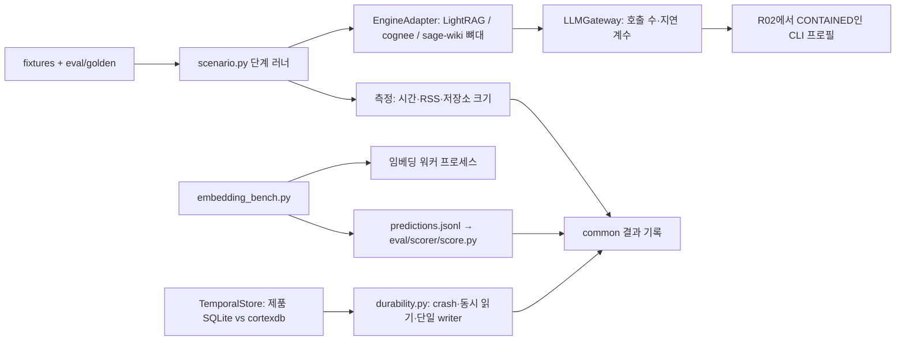

# 스펙: R03 엔진·임베딩·저장소 비교 키트 (사외 준비물)

- 날짜: 2026-11-21 / 상태: 초안
- 관련: 이슈 #12(R03), 총괄 #1, Phase 0 #2, 선행 #10·#11·#14, 결과 수령 #37(R07). 근거: [OSS 평가](../OSS_EVALUATION.md) 5절 판정·7절 "R03에서 실행으로 확인할 항목". 같은 묶음: [R02 스펙](2026-11-21-R02-cli-isolation.md), [R04 스펙](2026-11-21-R04-windows-installer.md)

## 배경

R01 조사는 후보 3개(LightRAG, cognee, sage-wiki)를 "보류"로 R03에 넘겼고, 저장 계층 후보 cortexdb를 제품이 소유하는 SQLite 스키마와 비교하라고 했다. 또한 "제품이 Knowledge/Evidence 정본을 SQLite에 두고 엔진은 다시 만들 수 있는 투영으로 쓴다"는 가설과 "엔진이 정본이다"를 같은 조건에서 시험해야 한다(OSS 평가 6절). 이 모든 실행은 배포처에서만 할 수 있다.

사외에서는 (1) 엔진에 공통으로 적용할 어댑터 규약·시나리오 러너·측정기, (2) 후보별 어댑터 뼈대(근거 링크가 있는 호출만 계획으로 적고 나머지는 `NotImplementedError`), (3) 임베딩 벤치 러너, (4) 내구성 점검 절차, (5) 한국어 절차서와 결과 양식을 만든다. 후보 엔진은 가져오거나 설치하거나 import하지 않았다.

## 목표

- 같은 합성 입력으로 후보별 import → 추출 → 관계 → 증분 수정 → 삭제 → 재시작을 돌리고, LLM 호출 수·벽시계 시간·최대 RSS·저장소 크기를 같은 모양으로 남기는 러너가 있다.
- 어댑터의 각 호출 계획에는 OSS 평가의 근거 링크가 붙어 있고, 근거가 없는 호출은 추측하지 않고 빈 뼈대로 남아 그 목록이 문서에 있다.
- 임베딩 두 모델(BAAI/bge-m3, intfloat/multilingual-e5-base)을 `eval/golden`으로 돌려 `eval/scorer/score.py`가 받을 predictions 파일을 만든다.
- cortexdb와 제품 소유 SQLite 스키마를 같은 시나리오(시간 유효성·span 근거·삭제 뒤 이력·export)로 비교한다. SQLite 쪽은 이 PR에서 완전히 구현되어 있고 cortexdb 쪽은 뼈대다.

## 비목표 (배포처에서 후속 진행)

- 후보 엔진의 설치·import·실행, 모델 내려받기, 실제 LLM 호출. 이 PR은 하지 않는다. (배포처에서 후속 진행)
- `eval/golden/`과 `eval/scorer/`는 R05 브랜치(`docs/r05-golden-dataset`)의 산출물이다. 이 PR은 만들지 않고 그 확정된 형식에 맞춘다.
- 엔진 선정 결정(R06), 사이드카 언어 결정. 이 키트는 결과 숫자만 낸다.
- 사내 데이터·사내 주소·사내 모델 서버 연동.

배포처 후속 항목(각 항목은 `verification/SITE_FOLLOWUPS.md`의 `## 배포처 설정 체크리스트`에 같은 ID로 있고, 해당 경로를 실행하면 `NotImplementedError`가 "미구현, 배포처 후속" 안내와 비0 종료로 바뀐다):

- R03-S1: LightRAG 어댑터의 상류 API 호출 확정
- R03-S2: cognee 어댑터의 상류 API 호출 확정과 로컬 OpenAI 호환 shim 구조화 출력 확인
- R03-S3: sage-wiki 어댑터의 실행 파일 호출 방식 확정
- R03-S4: cortexdb 저장 계층 어댑터의 호출 방식 확정
- R03-S5: 임베딩 워커 백엔드(라이브러리 호출) 확정

## 요구사항

- R03-R1 (어댑터 규약): `EngineAdapter` 규약은 `ingest`, `update`, `delete`, `query`, `export`, `restart`, `stats`를 가진다. 후보마다 어댑터 하나가 있고, 근거 링크가 있는 호출만 계획 주석에 적는다.
- R03-R2 (시나리오): 러너는 import → 추출 → 관계 → 증분 수정 → 삭제 → 재시작을 단계별로 실행하고 단계마다 LLM 호출 수, 벽시계 시간, 최대 RSS, 저장소 크기를 남긴다. 정답 판정은 엔진 표현에 묶이지 않는 "탐침 질의"(검색 결과의 source id가 기대 집합에 속하는가)로 한다.
- R03-R3 (LLM 게이트웨이): 엔진이 부르는 모든 LLM 호출은 게이트웨이를 지나며 호출 수·지연·프롬프트 길이를 센다. 본문은 남기지 않는다.
- R03-R4 (CLI 어댑터, C2): CLI 호출은 R02 결과에서 `CONTAINED`로 판정된 프로필만 쓴다. 없으면 BLOCKED로 멈춘다. API 키를 넣는 경로를 만들지 않는다. 로컬 OpenAI 호환 shim은 루프백에만 바인딩한다.
- R03-R5 (임베딩): 벤치 러너는 외부 워커 프로세스(JSON Lines 규약)를 통해 두 모델을 돌리고 속도·최대 RSS·차원·predictions 파일을 낸다. 모델 내려받기·오프라인 캐시·라이선스 기록 절차를 가진다.
- R03-R6 (저장소 비교, C4): `TemporalStore` 규약으로 제품 소유 SQLite 스키마(구현 완료)와 cortexdb(뼈대)를 같은 시험에 건다. 시험은 시간 유효성, span 근거, 문서 삭제 뒤 이력 행, export를 포함한다.
- R03-R7 (내구성, C4): crash(쓰는 도중 프로세스 트리 강제 종료 뒤 재시작·무결성), 동시 읽기, 단일 writer 점검을 대상(어댑터 또는 저장소)에 공통 절차로 건다.
- R03-R8 (결과): 결과는 R02와 같은 `result.json`/`result.md` 모양이며 마스킹·실패 시 쓰기 거부가 같다. 명령·환경·고정 버전·원 결과를 보존한다(C1).
- R03-R9 (고정 버전): 후보별 설치 단계에는 OSS 평가의 고정 SHA·버전과 "네트워크 설치 승인 필요" 표시가 있다. release와 HEAD가 다른 후보(LightRAG)는 무엇을 돌렸는지 결과에 쓴다.
- R03-R10 (평가 데이터 계약): `eval/golden`(sources `id`/`content`/`version`/`operation`, `labels/qa.jsonl`, `splits.json`의 `splits`)과 `eval/scorer/score.py`(predictions `{"kind":"retrieval","query_id","ranked"}`)의 확정된 형식을 따른다. 필드 이름은 `--field-map`으로 바꿀 수 있고 `inspect-golden`이 실제 필드를 보여 준다. 실제 커밋된 데이터셋과 채점기에 대한 계약 테스트가 있다(`test_r03_golden.py`).
- R03-R11 (표기·문서): 모든 스크립트 머리에 실행된 적 없음을 적는다. 한국어 절차서, 결과 양식, `verification/SITE_FOLLOWUPS.md` 항목을 둔다.

## 인터페이스 / 설계 개요

경계는 세 곳이다. 모두 "구현마다 같은 결과 모양을 돌려주는지"를 계약 테스트로 건다.

- **EngineAdapter**: 엔진별 어댑터와 시나리오 러너 사이. 가짜 어댑터(메모리 구현)로 러너를 시험한다.
- **TemporalStore**: 시간 그래프 저장 비교. 제품 소유 SQLite가 기준 구현이다.
- **LLMGateway / 임베딩 워커**: 호출 계수와 외부 프로세스 경계.

## 완료 기준 (테스트 가능한 형태)

### 이슈 #12의 기준 (원문 그대로)

- [ ] R03-C1: Import→추출→관계→증분 수정→삭제→재시작을 실행하고 명령·환경·고정 버전·raw 결과를 보존한다.
- [ ] R03-C2: 엔진이 요구하는 generate/embed/rerank/structured 호출을 CLI adapter로 충족하는지 검증한다. API 키를 몰래 추가하지 않는다.
- [ ] R03-C3: 한국어·영어·혼용 CPU embedding의 검색 품질/메모리/속도와 모델 다운로드·오프라인 캐시·모델 라이선스를 비교한다.
- [ ] R03-C4: SQLite·vector·graph 중 실제 필요한 저장소만 선정 후보로 남기고 crash/동시 읽기/단일 writer·엔진 추출 export 가능성을 검증한다. 시간 그래프 저장은 cortexdb와 제품 소유 SQLite schema를 비교한다.

| 기준 | 키트가 준비하는 것 | 요구사항 | 공백(배포처가 해야 하는 것) |
|---|---|---|---|
| R03-C1 | 시나리오 러너, 측정기, 가짜 어댑터 계약 시험, 후보별 설치 단계(고정 버전), 결과 양식 | R1, R2, R8, R9 | 세 엔진 모두: 어댑터의 상류 API 호출 구현(S1~S3)과 실행. 어느 하나도 이 PR에서 실행되지 않았다 |
| R03-C2 | LLM 게이트웨이, R02 통과 프로필만 쓰는 게이트, 루프백 shim 뼈대, 호출 종류별 계수 | R3, R4 | 엔진이 요구하는 호출 종류(구조화 출력 모드 등)는 상류 코드가 정하며 사외에서 확정할 수 없다(S2). 실제 CLI 호출 필요 |
| R03-C3 | 임베딩 벤치 러너(속도·RSS·predictions), 오프라인 점검·라이선스 기록 절차, 모델 데이터 파일 | R5, R10 | 워커의 라이브러리 호출(S5)과 모델 내려받기. 데이터셋·채점기 형식은 확정 형식으로 맞춰졌다 |
| R03-C4 | `TemporalStore` 규약, 제품 SQLite 구현(완료), cortexdb 뼈대, crash·동시 읽기·단일 writer 스크립트, export 점검 | R6, R7 | cortexdb 호출 확정(S4), 엔진 저장소 3종 사이의 일관성은 엔진 실행이 필요. "실제 필요한 저장소만 남기기"는 결과를 읽는 사람의 판단 |

### 사외 준비물 기준 (이 PR에서 검증)

- [ ] R03-K1 (R2): 가짜 어댑터로 시나리오 러너가 모든 단계를 지나고, 삭제 뒤 잔존 참조가 있는 가짜 어댑터에서는 삭제 단계가 실패한다 → `test_r03_scenario.py`.
- [ ] R03-K2 (R3, R4): 게이트웨이가 호출 수를 세고, R02 결과가 없거나 `CONTAINED`가 아닌 프로필은 거부한다 → `test_r03_gateway.py`.
- [ ] R03-K3 (R5): 가짜 해시 워커로 predictions 파일이 만들어지고 순위가 결정적이다 → `test_r03_embedding.py`. 같은 파일이 실제 `eval/scorer/score.py eval/golden <file> --split dev|eval`에서 종료 코드 0과 문서화된 JSON 모양으로 받아들여진다(점수는 단정하지 않음) → `test_r03_golden.py`.
- [ ] R03-K4 (R6): 제품 SQLite 저장소가 as-of 조회, span 근거, 문서 삭제 시 파생 사실 제거를 만족한다 → `test_r03_store.py`.
- [ ] R03-K5 (R7): 단일 writer 점검 논리와 무결성 점검이 SQLite 대상에서 통과한다 → `test_r03_durability.py`.
- [ ] R03-K6 (배포처 후속 개수·경로): 비목표의 5개 항목이 `verification/SITE_FOLLOWUPS.md`에 5개로 있고, 해당 5경로가 "미구현, 배포처 후속"과 비0으로 끝난다 → `test_site_followups.py`.

## 미해결 질문

- LightRAG는 release 1.5.7과 고정 HEAD(`01261ed135bf`, 1.5.8rc)가 다르다. 잠정으로 release를 1순위로 두고 HEAD를 2순위로 적었다. 바꾸는 법: `candidates.json`의 `primary`. (OSS 평가 8절이 명시적 선택을 요구한다)
- 임베딩 모델의 HF 커밋 SHA는 내려받는 시점에 기록한다(미고정).

## 변경 이력

| 날짜 | 변경 내용 | 대상 | 사유 |
|---|---|---|---|
| 2026-11-21 | 최초 작성 | 이 문서 | 이슈 #12 사외 준비물 spec 고정(이슈 #37 실행 분리 방침) |
| 2026-11-21 | 배포처 후속 체크리스트 위치를 `docs/site-setup.md`에서 `verification/SITE_FOLLOWUPS.md`로 변경 | 비목표, 요구사항, 완료 기준 | 다른 브랜치가 `docs/site-setup.md`를 소유해 병합 충돌을 피함(조정자 지시) |
| 2026-11-21 | 가정했던 평가 데이터 필드와 predictions 형식을 R05 브랜치의 확정 형식으로 교체, 채점기 계약 테스트 추가 | R03-R10, R03-K3, 미해결 질문 | 조정자 통합 지시 |
