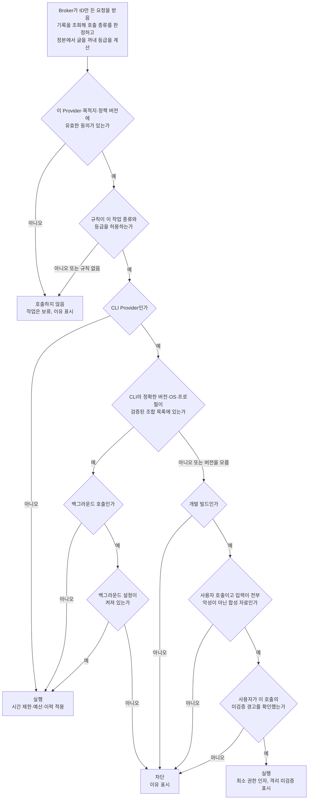
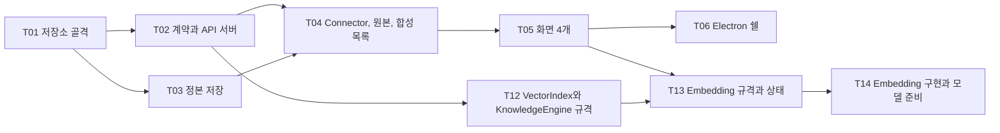
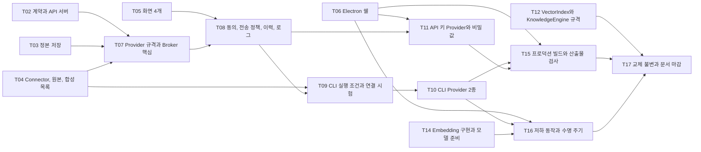

# 스펙: V01 공통 웹·API·Provider와 로컬 데이터 수직 골격

- 날짜: 2026-11-21 / 상태: 확정
- 관련: 이슈 #16(V01), 총괄 #1, Phase 1 #3, 선행 #15(R06), 확정 #37(R07). [ARCHITECTURE.md](../ARCHITECTURE.md), [adr/](../adr/README.md), [site-setup.md](../site-setup.md), 원 설계 [original-design.md](../design/original-design.md)

낯선 말은 [ARCHITECTURE 0절](../ARCHITECTURE.md#0-처음-나오는-말)에 풀이가 있다. `A01`~`A22`는 같은 문서 9절의 가정 번호, `S01`~`S15`는 site-setup.md의 체크리스트 번호다.

## 배경

제품 코드가 아직 없다. Phase 1은 수직 흐름 하나(합성 출처 → 추출 → Insight → 근거 화면)를 증명하는 단계이고, V01은 그 흐름이 올라설 **뼈대**를 만든다: 화면, 로컬 API, Electron 쉘, 정본 저장, Provider, Embedding, 그리고 뒤집힐 수 있는 선택을 가두는 어댑터 경계다.

엔진, CLI, Windows 설치 파일의 실행 검증은 배포처에서만 할 수 있다. 그래서 이 spec은 잠정 ADR 위에서 시작하고, 실행 근거가 없는 선택은 어댑터 뒤에 둔다(R06-C4). 어떤 완료 기준이 사외에서 충족되고 어떤 기준이 배포처 실행 전까지 미충족으로 남는지는 "완료 기준" 절에 따로 적었다.

## 목표

- 브라우저와 Electron에서 같은 화면이 같은 API 계약으로 백엔드의 실제 데이터를 보여 준다.
- 보안 기준선([ADR 0008](../adr/0008-security-baseline.md))이 첫 코드부터 적용되어 있고, 각 통제에 거부되는 경우의 테스트가 있다.
- CLI가 없거나 네트워크가 없거나 전송이 거부되거나 모델이 없어도 앱이 뜨고 저장된 자료를 찾아볼 수 있다.
- 배포 빌드는 격리가 검증된 CLI 조합만 실행하고, 그 판정에 쓰이는 값도 Provider에 나가는 글도 호출하는 쪽이 정할 수 없다. 이것을 **빌드한 산출물로** 확인한다.
- Provider와 Embedding의 구현을 test double로 바꿔도 API 응답과 화면이 바뀌지 않는다.

## 비목표 (배포처에서 후속 진행)

**공용 저장소의 뒤 작업으로 넘기는 것**

- JSONL 가져오기, 지식 추출, Insight, 근거 화면: V02(#17).
- 작업 실행기와 스케줄러: V02가 최소 실행기를 만들고 I03(#20)이 일반화한다. V01은 작업 **테이블**만 둔다(Broker가 호출 종류를 판정하는 데 필요하다).
- **파이프라인이 KnowledgeEngine과 VectorIndex를 부르는 자리, 그리고 그 둘의 교체 증명**: V02-C5. 이슈 #16의 V01-C7이 이 부분을 V02로 넘겼다.
- **벡터 색인의 실제 구현**(sqlite-vec 등 네이티브 모듈): 배포처 확인 뒤 R07에서 정한다([ADR 0004](../adr/0004-embedded-storage.md)).
- 정본 SQLite의 파일 단위 암호화, 백업: [ADR 0010](../adr/0010-encryption-at-rest.md), H01(#32).
- **설치 파일 만들기**(패키징 구성, NSIS): R04(#13)의 사외 준비물. V01은 그 입력인 프로덕션 빌드 산출물까지 만든다(T15).
- 트레이, OS 알림, 자동 시작, 자동 업데이트: H02(#33).
- outbox: 벡터에 실제 지식을 색인하는 작업([ADR 0013](../adr/0013-failure-recovery.md)).
- 실제 지식 엔진 연결과 사이드카: R07 뒤([ADR 0003](../adr/0003-phase1-without-engine.md), [0011](../adr/0011-sidecar-language.md)).
- 원본 파일과 첨부의 저장: I02(#19).

**배포처 후속 항목**(13개. 각각 [site-setup.md의 배포처 설정 체크리스트](../site-setup.md#배포처-설정-체크리스트)와 번호로 대응한다)

| 번호 | 항목 | 실행 경로 |
|---|---|---|
| S01 | 메일 수집기 구현 | `site-mail` |
| S02 | 메신저 수집기 구현 | `site-messenger` |
| S03 | Wiki 수집기 구현 | `site-wiki` |
| S04 | 수집기의 인증과 권한 매핑 | — (S01~S03의 구현 안) |
| S05 | LLM Provider 구성(엔드포인트, 모델, 키) | — (설정 값) |
| S06 | 구독 로그인 CLI 사용 허용 여부 확인 | — (확인 작업) |
| S07 | CLI 격리 검증과 검증된 조합 등록 | — (R02 실행) |
| S08 | 외부 전송 정책의 값 | — (설정 값) |
| S09 | Embedding 모델 반입 | — (설정 값) |
| S10 | Windows 11 설치본 검증 | — (R04 실행) |
| S11 | 저장 데이터 보호 확인 | — (확인 작업) |
| S12 | 서명, 배포 채널, 업데이트 | — (R04 실행) |
| S13 | 엔진과 저장소의 실행 비교 | — (R03 실행) |

"실행 경로"가 있는 세 항목은 공용 저장소에 미구현 표시용 구현이 있고, 실행하면 `미구현, 배포처 후속`을 알리고 실패한다(V01-R18).

## 요구사항

**뼈대**

- **V01-R1 저장소 골격.** "인터페이스 / 설계 개요"의 배치와 도구로 workspace를 만든다. 모듈 사이의 직접 import는 lint가 막아, 상위 코드가 어댑터 규격을 건너뛰고 구현을 직접 부를 수 없게 한다. `lint`, `typecheck`, `test`, `e2e` 명령이 저장소 루트에서 돈다.
- **V01-R2 Local API.** 백엔드는 127.0.0.1에만 바인딩한다. 실행마다 새로 만든 세션 토큰이 없는 요청, `Host`가 자기 주소가 아닌 요청을 거부한다. `Origin`이 있으면 허용 목록과 정확히 일치해야 한다. `Origin`이 없는 요청은 브라우저 밖 클라이언트로 보고 토큰과 `Host`로만 판정한다(다른 출처에서 `Origin` 없이 오는 브라우저 요청(no-cors GET·HEAD)은 `Authorization` 헤더를 실을 수 없다. 같은 출처의 GET·HEAD도 `Origin`을 빼지만 그 출처는 `127.0.0.1:포트` 자신뿐이다. 실제 통제는 토큰과 정확한 `Host`다). 요청과 응답의 모양은 `packages/contracts`의 스키마 하나로 정의하고 화면과 백엔드가 그것을 함께 쓴다.
- **V01-R3 화면.** Home, Sources, Activity, Settings의 최소 화면이 백엔드에서 받은 데이터를 보여 준다. 화면 코드에 고정된 가짜 데이터를 두지 않는다. 같은 빌드가 브라우저와 Electron에서 돌고, 두 환경의 차이는 "백엔드 주소와 토큰을 어디서 받는가"뿐이다.
- **V01-R4 Electron 쉘.** 쉘은 백엔드 프로세스를 시작·종료하고, 앱이 두 번 실행되면 하나만 남긴다. 세션 토큰과 비밀 값은 부모와 자식 프로세스 사이의 전용 통로로만 넘기고 명령줄 인자와 환경 변수에 싣지 않는다. contextIsolation 켬, sandbox 켬, nodeIntegration 끔, CSP 적용, 외부 URL 이동과 새 창 차단. preload는 "설계 개요"에 적은 함수**만** 노출하고 모든 IPC 입력을 스키마로 검증한다. 외부 링크는 `https` 주소만 받는다.
- **V01-R5 저하 동작.** CLI 없음, 네트워크 없음, 전송 거부, embedding 모델 없음, 벡터 색인 사용 불가의 각 상태에서 앱이 뜨고 저장된 원본의 목록과 키워드 검색이 동작하며, 무엇이 안 되는지 화면에 보인다. CLI가 없거나 로그인되어 있지 않으면 설치와 로그인 방법을 안내한다(원 설계 4절). 막힌 Provider 대신 다른 Provider를 몰래 쓰지 않는다.

**저장**

- **V01-R6 정본 저장.** 정본 SQLite에 스키마 v1(원본, 원본 version, **작업**, 설정, 동의, Provider 호출 이력)과 키워드 색인을 두고, 마이그레이션 실행기가 스키마 버전을 관리한다. 작업 테이블은 V01에서는 식별자, 종류, 대상 원본 version, 상태만 갖는 최소 형태이며 V02가 임대와 fence에 필요한 열을 더한다. 데이터 디렉터리는 OS 사용자별이고 다른 PC로 따라다니지 않는 위치여야 하며, 그 위치를 코드가 직접 정한다. 정본 접근은 SQL 드라이버 포트를 지난다([ADR 0004](../adr/0004-embedded-storage.md)).
- **V01-R7 Connector 규격, 원본 저장, 합성 목록.** `Connector` 규격과 계약 테스트, `fixtures/`의 합성 원본을 내는 테스트 Connector를 만든다. 원본의 정체는 `connector_instance_id + external_id`이고, 내용이 같으면(content hash) 새 version을 만들지 않으며, cursor는 저장한 뒤에 확정한다. 빌드할 때 저장소에 든 합성 자료마다 **제목과 본문을 함께 묶은 해시**를 계산해 **합성 목록**을 만들고, 악성 변형에는 표시를 단다. 연결 시험에 쓰는 고정 자료도 이 목록에 든 빌드 자원이다. Connector는 등급을 정하지 못한다.

**Provider와 전송**

- **V01-R8 Provider 규격과 Broker.** `LLMProvider` 규격([ARCHITECTURE 5.1절](../ARCHITECTURE.md))과 계약 테스트를 만든다. 모든 호출은 Broker를 지나고, Broker가 시간 제한, 재시도 간격, 요청 한도 응답 처리, 동시 실행 제한, 호출 예산, 오류 복구, 이력 기록을 맡는다. Provider에 가는 요청에는 request ID, 작업 종류, 데이터 등급, 전송 결정, 스키마 버전, 재시도 가능 여부가 실린다. 이력에는 본문과 비밀 값이 없다. 그리고:
  - **부르는 쪽은 ID만 넘긴다.** 상위 코드가 Broker에 넘기는 것은 작업 종류, 원본 version ID, 후보 항목 ID, 기록 ID, 예산뿐이다. 그 밖의 필드(글, 지시, 등급, 호출 종류)가 든 요청은 거부한다.
  - **나가는 글은 Broker가 만든다.** Broker가 그 ID로 정본에서 제목과 본문을 직접 꺼내 문서 구획에 넣는다. 지시문은 작업 종류와 스키마 버전으로 고르는 코드 상수다. 원본의 다른 필드는 보내지 않는다.
  - **등급은 Broker가 계산한다.** 꺼낸 원본들과, 후보 항목의 근거가 된 원본들 가운데 가장 엄격한 값이다. `extract`에 원본 ID가 하나도 없으면 거부한다. `connection-test`는 ID 없이 고정 빌드 자원만 쓴다.
  - **호출 종류는 Broker가 기록을 조회해 판정한다.** 작업 기록이면 백그라운드다. 사용자 동작 기록이면 사용자 호출인데, 그 기록은 **API 계층만** 만들 수 있고, 처리 중인 요청 하나에 묶이며, 한 번 쓰면 끝이고, 요청이 끝나면 사라진다(메모리에만 있고 저장하지 않는다). 없는 기록, 이미 쓴 기록, 요청이 끝난 기록은 거부한다.
- **V01-R9 CLI Provider.** `ClaudeCodeProvider`와 `CodexProvider`가 규격의 일곱 동작(detect, checkAuthentication, checkHealth, generate, generateStructured, cancel, getCapabilities)을 구현한다. 실행은 셸 없이 인자 배열로, 입력은 stdin으로, 작업마다 만든 빈 임시 디렉터리에서, 최소 환경 변수로, 세션을 디스크에 남기지 않는 옵션을 주고, 바깥에서 시간 제한을 걸어 프로세스 트리를 끝낸다. 인자 프로필은 코드의 상수다. 판정 없이 실행하는 것은 버전 조회와 로그인 상태 조회의 고정 인자뿐이며 입력도 문서 내용도 주지 않는다. 로그인 상태를 알려 주는 명령이 없는 CLI는 "알 수 없음"을 돌려준다. 제품은 CLI의 로그인 파일을 읽지 않는다. 두 CLI가 모두 탐색되면 사용자가 기본값을 고른다.
- **V01-R10 CLI 실행 조건.** [ARCHITECTURE 3.1절](../ARCHITECTURE.md)의 표대로 판정한다.
  - **빌드 종류**는 번들러가 빌드할 때 코드에 박는 값 **하나**에서만 읽고, 그 값을 읽는 자리는 한 모듈뿐이다. 판정 코드와 Broker는 환경 변수와 "설치본인가"를 묻는 실행 환경 기능을 읽지 않는다. 이 둘을 lint 규칙으로 막는다. 값이 없거나 모르는 값이면 배포 빌드로 본다. 개발용 예외의 코드는 배포 빌드 산출물에 들어 있지 않다.
  - **테스트 빌드**는 테스트가 구성할 때 "배포 빌드처럼" 또는 "개발 빌드처럼" 판정하도록 고른다. 고르지 않으면 배포 빌드처럼 판정한다. 이 선택 기능은 테스트 빌드에만 들어 있고 개발 빌드와 배포 빌드의 산출물에는 없다.
  - **검증된 조합 목록**은 읽기 전용 빌드 자원이다. 항목은 CLI 이름, 정확한 버전 하나, OS, 인자 프로필 이름, 검증 날짜다. 사용자 데이터 폴더의 설정, 환경 변수, 설정 API로는 항목을 더할 수 없다. 공용 저장소의 목록은 비어 있다. 버전을 읽지 못하거나 해석하지 못하면 "목록에 없다"로 처리한다.
  - **배포 빌드**: 목록에 없으면 사용자 호출과 백그라운드 호출을 모두 차단한다. 목록에 있으면 사용자 호출은 실행하고, 백그라운드 호출은 백그라운드 설정이 켜져 있을 때만 실행한다. 그 설정의 기본값은 끔이다.
  - **개발 빌드**: 목록에 없는 조합은 다음을 모두 만족할 때만 실행한다 — 사용자 호출이다, 입력이 전부 합성 등급이고 악성 변형이 아니다, 고정된 최소 권한 인자 프로필을 쓴다, "격리 미검증"을 표시한다, 그 호출 한 번에 대해 사용자가 확인했다(확인은 저장하지 않는다).
  - test double은 테스트 빌드에만 있고, 가짜 CLI도 같은 판정을 지난다.
- **V01-R11 API 키 Provider.** `OpenAICompatibleProvider`가 같은 규격을 구현한다. 이것은 선택 항목이 아니라 **필수 경로**다. 주소와 모델은 설정이고 주소는 `https`여야 한다(loopback의 `http`는 개발·테스트 빌드에서만). 키는 OS 자격 증명 저장소에서만 읽는다. `LocalModelProvider`는 규격만 따르고 모든 호출에 "미구현"을 돌려준다.
- **V01-R12 동의와 전송 정책.** [ADR 0014](../adr/0014-egress-policy-and-consent.md)대로 Broker가 호출 직전마다 판정한다. 동의는 Provider, 목적지, 정책 버전에 묶이고 그중 하나가 바뀌면 무효다. 정책 버전은 지금 적용되는 규칙 전체에서 계산한 값이다. 사용자는 동의할 때 허용할 등급을 고른다. 거부가 우선이고 맞는 규칙이 없으면 거부다. 화면과 이력은 CLI 호출을 "외부 전송"으로 표시한다.
- **V01-R13 비밀 값과 로그.** 비밀 값은 OS 자격 증명 저장소에만 둔다. 그 방식을 조사해 [ADR 0010](../adr/0010-encryption-at-rest.md)에 적는 것이 T11의 첫 산출물이다. 저장소를 쓸 수 없으면 평문으로 넘어가지 않고 그 Provider를 "사용 불가"로 표시한다. 로그와 이력은 원문, 프롬프트, 응답 본문, 비밀 값, 토큰을 담지 않는다. 호출이 실패해 CLI나 HTTP 서버가 입력을 섞은 오류를 돌려줘도 마찬가지다. 설정 화면은 정본 SQLite의 암호화 상태를 있는 그대로 보인다.

**Embedding, 벡터, 엔진**

- **V01-R14 Embedding.** `EmbeddingProvider` 규격(`egress` 표시 포함)과 계약 테스트, Transformers.js 구현을 만든다. 모델은 로컬 팩 가져오기 또는 사용자가 승인한 내려받기로 준비하며 어느 쪽도 자동으로 시작하지 않는다. 쓰는 모델의 revision과 파일별 해시를 빌드 자원에 고정하고, 해시가 모두 맞을 때만 "준비됨"이 된다. 준비된 뒤에는 네트워크 없이 동작한다([ADR 0006](../adr/0006-embedding.md)).
- **V01-R15 VectorIndex.** `VectorIndex` 규격과 계약 테스트, 테스트용 메모리 구현(fake)을 만든다. 제품의 기본 구성은 모든 호출에 "사용 불가"를 돌려주는 빈 구현에 묶이고, 상태 API가 그 상태를 읽어 보인다. **네이티브 벡터 모듈은 넣지 않는다.**
- **V01-R16 KnowledgeEngine.** `KnowledgeEngine` 규격과 계약 테스트, null 구현, 테스트용 메모리 구현을 만든다. 계약 테스트는 메모리 구현에 대해 삭제, 낡은 fence 거부, 재구축 결과 동일성을 확인한다.
- **V01-R17 구현 교체 불변.** Provider와 Embedding을 test double로 바꾼 구성에서도 API 응답이 같은 스키마를 지키고 같은 화면 테스트가 통과하며, 그 대역이 실제로 호출된다. 두 규격 모두 V01에 부르는 자리가 있다(연결 시험, embedding 준비와 상태).

**배포처 경계, 빌드, 문서**

- **V01-R18 미구현 표시.** `site-mail`, `site-messenger`, `site-wiki`를 Connector 종류로 등록하되 초기화하면 `미구현, 배포처 후속`이라는 오류로 실패한다. Sources 화면은 이들을 "미구현(배포처 후속)"으로 보인다. `site-check` 명령은 지정한 종류를 초기화해 보고, 실패하면 그 알림을 출력하고 0이 아닌 값으로 끝난다.
- **V01-R19 문서.** [site-setup.md](../site-setup.md)의 설정 키 이름을 구현한 이름으로 고친다(제목 `## 배포처 설정 체크리스트`는 그대로 둔다). 이 spec의 배포처 후속 항목과 그 체크리스트가 번호로 대응하는지 확인하는 문서 대응 테스트를 둔다. 설정 키의 설명은 site-setup.md에 두고, README에는 실행 명령 한 줄씩과 문서 링크만 둔다.
- **V01-R20 프로덕션 빌드 산출물.** 백엔드, 화면, 쉘을 배포 빌드로 묶는 빌드 대상을 만든다(설치 파일은 만들지 않는다). 산출물에는 test double, 개발용 예외 코드, 테스트 빌드의 판정 선택 기능이 들어 있지 않다. R04(#13)는 이 산출물을 받아 설치 파일을 만든다.
- **V01-R21 연결 시험.** 설정 화면에서 Provider를 골라 "연결 시험"을 누르면, API 계층이 사용자 동작 기록을 만들고 Broker에 `connection-test`를 요청한다. Broker는 빌드 자원인 고정된 무해한 합성 자료 하나로 구조화 출력을 한 번 요청하고, 화면은 결과(성공, 차단 사유, 오류)를 보인다. 이것이 Phase 1의 유일한 사용자 호출이며 다른 호출과 똑같이 Broker의 판정을 지난다.

## 인터페이스 / 설계 개요

구성요소와 다섯 어댑터 규격의 스케치는 [ARCHITECTURE 2절·5절](../ARCHITECTURE.md)에 있다. 여기에는 V01이 새로 정하는 경계만 적는다.

### Broker의 호출 허용 판단

V01-R8, R10, R12를 합친 것이다. Provider를 부를 수 있는 길은 이 그림의 "실행" 둘뿐이고, 그림의 모든 질문은 Broker가 스스로 조회하고 계산한 값으로 답한다.

요청에 ID 말고 다른 것이 들어 있거나, 기록이 없거나 이미 쓰였으면 이 그림에 들어오기 전에 거부된다.

### API와 preload (잠정. T02와 T06에서 확정)

| 경계 | 내용 |
|---|---|
| HTTP API | 상태 조회(백엔드, Provider, embedding, 벡터 색인), 원본 목록과 키워드 검색, 활동(Provider 호출 이력), 설정 읽기·쓰기(기본 Provider, 동의, 백그라운드 설정), Connector 목록과 동기화 실행, embedding 준비 시작, **Provider 연결 시험** |
| 설정 API로 바꿀 수 **없는** 것 | 빌드 종류, 검증된 조합 목록, 인자 프로필, 합성 목록, 지시문, 모델의 고정 revision과 해시 |
| preload가 화면에 주는 함수(이것이 전부다) | 세션 받기(백엔드 주소와 토큰), 비밀 값 저장·존재 확인·삭제(값을 다시 읽어 주는 함수는 없다), 외부 링크 열기(`https`만, 사용자 확인 뒤 OS 브라우저) |
| 로컬 API 접속 조건(T02가 정함) | CORS는 없다. 브라우저 개발 환경은 같은 출처의 Vite 프록시(`changeOrigin: true`)로 부르고 개발 화면의 출처를 백엔드 `--origin`에 넘긴다(T05). Electron 화면은 `file://`로 띄우지 않는다(`Origin: null`은 거부된다). 허용 목록에 넣은 출처로 내준다(T06). T05는 개발 진입점이 stdout에 내는 토큰 줄을 코드로 읽고 어디에도 기록하지 않는다. 개발 진입점(`backend/src/dev.ts`)과 `packages/testkit`은 R20 산출물에 넣지 않는다 |
| 쉘 ↔ 백엔드 | 부모와 자식 프로세스 사이의 전용 통로. 쉘이 세션 토큰과 포트를 넘기고, 백엔드는 호출 직전에 비밀 값을 요청한다 |

### 저장소 배치와 도구 (잠정)

배치는 [ARCHITECTURE 2절](../ARCHITECTURE.md)의 표를 따른다. 아래 도구 가운데 [OSS_EVALUATION](../OSS_EVALUATION.md)이 평가한 것은 절 번호를 적었다. 나머지는 개발 도구이며 **평가 범위 밖**이므로 T01과 T02에서 라이선스를 확인해 PR에 적는다([ADR 0009](../adr/0009-license.md)).

| 항목 | 잠정 선택 | 한 줄 이유 |
|---|---|---|
| 런타임 | Node.js 24 계열로 고정 | Electron 45가 Node 24를 담고 있어(4.1절) 개발과 설치본의 런타임을 맞춘다 |
| 패키지 관리 | pnpm workspace(평가 범위 밖) | 패키지마다 선언한 의존성만 보이게 해 모듈 경계를 지키기 쉽다 |
| 언어 설정 | TypeScript strict | 어댑터 규격을 타입으로 강제한다 |
| 단위·계약·통합 테스트 | Vitest(평가 범위 밖) | 화면이 쓰는 Vite와 설정을 공유한다 |
| 화면 자동 테스트 | Playwright(4.2절) | 브라우저와 Electron을 같은 테스트로 돌린다. Electron 지원은 실험적 |
| lint·서식 | ESLint와 Prettier(평가 범위 밖) | 모듈 간 import 금지 규칙과 판정 코드의 금지 입력 규칙을 lint로 건다 |
| HTTP 서버 | Node 표준 `node:http`(T02 확정, 의존성 없음) | 기준: 허용 라이선스, 네이티브 모듈 없음, 유지보수 활발. 경로가 적고 검사 세 가지를 직접 거는 편이 프레임워크의 기본 동작(경로 해석, 플러그인 순서)을 따로 확인하는 것보다 작다 |
| 스키마 검증 | Zod 4(T02 확정, MIT, 네이티브 모듈과 런타임 의존성 없음) | 기준: 같은 정의에서 TypeScript 타입과 JSON Schema를 둘 다 얻을 수 있을 것(CLI의 구조화 출력 옵션에 JSON Schema를 넘겨야 한다). `z.infer`로 타입을, 내장 `z.toJSONSchema`로 JSON Schema를 얻는다 |
| 화면 구성요소 | React, Vite, shadcn/ui(4.2절) | 원 설계 지정 |
| 정본 저장 | better-sqlite3(4.3절) | [ADR 0004](../adr/0004-embedded-storage.md). V01의 네이티브 저장 모듈은 이것 하나다 |
| Embedding | Transformers.js, bge-m3(4.5절) | [ADR 0006](../adr/0006-embedding.md) |

### 작업 분해

한 작업이 PR 하나다. 모든 PR은 실행한 명령과 실제 출력, 충족한 기준과 이유, 미검증 범위를 적는다. 작업이 17개라 그림을 둘로 나눴다. 두 그림에 함께 나오는 작업은 같은 작업이다. **V01의 기준은 V01의 작업만으로 끝난다.**

뼈대, 저장, embedding 쪽:

Provider 쪽과 마감:

| ID | 산출물 | 요구사항 | 기준 | depends_on | 검증 증거 |
|---|---|---|---|---|---|
| V01-T01 | workspace, lint·typecheck·test 명령, 모듈 경계 lint 규칙(패키지 경계: 다른 패키지는 공개 진입점과 선언한 의존성으로만 import), 문서 대응 테스트 | R1, R19(테스트) | C7(`module-boundary`의 패키지 경계 몫), H1 | — | 세 명령의 출력. 경계를 어긴 import를 넣으면 lint가 실패하는 것 |
| V01-T02 | `packages/contracts`, API 서버 골격, 토큰·Host·Origin 검사, 상태 API | R2 | C2(API), C1(계약) | T01 | API 보안 통합 테스트(거부 4종), API 계약 테스트 |
| V01-T03 | SQL 드라이버 포트와 계약 테스트, 마이그레이션 실행기, 스키마 v1(작업 테이블 포함), 키워드 색인, 데이터 디렉터리 위치 | R6 | C7(저장소), C3(검색) | T01 | 드라이버 계약 테스트, 마이그레이션 테스트, 전문 검색 기능이 드라이버에 들어 있는지의 테스트(A17), 데이터 디렉터리 위치의 근거 기록 |
| V01-T04 | Connector 규격과 계약 테스트, 테스트 Connector, 원본 저장, cursor 저장(이 작업의 마이그레이션), 빌드 때 만드는 합성 목록(제목과 본문의 해시), 미구현 표시 3종, `site-check` | R7, R18(등록) | C3(자료), H2 | T02, T03 | Connector 계약 테스트, 재실행 시 원본이 늘지 않는 통합 테스트, 합성 목록 테스트, `site-check` 3건 |
| V01-T05 | 화면 4개, API 클라이언트, 세션 받기(개발 환경), 미구현 수집기 표시, 브라우저 E2E | R3, R18(표시) | C1 | T04 | 브라우저 E2E. 백엔드의 씨앗 데이터를 바꾸면 화면 값이 바뀌는 것 |
| V01-T06 | Electron 쉘(백엔드 수명 주기, 단일 실행, 전용 통로, preload, IPC 검증, CSP, 이동 차단, 외부 링크 규칙), Electron E2E | R4 | C1, C2(쉘) | T05 | 같은 화면 테스트의 Electron 실행, 쉘 보안 E2E, preload 노출 목록 테스트 |
| V01-T07 | Provider 규격과 계약 테스트, 가짜 Provider(테스트 빌드 전용), Broker 핵심: ID만 받는 요청, 정본에서 글 꺼내기, 코드 상수 지시문, 등급 계산(원본의 access_scope 열 추가 포함), 기록 조회로 호출 종류 판정, 사용자 동작 기록(API 계층 전용, 일회용), 시간 제한·재시도·요청 한도·동시 실행·예산·오류 복구, module-boundary 확장: 상위 모듈(backend, knowledge-engine 등)이 같은 패키지 안의 어댑터 구현 모듈을 직접 import하면 lint 실패, 구성 지점(composition root)만 예외 | R8, R1 | C4(Broker), C7(`module-boundary`의 구현 경계 몫) | T02, T03, T04 | Broker 단위 테스트, 글과 등급과 호출 종류를 부르는 쪽이 정할 수 없다는 테스트 묶음, 구성 지점 밖에서 어댑터 구현을 import하면 lint가 실패하는 테스트 |
| V01-T08 | 동의(Provider·목적지·정책 버전), 규칙에서 계산하는 정책 버전, 전송 규칙, 이력, 로그 걸러 내기, 동의 화면과 활동 화면 연결, 암호화 상태 표시 | R12, R13(로그·표시) | C5(전송·로그·표시) | T05, T07 | 규칙 허용·거부 표 테스트, 동의 무효화 테스트, 실패 경로 카나리 테스트, 표시 E2E |
| V01-T09 | 빌드 종류 값과 그것을 읽는 한 모듈, 판정 코드의 금지 입력 lint 규칙, 테스트 빌드의 판정 선택, 검증된 조합 목록 자원, 실행 조건 판정, 연결 시험 API와 화면, 미검증 확인 화면, 백그라운드 설정(기본 끔) | R10, R21 | C4(실행 조건), C7(기본 OFF) | T04, T08 | 실행 조건 통합 테스트(테스트 빌드에서 CLI 전송 방식의 대역으로 경우 전부. 백그라운드 경우는 작업 테이블에 넣은 기록으로), 목록에 항목을 더할 수 없다는 테스트, lint 규칙 테스트 |
| V01-T10 | CLI Provider 2종, 가짜 CLI 실행 파일, 고정 인자 프로필, 판정 없는 조회 두 가지, 프로세스 트리 종료, 설치·로그인 안내, 기본 Provider 선택 | R9, R5(안내) | C4(CLI) | T09 | 가짜 CLI에 대한 계약 테스트, 인자 배열 테스트, 자식 프로세스까지 끝나는 테스트 |
| V01-T11 | 자격 증명 저장 방식의 조사 기록(ADR 0010 갱신), 비밀 값 저장소(쉘 중개, 개발용 환경 변수), OpenAI 호환 Provider, 미구현 로컬 모델 Provider | R11, R13(비밀) | C4(API 키 경로), C5(자격 증명) | T06, T08 | 조사 기록, 로컬 가짜 HTTP 서버에 대한 계약 테스트, 비밀 값이 어디에도 남지 않는 테스트, `https` 강제 테스트 |
| V01-T12 | VectorIndex와 KnowledgeEngine의 규격, 계약 테스트, 메모리 구현, 빈 구현과 null 구현 | R15, R16 | C7(저장소·엔진의 규격과 계약 테스트) | T02 | 메모리 구현에 대한 계약 테스트, 기본 구성의 상태가 "사용 불가"인 테스트 |
| V01-T13 | Embedding 규격(`egress` 포함)과 계약 테스트, 가짜 embedder, 상태 API와 화면 표시 | R14(규격) | C6(계약, 상태) | T05, T12 | 가짜 embedder 계약 테스트, 모델 없음 통합 테스트 |
| V01-T14 | Transformers.js 구현, 고정 revision과 해시, 로컬 팩 가져오기, 승인한 내려받기, embedding → 메모리 색인 → 검색 왕복 | R14(구현) | C6(왕복) | T13 | 해시가 틀린 파일을 거부하는 테스트, 실제 모델 왕복 1회의 기록 |
| V01-T15 | 백엔드·화면·쉘의 프로덕션 빌드 대상, 산출물 검사 | R20, R10(산출물) | C4(배포 빌드의 차단) | T06, T10, T11 | **빌드한 산출물**을 개발처럼 보이는 환경과 설정으로 띄워도 차단되는 통합 테스트, 산출물에 대역·예외 코드·판정 선택 기능이 없다는 검사 |
| V01-T16 | 저하 동작 통합(다섯 상태), 시작·종료·단일 실행 통합 | R5 | C3, C6(모델 없음) | T06, T10, T14 | 저하 통합 테스트와 E2E, 수명 주기 E2E |
| V01-T17 | Provider·Embedding 교체 불변 테스트, site-setup 키 이름 확정, README 명령 | R17, R19 | C7(교체), H1 | T12, T15, T16 | 교체 구성에서의 API 계약 테스트와 화면 E2E |

T07이 확장한 module-boundary 규칙은 T07보다 먼저 들어온 것(T03, T04, T12, T13, T14)을 포함한 모든 어댑터 구현에 적용되고, 공개 진입점으로 다시 내보낸 구현도 대상이다. T07은 그때까지 생긴 위반을 함께 고친다.

V02의 작업은 V01-T01·T03·T04·T05·T06·T08·T12·T15에 의존한다. R04(#13)의 패키징 준비는 V01-T15에 의존한다.

## 완료 기준 (테스트 가능한 형태)

C1~C7은 이슈 #16의 문장 그대로다(2026-11-21 개정된 C4와 C7 포함). H1·H2는 이 프로젝트가 배포처로 넘어가는 프로젝트라서 spec 양식이 요구하는 두 기준이며, 이슈의 문장이 아닌 별도 항목으로 이 spec에만 둔다.

- [ ] **V01-C1** (R2, R3, R4): Home/Sources/Activity/Settings 최소 화면이 backend 데이터를 표시하고 브라우저와 Electron이 같은 API 계약을 사용한다.
- [ ] **V01-C2** (R2, R4): loopback 바인딩, 세션 token·Origin/Host 검사, renderer sandbox/contextIsolation/nodeIntegration 비활성화/CSP/외부 URL navigation 제한/검증 IPC로 unauthorized 요청을 거부한다.
- [ ] **V01-C3** (R4, R5, R6, R7): CLI 없음·오프라인·전송 거부 상태에서도 앱/기존 자료 탐색이 동작한다. 시작·종료·single instance를 통합 검증한다.
- [ ] **V01-C4** (R8, R9, R10, R11, R20, R21): ClaudeCodeProvider/CodexProvider의 detect/auth/health/generate/generateStructured/cancel/capabilities를 구현한다. 두 CLI가 모두 있으면 사용자가 기본 Provider를 고른다. timeout/backoff/rate limit/동시 실행·호출 예산·오류 복구·민감값 없는 이력은 공통 broker에서 적용한다. API key 기반 OpenAI-compatible Provider를 구현한다(구독 로그인 재사용의 약관이 불리하게 확정돼도 제품이 동작하도록 하는 필수 경로). local-model 계약은 분리하고 미구현 상태를 명시한다. 요청에는 request ID·task kind·data classification·egress policy·schema version·retryability를 싣는다. 배포 빌드는 R02(#11)에서 격리를 검증한 설정·버전으로만 CLI를 실행하고 그 외에는 사용자 호출과 자동 실행을 모두 차단한다. 개발 모드에서는 합성 데이터에 한해 최소 권한 인자와 '격리 미검증' 표시, 명시적 확인을 거쳐 호출할 수 있다.
- [ ] **V01-C5** (R6, R12, R13): R06에서 정한 로컬 데이터 암호화·OS credential store·전송 범위 승인·로그 redaction을 첫 영속 데이터 경로에 적용하고 허용/거부 테스트를 통과한다. CLI Provider 호출은 UI와 이력에서 외부 전송으로 표시하고 로컬 추론이라고 부르지 않는다.
- [ ] **V01-C6** (R5, R14, R15): R06에서 정한 embedding 실행 경로(모델 자산 포함 또는 최초 다운로드·오프라인 캐시)를 CLI Provider와 분리된 계약으로 연결하고 합성 입력의 embed round trip을 실행한다. 모델이 없거나 받을 수 없을 때는 그 상태를 표시하고 V01-C3의 기존 자료 탐색을 유지한다.
- [ ] **V01-C7** (R1, R6, R8, R10, R14, R15, R16, R17): 엔진·Provider·저장소·embedding을 어댑터 경계 뒤에 두고 계약 테스트를 둔다. Provider와 embedding은 구현을 바꿔도 상위 API와 UI가 바뀌지 않음을 테스트 double 교체로 보인다. 엔진·VectorIndex의 교체 증명은 이들을 호출하는 파이프라인이 생기는 V02-C5에서 한다. CLI Provider의 백그라운드 자동 실행은 기본 OFF이며 실행 조건은 V01-C4를 따른다.
- [ ] **V01-H1** (R19): 이 spec의 "배포처 후속 항목" 13개 각각에 대해 site-setup.md의 `## 배포처 설정 체크리스트` 아래에 같은 번호의 항목이 있으면 통과하고, 하나라도 없거나 수가 다르면 문서 대응 테스트가 실패한다.
- [ ] **V01-H2** (R18): `site-check`를 `site-mail`, `site-messenger`, `site-wiki` 각각에 실행하면 `미구현, 배포처 후속` 알림을 출력하고 0이 아닌 값으로 끝난다(경로마다 1건, 모두 3건).

**기준을 읽는 법**

- **C4의 "개발 모드"**는 이 spec의 개발 빌드다. "명시적 확인"은 호출 한 번마다 받고 저장하지 않는다. Phase 1에서 그 예외로 나가는 호출은 연결 시험 하나다. C4의 "요청에는 … 싣는다"는 Broker가 Provider에 보내는 요청을 뜻한다. 상위 코드가 Broker에 보내는 요청에는 등급과 전송 결정이 없다(Broker가 채운다).
- **C5의 "R06에서 정한 로컬 데이터 암호화"**는 [ADR 0010](../adr/0010-encryption-at-rest.md)의 표를 뜻한다. Phase 1에서 그것은 "비밀 값은 OS 자격 증명 저장소에만 있고, 정본 SQLite는 암호화되어 있지 않으며 그 사실이 화면에 표시된다"이다. **정본 파일의 암호화는 Phase 1에 없고 원 설계 17절보다 약하다.** ADR 0010은 사용자 확인 대기다.
- **C6의 "round trip"**은 합성 문장을 embedding하고, 그 벡터를 `VectorIndex`의 메모리 구현에 넣었다가 검색해 같은 항목을 돌려받는 것이다. 이것은 테스트가 메모리 구현을 직접 부르는 것이며, 제품 코드가 벡터를 쓰고 찾는 경로는 Phase 1에 없다.
- **C7의 "저장소"**는 `VectorIndex`와 좁은 SQL 드라이버 포트를 뜻한다. V01이 이 둘에 대해 하는 것은 규격과 계약 테스트까지다. 정본 SQLite 자체를 가짜로 바꿔 보이지는 않는다. 정본의 동작이 곧 제품의 동작이기 때문이다.
- **C7은 V01의 작업만으로 충족된다.** 교체 증명의 대상은 Provider와 Embedding이다. 엔진과 VectorIndex의 교체 증명은 V02-C5로 넘어갔으므로 V01은 V02의 어떤 작업도 기다리지 않는다.

### 기준별 증명 테스트

테스트 수준: **단위**(한 모듈), **계약**(어댑터의 모든 구현에 같은 묶음), **통합**(백엔드를 실제로 띄우고 SQLite 파일을 씀), **산출물**(프로덕션 빌드의 결과물을 띄우거나 검사), **Playwright E2E**(브라우저 또는 Electron에서 화면까지).

| 기준 | 테스트 | 수준 | 확인하는 것 |
|---|---|---|---|
| C1 | `api.contract` | 계약 | 모든 API 응답이 `packages/contracts` 스키마를 통과 |
| C1 | `screens.e2e`(브라우저) | Playwright E2E | 네 화면이 백엔드 씨앗 데이터를 표시. 씨앗을 바꾸면 표시가 바뀜 |
| C1 | `screens.e2e`(Electron) | Playwright E2E | **같은 테스트 파일**이 Electron에서 통과 |
| C2 | `api.security` | 통합 | 토큰 없음, 틀린 토큰, 다른 `Host`, 허용되지 않은 `Origin`이 각각 거부. `Origin`이 없고 토큰과 `Host`가 맞으면 통과. loopback이 아닌 주소로는 연결 불가 |
| C2 | `shell.security.e2e` | Playwright E2E(Electron) | 화면에서 Node 기능에 접근 불가, 인라인·원격 스크립트가 CSP에 막힘, 외부 URL 이동 차단, 새 창 차단, 스키마에 안 맞는 IPC 거부, `https`가 아닌 외부 링크 거부 |
| C2 | `preload.surface` | Playwright E2E(Electron) | 화면에 노출된 함수의 목록이 spec의 목록과 정확히 같음 |
| C2 | `shell.channel` | 통합 | 백엔드 프로세스의 명령줄 인자와 환경 변수에 토큰과 비밀 값이 없음 |
| C3 | `degraded` | 통합 | CLI 없음, 네트워크 없음, 전송 거부의 각 상태에서 원본 목록과 키워드 검색이 결과를 돌려줌. Provider 호출이 0건 |
| C3 | `degraded.e2e` | Playwright E2E | 같은 상태에서 화면이 뜨고 무엇이 안 되는지와 설치·로그인 안내를 표시 |
| C3 | `lifecycle.e2e` | Playwright E2E(Electron) | 시작하면 백엔드가 응답, 종료하면 백엔드 프로세스가 없음, 두 번째 실행은 스스로 끝남 |
| C4 | `provider.contract` | 계약 | 가짜 Provider, 가짜 CLI를 쓴 CLI Provider 2종, 가짜 HTTP 서버를 쓴 OpenAI 호환 Provider가 같은 묶음을 통과. 로컬 모델 Provider는 "미구현" |
| C4 | `broker` | 단위 | 시간 초과, 재시도 간격, 요청 한도 응답, 동시 실행 상한, 예산 소진, 오류 복구, Provider에 간 요청의 필드 6종 |
| C4 | `broker.payload` | 통합 | ① 합성 원본의 ID를 대면서 다른 글을 함께 실은 요청 → 거부(요청에 글 필드가 있다) ② Provider가 받은 문서가 정본에 저장된 그 원본의 제목과 본문과 글자 하나 다르지 않음 ③ 지시문이 코드 상수와 같고 요청으로 바꿀 수 없음 ④ 원본 ID가 없는 `extract` → 거부 ⑤ 원본의 작성자와 메타데이터가 Provider가 받은 요청에 없음 |
| C4 | `broker.class` | 통합 | 요청에 등급을 적어 보내면 거부. 합성 판정의 거부 5종: 레코드가 스스로 합성이라고 주장, `fixtures/` 아래에 있으나 목록에 없는 파일, 본문은 목록에 있으나 제목이 다른 원본, 합성과 일반이 섞인 입력, `site-*` Connector가 낸 원본. 후보 항목의 근거가 일반 등급 원본이면 문서가 합성이어도 등급은 일반 |
| C4 | `broker.origin` | 통합 | 작업 기록에서 나온 호출은 백그라운드. 요청에 호출 종류를 적어 보내면 거부. 작업 실행기 쪽 코드가 만든 사용자 동작 기록 → 거부. 한 번 쓴 기록을 다시 씀 → 거부. 요청이 끝난 뒤의 기록 → 거부. 없는 기록 ID → 거부 |
| C4 | `cli-argv` | 단위 | 인자 배열이 코드의 고정 프로필과 일치하고 세션을 남기지 않는 옵션이 들어 있음. 판정 없는 조회는 고정 인자, 입력 없음. 가짜 CLI는 실제 CLI처럼 값이 빠진 옵션을 거부한다 |
| C4 | `cli-gate` | 통합(테스트 빌드. 경우마다 "배포 빌드처럼" 또는 "개발 빌드처럼"을 고른다) | **목록에 있음, 배포 빌드처럼**: ① 사용자 호출 → 실행 ② 백그라운드, 설정 켬 → 실행 ③ 백그라운드, 설정 끔 → 차단. **목록에 없음, 배포 빌드처럼**: ④ 사용자 호출 → 차단 ⑤ 백그라운드 → 차단. **목록에 없음, 개발 빌드처럼**: ⑥ 사용자 호출, 합성, 확인함 → 고정 최소 권한 인자와 "격리 미검증" 표시로 실행 ⑦ 확인 안 함 → 차단 ⑧ 합성이 아닌 입력 → 차단 ⑨ 악성 변형 합성 자료 → 차단 ⑩ 백그라운드 → 차단. **목록과 어긋남**: ⑪ CLI가 갱신되어 버전이 다름 → 목록에 없음으로 처리 ⑫ 프로필 이름이 다름 → 같음 ⑬ OS가 다름 → 같음 ⑭ 버전을 해석할 수 없음 → 같음. 판정을 고르지 않은 테스트 빌드는 배포 빌드처럼 동작 |
| C4 | `gate.inputs` | 단위(lint) | 빌드 값을 읽는 코드가 한 모듈 밖에 있으면 실패. 판정 코드나 Broker가 환경 변수, 실행 환경의 "설치본인가" 기능을 읽으면 실패 |
| C4 | `cli-list.readonly` | 통합 | 사용자 데이터 폴더의 설정 파일, 환경 변수, 설정 API로 목록 항목을 더하려 해도 판정이 바뀌지 않음 |
| C4 | `artifact.gate` | 산출물 | **프로덕션 빌드 산출물**을 개발처럼 보이는 환경 변수와 설정으로 띄워도 목록에 없는 CLI의 사용자 호출(연결 시험)과 백그라운드 호출(작업 테이블에 넣은 기록)이 차단됨. 빌드 값을 빼고 빌드한 산출물도 배포 빌드로 동작 |
| C4 | `artifact.contents` | 산출물 | 프로덕션 산출물에 개발용 예외 코드의 표식 문자열, test double, 테스트 빌드의 판정 선택 기능이 없음 |
| C4 | `cli-kill` | 통합 | 자식 프로세스를 띄우고 멈추는 가짜 CLI를 시간 제한으로 끝내면 자식까지 남지 않음(개발 OS에서. Windows는 A04) |
| C4 | `connection-test.e2e` | Playwright E2E | 설정에서 Provider를 골라 연결 시험을 누르면 결과 또는 차단 사유가 표시됨. 두 CLI가 탐색되면 기본값을 고를 수 있고 다음 시험이 그 Provider로 감 |
| C5 | `egress-policy` | 단위 | 허용·거부 표, 거부 우선, 규칙 없으면 거부, 섞인 입력은 가장 엄격한 등급, 배포처의 거부 규칙은 동의로 뒤집히지 않음 |
| C5 | `consent.binding` | 통합 | 동의한 뒤 엔드포인트의 호스트를 바꾸면 호출이 다시 막힘. 규칙을 하나 고치면 정책 버전이 달라져 호출이 다시 막힘. `http` 주소는 거부(loopback은 테스트 빌드에서만 통과) |
| C5 | `secrets` | 통합 | 저장한 키의 카나리가 데이터 디렉터리 전체(DB, 설정, 로그), 임시 디렉터리, 프로세스 인자에 없음. 저장소를 못 쓰면 Provider가 "사용 불가"이고 평문 파일이 생기지 않음 |
| C5 | `redaction.failure-paths` | 통합 | 입력을 그대로 되돌려 주며 실패하는 가짜 CLI(오류 출력, 이벤트 출력)와 가짜 HTTP 서버(오류 본문)를 불렀을 때, 문서와 프롬프트의 카나리가 로그, 이력, 임시 디렉터리, 테스트용 CLI 홈에 없음 |
| C5 | `egress-label.e2e` | Playwright E2E | CLI 전송 방식의 호출이 화면과 이력에 "외부 전송"으로 표시되고 "로컬 추론"이라는 말이 없음. 설정 화면이 "데이터베이스 암호화: 적용 안 됨"을 표시 |
| C6 | `embedding.contract` | 계약 | 가짜 embedder와 Transformers.js 구현이 같은 묶음을 통과. `egress`가 `'external'`인 대역은 동의 없이는 호출되지 않음 |
| C6 | `embedding.integrity` | 통합 | 로컬 팩의 파일 하나를 바꾸면 "준비됨"이 되지 않고 그 파일이 쓰이지 않음. 내려받기 경로도 같은 검사를 지남 |
| C6 | `embedding.roundtrip` | 통합(실제 모델, 명시적으로 켤 때만) | 합성 한국어·영어 문장을 embedding해 메모리 색인에 넣고 검색하면 그 항목이 나옴. 준비 뒤 네트워크를 끊어도 동작 |
| C6 | `embedding.missing` | 통합 | 모델이 없을 때 상태가 "모델 없음"이고 자동으로 내려받지 않으며 키워드 검색은 동작 |
| C7 | 경계별 계약 묶음 | 계약 | `provider.contract`, `embedding.contract`, `vector-index.contract`, `sql-driver.contract`, `engine.contract`가 존재하고 통과 |
| C7 | `module-boundary` | 단위(lint) | 상위 모듈이 어댑터 구현을 직접 import하면 lint가 실패. 패키지 경계는 T01, 같은 패키지 안의 구현 경계는 T07이 맡는다 |
| C7 | `adapter-swap` | 통합 | Provider를 바꾼 구성에서 연결 시험의 응답이, Embedding을 바꾼 구성에서 준비·상태의 응답이 같은 스키마로 나오고 **대역이 실제로 호출됨** |
| C7 | `screens.e2e`(double 구성) | Playwright E2E | 같은 화면 테스트가 Provider와 Embedding을 대역으로 바꾼 구성에서 통과 |
| C7 | `cli-background-default` | 단위 | 기본 설정에서 백그라운드가 꺼져 있음 |
| H1 | `docs.site-setup` | 단위 | 비목표 표의 번호 13개가 체크리스트에 모두 있음 |
| H2 | `site-check` | 통합 | 세 종류 각각에서 알림 문자열과 0이 아닌 종료 값 |

### 사외에서 충족할 수 있는 것, 배포처 실행을 기다리는 것, 다른 것을 기다리는 것

"사외"는 공용 저장소의 개발 환경이다. 여기서의 통과는 Windows에서의 동작이나 실제 CLI의 격리를 증명하지 않는다.

| 기준 | 사외 | 남는 것과 그것을 푸는 것 |
|---|---|---|
| C1 | **충족 가능**(개발 OS의 브라우저와 Electron) | Windows 설치본에서의 같은 확인: R04, V02-C4 |
| C2 | **충족 가능**(개발 OS) | Windows에서의 재확인: H03 |
| C3 | **충족 가능**(개발 OS) | Windows에서의 종료·단일 실행: R04(A18). 절전 복귀: H02 |
| C4 | **부분.** 구현, 가짜 CLI와 가짜 HTTP 서버에 대한 계약 테스트, Broker, 실행 조건의 모든 경우, 산출물 수준의 차단은 충족 가능 | **미충족**: 배포 빌드가 "R02에서 격리를 검증한 설정·버전으로" 실제 CLI를 실행하는 것. 목록이 비어 있어 배포 빌드는 CLI를 실행하지 않는다. **배포처 실행**(S06, S07)이 푼다(A01~A05, A22). 개발 빌드의 연결 시험으로 실제 CLI를 불러 볼 수는 있으나 격리의 증거가 아니며, 벤더가 그 호출을 허용하는지는 미확인이다(A01) |
| C5 | **부분.** 전송 정책, 동의, 로그, 개발 OS의 자격 증명 저장은 충족 가능 | 배포처 Windows의 자격 증명 저장: **배포처 실행**(S11, A16). 정본 SQLite의 암호화: **사용자 결정과 드라이버 조사**가 푼다. 배포처 실행으로는 풀리지 않는다 |
| C6 | **부분.** 계약 테스트, 무결성, "모델 없음"은 충족 가능. 실제 모델 왕복은 개발 환경에서 모델을 받을 수 있을 때 1회 기록 | 설치본 안에서의 실행과 속도·메모리(A11), 배포처의 모델 반입(A12): **배포처 실행** |
| C7 | **충족 가능** | 실제로 구현을 바꾸는 일: R07. 엔진과 VectorIndex의 교체 증명은 이 기준의 범위가 아니다(V02-C5) |
| H1, H2 | **충족 가능** | — |

R07(#37)이 닫히기 전에는 V01을 통과로 표시하지 않는다(이슈 #1 공통 완료 규칙).

## 미해결 질문

**작업을 막는 것**

- 없다. V01의 모든 작업은 지금 시작할 수 있다.

**진행은 하되 번복되면 다시 하는 것**(사용자 확인 대기. [ARCHITECTURE 맨 위 표](../ARCHITECTURE.md#사용자-확인이-필요한-결정))

1. **정본 SQLite 평문**([ADR 0010](../adr/0010-encryption-at-rest.md)). 받아들이지 않으면 암호화 드라이버 조사가 T03의 선행 작업이 되고, T03이 끝난 뒤라면 드라이버를 바꾸고 저장 테스트를 다시 돌린다.
2. **모델을 설치 파일에 넣지 않음**([ADR 0006](../adr/0006-embedding.md)). 넣기로 하면 T14의 준비 방식과 R04의 패키징 구성을 다시 한다.
3. **가져오기 뒤의 추출을 백그라운드 호출로 봄**([ADR 0005](../adr/0005-llm-providers.md)). 다르게 정하면 T07의 호출 종류 판정과 T09의 실행 조건을 다시 한다.

## 변경 이력

| 날짜 | 변경 내용 | 대상 | 사유 |
|---|---|---|---|
| 2026-11-21 | 최초 작성(초안) | 이 문서 | 이슈 #16의 구현 spec, R06-C1·R06-C4 |
| 2026-11-21 | 상태를 확정으로. C4를 개정된 이슈 문장으로 교체. R10을 빌드 종류별 실행 조건으로 다시 씀. R11을 필수 경로로 명시. R15와 T11을 규격과 fake로 줄이고 T10·T11의 순서를 바꿈. R1을 C7에 연결. C7 "저장소"와 C6 "round trip"의 읽는 법 명시. 해결된 미해결 질문 3건 삭제 | 상태, 비목표, R1·R5·R7·R10·R11·R15, 설계 개요, 작업 분해, 완료 기준, 미해결 질문 | 조정자 판정 1·2·4·5·8, 이슈 #16 V01-C4 개정 |
| 2026-11-21 | CLI 판정의 입력을 호출하는 쪽이 정할 수 없게 함(R8, R10), 산출물 수준 테스트와 프로덕션 빌드 작업 추가(R20, T15), 연결 시험 추가(R21), 판정 없는 CLI 조회 한정(R9), 동의의 범위와 `https`(R11, R12), 실패 경로의 누출 테스트와 전용 통로(R4, R13), 모델 무결성(R14), 설치·로그인 안내(R5), 데이터 디렉터리 위치(R6). 작업을 17개로 다시 나누고 의존 관계 보완. C5 읽는 법 추가. 사외·배포처 표에 "무엇이 푸는가"를 구분. 미해결 질문을 "막는 것"과 "번복 시 재작업"으로 나눔 | 요구사항, 설계 개요, 작업 분해, 완료 기준, 미해결 질문 | 독립 검토 F01~F06, F10, F12~F14, F18, F20 |
| 2026-11-21 | C7을 개정된 이슈 문장으로 교체하고 엔진·VectorIndex 교체 증명을 V02-C5로 넘김(V01은 V01의 작업만으로 끝난다). Broker가 ID만 받고 글·지시·등급·호출 종류를 스스로 만들게 함(R8, `broker.payload`·`broker.class`·`broker.origin`). 사용자 동작 기록은 API 계층 전용 일회용. 작업 테이블을 스키마 v1에 추가해 V01에서 백그라운드 경우를 시험할 수 있게 함(R6, T03). 테스트 빌드의 판정 선택과 판정 코드의 금지 입력 lint(R10, `gate.inputs`). 합성 해시를 제목과 본문으로, 연결 시험 자료를 빌드 자원으로(R7, R21). 정책 버전을 규칙에서 계산(R12). T07이 T04에 의존 | 비목표, R6~R8·R10·R12·R17·R20·R21, 설계 개요, 작업 분해, 완료 기준, 미해결 질문 | 독립 재검토 D01~D04, D07, D08, D10, 이슈 #16 V01-C7 개정 |
| 2026-11-21 | C7 `module-boundary`를 T01(패키지 경계)과 T07(구현 경계)로 나누고 T07에 구현 경계 lint를 산출물로 추가. T10·T11·T13·T14의 구현도 그 규칙을 따름을 명시 | 작업 분해, 기준별 증명 테스트 | T01 독립 검토 F1: 구현 경계 강제의 담당 작업이 없었음 |
| 2026-11-21 | HTTP 서버를 `node:http`, 스키마 검증을 Zod 4로 확정 | 저장소 배치와 도구 | V01-T02 구현 |
| 2026-11-21 | R2에 `Origin`이 없는 요청의 판정을 명시하고 `api.security` 행에 반영. API 표에 로컬 API 접속 조건(CORS 없음, Vite 프록시, `file://` 금지, 토큰 줄 처리, 산출물 제외) 추가 | R2, API와 preload, 기준별 증명 테스트 | T02 독립 검토 F1, F7 |
| 2026-11-21 | R2의 `Origin` 예외 이유를 다른 출처의 no-cors GET·HEAD로 좁힘 | R2 | T02 재검토 N3 |
| 2026-11-21 | 스키마 v1이 미룬 열의 담당 작업 명시: cursor 저장은 T04의 마이그레이션, 원본의 access_scope는 T07 | 작업 분해(T04, T07) | T03 독립 검토 F5 |
