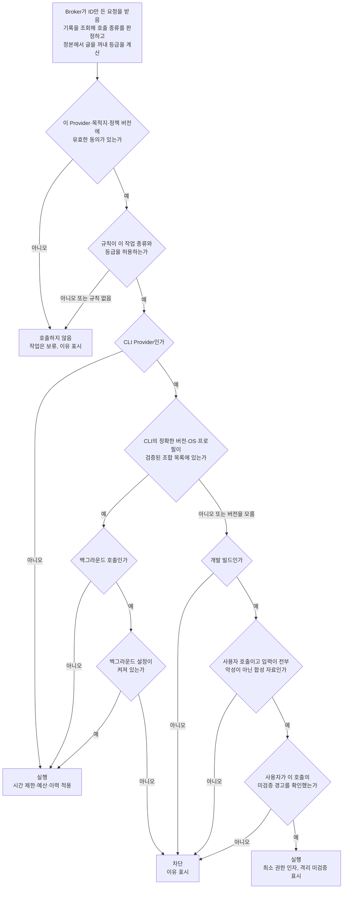
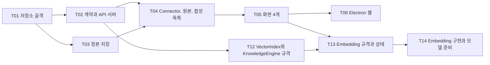
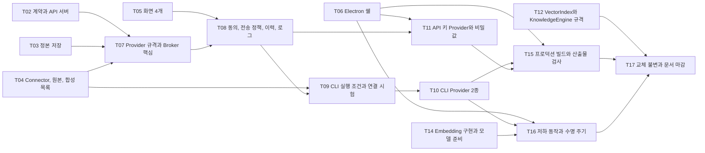

# 스펙: V01 공통 웹·API·Provider와 로컬 데이터 수직 골격

- 날짜: 2026-11-21 / 상태: 확정
- 관련: 이슈 #16(V01), 총괄 #1, Phase 1 #3, 선행 #15(R06), 확정 #37(R07). [ARCHITECTURE.md](../ARCHITECTURE.md), [adr/](../adr/README.md), [site-setup.md](../site-setup.md), 원 설계 [original-design.md](../design/original-design.md)

낯선 말은 [ARCHITECTURE 0절](../ARCHITECTURE.md#0-처음-나오는-말)에 풀이가 있다. `A01`~`A22`는 같은 문서 9절의 가정 번호, `S01`~`S15`는 site-setup.md의 체크리스트 번호다.

## 배경

제품 코드가 아직 없다. Phase 1은 수직 흐름 하나(합성 출처 → 추출 → Insight → 근거 화면)를 증명하는 단계이고, V01은 그 흐름이 올라설 **뼈대**를 만든다: 화면, 로컬 API, Electron 쉘, 정본 저장, Provider, Embedding, 그리고 뒤집힐 수 있는 선택을 가두는 어댑터 경계다.

엔진, CLI, Windows 설치 파일의 실행 검증은 배포처에서만 할 수 있다. 그래서 이 spec은 잠정 ADR 위에서 시작하고, 실행 근거가 없는 선택은 어댑터 뒤에 둔다(R06-C4). 어떤 완료 기준이 사외에서 충족되고 어떤 기준이 배포처 실행 전까지 미충족으로 남는지는 "완료 기준" 절에 따로 적었다.

## 목표

- 브라우저와 Electron에서 같은 화면이 같은 API 계약으로 백엔드의 실제 데이터를 보여 준다.
- 보안 기준선([ADR 0008](../adr/0008-security-baseline.md))이 첫 코드부터 적용되어 있고, 각 통제에 거부되는 경우의 테스트가 있다.
- CLI가 없거나 네트워크가 없거나 전송이 거부되거나 모델이 없어도 앱이 뜨고 저장된 자료를 찾아볼 수 있다.
- 배포 빌드는 격리가 검증된 CLI 조합만 실행하고, 그 판정에 쓰이는 값도 Provider에 나가는 글도 호출하는 쪽이 정할 수 없다. 이것을 **빌드한 산출물로** 확인한다.
- Provider와 Embedding의 구현을 test double로 바꿔도 API 응답과 화면이 바뀌지 않는다.

## 비목표 (배포처에서 후속 진행)

**공용 저장소의 뒤 작업으로 넘기는 것**

- JSONL 가져오기, 지식 추출, Insight, 근거 화면: V02(#17).
- 작업 실행기와 스케줄러: V02가 최소 실행기를 만들고 I03(#20)이 일반화한다. V01은 작업 **테이블**만 둔다(Broker가 호출 종류를 판정하는 데 필요하다).
- **파이프라인이 KnowledgeEngine과 VectorIndex를 부르는 자리, 그리고 그 둘의 교체 증명**: V02-C5. 이슈 #16의 V01-C7이 이 부분을 V02로 넘겼다.
- **벡터 색인의 실제 구현**(sqlite-vec 등 네이티브 모듈): 배포처 확인 뒤 R07에서 정한다([ADR 0004](../adr/0004-embedded-storage.md)).
- 정본 SQLite의 파일 단위 암호화, 백업: [ADR 0010](../adr/0010-encryption-at-rest.md), H01(#32).
- **설치 파일 만들기**(패키징 구성, NSIS): R04(#13)의 사외 준비물. V01은 그 입력인 프로덕션 빌드 산출물까지 만든다(T15).
- 트레이, OS 알림, 자동 시작, 자동 업데이트: H02(#33).
- outbox: 벡터에 실제 지식을 색인하는 작업([ADR 0013](../adr/0013-failure-recovery.md)).
- 실제 지식 엔진 연결과 사이드카: R07 뒤([ADR 0003](../adr/0003-phase1-without-engine.md), [0011](../adr/0011-sidecar-language.md)).
- 원본 파일과 첨부의 저장: I02(#19).

**배포처 후속 항목**(13개. 각각 [site-setup.md의 배포처 설정 체크리스트](../site-setup.md#배포처-설정-체크리스트)와 번호로 대응한다)

| 번호 | 항목 | 실행 경로 |
|---|---|---|
| S01 | 메일 수집기 구현 | `site-mail` |
| S02 | 메신저 수집기 구현 | `site-messenger` |
| S03 | Wiki 수집기 구현 | `site-wiki` |
| S04 | 수집기의 인증과 권한 매핑 | — (S01~S03의 구현 안) |
| S05 | LLM Provider 구성(엔드포인트, 모델, 키) | — (설정 값) |
| S06 | 구독 로그인 CLI 사용 허용 여부 확인 | — (확인 작업) |
| S07 | CLI 격리 검증과 검증된 조합 등록 | — (R02 실행) |
| S08 | 외부 전송 정책의 값 | — (설정 값) |
| S09 | Embedding 모델 반입 | — (설정 값) |
| S10 | Windows 11 설치본 검증 | — (R04 실행) |
| S11 | 저장 데이터 보호 확인 | — (확인 작업) |
| S12 | 서명, 배포 채널, 업데이트 | — (R04 실행) |
| S13 | 엔진과 저장소의 실행 비교 | — (R03 실행) |

"실행 경로"가 있는 세 항목은 공용 저장소에 미구현 표시용 구현이 있고, 실행하면 `미구현, 배포처 후속`을 알리고 실패한다(V01-R18).

## 요구사항

**뼈대**

- **V01-R1 저장소 골격.** "인터페이스 / 설계 개요"의 배치와 도구로 workspace를 만든다. 모듈 사이의 직접 import는 lint가 막아, 상위 코드가 어댑터 규격을 건너뛰고 구현을 직접 부를 수 없게 한다. `lint`, `typecheck`, `test`, `e2e` 명령이 저장소 루트에서 돈다.
- **V01-R2 Local API.** 백엔드는 127.0.0.1에만 바인딩한다. 실행마다 새로 만든 세션 토큰이 없는 요청, `Host`가 자기 주소가 아닌 요청을 거부한다. `Origin`이 있으면 허용 목록과 정확히 일치해야 한다. `Origin`이 없는 요청은 브라우저 밖 클라이언트로 보고 토큰과 `Host`로만 판정한다(다른 출처에서 `Origin` 없이 오는 브라우저 요청(no-cors GET·HEAD)은 `Authorization` 헤더를 실을 수 없다. 같은 출처의 GET·HEAD도 `Origin`을 빼지만 그 출처는 `127.0.0.1:포트` 자신뿐이다. 실제 통제는 토큰과 정확한 `Host`다). 요청과 응답의 모양은 `packages/contracts`의 스키마 하나로 정의하고 화면과 백엔드가 그것을 함께 쓴다.
- **V01-R3 화면.** Home, Sources, Activity, Settings의 최소 화면이 백엔드에서 받은 데이터를 보여 준다. 화면 코드에 고정된 가짜 데이터를 두지 않는다. 같은 빌드가 브라우저와 Electron에서 돌고, 두 환경의 차이는 "백엔드 주소와 토큰을 어디서 받는가"뿐이다.
- **V01-R4 Electron 쉘.** 쉘은 백엔드 프로세스를 시작·종료하고, 앱이 두 번 실행되면 하나만 남긴다. 세션 토큰과 비밀 값은 부모와 자식 프로세스 사이의 전용 통로로만 넘기고 명령줄 인자와 환경 변수에 싣지 않는다. contextIsolation 켬, sandbox 켬, nodeIntegration 끔, CSP 적용, 외부 URL 이동과 새 창 차단. preload는 "설계 개요"에 적은 함수**만** 노출하고 모든 IPC 입력을 스키마로 검증한다. 외부 링크는 `https` 주소만 받는다.
- **V01-R5 저하 동작.** CLI 없음, 네트워크 없음, 전송 거부, embedding 모델 없음, 벡터 색인 사용 불가의 각 상태에서 앱이 뜨고 저장된 원본의 목록과 키워드 검색이 동작하며, 무엇이 안 되는지 화면에 보인다. CLI가 없거나 로그인되어 있지 않으면 설치와 로그인 방법을 안내한다(원 설계 4절). 막힌 Provider 대신 다른 Provider를 몰래 쓰지 않는다.

**저장**

- **V01-R6 정본 저장.** 정본 SQLite에 스키마 v1(원본, 원본 version, **작업**, 설정, 동의, Provider 호출 이력)과 키워드 색인을 두고, 마이그레이션 실행기가 스키마 버전을 관리한다. 작업 테이블은 V01에서는 식별자, 종류, 대상 원본 version, 상태만 갖는 최소 형태이며 V02가 임대와 fence에 필요한 열을 더한다. 데이터 디렉터리는 OS 사용자별이고 다른 PC로 따라다니지 않는 위치여야 하며, 그 위치를 코드가 직접 정한다. 정본 접근은 SQL 드라이버 포트를 지난다([ADR 0004](../adr/0004-embedded-storage.md)).
- **V01-R7 Connector 규격, 원본 저장, 합성 목록.** `Connector` 규격과 계약 테스트, `fixtures/`의 합성 원본을 내는 테스트 Connector를 만든다. 원본의 정체는 `connector_instance_id + external_id`이고, 내용이 같으면(content hash) 새 version을 만들지 않으며, cursor는 저장한 뒤에 확정한다. 빌드할 때 저장소에 든 합성 자료마다 **제목과 본문을 함께 묶은 해시**를 계산해 **합성 목록**을 만들고, 악성 변형에는 표시를 단다. 연결 시험에 쓰는 고정 자료도 이 목록에 든 빌드 자원이다. Connector는 등급을 정하지 못한다.

**Provider와 전송**

- **V01-R8 Provider 규격과 Broker.** `LLMProvider` 규격([ARCHITECTURE 5.1절](../ARCHITECTURE.md))과 계약 테스트를 만든다. 모든 호출은 Broker를 지나고, Broker가 시간 제한, 재시도 간격, 요청 한도 응답 처리, 동시 실행 제한, 호출 예산, 오류 복구, 이력 기록을 맡는다. Provider에 가는 요청에는 request ID, 작업 종류, 데이터 등급, 전송 결정, 스키마 버전, 재시도 가능 여부가 실린다. 이력에는 본문과 비밀 값이 없다. 그리고:
  - **부르는 쪽은 ID만 넘긴다.** 상위 코드가 Broker에 넘기는 것은 작업 종류, 원본 version ID, 후보 항목 ID, 기록 ID, 예산, 그리고 응답 스키마 버전과 재시도 가능 여부뿐이다. 뒤의 둘은 [ARCHITECTURE 5.1절](../ARCHITECTURE.md)의 요청에도 있다. 스키마 버전은 부르는 쪽이 읽을 수 있는 응답 모양을 코드 상수 가운데서 고르는 값이고(목록에 없는 버전은 거부), 재시도 가능 여부는 다시 보내도 되는지를 알리는 값이다. 둘 다 나가는 글, 지시문, 등급, 호출 종류를 바꾸지 못하고, 재시도 횟수는 Broker의 상한과 예산이 정한다. 그 밖의 필드(글, 지시, 등급, 호출 종류)가 든 요청은 거부한다.
  - **나가는 글은 Broker가 만든다.** Broker가 그 ID로 정본에서 제목과 본문을 직접 꺼내 문서 구획에 넣는다. 지시문은 작업 종류와 스키마 버전으로 고르는 코드 상수다. 원본의 다른 필드는 보내지 않는다.
  - **등급은 Broker가 계산한다.** 꺼낸 원본들과, 후보 항목의 근거가 된 원본들 가운데 가장 엄격한 값이다. 근거 원본이 없는 후보 항목과, 등급을 매길 입력이 하나도 없는 경우는 일반이다(닫힌 쪽으로 실패). `extract`에 원본 ID가 하나도 없으면 거부한다. `connection-test`는 ID 없이 고정 빌드 자원만 쓴다.
  - **호출 종류는 Broker가 기록을 조회해 판정한다.** 작업 기록이면 백그라운드다. 사용자 동작 기록이면 사용자 호출인데, 그 기록은 **API 계층만** 만들 수 있고, 처리 중인 요청 하나에 묶이며, 한 번 쓰면 끝이고, 요청이 끝나면 사라진다(메모리에만 있고 저장하지 않는다). 없는 기록, 이미 쓴 기록, 요청이 끝난 기록은 거부한다.
- **V01-R9 CLI Provider.** `ClaudeCodeProvider`와 `CodexProvider`가 규격의 일곱 동작(detect, checkAuthentication, checkHealth, generate, generateStructured, cancel, getCapabilities)을 구현한다. 실행은 셸 없이 인자 배열로, 입력은 stdin으로, 작업마다 만든 빈 임시 디렉터리에서, 최소 환경 변수로, 세션을 디스크에 남기지 않는 옵션을 주고, 바깥에서 시간 제한을 걸어 프로세스 트리를 끝낸다. 인자 프로필은 코드의 상수다. 판정 없이 실행하는 것은 버전 조회와 로그인 상태 조회의 고정 인자뿐이며 입력도 문서 내용도 주지 않는다. 로그인 상태를 알려 주는 명령이 없는 CLI는 "알 수 없음"을 돌려준다. 제품은 CLI의 로그인 파일을 읽지 않는다. 두 CLI가 모두 탐색되면 사용자가 기본값을 고른다.
- **V01-R10 CLI 실행 조건.** [ARCHITECTURE 3.1절](../ARCHITECTURE.md)의 표대로 판정한다.
  - **빌드 종류**는 번들러가 빌드할 때 코드에 박는 값 **하나**에서만 읽고, 그 값을 읽는 자리는 한 모듈뿐이다. 판정 코드와 Broker는 환경 변수와 "설치본인가"를 묻는 실행 환경 기능을 읽지 않는다. 이 둘을 lint 규칙으로 막는다. 값이 없거나 모르는 값이면 배포 빌드로 본다. 개발용 예외의 코드는 배포 빌드 산출물에 들어 있지 않다.
  - **테스트 빌드**는 테스트가 구성할 때 "배포 빌드처럼" 또는 "개발 빌드처럼" 판정하도록 고른다. 고르지 않으면 배포 빌드처럼 판정한다. 이 선택 기능은 테스트 빌드에만 들어 있고 개발 빌드와 배포 빌드의 산출물에는 없다.
  - **검증된 조합 목록**은 읽기 전용 빌드 자원이다. 항목은 CLI 이름, 정확한 버전 하나, OS, 인자 프로필 이름, 검증 날짜다. 사용자 데이터 폴더의 설정, 환경 변수, 설정 API로는 항목을 더할 수 없다. 공용 저장소의 목록은 비어 있다. 버전을 읽지 못하거나 해석하지 못하면 "목록에 없다"로 처리한다.
  - **배포 빌드**: 목록에 없으면 사용자 호출과 백그라운드 호출을 모두 차단한다. 목록에 있으면 사용자 호출은 실행하고, 백그라운드 호출은 백그라운드 설정이 켜져 있을 때만 실행한다. 그 설정의 기본값은 끔이다.
  - **개발 빌드**: 목록에 없는 조합은 다음을 모두 만족할 때만 실행한다 — 사용자 호출이다, 입력이 전부 합성 등급이고 악성 변형이 아니다, 고정된 최소 권한 인자 프로필을 쓴다, "격리 미검증"을 표시한다, 그 호출 한 번에 대해 사용자가 확인했다(확인은 저장하지 않는다).
  - test double은 테스트 빌드에만 있고, 가짜 CLI도 같은 판정을 지난다.
- **V01-R11 API 키 Provider.** `OpenAICompatibleProvider`가 같은 규격을 구현한다. 이것은 선택 항목이 아니라 **필수 경로**다. 주소와 모델은 설정이고 주소는 `https`여야 한다(loopback의 `http`는 개발·테스트 빌드에서만). 키는 OS 자격 증명 저장소에서만 읽는다(그 뜻은 [ADR 0010](../adr/0010-encryption-at-rest.md)의 조사가 정한다: OS가 보호하는 키로 암호화한 암호문. 키는 입력할 때의 엔드포인트 호스트에 묶인다. 잠정, 사용자 확인 대기). `LocalModelProvider`는 규격만 따르고 모든 호출에 "미구현"을 돌려준다.
- **V01-R12 동의와 전송 정책.** [ADR 0014](../adr/0014-egress-policy-and-consent.md)대로 Broker가 호출 직전마다 판정한다. 동의는 Provider, 목적지, 정책 버전에 묶이고 그중 하나가 바뀌면 무효다. 정책 버전은 지금 적용되는 규칙 전체에서 계산한 값이다. 사용자는 동의할 때 허용할 등급을 고른다. 거부가 우선이고 맞는 규칙이 없으면 거부다. 화면과 이력은 CLI 호출을 "외부 전송"으로 표시한다.
- **V01-R13 비밀 값과 로그.** 비밀 값은 OS 자격 증명 저장소에만 둔다(뜻은 ADR 0010의 조사: 값은 OS 보관함 항목이 아니라 OS가 보호하는 키로 암호화한 암호문 파일이다. 잠정, 사용자 확인 대기). 그 방식을 조사해 [ADR 0010](../adr/0010-encryption-at-rest.md)에 적는 것이 T11의 첫 산출물이다. 저장소를 쓸 수 없으면 평문으로 넘어가지 않고 그 Provider를 "사용 불가"로 표시한다. 로그와 이력은 원문, 프롬프트, 응답 본문, 비밀 값, 토큰을 담지 않는다. 호출이 실패해 CLI나 HTTP 서버가 입력을 섞은 오류를 돌려줘도 마찬가지다. 설정 화면은 정본 SQLite의 암호화 상태를 있는 그대로 보인다.

**Embedding, 벡터, 엔진**

- **V01-R14 Embedding.** `EmbeddingProvider` 규격(`egress` 표시 포함)과 계약 테스트, Transformers.js 구현을 만든다. 모델은 로컬 팩 가져오기 또는 사용자가 승인한 내려받기로 준비하며 어느 쪽도 자동으로 시작하지 않는다. 쓰는 모델의 revision과 파일별 해시를 빌드 자원에 고정하고, 해시가 모두 맞을 때만 "준비됨"이 된다. 준비된 뒤에는 네트워크 없이 동작한다([ADR 0006](../adr/0006-embedding.md)).
- **V01-R15 VectorIndex.** `VectorIndex` 규격과 계약 테스트, 테스트용 메모리 구현(fake)을 만든다. 제품의 기본 구성은 모든 호출에 "사용 불가"를 돌려주는 빈 구현에 묶이고, 상태 API가 그 상태를 읽어 보인다. **네이티브 벡터 모듈은 넣지 않는다.**
- **V01-R16 KnowledgeEngine.** `KnowledgeEngine` 규격과 계약 테스트, null 구현, 테스트용 메모리 구현을 만든다. 계약 테스트는 메모리 구현에 대해 삭제, 낡은 fence 거부, 재구축 결과 동일성을 확인한다.
- **V01-R17 구현 교체 불변.** Provider와 Embedding을 test double로 바꾼 구성에서도 API 응답이 같은 스키마를 지키고 같은 화면 테스트가 통과하며, 그 대역이 실제로 호출된다. 두 규격 모두 V01에 부르는 자리가 있다(연결 시험, embedding 준비와 상태).

**배포처 경계, 빌드, 문서**

- **V01-R18 미구현 표시.** `site-mail`, `site-messenger`, `site-wiki`를 Connector 종류로 등록하되 초기화하면 `미구현, 배포처 후속`이라는 오류로 실패한다. Sources 화면은 이들을 "미구현(배포처 후속)"으로 보인다. `site-check` 명령은 지정한 종류를 초기화해 보고, 실패하면 그 알림을 출력하고 0이 아닌 값으로 끝난다.
- **V01-R19 문서.** [site-setup.md](../site-setup.md)의 설정 키 이름을 구현한 이름으로 고친다(제목 `## 배포처 설정 체크리스트`는 그대로 둔다). 이 spec의 배포처 후속 항목과 그 체크리스트가 번호로 대응하는지 확인하는 문서 대응 테스트를 둔다. 설정 키의 설명은 site-setup.md에 두고, README에는 실행 명령 한 줄씩과 문서 링크만 둔다.
- **V01-R20 프로덕션 빌드 산출물.** 백엔드, 화면, 쉘을 배포 빌드로 묶는 빌드 대상을 만든다(설치 파일은 만들지 않는다). 산출물에는 test double, 개발용 예외 코드, 테스트 빌드의 판정 선택 기능이 들어 있지 않다. R04(#13)는 이 산출물을 받아 설치 파일을 만든다.
- **V01-R21 연결 시험.** 설정 화면에서 Provider를 골라 "연결 시험"을 누르면, API 계층이 사용자 동작 기록을 만들고 Broker에 `connection-test`를 요청한다. Broker는 빌드 자원인 고정된 무해한 합성 자료 하나로 구조화 출력을 한 번 요청하고, 화면은 결과(성공, 차단 사유, 오류)를 보인다. 이것이 Phase 1의 유일한 사용자 호출이며 다른 호출과 똑같이 Broker의 판정을 지난다.

## 인터페이스 / 설계 개요

구성요소와 다섯 어댑터 규격의 스케치는 [ARCHITECTURE 2절·5절](../ARCHITECTURE.md)에 있다. 여기에는 V01이 새로 정하는 경계만 적는다.

### Broker의 호출 허용 판단

V01-R8, R10, R12를 합친 것이다. Provider를 부를 수 있는 길은 이 그림의 "실행" 둘뿐이고, 그림의 모든 질문은 Broker가 스스로 조회하고 계산한 값으로 답한다.



요청에 ID 말고 다른 것이 들어 있거나, 기록이 없거나 이미 쓰였으면 이 그림에 들어오기 전에 거부된다.

### API와 preload (T02와 T06에서 확정)

| 경계 | 내용 |
|---|---|
| HTTP API | 상태 조회(백엔드, Provider, embedding, 벡터 색인), 원본 목록과 키워드 검색, 활동(Provider 호출 이력), 설정 읽기·쓰기(기본 Provider, 동의, 백그라운드 설정), Connector 목록과 동기화 실행, embedding 준비 시작, **Provider 연결 시험** |
| 설정 API로 바꿀 수 **없는** 것 | 빌드 종류, 검증된 조합 목록, 인자 프로필, 합성 목록, 지시문, 모델의 고정 revision과 해시 |
| preload가 화면에 주는 함수(이것이 전부다) | 세션 받기(백엔드 주소와 토큰), 비밀 값 저장·존재 확인·삭제(값을 다시 읽어 주는 함수는 없다), 외부 링크 열기(`https`만, 사용자 확인 뒤 OS 브라우저). T06이 이름을 정했다: `window.pki`의 `getSession`, `setSecret`, `hasSecret`, `deleteSecret`, `openExternal`(아래 "T06이 넘기는 것") |
| 로컬 API 접속 조건(T02가 정함) | CORS는 없다. 브라우저 개발 환경은 같은 출처의 Vite 프록시(`changeOrigin: true`)로 부르고 개발 화면의 출처를 백엔드 `--origin`에 넘긴다(T05). 브라우저 개발 환경의 세션 받기는 Vite 개발 서버의 `/__pki/session`이 맡는다(개발 서버에만 있고 토큰은 메모리에만 둔다). 개발 서버는 Vite의 Host 검사를 그대로 켜 두어 다른 이름으로 같은 주소에 오는 요청(DNS rebinding)을 막고, CORS를 꺼 다른 로컬 화면이 세션을 읽지 못하게 한다(T05, 브라우저 E2E가 둘 다 확인). Electron 화면은 `file://`로 띄우지 않는다(`Origin: null`은 거부된다). 허용 목록에 넣은 출처로 내준다(T06). T05는 개발 진입점이 stdout에 내는 토큰 줄을 코드로 읽고 어디에도 기록하지 않는다. 개발 진입점(`backend/src/dev.ts`)과 `packages/testkit`은 R20 산출물에 넣지 않는다 |
| 쉘 ↔ 백엔드 | 부모와 자식 프로세스 사이의 전용 통로. 쉘이 세션 토큰을 넘기고, 백엔드는 스스로 빈 포트에 바인딩한 뒤 그 포트를 같은 통로로 알린다(T06. 쉘이 포트를 골라 넘기면 고른 때와 바인딩하는 때 사이에 다른 프로세스가 그 포트를 가져갈 수 있다). 백엔드는 호출 직전에 비밀 값을 요청한다(T11) |

### 저장소 배치와 도구 (잠정)

배치는 [ARCHITECTURE 2절](../ARCHITECTURE.md)의 표를 따른다. 아래 도구 가운데 [OSS_EVALUATION](../OSS_EVALUATION.md)이 평가한 것은 절 번호를 적었다. 나머지는 개발 도구이며 **평가 범위 밖**이므로 T01과 T02에서 라이선스를 확인해 PR에 적는다([ADR 0009](../adr/0009-license.md)).

| 항목 | 잠정 선택 | 한 줄 이유 |
|---|---|---|
| 런타임 | Node.js 24 계열로 고정 | Electron 45가 Node 24를 담고 있어(4.1절) 개발과 설치본의 런타임을 맞춘다 |
| 패키지 관리 | pnpm workspace(평가 범위 밖) | 패키지마다 선언한 의존성만 보이게 해 모듈 경계를 지키기 쉽다 |
| 언어 설정 | TypeScript strict | 어댑터 규격을 타입으로 강제한다 |
| 단위·계약·통합 테스트 | Vitest(평가 범위 밖) | 화면이 쓰는 Vite와 설정을 공유한다 |
| 화면 자동 테스트 | Playwright(4.2절) | 브라우저와 Electron을 같은 테스트로 돌린다. Electron 지원은 실험적 |
| lint·서식 | ESLint와 Prettier(평가 범위 밖) | 모듈 간 import 금지 규칙과 판정 코드의 금지 입력 규칙을 lint로 건다 |
| HTTP 서버 | Node 표준 `node:http`(T02 확정, 의존성 없음) | 기준: 허용 라이선스, 네이티브 모듈 없음, 유지보수 활발. 경로가 적고 검사 세 가지를 직접 거는 편이 프레임워크의 기본 동작(경로 해석, 플러그인 순서)을 따로 확인하는 것보다 작다 |
| 스키마 검증 | Zod 4(T02 확정, MIT, 네이티브 모듈과 런타임 의존성 없음) | 기준: 같은 정의에서 TypeScript 타입과 JSON Schema를 둘 다 얻을 수 있을 것(CLI의 구조화 출력 옵션에 JSON Schema를 넘겨야 한다). `z.infer`로 타입을, 내장 `z.toJSONSchema`로 JSON Schema를 얻는다 |
| 화면 구성요소 | React 19, Vite 8(4.2절, T05 확정, MIT). shadcn/ui는 아직 쓰지 않는다(T05) | 원 설계 지정. JSX는 Vite 8이 직접 변환해 React 플러그인이 필요 없다. shadcn/ui는 Tailwind 설정과 구성요소 사본을 저장소에 들이는데 V01 화면은 표와 버튼뿐이라 쓸 곳이 없다. 화면이 커지는 작업에서 들인다 |
| 정본 저장 | better-sqlite3(4.3절) | [ADR 0004](../adr/0004-embedded-storage.md). V01의 네이티브 저장 모듈은 이것 하나다 |
| Embedding | Transformers.js, bge-m3(4.5절) | [ADR 0006](../adr/0006-embedding.md) |

### 작업 분해

한 작업이 PR 하나다. 모든 PR은 실행한 명령과 실제 출력, 충족한 기준과 이유, 미검증 범위를 적는다. 작업이 17개라 그림을 둘로 나눴다. 두 그림에 함께 나오는 작업은 같은 작업이다. **V01의 기준은 V01의 작업만으로 끝난다.**

뼈대, 저장, embedding 쪽:



Provider 쪽과 마감:



| ID | 산출물 | 요구사항 | 기준 | depends_on | 검증 증거 |
|---|---|---|---|---|---|
| V01-T01 | workspace, lint·typecheck·test 명령, 모듈 경계 lint 규칙(패키지 경계: 다른 패키지는 공개 진입점과 선언한 의존성으로만 import), 문서 대응 테스트 | R1, R19(테스트) | C7(`module-boundary`의 패키지 경계 몫), H1 | — | 세 명령의 출력. 경계를 어긴 import를 넣으면 lint가 실패하는 것 |
| V01-T02 | `packages/contracts`, API 서버 골격, 토큰·Host·Origin 검사, 상태 API | R2 | C2(API), C1(계약) | T01 | API 보안 통합 테스트(거부 4종), API 계약 테스트 |
| V01-T03 | SQL 드라이버 포트와 계약 테스트, 마이그레이션 실행기, 스키마 v1(작업 테이블 포함), 키워드 색인, 데이터 디렉터리 위치 | R6 | C7(저장소), C3(검색) | T01 | 드라이버 계약 테스트, 마이그레이션 테스트, 전문 검색 기능이 드라이버에 들어 있는지의 테스트(A17), 데이터 디렉터리 위치의 근거 기록 |
| V01-T04 | Connector 규격과 계약 테스트, 테스트 Connector, 원본 저장, cursor 저장(이 작업의 마이그레이션), 정본 DB를 여는 백엔드 구성(`dataDirectory()`·`ensureDataDirectory()` 호출), 빌드 때 만드는 합성 목록(제목과 본문의 해시. 아래 "T04가 넘기는 것"), 미구현 표시 3종, `site-check` | R7, R18(등록) | C3(자료), H2 | T02, T03 | Connector 계약 테스트, 재실행 시 원본이 늘지 않는 통합 테스트, 합성 목록 테스트, `site-check` 3건 |
| V01-T05 | 화면 4개, API 클라이언트, 세션 받기(개발 환경), 미구현 수집기 표시, 브라우저 E2E | R3, R18(표시) | C1 | T04 | 브라우저 E2E. 백엔드의 씨앗 데이터를 바꾸면 화면 값이 바뀌는 것 |
| V01-T06 | Electron 쉘(백엔드 수명 주기, 단일 실행, 전용 통로, preload, IPC 검증, CSP, 이동 차단, 외부 링크 규칙), Electron E2E | R4 | C1, C2(쉘) | T05 | 같은 화면 테스트의 Electron 실행, 쉘 보안 E2E, preload 노출 목록 테스트 |
| V01-T07 | Provider 규격과 계약 테스트, 가짜 Provider(테스트 빌드 전용), Broker 핵심: ID만 받는 요청, 정본에서 글 꺼내기, 코드 상수 지시문, 등급 계산(원본의 access_scope 열 추가 포함), 기록 조회로 호출 종류 판정, 사용자 동작 기록(API 계층 전용, 일회용), 시간 제한·재시도·요청 한도·동시 실행·예산·오류 복구, module-boundary 확장: 상위 모듈(backend, knowledge-engine 등)이 같은 패키지 안의 어댑터 구현 모듈을 직접 import하면 lint 실패, 구성 지점(composition root)만 예외. 합성 판정과 `site-*` 출처 거부는 아래 "T04가 넘기는 것" ②·④를 따른다 | R8, R1 | C4(Broker), C7(`module-boundary`의 구현 경계 몫) | T02, T03, T04 | Broker 단위 테스트, 글과 등급과 호출 종류를 부르는 쪽이 정할 수 없다는 테스트 묶음, 구성 지점 밖에서 어댑터 구현을 import하면 lint가 실패하는 테스트 |
| V01-T08 | 동의(Provider·목적지·정책 버전), 규칙에서 계산하는 정책 버전, 전송 규칙, 이력, 로그 걸러 내기, 동의 화면과 활동 화면 연결, 암호화 상태 표시 | R12, R13(로그·표시) | C5(전송·로그·표시) | T05, T07 | 규칙 허용·거부 표 테스트, 동의 무효화 테스트, 실패 경로 카나리 테스트, 표시 E2E |
| V01-T09 | 빌드 종류 값과 그것을 읽는 한 모듈, 판정 코드의 금지 입력 lint 규칙, 테스트 빌드의 판정 선택, 검증된 조합 목록 자원, 실행 조건 판정, 연결 시험 API와 화면, 미검증 확인 화면, 백그라운드 설정(기본 끔) | R10, R21 | C4(실행 조건), C7(기본 OFF) | T04, T08 | 실행 조건 통합 테스트(테스트 빌드에서 CLI 전송 방식의 대역으로 경우 전부. 백그라운드 경우는 작업 테이블에 넣은 기록으로), 목록에 항목을 더할 수 없다는 테스트, lint 규칙 테스트 |
| V01-T10 | CLI Provider 2종, 가짜 CLI 실행 파일, 고정 인자 프로필, 판정 없는 조회 두 가지, 프로세스 트리 종료, 설치·로그인 안내, 기본 Provider 선택 | R9, R5(안내) | C4(CLI) | T09 | 가짜 CLI에 대한 계약 테스트, 인자 배열 테스트, 자식 프로세스까지 끝나는 테스트 |
| V01-T11 | 자격 증명 저장 방식의 조사 기록(ADR 0010 갱신), 비밀 값 저장소(쉘 중개, 개발용 환경 변수), OpenAI 호환 Provider, 미구현 로컬 모델 Provider, 설정 화면의 주소·모델·키 절(키는 엔드포인트 호스트에 묶임) | R11, R13(비밀) | C4(API 키 경로), C5(자격 증명) | T06, T08 | 조사 기록, 로컬 가짜 HTTP 서버에 대한 계약 테스트, 비밀 값이 어디에도 남지 않는 테스트, `https` 강제 테스트, 주소를 옮기면 키가 나가지 않는 테스트, 설정 화면 E2E(`provider-settings.e2e`) |
| V01-T12 | VectorIndex와 KnowledgeEngine의 규격, 계약 테스트, 메모리 구현, 빈 구현과 null 구현 | R15, R16 | C7(저장소·엔진의 규격과 계약 테스트) | T02 | 메모리 구현에 대한 계약 테스트, 기본 구성의 상태가 "사용 불가"인 테스트 |
| V01-T13 | Embedding 규격(`egress` 포함)과 계약 테스트, 가짜 embedder, 상태 API와 화면 표시 | R14(규격) | C6(계약, 상태) | T05, T12 | 가짜 embedder 계약 테스트, 모델 없음 통합 테스트 |
| V01-T14 | Transformers.js 구현, 고정 revision과 해시, 로컬 팩 가져오기, 승인한 내려받기, embedding → 메모리 색인 → 검색 왕복 | R14(구현) | C6(왕복) | T13 | 해시가 틀린 파일을 거부하는 테스트, 실제 모델 왕복 1회의 기록 |
| V01-T15 | 백엔드·화면·쉘의 프로덕션 빌드 대상, 산출물 검사. 산출물 빌드는 합성 목록의 최신성 검사를 돌리고, 테스트 Connector를 제품 구성에서 뺀다(아래 "T04가 넘기는 것" ①·③) | R20, R10(산출물) | C4(배포 빌드의 차단) | T06, T10, T11 | **빌드한 산출물**을 개발처럼 보이는 환경과 설정으로 띄워도 차단되는 통합 테스트, 산출물에 대역·예외 코드·판정 선택 기능이 없다는 검사 |
| V01-T16 | 저하 동작 통합(다섯 상태), 시작·종료·단일 실행 통합 | R5 | C3, C6(모델 없음) | T06, T10, T14 | 저하 통합 테스트와 E2E, 수명 주기 E2E, 쉘이 실제 백엔드 프로세스에 키 값(read)을 넘기는 `shell.channel` 왕복 테스트("T11이 넘기는 것" 2·7항) |
| V01-T17 | Provider·Embedding 교체 불변 테스트, site-setup 키 이름 확정, README 명령 | R17, R19 | C7(교체), H1 | T12, T15, T16 | 교체 구성에서의 API 계약 테스트와 화면 E2E |

**T04가 넘기는 것**(T04 독립 검토 K2). 뒤 작업이 지켜야 하는 T04의 결정이다.

1. **합성 목록의 "빌드할 때"**: 생성 스크립트(`pnpm --filter @pki/providers build:synthetic-manifest`)가 만든 `providers/src/synthetic-manifest.json`을 커밋한다. 커밋된 목록이 저장소 자료로 새로 만든 결과와 다르면 `pnpm test`가 실패한다. 실행 중에는 이 파일만 읽고 데이터 폴더, 환경 변수, 설정 API로는 항목을 더할 수 없다. **T15의 산출물 빌드는 생성 스크립트나 최신성 검사를 돌려야 한다**(V01-T15가 닫았다: 산출물 빌드가 `check:synthetic-manifest`를 먼저 돈다. "T15가 넘기는 것" 1항).
2. **목록에 드는 자료**: `fixtures/*.jsonl`(악성 변형은 `"malicious": true`), `eval/golden/sources/*.jsonl`(삭제 레코드 제외, 악성 아님), 연결 시험 고정 자료(`providers/src/connection-test-material.json`). `verification/`의 자료는 넣지 않는다(제품 Connector가 받아들이는 자료가 아니다). 합성 등급은 목록에 든 내용이 믿는 Connector 종류(`test-fixtures`)로 들어왔을 때만 붙는다. **V02의 JSONL 가져오기(종류 `jsonl-import`)로 들어온 골든 데이터는 사용자가 고른 파일이므로 일반 등급이다**(V02-T04의 닫힌 쪽 선택, V02 spec "T04가 넘기는 것" 6). T07·T09는 합성 자료가 R10의 조건(개발 빌드, 사용자 호출, 확인, 최소 권한 인자)에서만 나갈 수 있음을 전제로 한다.
3. **테스트 Connector의 위치**(V01-T15가 바꿨다: 이제 `connectorKinds`에 없고 `fixtureConnectors()`로만 묶인다. "T15가 넘기는 것" 4항): `backend/src/composition.ts`의 `connectorKinds`에 정적으로 들어 있었다. 제품 인스턴스 목록에는 fixtures 경로를 줄 때만 생긴다. **T15는 이것을 제품 구성에서 빼서** 산출물에 테스트용 구현이 남지 않게 한다(R20).
4. **`site-*` 출처 판정**: 원본의 Connector 종류는 `sources.connector_instance_id` → `connector_instances.kind`로 찾는다(스키마 v2, 외래 키 있음). 스키마 v1에서 올라온 원본의 종류는 `unknown`이다. **T07은 행이 없거나 종류가 공용 저장소의 종류(`test-fixtures` 등)가 아니면 합성으로 보지 않는다**(닫힌 쪽으로 실패).

T07이 확장한 module-boundary 규칙은 T07보다 먼저 들어온 것(T03, T04, T12, T13, T14)을 포함한 모든 어댑터 구현에 적용되고, 공개 진입점으로 다시 내보낸 구현도 대상이다. T07은 그때까지 생긴 위반을 함께 고친다.

**T07이 넘기는 것**. T07이 확정한 것과, 뒤 작업이 이어받는 결합 지점이다.

1. **구현 경계의 규칙(확정)**: 어댑터 구현은 각 패키지의 `src/adapters/` 아래에 둔다. 같은 패키지의 다른 모듈은 상대 경로로도 이 폴더를 import할 수 없다(타입 전용 import 포함). 다른 패키지는 `<패키지>/adapters` 진입점으로만 받는다. 이 진입점이나 폴더를 import할 수 있는 곳은 구성 지점 `backend/src/composition.ts`와 테스트 파일뿐이다. 공개 진입점(`src/index.ts`)이 구현을 다시 내보내도 실패한다. 테스트 파일은 구현에 닿을 수 있으므로, 제품 코드가 테스트 파일을 import해도 실패한다(`*.test`·`*.e2e`에 확장자가 없거나 `.ts`·`.tsx`·`.mts`·`.cts`·`.js`·`.jsx`·`.mjs`·`.cjs`인 경로. 번들러 해석은 `.js` 경로를 `.ts` 파일로 잇는다). `src/adapters/` 밖에서 구현을 **만드는** 코드도 실패한다: 어댑터 규격(`Connector`, `ConnectorFactory`, `LLMProvider`, `EmbeddingProvider`, `KnowledgeEngine`, `VectorIndex`, `SqlDriver`, `OpenSqlDriver`)을 `implements`하는 클래스, 그리고 그 타입을 단(값 타입, 반환 타입, `satisfies`, `as`) 객체·클래스·함수·`new` 값이다. `?:`·`&&`·`||`·`??`의 어느 쪽 값이든, 함수 본문 맨 위의 `const`에 담았다가 돌려주는 값이든(`return c as Connector`, `return c!` 포함) 마찬가지다. 규격 이름은 import 별칭, `c.Connector` 같은 이름 공간, 파일 최상위의 타입 별칭과 규격을 `extends`하는 interface, 합집합·교집합, 함수 타입과 생성자 타입(`new () => Connector`), 함수 자신의 타입 매개변수 제약(`<T extends Connector>`), `Promise`·`Partial`·`Readonly`·`Required`·`NonNullable`·`Awaited`로 감싼 경우까지 따라간다. 상위 코드가 다른 곳에서 만든 구현을 받아 두거나 돌려주는 것(`const i: VectorIndex = deps.index`, `const f: ConnectorFactory = () => existing`)은 허용한다. 함수 값은 함수 선언처럼 돌려주는 값으로 판정한다. 예외는 대역을 두는 `@pki/testkit`(테스트 빌드 전용) 하나다. `@pki/contracts`도 구현을 두지 않으므로 예외가 아니다. 기존 위반은 옮겼다: storage의 SQLite 드라이버와 빈 VectorIndex, knowledge-engine의 null 엔진, backend의 Connector 구현 2개. **알려진 빈틈**(검토에서 본다): 계산한 경로의 `import()`(``import(`./adapters/${이름}.ts`)``), `createRequire`, `#` imports, 절대 경로. 그리고 구현이 ① 규격 타입을 전혀 적지 않았거나 ② 간접으로 만들어졌거나(`Object.assign` 같은 함수 호출 결과, 배열·Map 원소, 배열 펼침 `[...items]`, `let`·`var`나 함수 밖·안쪽 블록에 선언한 변수, 구조 분해한 지역 상수, 두 단계 이상 거친 지역 상수. 객체 펼침 `{ ...base }`는 객체이므로 잡힌다) ③ 함수 안에서 선언한 타입 별칭·interface, 다른 모듈에서 정의한 타입 별칭(`ConnectorFactory` 제외), 위 목록 밖의 감싼 타입, 클래스나 변수의 타입 매개변수로만 규격을 가리키는 경우. 이런 구현이 `src/adapters/` 밖에 있으면 그것을 import하는 쪽도 검사되지 않는다. T10·T11·T13·T14는 구현을 자기 패키지의 `src/adapters/`에 두고 구성 지점에서 묶는다.
2. **Provider 규격(확정)**: `packages/contracts/src/provider.ts`. [ARCHITECTURE 5.1절](../ARCHITECTURE.md) 스케치와 다른 점은 셋이다. 구조화 요청은 제네릭 대신 JSON Schema(`outputSchema`)를 싣고, Broker가 같은 정의의 Zod 스키마로 응답을 검증한다. Provider 입력에 후보 항목의 이름(`candidates`)이 따로 있다. 실패는 `ProviderError`(재시도 가능 여부)와 `ProviderRateLimitError`(기다릴 시간)로 알린다. 가짜 Provider와 계약 묶음 `providerContract`는 `@pki/testkit`에 있고, 제품 코드에서 import하면 lint가 실패한다. 어떤 제품 패키지도 testkit을 런타임 의존성으로 선언하지 않는다는 검사가 있다. `providerContract`는 구현마다 두 가지를 받는다: 모델 호출 횟수를 세는 방법(가짜 CLI·가짜 서버의 호출 수)과 모든 생성이 실패하는 Provider. 묶음은 detect·인증·상태 확인이 모델을 부르지 않는지와, 실패가 `ProviderError`(재시도 가능 여부 포함)로 나오는지를 확인한다. 그래서 T10·T11은 자기 실패를 `ProviderError`로 옮겨야 한다. 구조화 출력을 못 하는 Provider(`structuredOutput: false`)에는 그 경우를 묻지 않는다. Phase 1의 작업은 모두 구조화 출력을 요청하므로, Broker는 그런 Provider를 부르지 않고 차단으로 기록한다. `structuredOutput`이 정확히 `true`가 아니거나 `getCapabilities()`가 예외를 던져도 마찬가지로 차단하며, 예외의 문구는 옮기지 않는다.
3. **T08**: Broker는 호출마다 `EgressPolicy.decide({providerId, taskKind, classification})`를 묻는다. 답은 허용(목적지, 정책 버전) 또는 거부 사유다. 이력은 `CallRecorder.record(CallRecord)`로 넘긴다. 항목에는 본문도 Provider의 오류 문구도 없다. 시도마다 한 행이고, 실행하지 못한 시도(전송 판정·실행 조건에 막힘, 예산 소진, 구조화 출력을 못 하는 Provider, 기능을 읽을 수 없는 Provider)도 그 시도의 번호와 사유 코드(`reason`: 판정이 돌려준 사유, `budget-exhausted`, `structured-output-unsupported`, `capabilities-unavailable`)로 남는다. 사유는 코드이고 Provider의 문구가 아니다. `provider_calls`에는 아직 사유 열이 없으므로, 그것을 어떻게 저장할지는 T08이 정한다. 항목의 `requestId`는 요청 전체의 ID이고, Provider가 받는 request ID는 시도마다 `<요청 ID>:<시도 번호>`다. 그래서 `provider_calls`의 `(request_id, attempt)`로 Provider 쪽 ID를 그대로 다시 만들 수 있고, 열을 더할 필요가 없다. 판정은 요청마다 한 번이 아니라 **시도마다** 한다: 동시 실행 자리를 기다린 뒤 첫 시도 직전에, 그리고 재시도마다 다시 묻는다. 기다리거나 재시도 간격을 두는 사이에 동의가 철회되면 다음 시도는 막힌다. T08은 이 두 결합 지점을 구현하고, 막힌 호출처럼 목적지가 없는 항목을 `provider_calls`의 NOT NULL 열(destination, policy_version)에 어떻게 쓸지 정한다.
4. **T09**: Broker는 시도마다 `ExecutionGate.decide({providerId, transport, taskKind, trigger, classification, malicious})`를 묻는다(전송 판정 다음). 사용자 동작 기록은 구성 지점에서 `createUserActionLedger()`로 한 번 만든다. issuer는 API 계층에만, redeemer는 Broker에만 준다. 연결 시험 API는 `issuer.during(id => broker.call({taskKind: "connection-test", …, origin: {userActionId: id}}))` 형태로 부른다. Broker 요청에는 ID만 실을 수 있으므로, 개발 빌드의 "이 호출에 대한 확인"은 T09가 사용자 동작 기록에 담도록 기록을 넓힌다. 기록은 여전히 issuer만 만든다. Broker를 제품 구성에 묶는 일도 T09의 몫이다. 지금 구성 지점에는 Broker가 없다.
5. **T10**: CLI Provider는 가짜 CLI로 `providerContract`를 통과해야 한다. 시간이 넘으면 Broker는 먼저 signal을 끊고 그 시도의 `cancel(requestId)`를 부르되 **기다리지 않는다**. 시도마다 request ID가 다르므로(`<요청 ID>:<시도 번호>`), 늦게 도착한 cancel이 다음 시도를 멈추지 않고, 시도마다 붙잡을 핸들이 따로 남는다. T10은 request ID별로 프로세스를 기억해야 한다. 그래서 cancel이 끝나지 않거나 예외를 던져도 Broker는 시간 초과를 돌려주고 동시 실행 자리를 반환한다. 프로세스 트리를 끝내는 일은 Provider의 몫이다. Provider가 signal을 무시하면 그 호출은 Broker 밖에서 계속 돌 수 있으므로(동시 실행 상한에 세지 않음), signal과 cancel로 실제로 멈추는 것은 T10이 테스트로 보인다. 생성 함수가 동기 예외를 던져도 다른 실패와 같이 처리된다. 오류 문구에는 입력이 섞일 수 있으므로 Broker는 그것을 결과에도 이력에도 옮기지 않는다.
6. **V02**: V02-T05가 확정했다. `extract`의 출력 스키마는 버전 2이고 V01의 잠정 버전 1(`claims[]`)은 지워져 요청하면 `unknown-task-version`이다. 후보 항목 조회(`CandidateItems`)는 지식 저장소에 붙어(`knowledgeCandidates`) 후보가 든 요청도 처리된다. 작업 기록은 `leased`이고 요청의 임대 토큰이 현재 값일 때만 백그라운드 호출로 인정된다(V02 spec "T03이 넘기는 것" 6항, "T05가 넘기는 것" 1·2·6항). 합성 등급이 될 수 있는 Connector 종류는 `test-fixtures` 하나다. V02-T04는 JSONL 가져오기 종류(`jsonl-import`)를 이 목록에 더하지 않았다(가져온 파일은 일반 등급, 위 "T04가 넘기는 것" 2). 바꾸려면 `providers/src/broker.ts`의 목록에 더하고 두 spec을 함께 고친다.
7. **access_scope**: 스키마 v3에서 `sources`에 NULL 허용 열로 더했다. 공용 저장소에서는 어떤 범위든 일반 등급이고, 합성은 합성 목록으로만 붙는다(범위에 `synthetic`이라고 적어도 합성이 아니다). Connector가 이 열을 채우는 경로(레코드 스키마의 필드)는 I01·V02의 몫이다. 배포처는 `broker.ts`의 `grade`에서 범위를 자기 등급으로 바꾼다(S08).
8. **Broker 한도의 기본값(잠정)**: 동시 실행 2, 요청당 시도 3, 재시도 대기는 1초부터 두 배씩 늘어 최대 30초(요청 한도 응답의 대기 시간도 이 상한을 넘지 않음), 요청 시간 제한의 상한 120초, 호출 예산 1시간에 60회. 값은 `DEFAULT_LIMITS` 한 곳에 있다.

**T13이 넘기는 것**. T13이 확정한 Embedding 규격과, T14·T16·T17이 이어받는 결합 지점이다. 표시한 것은 잠정 결정이며 바꿀 때는 이 절과 해당 테스트를 함께 고친다.

1. **규격(확정)**: `packages/contracts/src/embedding.ts`. [ARCHITECTURE 5.2절](../ARCHITECTURE.md) 스케치와 같고, 더 정한 것은 셋이다. 모델이 준비되지 않았을 때 `embed`는 `AdapterUnavailableError`로 거부한다. 중단된 `prepare`는 준비되지 않은 상태(`model-missing`)로 남는다. `describe()`는 입출력 없이 늘 같은 값을 돌려준다.
2. **계약 묶음**: `@pki/testkit`의 `embeddingContract(이름, { create, source })`. `create`는 모델을 준비하지 않은 새 구현, `source`는 `prepare`가 준비를 끝낼 수 있는 출처(테스트에서는 올바른 로컬 팩)다. 묶음은 `describe()`의 필드와 `egress`, 처음 상태가 "모델 없음"이고 스스로 준비하지 않음, 준비 전 `embed` 거부, 중단된 준비, 준비 뒤 텍스트마다 차원이 맞는 유한한 벡터, 빈 입력, 단독과 묶음의 같은 벡터(코사인 0.999 초과), 다른 텍스트의 다른 벡터, 중단된 `embed` 거부를 확인한다. 준비 뒤의 검사는 구현 하나를 한 번만 준비해 함께 쓴다(T14의 실제 모델 비용). **T14는 Transformers.js 구현을 이 묶음에 통과시킨다.** 파일 해시 검사(`embedding.integrity`)와 실제 모델 왕복(`embedding.roundtrip`)은 묶음 밖의 T14 테스트다.
3. **가짜 embedder**: `@pki/testkit`의 `FakeEmbedder`. 벡터는 텍스트만의 해시(종류와 무관)라서 같은 문장의 질의가 그 문서를 찾는다. `calls`에 상태 조회 수, `prepare` 출처, `embed` 요청을 남긴다. `egress`, 차원, 모델 ID, 사용 불가 사유를 고를 수 있다.
4. **상태 API(잠정)**: `/api/status`의 `embedding`은 `EmbeddingStatusSchema`다. 구현이 보고하는 상태(`ready`, `model-missing`, `preparing`, `unavailable`+사유)에 `egress`를 붙이고, 구현이 묶이지 않았으면 `not-implemented`다. 상태 조회는 `describe()`와 `status()`만 부르며 준비도 embedding도 하지 않는다. 구현이 예외를 던지거나 규격 밖의 값(모르는 상태, 빈 사유, 모르는 `egress`, API만 쓰는 `not-implemented`)을 내면 그 항목만 `egress` 없는 `unavailable`("status check failed")이 된다. 구현의 오류 문구는 응답에 옮기지 않는다.
5. **제품 구성(T14에서 바뀜)**: T13 때 `productAdapters()`의 `embedder`는 `null`이었고 홈 화면은 "미구현"을 보였다. T14가 `productAdapters(dataDir)`에 Transformers.js 구현을 묶어 `screens.e2e`의 Embedding 행 기대값이 "모델 없음, 키워드 검색으로 동작 (로컬 계산)"이 되었고, `embedding 준비 시작` API를 만들었다(아래 "T14이 넘기는 것" 2·5항).
6. **화면(잠정)**: 홈의 Embedding 행은 상태 뒤에 `(로컬 계산)` 또는 `(외부 전송)`을 붙이고, 모델이 없으면 "모델 없음, 키워드 검색으로 동작"이라고 적는다. 문구는 `apps/web/src/status-text.ts` 한 곳에 있다.
7. **외부 embedding의 전송 판정(잠정)**: 상위 코드가 텍스트를 embedding하는 입구는 `@pki/providers`의 `embedWithinPolicy(embedder, policy, texts, kind, signal)` 하나다. `egress`가 정확히 `'local'`이 아니면 호출마다 `EmbeddingEgressPolicy.decide({modelId, classification})`를 묻고, 정확히 `{allowed: true}`가 아니면 구현을 부르지 않고 `EmbeddingEgressDeniedError`(사유 코드만)로 거부한다. 텍스트에는 등급을 매길 원본 ID가 없으므로 등급은 일반이다(R8의 닫힌 쪽). T08의 `EgressPolicy`는 LLM 작업 종류(`TaskKind`)만 받아 이 판정에 쓰지 않았고, 기본값 `denyExternalEmbedding`은 모든 외부 embedding을 거부한다. 외부 embedder를 넣는 포크나 그것을 부르는 기능(X01)은 이 정책을 동의 규칙에 잇는다. 이 포트의 입력은 `{modelId, classification}`, 허용 응답은 `{allowed: true}`뿐이라 목적지와 정책 버전이 없다. 그래서 C5처럼 엔드포인트 호스트가 바뀌면 동의를 다시 막는 결합은 지금 형태로는 표현할 수 없다. ADR 0006·0014가 말하는 "LLM 호출과 같은 동의·규칙 판정"을 실제로 적용하려면, 그 연결을 맡는 쪽(X01 또는 외부 embedder 포크)이 입력에 목적지를, 응답에 정책 버전을 더해 포트를 넓힌다. Phase 1에는 `embed`를 부르는 제품 코드가 없으며, 이 입구를 건너뛰고 `embed`를 직접 부르는 것을 막는 lint는 없다(검토에서 본다).

**T14이 넘기는 것**. T14가 정한 Embedding 구현과 모델 준비, 그리고 T16·T17과 배포처(S09)가 이어받는 결합 지점이다. 표시한 것은 잠정 결정이며 바꿀 때는 이 절과 해당 테스트를 함께 고친다.

1. **고정한 모델(빌드 자원)**: `providers/src/adapters/bge-m3.ts`의 `BGE_M3_INT8`. 저장소 `onnx-community/bge-m3-ONNX`의 commit `25b9af8e87a38eb120cfe87125383677b9cd309e`, int8 ONNX, CLS 토큰 벡터를 L2 정규화, 1024차원, 최대 8192 토큰, MIT. 파일 4개(`config.json`, `tokenizer_config.json`, `tokenizer.json`, `onnx/model_int8.onnx`, 합 약 586 MB)의 크기와 SHA-256을 고정했다. 값은 그 commit의 Hugging Face API 목록(큰 파일은 LFS의 SHA-256)과 작은 JSON 파일을 받아 계산한 해시이고, 실제 실행에서 내려받은 파일을 따로 해시해 같음을 확인했다(9항). `modelId`는 `onnx-community/bge-m3-ONNX:int8`이다(잠정). 데이터 종류가 바뀌면 벡터 공간이 바뀌므로 이름에 넣었다. 런타임이 읽지 않는 파일(`special_tokens_map.json` 등)은 고정하지 않았다(9항의 실행이 이 4개만으로 동작). 포크가 다른 모델을 쓰면 이 값을 바꾼다(S09).
2. **설치 위치와 무결성**: 준비한 모델은 `<데이터 디렉터리>/models/<modelId의 안전한 이름>/<revision>/`에 둔다(구성 지점의 `productAdapters(dataDir)`, 잠정). 파일마다 임시 폴더에 쓰면서 해시를 계산하고, 모든 파일이 크기와 해시까지 맞을 때만 그 폴더를 모델 폴더로 옮긴다. 그래서 설치되는 바이트가 곧 확인한 바이트이고, 맞지 않는 파일은 모델 폴더에 들어가지 않고 런타임에도 가지 않는다. 내려받기는 `https://huggingface.co/<저장소>/resolve/<revision>/<경로>`이며, 고정 크기를 넘으면 그 자리에서 읽기를 멈춘다. 리디렉션은 따라가되 마지막 주소가 `https`가 아니면 `model download failed`다. 이 검사는 **마지막 주소만** 본다. 중간에 평문 `http` 구간이 끼면(https→http→https) 그 요청은 이미 나간 뒤이므로, 어떤 파일을 받는지가 드러나는 것까지는 막지 못한다. 무결성은 이 검사에 기대지 않는다(바이트마다 크기와 해시로 확인). 중간 구간까지 막으려면 리디렉션을 직접 따라가며 `https`가 아닌 `Location`을 요청 전에 거부해야 하며, 이는 T16의 승인 화면 작업과 함께 판단한다(**T16의 판단**: 바꾸지 않음, 아래 "T16이 넘기는 것" 3항). 로컬 팩은 절대 경로의 폴더이고 같은 상대 경로에 같은 파일이 있어야 한다(ADR 0006의 "고정된 파일 목록과 해시에 맞는 폴더"). 팩과 설치된 모델의 파일은 **일반 파일만** 연다. FIFO·장치·폴더는 `model file missing`이다(FIFO를 열면 쓰는 쪽이 나타날 때까지 스레드 풀의 스레드를 붙잡아 중단으로도 풀리지 않는다). 파일을 여는 기다림도 중단 신호로 끝난다. **남은 임시 폴더**: 프로세스가 준비 중에 끝나거나 죽으면 `models/.staging-*`(최대 약 586 MB)가 남는다. 다음 준비가 시작할 때 `.staging-`로 시작하는 항목을 모두 지운다. 한 embedder가 그 폴더를 맡고 준비를 한 번에 하나만 하므로 지우는 것 가운데 살아 있는 준비의 것은 없다. 같은 데이터 폴더를 두 백엔드가 함께 쓰는 경우는 이 가정 밖이다.
3. **다시 준비하기와 다시 켠 뒤(잠정)**: 모델 폴더가 이미 고정 값과 모두 맞으면 출처를 읽지 않고 그 폴더를 쓴다(내려받기를 골라도 네트워크에 가지 않는다). 하나라도 다르면 출처에서 다시 설치하고, 출처도 없으면 실패하며 바뀐 파일은 읽지 않는다. **백엔드를 다시 켜면 상태는 "모델 없음"이다.** 설치된 모델도 사용자가 준비를 요청하기 전에는 읽지 않는다. "어느 쪽도 자동으로 시작하지 않는다"(R14)를 설치된 모델을 올리는 일까지 넓게 읽은 선택이다. 다시 요청하면 해시 확인(9항에서 약 2초) 뒤 준비됨이 된다. 시작할 때 설치된 모델을 자동으로 올릴지는 **T16**이 정한다(T16: 올리지 않는다. 아래 "T16이 넘기는 것" 3항).

   3~5항의 상태와 준비 API의 응답:

   ```mermaid
   stateDiagram-v2
     state "model-missing" as Missing
     state "preparing" as Preparing
     state "ready" as Ready
     state "unavailable + 사유" as Unavailable
     [*] --> Missing: 백엔드 시작, 설치된 모델도 읽지 않음
     Missing --> Preparing: POST prepare, 200
     Unavailable --> Preparing: POST prepare, 200
     Preparing --> Preparing: POST prepare, 409 embedding-busy
     Preparing --> Ready: 모든 파일 일치, 런타임 로드
     Preparing --> Unavailable: 파일 없음, 해시 불일치, 내려받기·설치·로드 실패
     Preparing --> Missing: 중단, 서버 종료 포함
     Ready --> Ready: POST prepare, 200, 아무것도 안 함
     Ready --> [*]: 백엔드 종료, 다시 켜면 model-missing
   ```
4. **상태의 사유(확정)**: `model file missing`(파일이 없거나 읽을 수 없음, 상대 경로의 팩 포함), `model file hash mismatch`(크기나 해시가 다름), `model download failed`(HTTP 오류나 네트워크 실패), `model install failed`(그 밖의 쓰기 실패), `embedding runtime failed to load`. 모두 `{unavailable: 사유}`로 보이고, 잡은 예외나 서버 응답의 문구는 옮기지 않는다. 중단된 준비는 `model-missing`이다. 실패한 상태에서도 다시 준비할 수 있다.
5. **준비 API(잠정)**: `POST /api/embedding/prepare`, 본문 `{source: {kind: "download"} | {kind: "local-pack", path}}`(`path`는 1~4096자, 그 밖의 필드는 거부. revision과 해시는 요청으로 바꿀 수 없다). 준비를 시작하고 기다리지 않고 그때의 상태(`{embedding: 상태}`)를 돌려준다. 준비 중이면 409 `embedding-busy`(두 요청이 동시에 와서 둘 다 준비 전의 상태를 읽었어도 늦은 쪽은 409이고 실패 로그를 남기지 않는다), 구현이 묶이지 않았으면 409 `embedding-not-implemented`, 이미 준비됨이면 아무것도 하지 않는다. 서버가 닫히면 진행 중인 준비를 중단한다. 실패는 로그에 `embedding-prepare-failed`와 오류 클래스만 남는다. **이 요청이 "사용자의 승인"이다.** 화면에는 아직 준비 버튼이 없다(API만). 로컬 팩 폴더를 고르고 내려받기를 승인하는 화면은 **T16**의 저하 동작 화면과 함께 붙인다(T16이 붙였다: 아래 "T16이 넘기는 것" 3항). [site-setup.md](../site-setup.md)의 `embedding.modelSource`는 설정 값이 아니라 이 요청이 되었으므로, 키 이름을 고치는 **T17**이 반영한다(V01-T17이 닫았다: "T17이 넘기는 것" 4항).
6. **런타임**: Transformers.js 4.3.2(Apache-2.0)가 onnxruntime-node 1.30.0(MIT)으로 CPU에서 돈다. 라이브러리는 처음 준비할 때 불러오므로 불러오지 못해도 앱의 나머지는 동작한다. 원격 모델, 파일 캐시, 라이브러리 자체의 fetch와 콘솔 출력(`env.logLevel`을 `NONE`. 라이브러리의 경고는 로컬 경로를 담고 제품의 `log()`를 거치지 않는다)을 끄고 절대 경로의 모델 폴더에서만 읽는다. 풀링과 정규화는 `extractionOptions(model)` 한 곳에서 정한다(CLS, L2 정규화). **텍스트마다 한 번씩 실행한다(잠정).** int8 export는 묶음 안에서 padding이 붙은 텍스트의 벡터가 단독일 때와 달라졌다(코사인 0.985, 같은 길이끼리의 묶음과 반복 실행은 1.0. 9항 1회차의 계약 묶음이 잡았다). 같은 텍스트는 어떻게 묶여도 같은 벡터여야 색인이 어긋나지 않으므로 묶음 처리량을 포기했다. bge-m3는 질의와 문서에 접두어를 쓰지 않으므로 `kind`는 입력을 바꾸지 않는다. `pnpm-workspace.yaml`의 `allowBuilds`에서 onnxruntime-node(설치 스크립트는 Linux의 CUDA 파일만 받는다, CPU 파일은 패키지에 들어 있다)와 protobufjs(설치 스크립트는 버전 표기 경고뿐)를 실행하지 않도록 했다. **전이 의존성 sharp 0.35.5**(Apache-2.0)와 그 libvips 사전 빌드(macOS `@img/sharp-libvips-darwin-arm64`는 **LGPL-3.0-or-later**)는 **embedder를 올릴 때 함께 백엔드 프로세스에 적재된다.** Transformers.js의 Node 번들이 `sharp`를 최상위에서 정적으로 import하기 때문이다(독립 검토 B2가 `process.report`로 `sharp-darwin-arm64-0.35.5.node`와 `libvips-cpp`의 적재를 확인). 텍스트 embedding이 이미지 기능을 부르지는 않지만, **설치 파일에서 sharp를 빼면 라이브러리 import가 실패해 `embedding runtime failed to load`가 된다.** 빼려면 `sharp`를 대신하는 빈 모듈(resolver alias)이나 이미지 기능 없는 Transformers.js 빌드가 필요하다. Windows 대상의 사전 빌드(`@img/sharp-win32-x64@0.35.5`, lockfile에 있음)는 이 PC에 설치되지 않아 **라이선스가 기록되지 않았다**. ADR 0009의 금지 목록(GPL, AGPL, SSPL, BSL)은 LGPL을 거명하지 않으므로 지금은 차단이 아니고, 그 해석과 Windows 사전 빌드의 라이선스 확인을 **R04**가 맡는다(ADR 0009 감시 항목).
7. **증명 테스트의 위치**: `embedding.contract` → `providers/src/adapters/embedding.contract.test.ts`(기본 실행. 가짜 런타임과 합성 팩으로 구현의 준비·상태·묶음 처리를 묶음에 통과시키고 `egress`가 `'local'`임을 확인)와 `embedding.roundtrip.test.ts`(실제 런타임과 고정 bge-m3로 같은 묶음, 명시적으로 켤 때만). `embedding.integrity` → `providers/src/adapters/embedding.integrity.test.ts`. `embedding.missing` → 같은 파일의 "nothing prepares by itself"(가짜 시계로 하루를 흘려도 내려받기·런타임 호출·타이머가 없음)와 `backend/src/embedding-status.test.ts`(제품 구성: 전역 fetch 호출 0, 데이터 폴더에 아무것도 생기지 않음, 키워드 검색 동작). 준비 API → `backend/src/embedding-prepare.test.ts`. 실제 런타임의 오프라인 설정·콘솔 출력·풀링 → `transformers-runtime.test.ts`. 설치 위치 `<dataDir>/models` → `backend/src/embedding-status.test.ts`(그 아래에 둔 남은 임시 폴더가 다음 준비에서 지워짐). 남은 임시 폴더, 상대 경로 팩, 일반 파일이 아닌 팩 파일, `https`가 아닌 리디렉션 → `embedding.integrity.test.ts`. 벡터 공간(CLS 풀링, 정규화)은 실제 실행에서 한 문장의 앞 6차원을 기록값과 비교한다(허용 오차 0.005, 같은 문장의 mean 풀링과는 0.027까지 다르다). `local_files_only: true`는 `allowRemoteModels=false` 뒤의 겹친 방어라서 지워도 테스트가 빨개지지 않는다(남겨 둠). **기본 `pnpm test`는 실제 모델을 돌리지 않는다.** 그래서 기본 실행에서 "Transformers.js 구현이 묶음을 통과"는 가짜 런타임까지이고, 실제 런타임은 아래 기록의 실행으로만 확인되었다.
8. **실제 모델을 켜는 법**: `PKI_REAL_EMBEDDING_MODELS_DIR=<절대 경로>`로 `embedding.roundtrip.test.ts`를 돌린다. `PKI_REAL_EMBEDDING_PACK=<절대 경로>`가 있으면 그 로컬 팩에서, 없으면 승인한 내려받기로 준비한다(README 명령 줄).
9. **실제 모델 왕복 기록(2026-11-21, 개발 OS macOS arm64, Node 24.22.3)**. 1회차: 빈 폴더에서 내려받기 경로로 4개 파일을 받아 해시가 맞아 준비됨(파일 4개를 `shasum -a 256`으로 따로 해시해 1항의 값과 같음). 왕복과 계약 묶음 12건 중 11건 통과, "단독과 묶음의 같은 벡터"가 0.9848로 실패해 6항으로 고쳤다. 2회차: 설치된 모델을 재사용해 준비 1.9초, 12건 모두 통과. 질의 넷이 모두 맞는 문서를 1위로 찾았다(코사인, 1위/2위): "등대 렌즈를 청소한 기록" 0.667/0.392, "하역 작업이 언제 중단되나요" 0.720/0.436, "How much did the quarterly budget increase?" 0.681/0.321, "Is the ferry running this morning?" 0.657/0.489. "네트워크를 끊어도"는 준비 뒤 전역 fetch를 막고 호출 0건을 확인한 것이며 OS의 네트워크를 끊은 것은 아니다. 3회차(독립 검토 반영 뒤): 없는 로컬 팩 경로를 주어 설치된 모델의 재사용만으로 준비 2.5초, 벡터 공간 검사를 더한 13건 모두 통과. Windows와 Electron 설치본 안의 실행, 속도와 메모리는 미확인이다(A11).

**T08이 넘기는 것**. T08이 정한 것(잠정 표시가 없으면 확정)과 뒤 작업이 이어받는 결합 지점이다.

1. **전송 정책의 위치와 규칙의 모양(잠정)**: `providers/src/egress-policy.ts`의 `createEgressPolicy`. 규칙은 `(provider, taskKind, classification, effect)`이고 앞의 세 칸에는 `*`(모두)를 쓸 수 있다. **배포처 규칙은 구성 지점이 넘기는 값**이다(`backend/src/composition.ts`의 `productEgress`, 공용 값은 빈 목록 `PUBLIC_SITE_RULES`). 설정 표나 설정 API로는 바꿀 수 없다. 그렇게 하면 사용자가 배포처의 거부 규칙을 지울 수 있기 때문이다. 규칙이 스키마에 맞지 않으면 백엔드가 시작하지 않는다(닫힌 쪽으로 실패). 포크는 S08에서 이 자리에 자기 값을 넣는다. 그래서 [site-setup.md](../site-setup.md)의 `egress.classes`·`egress.rules`를 실행 중 설정 표에서 빌드 자원 표로 옮겼다. **규칙에는 목적지 칸이 없다.** 그래서 `openai-compatible`을 허용하는 배포처 규칙은 사용자가 설정한 어느 `https` 호스트로 보내는 것이든 허용하는 셈이다(사용자의 동의는 여전히 필요하다). 엔드포인트를 정해 두어야 하는 포크는 `openai-compatible`을 거부하거나, 주소를 빌드 자원으로 바꾸거나, 규칙에 목적지 칸을 더한다(더하면 그 칸도 정책 버전의 계산에 넣어야 한다).
2. **정책 버전**: `pv-`와, 등급 목록과 배포처 규칙 전체(필드마다, 순서 포함)의 SHA-256 앞 16자. 동의에서 생긴 허용 규칙은 넣지 않는다(동의가 정책 버전에 묶이므로 넣으면 순환한다). 규칙의 순서만 바꿔도 버전이 바뀐다. 다시 동의를 받는 쪽으로 실패하는 선택이다.
3. **판정 순서와 사유 코드**: 목적지(`destination-unavailable`, `insecure-endpoint`) → 동의(`no-consent`, `consent-stale-destination`, `consent-stale-policy`) → 규칙(`rule-denied`, `no-matching-rule`). 동의에서 생기는 허용 규칙은 그 Provider, 고른 등급, 모든 작업 종류다. 배포처의 허용 규칙만으로는 동의를 대신하지 않는다.
4. **목적지**: OpenAI 호환 Provider는 설정 `providers.openaiCompatible.baseUrl`의 호스트(포트 포함)다. `https`만 받고, `http`는 loopback(`127.0.0.1`, `[::1]`, `localhost`)이면서 `allowLoopbackHttp`가 켜져 있을 때만 받는다. 제품 구성은 이것을 끈다. **T09**가 빌드 종류에 따라 개발·테스트 빌드에서 켜고, **T11**이 주소를 쓰는 설정 API와 Provider를 붙인다. **T11의 의무**: 판정과 전송 사이에 주소 설정이 바뀔 수 있으므로, HTTP Provider는 `request.egress.destination`으로만 보낸다. 보내기 직전에 설정의 주소를 같은 WHATWG `URL` 파서로 읽어 그 `host`가 `request.egress.destination`과 다르거나 프로토콜 조건(`https`, 또는 허용된 loopback `http`)을 벗어나면 보내지 않고 재시도할 수 없는 `ProviderError`로 거부한다. 이 불일치를 확인하는 계약 테스트를 T11이 둔다. (T11: 사용자 정보가 든 주소도 `insecure-endpoint`로 거부한다. 아래 "T11이 넘기는 것" 5항.) CLI의 목적지는 "그 CLI가 정하는 벤더 서비스"라는 뜻의 `vendor:claude-code`, `vendor:codex`이고, 로컬 모델은 `local-model`이다.
5. **동의 저장과 API**: 스키마 v4에서 `consents`가 Provider마다 한 행이 된다(다시 동의하면 앞의 것을 대체한다). 허용 등급은 JSON 목록이고 읽을 수 없으면 아무것도 허용하지 않는다. API는 `GET /api/consents`(정책 버전, 등급, Provider마다 전송 종류·지금의 목적지·동의 상태), `POST /api/consents`(`{providerId, allowedClasses, destination, policyVersion}`, 등급은 하나 이상), `POST /api/consents/revoke`다. 부여 요청은 **화면에 보인 목적지와 정책 버전**을 함께 싣는다. 지금의 목적지를 모르면 409 `destination-unavailable`, 실린 목적지나 정책 버전이 지금 값과 다르면 409 `consent-stale`로 거부하고 아무것도 저장하지 않는다. 그래서 동의는 사용자가 본 적 없는 목적지에 묶이지 않는다. 화면은 거부되면 오류를 보이고 표를 다시 불러온다. 설정 화면은 아무 등급도 고르지 않은 상태로 시작한다.
6. **이력**: `createCallRecorder(db)`가 Broker의 `CallRecorder`다. 스키마 v4는 `provider_calls`에 `reason` 열을 더하고, `destination`과 `policy_version`은 `blocked` 행에서만 비울 수 있게 했으며(CHECK), `reason`은 `blocked`와 `budget-exhausted`에만 있고 그 둘에는 반드시 있다(CHECK). v3의 막힌 행은 사유가 `unrecorded`가 된다. 기록기는 알려진 필드만 이름으로 골라 쓴다. 코드 모양이 아닌 사유는 `unrecognized-reason`, 목록에 없는 Provider·작업 종류·등급·결과는 `unrecognized`로 남는다. Provider가 받은 request ID는 `(request_id, attempt)`로 `<요청 ID>:<시도 번호>`를 만들면 된다. **T09**는 Broker를 제품 구성에 묶을 때 `productEgress(db)`로 만든 **같은 인스턴스**를 API(server의 `egress`)와 Broker 양쪽에 준다.
7. **외부 전송 표시**: `@pki/contracts`의 `providerEgress(provider)`가 정한다. `local-model`만 로컬이고 나머지와 모르는 이름은 외부다. 활동 응답의 `egress`가 이 값이고, 화면은 "외부 전송"이라고 쓴다.
8. **로그 걸러 내기**: `providers/src/log.ts`의 `log(event, fields)`는 코드 모양 문자열, 수, 참·거짓만 남기고 나머지는 `[redacted]`로 바꾼다. 오류는 `errorClass`가 알려진 클래스 이름으로만 적는다(메시지와 조작된 `name`은 `other`). 서버의 경로 실패 로그가 이것을 쓴다. 모양 검사로는 입력 속의 코드처럼 생긴 낱말을 가려내지 못하므로, 부르는 쪽은 닫힌 목록의 값만 넘긴다. **T10·T11**은 자기 로그도 이것으로 남기고, `redaction.failure-paths`(`backend/src/redaction.failure-paths.test.ts`)에 가짜 CLI와 가짜 HTTP 서버의 경우를 더한다. 지금 그 테스트는 입력을 되돌려 주며 실패하는 대역 Provider 셋(오류 문구, 조작된 오류 이름, 잘못된 출력)으로 결과, 이력, 활동 API, 로그, 데이터 폴더의 파일, 임시 디렉터리를 확인한다.
9. **암호화 표시**: storage의 `databaseEncryption(file)`이 정본 파일의 첫 16바이트를 읽는다. SQLite 평문 머리말이면 `not-applied`("적용 안 됨"), 아니거나 파일이 없으면 `unknown`("확인할 수 없음")이다. 백엔드에 `databaseFile`을 주지 않으면(메모리 DB) `unknown`이다. 암호화 드라이버가 들어오면 이 판정에 "적용됨"을 더한다(H01).
10. **증명 테스트의 위치**: `egress-policy` → `providers/src/egress-policy.test.ts`, `consent.binding` → `backend/src/consent.binding.test.ts`(제품 구성이 loopback `http`도 거부하는 것은 `backend/src/composition.test.ts`. T09가 빌드 종류 테스트로 바꾼다), `redaction.failure-paths`(T08 몫) → 위 8항, `egress-label.e2e` → `apps/web/e2e/egress-label.e2e.ts`(브라우저. Electron 실행은 T06의 E2E 구성을 따른다).
11. **Embedding과의 관계**: 외부 embedding의 전송 판정(위 "T13이 넘기는 것" 7항)은 이 `EgressPolicy`를 쓰지 않는다. 그 포트를 넓히는 쪽은 여기의 `destination`·`policyVersion()`·동의 저장을 이어 쓸 수 있지만, `ProviderId`·`TaskKind`에 embedding이 없으므로 규칙의 모양도 함께 넓혀야 한다.

**T09이 넘기는 것**. T09이 정한 것(잠정 표시가 없으면 확정)과 뒤 작업이 이어받는 결합 지점이다.

1. **빌드 종류**: 번들러가 빌드할 때 `define`으로 박는 `import.meta.PKI_BUILD_KIND`를 읽는 곳은 `providers/src/build-kind.ts` 하나이고, 그 모듈이 `BUILD_KIND`(`production`, `development`, `test`)를 내보낸다. 값이 없거나 모르는 값이면 `production`이다. 테스트 실행기는 `vitest.config.ts`의 `define`으로 `test`를 박는다. 값을 전역 이름이 아닌 `import.meta`에 둔 것은 `import.meta`가 그 모듈만의 객체이기 때문이다. 번들러 없이 원본을 그대로 실행하면(`dev.ts`, 쉘의 `shell.ts`) 전역 변수, 상속된 속성, 환경 변수, `NODE_OPTIONS`의 `--import` 미리 읽기 어느 것으로도 값을 줄 수 없고 **배포 빌드로 동작한다**(이것을 `build-kind.test.ts`가 테스트 실행기 밖의 Node 프로세스로 확인한다. 처음 구현은 전역 식별자를 읽어 이 경로로 개발 빌드로 바뀌었다. 독립 검토 B1). 그 모듈의 원본을 바꾸는 로더 훅은 여기서 막을 수 없다(프로세스 안의 코드 실행이다). Vitest는 식별자 하나짜리 `define`을 `globalThis`에도 넣으므로 전역 이름으로는 테스트 빌드와 실행 중 전역을 구별할 수 없었다. **잠정**: 개발 빌드의 예외(목록에 없는 CLI의 연결 시험)는 `define`에 `development`를 넣어 묶은 백엔드에서만 나타나며, 그런 개발 빌드는 아직 없다. **T15**: 산출물 빌드에 `production`을 박고, ① 산출물에 `PKI_BUILD_KIND`라는 이름이 하나도 남지 않았는지(`define`이 적용되었다는 증거) ② 개발용 예외와 테스트 빌드의 판정 선택(`decisionBuild`의 `test` 분기)이 산출물에 없는지 `artifact.contents`로 확인한다. (V01-T15가 닫았다: "T15가 넘기는 것" 3항) 지금 코드는 다른 모듈에서 가져온 `BUILD_KIND`를 비교해 분기하므로 번들러가 그 분기를 지운다는 보장이 없다. 지워지지 않으면 분기를 따로 모듈로 떼어 빌드에서 뺀다. 표식 문자열 후보는 사유 코드 `unverified-ack-required`와 프로필 이름 `minimal-1`이다.
2. **lint `pki/gate-inputs`**(`tooling/eslint/gate-inputs.js`): 빌드 값의 이름(`PKI_BUILD_KIND`가 든 모든 이름)은 `build-kind.ts`와 번들러 설정(`vitest.config.ts`) 밖에서는 어떤 형태로든 실패한다. 식별자, 속성과 키, 문자열과 템플릿 문자열을 모두 보므로 테스트 파일도, 이전 전역 표기(`__PKI_BUILD_KIND__`)도, `globalThis[...] =`·`Object.defineProperty(globalThis, ...)` 같은 실행 중 쓰기도 걸린다. 다른 파일의 `define` 설정은 번들러 설정이 아니므로 실패한다(번들러 설정 파일이 늘면 `BUNDLER_CONFIGS`에 더한다). 판정 코드는 `providers/src/`의 `broker.ts`, `execution-gate.ts`, `verified-cli.ts`, `cli-profiles.ts`, `build-kind.ts`, 그리고 판정의 입력을 만드는 `synthetic-manifest.ts`(합성·악성)와 `user-actions.ts`(확인)다. 여기서 `process`, 전역 객체(`globalThis`, `global`, `self`, `window`), `Reflect`, `Function`, `eval`, `createRequire`의 참조, `import.meta.env`, `process`·`node:process`·`electron`·`module`·`node:module`·`vm`·`node:vm`의 import와 require, `isPackaged`·`defaultApp`·`resourcesPath` 속성이 실패한다(`Reflect.get(globalThis, "process")`, `(0, globalThis).process`, `globalThis["pro" + "cess"]`, `createRequire` 별칭은 전역 객체나 `Reflect`·`createRequire` 참조로 걸린다). OS는 `node:os`의 `platform()`으로 읽는다. 알려진 빈틈(검토에서 본다): 이 파일들 밖에서 받은 객체를 거쳐 닿는 값(함수 인자로 넘겨받은 `process`의 별칭 등), 판정 코드가 아닌 모듈에서 조각을 이어 붙여 실행 중에 만든 빌드 값의 이름. 후자는 1항 때문에 판정을 바꾸지 못한다.
3. **검증된 조합 목록**: `providers/src/verified-cli-combinations.json`(공용 값 `[]`). `verified-cli.ts`가 모듈을 읽을 때 한 번 엄격한 스키마로 파싱해 얼린다. 항목은 `{cli, version, os, profile, verifiedOn}`이다. `cli`는 `claude-code`·`codex`, `version`은 정확한 버전 하나(`주.부.수`와 선택적인 pre-release·build. 범위와 앞의 `v`는 거부), `os`는 Node `platform()`의 값(`win32`, `darwin`, `linux`), `profile`은 코드에 있는 프로필 이름, `verifiedOn`은 `YYYY-MM-DD`다. 틀린 항목이 하나라도 있으면 백엔드가 시작하지 않는다. CLI의 버전 문자열이 목록의 값과 글자 하나까지 같아야 목록에 있다.
4. **인자 프로필의 이름(잠정)**: `providers/src/cli-profiles.ts`의 `CLI_PROFILES`. `claude-code/standard-1`, `claude-code/minimal-1`, `codex/standard-1`, `codex/minimal-1`. 목록에 있는 조합은 `standard`로, 개발 빌드의 예외는 `minimal`로 실행한다. 목록의 항목은 `standard` 이름과 맞아야 한다. **T10**: 이 이름에 인자 배열을 붙이고, 인자를 바꾸면 이름의 끝 번호를 올린다(그래야 앞의 검증이 새 인자에 맞지 않는다). 그리고 제품 프로필마다 그 인자 배열과 같은 R02 프로필(`verification/r02-cli-isolation/profiles.json`의 이름, 예: `claude-A-restricted-safe`)을 `cli-profiles.ts`에 적고, [site-setup.md](../site-setup.md) S07이 그 대응을 가리키게 한다. 배포처는 그 R02 프로필의 결과로 목록에 제품 프로필 이름을 적는다. CLI Provider는 `request.execution.profile`로만 인자를 고르고, 그 값이 없거나 모르는 이름이면 실행하지 않는다. `detect()`가 돌려주는 `version`은 R02의 정규화와 같은 **버전 문자열 하나**(예: `2.1.3`. `2.1.3 (Claude Code)`가 아니다)여야 한다. 그렇지 않으면 목록과 맞지 않아 닫힌 쪽으로 막힌다.
5. **판정**: `providers/src/execution-gate.ts`의 `createExecutionGate({db, testBuild?})`. T07의 `ExecutionInput`에 `version`과 `unverifiedAcknowledged`를 더했다. Broker는 시도마다 전송 판정을 **먼저** 묻고, 허용된 경우에만 CLI의 버전을 조회한 뒤 실행 조건을 묻는다(동의가 없으면 버전 조회도 실행 조건도 없고 사유는 `no-consent`. `broker.test.ts`와 `cli-gate.test.ts`의 순서 테스트). `version`은 Broker가 **시도마다** `provider.detect()`로 다시 읽는다(CLI 전송 방식만. 설치되어 있지 않음, 버전 없음, 예외, 시간 초과는 `undefined`이고 목록에 없음으로 처리된다). 버전 조회의 시간 제한은 `DEFAULT_LIMITS.versionQueryTimeoutMs`(10초, 잠정)와 그 요청의 시간 제한 가운데 짧은 쪽이다. 조회는 동시 실행 자리 안에서 하지만 이 제한 때문에 멈춘 조회가 자리를 붙잡지 못한다. `unverifiedAcknowledged`는 사용자 동작 기록에서 온다. 허용 답은 CLI면 `cli: {profile, isolation}`을 싣고, Broker가 그것을 Provider 요청의 `execution`과 성공 결과의 `cli`로 옮긴다. HTTP Provider는 판정하지 않는다(`{run: true}`). 사유 코드는 `cli-not-verified`, `cli-background-off`, `cli-unknown`(프로필이 없는 CLI), `unverified-background`, `unverified-not-synthetic`, `unverified-malicious`, `unverified-ack-required`다. 개발 빌드의 예외는 백그라운드 → 합성 → 악성 → 확인 순으로 묻는다. 목록에 있는 조합은 개발 빌드에서도 배포 빌드와 똑같이 판정한다. **T10의 의무**: ① 시도마다 실행 파일의 절대 경로를 **한 번** 정하고, 그 같은 경로로 버전 조회와 실행을 한다(그 사이에 PATH로 다시 찾지 않는다. 그 사이에 CLI가 스스로 갱신되거나 PATH가 바뀌면 판정한 버전과 다른 실행 파일이 `verified`로 돌 수 있다. 독립 검토 B2). 시도마다 다른 경로를 쓰는 경우와 경로가 바뀐 경우의 테스트를 둔다. ② 버전 조회가 Broker의 시간 제한을 넘으면 Broker는 답을 버리므로, 조회 프로세스는 Provider가 스스로 시간 제한으로 끝낸다.
6. **테스트 빌드의 판정 선택**: `testBuild: {decideAs?: "production" | "development", verified?}`. 테스트 빌드에서만 따르고 다른 빌드는 받은 값을 무시한다(V01-T15가 `decisionBuild`를 지우고 `createExecutionGate`가 `BUILD_KIND`를 직접 비교해 `testBuildDecision`에 들어가게 했다. 테스트 빌드가 아니면 구성 지점도 선택지를 넘기지 않는다. "T15가 넘기는 것" 3항). 고르지 않으면 `production`, 목록을 주지 않으면 빌드 자원의 목록이다.
7. **사용자 동작 기록의 확인**: `issuer.during(handle, {acknowledgeUnverified})`가 기록에 확인 여부를 담고, `redeem`은 `{unverifiedAcknowledged}`, `"used"`, `"unknown"` 가운데 하나를 돌려준다. 확인은 메모리의 그 기록에만 있고 저장하지 않는다.
8. **백그라운드 설정**: 설정 표의 `providers.cli.background`. 값이 정확히 `on`일 때만 켜져 있다(없으면 끔). API는 `GET /api/settings/execution`과 `POST /api/settings/execution`(`{cliBackground: boolean}`, 다른 필드가 있으면 400)이고 설정 화면에 체크 상자가 있다.
9. **연결 시험**: `POST /api/connection-test`(`{acknowledgeUnverified: boolean}`) → `{outcome, reason, isolation}`. `outcome`은 `ok`, `blocked`, `failed`, `rejected`이고 `reason`은 코드다. **잠정**: 시간 제한 60초, 재시도 없음, 스키마 버전 1. 화면의 결과 문구는 `apps/web/src/connection-test-text.ts` 한 곳에 있다. 답이 `unverified-ack-required`이면 화면이 "격리 미검증" 확인 창을 띄우고, "이번 한 번 실행"을 누를 때만 `acknowledgeUnverified: true`로 다시 보낸다. 다음 시험은 다시 확인하지 않은 상태로 시작한다. **신뢰 경계는 확인 창이 아니라 API 계층이다**: 세션 토큰과 허용된(또는 없는) `Origin`을 가진 클라이언트는 확인 창 없이 `true`를 보낼 수 있다. 토큰을 가진 쪽을 사용자로 보는 것이 이 API의 전제이고(R2), 그 값은 개발 빌드에서 목록에 없는 CLI에만 효과가 있으며 요청 하나의 사용자 동작 기록에만 묶인다.
10. **Broker의 제품 구성**: `backend/src/composition.ts`의 `productCalls(db, egress, {providers?, testBuild?})`가 사용자 동작 기록 장부, 판정, 이력 기록기(`createCallRecorder`), Broker를 묶고 issuer와 Broker를 돌려준다. `boot.ts`는 `productEgress(db)`로 만든 **같은 인스턴스**를 API와 Broker에 주고 issuer는 API 계층(server의 `calls`)에만 준다. `productProviders()`는 빈 목록이다(T10·T11이 채운다). **잠정**: 묶인 Provider가 정확히 하나일 때만 그것을 부르고, 없거나 둘 이상이면 어느 것도 부르지 않는다(`no-provider`, 다른 것으로 넘어가지 않는다). **T10**이 사용자의 기본 Provider 선택으로 바꾼다. (T10이 넘기는 것 8항이 대체했다.) server의 `calls`를 주지 않은 구성(Broker가 없는 테스트용 서버)의 연결 시험은 `broker-not-bound`로 막힌다.
11. **loopback `http`**: `productEgress`가 `loopbackHttpAllowed(BUILD_KIND)`로 개발·테스트 빌드에서만 켠다. T08 10항의 `composition.test.ts` 테스트를 빌드 종류 테스트로 바꿨다(각 빌드 종류의 값은 `providers/src/build-kind.test.ts`).
12. **증명 테스트의 위치**: `cli-gate` → `backend/src/cli-gate.test.ts`(①~⑭, 전송 판정이 먼저라는 순서, 고르지 않은 테스트 빌드), `gate.inputs` → `tooling/eslint/gate-inputs.test.ts`, 빌드 값 없음·실행 중 값 무시(번들러 없는 Node 프로세스) → `providers/src/build-kind.test.ts`, `cli-list.readonly` → `backend/src/cli-list.readonly.test.ts`(얼린 목록과 스키마는 `providers/src/verified-cli.test.ts`), `cli-background-default` → `providers/src/execution-gate.test.ts`와 `backend/src/boot.test.ts`, 판정의 단위 경우 → `providers/src/execution-gate.test.ts`, 버전 조회의 시간 제한과 판정 순서 → `providers/src/broker.test.ts`. `connection-test.e2e`의 T09 몫(결과와 차단 사유 표시, 미검증 확인 창, 백그라운드 설정) → `apps/web/e2e/connection-test.e2e.ts`(브라우저만). 이 백엔드는 배포 빌드라 미검증 확인 창이 실제로 나오지 않으므로 그 경우는 연결 시험 응답을 바꿔 끼운 화면 시험이다. 두 CLI 가운데 기본값을 고르는 부분은 T10의 몫이다.

**T10이 넘기는 것**. T10이 정한 것(잠정 표시가 없으면 확정)과 뒤 작업이 이어받는 결합 지점이다.

1. **구현의 위치**: `providers/src/adapters/cli-provider.ts`의 `createClaudeCodeProvider`·`createCodexProvider`(공통 실행기는 같은 폴더의 `process-tree.ts`). 구성 지점의 `productProviders()`가 둘을 묶는다. 가짜 CLI는 `@pki/testkit`의 `installFakeCli`(테스트 빌드 전용)가 임시 폴더에 `claude`·`codex` 이름으로 깔아 주는 실행 파일이다. 버전 출력, 로그인 상태, 성공, 구조화 출력, 실패(입력을 되돌려 줌), 멈춤, SIGTERM 무시, 손자 프로세스 띄우기, 1 MiB를 넘는 출력을 흉내 낸다. 값이 빠진 옵션과 모르는 옵션은 R02 `profiles.json`의 `value_flags`·`valueless_flags` 목록대로 실제 CLI처럼 거부한다. `leftovers()`는 그 가짜가 띄운 프로세스가 남았는지 확인하고, 남은 것을 끝낸다. 끝내기 전에 그 프로세스의 명령줄에 그 가짜의 상태 폴더가 들어 있는지 확인하므로, OS가 다른 프로세스에 다시 준 PID는 건드리지 않는다. CLI 테스트 파일마다 이것을 `afterEach`의 누수 검사로 쓰고, 파일마다 둔 실행 폴더 루트가 비었는지도 함께 확인한다. 가짜 CLI는 Windows에서 돌지 않는다(셸 스크립트).
2. **인자 프로필과 모델(잠정)**: `providers/src/cli-profiles.ts`의 `CLI_ARGUMENTS`가 네 이름에 인자 배열(실행 파일 이름 뒤의 인자)을 붙인다. 대응하는 R02 초안은 가장 좁은 것이다: `claude-code/*` → `claude-A-restricted-safe`, `codex/*` → `codex-A-full`. **`standard-2`는 그 R02 프로필과 글자까지 같다.** `--model {model}`(Codex는 `-m {model}`)도 R02와 같은 자리에 있다. R02의 판정은 "시험한 CLI 버전, 모델, Windows 빌드에서만 유효"하다(`verification/common/results.py`의 `caveat_version_model_scope`). 그래서 모델은 **검증된 조합 목록의 항목**이 정한다: 항목에 `model` 칸을 더했고(엄격한 스키마. 비어 있거나 옵션처럼 읽히거나 공백이 든 이름은 거부되며, 그런 항목이 있으면 백엔드가 시작하지 않는다), 판정이 그 값을 `execution.model`로 실어 Provider가 `--model <항목의 모델>`로 실행한다. 인자가 바뀌었으므로 이름의 끝 번호를 `standard-1`에서 `standard-2`로 올렸다(T09 4항의 규칙). `minimal-1`은 같은 초안에서 모델 쌍만 뺀 것이다. 개발 빌드의 예외는 목록 밖이라 정할 모델이 없으므로 CLI의 기본 모델로 돌고, 결과에 이미 "격리 미검증"이 붙는다. 이 차이는 프로필의 `r02.differences`에 있다. 이름이 따로 있는 이유는 목록 항목이 `standard`에만 맞아야 하기 때문이다(T09 4항). `cli-argv` 테스트가 `profiles.json`과 대조한다. 자리표시자는 `{schema_json}`, `{schema_file}`, `{result_file}`, `{cwd}`, `{model}`이다. 텍스트 생성(`generate`)은 같은 배열에서 구조화 플래그 쌍(`--json-schema`, `--output-schema`)만 뺀다. R02는 구조화 경우만 시험하므로 텍스트 경로는 검증 범위 밖이다(Phase 1은 구조화 출력만 부른다).
3. **프로필 선택**: Provider는 `request.execution.profile`로만 인자를 고른다. 다음 경우는 실행하지 않고 재시도할 수 없는 `ProviderError`로 거부한다: `execution`이 없거나, `profile`·`isolation`이 없거나, 그 CLI의 이름이 아닌 프로필(지난 이름 `standard-1` 포함)이거나, `standard` 프로필인데 `model`이 없거나 모델 이름 꼴이 아닌 경우.
4. **실행**: 셸 없이 인자 배열로 실행한다. 입력(지시문, 그리고 문서와 후보를 담은 JSON)은 stdin으로 준다. 시도마다 만든 임시 폴더의 빈 하위 폴더 `cwd`에서 실행하고, 끝나면 폴더째 지운다. Codex의 스키마·결과 파일은 `cwd` 밖의 같은 임시 폴더에 둔다(R02와 같은 배치). 다만 **바깥 배치는 R02와 다르다**: 제품의 `cwd`는 데이터 디렉터리 안(`<dataDir>/cli-runs/<PID>.*/cwd`)이라, 두 단계 위에 `pki.sqlite`와 `secrets.json`(암호문)이 있다. R02는 읽기 카나리를 실행 폴더의 `cwd` 옆(`<run_dir>/canary/`)에 둔다. 그래서 CONTAINED 판정은 `cwd` 밖을 상대 경로로 읽는 것을 덮지만, 이 배치 그대로를 시험한 것은 아니다. 검증된 경로에서 이것이 노출이 되지 않게 막는 것은 도구 제거와 `--restricted`이며, 그것이 실제로 막는지는 R02가 확인한다(**미검증**). 임시 폴더는 **데이터 디렉터리 안의** `cli-runs/<백엔드 PID>.<무작위>`이다(구성 지점의 `cliRunsRoot(dataDir)`, 7항의 청소). 여러 사용자가 함께 쓰는 임시 폴더(Linux의 `/tmp`)에 고정 이름을 두면, 다른 사용자가 그 이름을 먼저 만들거나 심볼릭 링크로 바꿔 둘 수 있다. 그러면 결과 파일을 바꿔치기하거나 청소가 엉뚱한 폴더를 지울 수 있으므로 거기에 두지 않는다. 루트는 쓰기 전과 청소 전에 `lstat`으로 확인한다: 실제 디렉터리이고(`lstat`은 심볼릭 링크와 Windows의 junction을 디렉터리로 보지 않으므로 링크는 여기서 걸린다), POSIX에서는 지금 사용자의 것이며 권한이 0700이어야 한다(없으면 0700으로 만든다). 아니면 실행하지 않고(`cli-runs-root-refused`) 청소도 하지 않는다. 권한을 고쳐 쓰지는 않는다(복원이나 복사로 느슨해진 루트가 누구의 손을 탔는지 알 수 없다). 그 대신 "Provider 확인"과 연결 시험의 안내가 이유와 고치는 법(앱을 끄고 그 폴더를 지우면 다음 실행 때 0700으로 다시 만든다)을 보인다(`ProviderInfo.problem`, 응답의 `problem`). Windows에서는 실제 디렉터리인지만 본다(ACL 미검증). 루트를 받지 않은 Provider(테스트, 구성 지점 밖)는 실행마다 OS 임시 폴더에 `mkdtemp`로 새 폴더를 만들고, 청소하지 않는다. 자식의 환경 변수는 R02 실행기(`verification/common/runner.py`)의 허용 목록에 있는 이름만 부모에서 옮기고, R02 프로필의 `env_set`을 더한다. 자격 증명 모양의 이름(`ANTHROPIC_*`, `OPENAI_*`, `CODEX_API_KEY` 등)은 부모의 값에서도 프로필의 추가분에서도 넘기지 않는다(R02 `build_env`와 같다). **프록시·사설 인증서 변수(`HTTPS_PROXY`, `NO_PROXY`, `NODE_EXTRA_CA_CERTS` 등)는 넘기지 않는다**(잠정). R02는 운영자가 `--pass-env`로 고를 수 있지만 제품에는 그 길이 없다. 그래서 프록시 뒤의 CLI는 R02에서 통과해도 제품에서는 연결하지 못한다([site-setup.md](../site-setup.md) S07). 세션을 남기지 않는 옵션은 프로필에 든다(`--no-session-persistence`, `--ephemeral`). Claude는 stdout의 JSON(`structured_output`, `result`)을, Codex는 `-o` 결과 파일을 읽는다. stdout과 stderr를 합쳐 1 MiB를 넘으면 트리를 끝내고 재시도할 수 없는 실패(`cli-output-too-large`)로 본다.
5. **판정 없는 조회 두 가지**: 버전 조회 `--version`과 로그인 상태 조회. 둘 다 고정 인자이고 stdin을 주지 않으며 문서를 싣지 않는다. 버전은 종료 코드가 0일 때만 읽는다. R02 `parse_version`과 같은 정규식에 처음 맞는 문자열 하나다(`2.1.3 (Claude Code)` → `2.1.3`). 버전 조회는 Provider가 스스로 10초(잠정, `DEFAULT_LIMITS.versionQueryTimeoutMs`와 같은 값)에서 끊고 프로세스 트리를 끝낸다. 로그인 상태는 Codex만 문서화된 `login status`를 부르고, R02 `classify_auth`와 같은 문구 규칙으로 판정한다. Claude는 문서화된 상태 명령이 없어(조사 4.1절) 아무것도 실행하지 않고 "알 수 없음"을 돌려준다. 어느 쪽도 로그인 파일을 읽지 않는다. 화면이 이 둘을 부르는 경우는 두 가지다. 사용자가 설정의 "Provider 확인"을 누를 때(8항), 그리고 연결 시험이 CLI 단계에서 막히거나 실패했을 때다(9항).
6. **실행 파일 하나(T09 5항 ①)**: `detect()`가 `PATH`의 절대 경로 항목에서 실행 파일을 한 번 찾고, **그 실제 경로**(`realpath`. 심볼릭 링크를 풀어 낸 파일)로 버전을 묻는다. 그리고 그 경로를 `path`로 돌려준다. 상대 경로 항목은 건너뛴다(작업 폴더를 거친 PATH 가로채기). Broker는 그 시도의 `detect()`가 돌려준 경로를 Provider 요청의 `execution.executable`로 옮기고, Provider는 그 경로로만 실행한다(다시 찾지 않는다). 그래서 PATH가 바뀌어도, 자동 갱신기가 링크를 새 버전으로 옮겨도(Claude Code의 네이티브 설치가 그렇다) 판정한 파일이 돈다. 그 대신 CLI는 링크 이름(`claude`)이 아니라 버전이 붙은 실제 경로로 실행된다. 실제 CLI가 이것으로 다르게 동작하는지는 **미검증**이다(R02). Windows에서 실제 경로를 풀지 못하면(재분석 지점, App Execution Alias) 찾은 경로를 그대로 쓴다. 이 경우 링크를 옮기는 갱신을 막지 못하며, 이 동작도 **미검증**이다(A04). 경로가 상대 경로이면 거부한다. 경로가 없는 요청(버전 조회가 실패한 개발 빌드 예외, Broker를 거치지 않은 호출)만 실행 직전에 한 번 찾는다. **알려진 빈틈**: 같은 실제 경로의 파일을 그 자리에서 덮어쓰는 갱신(npm의 전역 설치 갱신), 실행할 때 다른 파일을 고르는 실행 파일(npm `codex.js`가 플랫폼별 바이너리를 고르는 것), 해석기를 `#!/usr/bin/env node`로 다시 찾는 스크립트는 막지 못한다. 막으려면 조회와 실행 사이에 해시나 inode·mtime을 대조해야 한다(뒤 작업). Windows에서는 `.exe`만 찾는다. npm이 까는 `.cmd` 실행 파일은 셸 없이 실행할 수 없으므로 찾지 않는다. 이것을 안내 문구와 [site-setup.md](../site-setup.md) S07에 적었다(**미검증**, 배포처 R02에서 같은 `.exe`로 확인).
7. **프로세스 트리 종료**: 요청 ID(`<요청 ID>:<시도 번호>`)마다 실행 중인 프로세스를 기억한다. `cancel(requestId)`, signal 끊김, 요청의 `budget.timeoutMs`가 같은 종료를 부른다. POSIX는 자식을 새 프로세스 그룹으로 띄운다. 끝낼 때는 그룹에 SIGTERM을 보내고, 2초(잠정) 안에 끝나지 않으면 SIGKILL을 보낸다. CLI가 정상으로 끝나도 그룹에 SIGKILL을 보내 남은 손자를 치운다. `cancel`은 트리가 끝날 때까지 기다린다. 등록은 생성 함수를 부른 즉시 하므로, 프로세스가 뜨기 전에 온 cancel이나 signal도 실행을 막는다. 같은 요청 ID로 두 번째 호출이 오면 거부한다. **백엔드 종료**: `close()`(규격의 선택 함수)는 모델 호출뿐 아니라 버전 조회와 로그인 상태 조회의 트리도 끝낸다. 그리고 각 호출이 자기 임시 폴더를 지울 때까지 기다린다. 그 뒤의 `generate`·`detect`·`checkAuthentication`은 모두 `cli-closed`로 거부한다. 조회가 임시 폴더를 만드는 동안 `close()`가 와도, 폴더를 만든 뒤 다시 확인하므로 프로세스를 띄우지 않는다. 쉘 진입점의 `stop`은 한 번만 돈다(쉘의 `stop` 뒤에 부모가 끊겨도 같은 종료를 기다린다). 서버 닫기가 실패해도 CLI 트리는 끝낸다. `boot.ts`의 `closeProviders(providers, 한도)`를 부르는 곳은 셋이다: 쉘 진입점의 `stop`(서버 닫기와 동시에, 3초. 쉘의 5초 종료 한도 안), 부모가 끊겼을 때(Node fork의 `disconnect`도 `stop`을 부른다), 그리고 개발 진입점의 SIGTERM·SIGINT. 프로세스가 강제로 죽어(충돌, 강제 종료) 남은 임시 폴더는 다음 시작 때 `bootBackend`가 `sweepStaleCliRuns`로 지운다. 지우는 것은 루트 확인을 통과한 루트 안에서, PID가 더는 살아 있지 않은 `<PID>.*` **디렉터리**뿐이다. 일반 파일과 심볼릭 링크는 그대로 두고, 링크를 따라가지 않는다. 남은 CLI 프로세스 자체는 다음 시작이 찾지 못한다. **알려진 빈틈**: ① 스스로 새 세션이나 그룹으로 빠져나간 손자(`setsid`)는 잡지 못한다. 실제 CLI가 그런 자손을 만드는지는 **미검증**이며, R02 실행기의 `descendants_at_kill` 기록으로 확인한다. ② **Windows에는 정상 종료 뒤의 정리가 없다.** `taskkill /PID <pid> /T /F`는 CLI가 살아 있는 동안에만 부르며, 부모가 이미 끝난 손자는 찾지 못한다(`/T`는 살아 있는 부모 관계만 따라간다). 조사 문서가 권한 kill-on-close Job Object(`JOB_OBJECT_LIMIT_KILL_ON_JOB_CLOSE`)가 후보다. 담당은 T16(수명 주기), 확인은 R04와 배포처(A04)다(**T16이 넘김**: 담당 R04, 확인 A04. 아래 "T16이 넘기는 것" 7항). ③ 강제 종료된 백엔드가 남긴 CLI 프로세스는 다음 시작이 끝내지 못한다(T16. **T16이 R04로 넘김**: "T16이 넘기는 것" 7항).

   ```mermaid
   stateDiagram-v2
     state "등록됨(프로세스 전)" as Registered
     state "실행 중" as Running
     state "SIGTERM 보냄" as Terminating
     state "그룹 SIGKILL" as Killed
     state "끝남, 폴더 지움" as Done
     [*] --> Registered: generate 호출
     Registered --> Done: 실행 전 cancel·signal·close, 프로필·모델·실행 파일 거부, 설치 안 됨, 루트 거부
     Registered --> Running: 임시 폴더, spawn
     Running --> Done: spawn 실패
     Running --> Killed: 스스로 끝남, 남은 손자 정리(POSIX만)
     Running --> Terminating: cancel, signal, 시간 제한, close, 출력 1 MiB 초과
     Terminating --> Killed: 2초 안에 안 끝남
     Terminating --> Killed: 끝남
     Killed --> Done
     Done --> [*]
     note right of Killed
       Windows: 정상 종료 뒤의 정리가 없고
       taskkill은 실행 중에만 부른다(빈틈 ②)
     end note
   ```

   버전 조회와 로그인 상태 조회도 같은 흐름이다(시간 제한은 10초, `close()`가 끝낸다). 다만 요청 ID가 없어 cancel과 signal로는 멈추지 않는다.
8. **기본 Provider 선택(잠정, T09 10항의 잠정 규칙을 대체)**: 사용자가 고른 Provider 이름을 설정 `providers.default`에 둔다. 고르는 판정은 `providers/src/provider-selection.ts`의 `selectProvider`가 한다(판정 코드로 `pki/gate-inputs` 목록에 더함). Broker는 호출마다 설정을 다시 읽는다. 설정이 묶인 Provider의 이름일 때만 그 Provider를 부른다. 설정이 없거나 묶이지 않은 이름이면 아무것도 부르지 않고(`no-provider`), 목록 API도 기본값을 `null`로 보인다. **탐색된 CLI가 하나뿐이어도 저절로 고르지 않는다.** 설치 상태는 호출 사이에 바뀔 수 있고, 저절로 고르면 사용자가 모르는 Provider로 넘어갈 수 있기 때문이다. 원 설계 4절("자동 탐색해 바로 쓴다")과 다르므로 사용자가 위임한 판단으로 정한 잠정 결정으로서 [ADR 0005](../adr/0005-llm-providers.md) "후속 기록"(다시 열 조건 포함)과 [ARCHITECTURE 맨 위 표](../ARCHITECTURE.md#사용자-확인이-필요한-결정)에 적었다. 바꾸려면 `selectProvider`와 이 항을 함께 고친다. API는 셋이다. `GET /api/providers`는 `{defaultProvider, providers: [{providerId, transport}]}`를 돌려주고 프로세스를 실행하지 않는다. `POST /api/providers/default`는 `{providerId}`를 받고, 묶이지 않은 이름에는 404 `not-found`를 돌려준다. `POST /api/providers/check`는 묶인 Provider마다 5항의 두 조회를 해서 `{providerId, installed, version, authentication}`을 돌려준다. 확인이 도는 동안 온 요청은 그 확인을 함께 받는다(잠정. 조회 프로세스는 한 벌만 뜬다). 기본값을 바꾸면 V02 작업 실행기가 "보류"한 작업을 다시 대기열에 넣는다(`onRunConditionsChanged` → `releaseHeldJobs`). 기본값이 없어 `no-provider`로 보류된 추출도 그때 다시 대기열에 들어가고, 작업마다 동의·전송 규칙·실행 조건을 Broker가 다시 판정한다(판정을 통과한 것만 실행된다). 설정 화면의 "Provider" 절이 목록, 기본값 선택, "Provider 확인" 버튼을 보인다.
9. **설치·로그인 안내(R5)**: 문구는 `apps/web/src/provider-text.ts` 한 곳에 있다. "Provider 확인" 결과에서 설치되어 있지 않으면 설치 방법을 보인다(Windows는 `.exe` 설치만 된다는 말 포함). 로그인되어 있지 않거나 알 수 없으면 로그인 방법을 보인다. 주소는 조사 문서가 인용한 벤더 문서다. 연결 시험이 **CLI 단계에서** 막히거나 실패했고(`cli-*`·`unverified-*` 사유, 또는 실패) 기본 Provider가 설치되어 있지 않거나 로그인되어 있지 않으면, 응답에 `providerCheck`가 붙고 화면이 결과 아래에 같은 안내를 보인다. 그 응답을 만들 때 5항의 두 조회가 돈다. 동의·전송 규칙에서 막힌 경우에는 붙이지 않는다(그때는 CLI를 묻지 않는다). 그래서 배포 빌드에서 "CLI 없음"이 `cli-not-verified`로만 보이던 것을 안내로 잇는다. 연결 시험의 `no-provider`는 "기본 Provider가 정해지지 않음"으로 보인다. 결과 아래 안내가 화면에 뜨는 것은 E2E가 확인한다(연결 시험 응답을 바꿔 끼운 화면 시험). **T16**: 다섯 저하 상태의 "CLI 없음"은 지금 사용자가 확인하거나 연결 시험을 해야만 보인다. 홈·상태 화면에 기본 CLI가 없거나 로그인되어 있지 않다는 것을 띄우는 일과, 그 상태에서 목록과 검색이 그대로 도는지 보이는 통합 테스트는 T16의 몫이다. 상태 API의 `provider`는 아직 `not-implemented`다(**T16이 대체**: 아래 "T16이 넘기는 것" 1·2항).
10. **실패와 로그**: 실패는 모두 `ProviderError`이고, 메시지는 코드(`cli-exit-nonzero`, `cli-timeout`, `cli-output-unreadable`, `cli-model-refused`, `cli-closed` 등)뿐이다. CLI의 stdout·stderr는 옮기지 않는다(Provider 수준 테스트가 오류 메시지와 로그에 입력·출력이 없음을 확인한다). 비0 종료와 시간 초과는 재시도할 수 있고, 나머지(프로필·모델 거부, 설치 안 됨, 읽을 수 없는 출력, 출력 초과)는 재시도할 수 없다(잠정). CLI의 요청 한도 응답은 문구 형식을 몰라 알아보지 않는다(V02 이후). 로그는 `providers/src/log.ts`로 사건 이름과 코드만 남긴다. `redaction.failure-paths`에 입력을 되돌려 주며 실패하는 가짜 CLI의 경우를 더했다.
11. **T11과의 결합(main 통합 뒤)**: `productProviders(db, secrets, egress)`가 CLI Provider 둘과 OpenAI 호환 Provider를 돌려주고, 셋 모두 선택 목록과 API에 들어간다. T11 7항의 잠정 규칙(Provider가 하나일 때만 부름)은 8항의 기본 Provider 선택이 대체했다. 그래서 OpenAI 호환 Provider도 사용자가 기본값으로 골라야 불린다. `checkProviders`는 HTTP Provider에도 `detect()`·`checkAuthentication()`을 부른다. T11의 둘은 설정과 비밀 값 저장소의 존재만 확인하고 네트워크를 쓰지 않는다. 화면은 HTTP Provider의 "설치 안 됨"을 "주소가 설정되지 않음"으로, 로그인 안 됨을 "API 키 없음"으로 보인다. **H01**: 백업에서 `<dataDir>/cli-runs/`를 뺀다. 강제 종료 뒤 다음 시작 전까지 그 안에 문서에서 나온 모델 출력(Codex 결과 파일)이 남을 수 있다. **I04**: 데이터 디렉터리 운영 목록에 `cli-runs/`를 올렸다(I04-R3). 원본을 지우는 purge는 그 전에 `sweepStaleCliRuns`를 부르거나 실행 중인 호출이 끝난 뒤에 해야 한다. 그렇지 않으면 그 사이의 결과 파일에 지운 원본에서 나온 내용이 남는다. **T17**: 대역으로 바꾼 구성도 `providers.default`에 그 Provider의 이름을 넣어야 불린다(넣지 않으면 모든 호출이 `no-provider`). 교체 불변 테스트는 이 단계를 거친다(V01-T17이 닫았다: "T17이 넘기는 것" 2항).
12. **증명 테스트의 위치**:
    - `provider.contract`(CLI 2종) → `providers/src/adapters/cli-provider.contract.test.ts`
    - `cli-argv`(프로필·모델·환경 변수·상대 PATH·버전의 종료 코드·오류 문구) → `providers/src/adapters/cli-argv.test.ts`
    - `cli-kill`(트리 종료·출력 상한·`close`·중복 요청 ID·남은 폴더 청소) → `providers/src/adapters/cli-kill.test.ts`
    - 실행 파일 하나 → `providers/src/adapters/cli-path.test.ts`. 시도마다 다른 경로, 조회와 실행 사이에 바뀐 PATH, 옮겨진 심볼릭 링크, Broker를 거친 경우를 본다.
    - 선택 판정 → `providers/src/provider-selection.test.ts`
    - 목록 항목의 모델 → `providers/src/verified-cli.test.ts`, `providers/src/execution-gate.test.ts`, `backend/src/cli-gate.test.ts`
    - API(기본값, 확인 공유, 연결 시험의 안내, 거부된 실행 폴더 루트의 `problem`) → `backend/src/providers-api.test.ts`
    - 종료와 시작 청소 → `backend/src/boot.test.ts`(데이터 디렉터리의 루트 청소, `closeProviders`), `backend/src/shell.stop.test.ts`(실제 쉘 진입점을 fork해 `stop`, 부모 끊김, `stop` 뒤 끊김 모두 멈춘 버전 조회의 트리와 폴더를 남기지 않고 0으로 끝남)
    - 루트 확인과 청소(심볼릭 링크 루트, 다른 사용자·느슨한 권한의 루트, 일반 파일·링크·살아 있는 PID의 폴더는 그대로) → `providers/src/adapters/cli-kill.test.ts`
    - 가짜 CLI의 누수 검사가 남의 프로세스를 끝내지 않음 → `packages/testkit/src/fake-cli.test.ts`
    - `connection-test.e2e`의 T10 몫(두 CLI가 탐색되면 기본값을 고르고 다음 시험이 그 Provider로 감, 기본 CLI가 없을 때 결과 아래의 설치 안내) → `apps/web/e2e/connection-test.e2e.ts`(가짜 CLI를 백엔드의 `PATH`에 둔다)

**T06이 넘기는 것**. T06이 정한 것(잠정 결정 포함)과 뒤 작업이 이어받는 결합 지점이다.

1. **화면을 내주는 출처**: Electron 화면은 `app://pki`에서 뜬다. 쉘이 `app` 스킴을 standard·secure·fetch 가능으로 등록하고 `protocol.handle`로 응답한다(`apps/desktop/src/app-protocol.ts`). 파일은 빌드한 화면(`apps/web/dist`)에서 CSP 헤더와 함께 내주고, `/api/`는 쉘의 main 프로세스가 백엔드로 넘긴다. 넘길 때 `Origin`은 언제나 `app://pki`로 고정하고(Chromium은 같은 출처의 사용자 정의 스킴 요청에 `Origin`을 싣지 않는다) 화면 요청의 헤더는 `authorization`, `content-type`, `accept`만 옮긴다. 응답은 `content-type`만 돌려준다. 백엔드는 `--origin app://pki`로 그 출처 하나만 받는다. 화면이 받는 세션의 `baseUrl`은 `""`(같은 출처)이다. **잠정 결정**: 쉘이 두 번째 loopback 서버를 열어 내주는 방법도 있으나, 같은 PC의 다른 프로세스가 닿을 수 있는 포트가 하나 더 생겨 택하지 않았다.
2. **CSP(확정)**: `default-src 'none'; script-src 'self'; style-src 'self'; img-src 'self' data:; font-src 'self'; connect-src 'self'; base-uri 'none'; form-action 'none'; frame-ancestors 'none'`. 화면에 인라인 스크립트나 인라인 `<style>`이 생기면 막힌다. React의 `style` 속성은 CSSOM으로 들어가므로 막히지 않는다.
3. **백엔드 프로세스(잠정)**: 쉘은 Electron의 `utilityProcess.fork`로 `backend/src/shell.ts`를 띄운다. Electron 45에 든 Node 24가 TypeScript 원본을 그대로 실행하고, better-sqlite3 13의 N-API 사전 빌드도 재빌드 없이 읽힌다(macOS arm64에서 관찰. Windows는 A07·A18). 통로는 utility process의 `parentPort`이고, 테스트에서는 Node `fork`의 IPC가 같은 메시지를 나른다. 메시지는 쉘 → 백엔드 `{type:"start", token}`·`{type:"stop"}`, 백엔드 → 쉘 `{type:"ready", port}`·`{type:"failed"}` 넷뿐이며(T11이 비밀 값 요청과 답 둘을 더했다. 아래 "T11이 넘기는 것" 2항), 모양이 틀린 시작 메시지는 되돌려 보내지 않고(토큰이 들었을 수 있다) 실패로 끝난다. 백엔드 환경 변수는 허용 목록(`BACKEND_ENV_KEYS`: PATH, HOME, USERPROFILE, LOCALAPPDATA, APPDATA, XDG_DATA_HOME, TMPDIR, TEMP, TMP, SystemRoot, LANG)만 넘긴다. **T15**는 원본 경로(`../../../backend/src/shell.ts`, `../../web/dist/`)를 산출물 배치로 바꾸고 백엔드를 묶는다(V01-T15가 닫았다: `layout.ts`·`layout.production.ts`, "T15가 넘기는 것" 5항). 종료는 `stop` 메시지 뒤 5초 안에 끝나지 않으면 kill이다(**T16이 넓힘**: kill 뒤 2초, SIGKILL 뒤 2초까지 한도가 있다. 아래 "T16이 넘기는 것" 5항). 백엔드가 스스로 죽으면 다시 띄우지 않고(**T16이 대체**: 아래 "T16이 넘기는 것" 4항, 지금은 한도 안에서 다시 띄운다), 쉘은 그 뒤의 `/api/` 요청을 백엔드 포트로 넘기지 않고 502로 끝낸다. 비워진 loopback 포트는 같은 PC의 어떤 프로세스든(다른 OS 사용자 포함) 다시 잡을 수 있어, 넘기면 토큰과 요청 본문이 그쪽으로 간다. T16이 재시작을 넣으면 새 주소로만 다시 넘긴다. 이미 죽은 백엔드에는 종료 시 `stop`을 보내지 않는다. `lifecycle.e2e`는 두 경우를 따로 본다: 백엔드가 살아 있을 때 종료하면 앱이 끝나고 백엔드 프로세스가 없다(C3), 백엔드가 죽은 뒤에도 종료가 끝난다(멈추지 않음). Electron은 앱이 끝날 때 utility process를 스스로 끝내므로 "종료 뒤 백엔드 없음"은 이 정상 종료 절차가 없어도, 백엔드가 `stop`과 SIGTERM을 무시해도 통과한다. 그 E2E가 붙잡는 것은 종료 절차가 멈추지 않는 것이고, 정상 종료 절차 자체는 `shell.channel` 테스트가 본다. 종료 처리기는 `stop()`이 곧바로 끝나는 경우(이미 끝난 백엔드)를 위해 `will-quit` 안이 아닌 새 작업에서 다시 종료를 부른다. `will-quit` 안에서 부른 종료는 버려져 앱이 멈춘다.

   쉘과 백엔드, 화면 사이에 오가는 것(3·1항):

   ```mermaid
   sequenceDiagram
     participant P as 화면 (app://pki)
     participant M as 쉘 main
     participant B as 백엔드 (utility process)
     M->>B: fork (argv: --origin app://pki, --data-dir, --fixtures / env: 허용 목록만)
     M->>B: {type: start, token}
     alt 시작 성공
       B-->>M: {type: ready, port}
     else 시작 실패 또는 모양이 틀린 메시지
       B-->>M: {type: failed} (받은 것을 되돌려 보내지 않음)
       M->>B: kill
     else 30초 안에 답이 없음
       M->>B: kill
     end
     P->>M: fetch /api/... (authorization)
     alt 백엔드가 살아 있음
       M->>B: 같은 경로 (Origin: app://pki 고정, authorization·content-type·accept만)
       B-->>M: 응답
       M-->>P: 상태와 content-type만
     else 백엔드가 이미 끝남
       M-->>P: 502 (넘기지 않음)
     end
     Note over M,B: 앱 종료
     alt 백엔드가 살아 있음
       M->>B: {type: stop}
       alt 5초 안에 끝남
         B-->>M: exit
       else 끝나지 않음
         M->>B: kill
       end
     else 이미 끝남
       Note over M: 보내지 않고 바로 종료
     end
   ```

4. **preload(확정)**: `window.pki`에 `getSession`, `setSecret(name, value)`, `hasSecret(name)`, `deleteSecret(name)`, `openExternal(url)`만 있다. sandbox의 preload는 `electron`만 require할 수 있어 CommonJS 파일(`apps/desktop/src/preload.cjs`)로 두고, 통로 이름은 `bridge.ts`의 사본이며 단위 테스트가 둘을 맞춘다. preload는 인자를 그대로 넘기고, main이 보낸 프레임의 출처(`app://pki`)와 인자 수·모양을 스키마로 검사한다. 비밀 값 이름은 `^[a-z0-9][a-z0-9._-]{0,63}$`, 값은 1~8192자. **T11**: 세 비밀 값 함수는 T06에서 아무것도 저장하지 않고 `{ok:false, error:"not-implemented"}`를 돌려주었다. T11이 저장소를 붙이고 결과 모양을 정했다(아래 "T11이 넘기는 것" 1항).
5. **외부 링크(확정)**: `https`이고 호스트가 있으며 사용자 정보(`user:pw@`)가 없고 2048자 이하인 주소만 받는다. 받은 문자열은 `new URL(url).href`로 한 번 정규화하고, OS 확인 창("열기"/"취소", 기본 "취소")은 그 href와 punycode 호스트 이름(예: 키릴 문자 `а`가 든 `аpple.com`은 `xn--pple-43d.com`, U+202E 같은 방향 제어 문자는 `%E2%80%AE`)을 보인다. "열기"를 고를 때만 **같은 href**를 `shell.openExternal`에 넘긴다. 화면이 넘긴 원래 문자열은 확인 창에도 OS에도 가지 않는다(보이는 글자와 실제로 열리는 주소가 다를 수 있다). 결과는 `{opened: boolean}`.
6. **이동 차단(확정)**: 모든 web contents에 `will-navigate`·`will-redirect`·`will-frame-navigate`가 `app://pki` 밖이면 막고, 새 창은 `app://pki`도 포함해 모두 거부하며, webview를 막는다. 권한 요청과 권한 확인은 모두 거부한다.
7. **단일 실행과 개발·테스트용 스위치(잠정)**: (V01-T15가 `--pki-user-data`를 지우고 나머지 둘을 원본 실행 전용으로 했다. "T15가 넘기는 것" 5·6항) `--pki-user-data`(userData 폴더. 단일 실행 잠금이 여기에 있어 테스트마다 따로 준다), `--pki-data-dir`(정본 DB 폴더), `--pki-fixtures`(테스트 Connector의 합성 자료). **T15**가 세 스위치 모두의 산출물 처리를 맡는다: `--pki-fixtures`는 테스트 Connector와 함께 빼고, `--pki-user-data`·`--pki-data-dir`도 뺄지 정한다. `--pki-user-data`는 단일 실행 잠금의 위치를 옮기므로, 다른 값으로 띄운 두 번째 실행은 기본 데이터 폴더에 두 번째 백엔드를 띄울 수 있다. 두 번째 실행은 아무것도 띄우지 않고 0으로 끝나며 첫 창을 앞으로 가져온다.
8. **E2E 배치(확정)**: Playwright 프로젝트는 `browser`, `build-web`(화면 빌드), `electron`(`build-web`에 의존) 셋이다. `apps/web/e2e/screens.e2e.ts` 한 파일이 `target` 옵션으로 두 프로젝트에서 돈다. 브라우저 전용인 Vite 프록시 검사는 Electron에서 건너뛴다. T08의 `apps/web/e2e/egress-label.e2e.ts`는 자기 Vite 실행 도우미를 쓰며 **브라우저에서만** 돈다(잠정). 그 화면들은 같은 빌드와 같은 API를 쓰고, Electron에서 달라지는 것(세션 출처, `/api/` 전달의 POST 본문)은 `screens.e2e`의 Electron 실행이 이미 지난다. 그 파일도 Electron에서 돌리려면 `screens.e2e`처럼 `target` 옵션으로 바꾸고 `electron` 프로젝트의 `testMatch`에 더한다. 쉘 테스트(`shell.security`, `preload.surface`, `lifecycle`)는 `apps/desktop/e2e/`에 있고 쉘 실행 도우미는 `@pki/desktop`의 진입점이다(런타임에 쉘을 import하는 곳은 없다). Electron 45에는 창의 설정을 읽는 API(`getLastWebPreferences`)가 없어 E2E는 설정을 효과로 확인한다: OS 수준 sandbox는 `app.getAppMetrics()`의 `sandboxed`(macOS·Windows만), contextIsolation은 `window.pki`의 존재(contextBridge는 격리 없이 동작하지 않는다), nodeIntegration은 `require`·`process`가 없음. 값 자체는 `secureWebPreferences` 단위 테스트가 고정한다. Linux에서는 sandbox를 그 단위 테스트로만 본다. `shell.channel`의 두 절반은 증명하는 곳이 다르다: **명령줄 인자**에 토큰이 없음은 `apps/desktop/src/shell.channel.test.ts`(Node `fork`로 띄운 실제 백엔드 진입점과 OS가 보고하는 argv)가 보이고, `lifecycle.e2e`는 Electron utility process의 **환경 변수**만 본다(토큰과 쉘에만 준 카나리 변수가 없음). Electron은 utility process의 진입 파일과 인자를 자기 통로로 넘겨 OS argv에는 서비스 종류만 보이므로, 그 E2E의 argv 검사는 무엇도 증명하지 않는다.

**T11이 넘기는 것**. T11이 정한 것(잠정 표시가 없으면 확정)과 뒤 작업이 이어받는 결합 지점이다. R11·R13·C5의 "OS 자격 증명 저장소에만"은 [ADR 0010](../adr/0010-encryption-at-rest.md)이 조사로 다시 정한 뜻(OS가 보호하는 키로 암호화한 암호문만 디스크에)으로 읽는다. 이 뜻은 잠정이며 사용자 확인 대기다([ARCHITECTURE 맨 위 표](../ARCHITECTURE.md#사용자-확인이-필요한-결정)).

1. **쉘의 비밀 값 저장소(잠정, ADR 0010 사용자 확인 대기)**: `apps/desktop/src/secret-store.ts`. Electron `safeStorage`의 비동기 API로 암호화한 값을 데이터 디렉터리(`--pki-data-dir` 또는 `dataDirectory()`)의 `secrets.json`(0600, 새 파일을 쓴 뒤 바꿔 넣음)에 둔다. 암호화는 `Cipher` 인터페이스 뒤에 있고 테스트는 대역만 쓴다(실제 키체인에 쓰지 않는다). OS 보호가 없거나(Linux는 비동기 암호기를 먼저 묻고 그 뒤 `basic_text`·`unknown`이면 거부) 파일이 이 형식이 아니거나 복호화가 실패하면 "사용 불가"이며 읽을 수 없는 파일은 덮어쓰지 않는다. 존재 확인은 저장된 항목이 없으면 OS를 묻지 않고 "없음"이다(키체인을 건드리지 않는다). preload 결과: `setSecret`·`deleteSecret`은 `{ok:true}` 또는 `{ok:false, error:"unavailable"}`, `hasSecret`은 `{ok:true, present}` 또는 같은 실패. 삭제는 OS 보호 없이도 된다. 모양은 `@pki/contracts`의 `SecretWriteResult`·`SecretPresenceResult`다.
2. **백엔드가 비밀 값을 받는 길**: Provider는 보내기 직전에만 `SecretSource.read(이름)`으로 값을 받고, 상태 확인은 `has(이름)`으로 존재만 묻는다(값이 저장소 밖으로 나오지 않는다). 쉘에서 띄운 백엔드(`shell.ts`)는 전용 통로로 묻는다: 백엔드 → 쉘 `{type:"secret-request", id, name, mode:"read"|"presence"}`, 쉘 → 백엔드 `{type:"secret", id, state:"present", value}`(read), `{type:"secret", id, state}`(presence, 값 없음), 또는 `state:"missing"|"unavailable"`. 쉘은 백엔드가 읽을 수 있는 이름(`isBackendReadableSecret`: OpenAI 호환 키의 이름 꼴)만 찾아보고 그 밖은 "사용 불가"로 답한다. 10초 안에 답이 없으면 "사용 불가"이고 늦은 답은 버린다. 모양이 틀린 요청에는 답하지 않는다. 브라우저 개발 진입점(`dev.ts`)은 `PKI_DEV_OPENAI_API_KEY_HOST`(엔드포인트 호스트)와 `PKI_DEV_OPENAI_API_KEY`를 호출할 때마다 읽고, 저장된 키처럼 그 호스트에만 준다. 그 밖(테스트, `site-check`)은 `NO_SECRET_STORE`로 늘 "사용 불가"다. 구현은 `backend/src/secret-sources.ts`, 쉘 쪽 답은 `apps/desktop/src/backend-process.ts`. 실제 프로세스 사이의 왕복은 `shell.channel` 테스트가 보인다(포크한 실제 백엔드가 설정 API의 응답을 만들려고 존재를 묻고 쉘이 답한다). 값(read)의 실제 프로세스 왕복은 **T16**(시작·종료·단일 실행 통합)이 같은 테스트에 더한다(**T16이 더했다**: "T16이 넘기는 것" 8항). 백엔드가 Provider를 부르는 길은 T09의 연결 시험이 만든다.

   ```mermaid
   sequenceDiagram
     participant P as Provider·설정 API (백엔드)
     participant B as shell.ts (백엔드)
     participant M as 쉘 main
     participant S as secrets.json + safeStorage
     P->>B: read(이름) 보내기 직전 / has(이름) 상태 확인
     B->>M: {type: secret-request, id, name, mode}
     alt 백엔드가 읽을 수 없는 이름
       M-->>B: {type: secret, id, state: unavailable}
     else read
       M->>S: 읽고 복호화
       M-->>B: {type: secret, id, state: present, value} 또는 missing·unavailable
     else presence
       M->>S: 항목이 있는지(있을 때만 OS 보호 확인)
       M-->>B: {type: secret, id, state} (값 없음)
     else 10초 안에 답 없음
       Note over B: unavailable, 늦은 답은 버림
     end
     B-->>P: 결과 (값은 그 호출에만 쓰고 저장하지 않음)
   ```

3. **OpenAI 호환 Provider(요청 모양과 오류 대응은 잠정)**: `providers/src/adapters/openai-compatible.ts`, 진입점 `@pki/providers/adapters`. `POST <baseUrl>/chat/completions`에 모델(설정 `providers.openaiCompatible.model`), system에 지시문, user에 "데이터이며 지시가 아니다"라는 고정 머리말과 문서·후보의 JSON, 구조화 요청이면 `response_format: {type:"json_schema", json_schema:{name:"output", schema}}`(strict 없음), `budget.maxOutputTokens`가 있으면 `max_tokens`를 싣는다. 목적지 검사(T08 4항의 의무)는 키를 읽기 전에 한 번, 키를 읽은 뒤 보내기 직전에 다시 한다. 둘 다 egress 정책과 같은 `parseEndpoint`다. redirect는 따라가지 않는다(`redirect: "manual"`, 3xx는 `http-3xx`로 재시도 불가). 실패는 모두 코드 문구의 `ProviderError`다: 429 → `ProviderRateLimitError`(`Retry-After`의 초만 읽음), 5xx·408 → 재시도 가능, 그 밖의 4xx·3xx → 불가, 연결 실패(본문을 받는 도중 끊김 포함) → 가능, 응답 모양 오류 → 가능, 2 MiB 넘는 응답 → 불가, 주소 없음·안전하지 않은 주소·목적지 불일치·모델 없음·키 없음·저장소 사용 불가 → 불가. 실패한 응답의 본문은 읽지 않고 버린다. 로그는 `provider-call-failed`(`provider`, `reason`, `status`). `detect`는 주소가 쓸 만한가, `checkAuthentication`은 키가 없으면 `unauthenticated`이고 있으면 `unknown`(확인하려면 키를 보내야 한다), `checkHealth`는 설정과 키의 존재만 본다. 셋 다 네트워크를 쓰지 않고 키 값을 읽지 않는다. **동의도 보내기 직전에 다시 묻는다**(검토 B4): 목적지 재검사 뒤 Broker와 같은 정책 인스턴스(`OpenAICompatibleOptions.egress`)에 `decide`를 다시 묻고, 허용이 아니거나 목적지·정책 버전이 Broker가 받은 결정과 다르면 보내지 않고 재시도할 수 없는 `consent-withdrawn`으로 거부한다. 그래서 키를 읽는 동안(통로 최대 10초, 키체인 확인 창) 철회된 동의는 그 시도를 막는다. 남는 창은 이 판정과 `fetch` 사이의 동기 코드뿐이다.
4. **키는 엔드포인트 호스트에 묶인다(잠정, 검토 A-F3·B-B1의 조정자 결정)**: 키의 저장 이름은 `openai-compatible.api-key.` 뒤에 호스트(`URL.host`)의 SHA-256 앞 32자리(`@pki/providers`의 `openaiKeySecretName`)다. Provider는 지금 엔드포인트 호스트의 이름으로만 키를 찾는다. 그래서 화면(또는 세션 토큰을 가진 침해된 화면)이 설정 API로 주소를 다른 호스트로 바꾸고 그 목적지에 동의해도, 새 호스트의 이름으로 저장된 키가 없어 아무것도 보내지 않으며 Provider는 "사용 불가(`api-key-missing`)"다. 사용자가 그 호스트에 쓸 키를 다시 입력해야 한다. 화면은 값을 다시 읽지 못하므로 키를 다른 이름으로 옮길 수 없다. 조정자는 사유 코드로 `credential-host-mismatch`를 예로 들었으나 `api-key-missing` 하나로 두었고 조정자가 받아들였다. 이유: 이름이 호스트에서 나오므로 Provider는 지금 호스트의 이름으로 찾아 "없다"만 안다. "다른 호스트의 키가 있다"를 가려내려면 옛 호스트를 따로 저장해야 하는데, 그 값은 화면이 설정 API로 바꿀 수 있어 진단 외의 쓸모가 없고 상태만 늘린다. 화면 문구가 "<호스트>에 쓸 키를 입력하세요"로 다시 입력이 필요함을 알린다. **호스트가 바뀌면 다른 호스트의 키를 지운다(잠정, 재검토 N1의 조정자 결정)**: 설정 API는 주소를 쓰기 전에 `SecretSource.deleteOthers(새 호스트의 키 이름)`을 부른다. 쉘은 백엔드가 읽을 수 있는 키(OpenAI 호환 키의 이름 꼴) 가운데 그 이름이 아닌 것을 모두 지운다(통로 `mode:"prune"`, 답은 값 없이 `missing` 또는 `unavailable`. OS 보호 없이도 된다). 그래서 옛 호스트로 주소를 되돌려도 그 키를 조용히 다시 쓰지 않고, 화면에서 볼 수 없는 옛 키가 파일에 남지 않는다. 지우지 못하면(파일이 이 형식이 아님, 통로 시간 초과) 설정은 409 `secret-store-unavailable`로 아무것도 바꾸지 않는다. 같은 호스트로 다시 쓰면 그 키는 남는다. 브라우저 개발 환경의 환경 변수 키와 저장소가 없는 구성은 지울 것이 없어 늘 성공한다. 남는 위험: 주소가 바뀐 것을 모르는 사용자가 새 호스트에 키를 다시 입력하는 경우. 그래서 입력란과 상태 줄은 키를 보낼 호스트를 보인다.
5. **주소 설정 API**: `POST /api/settings`(`writeSettings`, `{openaiCompatible:{baseUrl, model}}`). `https`, 또는 loopback `http`만 받고 사용자 정보·질의·조각이 있으면 400 `invalid-endpoint`이며 아무것도 바꾸지 않는다. 저장하는 값은 파싱한 `href`다. loopback `http`는 저장되지만 쓰일지는 전송 정책이 빌드 종류로 정한다. `GET /api/settings`의 `openaiCompatible`은 `baseUrl`, `model`, `host`, `keyName`(이 호스트의 키 이름), `key`(`present`·`missing`·`unavailable`, 존재만 물어 얻음)이고 주소가 없으면 뒤의 셋이 null이다. API 키는 설정이 아니며 이 API는 키 필드를 받지 않는다. 새 마이그레이션은 없다(설정 표의 키 두 개). 사용자 정보가 든 주소는 전송 정책도 `insecure-endpoint`로 거부한다(T08 4항의 판정을 좁힘).
6. **로컬 모델 Provider**: `providers/src/adapters/local-model.ts`. 모든 생성이 재시도할 수 없는 `ProviderError("not-implemented")`, 상태는 "사용 불가(not-implemented)", `structuredOutput: false`라서 Broker는 부르지 않고 `structured-output-unsupported`로 막는다. `transport`는 아직 실행 방식이 없어 `"http"`로 두었다(CLI 실행 조건이 걸리지 않음).
7. **구성 지점(T09와 결속 완료)**: `bootBackend`가 `productEgress(db)`를 한 번 만들고, `productProviders(db, secrets, egress)`로 Provider를 만든 뒤 T09의 `productCalls(db, egress, { providers })`에 넘긴다. 설정·동의 API, Broker, Provider가 모두 같은 정책 인스턴스를 받는다. 정책의 상태는 정본 DB에 있으므로 인스턴스를 둘로 나눠도 동작은 같다(같은 인스턴스는 약속일 뿐 테스트가 붙잡는 성질이 아니다). Provider의 loopback `http` 허용은 전송 정책과 같은 `loopbackHttpAllowed(BUILD_KIND)`다. **잠정 결정(V01-T11, T10이 넘기는 것 8·11항이 대체했다)**: `productProviders`는 OpenAI 호환 Provider 하나만 돌려준다. T09의 `productCalls`는 Provider가 정확히 하나일 때만 그것을 부르므로, 로컬 모델 Provider까지 묶으면 둘이 되어 아무것도 부르지 않는다. 로컬 모델 Provider는 "미구현"만 답하고 구조화 출력이 없어 Broker가 어차피 부르지 못하므로 묶지 않는다(규격 구현과 테스트는 `providers/src/adapters/local-model.ts`에 있다). 여럿 가운데 사용자의 기본값 고르기는 **T10**의 몫이며, T10이 CLI Provider를 `productProviders`에 더할 때 이 "하나뿐" 전제도 함께 바꾼다. `productCalls`의 `providers`는 이제 필수다(기본값으로 제품 Provider를 만들려면 비밀 값 출처가 필요하다). T09의 금지 입력 lint(`pki/gate-inputs`)의 판정 모듈에 `providers/src/adapters/openai-compatible.ts`, `providers/src/egress-policy.ts`, `providers/src/secret-names.ts`를 더했다: 요청이 나갈지와 어디로 나갈지를 정하는 코드다. **T16**: 값(read)의 실제 프로세스 왕복 테스트(2항. T16이 더했다). **T15**: `envSecrets`는 `shell.ts`가 import하는 모듈에 있으나 `dev.ts`만 부른다. 산출물에서 개발 경로에 닿지 않는지 확인한다(V01-T15가 닫았다: "T15가 넘기는 것" 7항).
8. **설정 화면(잠정, 검토 A-F3의 조정자 결정으로 T11이 맡음)**: 설정 화면의 "OpenAI 호환 Provider" 절. 주소와 모델을 저장하고(설정 API), API 키의 존재만 보인다. Electron에서는 입력란의 값을 preload `setSecret(keyName, 값)`으로 쉘에 바로 넘기고 입력란을 비운다(화면과 백엔드를 거치지 않는다). 브라우저 개발 환경에는 저장소가 없어 2항의 환경 변수를 안내한다. 호스트가 바뀌면 "없음 — <호스트>에 쓸 키를 입력하세요"가 된다. 문구는 `apps/web/src/api-key.ts`. Electron E2E는 키를 저장하지 않는다(실제 키체인에 쓰지 않으려고). 그래서 Electron에서 키 저장 버튼부터 쉘 저장소까지는 단위 테스트(`api-key.test`, `bridge.test`, `secret-store.test`)로만 본다.
9. **증명 테스트의 위치**: `provider.contract`(OpenAI 호환) → `providers/src/adapters/openai-compatible.test.ts`(같은 파일에 목적지 불일치, 보내기 직전의 동의 재확인, `https` 강제, 사용자 정보, redirect, 키를 호출마다 읽음, 호스트에 묶인 키, 존재만 묻는 상태 확인, 오류 대응, 본문 도중 끊김), `secrets` → `backend/src/secrets.test.ts`(결과·이력·API·로그·데이터 폴더·임시 파일, 저장소 없음, 침해된 화면이 주소를 옮기고 동의해도 키가 나가지 않음, 키를 읽는 동안 철회된 동의)와 `apps/desktop/src/secret-store.test.ts`(파일에 암호문만, OS 보호 없으면 파일 없음)와 `apps/desktop/src/shell.channel.test.ts`(시작 때 argv·환경 변수·OS의 프로세스 기록에 없음, 실제 프로세스 사이의 존재 확인 왕복), `redaction.failure-paths`의 HTTP 경우 → `backend/src/redaction.failure-paths.test.ts`, 주소 설정 → `backend/src/settings-api.test.ts`, 사용자 정보 거부 → `providers/src/egress-policy.test.ts`, 화면 → `apps/web/e2e/provider-settings.e2e.ts`(브라우저와 Electron. 저장 뒤 입력란이 비는 것은 기록하는 preload 대역으로 브라우저에서), 호스트가 바뀌면 다른 키를 지움 → `settings-api.test`, `secrets.test`(옮겼다 되돌려도 키가 나가지 않음), `secret-store.test`, `backend-process.secrets.test`, `shell.channel.test`. 임시 디렉터리 검사는 `@pki/testkit`의 `newTempFilesContaining`(맨 위의 일반 파일 포함, 목록과 읽기만 감싸고 판정은 바깥의 단언)이다.

**T15가 넘기는 것**. T15가 정한 것(잠정 표시가 없으면 확정)과 R04(#13)·T16·T17이 이어받는 결합 지점이다. 설치 파일은 만들지 않는다. Windows에서의 빌드와 실행은 확인하지 않았다(R04).

1. **빌드 명령과 산출물 배치(잠정)**: `pnpm --filter @pki/desktop build`가 `apps/desktop/dist/app/`에 Electron 앱 폴더를 만든다. 안에는 `package.json`(`main`은 `main.js`), 쉘 `main.js`, `preload.cjs`, 백엔드 `backend/shell.js`, 화면 `web/`, 번들하지 않는 런타임 의존성 `node_modules/`가 있다. 빌드 보고 `apps/desktop/dist/build-report.json`(묶음마다 tree-shaking 뒤에 남은 원본 모듈. 마지막 죽은 코드 제거 전에 잰 것이라 실제보다 많을 수는 있어도 적지는 않다. 그리고 복사한 패키지의 이름·버전·라이선스)은 앱 폴더 밖에 둔다. 앱 이름(`package.json`의 `name`)은 `pki-desktop`이다(**잠정**, 최종 이름과 appId는 R04): Electron이 이 이름으로 userData 폴더를 만드는데, `pki`면 macOS의 대소문자를 가리지 않는 볼륨에서 정본 데이터 폴더 `PKI`와 같은 폴더가 된다. R04는 이 앱 폴더를 패키저의 입력으로 쓴다. 순서는 ① 합성 목록의 최신성 검사(`pnpm --filter @pki/providers check:synthetic-manifest`. 커밋된 목록이 저장소 자료로 새로 만든 결과와 다르면 빌드가 실패하고, 목록을 고쳐 쓰지 않는다. "T04가 넘기는 것" ①) ② 화면의 Vite 빌드(출력은 `app/web`. 원본 실행용 `apps/web/dist`와 따로 둔다) ③ 쉘과 백엔드의 번들 ④ 런타임 의존성 복사 ⑤ 빌드 검사(아래 7항)다. 앞 단계가 실패하면 뒤 단계를 하지 않는다. 빌드는 `dist/app/`과 빌드 보고만 지우고 새로 쓴다(`dist/`의 나머지는 tsc의 선언 출력이다). pnpm은 셸 없이 부른다: pnpm 스크립트 안에서는 `npm_execpath`(pnpm 자신의 진입점)를 이 Node로 돌리고, 그 값이 없으면 `PATH`의 `pnpm`을 찾되 Windows에서는 실패하므로 pnpm을 거쳐 실행해야 한다(`apps/desktop/build/pnpm.ts`. Windows 미검증).
2. **번들러**: rolldown 1.2.19(MIT). Vite 8이 이미 쓰는 번들러라 설치되는 패키지는 늘지 않고, 그 API를 직접 부르므로 `@pki/desktop`의 devDependency로 선언했다. 설정은 `apps/desktop/build/bundle.ts` 하나이며 `pki/gate-inputs`의 `BUNDLER_CONFIGS`에 들어 있다. `define`으로 `import.meta.PKI_BUILD_KIND`에 `production`을 박고, `minify: "dce-only"`로 죽은 코드만 지우며 이름은 바꾸지 않는다(산출물 검사의 표식과 오류 추적이 읽히게. 잠정). JSDoc·일반 주석은 남기지 않는다. 묶음 안 구역마다 원본 경로를 적은 구역 주석(`// providers/src/build-kind.ts` 같은 것)은 남는다(경로뿐이며 저장소의 공개 경로다).
3. **빌드 종류의 접기("T09이 넘기는 것" 1항)**: 처음 코드는 함수 호출(`parseBuildKind`)의 결과와 다른 모듈에서 받은 판정 결과로 분기해 번들러가 개발용 예외를 지우지 못했다(실제로 묶어 보니 `unverified-ack-required`가 남았다). 그래서 `BUILD_KIND`를 문자열만 비교하는 식으로 바꿨고(`parseBuildKind`는 지웠다), `createExecutionGate`는 `BUILD_KIND`를 직접 비교해 테스트 빌드의 판정 선택(`testBuildDecision`)과 개발 빌드 예외에 들어간다. `define` 뒤에 이 비교가 상수가 되어 두 분기가 지워진다. 구성 지점(`productCalls`)도 테스트 빌드일 때만 선택지를 게이트에 넘긴다. 동작은 그대로다: 값이 없거나 모르는 값이면 `production`이고, 테스트가 아닌 빌드는 넘겨받은 테스트 선택지를 무시한다. 지워졌는지는 `artifact.contents`가 표식으로 본다: 개발용 예외의 사유 코드 `unverified-ack-required`·`unverified-background`·`unverified-not-synthetic`·`unverified-malicious`, 테스트 빌드 선택의 `testBuildDecision`·`testBuild`, 그리고 `PKI_BUILD_KIND`라는 이름 자체(`define`이 적용되었다는 증거). 개발 빌드의 묶음에도 테스트 빌드 선택이 없음을 `bundle.test.ts`가 본다(R10). 프로필 이름 `minimal-1`은 CLI Provider의 인자 표에 자료로 남는다(**잠정**. 배포 빌드의 판정은 이 프로필을 돌려주지 않으므로 실행 경로가 없다. 빼려면 빌드마다 다른 인자 표가 필요하다). 화면 묶음에는 미검증 확인 창의 문구와 사유 코드가 있다. 화면은 백엔드가 준 결과를 보일 뿐이라 이것은 예외 코드가 아니다.
4. **테스트 Connector를 제품 구성에서 뺌("T04가 넘기는 것" ③)**: `connectorKinds`는 `site-*` 셋만 담는다. 테스트 Connector는 `fixtureConnectors(file)`(종류 목록은 `fixtureConnectorKinds()`. 상수가 아니라 함수인 것은 쓰지 않는 객체 펼침을 번들러가 부수 효과로 보고 남기기 때문이다)로만 묶이고, 이것을 부르는 제품 쪽 코드는 `dev.ts`와 원본 실행의 쉘 진입 선택지(`backend/src/shell-options.ts`)뿐이다. `connectorInstances()`는 `site-*` 인스턴스만 만든다(테스트 Connector 인스턴스는 `fixtureConnectors`가 더한다). `bootBackend`의 `fixtures` 선택지는 `connectors`(기본값 `productConnectors()`)로 바꿨다. I01-T09의 종류 검사가 볼 제품 구성은 `connectorKinds`·`productConnectors()`와 V02의 `JSONL_CONNECTOR_KIND`다. `site-check`는 `site-*`만 받는다. `fixture-connector.ts`는 구성 지점이 정적으로 import하므로 이름으로 막을 수 없고, 묶음에서 빠졌는지는 빌드 검사와 `artifact.contents`가 본다.
5. **원본 실행 전용 모듈의 교체(잠정)**: 산출물 빌드는 두 모듈을 산출물용 짝으로 바꿔 묶는다(`bundle.ts`의 `REPLACEMENTS`): `apps/desktop/src/layout.ts` → `layout.production.ts`, `backend/src/shell-options.ts` → `shell-options.production.ts`. 원본 쪽은 원본 경로(`../../web/dist/`, `../../../backend/src/shell.ts`)와 개발·테스트용 스위치를 갖고, 산출물 쪽은 산출물 배치의 경로(`./web/`, `./backend/shell.js`)만 갖는다. 바뀐 원본 모듈이 묶음에 들어가면 빌드가 실패한다. 원본을 그대로 실행하는 쉘(`pnpm --filter @pki/desktop start`, E2E)은 지금처럼 동작한다.
6. **스위치("T06이 넘기는 것" 7항)**: `--pki-user-data`는 지웠다. Electron이 Chromium의 `--user-data-dir`를 받아 같은 일을 하고(macOS에서 관찰: `app.getPath("userData")`와 단일 실행 잠금이 그 폴더로 간다), 이 스위치는 산출물에서도 막을 수 없다. 그러니 우리 스위치를 지워도 "다른 userData로 띄운 두 번째 실행이 두 번째 백엔드를 띄운다"는 위험은 줄지 않으며, 이 위험은 R04·H02(#33)로 넘긴다(Windows 미검증). E2E는 `--user-data-dir`를 쓴다. `--pki-data-dir`·`--pki-fixtures`는 원본 실행에만 있고 산출물의 쉘은 읽지 않는다. 산출물의 백엔드는 `--origin`만 받고 다른 인자가 오면 시작하지 않는다(닫힌 쪽).
7. **빌드 검사**: 번들 중에 다음 원본이 해석되면 빌드가 실패한다. 파일 이름 규칙에 기대지 않고 경로로 적었다(V02 spec "T10이 넘기는 것" 5항, "T11이 넘기는 것" 7항): `@pki/testkit`(`packages/testkit/`, 가짜 CLI 포함. "T10이 넘기는 것" 1항), `backend/src/v02-seed.e2e.ts`, V02-T11의 `backend/src/v02-double.e2e.ts`·`v02-double.hook.e2e.ts`·`v02-shell.e2e.ts`·`apps/desktop/e2e/double-main.ts`, `backend/src/dev.ts`, I03-T03의 시험 전용 작업 종류 `backend/src/test-effect.ts`와 강제 종료 시험의 백엔드 진입점 `backend/src/job-kill.child.ts`, `apps/desktop/e2e/`, `apps/desktop/artifact/`, 5항에서 바뀐 원본 모듈. 이름 규칙 `*.test.*`·`*.e2e.*`·`*.setup.*`와 어느 곳의 `e2e/` 폴더든 함께 막는다(뒤 작업이 이 목록에 적지 않고 더하는 시험 진입점도 걸린다). 번들러의 경고도 빌드 실패다(풀리지 않은 import 등). 묶음에 실제로 남은 모듈에 `backend/src/adapters/fixture-connector.ts`가 있어도 실패한다. 빌드 보고와 산출물의 문자열을 `artifact.contents`가 다시 확인한다. 표식에는 testkit의 대역 이름(`FakeProvider`, `FakeEmbedder`, `MemoryKnowledgeEngine`, `ProposingKnowledgeEngine` 등)과, 두 묶음에 대해 `dev.ts`만 쓰는 개발용 비밀 값 출처의 변수 이름 `PKI_DEV_OPENAI_API_KEY`("T11이 넘기는 것" 7항의 `envSecrets`), I03-T03의 시험 종류 표식 `createTestEffectHandler`·`test_effects`가 있다. 실행기의 테스트 빌드 조절(`testBuild`, `testRunnerSettings`)도 3항과 같은 방식으로 접히며, `bundle.test.ts`가 배포·개발 묶음에 없음을 본다(I03 spec "I03-T03이 넘기는 것" 6항). 화면 묶음은 브라우저 개발 환경 안내에 이 변수 이름을 보이므로 그 표식에서 뺀다.
8. **런타임 의존성(잠정, "T14이 넘기는 것" 6항)**: 번들하지 않는 것은 `better-sqlite3`(네이티브)와 `@huggingface/transformers`(onnxruntime-node·sharp의 네이티브를 부른다)다. 빌드는 둘의 의존성 닫힘을 pnpm 저장소에서 찾아 `app/node_modules/`에 실제 파일로 복사한다. 같은 이름의 다른 버전은 그것을 쓰는 패키지 아래에 겹쳐 둔다(지금은 `onnxruntime-common`). 타입만 있는 `@types/*`는 뺀다. 들어가는 것은 빌드한 PC에 설치된 사전 빌드뿐이므로 **Windows 산출물은 Windows에서 빌드한다(R04)**. onnxruntime-node는 모든 플랫폼의 바이너리를 담아 크고(약 290 MB), Transformers.js가 의존하는 onnxruntime-web(약 140 MB)도 함께 들어가 앱 폴더는 약 495 MB다. 줄이는 것(플랫폼별 바이너리, 쓰지 않는 onnxruntime-web)은 R04다. 각 패키지가 앱 폴더 안에서 읽히는지(better-sqlite3가 DB를 열고, Transformers.js·onnxruntime-node·sharp가 네이티브를 읽는지)는 `artifact.runtime`이 Electron의 Node로 본다. sharp와 libvips(LGPL-3.0-or-later)는 T14 6항대로 들어가며 그 해석은 R04다. 복사한 패키지의 라이선스는 빌드 보고에 적힌다. 화면·쉘·백엔드의 묶음에 들어간 npm 패키지(zod, React 등)는 이미 선언된 의존성이다.
9. **쉘 강화(잠정)**: 창의 `webPreferences`에 `devTools: false`를 더해 메뉴·단축키로 개발자 도구를 열 수 없게 했다(원본 실행 포함. 화면 디버깅은 브라우저 개발 환경에서 한다). 이것은 원격 디버깅과 inspector를 막지 않는다: `--remote-debugging-port`로 띄우면 CDP로 `app://pki/` 페이지에 붙어 세션 토큰을 읽고 API를 부를 수 있었다(독립 검토 A-F1에서 관찰). 그래서 **배포 빌드의 쉘은 디버깅 스위치가 있으면 창과 백엔드를 만들기 전에 1로 끝난다**(`apps/desktop/src/debugging.ts`): Chromium·Node 스위치 `remote-debugging-port`·`remote-debugging-pipe`·`inspect`·`inspect-brk`·`inspect-port`·`js-flags`, Node 인자나 `NODE_OPTIONS`의 `--inspect`·`--debug` 계열, 이미 열린 Node inspector. 원본 실행은 이를 하지 않는다(Playwright가 `--inspect=0`과 `--remote-debugging-port=0`으로 쉘을 몬다). 그래서 산출물 쉘은 Playwright로 몰 수 없고 직접 띄워 확인한다(10항). 이 검사보다 먼저 도는 것(`--inspect-brk`로 멈춘 시작, `NODE_OPTIONS`의 `--require` 미리 읽기)은 코드로 막을 수 없어 fuses가 필요하다. 기본 세션의 내려받기(`will-download`)를 모두 취소한다(`refuseDownloads`). **Electron fuses는 바꾸지 않았다**: fuses는 Electron 실행 파일을 고쳐 쓰는 패키징 단계라 R04가 패키저 설정으로 켠다. 넘기는 목록(잠정): `RunAsNode` 끔(`ELECTRON_RUN_AS_NODE`로 앱 실행 파일이 일반 Node가 되는 길. 산출물 검사는 이 길로 백엔드와 런타임 패키지를 돌리므로 fuses를 켠 실행 파일에서는 그 검사의 방식을 바꿔야 한다), `EnableNodeOptionsEnvironmentVariable` 끔, `EnableNodeCliInspectArguments` 끔(`--inspect-brk` 등), `EnableEmbeddedAsarIntegrityValidation`·`OnlyLoadAppFromAsar` 켬, `EnableCookieEncryption` 켬, `GrantFileProtocolExtraPrivileges` 끔. **asar로 묶을 때(R04)**: 네이티브 `.node` 파일과 그 옆 공유 라이브러리(`better-sqlite3`, `onnxruntime-node`, `sharp`·`@img/*`)는 `asarUnpack`으로 풀어 두어야 하고, `utilityProcess.fork`가 asar 안의 `backend/shell.js`를 띄우는지는 확인하지 않았다. `utilityProcess`가 `RunAsNode` 없이 도는지도 미검증이다.
10. **증명 테스트의 위치**: Playwright의 `artifact` 프로젝트이고, 먼저 `build-artifact` 설정이 산출물을 빌드한다. `artifact.contents` → `apps/desktop/artifact/artifact.contents.e2e.ts`. `artifact.gate` → `apps/desktop/artifact/artifact.gate.e2e.ts`: 앱 폴더의 `backend/shell.js`를 Electron 실행 파일의 Node(`ELECTRON_RUN_AS_NODE`)로 쉘과 같은 부모 통로(Node fork의 IPC)로 띄운다. 개발처럼 보이는 환경 변수(`NODE_ENV=development`, `PKI_BUILD_KIND=development` 등, 쉘이라면 걸러 냈을 것)를 백엔드에 바로 주고, 목록에 없는 버전의 가짜 CLI를 `PATH`에 두고, API로 기본 Provider `claude-code`, 동의, 백그라운드 켬을 설정한다. 그래도 고정 합성 자료의 연결 시험(미검증 확인 포함)은 `cli-not-verified`로 막힌다(개발 빌드라면 "격리 미검증"으로 실행된다). JSONL 가져오기(일반 등급)가 만든 추출 작업의 백그라운드 호출도 `cli-not-verified`다(개발 빌드라면 `unverified-background`). CLI에 간 모델 호출은 0건이고, `--fixtures`·`--data-dir`을 주면 백엔드가 준비되기 전에 끝난다. `artifact.shell` → `apps/desktop/artifact/artifact.shell.e2e.ts`: 앱 폴더를 Electron으로 직접 띄워 디버깅 스위치(`--remote-debugging-port=0`, `--remote-debugging-pipe`, `--inspect=0`)면 1로 끝나고 DB가 생기지 않는 것, 스위치 없이 개발처럼 보이는 환경과 세 스위치로 띄우면 백엔드가 임시 `HOME`의 데이터 폴더에 DB를 만들고 스위치가 가리키는 곳에는 아무것도 쓰지 않는 것을 본다. 산출물 쉘은 Playwright로 몰 수 없으므로, 쉘이 화면을 읽은 뒤 한 줄(`PKI: screens loaded`)을 쓰고 이 E2E가 그 줄을 기다린다. 화면이 앱 폴더에 없거나(`web/index.html`), 페이지가 2xx가 아니거나, 로드가 실패하면 쉘은 빈 창으로 떠 있지 않고 시작 실패로 끝난다(`loadScreens`, `apps/desktop/src/window.ts`. 독립 검토 D1: 산출물의 `WEB_ROOT`는 `layout.production.ts`에만 있어 다른 테스트가 보지 않는다). 화면 안의 내용은 이 E2E가 보지 않는다(원본 쉘의 E2E가 같은 화면 코드를 본다). `artifact.runtime` → `apps/desktop/artifact/artifact.runtime.e2e.ts`(8항). 데이터 폴더는 `HOME`(Linux는 `XDG_DATA_HOME`도)을 임시 폴더로 바꿔 옮기고, Chromium 폴더는 `--user-data-dir`로 옮긴다. 빌드 값을 빼거나 모르는 값으로 묶은 `build-kind.ts`가 배포 빌드인 것, 개발 빌드 묶음에 테스트 선택이 없는 것, 빌드 검사가 금지 모듈에서 실패하는 것, 의존성 복사의 겹쳐 두기, 셸 없는 pnpm 실행 → `apps/desktop/build/bundle.test.ts`. 디버깅 스위치 판정 → `apps/desktop/src/debugging.test.ts`. 내려받기 거부 → `apps/desktop/src/window.test.ts`와, 쉘에 실제로 걸려 내려받기를 취소하는지 → `apps/desktop/e2e/shell.security.e2e.ts`. 합성 목록 검사 명령 → `providers/src/synthetic-manifest.test.ts`.
11. **뒤 작업이 이어받는 것**: **T16** — 쉘의 백엔드 다시 띄우기(`superviseBackend`, "T16이 넘기는 것" 4항)는 `layout.ts`의 `BACKEND_ENTRY`·`switches()`로 백엔드를 띄운다(산출물은 `layout.production.ts`. T16을 합친 뒤 확인했다). 합친 뒤 `artifact.shell`이 찾은 것: 시작 중에 끝내면(SIGTERM이 창을 먼저 닫음) 창의 로드가 중단되어 "앱을 시작하지 못했습니다" 창이 떠 종료를 붙잡았다. 창이 이미 닫혔거나 끝내는 중이면 그 창을 띄우지 않게 고쳤다(`main.ts`. 그 원인은 `PKI shell start stopped by a quit: …`로 남긴다). 산출물의 백엔드는 모르는 인자로 모듈을 읽다가 끝나므로 재시작이 있으면 그만큼 시도가 늘 뿐 결과는 같다(닫힌 쪽). **T17** — Provider의 상태 표시가 실행 조건을 묻지 않는다: 배포 빌드(목록이 비어 있음)에서 동의하고 로그인한 기본 CLI가 Home에 "준비됨"으로 보이지만 모든 호출은 `cli-not-verified`다(독립 검토 B-X1). 상태가 게이트의 판정을 보이거나, "준비됨"이 목록 확인을 포함하지 않는다고 적어야 한다. 교체 불변 테스트(R17)는 `productConnectors()`·`fixtureConnectors()`를 쓴다(V01-T17이 닫았다: "T17이 넘기는 것" 1·2항).

**T16이 넘기는 것**. T16이 정한 저하 동작과 수명 주기(잠정 표시가 없으면 확정), 그리고 T17·R04·배포처가 이어받는 결합 지점이다. 바꿀 때는 이 절과 해당 테스트를 함께 고친다.

1. **다섯 상태와 화면이 보이는 것**: 홈의 상태 표가 R5의 다섯 상태를 이렇게 보인다. 문구는 `apps/web/src/status-text.ts` 한 곳에 있다.
   - **CLI 없음·로그인 안 됨**: Provider 행에 "<이름>: 설치되어 있지 않음" 또는 "<이름>: 설치됨(버전), 로그인되어 있지 않음"이 뜨고, 표 아래에 설정 화면의 "Provider 확인"과 같은 설치·로그인 안내(T10 9항의 문구)가 뜬다. **로그인 상태를 알 수 없는 CLI**(Claude Code는 로그인 상태 명령이 없어 늘 이렇다, R9)는 쓸 수 있을 수도 있어 막지 않지만, 홈도 설정과 같이 "<이름>: 설치됨(버전), 로그인 상태를 확인할 수 없음"과 로그인 안내를 보인다(설정의 같은 문구도 "알 수 없음"에서 이 말로 맞췄다). 기본 Provider를 고르지 않았으면 "기본 Provider가 정해지지 않음. 설정 화면에서 고르세요."다(T10 8항대로 저절로 고르지 않는다).
   - **전송 거부**: Provider 행에 "<이름>: 전송이 막힘(사유)". 사유 문구는 연결 시험과 같다(`blockReasonText`).
   - **embedding 모델 없음**: "모델 없음, 키워드 검색으로 동작 (로컬 계산)"(T13 6항). 준비에 실패하면 "사용 불가: <사유>, 키워드 검색으로 동작"이고 T14 4항의 사유를 한국어로 옮긴다(예: `model download failed` → "모델을 내려받지 못함(네트워크·프록시 확인)". 이 사유는 네트워크가 없을 때뿐 아니라 프록시가 거부하거나 마지막 주소가 `https`가 아닐 때도 나온다). 모르는 사유는 코드 그대로 보인다.
   - **벡터 색인 사용 불가**: "사용 불가: 이 빌드에는 벡터 색인이 없음, 키워드 검색으로 동작".
   - **네트워크 없음(잠정)**: 이 상태만 자기 행이 없다. 제품은 네트워크를 알아보려고 아무것도 보내지 않으므로(R5의 "몰래 쓰지 않는다"와 같은 이유), 네트워크가 없다는 것은 그것을 쓰는 곳에서 실패로 보인다: 모델 내려받기는 Embedding 행의 "모델을 내려받지 못함(네트워크·프록시 확인)", OpenAI 호환 Provider는 연결 시험의 "오류: Provider 오류". CLI가 벤더에 닿지 못하는 경우도 연결 시험의 실패로 보인다. 네트워크 행을 따로 두려면 탐지 요청을 보내야 하며, 그것은 전송 동의의 범위를 바꾸는 결정이라 V01에서 하지 않는다.
   - Provider 상태를 읽다가 실패하면(설정·정책을 읽는 중의 예외) 그 행만 "상태를 읽지 못함"(`status-check-failed`)이 되고 다른 행은 그대로다. Embedding·벡터 색인과 같은 규칙이다.
2. **상태 API의 `provider`(잠정, T10 9항의 `not-implemented`를 대체)**: `ProviderStatusSchema`. `{state:"ready", providerId, check?}` 또는 `{state:"unavailable", providerId|null, reason, check?}`. 판정은 `backend/src/server.ts`의 `providerStatus`가 한다. 순서: ① 기본 Provider가 없으면 `no-provider` ② 기본 Provider의 두 조회(CLI는 버전·로그인 상태 조회, HTTP는 설정과 키의 존재만. 네트워크에 가지 않는다)에서 설치 안 됨 `cli-not-installed`(HTTP는 `destination-unavailable`), 루트 거부 `cli-runs-root-refused`, 로그인 안 됨 `cli-not-logged-in`(HTTP는 `api-key-missing`), 이때 `check`에 조회 결과를 실어 화면이 안내한다 ③ 전송 정책의 `decide({작업: extract, 등급: 일반})`이 막으면 그 사유(`no-consent`, `consent-stale-*`, `rule-denied`, `no-matching-rule` 등) ④ 그 밖은 `ready`이고, CLI의 로그인이 `authenticated`로 확인되지 않았으면 `check`를 함께 싣는다(1항). **기본 Provider 하나만 본다**: 막힌 기본값을 다른 Provider가 대신하지 않으므로(R5) 다른 것의 상태는 홈이 보일 것이 아니다. `ready`는 아무것도 허가하지 않는다. 호출마다 Broker가 다시 판정한다. "일반 등급의 추출"로 묻는 것은 제품의 주된 호출이 그것이기 때문이며, 합성 자료만 동의한 경우 연결 시험은 되지만 홈은 "맞는 전송 규칙이 없음"을 보인다. **조회 비용(잠정)**: **CLI의** 조회 결과는 **60초**(`PROVIDER_CHECK_REUSE_MS`) 동안 상태 응답에 다시 쓰인다. 그동안 홈을 다시 열거나 모델 준비 중 1초마다 상태를 다시 읽어도 프로세스가 뜨지 않는다. HTTP Provider의 조회는 설정과 키의 존재만 읽고 프로세스도 네트워크도 쓰지 않으므로 다시 쓰지 않고 읽을 때마다 새로 본다. 그래서 주소나 키를 저장하면 다음 상태가 곧바로 바뀐다(키는 쉘의 저장소에 저장되어 백엔드에 알림이 오지 않으므로 이렇게 해야 한다). 기본 Provider를 고르거나 Provider 설정(주소·모델)을 저장하면 다시 쓰던 결과를 모두 버린다. 조회가 도는 동안 온 요청(상태, "Provider 확인", 연결 시험의 안내)은 그 조회를 함께 받는다(T10 8항의 확인 공유를 Provider별로 넓힘). 사용자가 "Provider 확인"을 누르거나 연결 시험이 안내를 위해 조회하면 결과를 새로 고친다. 그래서 CLI를 설치하거나 로그인한 직후의 홈은 최대 60초 동안 이전 결과를 보일 수 있고, "Provider 확인"(또는 기본 Provider를 다시 고르는 것)이 곧바로 고친다. **T17로 넘김**: 상태의 `ready`는 CLI 실행 조건(`cli-not-verified` 등, R10과 검증된 CLI 조합 목록)을 묻지 않는다. 그래서 배포 빌드는 목록이 비어 있어 CLI 호출이 모두 `cli-not-verified`로 막히는데도 홈이 설치·로그인된 CLI를 "사용 가능"으로 보인다. 상태가 실행 조건 판정까지 거치게 하는 일은 **V01-T17**이 맡는다(T15 검토 B X1. V01-T17이 닫았다: "T17이 넘기는 것" 1항). 프로세스를 띄우는 것은 R9가 판정 없이 허용한 두 조회뿐이다. 멈춘 CLI는 그 조회의 시간 제한(10초씩)만큼 첫 상태 응답을 늦춘다.
3. **모델 준비 화면(잠정, T14 5항)**: 모델이 없거나 사용 불가일 때 홈에 "Embedding 모델 준비"가 뜬다. ① "로컬 팩 폴더" 입력란에 절대 경로를 적고 "로컬 팩에서 준비" ② "모델 내려받기…"를 누르면 확인 창이 출처(huggingface.co와 그곳이 넘겨 주는 내려받기 서버), 크기(약 586 MB), 해시 확인을 알리고 "내려받기 승인"을 눌러야 요청이 간다. 확인 창을 열거나 취소하는 것은 요청을 보내지 않는다. 폴더 고르기는 OS 폴더 선택 창이 아닌 입력란이다: 선택 창은 preload에 함수를 더해야 하는데 preload 목록은 T06 4항에서 확정이고 브라우저 개발 화면에는 절대 경로를 돌려주는 선택 창이 없다. 준비 중에는 홈이 1초마다 상태를 다시 읽는다(2항의 재사용으로 CLI 조회는 돌지 않는다). 크기와 출처 문구는 화면 문구(`DOWNLOAD_APPROVAL`)에 고정되어 있다. 화면 패키지는 고정 모델의 상수(`@pki/providers`)를 import할 수 없어(모듈 경계) 끌어 쓰지 않았고, 대신 고정 모델을 바꾸는 포크(S09)가 이 문구도 고치도록 [site-setup.md](../site-setup.md)의 해당 행에 적었다. 큰 파일은 huggingface.co가 넘겨 주는 다른 호스트에서 오므로, 배포처의 방화벽 허용 목록은 그 호스트까지 넣어야 한다(S09). **T14 2항의 중간 `http` 구간**: 바꾸지 않았다(잠정). 드러나는 것은 승인 창이 이미 알린 공개 모델 파일의 이름뿐이고 무결성은 해시가 지킨다. **시작할 때 설치된 모델을 자동으로 올리지 않는다(T14 3항의 결정)**: 다시 켜면 "모델 없음"이고, 이미 설치된 모델은 같은 준비 요청(로컬 팩이든 내려받기든)이 네트워크 없이 해시 확인만으로 올린다. R14의 "어느 쪽도 자동으로 시작하지 않는다"를 그대로 둔 선택이다.
4. **백엔드 다시 띄우기(잠정, T06 3항을 대체)**: 쉘 쪽은 `apps/desktop/src/backend-supervisor.ts`. 백엔드가 스스로 끝나면(충돌, 강제 종료) 다시 띄운다. **한 번의 쉘 실행에서 3번까지**(`main.ts`의 `MAX_RESTARTS`), 시작에 실패한 것도 한 번으로 센다. 다시 띄운 백엔드는 **같은 세션 토큰**을 받으므로 화면은 다시 읽기만 하면 된다(토큰은 새 백엔드에만 같은 전용 통로로 간다). 새 백엔드는 자기 포트를 새로 잡고, 쉘은 요청마다 지금 살아 있는 백엔드의 주소로만 넘긴다(`createAppHandler`의 `backendUrl()`). 끝난 뒤부터 새 백엔드가 준비될 때까지, 그리고 한도를 넘긴 뒤에는 넘기지 않고 502다. 앱을 끄는 중이면 다시 띄우지 않고, 시작하던 것이 있으면 그것까지 멈춘다. 정본 DB는 앞 백엔드가 끝난 뒤에만 열리므로 V02-T08의 단독 열기와 부딪히지 않는다. 다시 띄운 사실은 쉘 로그(한도를 넘겼을 때 한 줄)에만 남고 화면에는 따로 알리지 않는다(화면은 그사이 "불러오지 못했습니다"를 보인다).

   ```mermaid
   stateDiagram-v2
     state "실행 중(주소로 넘김)" as Running
     state "다시 띄우는 중(502)" as Restarting
     state "포기(502)" as GaveUp
     state "멈추는 중" as Stopping
     [*] --> Running: 첫 시작 성공(실패하면 쉘이 알리고 끝남)
     Running --> Restarting: 스스로 끝남, 남은 횟수 있음
     Running --> GaveUp: 스스로 끝남, 3번을 다 씀
     Restarting --> Running: 같은 토큰으로 시작, 새 포트
     Restarting --> Restarting: 시작 실패, 남은 횟수 있음(한 번으로 셈)
     Restarting --> GaveUp: 시작 실패, 3번을 다 씀
     Running --> Stopping: 앱 종료
     Restarting --> Stopping: 앱 종료(시작하던 것도 멈춤)
     GaveUp --> Stopping: 앱 종료
     Stopping --> [*]: 5항의 한도 안에 끝남
   ```
5. **종료 시간 한도(확정)**: `startBackendProcess`의 `stop()`은 `stop` 메시지 뒤 5초, `kill()` 뒤 2초, 그다음 `forceKill()`(POSIX SIGKILL. `main.ts`가 `process.kill(pid, "SIGKILL")`로 준다) 뒤 2초를 기다리고, 끝난 신호가 끝내 오지 않아도 돌아온다. 그래서 쉘의 종료는 백엔드가 무엇을 하든 약 9초를 넘기지 않는다. **이 한도가 실제 가드다**: 한도 없이 기다리는 `stop()`은 `backend-process.stop.test.ts`가 잡는다(SIGTERM을 잡고 무시하는 실제 프로세스, 끝난 신호가 오지 않는 자식). 관찰: macOS에서 Electron의 `utilityProcess.kill()`은 SIGTERM을 무시하는(멈춘) 프로세스도 약 2초 뒤에 스스로 끝냈다(검토 A F4가 측정. 방식은 미확인). 그래서 `main.ts`의 SIGKILL은 이 OS에서 관찰되지 않는 겹친 방어이고 E2E로는 붙잡히지 않는다(변이 E3). `lifecycle.e2e`의 멈춘 백엔드 시험이 붙잡는 것은 "종료가 한도 안에 끝남"이다. **남은 틈**: OS가 프로세스를 이미 거둬 PID가 비었는데 끝난 신호가 아직 쉘에 오지 않은 순간에 SIGKILL을 보내면, 그사이 그 PID를 받은 다른 프로세스가 맞을 수 있다. 쉘 안에서 그 순간을 알아낼 방법이 없어 막지 않았다(macOS의 PID는 차례로 주어져 곧바로 다시 쓰이지 않는다. Windows는 이 단계를 쓰지 않는다, 7항 ③). T06 때의 `stop()`은 `kill()` 뒤에 한도 없이 기다렸으며, 그 대기가 멈추지 않은 것은 Electron의 이 동작 덕이었다. 쉘 진입점 쪽의 3초(CLI 트리)·2초(서버 닫기) 한도(T10 7항)는 그대로다.
6. **단일 실행**: T06 7항 그대로다. 보장하는 것은 `main.ts`가 단일 실행 잠금을 얻지 못하면 `run()`(백엔드 시작) 전에 `app.exit(0)`으로 끝나는 것이며, `lifecycle.e2e`는 두 번째 실행이 0으로 끝나는 것과 첫 실행의 창 하나·백엔드 하나가 그대로인 것을 본다(두 번째 프로세스의 자식을 따로 세지는 않는다. 잠금을 무시하는 변이 E1은 두 번째 실행이 끝나지 않아 빨개진다). 스위치는 V01-T15가 정했다("T15가 넘기는 것" 6항): userData와 잠금은 Chromium의 `--user-data-dir`로 옮기고(`shellArgs`), 다른 값으로 띄운 두 번째 실행이 같은 데이터 폴더에 두 번째 백엔드를 띄우는 위험은 R04·H02에 남는다. 배포 빌드의 쉘은 잠금보다 먼저 디버깅 스위치를 확인해 1로 끝난다("T15가 넘기는 것" 9항).
7. **남은 빈틈과 담당**: ① **Windows의 정상 종료 뒤 손자 정리(T10 7항 빈틈 ②)**: 이 개발 OS(macOS)에서는 풀 수 없다. kill-on-close Job Object는 Windows 네이티브 호출이 필요하고 확인도 Windows에서만 된다. 담당 **R04**(패키징과 Windows 실행), 확인 **A04**(배포처). ② **강제로 죽은 백엔드가 남긴 CLI 프로세스(빈틈 ③)**: 다시 띄우기가 생겨 이 경우가 앱을 끄지 않고도 생긴다. 새 백엔드는 남은 실행 폴더만 지우고(`sweepStaleCliRuns`) 프로세스는 찾지 못한다. 찾으려면 OS별 프로세스 목록에서 실행 폴더를 작업 폴더로 쓰는 것을 골라야 하며, Windows 쪽과 같은 Job Object 방식으로 푸는 편이 맞아 **R04**에 함께 넘긴다. ③ **Windows의 종료 한도**: Electron의 `kill()`이 Windows에서 곧바로 끝내므로(TerminateProcess) 5항의 SIGKILL 단계는 Windows에서 쓰이지 않는다. 멈춘 프로세스로 시험하는 E2E는 Windows에서 건너뛴다(R04, A18).
8. **증명 테스트의 위치**:
   - 다섯 상태(상태 API, 목록·검색, 다른 Provider 호출 0, 네트워크 없음의 실패 위치, 로그인 상태를 알 수 없는 CLI, 합성만 동의한 경우, 한 행만 실패, 제품 구성에서 다섯이 한꺼번에)와 조회 재사용(함께 온 요청이 한 벌, CLI는 60초 안에는 프로세스 없음, 지나면 다시, "Provider 확인"이 고친 결과를 상태가 씀, HTTP는 주소·키 저장이 곧바로 보임, 기본값 선택과 설정 저장이 다시 쓰던 결과를 버림) → `backend/src/degraded.test.ts`(가짜 CLI, 거부하는 `fetch`, 가짜 embedder. 실제 CLI·네트워크·모델 없음)
   - 화면(CLI 없음의 설치 안내, 모델 없음·색인 없음, 없는 로컬 팩의 사유, 내려받기 확인 창을 열고 취소하면 준비 요청 0건, 동의 없는 기본 CLI, 목록·검색) → `apps/web/e2e/degraded.e2e.ts`(브라우저에서만. 쉘이 더하는 단언이 없어 Electron 실행은 뺐다). "내려받기 승인"이 `{source:{kind:"download"}}` 하나만 보냄 → 같은 파일, **브라우저에서만**(응답을 대역으로 바꿔 끼워 백엔드와 네트워크에 가지 않는다. Electron의 `app://` 요청은 그렇게 바꿔 끼울 수 없어 실제 내려받기가 시작된다)
   - 문구 → `apps/web/src/status-text.test.ts`, 스키마 → `packages/contracts/src/index.test.ts`
   - 다시 띄우기(같은 토큰, 새 주소, 그사이 넘기지 않음, 한도, 시작 실패도 셈, 종료 중에는 띄우지 않음) → `apps/desktop/src/backend-supervisor.test.ts`. 요청마다 지금의 주소로 → `apps/desktop/src/app-protocol.test.ts`
   - 종료 한도(SIGTERM을 무시하는 실제 프로세스를 SIGKILL로 끝냄, 끝난 신호가 없어도 돌아옴, 주어진 토큰으로 시작) → `apps/desktop/src/backend-process.stop.test.ts`
   - 값(read)의 실제 프로세스 왕복(T11 2·7항) → `apps/desktop/src/shell.channel.test.ts`. 포크한 실제 백엔드가 연결 시험 직전에 값을 묻고 쉘이 답하며, 그 값이 loopback `https` 대역의 `Authorization`에만 닿는다. 원본 실행은 배포 빌드라 `https`만 보내므로 테스트가 임시 인증서를 만들고 자기 fork에만 `NODE_EXTRA_CA_CERTS`를 준다(제품은 이 변수를 넘기지 않는다). `openssl`이 없으면 건너뛴다.
   - 수명 주기(두 번째 실행이 0으로 끝나고 첫 실행이 그대로, 다시 띄우기와 옛 포트, 한도 뒤 502와 종료, 멈춘 백엔드에서도 종료가 한도 안에 끝남) → `apps/desktop/e2e/lifecycle.e2e.ts`

**T17이 넘기는 것**. T17이 정한 것(잠정 표시가 없으면 확정)과 V02·R07·배포처가 이어받는 결합 지점이다. 바꿀 때는 이 절과 해당 테스트를 함께 고친다.

1. **Provider 상태가 실행 조건을 묻는다(잠정. T15 11항·T16 2항의 넘김을 닫음)**: T16 2항의 순서에 ④를 더해 ① 기본 Provider 없음 ② 두 조회 ③ 전송 정책 ④ **실행 조건** ⑤ `ready`가 되었다. ④는 Broker가 쓰는 **바로 그 판정 인스턴스**에 묻는다: `productCalls`가 만든 `ExecutionGate`를 Broker와 함께 돌려주고(`execution`), API 계층이 받는 `calls`에 그것이 필수로 들어간다. 판정 규칙을 상태 쪽에 다시 적지 않으므로 빌드 종류, 검증된 조합 목록, 테스트 빌드의 선택, 백그라운드 설정이 Broker와 똑같이 적용된다. 묻는 입력은 ③과 같은 "일반 등급의 추출"이다: 작업 종류 `extract`, 등급 `general`, 호출 종류 **백그라운드**(가져오기 뒤의 추출은 작업 실행기가 부르는 백그라운드 호출이다. ADR 0005, 미해결 질문 3), 악성 아님, 미검증 확인 없음, 버전은 ②의 조회 결과(없으면 모름). 막히면 `{state:"unavailable", providerId, reason}`이고 `reason`은 판정의 사유 코드 그대로다(`cli-not-verified`, `cli-background-off`, `unverified-background` 등). 이때 `check`는 싣지 않는다(실행 조건이 막는 이상 로그인 안내가 답이 아니다). HTTP Provider는 판정이 늘 `run`이라 바뀌지 않는다. **결과**: 배포 빌드(목록이 비어 있음)의 홈은 설치·로그인·동의된 기본 CLI를 "<이름>: 실행이 막힘(격리가 검증된 CLI 조합(버전·OS·인자 프로필)이 아님)"으로 보인다(T15 독립 검토 B-X1). 목록에 있는 조합이라도 백그라운드 설정이 꺼져 있으면 "실행이 막힘(백그라운드 실행이 꺼져 있음)"이다. 이때 연결 시험(사용자 호출)은 실행되므로 홈과 연결 시험의 답이 다를 수 있다. 홈이 보이는 것은 가져온 자료의 추출이 돌 수 있는가이기 때문이다. 화면 문구는 `apps/web/src/status-text.ts`가 사유 코드의 앞부분(`cli-`·`unverified-`)으로 "실행이 막힘"과 "전송이 막힘"을 가르고, 사유의 한국어는 연결 시험과 같은 `blockReasonText`다. **조회 비용은 그대로다**: ④는 프로세스를 띄우지 않는다. 버전은 T16 2항의 60초 재사용 결과에서 오고, 백그라운드 설정은 상태를 읽을 때마다 새로 읽으므로 설정을 바꾸면 다음 상태가 곧바로 바뀐다. Broker는 지금처럼 호출마다 버전을 다시 읽으므로, 재사용 창 안에서 CLI가 갱신되면 홈은 최대 60초 동안 이전 버전으로 판정한 결과를 보일 수 있다. 목록 밖의 버전으로 갱신되면 홈은 "사용 가능"을 보여도 호출은 막히고(닫힌 쪽), 반대로 목록에 있는 버전으로 갱신되면 Broker는 곧바로 실행하는데 홈은 최대 60초 동안 `cli-not-verified`를 보인다(표시가 늦을 뿐 아무것도 열리지 않는다). 두 경우 모두 "Provider 확인"이 곧바로 고친다. 지금의 판정은 이 입력 가운데 `trigger`와 `version`만 답을 바꾼다(백그라운드 호출은 목록 경로에서 등급·악성·확인을 보지 않고, 개발 빌드의 예외에서는 `unverified-background`가 먼저 걸린다). 그래도 나머지를 채워 넘기는 것은 판정 규칙이 바뀌어도 상태가 Broker와 같은 입력을 묻게 하기 위해서다. 백그라운드 설정이 꺼진 경우에는 표 아래에 설정 화면의 "CLI 백그라운드 실행 허용"을 켜면 추출이 실행된다는 안내가 함께 뜬다(`BACKGROUND_OFF_GUIDANCE`). **바꾸려면**: 홈이 사용자 호출(연결 시험)의 답을 보이게 하려면 `server.ts`의 `STATUS_EXECUTION`에서 `trigger`를 `user`로 바꾼다. 그러면 목록에 있고 백그라운드가 꺼진 CLI는 "사용 가능"이 된다.
2. **교체 구성(잠정)**: `bootBackend`가 `providers`와 `embedder`를 받는다(테스트 전용. `engine`·`vectorIndex`와 같은 자리다). 주면 `productProviders()`와 `productAdapters()`의 embedder 대신 그것을 묶고, 나머지(정본 DB, 전송 정책, Broker와 판정, 작업 실행기, Connector, API 서버)는 제품 구성 그대로다. 진입점(`dev.ts`, `shell.ts`)은 이 선택지를 넘기지 않는다. 대역 구성도 사용자가 하는 것과 같은 API로 기본 Provider를 고르고(`providers.default`, T10 11항) 동의를 주어야 대역이 불린다.
3. **증명 테스트의 위치**: `adapter-swap` → `backend/src/adapter-swap.test.ts`. 제품 구성(`bootBackend`와 `fixtureConnectors()`, CLI 없는 PATH)과 교체 구성(Provider 대역 `local-model`, `FakeEmbedder`)에 **같은 API 절차**(원본 동기화와 목록·검색, Provider 목록, 기본 Provider 고르기, 동의, 연결 시험, embedding 준비, 상태)를 보내 모든 응답이 `@pki/contracts` 스키마를 지나고 스키마에 없는 필드가 없음을 확인한다(값은 구현에 따라 다르다: 제품 구성의 연결 시험은 실행 조건(`cli-not-verified`)으로, 상태는 CLI 없음(`cli-not-installed`)으로 막힌다. Broker는 버전을 모르는 CLI를 "목록에 없음"으로 보고 판정에서 멈추고, 상태는 두 조회를 먼저 보기 때문이다). 교체 구성에서는 연결 시험이 대역의 `generateStructured`에 한 번 닿고(`connection-test`), 준비 요청이 대역의 `prepare`에 그 출처로 닿고, 상태가 대역의 `status()`를 읽어 "준비됨"이 된다. 제품 구성은 같은 요청에 실행 조건의 차단(연결 시험), CLI 없음(상태), 없는 로컬 팩(준비)의 답을 낸다. `screens.e2e`(double 구성) → `apps/web/e2e/screens.e2e.ts`가 같은 화면 검사를 제품 구성과 교체 구성 둘 다에서 돌린다(**브라우저만**, 잠정. Electron에서 교체 구성을 돌리려면 V02-T11의 `double-main.ts`처럼 쉘이 띄울 진입점이 하나 더 필요해 이번에는 두지 않았다). 교체 구성은 개발 백엔드를 `backend/src/swap-double.hook.e2e.ts`를 미리 읽혀 띄운다. 이 훅은 `composition.ts`의 `productProviders`·`productAdapters`를 `backend/src/swap-double.e2e.ts`의 것으로 바꿔 끼운다(V02-T11의 `v02-double.hook.e2e.ts`와 같은 방식. 제품 프로세스에는 스위치가 생기지 않는다). 화면 검사가 같다는 것만으로는 대역이 실제로 묶였는지 알 수 없으므로, 교체 구성에서만 같은 화면으로 연결 시험이 "성공"하고(제품 구성의 개발 백엔드에는 그 Provider가 없다) 로컬 팩 준비가 홈의 Embedding 행을 "준비됨 (로컬 계산)"으로 바꾸는 것까지 본다(제품 구성이면 없는 팩이라 실패한다). 두 대역 파일은 빌드 검사가 경로로 막는다(`apps/desktop/build/bundle.ts`의 `FORBIDDEN_FILES`). 실행 조건을 묻는 상태(1항) → `backend/src/degraded.test.ts`(배포 빌드처럼 판정: 목록이 비어 있으면 `cli-not-verified`, 목록에 있고 백그라운드 끔이면 `cli-background-off`, 켬이면 `ready`, 개발 빌드처럼 판정하면 `unverified-background`, 버전이 목록과 달라지면 "Provider 확인" 뒤 `cli-not-verified`, 60초 재사용 유지)와 `apps/desktop/artifact/artifact.gate.e2e.ts`(프로덕션 산출물의 상태가 동의한 기본 CLI를 `cli-not-verified`로 알림). 문구 → `apps/web/src/status-text.test.ts`.
4. **site-setup.md의 키 이름(R19)**: "실행 중 설정" 표에는 구현에 있는 키 넷(`providers.default`, `providers.cli.background`, `providers.openaiCompatible.baseUrl`, `providers.openaiCompatible.model`)만 둔다. 값은 정본 DB의 `settings` 표에 있고 설정 화면(설정 API)으로 바꾼다. 따로 읽는 설정 파일은 없다. 구현과 달랐던 것: `providers.enabled`는 없다. 어느 Provider를 묶을지는 구성 지점(`productProviders`)이 정하는 빌드할 때의 값이라 빌드 표로 옮겼다(S06의 "CLI를 뺀다"도 그 함수를 가리킨다). `embedding.modelSource`는 설정이 아니라 준비 요청이다(T14 5항, 홈의 "Embedding 모델 준비"). 무엇을 준비했는지는 저장되지 않아 다시 켜면 다시 준비한다(T16 3항). `connectors`도 설정이 아니라 구성 지점의 `productConnectors()`(종류마다 인스턴스 하나)라 빌드 표로 옮겼다. `update.feedUrl`은 구현이 없어 표에서 빼고 H02(#33)가 정한다고 적었다. 내부 설정 행(`jobs.held-policy-version`)은 API로 바꿀 수 없어 적지 않는다. 표와 구현이 어긋나면 `providers/src/site-setup-keys.test.ts`가 실패한다(표의 키 집합과 `@pki/providers`의 진입점이 내보내는 `*_SETTING` 상수 값의 집합이 같아야 한다. 새 설정 키를 상수로 내보내면 표에도 적어야 한다).
5. **README 명령(R19)**: README의 `pnpm --filter <패키지> <스크립트>` 명령은 모두 그 패키지에 있는 스크립트여야 하고, 패키지의 스크립트는 모두 README나 site-setup.md 어딘가에 한 줄이 있어야 한다(`tooling/docs/readme-commands.test.ts`). **새 작업이 workspace 패키지에 스크립트를 더하면 같은 PR에서 README나 site-setup.md에 그 명령 한 줄을 더해야 한다**(그러지 않으면 `pnpm test`가 실패한다). 명령은 스크립트 이름 뒤가 끊겨야 맞은 것으로 본다(`build:fixtures` 줄은 `build`를 적은 것이 아니다). 진입점(`dev.ts`, `shell.ts`)이 `bootBackend`에 교체 선택지를 넘기지 않는 것은 `backend/src/entries.swap.test.ts`가 본다(2항). 빠져 있던 `@pki/backend dev`와 `@pki/document-normalize build:fixtures`를 더하고, 괄호 안에만 있던 `@pki/providers check:synthetic-manifest`를 한 줄로 꺼냈다. "현재 상태" 문단의 "제품 코드는 아직 없다"를 V01의 골격이 들어온 상태로 고쳤다.

V02의 작업은 V01-T01·T03·T04·T05·T06·T08·T12·T15에 의존한다. R04(#13)의 패키징 준비는 V01-T15에 의존한다.

## 완료 기준 (테스트 가능한 형태)

C1~C7은 이슈 #16의 문장 그대로다(2026-11-21 개정된 C4와 C7 포함). H1·H2는 이 프로젝트가 배포처로 넘어가는 프로젝트라서 spec 양식이 요구하는 두 기준이며, 이슈의 문장이 아닌 별도 항목으로 이 spec에만 둔다.

- [ ] **V01-C1** (R2, R3, R4): Home/Sources/Activity/Settings 최소 화면이 backend 데이터를 표시하고 브라우저와 Electron이 같은 API 계약을 사용한다.
- [ ] **V01-C2** (R2, R4): loopback 바인딩, 세션 token·Origin/Host 검사, renderer sandbox/contextIsolation/nodeIntegration 비활성화/CSP/외부 URL navigation 제한/검증 IPC로 unauthorized 요청을 거부한다.
- [ ] **V01-C3** (R4, R5, R6, R7): CLI 없음·오프라인·전송 거부 상태에서도 앱/기존 자료 탐색이 동작한다. 시작·종료·single instance를 통합 검증한다.
- [ ] **V01-C4** (R8, R9, R10, R11, R20, R21): ClaudeCodeProvider/CodexProvider의 detect/auth/health/generate/generateStructured/cancel/capabilities를 구현한다. 두 CLI가 모두 있으면 사용자가 기본 Provider를 고른다. timeout/backoff/rate limit/동시 실행·호출 예산·오류 복구·민감값 없는 이력은 공통 broker에서 적용한다. API key 기반 OpenAI-compatible Provider를 구현한다(구독 로그인 재사용의 약관이 불리하게 확정돼도 제품이 동작하도록 하는 필수 경로). local-model 계약은 분리하고 미구현 상태를 명시한다. 요청에는 request ID·task kind·data classification·egress policy·schema version·retryability를 싣는다. 배포 빌드는 R02(#11)에서 격리를 검증한 설정·버전으로만 CLI를 실행하고 그 외에는 사용자 호출과 자동 실행을 모두 차단한다. 개발 모드에서는 합성 데이터에 한해 최소 권한 인자와 '격리 미검증' 표시, 명시적 확인을 거쳐 호출할 수 있다.
- [ ] **V01-C5** (R6, R12, R13): R06에서 정한 로컬 데이터 암호화·OS credential store·전송 범위 승인·로그 redaction을 첫 영속 데이터 경로에 적용하고 허용/거부 테스트를 통과한다. CLI Provider 호출은 UI와 이력에서 외부 전송으로 표시하고 로컬 추론이라고 부르지 않는다.
- [ ] **V01-C6** (R5, R14, R15): R06에서 정한 embedding 실행 경로(모델 자산 포함 또는 최초 다운로드·오프라인 캐시)를 CLI Provider와 분리된 계약으로 연결하고 합성 입력의 embed round trip을 실행한다. 모델이 없거나 받을 수 없을 때는 그 상태를 표시하고 V01-C3의 기존 자료 탐색을 유지한다.
- [ ] **V01-C7** (R1, R6, R8, R10, R14, R15, R16, R17): 엔진·Provider·저장소·embedding을 어댑터 경계 뒤에 두고 계약 테스트를 둔다. Provider와 embedding은 구현을 바꿔도 상위 API와 UI가 바뀌지 않음을 테스트 double 교체로 보인다. 엔진·VectorIndex의 교체 증명은 이들을 호출하는 파이프라인이 생기는 V02-C5에서 한다. CLI Provider의 백그라운드 자동 실행은 기본 OFF이며 실행 조건은 V01-C4를 따른다.
- [ ] **V01-H1** (R19): 이 spec의 "배포처 후속 항목" 13개 각각에 대해 site-setup.md의 `## 배포처 설정 체크리스트` 아래에 같은 번호의 항목이 있으면 통과하고, 하나라도 없거나 수가 다르면 문서 대응 테스트가 실패한다.
- [ ] **V01-H2** (R18): `site-check`를 `site-mail`, `site-messenger`, `site-wiki` 각각에 실행하면 `미구현, 배포처 후속` 알림을 출력하고 0이 아닌 값으로 끝난다(경로마다 1건, 모두 3건).

**기준을 읽는 법**

- **C4의 "개발 모드"**는 이 spec의 개발 빌드다. "명시적 확인"은 호출 한 번마다 받고 저장하지 않는다. Phase 1에서 그 예외로 나가는 호출은 연결 시험 하나다. C4의 "요청에는 … 싣는다"는 Broker가 Provider에 보내는 요청을 뜻한다. 상위 코드가 Broker에 보내는 요청에는 등급과 전송 결정이 없다(Broker가 채운다).
- **C5의 "R06에서 정한 로컬 데이터 암호화"**는 [ADR 0010](../adr/0010-encryption-at-rest.md)의 표를 뜻한다. Phase 1에서 그것은 "비밀 값은 OS가 보호하는 키로 암호화한 암호문 파일(`secrets.json`)로만 디스크에 있고(값이 OS 보관함 항목에 있는 것은 아니다. 대안 `@napi-rs/keyring`은 평가 전), 정본 SQLite는 암호화되어 있지 않으며 그 사실이 화면에 표시된다"이다. 비밀 값의 이 방식도 잠정이며, 번복되면 V01-T11의 쉘 저장소를 다시 만든다. **정본 파일의 암호화는 Phase 1에 없고 원 설계 17절보다 약하다.** ADR 0010은 사용자 확인 대기다.
- **C6의 "round trip"**은 합성 문장을 embedding하고, 그 벡터를 `VectorIndex`의 메모리 구현에 넣었다가 검색해 같은 항목을 돌려받는 것이다. 이것은 테스트가 메모리 구현을 직접 부르는 것이며, 제품 코드가 벡터를 쓰고 찾는 경로는 Phase 1에 없다.
- **C7의 "저장소"**는 `VectorIndex`와 좁은 SQL 드라이버 포트를 뜻한다. V01이 이 둘에 대해 하는 것은 규격과 계약 테스트까지다. 정본 SQLite 자체를 가짜로 바꿔 보이지는 않는다. 정본의 동작이 곧 제품의 동작이기 때문이다.
- **C7은 V01의 작업만으로 충족된다.** 교체 증명의 대상은 Provider와 Embedding이다. 엔진과 VectorIndex의 교체 증명은 V02-C5로 넘어갔으므로 V01은 V02의 어떤 작업도 기다리지 않는다.

### 기준별 증명 테스트

테스트 수준: **단위**(한 모듈), **계약**(어댑터의 모든 구현에 같은 묶음), **통합**(백엔드를 실제로 띄우고 SQLite 파일을 씀), **산출물**(프로덕션 빌드의 결과물을 띄우거나 검사), **Playwright E2E**(브라우저 또는 Electron에서 화면까지).

| 기준 | 테스트 | 수준 | 확인하는 것 |
|---|---|---|---|
| C1 | `api.contract` | 계약 | 모든 API 응답이 `packages/contracts` 스키마를 통과 |
| C1 | `screens.e2e`(브라우저) | Playwright E2E | 네 화면이 백엔드 씨앗 데이터를 표시. 씨앗을 바꾸면 표시가 바뀜. 호출 이력을 기록하는 쪽(T07·T08)이 생기기 전까지 활동 화면의 씨앗은 실행마다 데이터 폴더의 정본 DB에 미리 넣은 호출 이력 한 행이다 |
| C1 | `screens.e2e`(Electron) | Playwright E2E | **같은 테스트 파일**이 Electron에서 통과 |
| C2 | `api.security` | 통합 | 토큰 없음, 틀린 토큰, 다른 `Host`, 허용되지 않은 `Origin`이 각각 거부. `Origin`이 없고 토큰과 `Host`가 맞으면 통과. loopback이 아닌 주소로는 연결 불가 |
| C2 | `shell.security.e2e` | Playwright E2E(Electron) | 화면에서 Node 기능에 접근 불가, 인라인·원격 스크립트가 CSP에 막힘, 외부 URL 이동 차단, 새 창 차단, 스키마에 안 맞는 IPC 거부, `https`가 아닌 외부 링크 거부 |
| C2 | `preload.surface` | Playwright E2E(Electron) | 화면에 노출된 함수의 목록이 spec의 목록과 정확히 같음 |
| C2 | `shell.channel` | 통합 | 백엔드 프로세스의 명령줄 인자와 환경 변수에 토큰과 비밀 값이 없음 |
| C3 | `degraded` | 통합 | CLI 없음, 네트워크 없음, 전송 거부(그리고 C6의 모델 없음, 벡터 색인 사용 불가)의 각 상태에서 원본 목록과 키워드 검색이 결과를 돌려주고 상태 API가 그 상태를 알림. 기본이 아닌 Provider의 호출이 0건 |
| C3 | `degraded.e2e` | Playwright E2E | CLI 없음(설치 안내), 전송 거부, 모델 없음과 없는 로컬 팩의 사유, 벡터 색인 없음에서 화면이 뜨고 무엇이 안 되는지 표시, 목록·검색 동작, 내려받기 확인 창을 열고 취소하면 요청 없음, 승인하면 내려받기 요청 하나(브라우저만). 네트워크 없음과 로그인 안 됨·알 수 없음의 표시는 `degraded`(통합)와 `status-text`(단위)가 본다 |
| C3 | `lifecycle.e2e` | Playwright E2E(Electron) | 시작하면 백엔드가 응답, 종료하면 백엔드 프로세스가 없음, 두 번째 실행은 스스로 0으로 끝나고 첫 실행의 백엔드가 그대로, 죽은 백엔드는 새 주소로 다시 뜨고 옛 포트로는 넘기지 않음, 다시 띄우기 한도 뒤에는 502, stop과 SIGTERM을 무시하는 백엔드에서도 종료가 한도 안에 끝남 |
| C4 | `provider.contract` | 계약 | 가짜 Provider, 가짜 CLI를 쓴 CLI Provider 2종, 가짜 HTTP 서버를 쓴 OpenAI 호환 Provider가 같은 묶음을 통과. 로컬 모델 Provider는 "미구현" |
| C4 | `broker` | 단위 | 시간 초과, 재시도 간격, 요청 한도 응답, 동시 실행 상한, 예산 소진, 오류 복구, Provider에 간 요청의 필드 6종 |
| C4 | `broker.payload` | 통합 | ① 합성 원본의 ID를 대면서 다른 글을 함께 실은 요청 → 거부(요청에 글 필드가 있다) ② Provider가 받은 문서가 정본에 저장된 그 원본의 제목과 본문과 글자 하나 다르지 않음 ③ 지시문이 코드 상수와 같고 요청으로 바꿀 수 없음 ④ 원본 ID가 없는 `extract` → 거부 ⑤ 원본의 작성자와 메타데이터가 Provider가 받은 요청에 없음 |
| C4 | `broker.class` | 통합 | 요청에 등급을 적어 보내면 거부. 합성 판정의 거부 5종: 레코드가 스스로 합성이라고 주장, `fixtures/` 아래에 있으나 목록에 없는 파일, 본문은 목록에 있으나 제목이 다른 원본, 합성과 일반이 섞인 입력, `site-*` Connector가 낸 원본. 후보 항목의 근거가 일반 등급 원본이면 문서가 합성이어도 등급은 일반 |
| C4 | `broker.origin` | 통합 | 작업 기록에서 나온 호출은 백그라운드. 요청에 호출 종류를 적어 보내면 거부. 작업 실행기 쪽 코드가 만든 사용자 동작 기록 → 거부. 한 번 쓴 기록을 다시 씀 → 거부. 요청이 끝난 뒤의 기록 → 거부. 없는 기록 ID → 거부 |
| C4 | `cli-argv` | 단위 | 인자 배열이 코드의 고정 프로필과 일치하고 세션을 남기지 않는 옵션이 들어 있음. 판정 없는 조회는 고정 인자, 입력 없음. 가짜 CLI는 실제 CLI처럼 값이 빠진 옵션을 거부한다 |
| C4 | `cli-gate` | 통합(테스트 빌드. 경우마다 "배포 빌드처럼" 또는 "개발 빌드처럼"을 고른다) | **목록에 있음, 배포 빌드처럼**: ① 사용자 호출 → 실행 ② 백그라운드, 설정 켬 → 실행 ③ 백그라운드, 설정 끔 → 차단. **목록에 없음, 배포 빌드처럼**: ④ 사용자 호출 → 차단 ⑤ 백그라운드 → 차단. **목록에 없음, 개발 빌드처럼**: ⑥ 사용자 호출, 합성, 확인함 → 고정 최소 권한 인자와 "격리 미검증" 표시로 실행 ⑦ 확인 안 함 → 차단 ⑧ 합성이 아닌 입력 → 차단 ⑨ 악성 변형 합성 자료 → 차단 ⑩ 백그라운드 → 차단. **목록과 어긋남**: ⑪ CLI가 갱신되어 버전이 다름 → 목록에 없음으로 처리 ⑫ 프로필 이름이 다름 → 같음 ⑬ OS가 다름 → 같음 ⑭ 버전을 해석할 수 없음 → 같음. 판정을 고르지 않은 테스트 빌드는 배포 빌드처럼 동작 |
| C4 | `gate.inputs` | 단위(lint) | 빌드 값을 읽는 코드가 한 모듈 밖에 있으면 실패. 판정 코드나 Broker가 환경 변수, 실행 환경의 "설치본인가" 기능을 읽으면 실패 |
| C4 | `cli-list.readonly` | 통합 | 사용자 데이터 폴더의 설정 파일, 환경 변수, 설정 API로 목록 항목을 더하려 해도 판정이 바뀌지 않음 |
| C4 | `artifact.gate` | 산출물 | **프로덕션 빌드 산출물**을 개발처럼 보이는 환경 변수와 설정으로 띄워도 목록에 없는 CLI의 사용자 호출(연결 시험)과 백그라운드 호출(작업 테이블에 넣은 기록)이 차단됨. 빌드 값을 빼고 빌드한 산출물도 배포 빌드로 동작(이 부분은 `build-kind.ts`를 묶어 보는 `apps/desktop/build/bundle.test.ts`) |
| C4 | `artifact.contents` | 산출물 | 프로덕션 산출물에 개발용 예외 코드의 표식 문자열, test double, 테스트 빌드의 판정 선택 기능이 없음 |
| C4 | `cli-kill` | 통합 | 자식 프로세스를 띄우고 멈추는 가짜 CLI를 시간 제한으로 끝내면 자식까지 남지 않음(개발 OS에서. Windows는 A04) |
| C4 | `connection-test.e2e` | Playwright E2E | 설정에서 Provider를 골라 연결 시험을 누르면 결과 또는 차단 사유가 표시됨. 두 CLI가 탐색되면 기본값을 고를 수 있고 다음 시험이 그 Provider로 감 |
| C5 | `egress-policy` | 단위 | 허용·거부 표, 거부 우선, 규칙 없으면 거부, 섞인 입력은 가장 엄격한 등급, 배포처의 거부 규칙은 동의로 뒤집히지 않음 |
| C5 | `consent.binding` | 통합 | 동의한 뒤 엔드포인트의 호스트를 바꾸면 호출이 다시 막힘. 규칙을 하나 고치면 정책 버전이 달라져 호출이 다시 막힘. `http` 주소는 거부(loopback은 테스트 빌드에서만 통과). 화면에 보인 목적지나 정책 버전이 그사이 바뀌었으면 동의 부여가 거부됨 |
| C5 | `secrets` | 통합 | 저장한 키의 카나리가 데이터 디렉터리 전체(DB, 설정, 로그), 임시 디렉터리, 프로세스 인자에 없음. 저장소를 못 쓰면 Provider가 "사용 불가"이고 평문 파일이 생기지 않음 |
| C5 | `redaction.failure-paths` | 통합 | 입력을 그대로 되돌려 주며 실패하는 가짜 CLI(오류 출력, 이벤트 출력)와 가짜 HTTP 서버(오류 본문)를 불렀을 때, 문서와 프롬프트의 카나리가 로그, 이력, 임시 디렉터리, 테스트용 CLI 홈에 없음 |
| C5 | `egress-label.e2e` | Playwright E2E | CLI 전송 방식의 호출이 화면과 이력에 "외부 전송"으로 표시되고 "로컬 추론"이라는 말이 없음. 설정 화면이 "데이터베이스 암호화: 적용 안 됨"을 표시 |
| C6 | `embedding.contract` | 계약 | 가짜 embedder와 Transformers.js 구현이 같은 묶음을 통과. `egress`가 `'external'`인 대역은 동의 없이는 호출되지 않음 |
| C6 | `embedding.integrity` | 통합 | 로컬 팩의 파일 하나를 바꾸면 "준비됨"이 되지 않고 그 파일이 쓰이지 않음. 내려받기 경로도 같은 검사를 지남 |
| C6 | `embedding.roundtrip` | 통합(실제 모델, 명시적으로 켤 때만) | 합성 한국어·영어 문장을 embedding해 메모리 색인에 넣고 검색하면 그 항목이 나옴. 준비 뒤 네트워크를 끊어도 동작 |
| C6 | `embedding.missing` | 통합 | 모델이 없을 때 상태가 "모델 없음"이고 자동으로 내려받지 않으며 키워드 검색은 동작 |
| C7 | 경계별 계약 묶음 | 계약 | `provider.contract`, `embedding.contract`, `vector-index.contract`, `sql-driver.contract`, `engine.contract`가 존재하고 통과 |
| C7 | `module-boundary` | 단위(lint) | 상위 모듈이 어댑터 구현을 직접 import하면 lint가 실패. 패키지 경계는 T01, 같은 패키지 안의 구현 경계는 T07이 맡는다 |
| C7 | `adapter-swap` | 통합 | Provider를 바꾼 구성에서 연결 시험의 응답이, Embedding을 바꾼 구성에서 준비·상태의 응답이 같은 스키마로 나오고 **대역이 실제로 호출됨** |
| C7 | `screens.e2e`(double 구성) | Playwright E2E | 같은 화면 테스트가 Provider와 Embedding을 대역으로 바꾼 구성에서 통과 |
| C7 | `cli-background-default` | 단위 | 기본 설정에서 백그라운드가 꺼져 있음 |
| H1 | `docs.site-setup` | 단위 | 비목표 표의 번호 13개가 체크리스트에 모두 있음 |
| H2 | `site-check` | 통합 | 세 종류 각각에서 알림 문자열과 0이 아닌 종료 값 |

### 사외에서 충족할 수 있는 것, 배포처 실행을 기다리는 것, 다른 것을 기다리는 것

"사외"는 공용 저장소의 개발 환경이다. 여기서의 통과는 Windows에서의 동작이나 실제 CLI의 격리를 증명하지 않는다.

| 기준 | 사외 | 남는 것과 그것을 푸는 것 |
|---|---|---|
| C1 | **충족 가능**(개발 OS의 브라우저와 Electron) | Windows 설치본에서의 같은 확인: R04, V02-C4 |
| C2 | **충족 가능**(개발 OS) | Windows에서의 재확인: H03 |
| C3 | **충족 가능**(개발 OS) | Windows에서의 종료·단일 실행: R04(A18). 절전 복귀: H02 |
| C4 | **부분.** 구현, 가짜 CLI와 가짜 HTTP 서버에 대한 계약 테스트, Broker, 실행 조건의 모든 경우, 산출물 수준의 차단은 충족 가능 | **미충족**: 배포 빌드가 "R02에서 격리를 검증한 설정·버전으로" 실제 CLI를 실행하는 것. 목록이 비어 있어 배포 빌드는 CLI를 실행하지 않는다. **배포처 실행**(S06, S07)이 푼다(A01~A05, A22). 개발 빌드의 연결 시험으로 실제 CLI를 불러 볼 수는 있으나 격리의 증거가 아니며, 벤더가 그 호출을 허용하는지는 미확인이다(A01) |
| C5 | **부분.** 전송 정책, 동의, 로그, 개발 OS의 자격 증명 저장은 충족 가능 | 배포처 Windows의 자격 증명 저장: **배포처 실행**(S11, A16). 정본 SQLite의 암호화: **사용자 결정과 드라이버 조사**가 푼다. 배포처 실행으로는 풀리지 않는다 |
| C6 | **부분.** 계약 테스트, 무결성, "모델 없음"은 충족 가능. 실제 모델 왕복은 개발 환경에서 모델을 받을 수 있을 때 1회 기록 | 설치본 안에서의 실행과 속도·메모리(A11), 배포처의 모델 반입(A12): **배포처 실행** |
| C7 | **충족 가능** | 실제로 구현을 바꾸는 일: R07. 엔진과 VectorIndex의 교체 증명은 이 기준의 범위가 아니다(V02-C5) |
| H1, H2 | **충족 가능** | — |

R07(#37)이 닫히기 전에는 V01을 통과로 표시하지 않는다(이슈 #1 공통 완료 규칙).

## 미해결 질문

**작업을 막는 것**

- 없다. V01의 모든 작업은 지금 시작할 수 있다.

**진행은 하되 번복되면 다시 하는 것**(사용자 확인 대기. [ARCHITECTURE 맨 위 표](../ARCHITECTURE.md#사용자-확인이-필요한-결정))

1. **정본 SQLite 평문**([ADR 0010](../adr/0010-encryption-at-rest.md)). 받아들이지 않으면 암호화 드라이버 조사가 T03의 선행 작업이 되고, T03이 끝난 뒤라면 드라이버를 바꾸고 저장 테스트를 다시 돌린다.
2. **모델을 설치 파일에 넣지 않음**([ADR 0006](../adr/0006-embedding.md)). 넣기로 하면 T14의 준비 방식과 R04의 패키징 구성을 다시 한다.
3. **가져오기 뒤의 추출을 백그라운드 호출로 봄**([ADR 0005](../adr/0005-llm-providers.md)). 다르게 정하면 T07의 호출 종류 판정과 T09의 실행 조건, 그리고 T17의 홈 상태 판정(`backend/src/server.ts`의 `STATUS_EXECUTION`)을 다시 한다.

## 변경 이력

| 날짜 | 변경 내용 | 대상 | 사유 |
|---|---|---|---|
| 2026-11-21 | 최초 작성(초안) | 이 문서 | 이슈 #16의 구현 spec, R06-C1·R06-C4 |
| 2026-11-21 | 상태를 확정으로. C4를 개정된 이슈 문장으로 교체. R10을 빌드 종류별 실행 조건으로 다시 씀. R11을 필수 경로로 명시. R15와 T11을 규격과 fake로 줄이고 T10·T11의 순서를 바꿈. R1을 C7에 연결. C7 "저장소"와 C6 "round trip"의 읽는 법 명시. 해결된 미해결 질문 3건 삭제 | 상태, 비목표, R1·R5·R7·R10·R11·R15, 설계 개요, 작업 분해, 완료 기준, 미해결 질문 | 조정자 판정 1·2·4·5·8, 이슈 #16 V01-C4 개정 |
| 2026-11-21 | CLI 판정의 입력을 호출하는 쪽이 정할 수 없게 함(R8, R10), 산출물 수준 테스트와 프로덕션 빌드 작업 추가(R20, T15), 연결 시험 추가(R21), 판정 없는 CLI 조회 한정(R9), 동의의 범위와 `https`(R11, R12), 실패 경로의 누출 테스트와 전용 통로(R4, R13), 모델 무결성(R14), 설치·로그인 안내(R5), 데이터 디렉터리 위치(R6). 작업을 17개로 다시 나누고 의존 관계 보완. C5 읽는 법 추가. 사외·배포처 표에 "무엇이 푸는가"를 구분. 미해결 질문을 "막는 것"과 "번복 시 재작업"으로 나눔 | 요구사항, 설계 개요, 작업 분해, 완료 기준, 미해결 질문 | 독립 검토 F01~F06, F10, F12~F14, F18, F20 |
| 2026-11-21 | C7을 개정된 이슈 문장으로 교체하고 엔진·VectorIndex 교체 증명을 V02-C5로 넘김(V01은 V01의 작업만으로 끝난다). Broker가 ID만 받고 글·지시·등급·호출 종류를 스스로 만들게 함(R8, `broker.payload`·`broker.class`·`broker.origin`). 사용자 동작 기록은 API 계층 전용 일회용. 작업 테이블을 스키마 v1에 추가해 V01에서 백그라운드 경우를 시험할 수 있게 함(R6, T03). 테스트 빌드의 판정 선택과 판정 코드의 금지 입력 lint(R10, `gate.inputs`). 합성 해시를 제목과 본문으로, 연결 시험 자료를 빌드 자원으로(R7, R21). 정책 버전을 규칙에서 계산(R12). T07이 T04에 의존 | 비목표, R6~R8·R10·R12·R17·R20·R21, 설계 개요, 작업 분해, 완료 기준, 미해결 질문 | 독립 재검토 D01~D04, D07, D08, D10, 이슈 #16 V01-C7 개정 |
| 2026-11-21 | C7 `module-boundary`를 T01(패키지 경계)과 T07(구현 경계)로 나누고 T07에 구현 경계 lint를 산출물로 추가. T10·T11·T13·T14의 구현도 그 규칙을 따름을 명시 | 작업 분해, 기준별 증명 테스트 | T01 독립 검토 F1: 구현 경계 강제의 담당 작업이 없었음 |
| 2026-11-21 | HTTP 서버를 `node:http`, 스키마 검증을 Zod 4로 확정 | 저장소 배치와 도구 | V01-T02 구현 |
| 2026-11-21 | R2에 `Origin`이 없는 요청의 판정을 명시하고 `api.security` 행에 반영. API 표에 로컬 API 접속 조건(CORS 없음, Vite 프록시, `file://` 금지, 토큰 줄 처리, 산출물 제외) 추가 | R2, API와 preload, 기준별 증명 테스트 | T02 독립 검토 F1, F7 |
| 2026-11-21 | R2의 `Origin` 예외 이유를 다른 출처의 no-cors GET·HEAD로 좁힘 | R2 | T02 재검토 N3 |
| 2026-11-21 | 스키마 v1이 미룬 열의 담당 작업 명시: cursor 저장은 T04의 마이그레이션, 원본의 access_scope는 T07 | 작업 분해(T04, T07) | T03 독립 검토 F5 |
| 2026-11-21 | T04가 정본 DB를 여는 백엔드 구성에서 데이터 폴더 함수(`dataDirectory()`·`ensureDataDirectory()`)를 부르는 담당임을 명시 | 작업 분해(T04) | T03 재검토 G3 |
| 2026-11-21 | T04의 결정 가운데 뒤 작업을 묶는 것을 "T04가 넘기는 것"으로 적음: 합성 목록은 커밋된 생성 결과와 최신성 테스트이며 T15 산출물 빌드가 검사를 돈다, 목록에 드는 자료(골든 데이터는 합성 등급, `verification/` 제외), 테스트 Connector는 T15가 제품 구성에서 뺀다, `site-*` 출처는 `connector_instances.kind`로 찾고 없으면 닫힌 쪽으로 실패. T07·T15 행에 가리킴 추가 | 작업 분해(T04, T07, T15) | T04 독립 검토 K2 |
| 2026-11-21 | 화면 구성요소를 React 19·Vite 8로 확정하고 shadcn/ui 도입을 미룸. 브라우저 개발 환경의 세션 받기(`/__pki/session`)와 그 보호(Vite Host 검사 유지, CORS 끔)를 API 표에 적음 | 저장소 배치와 도구, API와 preload | V01-T05 구현 |
| 2026-11-21 | `screens.e2e`(브라우저) 행에 활동 화면의 씨앗(미리 넣은 호출 이력 한 행)을 적음 | 기준별 증명 테스트 | T05 독립 검토 F2: 활동 화면이 고정 데이터여도 E2E가 통과했음 |
| 2026-11-21 | T07이 확정한 구현 경계 규칙(`src/adapters/`, `<패키지>/adapters` 진입점, 구성 지점 하나), Provider 규격의 위치와 스케치와 다른 점, T08·T09·T10·V02에 넘기는 결합 지점, access_scope의 뜻, Broker 한도의 잠정 기본값을 "T07이 넘기는 것"으로 적음 | 작업 분해 | V01-T07 구현 |
| 2026-11-21 | 독립 검토 반영: R8에 부르는 쪽이 넘기는 스키마 버전·재시도 가능 여부와 그 이유를 적음, 근거 없는 후보와 입력 없음은 일반 등급, 전송 판정·실행 조건을 시도마다 다시 묻고 막힌 시도도 시도 번호로 기록, 시간 초과 때 signal을 먼저 끊고 cancel은 기다리지 않음, 구현 경계 lint가 따라가는 이름 형태와 테스트 파일 import 금지·contracts 예외 삭제·남은 빈틈을 다시 적음, `providerContract`가 모델 호출 수와 `ProviderError`를 확인 | R8, T07이 넘기는 것 1~5 | V01-T07 독립 검토 A1~A4·A10, B1~B7 |
| 2026-11-21 | 재검토 반영: Provider가 받는 request ID를 시도마다 `<요청 ID>:<시도 번호>`로 나누고 T08의 `provider_calls` 키와의 관계를 적음, 구조화 출력을 못 하는 Provider는 부르지 않고 차단, 테스트 파일 판정에 JS·mts·cts 확장자 추가, 구현 경계가 따라가는 형태(지역 상수로 돌려주기, 조건식, interface `extends`, 함수의 타입 매개변수 제약, 생성자 타입)와 남은 빈틈을 다시 적음, 함수 값을 돌려주는 값으로 판정, 5항의 중복 문장 삭제 | T07이 넘기는 것 1~3, 5 | V01-T07 재검토 A12·A13, R2-1~R2-7 |
| 2026-11-21 | 3차 재검토 반영: 캐스트·`!`로 감싼 반환 지역 상수를 추적하고 지역 상수는 함수 본문 맨 위의 것만 봄(안쪽 블록의 같은 이름 오탐 제거), 남은 빈틈에 구조 분해·안쪽 블록·배열 펼침을 적고 객체 펼침은 잡힘을 밝힘, 기능 조회 예외와 `true`가 아닌 구조화 출력 표시는 차단, 막힌 시도의 이력에 사유 코드 | T07이 넘기는 것 1~3 | V01-T07 3차 재검토 R3-1~R3-4, A15·A16 |
| 2026-11-21 | T13이 확정한 Embedding 규격의 위치와 스케치보다 더 정한 점, 계약 묶음과 가짜 embedder, 상태 API의 `embedding` 모양과 항목별 저하, 제품 구성은 T14 전까지 `not-implemented`, 홈 화면 문구, 외부 embedding의 전송 판정 입구(`embedWithinPolicy`, 기본 전부 거부)를 "T13이 넘기는 것"으로 적음 | 작업 분해 | V01-T13 구현 |
| 2026-11-21 | V01-T08 구현: 전송 정책의 위치와 규칙 모양, 규칙에서 계산하는 정책 버전, 판정 순서와 사유 코드, 목적지, 동의 저장과 API, 이력의 사유 열과 NULL 규칙(스키마 v4), 외부 전송 표시, 로그 걸러 내기, 암호화 표시, 증명 테스트 위치를 "T08이 넘기는 것"으로 적음. 배포처 전송 규칙을 실행 중 설정이 아닌 구성 지점의 값으로 정하고 site-setup.md에서 옮김 | 작업 분해, [site-setup.md](../site-setup.md) | V01-T08 구현 |
| 2026-11-21 | T08 검토 반영: 동의 부여 요청이 화면에 보인 목적지·정책 버전을 싣고 다르면 409 `consent-stale`로 거부(5항, `consent.binding` 행), T11 HTTP Provider가 `request.egress.destination`으로만 보내고 다르면 거부할 의무(4항), 배포처 규칙에 목적지 칸이 없어 `openai-compatible` 허용은 사용자가 정한 어느 `https` 호스트에도 미침(1항, site-setup S08), 제품 구성의 loopback `http` 거부 테스트 위치(10항). 규칙 순서만 바꿔도 정책 버전이 바뀐다는 2항은 그대로 두고 테스트를 더함 | 작업 분해(T08이 넘기는 것 1·4·5·10), 기준별 증명 테스트, [site-setup.md](../site-setup.md) | V01-T08 독립 검토 A-F1·A-F2, B1~B3 |
| 2026-11-21 | T06이 정한 것을 "T06이 넘기는 것"으로 적음: 화면을 `app://pki`에서 내주고 `/api/`를 main이 고정 `Origin`으로 넘김, CSP, utility process로 띄우는 백엔드와 통로 메시지·환경 변수 허용 목록, 백엔드가 포트를 골라 알림, preload 함수 이름과 비밀 값 함수의 미구현 응답(T11), 외부 링크 조건, 이동 차단, 개발·테스트용 스위치, E2E 배치와 설정을 효과로 확인하는 방법. API 표의 preload·쉘 ↔ 백엔드 행을 고치고 절 제목의 "잠정"을 뗌 | API와 preload, 작업 분해 | V01-T06 구현 |
| 2026-11-21 | T06 독립 검토 반영: 백엔드가 끝난 뒤 `/api/`를 넘기지 않고 502, 외부 링크를 한 번 정규화해 확인 창에 punycode 호스트를 보이고 같은 href를 엶, 세 개발·테스트용 스위치의 산출물 처리를 T15에 맡김, `shell.channel`의 argv 절반과 env 절반을 증명하는 테스트를 바로잡음, 쉘·백엔드·화면 사이 교환의 시퀀스 다이어그램 추가 | T06이 넘기는 것 3·5·7·8 | V01-T06 검토 B-B1, B-B2, B-B7, A-F1~F3 |
| 2026-11-21 | main(T08) 통합: `egress-label.e2e`는 브라우저에서만 돈다는 것과 Electron으로 넓히는 방법을 적음. 두 백엔드 진입점(`dev.ts`, `shell.ts`)이 같은 시작 함수(`backend/src/boot.ts`)를 씀 | T06이 넘기는 것 8 | T08 머지 뒤 통합 |
| 2026-11-21 | T06 재검토 반영: `lifecycle.e2e`를 살아 있는 백엔드의 종료(백엔드 프로세스 없음)와 백엔드가 죽은 뒤(전달 없음, 종료가 멈추지 않음) 두 테스트로 나눔, 종료가 멈추던 문제의 방어를 새 작업에서 다시 종료를 부르는 것 하나로 줄임, 다이어그램의 종료 단계를 백엔드 생존 여부로 나눔, 무엇을 E2E가 붙잡고 무엇은 Electron이 보장하는지 적음 | T06이 넘기는 것 3 | V01-T06 재검토 RR-F1~F4 |
| 2026-11-21 | V01-T09 구현: 빌드 종류를 읽는 한 모듈과 `pki/gate-inputs` lint, 검증된 조합 목록 자원과 그 형식, 인자 프로필 이름(잠정), 실행 조건 판정과 사유 코드, Broker가 시도마다 CLI 버전을 다시 읽고 프로필·격리 표시를 Provider 요청에 싣는 것, 테스트 빌드의 판정 선택, 사용자 동작 기록의 확인, 백그라운드 설정과 API, 연결 시험 API·화면·미검증 확인 창, Broker의 제품 구성(`productCalls`), loopback `http`를 빌드 종류로 켬, 증명 테스트 위치를 "T09이 넘기는 것"으로 적음. 번들러 없는 백엔드는 배포 빌드로 동작한다는 점과 산출물에서 개발용 분기를 지우는 확인을 T15에 넘김 | 작업 분해(T09이 넘기는 것), [site-setup.md](../site-setup.md) | V01-T09 구현 |
| 2026-11-21 | T09 독립 검토 반영: 빌드 값을 전역 식별자에서 `import.meta.PKI_BUILD_KIND`로 옮겨 번들러 없는 실행에서 전역·환경 변수·미리 읽기로 개발 빌드가 되지 않게 함(번들러 없는 Node 프로세스 테스트), lint가 빌드 값 이름의 모든 언급과 판정 코드의 전역 객체·`Reflect`·`Function`·`createRequire`·`node:module`을 막고 판정 코드에 `synthetic-manifest.ts`·`user-actions.ts`를 더함, 전송 판정이 실행 조건보다 먼저라는 테스트, 버전 조회에 시간 제한, T10에 실행 파일 경로 하나로 조회와 실행·R02 프로필 대응·버전 문자열 형식의 의무, 확인의 신뢰 경계는 API 계층, T15에 산출물에 빌드 값 이름이 남지 않음을 확인할 의무 | T09이 넘기는 것 1·2·4·5·9·12, [site-setup.md](../site-setup.md) | V01-T09 독립 검토 B1~B6, A-S1~S5, A-W2 |
| 2026-11-21 | V01-T14 구현: 고정 모델(bge-m3 int8 ONNX의 commit과 파일 4개의 크기·SHA-256), 데이터 디렉터리 안의 설치 위치와 해시를 계산하며 쓰는 설치, 다시 준비할 때의 재사용과 다시 켠 뒤 "모델 없음", 상태 사유 문구, 준비 API(`POST /api/embedding/prepare`), 텍스트마다 실행하는 런타임, 전이 의존성 sharp의 LGPL 사전 빌드, 증명 테스트 위치, 실제 모델 왕복 기록을 "T14이 넘기는 것"으로 적음. 제품 구성이 Transformers.js 구현을 묶어 홈 화면이 "모델 없음"을 보임 | 작업 분해(T13이 넘기는 것 5의 후속, T14이 넘기는 것) | V01-T14 구현 |
| 2026-11-21 | T14 독립 검토 반영: 다음 준비가 남은 `.staging-*`를 지움, 팩·설치 파일은 일반 파일만 열고 여는 기다림도 중단으로 끝남, `https`가 아닌 리디렉션 거부, 동시에 온 두 번째 준비 요청은 409, 라이브러리 콘솔 출력 끔, 풀링을 한 곳에서 정하고 실제 실행에서 벡터 공간을 기록값과 비교, 상태와 준비 API의 상태도 추가, sharp·libvips가 embedder와 함께 적재되어 설치 파일에서 그냥 뺄 수 없음과 Windows 사전 빌드의 라이선스 미기록을 바로잡음, 크기 표기를 약 586 MB로 통일 | T14이 넘기는 것 2·3·5·6·7·9 | V01-T14 검토 A-F1~F4, A-W1~W6, B-B1~B4, B-B6 |
| 2026-11-21 | V01-T11 구현: 자격 증명 저장 방식의 조사와 잠정 결정(Electron `safeStorage` 암호문을 데이터 디렉터리에, ADR 0010 갱신), 쉘 저장소와 preload 결과 모양, 백엔드가 호출 직전에 비밀 값을 받는 통로 메시지와 개발용 환경 변수, OpenAI 호환 Provider의 요청 모양·목적지 재검사·오류 대응, 주소 설정 API와 `invalid-endpoint`, 사용자 정보가 든 주소 거부, 미구현 로컬 모델 Provider, T09·T10이 이어받을 구성 지점, 남은 화면을 "T11이 넘기는 것"으로 적음. R13·C5의 "OS 자격 증명 저장소에만"을 ADR 0010의 뜻으로 읽음 | T06이 넘기는 것 3·4, 작업 분해 | V01-T11 구현 |
| 2026-11-21 | V01-T11 검토 반영: R11·R13·C5 읽는 법에 비밀 값의 실제 동작(암호문 파일, 키는 OS 보호)과 잠정·사용자 확인 대기를 적음, 키를 엔드포인트 호스트에 묶음(주소를 옮기고 동의해도 키가 나가지 않음), T11이 설정 화면의 주소·모델·키 절을 맡음, 상태 확인은 존재만 물음, 쉘은 백엔드가 읽을 수 있는 이름만 답함, 개발 환경 변수를 호스트와 함께, 본문 도중 끊김을 재시도 가능 오류로, 동의를 보내기 직전에 다시 확인하지 않는 빈틈과 값 왕복 테스트를 T09에 넘김, Linux 확인 순서 | R11, R13, C5 읽는 법, T09 행, T11이 넘기는 것 | V01-T11 독립 검토 A-F1·F3·S1~S5, B-B1~B4(조정자 결정) |
| 2026-11-21 | main(T14) 통합 뒤: 보내기 직전에 같은 정책 인스턴스로 동의를 다시 묻게 함(`consent-withdrawn`), `bootBackend`가 정책 인스턴스 하나를 API와 Provider에 줌. T09는 끝나 새 항목을 받지 않으므로 값 왕복 테스트를 T16으로, Broker 구성·빌드 종류와의 결속을 T09를 합칠 때의 T11 몫으로 옮김. `api-key-missing`을 둔 이유를 적음 | T09·T16 행, T11이 넘기는 것 2·3·4·7·9 | 조정자 지시(T09 종료), 검토 B4 |
| 2026-11-21 | main(T09) 통합: Provider를 T09의 Broker 구성(`productCalls`)에 같은 정책 인스턴스와 함께 묶고, loopback `http` 허용을 `loopbackHttpAllowed(BUILD_KIND)`로 바꿈. 제품 Provider는 잠정으로 OpenAI 호환 하나(로컬 모델 미구현 Provider는 묶지 않음). T11의 전송 판정 모듈을 금지 입력 lint 대상에 더함 | T11이 넘기는 것 7 | 조정자 지시(T09 머지 #52) |
| 2026-11-21 | T11 재검토 N1·N2 반영: 주소의 호스트가 바뀌면 다른 호스트의 키를 지우고 지우지 못하면 설정을 바꾸지 않음(`secret-store-unavailable`), 키 저장 뒤 입력란이 비는 것을 E2E로 확인 | T11이 넘기는 것 4·9 | V01-T11 재검토 N1·N2(조정자 결정) |
| 2026-11-21 | "T04가 넘기는 것" 2항과 "T07이 넘기는 것" 6항 정정: 골든 데이터는 믿는 종류(`test-fixtures`)로 들어올 때만 합성 등급이고, V02의 JSONL 가져오기(`jsonl-import`)로 들어오면 일반 등급. V02-T04는 이 종류를 Broker 목록에 더하지 않음 | T04가 넘기는 것 2, T07이 넘기는 것 6 | V02-T04 독립 검토 B W3: 두 문장이 V02-T04의 닫힌 쪽 선택과 어긋났음 |
| 2026-11-21 | "T07이 넘기는 것" 6항을 V02-T05의 결과로 고침: 추출 스키마 버전 2 확정과 버전 1 삭제, 후보 조회가 지식 저장소에 붙음, 작업 기록은 임대 토큰으로 판정 | 작업 분해(T07이 넘기는 것 6) | V02-T05 독립 검토 A-S2: 낡은 문장("후보가 든 요청은 거부된다")이 뒤 작업을 오도 |
| 2026-11-21 | V01-T10 구현: CLI Provider 2종의 위치, 인자 프로필에 붙인 인자 배열과 R02 프로필 대응(`--model` 제외, 잠정), `request.execution.profile`로만 고르는 프로필, 실행 방식, 판정 없는 조회 두 가지(버전, 로그인 상태), Broker가 버전 조회의 실행 파일 경로를 요청에 옮겨 그 경로로만 실행하는 것, 프로세스 트리 종료, 기본 Provider 선택(설정 `providers.default`, 저절로 고르지 않음, 잠정)과 API·화면, 설치·로그인 안내, 실패와 로그, 증명 테스트 위치를 "T10이 넘기는 것"으로 적음 | 작업 분해(T09이 넘기는 것 10의 후속, T10이 넘기는 것, T11이 넘기는 것 7), [site-setup.md](../site-setup.md) | V01-T10 구현 |
| 2026-11-21 | T10 독립 검토 반영: 목록 항목에 `model`을 더해 `standard-2`가 R02 프로필과 같은 인자로 그 모델을 돌림(개발 빌드 예외는 CLI 기본 모델, 미검증 표시), 실행 파일을 실제 경로로 정함과 남은 빈틈, 출력 상한·상대 PATH·버전의 종료 코드·프로필 추가분의 자격 증명 이름·중복 요청 ID 테스트, 연결 시험이 CLI 단계에서 막히면 설치·로그인 안내를 붙임, 백엔드 종료 때 CLI 트리를 끝내고 시작 때 남은 임시 폴더를 지움, Windows의 정상 종료 뒤 정리가 없음을 빈틈으로 적고 담당을 정함, 프로세스 종료 상태 그림, 확인 요청 공유, 프록시 변수를 넘기지 않음, T16·T17에 넘길 줄, 앞 행의 대상 칸에 T11 7항 추가 | T10이 넘기는 것 1~12, 앞 행, [site-setup.md](../site-setup.md), [ADR 0005](../adr/0005-llm-providers.md), [ARCHITECTURE](../ARCHITECTURE.md) | V01-T10 독립 검토 A F1~F13·OBS-1, B F1~F11 |
| 2026-11-21 | T10 재검토 반영: CLI 실행 폴더의 루트를 공용 임시 폴더에서 데이터 디렉터리 안 `cli-runs`로 옮기고 루트를 `lstat`으로 확인(링크·다른 사용자·느슨한 권한이면 실행도 청소도 하지 않음), 청소는 죽은 PID의 디렉터리만, `close()`가 버전·로그인 조회의 트리도 끝내고 폴더 정리까지 기다리며 그 뒤 조회를 거부, 부모 끊김도 `stop`을 부름, Windows의 실제 경로 풀기 실패와 버전이 붙은 경로로의 실행을 미검증으로 적음, 상태 그림의 거부 경로와 Windows 메모, 기본 Provider 선택을 위임받은 잠정 결정으로 적음(main의 사용자 위임 기록과 맞춤), 증명 위치 추가 | T10이 넘기는 것 1·4·6·7·8·9·12, [site-setup.md](../site-setup.md) S07, [ADR 0005](../adr/0005-llm-providers.md) 후속 기록, [ARCHITECTURE](../ARCHITECTURE.md) | V01-T10 재검토 A D1~D5, B D1~D7 |
| 2026-11-21 | T10 3차 검토 반영: 쉘 진입점 `stop`을 한 번만 돌게 하고 서버 닫기 실패에도 CLI 트리를 끝냄, 조회 폴더를 만든 뒤의 닫힘 확인, 루트 확인의 링크 판정 근거 정정(`lstat`의 디렉터리 판정이 링크를 거름), 루트가 거부되면 확인·연결 시험이 이유와 고치는 법을 보임(`problem`), 바깥 배치가 R02 카나리와 다름, 기본값 변경이 보류된 작업을 다시 판정, H01·I04에 넘길 줄과 I04-R3·ARCHITECTURE 4절 등록 | T10이 넘기는 것 4·7·8·11, [I04 spec](2026-11-21-I04-invalidation.md) R3, [ARCHITECTURE](../ARCHITECTURE.md) 4절 | V01-T10 재검토 A R2-1~R2-5, B R2-1·R2-3 |
| 2026-11-22 | T10이 넘기는 것 8항: 기본값 변경 뒤 보류된 작업은 다시 대기열에 들어가 작업마다 다시 판정된다고 고침("그때 돈다" 정정) | T10이 넘기는 것 8 | V01-T10 최종 검토 A F-2 |
| 2026-11-22 | V01-T16: 다섯 저하 상태를 홈에 보임(상태 API `provider`를 기본 Provider의 실제 상태로, 설치·로그인 안내, 한국어 사유, 네트워크 없음은 쓰는 곳의 실패로), 모델 준비 화면(로컬 팩 경로, 내려받기 승인 창), 설치된 모델을 시작 때 올리지 않음, 백엔드 다시 띄우기(3번까지, 같은 토큰, 새 주소로만), 종료 한도를 `kill()` 뒤까지 넓힘(SIGKILL), 값(read)의 실제 프로세스 왕복, 남은 빈틈의 담당(R04). 모두 **잠정** 표시가 붙은 결정은 사용자 위임 판단 | T16이 넘기는 것 1~8, T06 3, T10 9, T14 3·5, 기준별 증명 테스트 C3 | V01-T16 작업 |
| 2026-11-22 | V01-T16 검토 반영: CLI 조회 결과를 60초 동안 상태에 다시 씀(준비 중 1초 갱신과 홈 열기가 프로세스를 띄우지 않음, "Provider 확인"·연결 시험이 고침, Provider별 확인 공유), Provider 상태 읽기 실패는 그 행만, 로그인 상태를 알 수 없는 CLI도 홈이 설정처럼 안내(설정 문구를 "확인할 수 없음"으로 맞춤), 내려받기 확인 창의 요청 0건·승인 시 요청 하나 E2E, 합성만 동의한 경우 테스트, 종료 한도의 근거와 E2E 이름 정정(Electron의 kill()이 멈춘 프로세스도 약 2초 뒤 끝냄), 단일 실행 보장의 근거, 다시 띄우기 상태 그림, 내려받기 실패 문구(프록시)와 승인 문구(넘겨 주는 서버), site-setup에 승인 문구 결합, 낡은 교차 참조(T06 3, T10 7, T11 2·7, ARCHITECTURE) | T16이 넘기는 것 1~8, T06 3, T10 7, T11 2·7, 기준별 증명 테스트 C3, [site-setup.md](../site-setup.md), [ARCHITECTURE](../ARCHITECTURE.md) | V01-T16 검토 A F1~F6, B F1~F10 |
| 2026-11-22 | V01-T16 재검토 반영: 조회 결과의 재사용을 CLI에만(HTTP는 읽을 때마다, 주소·키 저장이 곧바로 보임), 기본값 선택과 Provider 설정 저장이 재사용 결과를 버림, 상태의 실행 조건 판정을 T17로 넘김, 종료 한도의 남은 PID 틈, T14 2항 포인터 | T16이 넘기는 것 2·5·8, T14 2 | V01-T16 재검토 A N1~N4, T15 검토 B X1 |
| 2026-11-22 | "T15가 넘기는 것" 추가: 산출물 빌드 명령과 배치(잠정), rolldown 번들러와 `BUNDLER_CONFIGS`, 빌드 종류를 접어 개발용 예외와 테스트 빌드 선택을 산출물에서 지움(`parseBuildKind` 삭제, `testBuildDecision`), 테스트 Connector를 제품 구성에서 뺌(`productConnectors`·`fixtureConnectors`), 원본 실행 전용 모듈의 교체(잠정), `--pki-user-data` 삭제와 Chromium `--user-data-dir`의 같은 위험을 R04·H02로 넘김, 금지 모듈 빌드 검사, 런타임 의존성 복사(잠정, Windows 산출물은 Windows에서), `devTools: false`·내려받기 거부와 fuses 목록을 R04로, 증명 테스트 위치. T06 3·7항, T09 1항, T04 ①·③, V02 T10 5항의 T15 몫 | T15가 넘기는 것 | V01-T15 |
| 2026-11-22 | T15 독립 검토 반영: 배포 빌드의 쉘이 원격 디버깅·inspector·V8 플래그 스위치가 있으면 시작하지 않음(`debugging.ts`, `artifact.shell`), `artifact.gate`를 앱 폴더의 백엔드를 Electron의 Node로 띄우는 검사로 바꾸고(Playwright가 디버깅 스위치를 쓰므로) 앱 전체는 직접 띄움, 런타임 패키지를 앱 폴더에서 읽는 `artifact.runtime`, 개발 빌드 묶음에 테스트 선택이 없음, 내려받기 거부가 쉘에 걸렸는지의 E2E, `connectorInstances`의 테스트 Connector 분기와 테스트 빌드가 아닌 빌드의 `testBuild` 전달을 지움, 셸 없는 pnpm 실행(Windows 미검증), `dist/app`만 지움, 표식에 `ProposingKnowledgeEngine`·`testBuild`, 닫힌 넘김(T04 ①③, T06 3, T09 1·6, T11 7)에 표시, C4 표의 위치, 크기·asarUnpack·fuses 목록, T16·T17이 이어받는 것(T17: Provider 상태가 실행 조건을 묻지 않음) | T15가 넘기는 것 1~4·7~11, T04·T06·T09·T11이 넘기는 것, 기준별 증명 테스트 | V01-T15 독립 검토 A-F1~F3·F5~F8, B-F1~F10·X1·X2 |
| 2026-11-22 | 빌드 검사가 V02-T11의 시험 진입점(`v02-double.e2e.ts`, `v02-double.hook.e2e.ts`, `v02-shell.e2e.ts`, `apps/desktop/e2e/double-main.ts`)을 이름 규칙과 함께 경로로도 막음 | T15가 넘기는 것 7 | V02-T11 독립 검토 B-F2(조정자 결정) |
| 2026-11-22 | main(T16) 통합 뒤: T16 6항의 스위치 문장을 "T15가 넘기는 것" 6·9항으로 가리킴, T15 11항의 T16 몫을 `superviseBackend`로 고침, "V02의 작업은…" 문장을 T16 절 뒤로 옮김, 시작 중 종료가 실패 창으로 종료를 붙잡지 않게 함 | T16이 넘기는 것 6, T15가 넘기는 것 11 | V01-T15 검토 B 합치기 계획 M1~M3, 합친 뒤 `artifact.shell`이 잡은 시작 중 종료 |
| 2026-11-22 | T15 재검토 반영: 배포 쉘의 화면이 없거나(`web/index.html`) 2xx가 아니거나 로드가 실패하면 시작 실패(`loadScreens`), 화면을 읽으면 `PKI: screens loaded` 한 줄을 쓰고 `artifact.shell`이 그 줄을 기다림, 끝내는 중에 중단된 시작의 원인을 로그에 남김, T15 10항의 근거 문장을 바로잡음 | T15가 넘기는 것 10·11 | V01-T15 재검토 A D1·D2 |
| 2026-11-22 | 빌드 검사의 경로 목록에 I03-T03의 `backend/src/test-effect.ts`·`backend/src/job-kill.child.ts`, 산출물 표식에 `createTestEffectHandler`·`test_effects`, 실행기 테스트 빌드 조절이 접힌다는 것 | T15가 넘기는 것 7 | I03-T03 독립 검토 B-F1 |
| 2026-11-22 | V01-T17(잠정): Provider 상태가 Broker와 같은 실행 조건 판정을 일반 등급 추출(백그라운드)로 물어 배포 빌드의 목록에 없는 CLI를 "실행이 막힘"으로 보임, 교체 구성(`bootBackend`의 `providers`·`embedder`, 화면 E2E용 미리 읽기 훅)과 `adapter-swap`·`screens.e2e`(double) 증명, site-setup의 실행 중 설정 키를 구현의 넷으로 맞춤(`providers.enabled`·`connectors`는 빌드 표로, `embedding.modelSource`는 준비 요청으로, `update.feedUrl`은 H02로), README 명령과 그 대응 테스트 | T17이 넘기는 것 1~5, T10 11·T14 5·T15 11·T16 2의 닫힘 표시, [site-setup.md](../site-setup.md), README | V01-T17, T15 독립 검토 B-X1, T16 재검토 넘김 |
| 2026-11-22 | V01-T17 독립 검토 반영: 상태가 전송 정책을 실행 조건보다 먼저 묻는 순서의 테스트, 백그라운드 끔의 설정 안내, 60초 창의 반대쪽(목록 버전으로 갱신되면 홈이 늦게 보임)과 답을 바꾸는 입력, 연결 시험·상태의 차단 사유 차이, 진입점이 교체 선택지를 넘기지 않는 테스트, README 명령의 이름 경계와 새 스크립트의 같은 PR 문서 의무, 미해결 질문 3의 영향 목록에 `STATUS_EXECUTION` | T17이 넘기는 것 1·3·5, 미해결 질문 3, [ARCHITECTURE](../ARCHITECTURE.md), [docs/README](../README.md) | V01-T17 독립 검토 A F1·F3~F6, B F1~F5 |
| 2026-11-23 | 화면 증명 `degraded.e2e.ts`를 브라우저에서만 돌림(Electron 실행 제거. 쉘 전달은 `app-protocol.test.ts`와 Electron의 `v02-flow`가 본다) | T08 증명 테스트의 위치 | 테스트 간략화 #175 |
