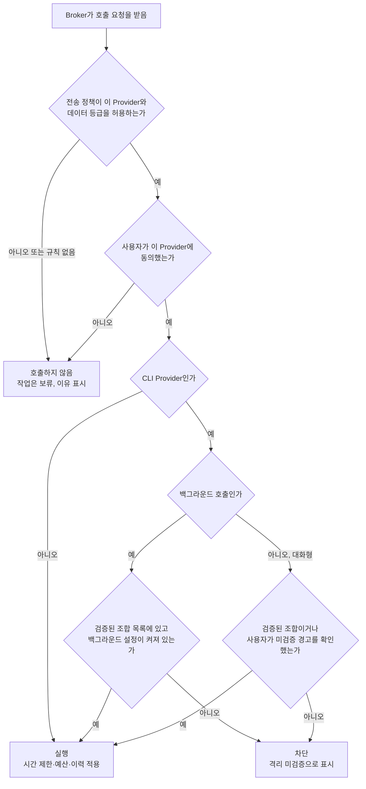
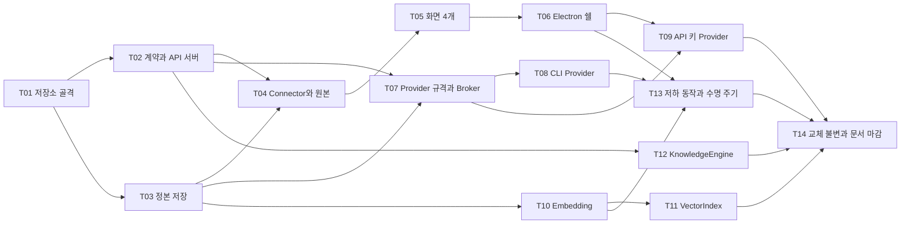

# 스펙: V01 공통 웹·API·Provider와 로컬 데이터 수직 골격

- 날짜: 2026-11-21 / 상태: 초안
- 관련: 이슈 #16(V01), 총괄 #1, Phase 1 #3, 선행 #15(R06), 확정 #37(R07). [ARCHITECTURE.md](../ARCHITECTURE.md), [adr/](../adr/README.md), [site-setup.md](../site-setup.md), 원 설계 [original-design.md](../design/original-design.md)

낯선 말은 [ARCHITECTURE 0절](../ARCHITECTURE.md#0-처음-나오는-말)에 풀이가 있다. `A01`~`A19`는 같은 문서 9절의 가정 번호, `S01`~`S15`는 site-setup.md의 체크리스트 번호다.

## 배경

제품 코드가 아직 없다. Phase 1은 수직 흐름 하나(합성 출처 → 추출 → Insight → 근거 화면)를 증명하는 단계이고, V01은 그 흐름이 올라설 **뼈대**를 만든다: 화면, 로컬 API, Electron 쉘, 정본 저장, Provider, Embedding, 그리고 뒤집힐 수 있는 선택을 가두는 어댑터 경계다.

엔진, CLI, Windows 설치 파일의 실행 검증은 배포처에서만 할 수 있다. 그래서 이 spec은 잠정 ADR 위에서 시작하고, 실행 근거가 없는 선택은 어댑터 뒤에 둔다(R06-C4). 어떤 완료 기준이 사외에서 충족되고 어떤 기준이 배포처 실행 전까지 미충족으로 남는지는 "완료 기준" 절에 따로 적었다.

## 목표

- 브라우저와 Electron에서 같은 화면이 같은 API 계약으로 백엔드의 실제 데이터를 보여 준다.
- 보안 기준선([ADR 0008](../adr/0008-security-baseline.md))이 첫 코드부터 적용되어 있고, 각 통제에 거부되는 경우의 테스트가 있다.
- CLI가 없거나 네트워크가 없거나 전송이 거부되거나 모델이 없어도 앱이 뜨고 저장된 자료를 찾아볼 수 있다.
- Provider, Embedding, KnowledgeEngine, 저장소 경계의 구현을 test double로 바꿔도 API 응답과 화면이 바뀌지 않는다.

## 비목표 (배포처에서 후속 진행)

**공용 저장소의 뒤 작업으로 넘기는 것**

- JSONL 가져오기, 지식 추출, Insight, 근거 화면: V02(#17).
- 작업 큐와 스케줄러: V02가 최소 실행기를 만들고 I03(#20)이 일반화한다.
- 정본 SQLite의 파일 단위 암호화, 백업: [ADR 0010](../adr/0010-encryption-at-rest.md), H01(#32).
- Windows 패키징 구성과 설치본 생성: R04(#13)의 사외 준비물. V01의 Electron 쉘(작업 T06)이 그 입력이다.
- 트레이, OS 알림, 자동 시작, 자동 업데이트: H02(#33).
- outbox와 투영 revision: 처음으로 비동기 투영이 생기는 작업([ADR 0013](../adr/0013-failure-recovery.md)).
- 실제 지식 엔진 연결과 사이드카: R07 뒤([ADR 0003](../adr/0003-phase1-without-engine.md), [0011](../adr/0011-sidecar-language.md)).

**배포처 후속 항목**(13개. 각각 [site-setup.md의 배포처 설정 체크리스트](../site-setup.md#배포처-설정-체크리스트)와 번호로 대응한다)

| 번호 | 항목 | 실행 경로 |
|---|---|---|
| S01 | 메일 수집기 구현 | `site-mail` |
| S02 | 메신저 수집기 구현 | `site-messenger` |
| S03 | Wiki 수집기 구현 | `site-wiki` |
| S04 | 수집기의 인증과 권한 매핑 | — (S01~S03의 구현 안) |
| S05 | LLM Provider 구성(엔드포인트, 모델, 키) | — (설정 값) |
| S06 | 구독 로그인 CLI 사용 허용 여부 확인 | — (확인 작업) |
| S07 | CLI 격리 검증과 백그라운드 실행 결정 | — (R02 실행) |
| S08 | 외부 전송 정책의 값 | — (설정 값) |
| S09 | Embedding 모델 반입 | — (설정 값) |
| S10 | Windows 11 설치본 검증 | — (R04 실행) |
| S11 | 저장 데이터 보호 확인 | — (확인 작업) |
| S12 | 서명, 배포 채널, 업데이트 | — (R04 실행) |
| S13 | 엔진과 저장소의 실행 비교 | — (R03 실행) |

"실행 경로"가 있는 세 항목은 공용 저장소에 미구현 표시용 구현이 있고, 실행하면 `미구현, 배포처 후속`을 알리고 실패한다(V01-R18).

## 요구사항

**뼈대**

- **V01-R1 저장소 골격.** "인터페이스 / 설계 개요"의 배치와 도구로 workspace를 만든다. 모듈 사이의 직접 import는 lint가 막는다. `lint`, `typecheck`, `test`, `e2e` 명령이 저장소 루트에서 돈다.
- **V01-R2 Local API.** 백엔드는 127.0.0.1에만 바인딩한다. 실행마다 새로 만든 세션 토큰이 없는 요청, `Host`가 자기 주소가 아닌 요청, `Origin`이 허용 목록에 없는 요청을 거부한다. 요청과 응답의 모양은 `packages/contracts`의 스키마 하나로 정의하고 화면과 백엔드가 그것을 함께 쓴다.
- **V01-R3 화면.** Home, Sources, Activity, Settings의 최소 화면이 백엔드에서 받은 데이터를 보여 준다. 화면 코드에 고정된 가짜 데이터를 두지 않는다. 같은 빌드가 브라우저와 Electron에서 돌고, 두 환경의 차이는 "백엔드 주소와 토큰을 어디서 받는가"뿐이다.
- **V01-R4 Electron 쉘.** 쉘은 백엔드 프로세스를 시작·종료하고, 앱이 두 번 실행되면 하나만 남긴다. contextIsolation 켬, sandbox 켬, nodeIntegration 끔, CSP 적용, 외부 URL 이동과 새 창 차단. preload는 "설계 개요"에 적은 함수만 노출하고 모든 IPC 입력을 스키마로 검증한다.
- **V01-R5 저하 동작.** CLI 없음, 네트워크 없음, 전송 거부, embedding 모델 없음, 벡터 확장 로드 실패의 각 상태에서 앱이 뜨고 저장된 원본의 목록과 키워드 검색이 동작하며, 무엇이 안 되는지 화면에 보인다. 막힌 Provider 대신 다른 Provider를 몰래 쓰지 않는다.

**저장**

- **V01-R6 정본 저장.** 정본 SQLite에 스키마 v1(원본, 원본 version, 설정, 동의, Provider 호출 이력)과 키워드 색인을 두고, 마이그레이션 실행기가 스키마 버전을 관리한다. 데이터 디렉터리는 OS 사용자별 위치다. 정본 접근은 SQL 드라이버 포트를 지난다([ADR 0004](../adr/0004-embedded-storage.md)).
- **V01-R7 Connector 규격과 원본 저장.** `Connector` 규격과 계약 테스트, 합성 원본을 내는 테스트 Connector를 만든다. 원본의 정체는 `connector_instance_id + external_id`이고, 내용이 같으면(content hash) 새 version을 만들지 않으며, cursor는 저장한 뒤에 확정한다.

**Provider와 전송**

- **V01-R8 Provider 규격과 Broker.** `LLMProvider` 규격([ARCHITECTURE 5.1절](../ARCHITECTURE.md))과 계약 테스트를 만든다. 모든 호출은 Broker를 지나고, Broker가 시간 제한, 재시도 간격, 요청 한도 응답 처리, 동시 실행 제한, 호출 예산, 오류 복구, 이력 기록을 맡는다. 요청에는 request ID, 작업 종류, 데이터 등급, 전송 결정, 스키마 버전, 재시도 가능 여부가 실린다. 이력에는 본문과 비밀 값이 없다.
- **V01-R9 CLI Provider.** `ClaudeCodeProvider`와 `CodexProvider`가 규격의 일곱 동작(detect, checkAuthentication, checkHealth, generate, generateStructured, cancel, getCapabilities)을 구현한다. 실행은 셸 없이 인자 배열로, 입력은 stdin으로, 작업마다 만든 빈 임시 디렉터리에서, 최소 환경 변수로 하고, 바깥에서 시간 제한을 걸어 프로세스 트리를 끝낸다. 제품은 CLI의 로그인 파일을 읽지 않는다. 두 CLI가 모두 탐색되면 사용자가 기본값을 고른다.
- **V01-R10 CLI 실행 조건.** 제품은 "검증된 조합 목록"(CLI 이름, 버전 범위, 인자 프로필)을 설정으로 갖고 공용 기본값은 빈 목록이다. 백그라운드 호출은 목록에 맞는 조합이고 백그라운드 설정이 켜져 있을 때만 실행한다. 백그라운드 설정의 기본값은 끔이다. 대화형 호출은 목록에 없는 조합이면 "격리 미검증" 표시와 사용자 확인을 거친 뒤에만 실행한다.
- **V01-R11 API 키 Provider.** `OpenAICompatibleProvider`가 같은 규격을 구현한다. 주소와 모델은 설정이고 키는 OS 자격 증명 저장소에서만 읽는다. `LocalModelProvider`는 규격만 따르고 모든 호출에 "미구현"을 돌려준다.
- **V01-R12 전송 정책과 동의.** [ADR 0014](../adr/0014-egress-policy-and-consent.md)대로 Broker가 호출 직전마다 정책과 동의를 검사한다. 거부가 우선이고 맞는 규칙이 없으면 거부다. 화면과 이력은 CLI 호출을 "외부 전송"으로 표시한다.
- **V01-R13 비밀 값과 로그.** 비밀 값은 OS 자격 증명 저장소에만 둔다. 저장소를 쓸 수 없으면 평문으로 넘어가지 않고 그 Provider를 "사용 불가"로 표시한다. 로그는 기록 전에 원문, 프롬프트, 응답 본문, 비밀 값, 토큰을 걸러 낸다. 설정 화면은 정본 SQLite의 암호화 상태를 있는 그대로 보인다([ADR 0010](../adr/0010-encryption-at-rest.md)).

**Embedding, 벡터, 엔진**

- **V01-R14 Embedding.** `EmbeddingProvider` 규격과 계약 테스트, Transformers.js 구현을 만든다. 모델은 사용자가 승인한 내려받기 또는 로컬 팩 가져오기로 준비하고, 준비된 뒤에는 네트워크 없이 동작한다([ADR 0006](../adr/0006-embedding.md)).
- **V01-R15 VectorIndex.** `VectorIndex` 규격과 계약 테스트, sqlite-vec 구현을 만든다. 확장을 불러오지 못하면 "사용 불가" 상태를 돌려준다.
- **V01-R16 KnowledgeEngine.** `KnowledgeEngine` 규격과 계약 테스트, null 구현, 테스트용 메모리 구현을 만든다. 계약 테스트는 메모리 구현에 대해 삭제, 낡은 fence 거부, 재구축 결과 동일성을 확인한다.
- **V01-R17 구현 교체 불변.** Provider, Embedding, VectorIndex, KnowledgeEngine 각각을 test double로 바꾼 구성에서도 API 응답이 같은 스키마를 지키고 같은 화면 테스트가 통과한다.

**배포처 경계와 문서**

- **V01-R18 미구현 표시.** `site-mail`, `site-messenger`, `site-wiki`를 Connector 종류로 등록하되 초기화하면 `미구현, 배포처 후속`이라는 오류로 실패한다. Sources 화면은 이들을 "미구현(배포처 후속)"으로 보인다. `site-check` 명령은 지정한 종류를 초기화해 보고, 실패하면 그 알림을 출력하고 0이 아닌 값으로 끝난다.
- **V01-R19 문서.** [site-setup.md](../site-setup.md)의 설정 키 이름을 구현한 이름으로 고친다(제목 `## 배포처 설정 체크리스트`는 그대로 둔다). 이 spec의 배포처 후속 항목과 그 체크리스트가 번호로 대응하는지 확인하는 문서 대응 테스트를 둔다. 설정 키의 설명은 site-setup.md에 두고, README에는 실행 명령 한 줄씩과 문서 링크만 둔다.

## 인터페이스 / 설계 개요

구성요소와 다섯 어댑터 규격의 스케치는 [ARCHITECTURE 2절·5절](../ARCHITECTURE.md)에 있다. 여기에는 V01이 새로 정하는 경계만 적는다.

### Broker의 호출 허용 판단

V01-R10과 V01-R12를 합친 것이다. Provider를 부를 수 있는 길은 이 그림의 "실행" 하나뿐이다.

### API와 preload (잠정. T02와 T06에서 확정)

| 경계 | 내용 |
|---|---|
| HTTP API | 상태 조회(백엔드, Provider, embedding, 벡터 색인), 원본 목록과 키워드 검색, 활동(Provider 호출 이력), 설정 읽기·쓰기(기본 Provider, 동의, 백그라운드 설정), Connector 목록과 동기화 실행, embedding 준비 시작 |
| preload가 화면에 주는 함수 | 세션 받기(백엔드 주소와 토큰), 비밀 값 저장·존재 확인·삭제(값을 다시 읽어 주는 함수는 없다), 외부 링크 열기(사용자 확인 뒤 OS 브라우저) |
| 쉘 ↔ 백엔드 | 쉘이 세션 토큰과 포트를 백엔드에 넘기고, 백엔드는 호출 직전에 비밀 값을 쉘에 요청한다 |

### 저장소 배치와 도구 (잠정)

배치는 [ARCHITECTURE 2절](../ARCHITECTURE.md)의 표를 따른다. 아래 도구 가운데 [OSS_EVALUATION](../OSS_EVALUATION.md)이 평가한 것은 절 번호를 적었다. 나머지는 개발 도구이며 **평가 범위 밖**이므로 T01과 T02에서 라이선스를 확인해 PR에 적는다([ADR 0009](../adr/0009-license.md)).

| 항목 | 잠정 선택 | 한 줄 이유 |
|---|---|---|
| 런타임 | Node.js 24 계열로 고정 | Electron 45가 Node 24를 담고 있어(4.1절) 개발과 설치본의 런타임을 맞춘다 |
| 패키지 관리 | pnpm workspace(평가 범위 밖) | 패키지마다 선언한 의존성만 보이게 해 모듈 경계를 지키기 쉽다 |
| 언어 설정 | TypeScript strict | 어댑터 규격을 타입으로 강제한다 |
| 단위·계약·통합 테스트 | Vitest(평가 범위 밖) | 화면이 쓰는 Vite와 설정을 공유한다 |
| 화면 자동 테스트 | Playwright(4.2절) | 브라우저와 Electron을 같은 테스트로 돌린다. Electron 지원은 실험적 |
| lint·서식 | ESLint와 Prettier(평가 범위 밖) | 모듈 간 import 금지 규칙을 lint로 건다 |
| HTTP 서버 | T02에서 고른다 | 기준: 허용 라이선스, 네이티브 모듈 없음, 유지보수 활발. 못 채우면 Node 표준 `node:http` |
| 스키마 검증 | T02에서 고른다 | 기준: 같은 정의에서 TypeScript 타입과 JSON Schema를 둘 다 얻을 수 있을 것(CLI의 구조화 출력 옵션에 JSON Schema를 넘겨야 한다) |
| 화면 구성요소 | React, Vite, shadcn/ui(4.2절) | 원 설계 지정 |
| 정본·벡터 | better-sqlite3, sqlite-vec(4.3절) | [ADR 0004](../adr/0004-embedded-storage.md) |
| Embedding | Transformers.js, bge-m3(4.5절) | [ADR 0006](../adr/0006-embedding.md) |

### 작업 분해 (잠정)

한 작업이 PR 하나다. 이 그래프는 잠정이며 spec이 확정된 뒤 다시 맞춘다. 모든 PR은 실행한 명령과 실제 출력, 충족한 기준과 이유, 미검증 범위를 적는다.

| ID | 산출물 | 요구사항 | 기준 | depends_on | 검증 증거 |
|---|---|---|---|---|---|
| V01-T01 | workspace, lint·typecheck·test 명령, 모듈 경계 lint 규칙, 문서 대응 테스트 | R1, R19(테스트) | H1 | — | 세 명령의 출력. 경계를 어긴 import를 넣으면 lint가 실패하는 것 |
| V01-T02 | `packages/contracts`, API 서버 골격, 토큰·Host·Origin 검사, 상태 API | R2 | C2(API), C1(계약) | T01 | API 보안 통합 테스트(거부 4종), API 계약 테스트 |
| V01-T03 | SQL 드라이버 포트와 계약 테스트, 마이그레이션 실행기, 스키마 v1, 키워드 색인 | R6 | C7(저장소) | T01 | 드라이버 계약 테스트, 빈 DB에서 v1까지 올리는 마이그레이션 테스트 |
| V01-T04 | Connector 규격과 계약 테스트, 테스트 Connector, 원본 저장, 미구현 표시 3종, `site-check` | R7, R18 | C3(자료), H2 | T02, T03 | Connector 계약 테스트, 재실행 시 원본이 늘지 않는 통합 테스트, `site-check` 3건 |
| V01-T05 | 화면 4개, API 클라이언트, 세션 받기(개발 환경), 브라우저 E2E | R3 | C1 | T04 | 브라우저 E2E. 백엔드의 씨앗 데이터를 바꾸면 화면 값이 바뀌는 것 |
| V01-T06 | Electron 쉘(백엔드 수명 주기, 단일 실행, preload, IPC 검증, CSP, 이동 차단), Electron E2E | R4 | C1, C2(쉘) | T05 | 같은 화면 테스트의 Electron 실행, 쉘 보안 E2E(거부 5종) |
| V01-T07 | Provider 규격과 계약 테스트, Broker, 전송 정책·동의, 이력, 로그 걸러 내기, 가짜 Provider | R8, R12, R13(로그) | C4(Broker), C5(전송·로그) | T02, T03 | Broker 단위 테스트, 정책 허용·거부 표 테스트, 카나리 문자열이 이력·로그에 없는 것 |
| V01-T08 | CLI Provider 2종, 가짜 CLI 실행 파일, 검증된 조합 목록, 백그라운드 기본 끔, 기본 Provider 선택 | R9, R10 | C4(CLI), C7(기본 OFF) | T07 | 가짜 CLI에 대한 계약 테스트, 인자 배열 테스트, 실행 조건 통합 테스트 |
| V01-T09 | OpenAI 호환 Provider, 비밀 값 저장소(쉘 중개, 개발용 환경 변수), 미구현 로컬 모델 Provider | R11, R13(비밀) | C4(계약 분리), C5(자격 증명) | T06, T07 | 로컬 가짜 HTTP 서버에 대한 계약 테스트, 비밀 값이 데이터 디렉터리에 없는 것 |
| V01-T10 | Embedding 규격과 계약 테스트, Transformers.js 구현, 모델 준비(내려받기, 로컬 팩), 상태 표시 | R14 | C6 | T03 | 가짜 embedder 계약 테스트, 실제 모델 왕복 1회의 기록, 모델 없음 통합 테스트 |
| V01-T11 | VectorIndex 규격과 계약 테스트, sqlite-vec 구현, embedding → 저장 → 검색 왕복 | R15 | C6(왕복), C7(저장소) | T10 | 계약 테스트, 왕복 통합 테스트, 확장 로드 실패 시 상태 테스트 |
| V01-T12 | KnowledgeEngine 규격과 계약 테스트, null 구현, 메모리 구현 | R16 | C7(엔진) | T02 | 메모리 구현에 대한 계약 테스트 |
| V01-T13 | 저하 동작 통합(다섯 상태), 시작·종료·단일 실행 통합 | R5 | C3, C6(모델 없음) | T06, T08, T10 | 저하 통합 테스트와 E2E, 수명 주기 E2E |
| V01-T14 | 구현 교체 불변 테스트, site-setup 키 이름 확정, README 명령 | R17, R19 | C7, H1 | T09, T11, T12, T13 | 교체 구성에서의 API 계약 테스트와 화면 E2E |

R04(#13)의 패키징 준비는 V01-T06에, V02의 작업은 V01-T03·T04·T05·T06·T07에 의존한다.

## 완료 기준 (테스트 가능한 형태)

C1~C7은 이슈 #16의 문장 그대로다. H1·H2는 이 프로젝트가 배포처로 넘어가는 프로젝트라서 spec 양식이 요구하는 두 기준이며 이슈에는 아직 없다.

- [ ] **V01-C1** (R2, R3, R4): Home/Sources/Activity/Settings 최소 화면이 backend 데이터를 표시하고 브라우저와 Electron이 같은 API 계약을 사용한다.
- [ ] **V01-C2** (R2, R4): loopback 바인딩, 세션 token·Origin/Host 검사, renderer sandbox/contextIsolation/nodeIntegration 비활성화/CSP/외부 URL navigation 제한/검증 IPC로 unauthorized 요청을 거부한다.
- [ ] **V01-C3** (R4, R5, R7): CLI 없음·오프라인·전송 거부 상태에서도 앱/기존 자료 탐색이 동작한다. 시작·종료·single instance를 통합 검증한다.
- [ ] **V01-C4** (R8, R9, R10, R11): ClaudeCodeProvider/CodexProvider의 detect/auth/health/generate/generateStructured/cancel/capabilities를 구현한다. 두 CLI가 모두 있으면 사용자가 기본 Provider를 고른다. timeout/backoff/rate limit/동시 실행·호출 예산·오류 복구·민감값 없는 이력은 공통 broker에서 적용한다. Optional OpenAI-compatible/local-model 계약은 분리하고 미구현 상태를 명시한다. 요청에는 request ID·task kind·data classification·egress policy·schema version·retryability를 싣는다. R02(#11)에서 격리를 검증한 설정으로만 실행하고 검증되지 않은 CLI 버전은 자동 실행을 차단한다.
- [ ] **V01-C5** (R6, R12, R13): R06에서 정한 로컬 데이터 암호화·OS credential store·전송 범위 승인·로그 redaction을 첫 영속 데이터 경로에 적용하고 허용/거부 테스트를 통과한다. CLI Provider 호출은 UI와 이력에서 외부 전송으로 표시하고 로컬 추론이라고 부르지 않는다.
- [ ] **V01-C6** (R5, R14, R15): R06에서 정한 embedding 실행 경로(모델 자산 포함 또는 최초 다운로드·오프라인 캐시)를 CLI Provider와 분리된 계약으로 연결하고 합성 입력의 embed round trip을 실행한다. 모델이 없거나 받을 수 없을 때는 그 상태를 표시하고 V01-C3의 기존 자료 탐색을 유지한다.
- [ ] **V01-C7** (R6, R8, R10, R14, R15, R16, R17): 엔진·Provider·저장소·embedding을 어댑터 경계 뒤에 두고 계약 테스트를 둔다. 배포처 검증(R07 #37) 결과로 구현을 바꿔도 상위 API와 UI가 바뀌지 않음을 테스트 double 교체로 보인다. 격리가 배포처에서 검증되기 전에는 CLI Provider의 백그라운드 자동 실행을 기본 OFF로 둔다.
- [ ] **V01-H1** (R19): 이 spec의 "배포처 후속 항목" 13개 각각에 대해 site-setup.md의 `## 배포처 설정 체크리스트` 아래에 같은 번호의 항목이 있으면 통과하고, 하나라도 없거나 수가 다르면 문서 대응 테스트가 실패한다.
- [ ] **V01-H2** (R18): `site-check`를 `site-mail`, `site-messenger`, `site-wiki` 각각에 실행하면 `미구현, 배포처 후속` 알림을 출력하고 0이 아닌 값으로 끝난다(경로마다 1건, 모두 3건).

이 spec에서 C7의 "저장소" 경계는 `VectorIndex`와 SQL 드라이버 포트를 뜻한다. double 교체는 `VectorIndex`로 보이고, SQL 드라이버 포트에는 계약 테스트를 둔다. 정본 SQLite 자체를 메모리 대역으로 바꿔 보이지는 않는다(정본의 동작이 곧 제품의 동작이기 때문이다).

### 기준별 증명 테스트

테스트 수준: **단위**(한 모듈), **계약**(어댑터의 모든 구현에 같은 묶음), **통합**(백엔드를 실제로 띄우고 SQLite 파일을 씀), **Playwright E2E**(브라우저 또는 Electron에서 화면까지).

| 기준 | 테스트 | 수준 | 확인하는 것 |
|---|---|---|---|
| C1 | `api.contract` | 계약 | 모든 API 응답이 `packages/contracts` 스키마를 통과 |
| C1 | `screens.e2e`(브라우저) | Playwright E2E | 네 화면이 백엔드 씨앗 데이터를 표시. 씨앗을 바꾸면 표시가 바뀜 |
| C1 | `screens.e2e`(Electron) | Playwright E2E | **같은 테스트 파일**이 Electron에서 통과 |
| C2 | `api.security` | 통합 | 토큰 없음, 틀린 토큰, 다른 `Host`, 허용되지 않은 `Origin`이 각각 거부. loopback이 아닌 주소로는 연결 불가 |
| C2 | `shell.security.e2e` | Playwright E2E(Electron) | 화면에서 Node 기능에 접근 불가, 인라인·원격 스크립트가 CSP에 막힘, 외부 URL 이동 차단, 새 창 차단, 스키마에 안 맞는 IPC 거부 |
| C3 | `degraded` | 통합 | CLI 없음, 네트워크 없음, 전송 거부의 각 상태에서 원본 목록과 키워드 검색이 결과를 돌려줌. Provider 호출이 0건 |
| C3 | `degraded.e2e` | Playwright E2E | 같은 상태에서 화면이 뜨고 무엇이 안 되는지 표시 |
| C3 | `lifecycle.e2e` | Playwright E2E(Electron) | 시작하면 백엔드가 응답, 종료하면 백엔드 프로세스가 없음, 두 번째 실행은 스스로 끝남 |
| C4 | `provider.contract` | 계약 | 가짜 Provider, 가짜 CLI를 쓴 CLI Provider 2종, 가짜 HTTP 서버를 쓴 OpenAI 호환 Provider가 같은 묶음을 통과. 로컬 모델 Provider는 "미구현" |
| C4 | `broker` | 단위 | 시간 초과, 재시도 간격, 요청 한도 응답, 동시 실행 상한, 예산 소진, 오류 복구, 요청 필드 6종의 존재 |
| C4 | `cli-argv` | 단위 | 인자 배열이 고정한 프로필과 일치. 가짜 CLI는 실제 CLI처럼 값이 빠진 옵션을 거부한다 |
| C4 | `cli-gate` | 통합 | 목록에 없는 조합의 백그라운드 호출 차단, 목록에 있고 켜져 있으면 실행, 대화형은 확인 없이는 차단 |
| C4 | `default-provider.e2e` | Playwright E2E | 두 CLI가 탐색되면 설정에서 기본값을 고를 수 있고 다음 호출이 그 Provider로 감 |
| C5 | `egress-policy` | 단위 | 허용·거부 표, 거부 우선, 규칙 없으면 거부, 섞인 입력은 가장 엄격한 등급 |
| C5 | `secrets` | 통합 | 저장한 키의 카나리 문자열이 데이터 디렉터리 전체(DB, 설정, 로그)에 없음. 저장소를 못 쓰면 Provider가 "사용 불가"이고 평문 파일이 생기지 않음 |
| C5 | `log-redaction` | 단위 | 원문, 프롬프트, 응답, 토큰의 카나리가 로그에 없음 |
| C5 | `egress-label.e2e` | Playwright E2E | CLI 호출이 화면과 이력에 "외부 전송"으로 표시되고 "로컬 추론"이라는 말이 없음. 설정 화면이 "데이터베이스 암호화: 적용 안 됨"을 표시 |
| C6 | `embedding.contract` | 계약 | 가짜 embedder와 Transformers.js 구현이 같은 묶음을 통과 |
| C6 | `embedding.roundtrip` | 통합(실제 모델, 명시적으로 켤 때만) | 합성 한국어·영어 문장을 embedding해 저장하고 검색하면 그 항목이 나옴. 준비 뒤 네트워크를 끊어도 동작 |
| C6 | `embedding.missing` | 통합 | 모델이 없고 받을 수 없을 때 상태가 "모델 없음"이고 키워드 검색은 동작 |
| C7 | 경계별 계약 묶음 | 계약 | `provider.contract`, `embedding.contract`, `vector-index.contract`, `sql-driver.contract`, `engine.contract`가 존재하고 통과 |
| C7 | `adapter-swap` | 통합 | Provider, Embedding, VectorIndex, KnowledgeEngine을 차례로 double로 바꾼 구성에서 `api.contract`가 그대로 통과 |
| C7 | `screens.e2e`(double 구성) | Playwright E2E | 같은 화면 테스트가 double 구성에서 통과 |
| C7 | `cli-background-default` | 단위 | 기본 설정에서 백그라운드가 꺼져 있음. 목록이 비어 있으면 켜도 차단 |
| H1 | `docs.site-setup` | 단위 | 비목표 표의 번호 13개가 체크리스트에 모두 있음 |
| H2 | `site-check` | 통합 | 세 종류 각각에서 알림 문자열과 0이 아닌 종료 값 |

### 사외에서 충족할 수 있는 것과 배포처 실행 전까지 미충족인 것

"사외"는 공용 저장소의 개발 환경이다. 여기서의 통과는 Windows에서의 동작이나 실제 CLI의 동작을 증명하지 않는다.

| 기준 | 사외 | 배포처 실행 전까지 남는 것 |
|---|---|---|
| C1 | **충족 가능**(개발 OS의 브라우저와 Electron) | Windows 설치본에서의 같은 확인은 R04, V02-C4 |
| C2 | **충족 가능**(개발 OS) | Windows에서의 재확인은 H03 |
| C3 | **충족 가능**(개발 OS) | Windows에서의 종료·단일 실행·절전 복귀(A18) |
| C4 | **부분.** 구현, 가짜 CLI에 대한 계약 테스트, Broker, 실행 조건은 충족 가능 | **미충족**: "R02에서 격리를 검증한 설정으로만 실행". 검증된 조합 목록이 비어 있으므로 실제 CLI의 실행 증거가 없다. S06, S07 뒤에 충족(A01~A05) |
| C5 | **부분.** 전송 정책, 로그, 개발 OS의 자격 증명 저장소는 충족 가능 | 배포처 Windows의 자격 증명 저장소(A16). **정본 SQLite의 파일 단위 암호화는 Phase 1에 없다**(ADR 0010). 이 점을 PR에 그대로 적는다 |
| C6 | **부분.** 계약 테스트와 "모델 없음"은 충족 가능. 실제 모델 왕복은 개발 환경에서 모델을 받을 수 있을 때 1회 기록 | 설치본 안에서의 실행과 속도·메모리(A11), 배포처의 모델 반입(A12) |
| C7 | **충족 가능** | 실제로 구현을 바꾸는 일은 R07의 결과에 달려 있다 |
| H1, H2 | **충족 가능** | — |

R07(#37)이 닫히기 전에는 V01을 통과로 표시하지 않는다(이슈 #1 공통 완료 규칙).

## 미해결 질문

1. **V01-C4 문구와 ADR 0005의 차이.** 이슈 #16은 OpenAI 호환 Provider를 "미구현 상태를 명시"할 선택 항목으로 적었지만 [ADR 0005](../adr/0005-llm-providers.md)는 정식 경로로 구현하기로 했다. 이 spec은 구현을 요구한다(V01-R11). 이슈 문구를 고칠지 정해야 한다.
2. **"R02에서 격리를 검증한 설정으로만 실행"의 범위.** 글자 그대로면 검증 전에는 대화형 호출도 할 수 없다. 이 spec은 ADR 0005에 따라 대화형 호출을 "격리 미검증" 확인 뒤에 허용한다(V01-R10). 검증 전에는 대화형도 막을지 정해야 한다.
3. **정본 SQLite 평문.** Phase 1을 파일 단위 암호화 없이 시작하는 것을 받아들이는지([ADR 0010](../adr/0010-encryption-at-rest.md) "미해결").
4. **H1·H2를 이슈 #16의 완료 기준에 더할지.**

## 변경 이력

| 날짜 | 변경 내용 | 대상 | 사유 |
|---|---|---|---|
| 2026-11-21 | 최초 작성(초안) | 이 문서 | 이슈 #16의 구현 spec, R06-C1·R06-C4 |
