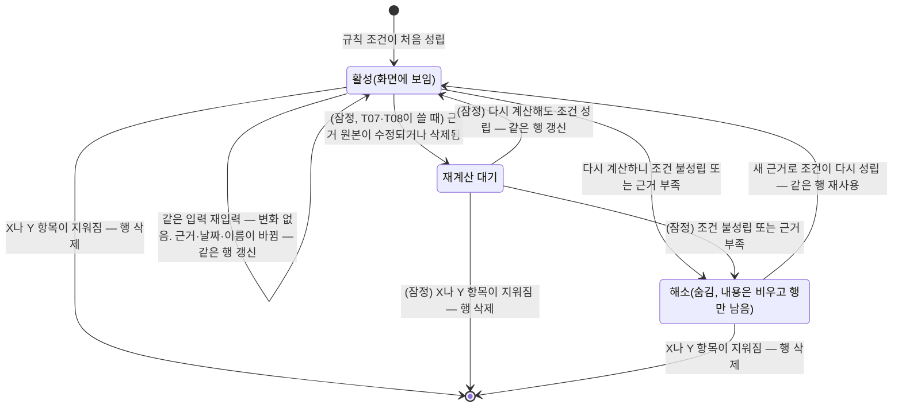
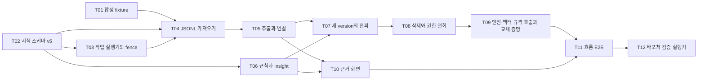

# 스펙: V02 세 출처 연결 → 일정 위험 Insight → 근거 화면 수직 검증

- 날짜: 2026-11-21 / 상태: 확정
- 관련: 이슈 #17(V02), 총괄 #1, Phase 1 #3, 선행 #16(V01)·#14(R05), 확정 #37(R07). [V01 spec](2026-11-21-V01-vertical-skeleton.md), [ARCHITECTURE.md](../ARCHITECTURE.md), [adr/](../adr/README.md), [site-setup.md](../site-setup.md)

낯선 말은 [ARCHITECTURE 0절](../ARCHITECTURE.md#0-처음-나오는-말)에 풀이가 있다. `S14`·`S15`는 site-setup.md의 체크리스트 번호, `A…`는 ARCHITECTURE 9절의 가정 번호다.

## 배경

제품의 핵심 가치는 서로 다른 출처의 정보를 이어 개별 원본만으로는 알기 어려운 것을 알려 주는 데 있다(원 설계 10절). 원 설계가 든 예가 이 spec의 대상이다.

- 메일: A 프로젝트 완료 목표는 12월 5일
- Wiki: A 프로젝트는 B 시스템의 API에 의존
- 메신저: B 시스템의 API 개발은 12월 10일로 연기

기대 결과는 "A의 목표 일정이 의존 업무의 지연으로 위험하다"는 Insight이며, 이것은 확정 사실이 아니라 **추론**으로 표시되어야 한다. V02는 V01의 뼈대 위에서 이 흐름 하나를 가져오기부터 근거 화면까지 실제로 잇는다.

Phase 1에는 제3자 지식 엔진이 없다([ADR 0003](../adr/0003-phase1-without-engine.md)). 추출은 LLM Provider의 구조화 출력으로 하고, 날짜 비교와 중복 검사는 코드가 한다. 다만 파이프라인은 엔진과 벡터 규격을 정해진 자리에서 부르며, 그 자리에 지금은 아무것도 하지 않는 구현이 묶여 있다. 이 규격들의 교체 증명은 이슈 #16의 V01-C7에서 이 작업의 V02-C5로 넘어왔다.

## 목표

- 합성 출처 3개를 가져오면 근거 3개가 달린 "의존 업무 지연" Insight 1건이 추론으로 표시되어 생긴다.
- 날짜를 바꾼 입력에서는 결과가 바뀐다.
- 같은 입력을 다시 넣어도 Insight가 늘지 않고, 원본을 고치면 다시 계산되며, 원본을 지우면 그 내용이 예전 version의 것까지 저장소에서 **없어진다.**
- 화면에서 근거를 원본의 version과 글자 위치까지 따라갈 수 있고, 가져온 원문 안의 스크립트와 원격 자원은 실행·로드되지 않는다.
- 엔진 규격의 구현을 바꿔 끼우면 파이프라인을 고치지 않고도 결과가 달라진다.

## 비목표 (배포처에서 후속 진행)

**공용 저장소의 뒤 작업으로 넘기는 것**

- JSONL 말고 다른 형식의 가져오기, 폴더 감시, 원본 파일과 첨부의 저장: I02(#19).
- Connector 규격의 확정과 SDK 문서화: I01(#18). V02는 V01의 규격에 JSONL 구현을 더할 뿐이다.
- 스케줄러, 재시도 정책의 일반화, 여러 작업의 동시 처리, 절전 복구: I03(#20).
- tombstone 보존 기간, 삭제한 원본의 복원, 지난 version의 정리, 접근 범위가 다른 원본 사이의 연결 제한: I04(#21).
- 유사도에 기대는 개체 해소, 뜻이 비슷한 사실의 병합, 값이 다른 사실의 상충 처리, 병합 되돌리기, 시간 그래프: S02(#23).
- "의존 업무 지연" 말고 다른 Insight 유형, 중요도 순위: P01(#27). 알림: P02(#28). Insight에 대한 사용자 피드백과 상태(확인함, 다시 알리지 않기): P03(#29).
- 벡터 검색, 질의응답, **벡터 색인에 쓰고 찾는 경로**: X01(#30). V02는 벡터 색인에 아무것도 넣지 않는다.
- 품질 수치(정확도 등)의 통과 기준: R05(#14)가 고정한 뒤 잰다. V02는 흐름이 성립하는지만 본다.
- 설치 파일 만들기: R04(#13). V02의 배포처 검증 실행기는 R04가 V01-T15의 산출물로 만든 설치본을 쓴다.

**배포처 후속 항목**(2개. 각각 [site-setup.md의 배포처 설정 체크리스트](../site-setup.md#배포처-설정-체크리스트)와 번호로 대응한다)

| 번호 | 항목 |
|---|---|
| S14 | 이 흐름을 Windows 설치본과 실제 Provider로 실행하고 기록 |
| S15 | 실제 수집 데이터에서의 추출·Insight 품질 확인 |

## 요구사항

**입력**

- **V02-R1 합성 fixture.** 세 출처(메일형, Wiki형, 메신저형)의 JSONL과 기대 결과를 `fixtures/`에 둔다. 레코드의 모양은 R05(#14)의 골든 데이터와 같다(원 설계 5절의 SourceRecord에 `connector_instance_id`, `operation`, `schema_version`을 더한 것). 변형도 함께 둔다: ① B의 날짜가 A의 목표일보다 이른 **날짜 변형** ② 스크립트 태그, 원격 이미지, "이전 지시를 무시하라"는 문장이 든 **악성 변형**. 모두 지어낸 내용이며 날짜에는 연도를 적는다. 이 파일들은 빌드 때 합성 목록에 들어가고(V01-R7), 악성 변형에는 표시가 붙는다.
- **V02-R2 JSONL 가져오기.** JSONL 한 줄이 원본의 version 하나인 Connector 구현을 만들고 V01의 Connector 계약 테스트를 통과시킨다. 형식이 틀린 줄은 그 줄만 거부하고 몇 번째 줄인지 알린다. 레코드의 `operation`을 Connector의 변경 종류로 옮긴다: `upsert`는 `upsert`, `delete`는 `delete`, `revoke`는 `access-revoked`. 같은 원본에 더 큰 version 번호와 다른 내용이 오면 새 version이 되고, 이전 version은 그대로 남는다. 삭제와 권한 철회, 그리고 화면의 삭제 요청은 V02-R12의 삭제가 된다.

**정본과 작업**

- **V02-R3 지식 스키마(마이그레이션 v5).** V01이 스키마 v1~v4를 썼으므로 지식 스키마는 다섯 번째 마이그레이션으로 들어간다. 마이그레이션으로 다음을 더한다: **항목**(프로젝트, 시스템 같은 대상), **사실**(어느 항목의 어떤 종류의 값인가. 예: 목표일), **관계**(주체 항목, 관계 유형, 대상 항목), **근거**(사실이나 관계 하나가 **어느 원본 version**의 어디에서 나왔는가: 시작, 끝, 인용문), Insight, tombstone, **변경 순번**, knowledge revision, 그리고 V01의 작업 테이블에 임대와 fence에 필요한 열. 항목·사실·관계는 인식 유형(명시 사실, 사용자 승인, 추론, 가설), 상태(candidate, verified, disputed, superseded, rejected), 유효 시각, 관측 시각을 따로 갖는다. 근거의 시작과 끝은 **유니코드 코드 포인트**로 센 `[시작, 끝)`이다(R05와 같은 단위). 원본의 version은 저장된 뒤 바뀌지 않고, 근거는 자기 version을 계속 가리킨다(이슈 #18 I01-C2). 그 version이 원본의 최신이면 "현재 근거", 아니면 "지난 근거"다.
- **V02-R4 작업 실행기.** 작업을 정본 SQLite 테이블에 두고 기한이 있는 임대로 집는다. 원본 version 저장, 변경 순번 증가, 추출 작업 등록은 한 트랜잭션이다. 같은 원본 version의 같은 종류 작업은 한 번만 등록된다. 재시작하면 임대 기한이 지난 작업을 다시 집는다. **작업은 한 번에 하나씩 처리한다**(세 출처가 동시에 추출되어 같은 대상이 두 항목으로 생기는 일을 막는다).
- **V02-R5 version fence.** 작업은 등록될 때의 원본 version을 들고 다닌다. 결과를 쓰는 트랜잭션 안에서 그 version이 여전히 최신이고 그 version 이상인 tombstone이 없는지 확인하고(tombstone보다 높은 version으로 다시 들어온 원본의 작업은 막지 않는다), 아니면 결과를 버리고 작업을 `superseded`로 닫는다.

**추출과 연결**

- **V02-R6 추출.** 원본 version 하나에 대해 Broker에 구조화 출력을 **1회** 요청한다(응답이 스키마에 맞지 않을 때만 재시도 1회). 파이프라인이 Broker에 넘기는 것은 원본 version의 ID, 후보 항목의 ID, 작업 ID뿐이다. 글, 지시, 등급, 호출 종류는 넘기지 않는다. Broker가 정본에서 글을 꺼내고 지시문을 붙인다(V01-R8). 응답의 사실과 관계는 **인용문**을 가져야 한다. 근거의 위치는 코드가 정한다: 정본의 원문에서 그 인용문을 찾아 시작과 끝을 계산하고, LLM이 숫자를 돌려주더라도 쓰지 않는다. 인용문이 원문에 없거나 두 군데 이상에 있으면 그 사실이나 관계는 기록하지 않고 작업 결과에 버린 수를 남긴다. 추출된 것은 상태 candidate로 들어간다.
- **V02-R7 기존 지식과의 연결.** 추출 전에, 이름이나 별칭이 원문에 **글자 그대로** 들어 있는 기존 항목을 찾아 그 ID를 후보로 Broker에 넘긴다. 별칭은 그 항목에 이미 기록된 이름에서만 온다. 비교 전의 가공은 유니코드 정규화, 대소문자 통일, 공백 정리뿐이다. 키워드 색인과 그 순위를 쓰지 않는다. 후보의 이름은 다른 원본에서 나온 글이므로, Broker는 후보 항목의 근거가 된 원본까지 넣어 등급을 계산한다. LLM은 후보 가운데 하나의 ID를 가리키거나 새 항목을 제안한다. 후보에 없는 ID를 가리킨 응답은 버린다. 코드는 유사도를 계산하지 않는다.
- **V02-R8 범위 제한.** [ADR 0003](../adr/0003-phase1-without-engine.md)의 범위 제한 일곱 줄을 지킨다. 그 가운데 이 spec이 직접 구현하는 규칙:
  - **같은 행**: 두 사실은 항목 ID, 사실 종류, 정규화한 값(날짜는 연-월-일)이 모두 같을 때만 같은 행이고, 두 관계는 주체 ID, 관계 유형, 대상 ID가 모두 같을 때만 같은 행이다. 같은 행이면 근거만 더한다. 값이 다르면 다른 행으로 두고 합치거나 상충을 풀지 않는다.
  - 한 번에 넣을 수 없는 크기의 원본은 chunk로 나누지 않고 작업을 "보류(크기 초과)"로 남긴다.
  - 관계 조회는 규칙이 쓰는 정해진 질의의 깊이 1 조인뿐이고 재귀 질의를 쓰지 않는다.

**Insight**

- **V02-R9 결정론 규칙 "의존 업무 지연".** 다음이 모두 참이면 Insight를 만든다: 항목 X에 목표일 사실이 있다, X가 Y에 의존한다는 관계가 있다, Y에 예상 완료일 사실이 있다, Y의 날짜가 X의 목표일보다 늦다, 세 행이 모두 **유효**하다. "유효"는 상태가 superseded나 rejected가 아니고 현재 근거가 하나 이상 있다는 뜻이다(candidate도 유효하다). 날짜 비교는 코드가 하고 이 규칙은 LLM을 부르지 않는다. Insight의 인식 유형은 "추론"이고 근거는 세 행의 현재 근거다.
- **V02-R10 Insight 유지.** Insight는 중복 키(규칙, X의 ID, Y의 ID)로 1건만 둔다. 조건이 그대로면 아무것도 바꾸지 않고, 근거가 바뀌면 같은 행을 갱신한다. 조건이 깨지거나 근거가 모자라면 "해소"로 바꿔 화면에서 숨기고 그 행의 설명 글과 근거 연결을 비운다. X와 Y 항목이 남아 있는 한 행 자체(ID와 중복 키)는 남겨, 조건이 다시 성립하면 새 행을 만들지 않고 그 행을 되살린다. X나 Y 항목이 지워지면 그 Insight 행도 함께 지운다.
- **V02-R11 새 version의 전파.** 원본의 새 version이 오면 이전 version을 가리키던 근거는 **떼지 않고** 지난 근거가 된다. 현재 근거가 하나도 없게 된 사실과 관계를 superseded로 바꾼 뒤 새 version을 추출한다. 추출 결과가 superseded인 행과 같은 행이면 현재 근거를 붙이며 그 행을 되살린다. 영향받은 Insight는 다시 계산한다.
- **V02-R12 삭제와 권한 철회.** 원본이 삭제되거나 권한이 철회되면 한 트랜잭션에서:
  - tombstone(원본 식별자, 그때까지의 version 번호, 시각, 사유. **내용 없음**)을 쓰고 변경 순번을 올린다.
  - 그 원본의 **모든 version**의 본문과 제목, 그 version들을 가리키는 근거와 인용문(현재 근거와 지난 근거 모두), 키워드 색인의 행을 **지운다.**
  - 근거가 하나도 남지 않은 사실과 관계를 상태와 상관없이 지운다(superseded였던 행도 포함한다. 예전 version에만 있던 값이 이 경로로 지워진다). 다른 원본의 근거가 남은 행은 남긴다.
  - 사실도 관계도 남지 않은 항목을 지우고, 그 항목을 가리키는 Insight 행을 지운다. 나머지 영향받은 Insight는 다시 계산한다.
  - 지운 내용은 데이터베이스 파일과 그 부속 파일에 남아 있지 않아야 한다. tombstone의 version 이하인 그 원본은 다시 들어오지 못한다.

**엔진과 벡터 규격**

- **V02-R13 규격을 부르는 자리와 교체.** 파이프라인은 [ARCHITECTURE 5.3절](../ARCHITECTURE.md)의 표대로 규격을 부른다: 원본 version 저장 뒤 `KnowledgeEngine.upsertSource`, 추출 직전 능력이 있을 때 `proposeKnowledge`, 새 version이나 삭제 뒤 `removeSource`와 `VectorIndex.remove`, 시작할 때 투영이 반영한 변경 순번이 정본과 다르면 `rebuild`(같으면 부르지 않는다). 통지에는 변경 순번을 함께 넘긴다. 엔진이 제안한 후보는 V02-R6과 **같은 인용문 대조**를 거쳐야 기록된다. 제품의 기본 구성에는 null 구현과 빈 구현이 묶여 있다. 이 호출은 정본을 쓴 뒤에 하며, 실패하거나 꺼져서 놓친 통지는 다음 시작 때 변경 순번 비교로 찾아낸다([ADR 0013](../adr/0013-failure-recovery.md)). 구현을 다른 것으로 바꿀 때 파이프라인 코드와 상위 API는 바뀌지 않는다. `VectorIndex`의 `upsert`와 `search`는 Phase 1에 부르는 자리가 없다.

**화면과 영속**

- **V02-R14 근거 화면.** Home의 Insight에서 근거 목록을 열고, 근거마다 원본의 version과 강조된 글자 위치를 볼 수 있다. Insight에는 "추론" 표지가 붙고, 근거가 없는 추론이 "확정"으로 보이는 길이 없다.
- **V02-R15 신뢰하지 않는 원문.** 가져온 원문에는 "가져온 자료(신뢰하지 않음)" 표지가 붙고 글자로만 그려진다. 원문 안의 스크립트는 실행되지 않고 원격 자원은 요청되지 않는다.
- **V02-R16 영속.** 재시작 뒤에도 원본, 지식, Insight가 남아 있고 끝나지 않은 작업이 이어진다.

**검증 수단과 문서**

- **V02-R17 흐름 E2E.** 가져오기부터 근거 화면까지를 Playwright로 브라우저와 Electron에서 실행한다. Provider는 fixture별로 정해 둔 내용을 돌려주는 test double이다(연결할 기존 항목의 ID는 받은 요청에 든 후보에서 고른다).
- **V02-R18 배포처 검증 실행기와 결과 기록.** 같은 흐름을 설치본과 실제 Provider로 돌리는 실행기를 둔다. 실행 기록에는 Provider 종류(`test-double` 또는 `real`), Provider 이름과 버전, OS, 앱 버전, 인용문 대조에서 버린 수가 반드시 들어간다. 실행기는 Provider가 test double이거나 Windows 설치본이 아니면 `배포처 후속`으로 시작하는 알림을 출력하고 0이 아닌 값으로 끝난다.
- **V02-R19 문서.** [site-setup.md](../site-setup.md)의 S14 항목을 실행기의 실제 명령과 기록 위치로 고친다(제목 `## 배포처 설정 체크리스트`는 그대로 둔다). V01의 문서 대응 테스트에 이 spec의 배포처 후속 항목을 더한다. README에는 실행 명령 한 줄과 문서 링크만 둔다.

## 인터페이스 / 설계 개요

가져오기에서 Insight까지의 순서, fence와 tombstone이 걸리는 자리, 엔진과 벡터 규격을 부르는 자리는 [ARCHITECTURE 5.3절·6절](../ARCHITECTURE.md)에 있다. 여기에는 V02가 새로 정하는 것만 적는다.

### Insight 한 건의 상태

V02-R10~R12를 합친 것이다. "해소"에서 다시 "활성"으로 돌아올 때 새 행을 만들지 않는 것이 중복을 막는 핵심이다.

T06의 규칙은 `DIRTY`를 만들지 않고 활성 행을 곧바로 갱신하거나 해소한다. `DIRTY`를 거치는 길은 T07·T08이 그 상태를 쓰기로 정할 때의 것이다("T06이 넘기는 것" 7항).

### 추출 응답의 모양 (잠정. T05에서 확정)

| 필드 | 내용 |
|---|---|
| 항목 | 유형, 이름, 후보 가운데 고른 기존 항목 ID 또는 새 항목 표시 |
| 사실 | 어느 항목의 어떤 종류인가(목표일, 예상 완료일), 값(날짜는 연-월-일), 인식 유형, **인용문** |
| 관계 | 주체 항목, 관계 유형(의존), 대상 항목, **인용문** |

위치(시작, 끝)는 응답에 요구하지 않는다. 유형과 관계 유형의 이름은 원 설계 7절의 목록에서 고르되, V02의 추출 스키마에는 이 흐름이 쓰는 것만 넣는다. 추출의 지시문과 응답 스키마는 `providers/`에 두는 코드 상수이며 Broker가 작업 종류로 고른다.

### 작업 분해

한 작업이 PR 하나다. `V01-T…`는 [V01 spec](2026-11-21-V01-vertical-skeleton.md)의 작업이다. 그림은 V02 안의 선후만 그렸고, V01과 다른 작업에 대한 선행은 아래 표가 기준이다.

| ID | 산출물 | 요구사항 | 기준 | depends_on | 검증 증거 |
|---|---|---|---|---|---|
| V02-T01 | 합성 fixture 3종, 날짜 변형, 악성 변형, 기대 결과, 합성 목록 등록, 문서 대응 테스트 확장 | R1, R19(테스트) | C1(입력), H1 | **R05(#14)**, V01-T01, V01-T04 | fixture가 가져오기 스키마를 통과하고 합성 목록에 들어 있다는 테스트 |
| V02-T02 | 스키마 v5 마이그레이션, 항목·사실·관계·근거·Insight·tombstone 저장 모듈, 변경 순번·knowledge revision(트리거로 올림), 원본 version 테이블 재구성(원본별 version 번호), 작업 테이블 재구성(원본·fence version·임대. 아래 "T02가 넘기는 것") | R3 | C1(저장), C3(영속) | V01-T03 | v4에서 v5로 올리는 마이그레이션 테스트, 저장 모듈 단위 테스트, 근거 위치가 코드 포인트 단위임을 보이는 테스트(한글과 이모지가 든 원문) |
| V02-T03 | 작업 실행기(임대, 한 번에 하나, 재시작 재개), fence 검사 | R4, R5 | C3 | V02-T02 | 낡은 version의 결과가 버려지는 통합 테스트, 재시작 재개 통합 테스트 |
| V02-T04 | JSONL Connector, `operation` 옮기기, 줄 단위 오류 보고, 새 version 받기, Sources 화면의 가져오기, 원본 저장·변경 순번·작업 등록의 한 트랜잭션 | R2 | C1(입력), C3(재입력) | V02-T01, V02-T02, V02-T03, V01-T04, V01-T05 | Connector 계약 테스트, 재입력 시 수가 늘지 않는 통합 테스트 |
| V02-T05 | 추출의 지시문과 스키마(코드 상수), ID만 넘기는 추출 요청, 인용문으로 위치 계산, 연결 후보 조회, 같은 행 판정, 크기 초과 보류, fixture별 Provider double | R6, R7, R8 | C1(추출·연결) | V02-T04, V01-T08 | 인용문 대조 단위 테스트, 호출 횟수 테스트, 세 출처의 A와 B가 같은 항목으로 이어지는 통합 테스트 |
| V02-T06 | "의존 업무 지연" 규칙, Insight 중복 키와 상태 | R9, R10 | C1(Insight), C3(중복) | V02-T02 | 날짜 경우별 단위 테스트(늦음, 같음, 이른 날짜, 의존 없음, 유효하지 않은 행) |
| V02-T07 | 새 version의 전파: 지난 근거, superseded, 재추출, 되살리기, Insight 재계산 | R11 | C3(수정) | V02-T05, V02-T06 | 수정 후 해소, 다시 수정 후 같은 행으로 활성의 통합 테스트. 지난 근거가 이전 version을 계속 가리키는지의 테스트 |
| V02-T08 | 삭제와 권한 철회: 내용 없는 tombstone, 모든 version의 본문·근거·색인 행 지우기, 근거 없는 지식과 그 Insight 지우기, 재유입 차단, 화면의 삭제 요청 | R12 | C3(삭제) | V02-T07 | 삭제 뒤 파일에서 카나리가 사라지는 테스트(예전 version에만 있던 값 포함), 공유 지식이 남는 테스트, 재유입 차단 테스트 |
| V02-T09 | 파이프라인의 엔진·벡터 규격 호출(네 자리), 변경 순번 통지, 시작 때 비교와 재구축, 교체 증명 | R13 | C5 | V02-T08, V01-T12 | 메모리 엔진으로 호출을 확인하는 테스트, 깨끗한 재시작에 재구축이 없다는 테스트, 제안 능력이 있는 엔진으로 바꾸면 결과가 달라지는 테스트. 메모리 엔진은 상태를 파일에 남기지 않으므로 `engine.restart` ①은 흉내 낸 재시작 앞뒤에 **같은 엔진 인스턴스**를 쓴다. 시작 비교는 엔진 종류로 분기하지 않으며 null 엔진(`appliedChangeSeq` 언제나 null)은 켤 때마다 비용 없는 `rebuild`를 받고, 빈 벡터 색인의 `AdapterUnavailableError`는 건너뜀으로 다룬다([ARCHITECTURE 5.3·5.4절](../ARCHITECTURE.md)의 V01-T12 확정 규격) |
| V02-T10 | Home의 Insight, 근거 목록, 원본 version과 span 보기, 신뢰하지 않는 원문 표시 | R14, R15 | C2 | V02-T05, V02-T06, V01-T05 | 근거 화면 E2E, 악성 변형 E2E |
| V02-T11 | 흐름 전체 E2E(브라우저, Electron), 재입력, 재시작 | R16, R17 | C3(영속), C4(E2E 부분) | V02-T09, V02-T10, V01-T06 | 두 환경의 E2E 출력과 실행 기록(Provider 종류 `test-double`) |
| V02-T12 | 배포처 검증 실행기, 실행 기록 양식, 실행 절차, site-setup S14 갱신 | R18, R19 | C4(실행기), H2 | V02-T11, V01-T15, **R04(#13)의 사외 준비물** | 실행기가 사외에서 거부하는 2건 |

**T01이 넘기는 것**. T04 이후가 지켜야 하는 T01의 결정이다.

1. **가져오기 한 줄의 스키마**: `packages/contracts/src/import-record.ts`의 `ImportRecordSchema`. R05 골든 데이터의 필드 규칙(`eval/scorer/validate.py`의 `check_record`)을 옮긴 것이며, 골든 원본 전부가 이 스키마를 통과한다는 테스트가 있다. `content_hash`가 `content`의 sha256인지는 스키마가 아니라 fixture 테스트가 확인한다(contracts는 화면에서도 쓰이므로 `node:crypto`를 쓰지 않는다). T04의 JSONL Connector는 줄마다 이 스키마로 검사한다. `content_hash`가 `content`와 맞지 않는 줄을 그 줄의 오류로 거부할지는 T04가 정하고 그 결정을 테스트로 남긴다(백엔드에서는 `node:crypto`를 쓸 수 있다).
2. **악성 표시**: fixture 줄의 `"malicious": true`는 스키마가 받아들이되(`true`만), Connector가 내는 `SourceRecord`에는 싣지 않는다(V01의 `SourceRecordSchema`가 거부한다). 이 표시는 합성 목록을 만들 때만 읽힌다. T04는 `SourceRecord`를 넓히더라도(version 등) Connector가 내는 레코드에 `malicious`가 없다는 것을 Connector 테스트로 확인한다.
3. **fixture와 기대 결과**: `fixtures/v02-*.jsonl`과 `fixtures/v02-expected.json`(묶음 `plain`, `date-variant`, `malicious`). 날짜 변형과 악성 변형은 기본 원본과 다른 `id`·`external_id`를 가진 별도 원본이며, 날짜 변형은 메신저 원본을 **대신해** 넣는다. 수정 version이 필요한 테스트(`update.recompute` 등)는 그 테스트가 version을 만든다. 합성 목록 생성기는 `schema_version`이 있는 줄에서 `body` 대신 `content`를 읽는다. 기대 결과의 규칙 이름은 골든 라벨의 `insight_type`과 같은 `dependency_delay`다. 근거가 붙은 원문 일부에는 인용문 앞에 이모지(BMP 밖 문자)가 있어, 위치를 UTF-16 단위로 세면 틀린다.

**T02가 넘기는 것**. T02가 정한 것(잠정 표시가 없으면 확정)과 뒤 작업이 이어받는 결합 지점이다. 바꿀 때는 이 절과 해당 테스트를 함께 고친다.

1. **원본 version 번호.** `source_versions`에 원본마다 1부터 세는 `version` 열이 있다. 새 version은 그 원본의 최신 version보다 커야 하고, 그 원본의 tombstone이 있으면 tombstone의 version보다도 커야 한다(트리거가 거부한다). 그래서 지운 원본이 같은 번호로 다시 들어오지 못하고, 행 ID도 AUTOINCREMENT라 다시 쓰이지 않는다. 최신 행 ID와 최신 version은 언제나 같은 행이다.
2. **T04: 레코드의 version을 그대로 저장한다.** 지금의 `saveSourceRecord`는 "최신 + 1"로 번호를 매긴다(V01 Connector가 version을 주지 않으므로 잠정). T04는 JSONL 레코드에 적힌 version을 저장하도록 바꿔야 한다(R2). 지운 원본을 "최신 + 1"로 다시 넣으면 1번이 되어 위 트리거에 거부된다. tombstone 트리거가 다시 들어온 레코드를 거부할 때 그 레코드만 줄 오류로 건너뛸지 페이지 전체를 실패시킬지는 T04·T08이 정한다. 아무것도 하지 않으면 `backend/src/connectors.ts`가 페이지를 한 트랜잭션으로 저장하므로 레코드 하나의 거부가 페이지 전체를 되돌린다.
3. **작업 테이블.** `jobs`는 version 행의 ID 대신 원본(`source_id`)과 등록할 때의 version(`fence_version`), 임대 기한(`lease_until`)을 갖는다. 원본의 모든 version을 지워도(R12) 작업이 남아 fence가 `superseded`로 닫을 수 있게 하려는 것이다. (종류, 원본, fence version)마다 한 번만 등록된다(R4). 등록이 충돌하면 기존 작업의 상태를 확인해야 하고, 충돌을 성공으로 여기지 않는다. 작업을 등록하고 집는 API는 T03·T04가 만든다.
4. **변경 순번과 knowledge revision은 트리거가 올린다.** 원본 version 저장과 tombstone 쓰기(더 높은 version으로 옮길 때 포함)마다 변경 순번이 같은 트랜잭션에서 정확히 1 오른다. 코드는 읽기만 한다(`readChangeSeq`). knowledge revision은 항목·사실·관계 행이 바뀔 때마다 행 하나에 1씩 오른다(잠정. 값이 같은 UPDATE도 센다). v4에서 올린 데이터베이스는 저장된 version 수에서 시작한다.
5. **T08: 지우기 전에 영향받는 것을 모은다.** 근거는 version이 지워지면 함께 지워지고(cascade) Insight의 근거 연결도 함께 사라진다. 그래서 version을 지운 뒤에는 어떤 Insight·사실·관계가 영향을 받았는지 알 수 없다. 특히 다른 원본의 근거가 남아 있어 계속 보이는 Insight의 설명 글이 지운 원본에서 나왔을 수 있다. T08은 같은 트랜잭션에서 **지우기 전에** 그 원본의 근거에 연결된 Insight, 그 근거가 받치는 사실·관계, 그리고 그 사실·관계를 가진 항목(사실의 항목, 관계의 주체와 대상)을 먼저 모으고, 그 집합만 다시 계산하거나 지운다. 항목은 모아 둔 것 가운데 사실도 관계도 남지 않은 것만 지우고, 처음부터 사실·관계가 없던 다른 항목은 건드리지 않는다. 근거 없는 행을 전체에서 쓸어 지우면 처음부터 근거가 없던 행까지 지워진다.
6. **T08: 키워드 색인의 흔적을 지운다.** FTS5의 `'delete'`는 지운 본문의 낱말을 색인의 부속 테이블에 남긴다. 둘 다 필요하다: ① `PRAGMA secure_delete = ON`. 연결마다 적용되는 설정이라 마이그레이션이 아니라 데이터베이스를 열 때마다 켠다. 이것만으로는 FTS 부속 테이블의 낱말이 사라지지 않는다(독립 검토 B에서 확인). ② `keyword_index`의 FTS5 `secure-delete` 설정을 켜거나 삭제 뒤 `optimize`를 돌린다. T08은 데이터베이스 파일과 부속 파일에서 카나리(본문, 제목, 인용문, Insight 설명 글)가 없어졌는지 테스트한다(`delete.purge`). 카나리끼리는 앞부분이 겹치지 않게 만든다. FTS가 같은 앞부분을 압축해 저장하므로, 겹치면 한 카나리가 없다는 결과가 실제로 없다는 증거가 되지 못한다.
7. **tombstone은 원본 행을 가리킨다.** 지워도 `sources` 행(식별자만)은 남고, tombstone의 키가 그 행이다. `writeTombstone`은 더 높은 version으로만 옮긴다. 그 원본의 실제 최신 version을 넘기는 것은 T08의 몫이다.
8. **근거의 위치는 저장할 때 검사한다.** `addEvidence`는 저장된 본문에서 코드 포인트로 센 `[시작, 끝)`이 인용문과 정확히 같을 때만 기록한다(SQLite의 `substr`·`length`가 TEXT를 글자, 곧 코드 포인트로 센다). 본문에 U+0000이 있으면 그 뒤의 위치는 기록할 수 없다(`length`가 거기서 멈춘다). 인용문으로 위치를 계산하는 것은 T05다.

**T03이 넘기는 것**. T03이 정한 것(잠정 표시가 없으면 확정)과 T04·T05·T07이 이어받는 결합 지점이다. 바꿀 때는 이 절과 `storage/src/jobs.test.ts`, `backend/src/job-runner.test.ts`를 함께 고친다.

1. **작업 상태.** `queued` → `leased` → `done`·`superseded`·`held`(보류)·`failed`. 임대 기한이 지난 `leased`는 다시 집히고, 닫힌 작업은 다시 집히지 않는다. 보류와 실패의 이유는 스키마 v6에서 더한 `jobs.reason`에 **코드**로만 남긴다(Provider 문구나 본문은 넣지 않는다). `closeJob`은 코드 모양(`/^[a-z][a-z0-9-]{0,63}$/`, `isReasonCode`)이 아닌 이유를 `RangeError`로 거부하고, 실행기는 처리기가 그런 이유를 돌려주면 `failed`(`invalid-reason`)로 닫는다. 스키마 v6은 임대 토큰 `jobs.lease_token`도 더한다(집을 때마다 1 오름).
2. **T04: 등록.** `registerJob(db, {kind, sourceId, fenceVersion})`은 부르는 쪽의 트랜잭션 안에서 작업을 `queued`로 넣는다. 원본 version 저장과 같은 트랜잭션에서 부른다(R4). 충돌이면 `{registered: false, existing}`로 이미 있는 작업을 돌려주며 성공으로 치지 않는다. 등록 뒤 실행기를 깨우는 것(`runner.wake()`)은 T04의 몫이다.
3. **T05: 처리기.** `createJobRunner({db, handlers: {extract: handler}})`. 처리기는 임대된 작업(`StoredJob`: 원본 ID와 fence version)을 받아 `{status: "done", write}`·`{status: "held", reason}`·`{status: "failed", reason}`을 돌려준다. `write`는 실행기가 fence를 확인하는 트랜잭션 안에서만 부르므로, 처리기는 정본에 결과를 직접 쓰지 않는다. Broker에 넘길 원본 version의 행 ID는 처리기가 `(sourceId, fenceVersion)`으로 찾는다. Broker에는 `origin: {jobId: String(job.id), lease: String(job.leaseToken)}`을 넘긴다. 처리기가 예외를 던지면 `failed`(`handler-error`), `write`가 던지면 그 쓰기는 되돌려지고 `failed`(`write-error`). `write`가 아닌 데이터베이스 오류와 파일 잠김(SQLITE_BUSY·SQLITE_LOCKED, `write` 안에서 생겨도)은 `write-error`가 아니다. 작업은 `leased`로 남고 임대가 끝나면 다시 집힌다. `closeJob`은 `write`보다 작업 행 갱신을 먼저 해 쓰기 잠금을 먼저 잡으므로, 다른 프로세스가 파일을 잠그고 있으면 결과를 쓰기 전에 실패한다.
4. **fence(R5).** `closeJob`이 한 트랜잭션에서 확인한다: 그 원본의 최신 version이 fence version과 같고, tombstone이 없거나 tombstone의 version이 fence보다 작아야 한다. 아니면 `write`를 부르지 않고 `superseded`로 닫는다. 보류·실패도 fence가 낡았으면 `superseded`가 된다. 집을 때 이미 낡은 작업은 처리기를 부르지 않고 닫는다(지워진 원본으로 Broker를 부르지 않는다). `leased`가 아닌 작업의 결과는 버린다(`not-leased`). 그래서 같은 작업이 두 번 돌아도 결과는 한 번만 들어간다.
5. **한 번에 하나(R4)와 임대 토큰.** 실행기 하나 안의 모든 집기와 처리가 한 줄로 이어진다(`runOnce`, `wake`, 주기 확인이 겹쳐도 동시에 두 작업이 돌지 않는다). 임대가 유효한 동안에는 다른 실행기가 그 작업을 집지 못한다. 임대가 끝나 다른 실행기가 다시 집으면 토큰이 오르므로, 이전 보유자는 Broker 호출도(`origin-not-leased`) 작업 닫기도(`not-leased`, 아무것도 쓰지 않음) 하지 못한다. 그래서 이전 보유자의 늦은 `held`가 새 보유자의 `done`을 덮어쓰지 못한다. 다만 이전 보유자의 호출이 토큰이 오르기 **전에** 이미 Broker를 지났다면 그 호출은 끝까지 간다(Broker는 요청마다 한 번 확인한다). Phase 1은 백엔드 하나를 전제한다.
6. **백그라운드 판정은 Broker가 한다.** 실행기는 설정을 읽지 않는다. Broker는 작업 기록이 **`leased`이고 요청의 `lease`가 현재 토큰과 같을 때만** 작업에서 나온 호출로 받고, 아니면 `origin-not-leased`로 거부한다(V01 "T07이 넘기는 것" 6의 "이미 쓴 작업 기록"). `lease`가 없는 작업 요청은 `invalid-request`다. CLI 백그라운드 설정이 꺼져 Broker가 막은 호출(`cli-background-off` 등, 그리고 전송 거부)은 처리기가 `held`로 돌려주고 사유 코드를 남긴다. **다른 Provider로 넘어가지 않는다**(ARCHITECTURE 7절).
7. **잠정: 보류는 저절로 풀리지 않는다.** `held` 작업은 다시 집히지 않는다. (종류, 원본, version)마다 한 번만 등록되므로 같은 version을 새로 등록해 풀 수도 없다. 푸는 길은 미해결 질문 7(담당 T05)에 있다.
8. **잠정: 임대 10분, 주기 확인 30초**(`DEFAULT_LEASE_MS`, `DEFAULT_POLL_MS`). 임대는 Broker 한도(시도 3, 시간 제한 상한 120초, 대기 최대 30초)로 호출 하나가 걸릴 수 있는 시간보다 길게 잡았고, 갱신하지 않는다. 그래서 처리 중에 꺼진 뒤 다시 켜면 그 작업은 최대 10분 뒤에 이어진다. 계속 프로세스를 죽이는 작업의 재시도 횟수 제한은 없다.
9. **T05: 구성 지점에 묶기.** 실행기는 아직 `backend/src/composition.ts`와 시작 함수에 묶이지 않았다(처리기가 하나도 없다). 첫 처리기를 넣는 T05가 구성 지점에서 실행기를 만들고 시작할 때 `start()`, 끝낼 때 `stop()`을 부른다. `stop()`은 돌고 있는 작업이 닫힐 때까지 기다린다.
10. **T07: 새 version.** 새 version이 들어오면 그 version의 작업을 새로 등록할 뿐, 이전 version의 작업을 고치지 않는다. 이전 작업은 fence에 걸려 `superseded`로 닫힌다.

**T06이 넘기는 것**. T06이 정한 것(잠정 표시가 없으면 확정)과 뒤 작업(T05, T07, T08, T10)이 이어받는 결합 지점이다. 바꿀 때는 이 절과 `knowledge-engine/src/dependency-delay.test.ts`를 함께 고친다.

1. **자리와 이름.** 규칙은 `knowledge-engine/src/dependency-delay.ts`에 있고 패키지 입구(`@pki/knowledge-engine`)가 `recomputeDependencyDelay`와 이름 상수를 내보낸다(ARCHITECTURE 2절의 "결정론 규칙, Insight" 자리). 규칙 이름은 `dependency_delay`, 사실 종류는 `target_date`(X의 목표일)와 `completion_date`(Y의 예상 완료일), 관계 유형은 `DEPENDS_ON`(주체 X, 대상 Y)이다. 골든 라벨의 어휘와 같으며 테스트가 `fixtures/v02-expected.json`과 대조한다. **T05는 추출한 사실과 관계를 이 이름으로 써야 한다**(다른 이름이면 규칙이 아무것도 찾지 못한다).
2. **부르는 때(잠정).** 규칙은 스스로 깨어나지 않는다. 지식을 쓴 쪽이 **같은 트랜잭션에서** 영향받은 항목의 ID를 넘겨 `recomputeDependencyDelay(db, itemIds)`를 부른다(ARCHITECTURE 6절 "영향받은 항목의 규칙 평가"). 함수는 자기 트랜잭션을 연다. 혼자 불렀다가 도중에 실패하면 그 호출이 쓴 것이 모두 되돌려지고, 바깥 트랜잭션 안에서 부르면 그 일부가 되어 바깥이 되돌리면 함께 되돌려진다(better-sqlite3 드라이버의 중첩 트랜잭션. 두 경우 모두 테스트가 있다). 넘긴 항목이 X나 Y인 쌍은 ① 그 항목을 한쪽 끝으로 하는 `DEPENDS_ON` 관계와 ② 그 항목을 X나 Y로 가진 기존 Insight 행(상태 무관) 두 곳에서 모은다. ②가 있어야 **관계 행이 지워진** 쌍(R12는 근거가 남지 않은 관계를 지운다)도 해소된다. superseded나 rejected가 된 관계는 행이 남아 있어 ①로 찾는다. X와 Y가 같은 쌍(자기 의존)은 건너뛴다(잠정. 다른 업무의 지연이 아니므로 Insight를 만들지 않는다). T05는 기록한 사실의 항목과 관계의 주체·대상을, T07은 superseded로 바꾸거나 되살린 사실의 항목과 관계의 주체·대상을, T08은 지우기 전에 모아 둔 항목 가운데 남은 것을 넘긴다.
3. **입력 질의(잠정).** 규칙이 읽는 것은 `storage/src/insights.ts`에 더한 정해진 질의 넷(`listFactsOfKind`, `findRelation`, `listRelationPairs`, `listInsightKeys`)과 T02의 `listEvidence`, `readItem`, `readInsight`뿐이다. 모두 테이블 하나이거나 깊이 1 조인이며 재귀 질의가 없다(R8). 항목 ID 목록은 JSON 매개변수 하나(`json_each`)로 넘기므로 SQLite의 매개변수 개수 제한에 걸리지 않는다(테스트는 4만 개). 중복된 ID는 쌍 하나로 모인다. "현재 근거"의 판정은 `listEvidence`의 것을 그대로 쓴다. 상태와 날짜의 판단은 SQL이 아니라 규칙 코드가 한다.
4. **날짜와 "유효".** 날짜는 연-월-일 형식의 실제 달력 날짜만 쓴다(`2026-02-30`, `2026-11-31`, `12월 10일`, 시각이 붙은 값은 그 사실을 쓰지 않는다. `Date.parse`는 `2026-11-31`을 12월 1일로 넘기므로 코드가 달력에 있는 날짜인지 따로 확인한다. 정규화는 T05의 몫). 비교는 **엄격히 늦음**이다: 같은 날이면 Insight가 없다. T06 행의 "이른 날짜"는 **Y가 더 이른 경우**다(C1 증명 테스트의 "12/5 대 12/3". 처음 표기 "이름"을 독립 검토 B-F2에서 고쳤다). 유효한 행은 상태가 superseded·rejected가 아니고(candidate, verified, disputed는 유효) 현재 근거가 하나 이상인 것이다. 항목 자체의 상태는 보지 않는다.
5. **날짜가 여럿일 때(잠정).** 값이 다른 사실은 다른 행이므로(R8) X의 목표일이나 Y의 완료일이 여럿일 수 있다. 유효한 것 가운데 **가장 이른 목표일과 가장 늦은 완료일**로 판정한다(늦은 쌍이 하나라도 있으면 성립하는 것과 같다). 한 항목에 같은 종류·같은 값의 사실은 한 행뿐이므로(`UNIQUE (item_id, kind, value)`) 같은 값끼리 고를 일은 없다. 근거는 그 두 사실과 관계, 세 행의 현재 근거 전부이며 상충을 풀지 않는다(S02).
6. **쓰기.** 원하는 내용과 저장된 행이 같으면 **쓰지 않는다**(테스트는 연결의 `total_changes()`, 변경 순번, knowledge revision이 그대로인지 본다. Insight 행은 어느 카운터도 올리지 않는다). 성립하지 않는 쌍에는 행을 만들지 않는다. 깨지면 해소(설명 글·근거 연결 비움, 행 유지), 해소된 행에 다시 성립하면 같은 행을 되살린다. 결과는 판정한 쌍마다(성립하지 않고 행도 없는 쌍은 빼고) `created`, `updated`, `revived`, `resolved`, `unchanged`로 돌려준다. 같은지는 상태(`active`), 설명 글, 근거 ID 목록(오름차순)으로 비교한다. 설명 글은 두 항목의 이름과 두 날짜로 만드는 한국어 문장이며 "추론"을 밝힌다. 그래서 항목 이름이 바뀌면 근거가 그대로여도 같은 행이 갱신된다. 항목이 지워질 때 행이 사라지는 것은 T02의 외래 키 cascade이고 규칙은 지운 항목을 넘겨받아도 아무것도 하지 않는다.
7. **"재계산 대기"(dirty)는 T07의 것(잠정).** T06은 행을 `dirty`로 만들지 않는다. 다시 계산할 때 `dirty` 행은 조건이 그대로여도 `active`로 다시 쓰고(`updated`), 깨졌으면 해소한다. 근거 원본이 바뀌거나 지워질 때 행을 `dirty`로 표시할지, 아니면 같은 트랜잭션에서 곧바로 이 함수를 불러 `dirty`를 거치지 않을지는 T07·T08이 정한다. 상태 그림의 `DIRTY`는 그때까지 쓰이지 않는다.
8. **T08: 설명 글의 출처.** 설명 글에는 두 항목의 이름과 두 날짜가 들어가고 근거의 인용문은 들어가지 않는다. 날짜는 사실 행의 값이라 그 사실이 지워지면 다시 계산할 때 빠진다. 그러나 **항목 이름은 근거에 묶여 있지 않다**: 이름이 지운 원본에서만 나왔더라도 다른 원본의 사실이나 관계가 남아 항목이 남으면, 그 이름은 다시 계산한 설명 글에 그대로 남는다. 이것을 R12의 "지운 내용"으로 볼지와 `delete.purge`의 카나리에 항목 이름을 넣을지는 T08이 정한다.
9. **T10: 화면이 쓸 것.** 화면은 상태가 `active`인 행만 보이고, 근거는 `readInsight`의 `evidenceIds`로 연다. 인식 유형은 언제나 `inferred`다.

## 완료 기준 (테스트 가능한 형태)

C1~C5는 이슈 #17의 문장 그대로다(2026-11-21 추가된 C5 포함). H1·H2는 이 프로젝트가 배포처로 넘어가는 프로젝트라서 spec 양식이 요구하는 두 기준이며, 이슈의 문장이 아닌 별도 항목으로 이 spec에만 둔다.

- [ ] **V02-C1** (R1, R2, R3, R6, R7, R8, R9): A 완료 12/5, A→B 의존, B API 12/10 지연을 실제 추출·저장·연결하여 추론임을 표시한 위험 Insight를 만든다. 다른 날짜를 주면 결과가 바뀐다.
- [ ] **V02-C2** (R14, R15): 근거 3개를 UI에서 원본 version/span까지 열고 unsupported 추론을 확정 사실로 보이지 않는다. import한 원문은 untrusted data로 표시하며 원문 안의 script·remote resource는 실행·로드되지 않는다.
- [ ] **V02-C3** (R2, R4, R5, R10, R11, R12, R16): 재입력은 중복 Insight를 만들지 않고 수정·삭제 뒤 stale 결과를 숨기거나 재계산한다. 재시작 후 데이터가 유지된다.
- [ ] **V02-C4** (R17, R18): Playwright E2E와 Windows 설치본에서 같은 흐름을 실행한다. Windows 설치본과 실제 provider 실행은 배포처에서 수행하며 그 전까지 이 기준은 미충족이다. 테스트 double 결과와 실제 provider 결과를 구분해 기록한다.
- [ ] **V02-C5** (R13): 파이프라인이 KnowledgeEngine·VectorIndex 규격을 정해진 지점에서 호출하고, 구현을 교체해도 파이프라인 코드와 상위 API가 바뀌지 않음을 보인다(V01-C7에서 넘어온 부분). Phase 1에서 호출되지 않는 경로(예: 벡터 쓰기)는 미증명으로 남긴다.
- [ ] **V02-H1** (R19): 이 spec의 "배포처 후속 항목" 2개 각각에 대해 site-setup.md의 `## 배포처 설정 체크리스트` 아래에 같은 번호의 항목이 있으면 통과하고, 하나라도 없거나 수가 다르면 문서 대응 테스트가 실패한다.
- [ ] **V02-H2** (R18): 배포처 검증 실행기를 ① test double Provider로 ② Windows 설치본이 아닌 환경에서 실행하면 각각 `배포처 후속`으로 시작하는 알림을 출력하고 0이 아닌 값으로 끝난다(경우마다 1건, 모두 2건). V02에는 구현하지 않고 넘기는 코드 경로가 없으므로, 양식의 "미구현 경로" 기준을 "사외 실행이 배포처 결과로 기록되는 길을 막는다"로 적용했다.

**기준을 읽는 법**

- **C3의 "stale 결과를 숨기거나"**: 화면에서는 숨기는 것이지만 저장소에서는 다르다. 삭제된 원본의 내용은 숨기는 것이 아니라 지운다(V02-R12, 원 설계 17절 "원본 삭제와 파생 지식 삭제 동기화").
- **C5의 "정해진 지점"**은 V02-R13의 네 자리다. **C5의 "미증명으로 남긴다"**에 해당하는 것: `VectorIndex.upsert`와 `VectorIndex.search`(제품 코드가 부르지 않는다), `KnowledgeEngine.relatedContext`(파이프라인이 부르지 않고 테스트만 부른다). 이 경로들은 구현을 바꿔도 된다는 것이 Phase 1에서 확인되지 않으며 X01(#30)에서 확인한다.

### 기준별 증명 테스트

테스트 수준의 뜻은 [V01 spec](2026-11-21-V01-vertical-skeleton.md#기준별-증명-테스트)과 같다.

| 기준 | 테스트 | 수준 | 확인하는 것 |
|---|---|---|---|
| C1 | `rule.dependency-delay` | 단위 | 12/5 대 12/10이면 Insight. 12/5 대 12/3, 같은 날, 의존 관계 없음, 세 행 중 하나가 superseded이면 Insight 없음 |
| C1 | `extraction.quote` | 단위 | 인용문이 원문에 없으면 버림. 두 군데 이상이면 버림. 응답에 든 위치 숫자는 무시되고 코드가 계산한 값이 저장됨. 한글과 이모지가 든 원문에서 위치가 코드 포인트 단위 |
| C1 | `extraction.calls` | 통합 | 원본 version 하나의 추출에서 Provider 호출이 정확히 1회. 스키마에 안 맞는 응답이면 2회에서 멈추고 실패. 크기 초과 원본은 호출 0회로 "보류" |
| C1 | `extraction.request` | 통합 | 파이프라인이 Broker에 넘긴 요청에 ID 말고 글이 없음. 악성 변형을 추출할 때 Provider가 받은 요청에서 그 지시 문장이 문서 구획에만 있고 지시 구획에는 없음 |
| C1 | `linking` | 통합 | 후보는 이름이 원문에 글자 그대로 있는 항목뿐. 후보에 없는 ID를 가리킨 응답은 버림. 값이 같은 사실은 한 행에 근거 2개, 값이 다른 사실은 두 행. 후보 항목의 출처가 일반 등급이면 그 호출의 등급도 일반 |
| C1 | `flow.insight` | 통합 | fixture 3개를 가져오면 항목·사실·관계가 저장되고, A와 B가 출처를 넘어 같은 항목으로 이어지며, Insight 1건이 인식 유형 "추론"과 근거 3개로 생김 |
| C1 | `flow.date-variant` | 통합 | 날짜 변형 fixture에서는 Insight가 생기지 않음 |
| C1 | 배포처 검증 실행기 | 배포처 실행 | 실제 Provider가 같은 fixture에서 같은 Insight에 이르는지, 인용문 대조에서 몇 건이 버려지는지(A21) |
| C2 | `evidence.e2e` | Playwright E2E | 근거 3개를 각각 열면 원본 version 번호와 강조된 글자가 fixture와 일치. "추론" 표지가 있고 "확정" 표지가 없음 |
| C2 | `insight.epistemic` | 단위 | 근거 없는 추론을 사실 유형으로 저장하려 하면 거부 |
| C2 | `untrusted.e2e` | Playwright E2E | 악성 변형에서 스크립트가 실행되지 않음(페이지에 표식이 생기지 않음), 원격 요청 0건, "신뢰하지 않음" 표지 표시 |
| C3 | `reimport.idempotent` | 통합 | 같은 JSONL을 두 번 넣어도 원본 version, 지식, Insight의 수가 그대로 |
| C3 | `update.recompute` | 통합 | B의 날짜를 12/3으로 고친 version → 12/10 사실은 superseded가 되고 그 근거는 이전 version을 계속 가리킴, Insight 해소. 다시 12/12로 고치면 **같은 Insight 행**이 활성 |
| C3 | `delete.purge` | 통합 | ① 원본을 지운 뒤 그 원본에만 있던 카나리 문자열이 데이터베이스 파일과 부속 파일의 바이트 어디에도 없음 ② **예전 version에만 있던 값**(version 1의 카나리가 version 2에서 다른 값으로 바뀐 원본)을 지워도 version 1의 본문, 그 인용문, superseded였던 사실이 모두 사라짐 ③ tombstone 행에 내용 열이 없음 ④ 권한 철회도 같음 |
| C3 | `delete.propagate` | 통합 | 의존 관계 원본을 지우면 Insight가 해소되고 내용이 비워짐. 다른 원본도 근거인 사실은 남음. 항목이 지워지면 그 항목의 Insight 행도 지워짐. 삭제 전에 시작된 추출의 결과는 fence에 걸려 버려짐. 삭제된 version 이하를 다시 넣어도 되살아나지 않음 |
| C3 | `restart.persist` | 통합 | 백엔드 재시작 뒤 Insight가 그대로이고 임대된 채 남은 작업이 이어짐 |
| C3 | `stale.e2e` | Playwright E2E | 삭제 뒤 Home에서 그 Insight가 보이지 않음 |
| C4 | `v02-flow.e2e`(브라우저, Electron) | Playwright E2E | 가져오기부터 근거 화면까지. 실행 기록의 Provider 종류가 `test-double` |
| C4 | `run-record` | 단위 | 실행 기록에 Provider 종류가 없으면 거부. test double 실행은 `real`로 기록될 수 없음 |
| C4 | 배포처 검증 실행기 | 배포처 실행 | Windows 설치본과 실제 Provider로 같은 흐름 |
| C5 | `engine.calls` | 통합 | 메모리 엔진과 메모리 색인을 묶으면: 가져오기 3건에 `upsertSource` 3회(변경 순번 1, 2, 3), 삭제에 `removeSource`와 `VectorIndex.remove`, 그 뒤 테스트가 엔진에 관련 문맥을 물으면 삭제된 원본이 나오지 않음 |
| C5 | `engine.restart` | 통합 | ① 추출까지 끝낸 뒤 깨끗이 끝냈다가 다시 켜면 `rebuild`가 **호출되지 않음** ② 통지 직전에 꺼뜨리고 다시 켜면 `rebuild`가 호출됨 |
| C5 | `engine.swap` | 통합 | 파이프라인 코드와 API를 고치지 않고 엔진만 "제안 능력이 있는" 대역으로 바꾸면, 그 엔진이 제안한 후보가 인용문 대조를 거쳐 candidate로 기록됨. 인용문이 틀린 제안은 버려짐. null 엔진에서는 그 후보가 없음. 두 구성에서 `api.contract`가 그대로 통과 |
| H1 | `docs.site-setup` | 단위 | 비목표 표의 번호 2개가 체크리스트에 모두 있음 |
| H2 | `site-verify.refuse` | 통합 | 두 경우 각각에서 알림 문자열과 0이 아닌 종료 값 |

### 사외에서 충족할 수 있는 것, 배포처 실행을 기다리는 것

| 기준 | 사외 | 남는 것 |
|---|---|---|
| C1 | **부분.** 저장, 연결, 규칙, 날짜에 따른 결과 변화는 test double로 충족 가능 | **미충족**: "실제 추출". test double은 정해 둔 내용과 언제나 정확한 인용문을 돌려줄 뿐이라, LLM이 원문에서 실제로 뽑아냈다는 증거도 인용문이 대조를 통과한다는 증거도 아니다(A21). S14 뒤에 충족 |
| C2 | **충족 가능**(개발 OS) | — |
| C3 | **충족 가능**(개발 OS) | Windows에서의 재시작 영속은 S14의 실행에 포함 |
| C4 | **부분.** Playwright E2E와 실행기 자체는 충족 가능 | **미충족**(기준이 명시): Windows 설치본과 실제 Provider 실행. 가져오기로 등록된 추출은 백그라운드 호출이다. 따라서 설치본에서 CLI Provider로 이 흐름을 돌리려면 그 조합이 검증된 조합 목록에 있고(S07) 백그라운드 설정이 켜져 있어야 한다. 그렇지 않으면 API 키 Provider(S05)로 실행한다. S10과 S14 뒤에 충족 |
| C5 | **충족 가능** | 기준이 스스로 미증명으로 남기는 경로(벡터 쓰기와 찾기, 엔진의 관련 문맥 조회를 제품이 부르는 것): X01(#30). 실제 엔진을 꽂았을 때의 동작: R07 |
| H1, H2 | **충족 가능** | — |

test double의 결과를 실제 Provider의 결과로 적지 않는다. R07(#37)이 닫히기 전에는 V02를 통과로 표시하지 않는다.

## 미해결 질문

**작업을 막는 것**

1. **R05(#14)가 V02-T01을 막는다.** fixture의 레코드 모양과 근거 단위를 R05의 골든 데이터에 맞추기로 했는데 R05는 아직 닫히지 않았다(PR #38이 열려 있다). T01이 막히면 T04와 그 뒤가 모두 막힌다. T02, T03, T06은 R05 없이 시작할 수 있다. R05가 늦어지면 T01이 PR #38의 형식을 그대로 따라 먼저 진행하고, R05가 형식을 바꾸면 fixture를 고친다.
2. **R04(#13)의 사외 준비물이 V02-T12를 막는다.** 실행기는 설치본을 대상으로 하므로 패키징 구성이 있어야 끝낼 수 있다.

**진행은 하되 번복되면 다시 하는 것**(사용자 확인 대기. [ARCHITECTURE 맨 위 표](../ARCHITECTURE.md#사용자-확인이-필요한-결정))

3. **지식의 정본을 제품이 갖는 것**([ADR 0002](../adr/0002-authority-in-product-records.md)). 번복되면 T02와 T05~T09를 다시 한다.
4. **가져오기 뒤의 추출을 백그라운드 호출로 보는 것**([ADR 0005](../adr/0005-llm-providers.md)). 다르게 정하면 T03이 작업에 남기는 기록과 S14의 실행 조건이 바뀐다.

**사용자가 정하면 증거가 더 생기는 것**

5. **사외에서의 "실제 추출" 증거.** 사외에서 쓸 수 있는 API 키가 있다면 합성 fixture로 API 키 Provider의 실제 추출을 미리 한 번 돌려 C1과 A21의 일부 증거를 남길 수 있다. 검증되지 않은 CLI로는 개발 빌드에서도 이 흐름을 돌릴 수 없다(추출은 백그라운드 호출이다). 하더라도 Windows 설치본 실행(C4)은 남는다.

**뒤 작업에서 정할 것**

6. **항목의 별칭을 어디에 둘지(T05).** R7은 별칭이 "그 항목에 이미 기록된 이름에서만" 온다고 하지만, T02의 스키마는 항목마다 이름 하나만 둔다. 출처마다 다르게 부른 이름을 별칭으로 쓰려면 T05가 이름 목록을 저장할 곳(새 마이그레이션)을 정해야 한다. 정하기 전까지 연결 후보는 항목의 이름으로만 찾는다.
7. **보류된 작업을 누가 언제 푸는가(T05).** T03의 `held` 작업은 다시 집히지 않고, 같은 version을 다시 등록할 수도 없다. 보류를 만드는 쪽(Broker가 막은 호출을 `held`로 옮기는 T05의 추출 처리기)이 푸는 길도 정한다. 잠정 제안: 막은 조건이 바뀔 때만 다시 판정한다. 곧 백그라운드 설정이나 동의·전송 규칙이 바뀌면 그 사유로 보류된 작업을 기존 행 그대로 `queued`로 되돌린다(새 행을 만들지 않으며 임대 토큰은 계속 오른다). 이는 I03(#20) 설계 방향(보류는 막은 조건이 바뀔 때만 다시 판정)과 맞춘 것이다.

## 변경 이력

| 날짜 | 변경 내용 | 대상 | 사유 |
|---|---|---|---|
| 2026-11-21 | 최초 작성(초안) | 이 문서 | 이슈 #17의 구현 spec, R06-C1·R06-C4 |
| 2026-11-21 | 상태를 확정으로. fixture의 "합성" 등급 명시. C4의 배포처 조건을 배포 빌드의 CLI 실행 규칙에 맞춤. H1·H2를 별도 항목으로 유지한다고 명시하고 해당 질문 삭제 | 상태, R1, 사외·배포처 표, 미해결 질문 | 조정자 판정 1·5·8 |
| 2026-11-21 | 엔진·벡터 규격을 부르는 자리와 교체 증명 추가(R13, T09). 삭제를 지우기로 바꾸고 권한 철회 포함(R12, T08). 근거 위치를 코드 포인트 단위로, 인용문에서 코드가 계산(R3, R6). 같은 행 판정, 연결 후보의 정의, "유효"의 정의(R7~R9). 사실 테이블 추가, 작업을 한 번에 하나씩(R3, R4). Insight의 사용자별 상태 삭제. 요구사항을 19개로, 작업을 12개로 다시 나누고 의존 관계 보완. 미해결 질문을 "막는 것"과 "번복 시 재작업"으로 나눔. 추출이 백그라운드 호출임을 반영 | 요구사항, 설계 개요, 작업 분해, 완료 기준, 미해결 질문 | 독립 검토 F03~F08, F11, F17, F20 |
| 2026-11-21 | 이슈에 추가된 C5를 옮겨 적고 R13과 T09를 C5에 연결(V01-C7에서 넘어온 부분). 근거가 바뀌지 않는 version을 계속 가리키게 하고 삭제가 모든 version을 따라가게 함(R3, R11, R12, `delete.purge`의 예전 version 경우). 추출 요청이 ID만 넘기고 후보의 출처를 등급에 넣음(R6, R7). 투영 통지의 기준을 변경 순번으로, 깨끗한 재시작에 재구축이 없다는 테스트(R13, `engine.restart`). `operation`의 대응(R2). 항목이 지워지면 그 Insight 행도 지움(R10, R12). 미증명 경로 명시 | 배경, 요구사항, 설계 개요, 작업 분해, 완료 기준, 미해결 질문 | 독립 재검토 D01, D05~D07, D09, D12, 이슈 #17 V02-C5 추가 |
| 2026-11-21 | T09 행에 V01-T12 확정 규격 반영: `engine.restart` ①은 재시작 앞뒤에 같은 메모리 엔진 인스턴스를 씀, null 엔진은 재구축하지 않음, 빈 벡터 색인의 거부는 건너뜀 | 작업 분해(T09) | V01-T12 독립 검토 M1 |
| 2026-11-21 | T09 행: null 엔진도 시작 비교의 같은 규칙을 따름(비용 없는 재구축) | 작업 분해(T09) | V01-T12 재검토 N1 |
| 2026-11-21 | "T01이 넘기는 것" 추가: 가져오기 한 줄의 스키마 위치(`ImportRecordSchema`)와 골든 데이터와의 대조, 악성 표시를 스키마가 받되 Connector가 싣지 않음, 날짜·악성 변형을 별도 원본으로 두고 날짜 변형은 메신저 원본을 대신함, 기대 결과 파일의 위치와 묶음 | 작업 분해 | V02-T01 구현: T04의 JSONL Connector보다 먼저 fixture가 통과할 스키마가 필요했음 |
| 2026-11-21 | "T01이 넘기는 것" 보강: `content_hash` 불일치를 줄 오류로 볼지 T04가 정함, Connector가 내는 레코드에 `malicious`가 없음을 T04가 테스트, 규칙 이름을 골든 어휘 `dependency_delay`로, 인용문 앞의 BMP 밖 문자 | 작업 분해 | V02-T01 독립 검토 F1, F2, F5, F6 |
| 2026-11-21 | 지식 스키마의 번호를 "v2"에서 마이그레이션 v5로 고침(R3, T02 행과 그림) | R3, 작업 분해(T02) | V02-T02 구현: V01-T04·T07·T08이 이미 스키마 v2~v4를 썼다 |
| 2026-11-21 | T02 행을 실제 산출물로 고침: 원본 version 테이블을 다시 만들어 원본별 version 번호를 둠(R5의 fence와 R12의 tombstone이 비교하는 번호), 작업 테이블을 다시 만들어 version 행 ID를 빼고 원본·fence version·임대를 둠(R12로 version이 지워져도 작업이 남아야 함), 변경 순번과 knowledge revision을 트리거로 올림(ADR 0013 결정 6의 "같은 트랜잭션에서 정확히 1"). "T02가 넘기는 것" 추가: T04는 레코드의 version을 저장, tombstone 이하 version과 행 ID의 재사용 금지, T08은 지우기 전에 영향받는 Insight·사실·관계를 모으고 FTS 흔적을 지움. 미해결 질문에 별칭 저장 위치(6) 추가 | 작업 분해(T02), 미해결 질문 | V02-T02 독립 검토 A F2·F5, B S1~S3·W3 |
| 2026-11-21 | "T02가 넘기는 것" 보강: tombstone이 그 원본에만 걸린다는 테스트 추가, 2항에 다시 들어온 레코드를 tombstone 트리거가 거부할 때의 처리(줄 오류로 건너뛰기 또는 페이지 실패)를 T04·T08이 정함, 5항에 영향받는 사실·관계의 항목도 지우기 전에 모으고 그 가운데 남은 것이 없는 항목만 지움, 6항에 `PRAGMA secure_delete`(여는 연결마다)와 FTS `secure-delete`·`optimize`가 함께 필요하고 카나리끼리 앞부분이 겹치지 않아야 함 | 작업 분해(T02가 넘기는 것) | V02-T02 2차 독립 검토 A N1·W5, B R2-1·R2-2 |
| 2026-11-21 | "T06이 넘기는 것" 추가: 규칙의 자리와 이름(`dependency_delay`, `target_date`, `completion_date`, `DEPENDS_ON`), 부르는 때와 쌍을 모으는 두 곳(잠정), 정해진 깊이 1 질의 넷(잠정), 엄격히 늦음과 "이름"을 "이른 경우"로 읽은 것, 날짜가 여럿일 때의 판정(잠정), 같으면 쓰지 않음, `dirty`는 T07·T08이 정함(잠정), 설명 글의 출처(T08), 화면이 쓸 것(T10) | 작업 분해(T06이 넘기는 것) | V02-T06 구현: T05가 쓸 이름과 T07·T08이 부를 방식을 규칙이 먼저 정해야 했음 |
| 2026-11-21 | "T06이 넘기는 것" 고침: 2항의 Insight 행 쌍 출처가 필요한 경우를 "관계가 무효"에서 "관계 행이 지워짐"으로 바로잡고, 자기 의존을 건너뜀(잠정), 혼자 부른 호출의 되돌림, T07이 넘길 항목의 문장을 T05와 맞춤. 3항에 ID 목록을 JSON 매개변수 하나로 넘겨 개수 제한이 없음, 4항에 `2026-11-31` 같은 없는 날짜, 6항에 결과 목록에서 빠지는 쌍과 같음의 비교 기준. Insight 상태 그림에 활성→해소, 활성→갱신, 활성→삭제를 더하고 DIRTY를 거치는 길을 잠정으로 표시. T06 행의 "이름"을 "이른 날짜"로 | 작업 분해(T06 행, T06이 넘기는 것), Insight 한 건의 상태 | V02-T06 독립 검토 A F1·F3·F4·F5·F6, B F1·F2·F3·F5 |
| 2026-11-21 | "T03이 넘기는 것" 추가: 작업 상태와 이유 코드(스키마 v6의 `jobs.reason`), 등록 API와 충돌 처리, 처리기의 모양과 실행기가 fence 트랜잭션 안에서만 결과를 씀, 집을 때 이미 낡은 작업은 부르지 않음, 한 번에 하나, Broker가 `leased` 작업 기록만 받음(`origin-not-leased`), 막힌 호출은 보류(다시 집지 않음, 잠정), 임대 10분·주기 30초(잠정), 구성 지점 연결은 T05, 새 version은 새 작업 | 작업 분해(T03이 넘기는 것) | V02-T03 구현 |
| 2026-11-21 | T03 검토 반영: R5를 "그 version 이상인 tombstone이 없는지"로 고침, 스키마 v6에 임대 토큰(`jobs.lease_token`)을 더해 이전 임대 보유자는 Broker 호출(`origin`의 `lease`)과 작업 닫기를 모두 못 함(5·6항), 이유를 코드 모양으로 검사(1항), `write`가 던진 오류만 `write-error`이고 데이터베이스 오류는 작업을 `leased`로 남김(3항), 보류를 푸는 담당과 잠정 제안을 미해결 질문 7로(7항) | R5, T03이 넘기는 것 1·3·5·6·7, 미해결 질문 | V02-T03 독립 검토 A M1·S1~S3, B SF1~SF3 |
| 2026-11-21 | T03 2차 검토 반영: `closeJob`이 작업 행을 먼저 갱신해 쓰기 잠금을 먼저 잡고, `write` 안의 파일 잠김도 `write-error`가 아님(3항). 미해결 질문 7에서 저장소에 없는 결정 번호를 빼고 I03(#20)로 가리킴 | T03이 넘기는 것 3, 미해결 질문 7 | V02-T03 2차 독립 검토 A N1~N3, B R2-SF3 |
