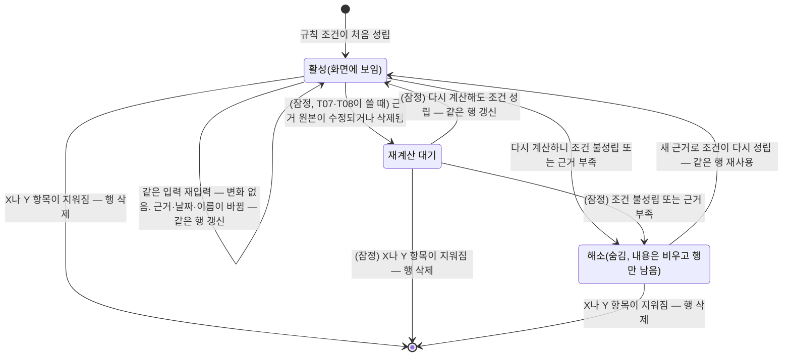
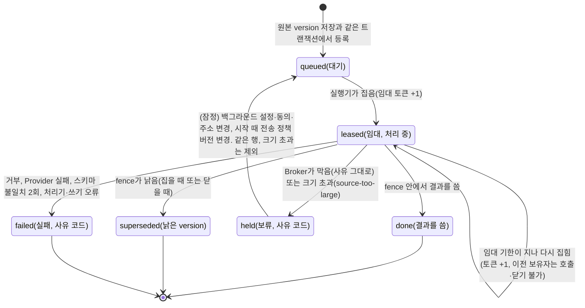
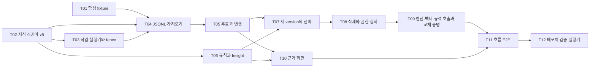
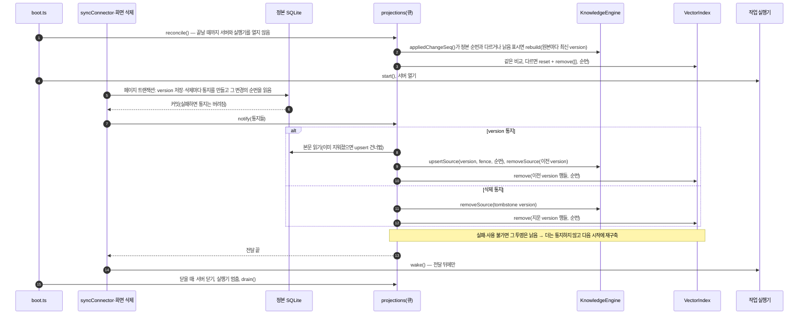
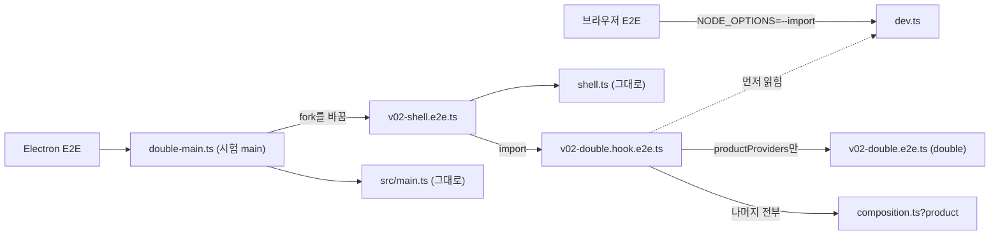

# 스펙: V02 세 출처 연결 → 일정 위험 Insight → 근거 화면 수직 검증

- 날짜: 2026-11-21 / 상태: 확정
- 관련: 이슈 #17(V02), 총괄 #1, Phase 1 #3, 선행 #16(V01)·#14(R05), 확정 #37(R07). [V01 spec](2026-11-21-V01-vertical-skeleton.md), [ARCHITECTURE.md](../ARCHITECTURE.md), [adr/](../adr/README.md), [site-setup.md](../site-setup.md)

낯선 말은 [ARCHITECTURE 0절](../ARCHITECTURE.md#0-처음-나오는-말)에 풀이가 있다. `S14`·`S15`는 site-setup.md의 체크리스트 번호, `A…`는 ARCHITECTURE 9절의 가정 번호다.

## 배경

제품의 핵심 가치는 서로 다른 출처의 정보를 이어 개별 원본만으로는 알기 어려운 것을 알려 주는 데 있다(원 설계 10절). 원 설계가 든 예가 이 spec의 대상이다.

- 메일: A 프로젝트 완료 목표는 12월 5일
- Wiki: A 프로젝트는 B 시스템의 API에 의존
- 메신저: B 시스템의 API 개발은 12월 10일로 연기

기대 결과는 "A의 목표 일정이 의존 업무의 지연으로 위험하다"는 Insight이며, 이것은 확정 사실이 아니라 **추론**으로 표시되어야 한다. V02는 V01의 뼈대 위에서 이 흐름 하나를 가져오기부터 근거 화면까지 실제로 잇는다.

Phase 1에는 제3자 지식 엔진이 없다([ADR 0003](../adr/0003-phase1-without-engine.md)). 추출은 LLM Provider의 구조화 출력으로 하고, 날짜 비교와 중복 검사는 코드가 한다. 다만 파이프라인은 엔진과 벡터 규격을 정해진 자리에서 부르며, 그 자리에 지금은 아무것도 하지 않는 구현이 묶여 있다. 이 규격들의 교체 증명은 이슈 #16의 V01-C7에서 이 작업의 V02-C5로 넘어왔다.

## 목표

- 합성 출처 3개를 가져오면 근거 3개가 달린 "의존 업무 지연" Insight 1건이 추론으로 표시되어 생긴다.
- 날짜를 바꾼 입력에서는 결과가 바뀐다.
- 같은 입력을 다시 넣어도 Insight가 늘지 않고, 원본을 고치면 다시 계산되며, 원본을 지우면 그 내용이 예전 version의 것까지 저장소에서 **없어진다.**
- 화면에서 근거를 원본의 version과 글자 위치까지 따라갈 수 있고, 가져온 원문 안의 스크립트와 원격 자원은 실행·로드되지 않는다.
- 엔진 규격의 구현을 바꿔 끼우면 파이프라인을 고치지 않고도 결과가 달라진다.

## 비목표 (배포처에서 후속 진행)

**공용 저장소의 뒤 작업으로 넘기는 것**

- JSONL 말고 다른 형식의 가져오기, 폴더 감시, 원본 파일과 첨부의 저장: I02(#19).
- Connector 규격의 확정과 SDK 문서화: I01(#18). V02는 V01의 규격에 JSONL 구현을 더할 뿐이다.
- 스케줄러, 재시도 정책의 일반화, 여러 작업의 동시 처리, 절전 복구: I03(#20).
- tombstone 보존 기간, 삭제한 원본의 복원, 지난 version의 정리, 접근 범위가 다른 원본 사이의 연결 제한: I04(#21).
- 유사도에 기대는 개체 해소, 뜻이 비슷한 사실의 병합, 값이 다른 사실의 상충 처리, 병합 되돌리기, 시간 그래프: S02(#23).
- "의존 업무 지연" 말고 다른 Insight 유형, 중요도 순위: P01(#27). 알림: P02(#28). Insight에 대한 사용자 피드백과 상태(확인함, 다시 알리지 않기): P03(#29).
- 벡터 검색, 질의응답, **벡터 색인에 쓰고 찾는 경로**: X01(#30). V02는 벡터 색인에 아무것도 넣지 않는다.
- 품질 수치(정확도 등)의 통과 기준: R05(#14)가 고정한 뒤 잰다. V02는 흐름이 성립하는지만 본다.
- 설치 파일 만들기: R04(#13). V02의 배포처 검증 실행기는 R04가 V01-T15의 산출물로 만든 설치본을 쓴다.

**배포처 후속 항목**(2개. 각각 [site-setup.md의 배포처 설정 체크리스트](../site-setup.md#배포처-설정-체크리스트)와 번호로 대응한다)

| 번호 | 항목 |
|---|---|
| S14 | 이 흐름을 Windows 설치본과 실제 Provider로 실행하고 기록 |
| S15 | 실제 수집 데이터에서의 추출·Insight 품질 확인 |

## 요구사항

**입력**

- **V02-R1 합성 fixture.** 세 출처(메일형, Wiki형, 메신저형)의 JSONL과 기대 결과를 `fixtures/`에 둔다. 레코드의 모양은 R05(#14)의 골든 데이터와 같다(원 설계 5절의 SourceRecord에 `connector_instance_id`, `operation`, `schema_version`을 더한 것). 변형도 함께 둔다: ① B의 날짜가 A의 목표일보다 이른 **날짜 변형** ② 스크립트 태그, 원격 이미지, "이전 지시를 무시하라"는 문장이 든 **악성 변형**. 모두 지어낸 내용이며 날짜에는 연도를 적는다. 이 파일들은 빌드 때 합성 목록에 들어가고(V01-R7), 악성 변형에는 표시가 붙는다.
- **V02-R2 JSONL 가져오기.** JSONL 한 줄이 원본의 version 하나인 Connector 구현을 만들고 V01의 Connector 계약 테스트를 통과시킨다. 형식이 틀린 줄은 그 줄만 거부하고 몇 번째 줄인지 알린다. 레코드의 `operation`을 Connector의 변경 종류로 옮긴다: `upsert`는 `upsert`, `delete`는 `delete`, `revoke`는 `access-revoked`. 같은 원본에 더 큰 version 번호와 다른 내용이 오면 새 version이 되고, 이전 version은 그대로 남는다. 레코드의 version 번호는 도착 순서를 가리는 데만 쓰고(저장소의 `revision`), 저장되는 version의 번호는 제품이 원본마다 매긴다(아래 "T02가 넘기는 것" 2). 삭제와 권한 철회, 그리고 화면의 삭제 요청은 V02-R12의 삭제가 된다.

**정본과 작업**

- **V02-R3 지식 스키마(마이그레이션 v5).** V01이 스키마 v1~v4를 썼으므로 지식 스키마는 다섯 번째 마이그레이션으로 들어간다. 마이그레이션으로 다음을 더한다: **항목**(프로젝트, 시스템 같은 대상), **사실**(어느 항목의 어떤 종류의 값인가. 예: 목표일), **관계**(주체 항목, 관계 유형, 대상 항목), **근거**(사실이나 관계 하나가 **어느 원본 version**의 어디에서 나왔는가: 시작, 끝, 인용문), Insight, tombstone, **변경 순번**, knowledge revision, 그리고 V01의 작업 테이블에 임대와 fence에 필요한 열. 항목·사실·관계는 인식 유형(명시 사실, 사용자 승인, 추론, 가설), 상태(candidate, verified, disputed, superseded, rejected), 유효 시각, 관측 시각을 따로 갖는다. 근거의 시작과 끝은 **유니코드 코드 포인트**로 센 `[시작, 끝)`이다(R05와 같은 단위). 원본의 version은 저장된 뒤 바뀌지 않고, 근거는 자기 version을 계속 가리킨다(이슈 #18 I01-C2). 그 version이 원본의 최신이면 "현재 근거", 아니면 "지난 근거"다.
- **V02-R4 작업 실행기.** 작업을 정본 SQLite 테이블에 두고 기한이 있는 임대로 집는다. 원본 version 저장, 변경 순번 증가, 추출 작업 등록은 한 트랜잭션이다. 같은 원본 version의 같은 종류 작업은 한 번만 등록된다. 재시작하면 임대 기한이 지난 작업을 다시 집는다. **작업은 한 번에 하나씩 처리한다**(세 출처가 동시에 추출되어 같은 대상이 두 항목으로 생기는 일을 막는다).
- **V02-R5 version fence.** 작업은 등록될 때의 원본 version을 들고 다닌다. 결과를 쓰는 트랜잭션 안에서 그 version이 여전히 최신이고 그 version 이상인 tombstone이 없는지 확인하고(tombstone보다 높은 version으로 다시 들어온 원본의 작업은 막지 않는다), 아니면 결과를 버리고 작업을 `superseded`로 닫는다.

**추출과 연결**

- **V02-R6 추출.** 원본 version 하나에 대해 Broker에 구조화 출력을 **1회** 요청한다(응답이 스키마에 맞지 않을 때만 재시도 1회). 파이프라인이 Broker에 넘기는 것은 원본 version의 ID, 후보 항목의 ID, 작업 ID뿐이다. 글, 지시, 등급, 호출 종류는 넘기지 않는다. Broker가 정본에서 글을 꺼내고 지시문을 붙인다(V01-R8). 응답의 사실과 관계는 **인용문**을 가져야 한다. 근거의 위치는 코드가 정한다: 정본의 원문에서 그 인용문을 찾아 시작과 끝을 계산하고, LLM이 숫자를 돌려주더라도 쓰지 않는다. 인용문이 원문에 없거나 두 군데 이상에 있으면 그 사실이나 관계는 기록하지 않고 작업 결과에 버린 수를 남긴다. 추출된 것은 상태 candidate로 들어간다.
- **V02-R7 기존 지식과의 연결.** 추출 전에, 이름이나 별칭이 원문에 **글자 그대로** 들어 있는 기존 항목을 찾아 그 ID를 후보로 Broker에 넘긴다. 별칭은 그 항목에 이미 기록된 이름에서만 온다. 비교 전의 가공은 유니코드 정규화, 대소문자 통일, 공백 정리뿐이다. 키워드 색인과 그 순위를 쓰지 않는다. 후보의 이름은 다른 원본에서 나온 글이므로, Broker는 후보 항목의 근거가 된 원본까지 넣어 등급을 계산한다. LLM은 후보 가운데 하나의 ID를 가리키거나 새 항목을 제안한다. 후보에 없는 ID를 가리킨 응답은 버린다. 코드는 유사도를 계산하지 않는다.
- **V02-R8 범위 제한.** [ADR 0003](../adr/0003-phase1-without-engine.md)의 범위 제한 일곱 줄을 지킨다. 그 가운데 이 spec이 직접 구현하는 규칙:
  - **같은 행**: 두 사실은 항목 ID, 사실 종류, 정규화한 값(날짜는 연-월-일)이 모두 같을 때만 같은 행이고, 두 관계는 주체 ID, 관계 유형, 대상 ID가 모두 같을 때만 같은 행이다. 같은 행이면 근거만 더한다. 값이 다르면 다른 행으로 두고 합치거나 상충을 풀지 않는다.
  - 한 번에 넣을 수 없는 크기의 원본은 chunk로 나누지 않고 작업을 "보류(크기 초과)"로 남긴다.
  - 관계 조회는 규칙이 쓰는 정해진 질의의 깊이 1 조인뿐이고 재귀 질의를 쓰지 않는다.

**Insight**

- **V02-R9 결정론 규칙 "의존 업무 지연".** 다음이 모두 참이면 Insight를 만든다: 항목 X에 목표일 사실이 있다, X가 Y에 의존한다는 관계가 있다, Y에 예상 완료일 사실이 있다, Y의 날짜가 X의 목표일보다 늦다, 세 행이 모두 **유효**하다. "유효"는 상태가 superseded나 rejected가 아니고 현재 근거가 하나 이상 있다는 뜻이다(candidate도 유효하다). 날짜 비교는 코드가 하고 이 규칙은 LLM을 부르지 않는다. Insight의 인식 유형은 "추론"이고 근거는 세 행의 현재 근거다.
- **V02-R10 Insight 유지.** Insight는 중복 키(규칙, X의 ID, Y의 ID)로 1건만 둔다. 조건이 그대로면 아무것도 바꾸지 않고, 근거가 바뀌면 같은 행을 갱신한다. 조건이 깨지거나 근거가 모자라면 "해소"로 바꿔 화면에서 숨기고 그 행의 설명 글과 근거 연결을 비운다. X와 Y 항목이 남아 있는 한 행 자체(ID와 중복 키)는 남겨, 조건이 다시 성립하면 새 행을 만들지 않고 그 행을 되살린다. X나 Y 항목이 지워지면 그 Insight 행도 함께 지운다.
- **V02-R11 새 version의 전파.** 원본의 새 version이 오면 이전 version을 가리키던 근거는 **떼지 않고** 지난 근거가 된다. 현재 근거가 하나도 없게 된 사실과 관계를 superseded로 바꾼 뒤 새 version을 추출한다. 추출 결과가 superseded인 행과 같은 행이면 현재 근거를 붙이며 그 행을 되살린다. 영향받은 Insight는 다시 계산한다.
- **V02-R12 삭제와 권한 철회.** 원본이 삭제되거나 권한이 철회되면 한 트랜잭션에서:
  - tombstone(원본 식별자, 그때까지의 version 번호, 시각, 사유. **내용 없음**)을 쓰고 변경 순번을 올린다.
  - 그 원본의 **모든 version**의 본문과 제목, 그 version들을 가리키는 근거와 인용문(현재 근거와 지난 근거 모두), 키워드 색인의 행을 **지운다.**
  - 근거가 하나도 남지 않은 사실과 관계를 상태와 상관없이 지운다(superseded였던 행도 포함한다. 예전 version에만 있던 값이 이 경로로 지워진다). 다른 원본의 근거가 남은 행은 남긴다.
  - 사실도 관계도 남지 않은 항목을 지우고, 그 항목을 가리키는 Insight 행을 지운다. 나머지 영향받은 Insight는 다시 계산한다.
  - 지운 내용은 데이터베이스 파일과 그 부속 파일에 남아 있지 않아야 한다. tombstone의 version 이하인 그 원본은 다시 들어오지 못한다.

**엔진과 벡터 규격**

- **V02-R13 규격을 부르는 자리와 교체.** 파이프라인은 [ARCHITECTURE 5.3절](../ARCHITECTURE.md)의 표대로 규격을 부른다: 원본 version 저장 뒤 `KnowledgeEngine.upsertSource`, 추출 직전 능력이 있을 때 `proposeKnowledge`, 새 version이나 삭제 뒤 `removeSource`와 `VectorIndex.remove`, 시작할 때 투영이 반영한 변경 순번이 정본과 다르면 `rebuild`(같으면 부르지 않는다). 통지에는 변경 순번을 함께 넘긴다. 엔진이 제안한 후보는 V02-R6과 **같은 인용문 대조**를 거쳐야 기록된다. 제품의 기본 구성에는 null 구현과 빈 구현이 묶여 있다. 이 호출은 정본을 쓴 뒤에 하며, 실패하거나 꺼져서 놓친 통지는 다음 시작 때 변경 순번 비교로 찾아낸다([ADR 0013](../adr/0013-failure-recovery.md)). 구현을 다른 것으로 바꿀 때 파이프라인 코드와 상위 API는 바뀌지 않는다. `VectorIndex`의 `upsert`와 `search`는 Phase 1에 부르는 자리가 없다.

**화면과 영속**

- **V02-R14 근거 화면.** Home의 Insight에서 근거 목록을 열고, 근거마다 원본의 version과 강조된 글자 위치를 볼 수 있다. Insight에는 "추론" 표지가 붙고, 근거가 없는 추론이 "확정"으로 보이는 길이 없다.
- **V02-R15 신뢰하지 않는 원문.** 가져온 원문에는 "가져온 자료(신뢰하지 않음)" 표지가 붙고 글자로만 그려진다. 원문 안의 스크립트는 실행되지 않고 원격 자원은 요청되지 않는다.
- **V02-R16 영속.** 재시작 뒤에도 원본, 지식, Insight가 남아 있고 끝나지 않은 작업이 이어진다.

**검증 수단과 문서**

- **V02-R17 흐름 E2E.** 가져오기부터 근거 화면까지를 Playwright로 브라우저와 Electron에서 실행한다. Provider는 fixture별로 정해 둔 내용을 돌려주는 test double이다(연결할 기존 항목의 ID는 받은 요청에 든 후보에서 고른다).
- **V02-R18 배포처 검증 실행기와 결과 기록.** 같은 흐름을 설치본과 실제 Provider로 돌리는 실행기를 둔다. 실행 기록에는 Provider 종류(`test-double` 또는 `real`), Provider 이름과 버전, OS, 앱 버전, 인용문 대조에서 버린 수가 반드시 들어간다. 실행기는 Provider가 test double이거나 Windows 설치본이 아니면 `배포처 후속`으로 시작하는 알림을 출력하고 0이 아닌 값으로 끝난다.
- **V02-R19 문서.** [site-setup.md](../site-setup.md)의 S14 항목을 실행기의 실제 명령과 기록 위치로 고친다(제목 `## 배포처 설정 체크리스트`는 그대로 둔다). V01의 문서 대응 테스트에 이 spec의 배포처 후속 항목을 더한다. README에는 실행 명령 한 줄과 문서 링크만 둔다.

## 인터페이스 / 설계 개요

가져오기에서 Insight까지의 순서, fence와 tombstone이 걸리는 자리, 엔진과 벡터 규격을 부르는 자리는 [ARCHITECTURE 5.3절·6절](../ARCHITECTURE.md)에 있다. 여기에는 V02가 새로 정하는 것만 적는다.

### Insight 한 건의 상태

V02-R10~R12를 합친 것이다. "해소"에서 다시 "활성"으로 돌아올 때 새 행을 만들지 않는 것이 중복을 막는 핵심이다.

T06의 규칙은 `DIRTY`를 만들지 않고 활성 행을 곧바로 갱신하거나 해소한다. `DIRTY`를 거치는 길은 T07·T08이 그 상태를 쓰기로 정할 때의 것이다("T06이 넘기는 것" 7항).

### 작업 한 건의 상태

V02-R4·R5와 "T03이 넘기는 것" 1·4·5·7항, "T05가 넘기는 것" 3·9항을 합친 것이다. 닫힌 상태(`done`, `superseded`, `failed`)에서는 다시 집히지 않는다. `held`에서 `queued`로 돌아가는 길은 미해결 질문 7의 잠정 결정이다.

### 추출 응답의 모양 (T05에서 확정. 스키마 버전 2)

| 필드 | 내용 |
|---|---|
| 항목 | 유형, 이름, 후보 가운데 고른 기존 항목 ID 또는 새 항목 표시 |
| 사실 | 어느 항목의 어떤 종류인가(목표일, 예상 완료일), 값(날짜는 연-월-일), 인식 유형, **인용문** |
| 관계 | 주체 항목, 관계 유형(의존), 대상 항목, **인용문** |

위치(시작, 끝)는 응답에 요구하지 않는다. 유형과 관계 유형의 이름은 원 설계 7절의 목록에서 고르되, V02의 추출 스키마에는 이 흐름이 쓰는 것만 넣는다. 추출의 지시문과 응답 스키마는 `providers/`에 두는 코드 상수이며 Broker가 작업 종류로 고른다. 실제 필드 이름과 값은 아래 "T05가 넘기는 것" 1항이다.

### 작업 분해

한 작업이 PR 하나다. `V01-T…`는 [V01 spec](2026-11-21-V01-vertical-skeleton.md)의 작업이다. 그림은 V02 안의 선후만 그렸고, V01과 다른 작업에 대한 선행은 아래 표가 기준이다.

| ID | 산출물 | 요구사항 | 기준 | depends_on | 검증 증거 |
|---|---|---|---|---|---|
| V02-T01 | 합성 fixture 3종, 날짜 변형, 악성 변형, 기대 결과, 합성 목록 등록, 문서 대응 테스트 확장 | R1, R19(테스트) | C1(입력), H1 | **R05(#14)**, V01-T01, V01-T04 | fixture가 가져오기 스키마를 통과하고 합성 목록에 들어 있다는 테스트 |
| V02-T02 | 스키마 v5 마이그레이션, 항목·사실·관계·근거·Insight·tombstone 저장 모듈, 변경 순번·knowledge revision(트리거로 올림), 원본 version 테이블 재구성(원본별 version 번호), 작업 테이블 재구성(원본·fence version·임대. 아래 "T02가 넘기는 것") | R3 | C1(저장), C3(영속) | V01-T03 | v4에서 v5로 올리는 마이그레이션 테스트, 저장 모듈 단위 테스트, 근거 위치가 코드 포인트 단위임을 보이는 테스트(한글과 이모지가 든 원문) |
| V02-T03 | 작업 실행기(임대, 한 번에 하나, 재시작 재개), fence 검사 | R4, R5 | C3 | V02-T02 | 낡은 version의 결과가 버려지는 통합 테스트, 재시작 재개 통합 테스트 |
| V02-T04 | JSONL Connector, `operation` 옮기기, 줄 단위 오류 보고, 새 version 받기, Sources 화면의 가져오기, 원본 저장·변경 순번·작업 등록의 한 트랜잭션 | R2 | C1(입력), C3(재입력) | V02-T01, V02-T02, V02-T03, V01-T04, V01-T05 | Connector 계약 테스트, 재입력 시 수가 늘지 않는 통합 테스트 |
| V02-T05 | 추출의 지시문과 스키마(코드 상수), ID만 넘기는 추출 요청, 인용문으로 위치 계산, 연결 후보 조회, 같은 행 판정, 크기 초과 보류, fixture별 Provider double | R6, R7, R8 | C1(추출·연결) | V02-T04, V01-T08 | 인용문 대조 단위 테스트, 호출 횟수 테스트, 세 출처의 A와 B가 같은 항목으로 이어지는 통합 테스트 |
| V02-T06 | "의존 업무 지연" 규칙, Insight 중복 키와 상태 | R9, R10 | C1(Insight), C3(중복) | V02-T02 | 날짜 경우별 단위 테스트(늦음, 같음, 이른 날짜, 의존 없음, 유효하지 않은 행) |
| V02-T07 | 새 version의 전파: 지난 근거, superseded, 재추출, 되살리기, Insight 재계산 | R11 | C3(수정) | V02-T05, V02-T06 | 수정 후 해소, 다시 수정 후 같은 행으로 활성의 통합 테스트. 지난 근거가 이전 version을 계속 가리키는지의 테스트 |
| V02-T08 | 삭제와 권한 철회: 내용 없는 tombstone, 모든 version의 본문·근거·색인 행 지우기, 근거 없는 지식과 그 Insight 지우기, 재유입 차단, 화면의 삭제 요청 | R12 | C3(삭제) | V02-T07 | 삭제 뒤 파일에서 카나리가 사라지는 테스트(예전 version에만 있던 값 포함), 공유 지식이 남는 테스트, 재유입 차단 테스트 |
| V02-T09 | 파이프라인의 엔진·벡터 규격 호출(네 자리), 변경 순번 통지, 시작 때 비교와 재구축, 교체 증명 | R13 | C5 | V02-T08, V01-T12 | 메모리 엔진으로 호출을 확인하는 테스트, 깨끗한 재시작에 재구축이 없다는 테스트, 제안 능력이 있는 엔진으로 바꾸면 결과가 달라지는 테스트. 메모리 엔진은 상태를 파일에 남기지 않으므로 `engine.restart` ①은 흉내 낸 재시작 앞뒤에 **같은 엔진 인스턴스**를 쓴다. 시작 비교는 엔진 종류로 분기하지 않으며 null 엔진(`appliedChangeSeq` 언제나 null)은 켤 때마다 비용 없는 `rebuild`를 받고, 빈 벡터 색인의 `AdapterUnavailableError`는 건너뜀으로 다룬다([ARCHITECTURE 5.3·5.4절](../ARCHITECTURE.md)의 V01-T12 확정 규격) |
| V02-T10 | Home의 Insight, 근거 목록, 원본 version과 span 보기, 신뢰하지 않는 원문 표시 | R14, R15 | C2 | V02-T05, V02-T06, V01-T05 | 근거 화면 E2E, 악성 변형 E2E |
| V02-T11 | 흐름 전체 E2E(브라우저, Electron), 재입력, 재시작, 삭제 뒤 Home(`stale.e2e`) | R16, R17 | C3(영속, `stale.e2e`), C4(E2E 부분) | V02-T09, V02-T10, V01-T06 | 두 환경의 E2E 출력과 실행 기록(Provider 종류 `test-double`), 삭제 뒤 Home에서 그 Insight가 보이지 않는 E2E |
| V02-T12 | 배포처 검증 실행기, 실행 기록 양식, 실행 절차, site-setup S14 갱신 | R18, R19 | C4(실행기), H2 | V02-T11, V01-T15, **R04(#13)의 사외 준비물** | 실행기가 사외에서 거부하는 2건 |

**T01이 넘기는 것**. T04 이후가 지켜야 하는 T01의 결정이다.

1. **가져오기 한 줄의 스키마**: `packages/contracts/src/import-record.ts`의 `ImportRecordSchema`. R05 골든 데이터의 필드 규칙(`eval/scorer/validate.py`의 `check_record`)을 옮긴 것이며, 골든 원본 전부가 이 스키마를 통과한다는 테스트가 있다. `content_hash`가 `content`의 sha256인지는 스키마가 아니라 fixture 테스트가 확인한다(contracts는 화면에서도 쓰이므로 `node:crypto`를 쓰지 않는다). T04의 JSONL Connector는 줄마다 이 스키마로 검사한다. `content_hash`가 `content`와 맞지 않는 줄을 그 줄의 오류로 거부할지는 T04가 정하고 그 결정을 테스트로 남긴다(백엔드에서는 `node:crypto`를 쓸 수 있다).
2. **악성 표시**: fixture 줄의 `"malicious": true`는 스키마가 받아들이되(`true`만), Connector가 내는 `SourceRecord`에는 싣지 않는다(V01의 `SourceRecordSchema`가 거부한다). 이 표시는 합성 목록을 만들 때만 읽힌다. T04는 `SourceRecord`를 넓히더라도(version 등) Connector가 내는 레코드에 `malicious`가 없다는 것을 Connector 테스트로 확인한다.
3. **fixture와 기대 결과**: `fixtures/v02-*.jsonl`과 `fixtures/v02-expected.json`(묶음 `plain`, `date-variant`, `malicious`). 날짜 변형과 악성 변형은 기본 원본과 다른 `id`·`external_id`를 가진 별도 원본이며, 날짜 변형은 메신저 원본을 **대신해** 넣는다. 수정 version이 필요한 테스트(`update.recompute` 등)는 그 테스트가 version을 만든다. 합성 목록 생성기는 `schema_version`이 있는 줄에서 `body` 대신 `content`를 읽는다. 기대 결과의 규칙 이름은 골든 라벨의 `insight_type`과 같은 `dependency_delay`다. 근거가 붙은 원문 일부에는 인용문 앞에 이모지(BMP 밖 문자)가 있어, 위치를 UTF-16 단위로 세면 틀린다.

**T02가 넘기는 것**. T02가 정한 것(잠정 표시가 없으면 확정)과 뒤 작업이 이어받는 결합 지점이다. 바꿀 때는 이 절과 해당 테스트를 함께 고친다.

1. **원본 version 번호.** `source_versions`에 원본마다 1부터 세는 `version` 열이 있다. 새 version은 그 원본의 최신 version보다 커야 하고, 그 원본의 tombstone이 있으면 tombstone의 version보다도 커야 한다(트리거가 거부한다). 그래서 지운 원본이 같은 번호로 다시 들어오지 못하고, 행 ID도 AUTOINCREMENT라 다시 쓰이지 않는다. 최신 행 ID와 최신 version은 언제나 같은 행이다.
2. **T04: 레코드의 version은 `revision`으로 따로 둔다(I01·I04 spec과의 교차 결정 D1).** `source_versions.version`은 계속 제품이 매긴다(그 원본의 최신 + 1). JSONL 레코드에 적힌 `version`은 스키마 v7에서 더한 `source_versions.revision`(빈 값 허용 정수)에 넣고 도착 순서를 가리는 데만 쓴다. 내용(content hash)이 최신 version과 같으면 revision과 상관없이 새 version을 만들지 않는다. 같은 revision과 같은 내용의 version이 이미 있어도(여러 version이 든 파일을 다시 가져올 때의 앞 줄) 새 version도 오류도 없다(잠정. I01의 `sources.last_revision`까지). 내용이 다르면 revision으로 가린다: 더 큰 revision이면 새 version이 되고, 같거나 작은 revision이면 그 줄을 거부한다(`revision-not-newer`, 잠정). 그래서 같은 revision으로는 새 version이 생기지 않는다. Connector 규격 v2(I01-T01, ADR 0016)부터 모든 레코드에 revision이 있으므로 이 규칙은 모든 Connector에 걸린다. revision이 비어 있는 것은 v7 이전에 저장된 version뿐이며, 그 version 다음에는 content hash만 본다. 일반 revision 규칙은 I01이 맡고 `sources.last_revision`도 I01이 더한다(T04는 더하지 않는다). 그래서 지금은 최신 version의 revision과만 비교한다: 내용이 같아 새 version을 만들지 않은 더 큰 revision은 기록되지 않는다. tombstone 트리거가 막을 version은 `saveSourceRecord`가 먼저 확인해 그 줄의 오류(`tombstoned`)로 돌려주고, 페이지는 계속된다. 가져오기에서는 그 줄의 오류이고, 일반 동기화(`onRefused`가 없을 때)에서도 그 변경만 저장하지 않고 페이지와 cursor를 커밋한다(T08이 정함: "T08이 넘기는 것" 5. `revision-not-newer`는 일반 동기화에서 여전히 페이지를 실패시킨다). 지운 원본은 version이 남지 않으므로 "최신 + 1"이 1이 되어 언제나 거부된다.
3. **작업 테이블.** `jobs`는 version 행의 ID 대신 원본(`source_id`)과 등록할 때의 version(`fence_version`), 임대 기한(`lease_until`)을 갖는다. 원본의 모든 version을 지워도(R12) 작업이 남아 fence가 `superseded`로 닫을 수 있게 하려는 것이다. (종류, 원본, fence version)마다 한 번만 등록된다(R4). 등록이 충돌하면 기존 작업의 상태를 확인해야 하고, 충돌을 성공으로 여기지 않는다. 작업을 등록하고 집는 API는 T03·T04가 만든다.
4. **변경 순번과 knowledge revision은 트리거가 올린다.** 원본 version 저장과 tombstone 쓰기(더 높은 version으로 옮길 때 포함)마다 변경 순번이 같은 트랜잭션에서 정확히 1 오른다. 코드는 읽기만 한다(`readChangeSeq`). knowledge revision은 항목·사실·관계 행이 바뀔 때마다 행 하나에 1씩 오른다(잠정. 값이 같은 UPDATE도 센다). v4에서 올린 데이터베이스는 저장된 version 수에서 시작한다.
5. **T08: 지우기 전에 영향받는 것을 모은다.** 근거는 version이 지워지면 함께 지워지고(cascade) Insight의 근거 연결도 함께 사라진다. 그래서 version을 지운 뒤에는 어떤 Insight·사실·관계가 영향을 받았는지 알 수 없다. 특히 다른 원본의 근거가 남아 있어 계속 보이는 Insight의 설명 글이 지운 원본에서 나왔을 수 있다. T08은 같은 트랜잭션에서 **지우기 전에** 그 원본의 근거에 연결된 Insight, 그 근거가 받치는 사실·관계, 그리고 그 사실·관계를 가진 항목(사실의 항목, 관계의 주체와 대상)을 먼저 모으고, 그 집합만 다시 계산하거나 지운다. 항목은 모아 둔 것 가운데 사실도 관계도 남지 않은 것만 지우고, 처음부터 사실·관계가 없던 다른 항목은 건드리지 않는다. 근거 없는 행을 전체에서 쓸어 지우면 처음부터 근거가 없던 행까지 지워진다.
6. **T08: 키워드 색인의 흔적을 지운다.** FTS5의 `'delete'`는 지운 본문의 낱말을 색인의 부속 테이블에 남긴다. 둘 다 필요하다: ① `PRAGMA secure_delete = ON`. 연결마다 적용되는 설정이라 마이그레이션이 아니라 데이터베이스를 열 때마다 켠다. 이것만으로는 FTS 부속 테이블의 낱말이 사라지지 않는다(독립 검토 B에서 확인). ② `keyword_index`의 FTS5 `secure-delete` 설정을 켜거나 삭제 뒤 `optimize`를 돌린다. T08은 데이터베이스 파일과 부속 파일에서 카나리(본문, 제목, 인용문, Insight 설명 글)가 없어졌는지 테스트한다(`delete.purge`). 카나리끼리는 앞부분이 겹치지 않게 만든다. FTS가 같은 앞부분을 압축해 저장하므로, 겹치면 한 카나리가 없다는 결과가 실제로 없다는 증거가 되지 못한다.
7. **tombstone은 원본 행을 가리킨다.** 지워도 `sources` 행(식별자만)은 남고, tombstone의 키가 그 행이다. `writeTombstone`은 더 높은 version으로만 옮긴다. 그 원본의 실제 최신 version을 넘기는 것은 T08의 몫이다.
8. **근거의 위치는 저장할 때 검사한다.** `addEvidence`는 저장된 본문에서 코드 포인트로 센 `[시작, 끝)`이 인용문과 정확히 같을 때만 기록한다(SQLite의 `substr`·`length`가 TEXT를 글자, 곧 코드 포인트로 센다). 본문에 U+0000이 있으면 그 뒤의 위치는 기록할 수 없다(`length`가 거기서 멈춘다). 인용문으로 위치를 계산하는 것은 T05다.

**T03이 넘기는 것**. T03이 정한 것(잠정 표시가 없으면 확정)과 T04·T05·T07이 이어받는 결합 지점이다. 바꿀 때는 이 절과 `storage/src/jobs.test.ts`, `backend/src/job-runner.test.ts`를 함께 고친다. **I03-T01이 이 절의 이름을 바꿨다**: 상태 `leased`·`done`·`failed`는 `running`·`succeeded`·`dead_letter`이고, Broker 출처는 `{jobId, leaseToken}`이며 Broker는 `running`과 그 토큰을 본다(아래 1·3·5·6항과 "T05가 넘기는 것" 2항의 옛 이름은 그 이름으로 읽는다. 현재 모양은 [I03 spec](2026-11-21-I03-persistent-queue.md)의 "I03-T01이 넘기는 것"). **I03-T03이 8항과 3항을 대신한다**: 임대는 2분이고 4분의 1마다 heartbeat로 늘리며, 시도 상한(기본 5회)을 넘긴 작업은 `dead_letter`가 되고, 처리기는 두 번째 인자 `{ signal }`(임대를 잃으면 끊김)을 받는다(I03 spec "I03-T03이 넘기는 것" 2·4·6항).

1. **작업 상태.** `queued` → `leased` → `done`·`superseded`·`held`(보류)·`failed`. 임대 기한이 지난 `leased`는 다시 집히고, 닫힌 작업은 다시 집히지 않는다. 보류와 실패의 이유는 스키마 v6에서 더한 `jobs.reason`에 **코드**로만 남긴다(Provider 문구나 본문은 넣지 않는다). `closeJob`은 코드 모양(`/^[a-z][a-z0-9-]{0,63}$/`, `isReasonCode`)이 아닌 이유를 `RangeError`로 거부하고, 실행기는 처리기가 그런 이유를 돌려주면 `failed`(`invalid-reason`)로 닫는다. 스키마 v6은 임대 토큰 `jobs.lease_token`도 더한다(집을 때마다 1 오름).
2. **T04: 등록.** `registerJob(db, {kind, sourceId, fenceVersion})`은 부르는 쪽의 트랜잭션 안에서 작업을 `queued`로 넣는다. 원본 version 저장과 같은 트랜잭션에서 부른다(R4). 충돌이면 `{registered: false, existing}`로 이미 있는 작업을 돌려주며 성공으로 치지 않는다. 등록 뒤 실행기를 깨우는 것(`runner.wake()`)은 T04의 몫이다.
3. **T05: 처리기.** `createJobRunner({db, handlers: {extract: handler}})`. 처리기는 임대된 작업(`StoredJob`: 원본 ID와 fence version)을 받아 `{status: "done", write}`·`{status: "held", reason}`·`{status: "failed", reason}`을 돌려준다. `write`는 실행기가 fence를 확인하는 트랜잭션 안에서만 부르므로, 처리기는 정본에 결과를 직접 쓰지 않는다. Broker에 넘길 원본 version의 행 ID는 처리기가 `(sourceId, fenceVersion)`으로 찾는다. Broker에는 `origin: {jobId: String(job.id), lease: String(job.leaseToken)}`을 넘긴다. 처리기가 예외를 던지면 `failed`(`handler-error`), `write`가 던지면 그 쓰기는 되돌려지고 `failed`(`write-error`). `write`가 아닌 데이터베이스 오류와 파일 잠김(SQLITE_BUSY·SQLITE_LOCKED, `write` 안에서 생겨도)은 `write-error`가 아니다. 작업은 `leased`로 남고 임대가 끝나면 다시 집힌다. `closeJob`은 `write`보다 작업 행 갱신을 먼저 해 쓰기 잠금을 먼저 잡으므로, 다른 프로세스가 파일을 잠그고 있으면 결과를 쓰기 전에 실패한다.
4. **fence(R5).** `closeJob`이 한 트랜잭션에서 확인한다: 그 원본의 최신 version이 fence version과 같고, tombstone이 없거나 tombstone의 version이 fence보다 작아야 한다. 아니면 `write`를 부르지 않고 `superseded`로 닫는다. 보류·실패도 fence가 낡았으면 `superseded`가 된다. 집을 때 이미 낡은 작업은 처리기를 부르지 않고 닫는다(지워진 원본으로 Broker를 부르지 않는다). `leased`가 아닌 작업의 결과는 버린다(`not-leased`). 그래서 같은 작업이 두 번 돌아도 결과는 한 번만 들어간다.
5. **한 번에 하나(R4)와 임대 토큰.** 실행기 하나 안의 모든 집기와 처리가 한 줄로 이어진다(`runOnce`, `wake`, 주기 확인이 겹쳐도 동시에 두 작업이 돌지 않는다). 임대가 유효한 동안에는 다른 실행기가 그 작업을 집지 못한다. 임대가 끝나 다른 실행기가 다시 집으면 토큰이 오르므로, 이전 보유자는 Broker 호출도(`origin-not-leased`) 작업 닫기도(`not-leased`, 아무것도 쓰지 않음) 하지 못한다. 그래서 이전 보유자의 늦은 `held`가 새 보유자의 `done`을 덮어쓰지 못한다. 다만 이전 보유자의 호출이 토큰이 오르기 **전에** 이미 Broker를 지났다면 그 호출은 끝까지 간다(Broker는 요청마다 한 번 확인한다). Phase 1은 백엔드 하나를 전제한다.
6. **백그라운드 판정은 Broker가 한다.** 실행기는 설정을 읽지 않는다. Broker는 작업 기록이 **`leased`이고 요청의 `lease`가 현재 토큰과 같을 때만** 작업에서 나온 호출로 받고, 아니면 `origin-not-leased`로 거부한다(V01 "T07이 넘기는 것" 6의 "이미 쓴 작업 기록"). `lease`가 없는 작업 요청은 `invalid-request`다. CLI 백그라운드 설정이 꺼져 Broker가 막은 호출(`cli-background-off` 등, 그리고 전송 거부)은 처리기가 `held`로 돌려주고 사유 코드를 남긴다. **다른 Provider로 넘어가지 않는다**(ARCHITECTURE 7절).
7. **잠정: 보류는 저절로 풀리지 않는다.** `held` 작업은 다시 집히지 않는다. (종류, 원본, version)마다 한 번만 등록되므로 같은 version을 새로 등록해 풀 수도 없다. 푸는 길은 미해결 질문 7(담당 T05)에 있다.
8. **잠정: 임대 10분, 주기 확인 30초**(`DEFAULT_LEASE_MS`, `DEFAULT_POLL_MS`). 임대는 Broker 한도(시도 3, 시간 제한 상한 120초, 대기 최대 30초)로 호출 하나가 걸릴 수 있는 시간보다 길게 잡았고, 갱신하지 않는다. 그래서 처리 중에 꺼진 뒤 다시 켜면 그 작업은 최대 10분 뒤에 이어진다. 계속 프로세스를 죽이는 작업의 재시도 횟수 제한은 없다.
9. **T05: 구성 지점에 묶기.** 실행기는 아직 `backend/src/composition.ts`와 시작 함수에 묶이지 않았다(처리기가 하나도 없다). 첫 처리기를 넣는 T05가 구성 지점에서 실행기를 만들고 시작할 때 `start()`, 끝낼 때 `stop()`을 부른다. `stop()`은 돌고 있는 작업이 닫힐 때까지 기다린다.
10. **T07: 새 version.** 새 version이 들어오면 그 version의 작업을 새로 등록할 뿐, 이전 version의 작업을 고치지 않는다. 이전 작업은 fence에 걸려 `superseded`로 닫힌다.

**T04가 넘기는 것**. T04가 정한 것(잠정 표시가 없으면 확정)과 T05·T07·T08이 이어받는 결합 지점이다. 바꿀 때는 이 절과 `backend/src/jsonl-lines.test.ts`, `backend/src/jsonl-import.test.ts`, `backend/src/connector-sync.test.ts`, `storage/src/sources.test.ts`를 함께 고친다.

1. **줄 검사.(I01-T05: 검사는 `@pki/connector-sdk`의 `parseJsonl`이 하고 `jsonl-lines.ts`는 V02 오류 사유로 옮기기, 되풀이 줄 거르기, `splitRounds`만 한다.)** `backend/src/jsonl-lines.ts`의 `parseJsonl`이 가져오기 한 번에 **한 번만** 줄마다 `ImportRecordSchema`로 검사한다. 줄 번호는 1부터 세고 빈 줄과 맨 앞의 UTF-8 BOM은 건너뛴다. `content_hash`가 `content`의 sha256(UTF-8)이 아니면 그 줄의 오류다(`content-hash-mismatch`). 오류의 `field`는 스키마에 있는 필드 이름만 적는다(모르는 키는 가져온 파일의 글이므로 되돌려 주지 않는다). **한 줄이 version 하나다(R2).** 한 파일 안에 같은 원본(instance + external id)의 줄이 여럿이면 더 새 revision의 줄마다 줄 순서대로 version이 된다. 그 원본의 앞 줄보다 같거나 작은 revision이면 내용이 같을 때 버리고(새것이 없다) 다를 때 오류다(`revision-not-newer`, 잠정). Connector 계약은 한 번 읽을 때 external id마다 한 번을 요구하므로, 가져오기는 원본마다 k번째 줄을 k번째 차례(round)에 넣어 차례마다 Connector를 한 번 읽는다(`splitRounds`). 골든 데이터(`eval/golden/sources/*.jsonl`)의 모든 줄이 version이 되거나 줄 오류로 보고된다는 테스트가 있다.
2. **`operation` 옮기기.(I01-T05가 `@pki/connector-sdk`로 옮기고 `revoke`를 `scope-change`로 바꿨다. 아래 글은 V02 당시의 기록이다.)** 옮기는 곳은 `changeKindOf` 하나다. `upsert`는 `upsert`, `delete`는 `delete`, `revoke`는 `access-revoked`. **`revoke`는 잠정이다.** I01이 `revoke`를 범위 변경으로 옮기고 접근을 모두 잃는 경우의 operation을 따로 더한다. C3④와 T08의 테스트는 JSONL의 `revoke` 글자가 아니라 Connector의 `access-revoked` 변경 종류로 시험한다.
3. **T08: 삭제와 권한 철회는 아직 저장하지 않는다(잠정. T08이 바꿈: "T08이 넘기는 것" 4).** `syncConnector`는 `delete`·`access-revoked` 변경을 `change-kind-unsupported`로 거부한다. 가져오기에서는 그 줄의 오류가 되고, 일반 동기화(`onRefused`가 없을 때)는 지금처럼 페이지 전체가 실패한다. T08이 이 자리에 tombstone과 지우기를 넣는다. 변경에는 레코드의 `version`과 `updated_at`이 `version`·`at`으로 실린다(규격 v2부터는 `revision`·`at`이고 `namespace`가 붙는다. I01-T01).
4. **한 트랜잭션.** `syncConnector`가 페이지마다 한 트랜잭션에서 원본 version을 저장하고(변경 순번은 트리거가 올린다) 새 version마다 `registerJob(kind: "extract", fence = 그 version)`을 부르고 cursor를 쓴다. JSONL만이 아니라 모든 Connector의 동기화가 그렇다. 등록이 충돌하면 그 페이지 전체가 실패한다(충돌은 성공이 아니고, version 번호가 다시 쓰이지 않으므로 정상 흐름에서는 생기지 않는다). 가져오기에서는 실패한 instance의 저장되지 않은 줄과 그 뒤 차례의 줄을 `instance-failed`로 보고하고, 그 사이에 다른 종류에 묶였으면 `instance-conflict`로 보고한다. 앞서 커밋된 페이지와 다른 instance는 저장된 것으로 센다(잠정. instance 사이는 한 트랜잭션이 아니다). 실패한 오류는 가져오기의 `onError`로 가고, 제품은 그 오류의 종류 이름만 기록한다(`import-instance-failed`. 메시지에는 파일의 글이 들 수 있으므로 남기지 않는다). 커밋 뒤에 새 작업이 있으면 `runner.wake()`를 부르고 기다리지 않는다. 실행기는 `productImporter(db, { runner })`와 `createConnectorManager(..., { runner })`로 넘긴다(T05가 만든다).
5. **가져오기.** `POST /api/import/jsonl`(`{ text }`)이 `{ received, created, errors: [{ line, reason, field? }], errorCount }`를 돌려준다. `errors`는 줄 번호 순으로 처음 100건만 싣고 `errorCount`가 전체 수다(잠정. Sources 화면은 "처음 100건만 보입니다"라고 알린다). 한 파일의 서로 다른 `connector_instance_id`는 32개까지이고(잠정. instance마다 지워지지 않는 행이 남는다), 그 뒤에 처음 나온 instance의 줄은 `too-many-instances`로 거부하며 등록하지 않는다. 파일의 instance마다 JSONL Connector(종류 `jsonl-import`)를 차례마다 처음부터 읽는다. 그래서 같은 파일을 다시 넣으면 모든 줄을 다시 읽고 아무것도 새로 저장하지 않으며, 한 원본의 여러 version이 든 파일이어도 처음에 받은 줄을 오류로 알리지 않는다(C3 재입력. 골든 데이터로도 테스트한다). 이미 다른 종류에 묶인 instance ID의 줄은 `instance-conflict`다. 이 경로의 본문 한도만 8 MiB다(잠정. 다른 경로는 16 KiB). Sources 화면은 파일을 골라 이 경로로 보내고 결과와 거부된 줄을 보여 준다. JSONL Connector는 `access_scope`를 싣지 않으므로 manifest의 `accessScope`는 `false`다.
6. **T05: 등급.** Broker는 `test-fixtures` 종류만 합성 자료의 출처로 믿는다. `jsonl-import`는 사용자가 고른 파일이라 믿지 않으므로, 가져온 원본은 내용이 합성 목록에 있어도 등급이 "일반"이다. `access_scope`도 아직 저장하지 않는다(I01-T05부터 저장하고 `scope_claimed`를 표시한다). 합성 fixture로 추출을 돌리는 T05·T11이 이 둘을 정한다.

**T05가 넘기는 것**. T05가 정한 것(잠정 표시가 없으면 확정)과 T07·T08·T09·T10·T11이 이어받는 결합 지점이다. 바꿀 때는 이 절과 `knowledge-engine/src/extraction.test.ts`, `knowledge-engine/src/quote.test.ts`, `backend/src/extraction-flow.test.ts`, `storage/src/extraction-store.test.ts`를 함께 고친다.

1. **추출 스키마 버전 2.** (S01-T08이 버전 3으로 올렸다: 지금의 `TASKS.extract[3]`은 `Concept`, `terms`, `definitions`, `confidence`를 더한 모양이고 버전 2를 요청하면 `unknown-task-version`이다. 아래는 V02 때의 서술이며 지금의 모양은 [S01 spec](2026-11-22-S01-semantic-registry.md)의 R17과 "S01-T08이 넘기는 것" 1이 정한다.) `providers/src/tasks.ts`의 `TASKS.extract[2]`(`EXTRACT_SCHEMA_VERSION`). V01의 잠정 버전 1(`claims[]`)은 지웠고, 버전 1을 요청하면 `unknown-task-version`이다. 응답은 `{items, facts, relations}`이다. 항목은 `{ref, type, name, existingItemId}`이고 `ref`는 그 응답 안에서만 쓰는 이름, `type`은 `Project`·`System`, `existingItemId`는 요청에 실린 후보 ID 하나이거나 `null`(새 항목)이다. 사실은 `{item, kind, value, epistemic, quote}`이고 `kind`는 `target_date`·`completion_date`, `value`는 `YYYY-MM-DD`, `epistemic`은 `explicit`·`hypothesis`다. 관계는 `{subject, type, object, quote}`이고 `type`은 `DEPENDS_ON`이다. 이 이름은 T06 규칙의 이름과 같다는 테스트가 있다. 항목·사실·관계 객체는 JSON Schema에서는 다른 필드를 금지하지만, Zod 검사에서는 모르는 필드를 **버리고** 받는다. 그래서 LLM이 위치 숫자를 덧붙여도 스키마 불일치가 아니고, 그 숫자는 쓰이지 않는다(R6).
2. **처리기.** `knowledge-engine/src/extraction.ts`의 `createExtractHandler({db, broker})`. ARCHITECTURE 2절의 "추출 조율" 자리라서 `knowledge-engine`에 두었고, 그래서 `knowledge-engine`이 `@pki/providers`에, 백엔드가 `@pki/knowledge-engine`에 의존한다. 처리기는 `(sourceId, fenceVersion)`으로 version 행을 찾고, Broker에 `{taskKind: "extract", sourceVersionIds: [그 행], candidateItemIds, origin: {jobId, lease}, schemaVersion: 2, budget: {timeoutMs: 120000}, retryable: false}`만 넘긴다. `origin`은 실행기가 임대한 작업(`StoredJob`)에서만 만든다. 결과 옮기기: Broker의 `blocked`는 `held`(Broker의 사유 코드 그대로), `rejected`는 `failed`(거부 사유), `failed`는 `failed`(`timeout`, `rate-limited`, `provider-error`, `invalid-output`). 스키마 불일치(`invalid-output`)일 때만 같은 요청을 한 번 더 보내므로 Provider 호출은 많아야 2회다. **잠정**: `retryable: false`라 시간 초과 같은 일시 실패도 Broker가 다시 시도하지 않고 작업이 `failed`로 닫힌다(R6의 "1회"를 글자대로 읽음. 재시도 정책의 일반화는 I03).
3. **크기 초과(잠정).** 제목과 본문의 코드 포인트 합이 `MAX_EXTRACT_CODE_POINTS`(20000)를 넘으면 Broker를 부르지 않고 `held`(`source-too-large`)로 닫는다. 값은 근거 없이 정한 잠정 값이다. 실제 Provider의 문맥 한도와 맞추는 것은 S14·R07의 실행 뒤다.
4. **인용문과 위치.** `knowledge-engine/src/quote.ts`의 `locateQuote(body, quote)`. 저장된 본문에서 **정확히 같은** 글자열을 찾고(정규화 없음, A21), 한 번만 나올 때만 코드 포인트로 센 `[시작, 끝)`을 돌려준다. 없음(`quote-missing`)과 두 번 이상(겹치는 경우 포함, `quote-ambiguous`), 그리고 저장소가 검사할 수 없는 경우(빈 인용문, 서로게이트 쌍을 가르는 일치, U+0000 뒤의 위치)는 버린다. 제목에서만 찾은 인용문도 버린다(근거의 위치는 본문 기준이다).
5. **버린 수(스키마 v8).** `jobs.dropped_quotes`(인용문 대조에서 버린 사실·관계)와 `jobs.dropped_other`(후보에 없는 ID를 가리킨 항목, 응답에 없는 `ref`를 가리킨 사실·관계, 달력에 없는 날짜, 쓰는 사이에 지워진 기존 항목 — **I04-T06이 바꿨다**: 그 경우는 이제 결과 전체가 버려져 이 수에 들지 않는다, 7항)를 결과를 쓰는 트랜잭션에서 남긴다. 읽는 함수는 `readExtractionDrops`. **T12**의 실행 기록이 "인용문 대조에서 버린 수"로 `dropped_quotes`를 쓴다.
6. **연결 후보(R7).** `knowledge-engine/src/linking.ts`의 `findCandidates(db, text)`. 한 응답에서 같은 `ref`가 여러 번 나오면 처음 것만 쓰고, 처음 것이 후보 밖 ID로 버려졌으면 그 `ref`는 끝까지 버려진다. 제목과 본문을 이은 글과 항목 이름을 둘 다 NFKC 정규화, 소문자, 공백 묶기만 한 뒤 이름이 글에 들어 있으면 후보다(부분 문자열이므로 "물결"은 "물결무늬"에도 걸린다). 모든 항목의 이름을 읽어 코드가 비교한다(잠정. 항목 수가 많아지면 I03·S02에서 다시 본다). 별칭은 두지 않았다(미해결 질문 6은 그대로). (S01-R16·S01-T09가 확정된 표기를, S02-R8·R13이 묶음을 후보에 넣었다: 이 항목의 이름만 읽던 범위가 넓어졌고 묶음의 구성원은 대표로 간다. 근거는 S02 spec 잠정 결정 27 ⑤.) Broker의 후보 조회는 `knowledgeCandidates(db, registry)`이며 이름과, 그 항목의 사실·관계(주체 또는 대상)의 근거가 된 **모든** version(지난 version 포함)을 돌려주어 등급 계산에 넣는다. 그 version들은 I04-T09부터 등록부의 `lineage`로 읽는다(따로 읽던 `listItemEvidenceVersions`는 없어졌고 결과 집합은 같다). 또 연결 후보는 범위 정책이 이 추출의 원본과 묶을 수 없다고 하면 후보로 보내지 않는다(I04-R14). 후보에 없는 ID를 가리킨 응답 항목은 그 항목과 그것을 가리키는 사실·관계만 버린다(응답 전체를 버리지 않음, 잠정).
7. **쓰기.** 실행기가 fence를 확인한 트랜잭션 안의 `write`에서만 쓴다. 항목은 남은 사실이나 관계가 가리킬 때만 만든다(인용문이 모두 버려진 항목은 생기지 않는다). 새 행은 상태 `candidate`, 관측 시각은 처리 시각, 유효 시각은 없음이다. 같은 행(R8)이면 T02의 고유 키가 기존 행을 돌려주고 근거를 더한다. 그 행이 `superseded`이면 근거를 더한 뒤 `reviveSuperseded`로 `candidate`로 되살린다(V02 당시의 동작이다. S01-T01이 입구 `automatedLifecycle.evidenceReturned`로 바꾸고 `reviveSuperseded`를 지웠다. 아래 "T07이 넘기는 것" 4의 머리말). (T07이 더함. 다른 상태의 행은 바꾸지 않는다. "T07이 넘기는 것" 4). 끝으로 기록한 사실의 항목과 관계의 주체·대상을 넘겨 `recomputeDependencyDelay`를 같은 트랜잭션에서 부른다.
8. **구성 지점과 시작·종료.** `backend/src/composition.ts`의 `productRunner(db, broker)`가 실행기에 `extract` 처리기를 묶고, `productCalls`의 Broker가 `knowledgeCandidates(db, registry)`를 쓴다(registry는 I04-T09가 더한 선택 인자, 기본은 기본 등록부). `boot.ts`는 같은 실행기를 `createConnectorManager(..., {runner})`와 `productImporter(db, {runner})`에 주고 시작할 때 `start()`, 서버를 닫을 때 서버 다음에 `stop()`을 부른다. 백엔드의 오류 로그는 `job-error`와 오류 클래스만 남긴다.
9. **보류를 푸는 길(미해결 질문 7의 결정, 잠정).** `storage`의 `requeueHeldJobs(db, {keep})`이 `held` 작업을 **기존 행 그대로** `queued`로 되돌린다(새 행 없음, 다시 집을 때 임대 토큰이 오른다). `releaseHeldJobs(db, runner)`가 `source-too-large`를 뺀 보류를 풀고 실행기를 깨운다. 부르는 때는 셋이다: ① API의 백그라운드 설정 쓰기, 동의 부여(성공했을 때)와 철회, OpenAI 호환 주소 설정 쓰기(server의 `onRunConditionsChanged`) ② 백엔드 시작 때 전송 정책 버전이 설정 `jobs.held-policy-version`에 적힌 값과 다를 때(`releaseOnPolicyChange`. 배포처 규칙은 빌드 값이라 재시작 때만 바뀐다) ③ 그 밖에는 풀지 않는다. 그래서 호출 예산 소진(`budget-exhausted`)으로 보류된 작업은 위 조건 중 하나가 생길 때까지 남는다. 막은 조건이 그대로면 다시 보류되고 Broker 이력에 막힌 시도가 한 행씩 더 생긴다. **(I03-T07이 대신함: `releaseHeldJobs`·`requeueHeldJobs`와 설정 `jobs.held-policy-version`은 사라지고, 사유별 해제 표·같은 트랜잭션 해제·정책 지문으로 바뀌었다. I03 spec의 "I03-T07가 넘기는 것" 5항.)**
10. **백그라운드 설정이 꺼진 기본값에서의 흐름.** 가져오기로 등록된 추출은 언제나 백그라운드 호출이다(사용자 호출로 추출하는 길은 이 spec에 없다). 목록에 있는 CLI Provider로는 설정이 꺼져 있는 동안 작업이 `held`(`cli-background-off`)로 남고 Provider 호출은 0회다. 설정을 켜면 9항으로 풀려 같은 행이 `done`이 된다. HTTP Provider는 이 설정과 상관없이 동의와 전송 규칙만 본다. 그래서 HTTP Provider에 동의하는 순간 기다리던 추출과 이후의 모든 가져오기가 자리에 없을 때도 자동으로 보내진다. 동의 화면은 이 사실을 HTTP Provider에 한정해 밝히고, CLI Provider는 동의만으로는 보내지 않고 백그라운드 실행을 켠 뒤에 보낸다고 적는다(`apps/web/src/consent-text.ts`, 테스트 `consent-text.test.ts`). 동의와 자동 실행을 따로 묻는 설계는 I03(#20)으로 넘긴다([ADR 0005](../adr/0005-llm-providers.md)의 미해결 문구 항목).
11. **fixture별 Provider double.** `@pki/testkit`의 `fixtureExtraction()`은 `FakeProvider`의 `answer`로 쓴다. 요청 문서의 본문이 V02 fixture 줄의 `content`와 같으면, `fixtures/v02-expected.json`에서 그 레코드를 근거로 하는 사실과 관계를 인용문과 함께 돌려준다. 기존 항목의 ID는 요청의 후보 가운데 이름이 같은 것에서만 고르고, 없으면 새 항목이다. fixture가 아닌 문서에는 빈 응답이다. 언제나 정확한 인용문을 주므로 실제 추출의 증거가 아니다(A21). **T11**은 이 double을 묶은 실행의 기록에 Provider 종류 `test-double`을 적는다. 제품 빌드에 묶는 길은 아직 없다(testkit은 테스트 빌드 전용). E2E가 백엔드 프로세스에 이것을 묶으려면 T11이 테스트 빌드 전용 진입점을 만든다(T11이 만듦: "T11이 넘기는 것" 1).
12. **T10: 화면이 쓸 것.** 근거의 `start_offset`·`end_offset`은 본문의 **코드 포인트** 위치다. 화면에서 강조할 때 JavaScript 문자열 색인(UTF-16)으로 바로 쓰면 이모지 뒤에서 어긋난다(`Array.from(body)`나 코드 포인트 단위로 자른다). 근거의 version은 `evidence.source_version_id`이고 원본별 번호는 `source_versions.version`이다.
13. **증명 테스트의 위치.** `extraction.quote` → `knowledge-engine/src/quote.test.ts`와 `extraction.test.ts`의 "extraction.quote (stored)", `extraction.calls`·`extraction.request`·`linking` → `knowledge-engine/src/extraction.test.ts`(실제 Broker와 SQLite), `flow.insight`·`flow.date-variant`와 보류·해제 → `backend/src/extraction-flow.test.ts`, 시작 시 실행기 연결 → `backend/src/boot.test.ts`.

**T06이 넘기는 것**. T06이 정한 것(잠정 표시가 없으면 확정)과 뒤 작업(T05, T07, T08, T10)이 이어받는 결합 지점이다. 바꿀 때는 이 절과 `knowledge-engine/src/dependency-delay.test.ts`를 함께 고친다.

1. **자리와 이름.** 규칙은 `knowledge-engine/src/dependency-delay.ts`에 있고 패키지 입구(`@pki/knowledge-engine`)가 `recomputeDependencyDelay`와 이름 상수를 내보낸다(ARCHITECTURE 2절의 "결정론 규칙, Insight" 자리). 규칙 이름은 `dependency_delay`, 사실 종류는 `target_date`(X의 목표일)와 `completion_date`(Y의 예상 완료일), 관계 유형은 `DEPENDS_ON`(주체 X, 대상 Y)이다. 골든 라벨의 어휘와 같으며 테스트가 `fixtures/v02-expected.json`과 대조한다. **T05는 추출한 사실과 관계를 이 이름으로 써야 한다**(다른 이름이면 규칙이 아무것도 찾지 못한다).
2. **부르는 때(잠정).** 규칙은 스스로 깨어나지 않는다. 지식을 쓴 쪽이 **같은 트랜잭션에서** 영향받은 항목의 ID를 넘겨 `recomputeDependencyDelay(db, itemIds)`를 부른다(ARCHITECTURE 6절 "영향받은 항목의 규칙 평가"). 함수는 자기 트랜잭션을 연다. 혼자 불렀다가 도중에 실패하면 그 호출이 쓴 것이 모두 되돌려지고, 바깥 트랜잭션 안에서 부르면 그 일부가 되어 바깥이 되돌리면 함께 되돌려진다(better-sqlite3 드라이버의 중첩 트랜잭션. 두 경우 모두 테스트가 있다). 넘긴 항목이 X나 Y인 쌍은 ① 그 항목을 한쪽 끝으로 하는 `DEPENDS_ON` 관계와 ② 그 항목을 X나 Y로 가진 기존 Insight 행(상태 무관) 두 곳에서 모은다. ②가 있어야 **관계 행이 지워진** 쌍(R12는 근거가 남지 않은 관계를 지운다)도 해소된다. superseded나 rejected가 된 관계는 행이 남아 있어 ①로 찾는다. X와 Y가 같은 쌍(자기 의존)은 건너뛴다(잠정. 다른 업무의 지연이 아니므로 Insight를 만들지 않는다). T05는 기록한 사실의 항목과 관계의 주체·대상을, T07은 새 version을 저장할 때 그 원본의 version들이 근거로 인용한 **모든** 사실·관계(superseded로 바뀐 것만이 아니다)의 항목과 주체·대상을("T07이 넘기는 것" 3. 되살리기는 T05의 `write`가 기록한 행의 항목으로 이미 다시 계산된다), T08은 지우기 전에 모아 둔 항목 가운데 남은 것을 넘긴다.
3. **입력 질의(잠정).** 규칙이 읽는 것은 `storage/src/insights.ts`에 더한 정해진 질의 넷(`listFactsOfKind`, `findRelation`, `listRelationPairs`, `listInsightKeys`)과 T02의 `listEvidence`, `readItem`, `readInsight`뿐이다. 모두 테이블 하나이거나 깊이 1 조인이며 재귀 질의가 없다(R8). 항목 ID 목록은 JSON 매개변수 하나(`json_each`)로 넘기므로 SQLite의 매개변수 개수 제한에 걸리지 않는다(테스트는 4만 개). 중복된 ID는 쌍 하나로 모인다. "현재 근거"의 판정은 `listEvidence`의 것을 그대로 쓴다. 상태와 날짜의 판단은 SQL이 아니라 규칙 코드가 한다.
4. **날짜와 "유효".** 날짜는 연-월-일 형식의 실제 달력 날짜만 쓴다(`2026-02-30`, `2026-11-31`, `12월 10일`, 시각이 붙은 값은 그 사실을 쓰지 않는다. `Date.parse`는 `2026-11-31`을 12월 1일로 넘기므로 코드가 달력에 있는 날짜인지 따로 확인한다. 정규화는 T05의 몫). 비교는 **엄격히 늦음**이다: 같은 날이면 Insight가 없다. T06 행의 "이른 날짜"는 **Y가 더 이른 경우**다(C1 증명 테스트의 "12/5 대 12/3". 처음 표기 "이름"을 독립 검토 B-F2에서 고쳤다). 유효한 행은 상태가 superseded·rejected가 아니고(candidate, verified, disputed는 유효) 현재 근거가 하나 이상인 것이다. 항목 자체의 상태는 보지 않는다.
5. **날짜가 여럿일 때(잠정).** 값이 다른 사실은 다른 행이므로(R8) X의 목표일이나 Y의 완료일이 여럿일 수 있다. 유효한 것 가운데 **가장 이른 목표일과 가장 늦은 완료일**로 판정한다(늦은 쌍이 하나라도 있으면 성립하는 것과 같다). 한 항목에 같은 종류·같은 값의 사실은 한 행뿐이므로(`UNIQUE (item_id, kind, value)`) 같은 값끼리 고를 일은 없다. 근거는 그 두 사실과 관계, 세 행의 현재 근거 전부이며 상충을 풀지 않는다(S02).
6. **쓰기.** 원하는 내용과 저장된 행이 같으면 **쓰지 않는다**(테스트는 연결의 `total_changes()`, 변경 순번, knowledge revision이 그대로인지 본다. Insight 행은 어느 카운터도 올리지 않는다). 성립하지 않는 쌍에는 행을 만들지 않는다. 깨지면 해소(설명 글·근거 연결 비움, 행 유지), 해소된 행에 다시 성립하면 같은 행을 되살린다. 결과는 판정한 쌍마다(성립하지 않고 행도 없는 쌍은 빼고) `created`, `updated`, `revived`, `resolved`, `unchanged`로 돌려준다. 같은지는 상태(`active`), 설명 글, 근거 ID 목록(오름차순)으로 비교한다. 설명 글은 두 항목의 이름과 두 날짜로 만드는 한국어 문장이며 "추론"을 밝힌다. 그래서 항목 이름이 바뀌면 근거가 그대로여도 같은 행이 갱신된다. 항목이 지워질 때 행이 사라지는 것은 T02의 외래 키 cascade이고 규칙은 지운 항목을 넘겨받아도 아무것도 하지 않는다.
7. **"재계산 대기"(dirty)는 T07의 것(잠정).** T06은 행을 `dirty`로 만들지 않는다. 다시 계산할 때 `dirty` 행은 조건이 그대로여도 `active`로 다시 쓰고(`updated`), 깨졌으면 해소한다. 근거 원본이 바뀌거나 지워질 때 행을 `dirty`로 표시할지, 아니면 같은 트랜잭션에서 곧바로 이 함수를 불러 `dirty`를 거치지 않을지는 T07·T08이 정한다. 상태 그림의 `DIRTY`는 그때까지 쓰이지 않는다.
8. **T08: 설명 글의 출처.** 설명 글에는 두 항목의 이름과 두 날짜가 들어가고 근거의 인용문은 들어가지 않는다. 날짜는 사실 행의 값이라 그 사실이 지워지면 다시 계산할 때 빠진다. 그러나 **항목 이름은 근거에 묶여 있지 않다**: 이름이 지운 원본에서만 나왔더라도 다른 원본의 사실이나 관계가 남아 항목이 남으면, 그 이름은 다시 계산한 설명 글에 그대로 남는다. 이것을 R12의 "지운 내용"으로 볼지와 `delete.purge`의 카나리에 항목 이름을 넣을지는 T08이 정한다.
9. **T10: 화면이 쓸 것.** 화면은 상태가 `active`인 행만 보이고, 근거는 `readInsight`의 `evidenceIds`로 연다. 인식 유형은 언제나 `inferred`다.

**T07이 넘기는 것**. T07이 정한 것(잠정 표시가 없으면 확정)과 T08·T09·T11이 이어받는 결합 지점이다. 바꿀 때는 이 절과 `backend/src/version-propagation.test.ts`(`update.recompute`, `propagation atomicity`), `knowledge-engine/src/propagation.test.ts`(`propagateNewVersion`), `storage/src/knowledge.test.ts`("a new version's propagation")를 함께 고친다 (I04-T03이 바꿈: 마지막 테스트의 supersede 경우는 `knowledge-engine/src/canonical-kinds.test.ts`("a new version's propagation through the canonical kinds")로 옮겨졌고, `storage/src/knowledge.test.ts`에는 되살리기 테스트만 남았다. I04 spec "T03이 넘기는 것").

1. **자리와 때.** 전파는 `knowledge-engine/src/propagation.ts`의 `propagateNewVersion(db, sourceId)`다. (I04-T03이 바꿈: 본문이 손 전파에서 등록부의 정본 종류로 옮겨졌고 `supersedeUnsupported`는 지워졌다. 이름·인자·반환과 아래 2~4의 동작은 같다. I04 spec "T03이 넘기는 것") `backend/src/connectors.ts`의 `storeChange`가 새 version을 저장한 바로 뒤, 그 version의 추출 작업을 등록하기 전에 **같은 트랜잭션에서** 부른다. 그래서 가져오기만이 아니라 모든 Connector 동기화가 이 길을 지나고, 페이지가 실패하면 전파도 함께 되돌려지며 전파가 실패하면 version도 저장되지 않는다(`propagation atomicity`의 두 테스트. 전파를 커밋 뒤로 옮기면 두 번째가 실패한다). 내용이 같아 새 version이 생기지 않은 줄(재입력)은 전파하지 않는다.
2. **superseded로 바꾸는 행.** (I04-T03이 바꿈: 이 일을 하던 `supersedeUnsupported`는 지워졌고 등록부의 `fact`·`relation` 종류가 `new-version` 변경에서 같은 규칙으로 한다. I04 spec "T03이 넘기는 것") 저장소의 `supersedeUnsupported(db, sourceId)`가 그 원본의 어느 version엔가 근거가 있는 사실·관계 가운데 **현재 근거가 하나도 없는** 행을 superseded로 바꾼다. 다른 원본의 현재 근거가 있는 행은 그대로이고, `rejected`(사용자 결정)와 이미 superseded인 행도 건드리지 않는다. 근거는 떼지도 고치지도 않는다(T02의 `evidence_immutable` 트리거). 이전 version을 가리키던 근거는 version이 최신이 아니게 되어 저절로 지난 근거가 된다. knowledge revision은 바뀐 행마다 트리거가 올리고, 전파는 변경 순번을 올리지 않는다(새 version 저장이 이미 1 올렸다).
3. **Insight 재계산과 "재계산 대기"(잠정).** 재계산하는 항목은 superseded로 바뀐 행만이 아니라 **그 원본의 version들이 근거로 인용한 모든 행**의 항목(사실의 항목, 관계의 주체와 대상)이다. 다른 원본 덕에 유효하게 남은 행도 Insight의 근거 목록에 지난 근거를 들고 있어 빼야 하기 때문이다(그 경우 결과는 `updated`). `dirty`는 쓰지 않는다: 같은 트랜잭션에서 곧바로 `recomputeDependencyDelay`를 불러 해소하거나 갱신한다. 그래서 같은 값을 다시 담은 수정 version이어도 그 version의 추출이 `done`으로 끝날 때까지(보류되면 풀려서 끝날 때까지) Insight는 해소되어 화면에서 숨는다. **추출이 `failed`로 끝나면**(`timeout`, `provider-error` 등. "T05가 넘기는 것" 2의 `retryable: false`) 닫힌 작업은 다시 집히지 않고 보류 해제(`requeueHeldJobs`)도 `held`만 풀므로, superseded가 된 행과 해소된 Insight는 **그 원본의 다음 version이 들어올 때까지** 그대로다(테스트가 이 현재 동작을 고정한다). 실패한 추출을 다시 시도하는 길은 미해결 질문 8(I03)이다. `dirty`를 쓸지는 T08이 다시 정할 수 있고, 상태 그림의 `DIRTY`는 여전히 쓰이지 않는다.
4. **되살리기(잠정. S01-T01이 바꿨다: 되살리기는 입구 `automatedLifecycle.evidenceReturned`가 하고 전파가 물린 행을 직전 상태로 되돌린다. [S01 spec](2026-11-22-S01-semantic-registry.md) R5와 "S01-T01이 넘기는 것". `reviveSuperseded`는 지웠다. 아래 문장은 V02 당시의 것이다).** 추출의 `write`가 근거를 더한 뒤 `reviveSuperseded(db, target)`를 불러, 같은 행이 superseded이면 `candidate`로 되돌린다("T05가 넘기는 것" 7의 "T05는 상태를 바꾸지 않는다"를 이 항목이 바꾼다). superseded 전의 상태를 기록하지 않으므로 언제나 `candidate`다(V02에는 사용자 승인이 없다). `rejected`·`verified`·`disputed` 행은 그대로다. 어느 원본의 추출이든 같은 행에 현재 근거를 붙이면 되살린다. 규칙은 같은 `write`의 재계산으로 해소된 Insight를 **같은 행**에서 되살린다(R10).
5. **이전 version의 작업.** 고치지 않는다("T03이 넘기는 것" 10). 실행기가 아직 집지 않은 이전 version의 작업은 fence에 걸려 Provider를 부르지 않고 `superseded`로 닫힌다는 테스트가 있다.
6. **T08: 삭제는 이 함수를 쓰지 않는다.** (I04-T03이 바꿈: 삭제와 새 version 모두 등록부의 두 단계 전파를 지나며 `supersedeUnsupported`는 지워졌다. 지우기 전에 모으는 것은 1단계가 한다. I04 spec "T03이 넘기는 것") 삭제는 version을 지우므로 근거가 cascade로 사라진 뒤에는 superseded를 가릴 수 없다. "T02가 넘기는 것" 5대로 지우기 전에 모은다. `supersedeUnsupported`의 "그 원본이 인용한 행" 질의 모양은 그 모으기에 쓸 수 있다. superseded가 된 행은 지난 근거만 남아 있으므로, 그 근거의 원본을 지우면 R12에 따라 지워진다(`delete.purge` ②).
7. **T09: 통지는 이 자리 다음, 커밋 뒤.** (삭제의 투영 제거는 I04-T04가 통지에서 작업으로 옮겼다. 새 version의 통지만 이 자리에 남는다.) R13의 "새 version 뒤 `removeSource`·`VectorIndex.remove`"는 정본을 쓴 뒤에 부르므로 `propagateNewVersion` 안이 아니라 `syncConnector`의 페이지 커밋 뒤(지금 `runner.wake()`를 부르는 곳)에 둔다. 통지에 실을 변경 순번은 커밋 뒤 `readChangeSeq`로 읽는다. 전파 자체는 변경 순번을 바꾸지 않으므로 한 페이지의 순번은 그 페이지에서 저장한 version 수만큼 오른다. (T09가 바꿈: 순번은 변경마다 저장 직후 트랜잭션 안에서 읽는다. 페이지의 마지막 순번을 모든 통지에 실으면 첫 통지만 전달하고 멈췄을 때 엔진의 적용 순번이 이미 정본과 같아져 나머지를 시작 비교로 찾지 못한다. "T09가 넘기는 것" 3)
8. **증명 테스트의 위치.** `update.recompute` → `backend/src/version-propagation.test.ts`(12-03으로 고치면 해소, 12-12로 다시 고치면 같은 Insight 행이 활성. 지난 근거가 version 1을 계속 가리킴. version 1의 내용으로 되돌리면 같은 사실 행이 되살아남. 집기 전에 바뀐 version의 작업은 `superseded`. 수정 version의 추출이 실패하면 다음 version까지 superseded와 해소가 남음. `propagation atomicity`: 실패한 페이지는 전파를 되돌리고, 실패한 전파는 version을 남기지 않음). 저장소 단위 → `storage/src/knowledge.test.ts`, 전파와 재계산 → `knowledge-engine/src/propagation.test.ts`.

**T08이 넘기는 것**. T08이 정한 것(잠정 표시가 없으면 확정)과 T09·T11과 I01·I04가 이어받는 결합 지점이다. 바꿀 때는 이 절과 `backend/src/source-deletion.test.ts`(`delete.purge`, `delete.propagate`), `knowledge-engine/src/deletion.test.ts`, `storage/src/purge.test.ts`를 함께 고친다 (I04-T03이 바꿈: `storage/src/purge.test.ts`는 지워졌고 그 단언은 `knowledge-engine/src/canonical-kinds.test.ts`("a source's purge through the canonical kinds")로 옮겨졌다. I04 spec "T03이 넘기는 것").

1. **자리와 한 트랜잭션.** 삭제는 `knowledge-engine/src/deletion.ts`의 `deleteSource(db, sourceId, {reason, at})`다. (I04-T03이 바꿈: ②·③이 등록부의 정본 종류를 지나는 두 단계 전파가 되었고 `purgeSourceContent`(`storage/src/purge.ts`)는 지워졌다. 지우는 것과 반환은 같다. I04 spec "T03이 넘기는 것") 한 트랜잭션에서 ① 그 원본의 최신 제품 version으로 tombstone을 쓰고(변경 순번 +1, 트리거) ② 저장소의 `purgeSourceContent`(`storage/src/purge.ts`)로 지우고 ③ 남은 항목으로 `recomputeDependencyDelay`를 부른다. 어느 단계가 실패하면 tombstone까지 모두 되돌려진다(테스트가 있다). 저장된 version이 하나도 없으면(이미 지웠거나 저장된 적이 없으면) 아무것도 쓰지 않고 `unchanged`다. 새 version이 아니므로 `propagateNewVersion`을 부르지 않는다("T07이 넘기는 것" 6). `dirty`도 쓰지 않는다: 같은 트랜잭션에서 곧바로 다시 계산한다. 그래서 V02에서 `dirty`를 만드는 길은 없다. 값은 스키마와 규칙 코드에 남겨 두되(지우려면 Insight 테이블을 다시 만들어야 하고, 규칙은 그 값을 이미 다룬다) 상태 그림의 `DIRTY`는 계속 쓰이지 않는다(잠정. 지연 재계산을 정할 I04가 쓰거나 지운다).
2. **tombstone(스키마 v9).** 사유는 셋이다: 화면의 삭제 요청은 `user-deleted`, Connector의 `delete` 변경은 `source-deleted`, `access-revoked` 변경은 `access-revoked`(I01·I04 spec과의 합의). 마이그레이션 v9가 사유 CHECK를 이 셋으로 바꾸고, v8의 `deleted` 행은 출처 삭제인지 화면 삭제인지 알 수 없으므로 되살아나지 않는 쪽인 `user-deleted`로 옮긴다(I04와 같은 판단. **I04-T05는 이 옮기기가 이미 끝났다는 것을 전제로 한다**). 열은 원본 행, version, 시각, 사유뿐이고 내용 열이 없다. version은 그 원본의 최신 제품 version이라 모든 version을 덮는다(저장 트리거가 tombstone 이하의 version을 막으므로 최신은 언제나 이전 tombstone보다 크다). 시각은 **제품이 삭제를 적용한 때**다. Connector 변경의 `at`은 글자열이라 무엇이든 실을 수 있으므로 tombstone에 넣지 않는다. 같은 version에서 사유를 바꾸는 규칙(`user-deleted`가 출처 사유를 덮음)은 `writeTombstone`에 없다: 지운 원본에는 version이 남지 않아 두 번째 삭제는 `unchanged`이고 처음 사유가 남는다(잠정. I04-T05의 `tombstone.rules`).
3. **지우는 것("T02가 넘기는 것" 5·6).** 지우기 전에 그 원본의 근거가 받치는 사실·관계와 그 항목(사실의 항목, 관계의 주체와 대상)을 모은다. 그 원본의 모든 version을 지우면 근거와 인용문, Insight의 근거 연결이 cascade로, 키워드 색인의 행이 트리거로 지워진다. 그 뒤 모은 사실·관계 가운데 근거가 남지 않은 것을 상태와 상관없이 지우고, 모은 항목 가운데 사실도 관계도 남지 않은 것을 지운다(그 항목의 Insight 행은 외래 키 cascade). 모으지 않은 행은 근거가 없어도 건드리지 않는다(테스트가 있다. 검토 A-S2). 모은 사실·관계 가운데 남았지만 **현재 근거가 없는** 것(다른 원본의 지난 근거만 남은 것)은 같은 트랜잭션에서 `superseded`로 바꾼다. "현재 근거가 없으면 superseded"라는 T07의 불변식을 삭제 뒤에도 지키려는 것이다(`rejected`와 이미 `superseded`인 행은 그대로. 결과의 `purge.superseded`. 검토 A-S1). 파일에 남지 않게 하는 장치는 둘이다: ① `PRAGMA secure_delete = ON`을 드라이버 어댑터(`openBetterSqlite3`)가 연결을 열 때마다 켠다(SQL 드라이버 계약 테스트가 다시 연 연결까지 확인한다. 다른 드라이버도 이 계약을 통과해야 한다) ② 마이그레이션 v9가 `keyword_index`의 FTS5 `secure-delete`를 켠다(색인 자체에 저장되는 설정). 둘 중 하나만 지워도 `delete.purge`의 카나리 테스트가 실패한다(변이 확인). v8에서 올린 데이터베이스에서 올리기 전에 색인된 version도 지운 뒤 파일에 남지 않는다는 테스트가 있다. 저널은 드라이버 어댑터가 연결을 열 때마다 `journal_mode = DELETE`로 고정한다. WAL에서는 지운 내용이 커밋 뒤에도 `-wal`에 남고, WAL 설정은 파일에 저장되어 다시 열어도 남기 때문이다(드라이버 계약 테스트가 WAL로 둔 파일을 다시 열어 확인한다. 검토 B2). 그래서 커밋 뒤 부속 파일이 남지 않는다. 트랜잭션 중의 저널 파일은 지우기 전의 페이지를 담은 채 커밋 때 지워질 뿐 0으로 덮이지 않는다. 이것은 SQLite 밖(파일 시스템)의 흔적이라 정본 암호화(ADR 0010)만 막는다(검토 B-W1).
4. **Connector 변경("T04가 넘기는 것" 3을 바꿈).** `storeChange`는 `delete`·`access-revoked` 변경을 받으면 (instance, namespace, external id)의 원본을 찾아(규격 v2의 정체, I01-T01. 처음에는 (instance, external id)였다) `deleteSource`를 부르고 결과를 `deleted`(새 결과 종류. `onStored`로 간다) 또는 `unchanged`(저장된 적이 없거나 이미 지운 원본)로 돌려준다. 페이지의 트랜잭션 안이므로 페이지가 실패하면 삭제도 되돌려진다. `change-kind-unsupported`는 만드는 곳이 없어져 계약(`ImportLineErrorReasonSchema`)과 화면 문구에서 지웠다. 변경의 `revision`(규격 v1의 `version`. I01-T01에서 이름이 바뀜)은 아직 순서를 가리는 데 쓰지 않는다(잠정. I01의 revision 규칙과 `sources.last_revision`). 가져오기는 원본마다 줄 순서를 차례로 지키므로(`splitRounds`) 한 파일에서 `upsert`(v1) → `delete` → `upsert`(v3)이면 v1이 저장되고, 지워지고, v3 줄은 `tombstoned`로 거부된다. 그 파일을 다시 넣으면 첫 줄도 `tombstoned`다(테스트가 있다). 가져오기 결과의 `created`는 새 version만 세고, 삭제 줄은 `received`에만 들어간다. 골든 데이터의 삭제·철회 줄은 모두 그 파일이 앞에서 저장한 원본을 지운다(테스트가 있다).
5. **다시 들어오는 길(R12, "T02가 넘기는 것" 2를 정함).** 지운 원본은 version이 남지 않으므로 다음 version 번호가 1이 되어 tombstone 이하가 되고, 어떤 revision으로 와도 `tombstoned`로 거부된다. 사유와 상관없다(잠정). 출처 사유(`source-deleted`·`access-revoked`)의 원본이 더 큰 revision으로 다시 들어오는 길과 `user-deleted`의 해제는 I01·I04가 정한다(V02에는 해제가 없다). 저장 쪽 확인 순서는 그대로다: 내용이 같은지 먼저 보고(아무것도 쓰지 않음) 그 다음 tombstone을 본다. **일반 동기화에서 거부된 upsert**(검토 A-M1): `syncConnector`는 `tombstoned`로 거부된 upsert를 페이지 실패로 치지 않는다. 그 변경만 저장하지 않고 페이지의 나머지와 cursor를 커밋하며, `onRefused`가 있으면 거기로 알린다. 페이지를 실패시키면 tombstone이 같은 변경을 매번 거부하므로 그 instance의 cursor가 영영 멈추고 같은 페이지의 다른 변경도 저장되지 않기 때문이다. `revision-not-newer`는 그대로 페이지를 실패시킨다(잠정. I01의 revision 규칙). 저장된 적 없는 원본의 삭제는 tombstone을 남기지 않으므로, 그 뒤의 낡은 upsert는 저장된다(잠정. I01, 검토 B-W4).
6. **작업.** (I04-T03이 바꿈: 소거 트랜잭션이 `supersedeOpenJobs`로 그 원본의 끝나지 않은 작업을 사유 `source-closed`로 닫는다. 아래는 그 전의 동작이며, 결과를 버리는 것은 같다.) 작업은 원본을 지워도 남는다. 아직 집지 않은 작업은 집을 때 fence(tombstone ≥ fence version)에 걸려 Provider를 부르지 않고 `superseded`로 닫히고, 지우기 전에 임대되어 Provider를 부르던 작업은 닫을 때 걸려 아무것도 쓰지 않는다(둘 다 테스트가 있다). 사유 열은 비어 있다(fence의 `superseded`는 사유 코드를 남기지 않는다).
7. **쓰는 사이에 지워진 항목(T05 검토 A-W3). (I04-T06이 바꿨다: 후보 항목의 출처가 호출 사이 지워지면 `commitDerived`의 계보 검사가 결과 **전체**를 버리고 작업을 `superseded`(사유 `lineage-covered`)로 닫으며 그 version의 추출을 한 번 다시 등록한다. 아래의 선조회 순서와 `dropped_other` 셈, "되돌리면 테스트가 실패한다"는 그 코드가 지워져 더는 해당하지 않는다. I04 spec "T06이 넘기는 것" 5. 아래 글은 V02 당시의 기록이다.)** 추출의 `write`는 이제 후보에서 고른 기존 항목을 **새 항목을 만들기 전에** 모두 찾는다. SQLite는 지운 가장 큰 행 ID를 다음 행에 다시 주므로(`items`는 AUTOINCREMENT가 아니다), 순서가 반대이면 Provider 호출 중에 지워진 항목의 ID가 같은 `write`가 만든 새 항목을 가리켜 지식이 엉뚱한 항목에 붙는다(이 순서를 되돌리면 테스트가 실패한다). 지워진 항목을 가리킨 사실·관계는 버려지고 `dropped_other`에 센다. **버릴 항목에는 새 항목을 만들지 않는다**(검토 B1): 사실·관계의 어느 한쪽이라도 지워진 항목을 가리키면 다른 쪽의 새 항목을 만들기 전에 그 항목을 버린다. 순서가 반대이면 새 항목이 사실도 관계도 근거도 없이 남는다. 근거가 없으니 그 원본을 지울 때 모이지 않아 이름(그 원본에만 있던 글)이 파일에 남는다(이 순서를 되돌리면 테스트가 실패한다). **ID 재사용 자체는 남아 있다**: 지운 항목·사실·관계의 ID는 뒤에 만든 행이 다시 받을 수 있다. 정본 안에서는 cascade로 정리되지만, 항목 ID로 정본 밖에 무언가를 두는 투영(T09의 엔진 통지 등)은 이 점을 따져야 한다.
8. **항목 이름과 Insight 설명 글("T06이 넘기는 것" 8의 결정).** 남은 항목의 이름은 R12의 "지운 내용"으로 보지 않는다. 항목이 남는 것은 다른 원본의 사실이나 관계가 그 항목을 가리키기 때문이고, 그 원본의 추출은 그 항목을 후보로 받았거나(R7: 이름이 그 원본에 글자 그대로 있다) 그 원본에서 이름을 얻어 새로 만들었다. 어느 쪽이든 이름은 남은 원본에도 있다. 지운 원본에서만 나온 항목은 사실도 관계도 남지 않아 지워지고, 그 이름이 든 Insight 행도 함께 지워진다. 그래서 `delete.purge`의 카나리에는 지운 원본에서만 나온 항목의 이름(Insight 설명 글에 들어간다)이 들어 있다.
9. **화면의 삭제 요청.** `POST /api/sources/delete`(`{ connectorId, externalId }`)가 `deleteSource`를 사유 `user-deleted`로 부르고 `{ outcome: "deleted" | "already-deleted" }`를 돌려준다. 모르는 원본은 `not-found`다. Sources 화면의 저장된 원본 목록에 줄마다 삭제 단추가 있고, 지우기 전에 지워지는 것과 다시 가져올 수 없다는 것을 알리는 확인을 거친다(`apps/web/src/delete-text.ts`). I04-T13이 이 호출을 `applyTombstone`으로 옮긴다. 실행기를 깨우지 않으므로 남은 작업은 다음 주기 확인 때 닫힌다.
10. **T09: 통지 자리.** R13의 "삭제 뒤 `removeSource`·`VectorIndex.remove`"는 정본을 쓴 뒤에 부르므로 `deleteSource` 안이 아니라 그 트랜잭션이 커밋된 뒤다: 동기화는 `syncConnector`의 페이지 커밋 뒤(결과가 `deleted`인 변경), 화면 삭제는 서버 처리기의 `deleteSource` 뒤.
11. **증명 테스트의 위치.** `delete.purge` ①~④ → `backend/src/source-deletion.test.ts`(실제 파일. Connector의 `delete`와 `access-revoked` 변경 종류로 각각, 카나리가 지우기 전에는 모두 파일에 있음을 먼저 확인). `delete.propagate`(해소와 내용 비움, 공유 사실이 남음, 항목과 함께 Insight 행 삭제, 집기 전·임대 중 작업의 fence, A-W3, 다시 들어오기 거부) → 같은 파일과 `knowledge-engine/src/deletion.test.ts`. 한 파일의 삭제 줄과 줄 순서 → `backend/src/jsonl-import.test.ts`. 저장소 단위 → `storage/src/purge.test.ts` (I04-T03이 바꿈: 지금은 `knowledge-engine/src/canonical-kinds.test.ts`. I04 spec "T03이 넘기는 것"), 마이그레이션 v9 → `storage/src/migrations.test.ts`. 화면 → `backend/src/screens-api.test.ts`, `apps/web/e2e/jsonl-import.e2e.ts`. `stale.e2e`(삭제 뒤 Home에서 Insight가 보이지 않음)는 V02-T11이 맡는다(작업 분해 표. 위치: `apps/web/e2e/v02-flow.e2e.ts`, "T11이 넘기는 것" 6). 검토 반영 테스트: 지난 근거만 남은 행의 superseded → `knowledge-engine/src/deletion.test.ts`, 모으지 않은 근거 없는 행 → `storage/src/purge.test.ts` (I04-T03이 바꿈: 지금은 `knowledge-engine/src/canonical-kinds.test.ts`. I04 spec "T03이 넘기는 것"), 버린 관계의 새 항목(B1) → `backend/src/source-deletion.test.ts`, 일반 동기화의 `tombstoned` → `backend/src/connector-sync.test.ts`, 저널 고정 → SQL 드라이버 계약. "T10이 넘기는 것" 7이 T08에 맡긴 테스트(삭제 뒤 그 원본의 근거 목록과 원본 보기가 내용 없이 404, 다른 원본의 근거는 열림) → `backend/src/evidence-api.test.ts`의 "after a source is deleted".

**T09가 넘기는 것**. T09가 정한 것(잠정 표시가 없으면 확정)과 T11·X01이 이어받는 결합 지점이다. 바꿀 때는 이 절과 `backend/src/engine-projection.test.ts`(`engine.calls`, `engine.restart`, `engine.swap`), `knowledge-engine/src/projections.test.ts`, `knowledge-engine/src/extraction.test.ts`의 "engine proposals", `backend/src/api.contract.test.ts`를 함께 고친다.

1. **자리.** 통지는 `knowledge-engine/src/projections.ts`에 있다. 원본을 바꾼 트랜잭션 **안에서** 통지 한 건(`ProjectionNotice`)을 만들고(`versionNotice`, `deleteSourceWithNotice`. **I04-T04가 삭제 통지를 없앴다**: 삭제는 통지가 아니라 소거 트랜잭션이 등록하는 `projection-remove` 작업이고 실행기가 커밋 뒤 돌린다. I04 spec "T04가 넘기는 것" 6), 그 트랜잭션이 **커밋된 뒤** `createProjections(...).notify`가 엔진과 벡터 색인에 전달한다. 전달은 통지한 순서대로 한 건씩이다(앞 통지가 끝나기 전에 다음 통지가 시작되지 않는다). 구성 지점은 `backend/src/composition.ts`의 `productEngine()`(Phase 1은 `NullKnowledgeEngine`)과 `productProjections(db, {engine, vectorIndex, embedder})`이고, `boot.ts`가 같은 인스턴스를 Connector 관리, 가져오기, 서버(화면 삭제)에 준다.
2. **네 자리(R13).** ① 원본 version을 저장한 뒤: `upsertSource({ref: {sourceId, version}, title, body}, {version}, 변경 순번)`. 본문은 **전달할 때** 정본에서 읽는다. 커밋과 전달 사이에 그 원본이 지워졌으면 엔진에 넘기지 않는다(뒤따르는 삭제 통지가 나머지를 맡는다). 그래서 지운 본문이 늦은 통지로 엔진에 들어가는 길이 없다. `sourceId`는 `sources` 행 ID의 글자열이다. ② 추출 직전, `capabilities().propose`가 참일 때: `proposeKnowledge({sourceId, version: fence version})`(아래 5). ③ 새 version 뒤: `upsertSource` 다음에 `removeSource({sourceId, version: 새 version − 1}, {새 version}, 같은 순번)`(그 이하의 version에서 나온 것을 모두 지운다. 엔진 계약 테스트와 같은 순서)과 `VectorIndex.remove(그 원본의 더 낮은 version 행 전부, 같은 순번)`. 삭제·권한 철회 뒤(**I04-T04가 바꿨다**: 아래 호출은 이제 통지가 아니라 소거 트랜잭션이 등록한 `projection-remove` 작업이 하고, `deleteSourceWithNotice`는 없어졌다. I04 spec "T04가 넘기는 것" 6): `removeSource({sourceId, version: tombstone version}, {tombstone version}, 순번)`과 `VectorIndex.remove(지운 모든 version 행, 순번)`. 지운 version 행 ID는 지우기 **전에** 같은 트랜잭션에서 모은다(`deleteSourceWithNotice`). 동기화는 `syncConnector`의 페이지 커밋 뒤, 화면 삭제는 서버 처리기의 `deleteSourceWithNotice` 뒤다("T08이 넘기는 것" 10). ④ 시작할 때: 아래 6.
3. **변경 순번("T07이 넘기는 것" 7을 바꿈).** 통지에 싣는 순번은 페이지 커밋 뒤 한 번 읽지 않고, **변경마다** 그 변경을 저장한 직후 같은 트랜잭션 안에서 `readChangeSeq`로 읽는다. 그래서 한 페이지에 version 셋이 있으면 통지마다 순번 1, 2, 3이 따로 실린다. 이것이 필요한 까닭: 페이지의 마지막 순번(3)을 셋 모두에 실으면, 첫 통지만 전달된 뒤 멈춘 엔진의 적용 순번이 이미 3이 되어 다시 켤 때 "같음"으로 보이고 나머지 둘을 영영 받지 못한다. 변경마다 실으면 적용 순번이 1에 머물러 재구축된다("one page with several versions"). `engine.calls`는 이것을 증명하지 못한다: 세 fixture는 Connector instance가 달라 각각 다른 페이지이므로 페이지마다 읽어도 1, 2, 3이 된다. 페이지가 실패하면 그 변경들이 만든 통지는 전달되지 않는다("a failed page"). 통지는 커밋 뒤에만 나간다.
4. **벡터 색인(잠정, X01이 정함).** 색인의 ref는 원본 version 행의 ID로 만든 `source-version:<행 ID>`(`vectorRefOf`)다. version 행 ID는 다시 쓰이지 않는다(AUTOINCREMENT, "T02가 넘기는 것" 1). Phase 1에는 벡터를 쓰는 곳이 없으므로 `remove`는 색인의 적용 순번을 정본과 맞추는 역할도 한다: 첫 version에도 빈 목록으로 부른다. 그래서 상태를 가진 색인도 깨끗이 다시 켜면 재구축되지 않는다. 시작 비교에서 어긋난 색인의 재구축은 `reset(embedder의 모델 공간)` 뒤 빈 목록 `remove(정본 순번)`이다(벡터가 없으니 다시 만든 색인은 비어 있는 것이 맞다). embedder가 묶여 있지 않으면 건너뛴다. `AdapterUnavailableError`는 오류로 기록하지 않지만 그 투영을 **낡음으로 표시한다**(7). 빈 색인(`EmptyVectorIndex`)은 상태가 없으므로 비용이 없다: 표시 한 번, 그 뒤 시작할 때마다 재구축도 그 오류를 내어 건너뜀(`skipped`)이 된다. 엔진이 잠시 그 오류를 내고 돌아오는 경우에는 이 표시가 있어야 한다: 그 사이 놓친 삭제 뒤에 다른 통지를 받으면 적용 순번이 정본과 같아져, 지운 원본이 엔진에 계속 남는다(검토 F1).
5. **엔진의 제안(R13·R6).** `createExtractHandler`의 `engine`(구성 지점이 실행기에 준다)이 propose 능력을 밝히면, 처리기가 Broker를 부르기 전에 같은 version으로 묻는다. 제안의 모양은 `packages/contracts/src/knowledge-engine.ts`의 `KnowledgeCandidate`로 넓혔다: 사실(`kind: "fact"`, `item`, `factKind`, `value`, `epistemic`, `quote`)이나 관계(`kind: "relation"`, `subject`, `type`, `object`, `quote`)이고, 항목은 `ProposedItem`(`type`, `name`, `existingItemId`)이다. 제안은 LLM 응답과 **같은 검사**를 지난다: 추출 스키마(버전 2. 이름과 날짜 형식), 그 요청의 후보에 있는 기존 항목 ID, 본문에 한 번만 있는 인용문, 쓰는 순간 다시 찾는 기존 항목(A-W3). 그래서 다시 쓰인 항목 ID("T08이 넘기는 것" 7)가 엉뚱한 항목에 지식을 붙이지 못한다. 엔진 통지는 원본 ID와 version 번호만 쓰고 항목·사실·관계 ID를 넘기지 않는다. 다른 version을 가리킨 제안과 스키마에 맞지 않는 제안은 `dropped_other`, 인용문이 틀린 제안은 `dropped_quotes`에 센다. 같은 항목(유형, 이름, 기존 ID가 같음)을 가리키는 제안끼리는 항목 하나를 쓴다. LLM 응답의 `ref`와 섞이지 않게 둘을 따로 묶는다. 제안은 그 작업의 결과와 함께 `write`에서 candidate로 쓴다. **잠정**: Broker가 막거나(보류) 실패하면 제안도 쓰지 않는다(다시 집힐 때 다시 묻는다). 엔진이 실패하면 제안 없이 추출을 계속하고 오류 클래스만 남긴다(`engine-error`). **낡음으로 표시된 엔진에는 묻지 않는다**(`isEngineStale`, 구성 지점이 `projections.isStale("engine")`을 준다): 놓친 삭제의 본문을 들고 있을 수 있고, 새 항목의 `name`은 인용문 대조를 받지 않아 지운 글이 항목 이름으로 정본에 돌아올 수 있기 때문이다. 재구축 뒤에는 다시 묻는다.
6. **시작 비교.** `boot.ts`가 서버와 실행기를 시작하기 **전에** `reconcile()`을 기다린다. 투영마다 반영한 순번이 정본의 변경 순번과 다르면(`null` 포함) 재구축하고, 같으면 부르지 않는다. 엔진 종류로 분기하지 않는다: null 엔진은 켤 때마다 비용 없는 `rebuild`를 받는다. 엔진 재구축의 입력은 원본마다 최신 version이고(지운 원본에는 version이 없다), 본문은 하나씩 읽는다.
7. **실패한 통지와 "낡음" 표시.** 통지나 재구축이 실패하거나 그 투영이 사용 불가이면(`AdapterUnavailableError`. 이때는 오류를 남기지 않는다) 그 투영을 낡음으로 표시하고, 실패이면 오류 클래스만 남긴다(`projection-error`). 낡음 표시는: 프로세스 안에서 그 투영에 더는 통지하지 않고, 설정 `projections.engine-stale`·`projections.vector-index-stale`에 `1`을 쓴다. 다음 시작 때 표시가 있으면 순번이 같아도 재구축하고 `0`으로 되돌린다. 이 표시가 필요한 까닭: 새 version의 `upsertSource`와 `removeSource`는 같은 순번을 싣으므로, 앞의 것만 성공하고 뒤의 것이 실패하면 엔진의 적용 순번이 정본과 같아져 순번 비교로는 놓친 것을 찾지 못한다. 또 실패 뒤의 통지가 성공하면 적용 순번이 놓친 순번을 넘어선다. 통지를 멈추면 순번이 실패 전에 머문다.
8. **실행기 깨우기와 종료.** 페이지 커밋 뒤 그 페이지의 통지가 전달된 **다음** 실행기를 깨운다(제안하는 엔진이 추출할 version을 먼저 받게). 주기 확인이 먼저 집으면 그 작업의 제안은 비어 있을 수 있다(잠정). 종료는 서버 닫기, 실행기 멈춤, 남은 통지 전달(`drain`) 순서다. 그래서 깨끗이 끝냈다가 같은 엔진으로 다시 켜면 재구축이 없다(`engine.restart` ①).
9. **시험용 자리.** `BootOptions`의 `engine`·`vectorIndex`는 구성 지점의 선택을 바꾼다(`engine.restart`가 흉내 낸 재시작 앞뒤에 같은 메모리 엔진 인스턴스를 쓴다). `BootedBackend`는 기다릴 수 있도록 `projections.drain`과 `runner.wake`를 내놓는다. 제안하는 대역은 `@pki/testkit`의 `ProposingKnowledgeEngine`이고 엔진 계약 테스트를 통과한다.
10. **증명 테스트의 위치.** `engine.calls`(가져오기 3건에 순번 1, 2, 3의 `upsertSource`, 화면 삭제와 Connector의 `access-revoked`에 `removeSource`·`VectorIndex.remove`, 그 뒤 관련 문맥에 지운 원본이 없음), `engine.restart`(① 추출까지 끝낸 뒤 손으로 비우지 않고 닫았다가 같은 인스턴스로 다시 켜면 `rebuild` 없음, ② 통지 없이 커밋만 된 변경 뒤에는 `rebuild`), `engine.swap`(제안이 candidate로 기록되고 틀린 인용문은 버려짐, null 엔진에서는 없음, 나머지 흐름은 같음), 한 페이지의 여러 version(3), 실패한 페이지(3), 시작 비교를 기다린 뒤 서버를 엶(6), 닫을 때 남은 통지 전달과 전달 뒤 깨우기(8), 실패한 통지로 낡은 엔진에 시작한 백엔드의 실행기가 제안을 묻지 않음(5의 배선) → `backend/src/engine-projection.test.ts`. 두 엔진에서의 `api.contract` → `backend/src/api.contract.test.ts`: 같은 묶음이 두 엔진에서 통과하고, API로 가져온 원본의 추출에서 제안하는 엔진의 제안만 candidate 사실이 된다(null 엔진에서는 없음). 통지 모양·순서·사용 불가의 낡음(F1 재현)·실패·시작 비교·재구축 입력(원본마다 최신 version, 지운 원본 없음) 단위 → `knowledge-engine/src/projections.test.ts`. 제안의 검사와 낡은 엔진에 묻지 않음 → `knowledge-engine/src/extraction.test.ts`의 "engine proposals". 제안하는 대역이 지운 원본의 제안을 버림 → `packages/testkit/src/proposing-knowledge-engine.test.ts`. 각 가드는 되돌리면 빨개지는 것을 확인했다(V02-T09 검토 반영).

**T10이 넘기는 것**. T10이 정한 것(잠정 표시가 없으면 확정)과 T08·T11·T15가 이어받는 결합 지점이다. 바꿀 때는 이 절과 `backend/src/evidence-api.test.ts`, `storage/src/evidence-view.test.ts`, `apps/web/src/evidence-text.test.ts`, `apps/web/src/evidence-view.test.tsx`, `apps/web/e2e/evidence.e2e.ts`를 함께 고친다.

1. **읽기 API 셋.** 모두 기존 토큰·Host·Origin 검사 뒤에 있고 요청 본문은 다른 필드를 받지 않는다(`strictObject`, 다른 필드·0 이하·정수 아님은 400 `bad-request`). ① `insights`(`GET /api/insights`): 상태가 `active`인 Insight만, ID 순으로 `{id, epistemic, summary, evidenceCount}`. 해소(`resolved`)와 재계산 대기(`dirty`) 행은 나오지 않는다(잠정: `dirty`는 지금 쓰이지 않으며 "T07이 넘기는 것" 3, 쓰이게 되면 T08이 이 결정을 다시 본다). 응답 스키마의 `epistemic`은 `"inferred"` 하나뿐이라, 다른 인식 유형의 Insight는 응답 검사에서 거부된다. ② `insightEvidence`(`POST /api/insights/evidence`, `{insightId}`): 그 Insight와 근거 목록. 근거마다 근거 ID, 사실인지 관계인지, 그 행의 상태(superseded 포함), 인용문, 출처 제목, version 행 ID와 원본별 version 번호, 그 version이 최신인지, 시작이 든 block의 locator(I01-R29, 없으면 null). (S01-T04가 응답에 `userInputs`를 더했다: 사용자가 쓰거나 현재 근거 없이 승인한 행은 원본 구간이 없어 이 목록에 들지 않고 `{target, id, status}`로 따로 실린다. `evidenceCount`는 둘의 합이다.) 활성이 아니거나 없는 Insight는 404 `not-found`다(잠정. 숨긴 Insight는 목록에도 없고 근거 목록도 열리지 않는다. 다만 ③은 Insight의 상태를 보지 않으므로, 근거 ID를 아는 화면은 근거 행이 남아 있는 동안, 곧 T08의 삭제가 지우기 전까지 원본을 연다). ③ `evidenceSource`(`POST /api/evidence/source`, `{evidenceId}`): 근거가 가리키는 **그 version 행**(`evidence.source_version_id`)을 version ID로 읽어 제목, 본문, version 번호, 원본의 최신 version 번호, 코드 포인트 위치 `[start, end)`와 인용문, locator(I01-R29, 없으면 null)를 돌려준다. 원본의 최신 version으로 바꿔 보여 주지 않는다(T07이 지난 근거를 이전 version에 남기므로). 없는 근거는 404다.
2. **저장소의 읽기 함수.** `storage/src/evidence-view.ts`의 `listActiveInsights`, `readInsightEvidence`, `readEvidenceSource`. 읽기만 하고 마이그레이션을 더하지 않는다. 테이블 하나이거나 깊이 1~2의 조인이다. 근거 목록은 T06 9항이 적은 `readInsight().evidenceIds` 대신 `insight_evidence`를 직접 조인해 읽는다. 같은 연결 테이블이라 결과는 같고, 근거마다 version과 제목을 한 질의로 얻으려고 바꿨다. "현재"는 `max(id)`로, 최신 version 번호는 `max(version)`으로 구하는데, T02 1항대로 최신 행 ID와 최신 version이 언제나 같은 행이므로 둘은 어긋나지 않는다.
3. **화면.** Home의 첫 절이 "Insight"다. Insight마다 "추론" 표지와 "확정 사실이 아닙니다" 문구가 붙고 "확정" 표지는 없다(문구는 `apps/web/src/evidence-text.ts`, 잠정). "근거 보기" 버튼(키보드로 열 수 있는 `button`)이 근거 목록을 열고, 근거마다 출처 제목, "version N", 인용문과 "원본 보기" 버튼이 있다. 활성 Insight의 근거는 언제나 현재 근거이고 superseded 행을 가리키지 않으므로("T07이 넘기는 것" 3, R9) 목록에는 지난 version이나 대체됨 표지가 없다. API의 `current`·`status`는 그대로 싣는다. 원본 보기의 version 글은 근거 ID로 지난 version을 열 수 있으므로 최신이 아니면 "version N · 지난 version(최신 M)"이다. 원본 보기는 "가져온 자료(신뢰하지 않음)" 표지를 달고 본문을 **React 글자 노드로만** 그리며(`dangerouslySetInnerHTML`을 쓰지 않는다) 근거 위치를 `<mark>`로 강조하고 그 앞뒤에 화면 낭독기용 글("[강조된 인용 시작]", "[강조된 인용 끝]", 보이지 않음)을 CSS 생성 내용(`::before`·`::after`)으로 붙여 원문을 복사할 때 섞이지 않게 한다. 가져온 제목과 Insight 설명 글은 `<bdi>`로 감싸 원문의 방향 문자가 제품의 글을 뒤집지 못하게 한다. 긴 줄은 접어서 보인다. 스타일은 화면의 첫 스타일시트 `apps/web/src/screens.css`(잠정. CSP의 `style-src 'self'`로 읽히는 파일이며 인라인 스타일은 쓰지 않는다)에 둔다. 열면 그 절의 제목으로 키보드 초점이 옮겨 가고, 같은 것을 다시 열어도 옮겨 간다. 본문의 `<script>`·``는 글자로 보일 뿐 요소가 되지 않는다. 원격 자원 차단은 셸의 CSP(V01 "T06이 넘기는 것" 2)가 한 겹 더 막는다. 브라우저 개발 서버에는 CSP가 없으므로 브라우저 E2E는 글자 노드만으로 막히는지를 본다.
4. **코드 포인트에서 UTF-16으로.** `evidence-text.ts`의 `splitAtCodePoints(body, start, end)`가 `Array.from(body)`로 코드 포인트 단위로 자른 `{before, marked, after}`를 돌려준다. 위치가 본문 밖이거나 거꾸로면 `undefined`이고 화면은 강조 없이 본문 전체와 "위치를 표시할 수 없습니다" 알림을 보인다(잠정. 저장소가 쓸 때 위치를 확인하므로 정상 경로에서는 생기지 않는다).
5. **시험 빌드 전용 시드 진입점.** `backend/src/v02-seed.e2e.ts`는 E2E가 백엔드를 켜기 **전에** `node`로 실행해, 데이터 폴더의 정본 DB에 fixture 묶음(`plain`, `malicious` 등)을 제품의 가져오기·실행기·Broker·규칙에 `@pki/testkit`의 `fixtureExtraction()` double을 묶어 넣고 끝난다(Provider 종류는 test double, 동의는 `local-model`의 `general`만, V01-T10의 기본 Provider 설정 `providers.default`도 `local-model`). 이름이 `.e2e.ts`라 모듈 경계 검사가 제품 코드에서의 import를 막고, Playwright 수집에서는 이 파일을 `testIgnore`로 뺀다(T11이 같은 성격의 실행 파일 셋을 이름으로 하나씩 더했다: "T11이 넘기는 것" 7). 백엔드 프로세스 자체에는 아무 스위치도 더하지 않았다. **T15**: 이 파일(`backend/src/v02-seed.e2e.ts`)과 `@pki/testkit`은 설치본에 들어가면 안 된다. 파일 이름 규칙에 기대지 말고 이 경로를 빌드 입력에서 명시적으로 빼고 T15의 포장 검사가 설치본에 없음을 확인한다(V01-T15가 닫았다: 경로로 막는 빌드 검사와 `artifact.contents`. V01 spec "T15가 넘기는 것" 7항). **T11**: 흐름 전체 E2E는 화면에서 가져오기를 하므로 이 시드로 대신할 수 없다. 실행 중인 백엔드에 double을 묶는 길은 T11이 만든다(T11이 만듦: "T11이 넘기는 것" 1. 시드도 같은 묶기 함수를 쓴다).
6. **E2E.** `apps/web/e2e/evidence.e2e.ts`의 두 시험 가운데 `untrusted.e2e`는 브라우저와 Electron 두 환경에서, `evidence.e2e`는 브라우저에서만 돈다. Electron에서는 `v02-flow.e2e`가 같은 helper(`apps/web/e2e/v02-screens.ts`의 `openEvidence`)로 같은 근거를 연다(`evidence.e2e`: 근거 3개의 version 번호와 강조 글자가 `fixtures/v02-expected.json`과 같음, "추론" 표지, "확정" 표지 없음. `untrusted.e2e`: 악성 변형에서 페이지에 `data-pki-canary`가 생기지 않고 원본 보기 안에 `script`·`img` 요소가 없으며 루프백 밖으로 나간 요청이 0건, `tracker.example.test`로의 요청 0건, "신뢰하지 않음" 표지).
7. **T08: 삭제 뒤의 화면.** 삭제로 Insight가 해소되거나 지워지면 ①의 목록에서 빠지고 ②는 404다. 근거가 cascade로 지워지면 ③도 404이며, **삭제 뒤 ③이 404라는 테스트는 T08이 쓴다**. 화면은 ②나 ③의 404를 받으면 API 코드("API 404: not-found") 대신 쉬운 한국어 문장을 알림으로 보이고(잠정 문구, `evidence-text.ts`의 `INSIGHT_GONE`·`SOURCE_GONE`), 보이던 것을 화면 상태에서 지운다: ③의 404면 열린 원문과 **그 근거 항목**(인용문과 제목), ②의 404면 **Home 목록의 그 Insight**와 근거 목록·원문(`evidence-view.tsx`의 `evidenceReducer`, 테스트 `evidence-view.test.tsx`). 404가 아닌 실패는 보이던 것을 그대로 두고 실패를 알린다. 이미 열려 있는 화면을 사용자 동작 없이 새로 고치는 것(삭제 직후 Home 목록과 열린 원문을 다시 읽기)은 T10이 하지 않는다. Home 목록(`stale.e2e`)과 열린 근거·원문 화면은 모두 T11의 흐름 E2E가 맡는다(T11 행, "T08이 넘기는 것" 11). (T11이 정함: "T11이 넘기는 것" 4)

**T11이 넘기는 것**. T11이 정한 것(잠정 표시가 없으면 확정)과 T12·T15가 이어받는 결합 지점이다. 바꿀 때는 이 절과 `apps/web/e2e/v02-flow.e2e.ts`를 함께 고친다.

1. **실행 중인 백엔드에 double을 묶는 길(잠정).** 시험 빌드 전용 preload `backend/src/v02-double.hook.e2e.ts`가 Node의 `module.registerHooks`로 `composition.ts`를 감싸, 그 모듈을 가져오는 모든 곳에 `productProviders`만 `backend/src/v02-double.e2e.ts`의 것(`@pki/testkit`의 `fixtureExtraction()` double, id `local-model`)으로 바꾼 제품 모듈을 준다. 제품 모듈 자체는 query를 붙인 URL로 한 번만 읽히므로 상태가 둘로 갈리지 않는다. 진입점, boot, Broker, 실행기, 화면은 그대로 돈다. 브라우저에서는 dev 서버의 `env`(`NODE_OPTIONS=--import=…`)로 dev 백엔드가 이 preload를 먼저 읽는다. Electron에서는 이 길이 막힌다: Playwright가 Electron을 켤 때 `NODE_OPTIONS`를 지우고, utility process는 `execArgv`의 `--import`·`--require`를 실행하지 않는다(실측). 그래서 E2E는 Electron을 앱 폴더 대신 시험 전용 main `apps/desktop/e2e/double-main.ts`로 켜고(셸의 스위치는 `shellArgs`의 것 그대로), 이 main은 `utilityProcess.fork`가 `backend/src/shell.ts` 대신 `backend/src/v02-shell.e2e.ts`(preload를 읽은 뒤 `shell.ts`를 그대로 가져옴)를 띄우게 한 다음 `src/main.ts`를 그대로 실행한다. `shell.ts`가 아닌 진입점을 띄우려 하면 묶지 않은 채 돌지 않도록 예외로 멈춘다. 어느 제품 프로세스에도 스위치를 더하지 않았다. 첫 시작에 `local-model`의 `general` 동의와 기본 Provider 설정(`providers.default`, V01-T10)을 쓰고, 이미 있으면 그대로 둔다. 이 E2E는 동의와 기본 Provider 설정의 영속을 **증명하지 않는다**: 동의가 없어지면 double이 다시 쓰고, 재시작 뒤에는 Provider 호출이 없다(V01의 설정 테스트가 맡는다). T10 시드도 같은 묶기 함수(`consentLocalModel`, `providerDouble`)를 쓴다. 두 시작 경로는 다음과 같다.

2. **dev 서버의 `onBackend`.** 개발 전용 `apps/web/dev/dev-server.ts`의 `DevBackendOptions`에 띄운 백엔드 프로세스를 알려 주는 `onBackend`를 더했다. 브라우저 E2E는 dev 서버를 닫은 뒤 그 프로세스가 끝나기를 기다리고 나서 같은 데이터 폴더로 다시 켠다.
3. **재시작.** 브라우저는 dev 서버를 닫아 백엔드를 끝내고(SIGTERM) 같은 데이터 폴더로 새 백엔드를 켠다. Electron은 앱 전체를 닫고(셸이 백엔드를 멈춘 뒤 끝남) 같은 userData와 데이터 폴더로 다시 켠다. 재시작 뒤 Home의 Insight와 근거 3개를 화면에서 다시 연다.
4. **열린 화면의 새로 고침("T10이 넘기는 것" 7이 넘긴 것, 잠정).** 자동 새로 고침은 더하지 않았다. Home은 들어올 때마다 Insight를 다시 읽고, 한 창에서 삭제는 원본 화면에서 하므로 그동안 Home은 닫혀 있다. 다른 페이지에 열려 있던 근거 목록은 다음 동작에서 ③의 404를 받아 `SOURCE_GONE` 알림을 보이고 그 근거 항목을 지운다(브라우저 E2E가 두 번째 페이지로 확인. Electron은 창이 하나라 이 경우가 없다). 열린 화면을 사용자 동작 없이 바꾸는 길(알림, 주기 읽기)이 필요해지면 P02(#28)에서 정한다.
5. **실행 기록(잠정. 양식은 T12가 정함).** 통과한 `v02-flow.e2e`마다 `test-results/v02-flow/run-record.<browser|electron>.json`을 쓴다: Provider(`kind: "test-double"`, id, 구현 이름), 환경(target, OS, 시험 실행기의 Node, Electron 버전), 커밋과 작업 트리 변경 여부, 시각, 지난 단계, 정본의 수(version, Insight 행, 활성 Insight, `succeeded`가 아닌 작업(I03-T01의 상태 이름), `local-model` 호출 성공 수, 인용문 대조에서 버린 수 `dropped_quotes`, 그 밖에 버린 수 `dropped_other`). Provider 종류는 double을 묶는 E2E 자신이 적으므로 이 기록이 `real`이 될 길은 없다. 기록은 커밋하지 않는다(`test-results/`는 gitignore이고 Playwright가 실행마다 비운다). `run-record` 단위 테스트(종류가 없으면 거부, test double을 `real`로 적을 수 없음)와 배포처 실행 기록은 T12의 몫이다. **T12 주의**: Playwright가 비우는 것은 기본 outputDir뿐이라, `--output`을 다른 곳으로 주면 `test-results/v02-flow/`에 지난 실행의 기록이 남는다. 기록을 읽는 쪽은 `commit`·`finishedAt`으로 그 실행의 것인지 확인한다.
6. **증명 테스트의 위치.** `v02-flow.e2e`·`stale.e2e` → `apps/web/e2e/v02-flow.e2e.ts`(Playwright의 browser와 electron 프로젝트). `v02-flow.e2e`: 원본 화면에서 세 fixture를 가져오면 Home에 Insight 1건과 근거 3개(version, 강조 글자, "추론", "확정" 없음), 같은 파일을 다시 가져오면 새 version 0건과 Insight 1건, 재시작 뒤에도 같음. 화면 밖에서 정본을 닫은 뒤 원본 version 3, Insight 행 1, 활성 1, `succeeded`가 아닌 작업 0, Provider 호출 3(재입력이 추출을 다시 부르지 않음), 버린 수 0을 재시작 앞뒤로 확인하고, 화면(renderer)이 연 뒤에 낸 요청 가운데 루프백 밖으로 가는 것이 0건(백엔드 프로세스의 나가는 연결은 보지 않는다. Electron은 `domcontentloaded` 뒤부터 센다). **이 E2E가 증명하지 못하는 것**: fixture의 version이 모두 1이고 재입력이 version을 더하지 않으므로, 원본 보기가 근거의 version이 아니라 최신 version을 열어도 통과한다. 근거가 가리키는 version을 여는 것은 `backend/src/evidence-api.test.ts`("opens past evidence on the version it points to")와 `storage/src/evidence-view.test.ts`가 맡는다. **C3 `restart.persist`의 위치**: "백엔드 재시작 뒤 Insight가 그대로"는 이 파일의 재시작 단계(두 환경), "임대된 채 남은 작업이 이어짐"은 `backend/src/job-runner.test.ts`의 "job runner: restart (V02-R4, R16)"(141~188행). `stale.e2e`: 메신저 원본을 지우면 Home이 "보여 줄 Insight가 없습니다."를 보임. 두 환경의 공통 화면 걸음은 `apps/web/e2e/v02-screens.ts`로 옮겼다(`evidence.e2e.ts`도 쓴다). 되돌리면 빨개지는 것을 확인한 가드: 재입력의 같은 내용 판정, 재시작 뒤 정본 유지, 삭제 뒤 Insight 재계산, "추론" 표지(V02-T11 변이 4건).
7. **T15: 설치본에서 빼야 할 것.** `backend/src/v02-double.e2e.ts`, `backend/src/v02-double.hook.e2e.ts`, `backend/src/v02-shell.e2e.ts`, `backend/src/v02-seed.e2e.ts`, `apps/desktop/e2e/double-main.ts`, `@pki/testkit`. 파일 이름 규칙에 기대지 말고 빌드 입력에서 명시적으로 빼고 포장 검사가 없음을 확인한다. Playwright browser 프로젝트의 `testIgnore`에는 시드와 함께 시험이 아닌 실행 파일 셋(`v02-double.e2e.ts`, `v02-double.hook.e2e.ts`, `v02-shell.e2e.ts`)을 이름으로 하나씩 더했다(glob으로 넓히면 뒤에 생길 백엔드 E2E가 조용히 빠진다). 모듈 경계 검사는 패키지 맨 위 `e2e/` 폴더의 파일을 이름과 상관없이 시험 코드로 보고, 제품 코드가 그 폴더를 가져오면 실패한다(`apps/desktop/e2e/double-main.ts`, `apps/web/e2e/v02-screens.ts` 포함, `tooling/eslint/module-boundary.test.ts`).
8. **이 E2E가 하지 않는 것.** 날짜 변형(C1 "다른 날짜를 주면 결과가 바뀐다")은 넣지 않았다: C1은 T11의 기준이 아니며 `flow.date-variant` 통합 테스트가 맡는다. Windows 설치본과 실제 Provider의 같은 흐름은 T12와 S14다. 재입력이 Insight 중복 키를 시험하지는 못한다: 같은 내용이면 새 version도 추출도 없어 규칙이 다시 돌지 않는다(중복 키는 T06의 단위 테스트와 `update.recompute`의 "같은 Insight 행"이 맡는다).

**T12가 넘기는 것(잠정).** T12가 정한 것과 S14·R04(#13)가 이어받는 결합 지점이다. 실행기는 사외에서 거부 경로와 기록 양식만 실행했다. **Windows 설치본에서의 실행은 한 번도 하지 않았고, R04의 패키징 구성(설치 파일)이 아직 없으므로 V02-C4는 R04의 설치 파일과 S14의 배포처 실행 전까지 미충족이다**("작업을 막는 것" 2). 사외에서 통과한 단위 테스트와 macOS 실행은 배포처 결과가 아니다.

1. **위치와 언어.** `verification/v02-site-flow/`(`run.py`, `run_record.py`, `RUNBOOK.md`, `RESULT_TEMPLATE.md`, `config.example.json`), 시험은 `verification/tests/test_v02_site_flow.py`다. Python 표준 라이브러리로 썼다. ① 배포처에서 R02~R04 키트와 같은 준비물(Python 3)로 돌고, 붙이는 결과의 허용 목록과 2차 마스킹(`verification/common/results.py`, `redact.py`)을 그대로 쓴다. ② 배포 빌드의 쉘은 원격 디버깅·inspector 스위치가 있으면 시작하지 않으므로(`apps/desktop/src/debugging.ts`) Playwright로 설치본을 몰 수 없다. TypeScript·Playwright로 쓸 이점이 없다. ③ 정본 DB는 표준 `sqlite3`로 읽기 전용으로 연다. 설치본의 네이티브 모듈이 필요 없다. 그래서 `pnpm test`가 아니라 `python3 -m unittest discover -s verification -p 'test_*.py'`가 이 시험을 돈다.
2. **실행 순서.** 설치본의 화면 걸음은 사람이 한다(자동으로 몰 길이 없다). `preflight` → `prepare --out <폴더>`(거부 검사, 정본 DB(`%LOCALAPPDATA%\PKI\pki.sqlite`)가 아직 없음을 확인, 합성 fixture `v02-plain.jsonl`(골든 데이터 `plain` 묶음, E2E의 `fixtureSetText("plain")`과 같은 글)과 시작 시각 `run-state.json`을 씀) → 사람이 RUNBOOK의 화면 걸음(가져오기, Insight·"추론" 표지, 근거 3개 열기, 재입력, 앱 재시작 뒤 다시 열기)을 하고 앱을 닫음 → `record --out <폴더> --observed …`(정본 DB를 세고 기록을 씀). `preflight`·`prepare`·`record`의 설정은 `--config`의 JSON 하나다(`productName`, `installedExe`, `provider.{kind,id,name,version}`). 설정 파일은 gitignore된 결과 폴더(`v02-result/config.json`)에 둔다. `summarize`는 설정을 받지 않고 거부 검사도 하지 않는다(사외에서 E2E 기록을 나열하는 데도 쓴다, 5항).
3. **거부 두 경우(V02-H2).** `preflight`·`prepare`·`record`가 먼저 거부 검사를 하고, 걸리면 `배포처 후속`으로 시작하는 줄 하나를 표준 출력에 쓰고 종료 값 3으로 끝난다(R02~R04 키트의 알림과 같은 값). 검사 순서는 Provider가 먼저다. 그래서 test double로 사외에서 돌리면 ①만 나오고, 한 실행의 알림은 언제나 하나다. ① **test double**: 설정의 `provider.kind`가 `real`이 아니거나 `provider.id`가 실제 Provider 셋(`openai-compatible`, `claude-code`, `codex`) 밖이면(E2E double의 `local-model` 포함). `record`는 정본 DB의 성공한 추출 호출(`provider_calls.outcome = 'ok'`, `task_kind = 'extract'`)에 설정과 다른 Provider id가 하나라도 있어도 같은 ①로 거부한다. 연결 시험(`connection-test`)의 호출은 거부에도 수에도 쓰지 않는다. 정본 DB에는 Provider의 id만 남으므로, 이 검사가 막는 것은 다른 id의 호출(E2E double의 `local-model` 등)뿐이다. 실제 id 아래 묶인 double은 이 실행기가 아니라 V01-T15의 산출물 빌드 검사(시험용 Provider를 설치본에서 뺌)가 막는다. 성공한 추출 호출이 없으면 기록의 `real`은 설정에서 오며 판정은 `FAIL`이다. ② **Windows 설치본이 아님**: `sys.platform`이 `win32`가 아니거나, `installedExe`가 없는 파일이거나, git 작업 트리 안 또는 `dist\app` 아래(설치 파일이 아니라 빌드 산출물)에 있거나, Windows 제거 목록(HKCU·HKLM의 `…\CurrentVersion\Uninstall`)에 `DisplayName`이 `productName`과 같고 `InstallLocation` 아래에 `installedExe`가 있는 항목이 없거나, 그 항목의 `DisplayVersion`이 엄격한 버전 형식이 아니면. 알림 줄 끝에 이유 코드 하나를 붙인다. 제품 이름과 exe 경로는 설정이 정하고(`installedExe`의 `%변수%`는 펼친다), 실행기는 플랫폼, 파일의 존재, git 작업 트리, 제거 목록 항목을 스스로 잰다. 이 잰 값을 덮어쓸 인자나 환경 변수는 없다(시험은 판정 함수에 플랫폼과 제거 목록 읽기를 넘겨 Windows 분기를 본다). `productName`이 설정에서 오므로 다른 설치 제품의 이름과 exe를 적어도 ②를 지난다. 그 경우는 7항의 `launched-installed` 관찰에 기댄다. 설정 파일이 없거나 모양이 틀리면 알림이 아니라 종료 값 2다.
4. **실행 기록 양식(`run-record` v1).** E2E(T11)와 배포처 실행기가 같은 양식을 쓴다: `schema: 1`, `record`(`v02-flow.e2e` 또는 `v02-site-flow`), `status`(`passed`·`failed`), `provider`(`kind`·`id`·`name`·`version`), `target`(`browser`·`electron`·`windows-installer`), `os`, `appVersion`, `commit`(40자 16진 또는 `unknown`), `worktreeDirty`, `startedAt`, `finishedAt`, `steps`, `counts`(`sourceVersions`, `insights`, `activeInsights`, `jobsNotSucceeded`, `providerCalls`, `droppedQuotes`, `droppedOther`). `node`·`electron`은 있으면 문자열이나 null이다. 검사(`run_record.validate_record`)는 다음을 거부한다: Provider 종류가 없거나 두 값 밖, `real`인데 id가 실제 Provider 셋 밖이거나 이름에 `@pki/testkit`이 있음, `real`인데 target이 `windows-installer`가 아님, `windows-installer`인데 `real`이 아님, `test-double`인데 target이 E2E 둘이 아님, R18이 요구하는 칸(Provider 이름·버전, OS, 앱 버전, `droppedQuotes`)이 비었음, `windows-installer`의 `appVersion`이 엄격한 버전이 아님. E2E의 기록은 `appVersion: "source"`, `provider.version: "workspace"`를 쓴다(원본 실행에는 앱 버전이 없고 double은 그 커밋의 코드다). 이 두 칸과 `schema`를 `apps/web/e2e/v02-flow.e2e.ts`의 기록 쓰기에 더했다. 배포처의 앱 버전은 제거 목록의 `DisplayVersion`, Provider 버전은 사람이 설정에 적는 값(CLI는 CLI 버전, `openai-compatible`은 모델 이름)이다.
5. **지난 기록 가리기.** `summarize --records <폴더> --since <ISO 시각> [--commit <sha>]`는 `run-record.*.json` 가운데 `finishedAt`이 `--since`보다 이르거나, `--commit`(40자 SHA, 또는 `HEAD`처럼 이 체크아웃에서 git이 푸는 이름. `unknown`은 거부, 종료 값 2)을 줬을 때 커밋이 다르거나, 양식 검사에 걸리는 것을 세기만 하고 쓰지 않는다("T11이 넘기는 것" 5의 T12 주의). 짝지을 커밋은 배포처 기록의 `commit`(40자)이며 붙이는 결과에는 그 앞 12자가 `kit_commit`으로 들어간다(40자 16진은 2차 마스킹이 토큰으로 가림). 배포처 기록의 커밋이 `unknown`이면 같은 커밋의 E2E와 짝지은 것을 보일 수 없으므로 미검증으로 남긴다. `record`는 `run-state.json`의 시작 시각보다 이른 호출 행이 정본 DB에 있으면 지난 데이터로 보고 기록하지 않는다(종료 값 4, `stale-data`).
6. **판정과 붙이는 결과.** `record`는 기록을 `<out>/raw/run-record.windows-installer.json`(로컬 전용, 붙이지 않음)에 쓰고, 붙이는 `result.json`·`result.md`(kit `v02-site-flow`, 검사 `V02-C4:site-flow`)를 R02~R04와 같은 허용 목록으로 만든다. Provider 이름은 id(고정 셋), 버전은 버전 형식 또는 알려진 모델 계열만 남고 나머지는 `h:<sha256 앞 12자>`, OS와 앱 버전은 허용 형식만 남는다. 판정은 정본의 수가 `v02-flow.e2e`와 같고(원본 version 3, Insight 행 1, 활성 1, `succeeded`가 아닌 작업 0) 설정한 Provider의 성공한 추출 호출(`task_kind = 'extract'`. 연결 시험은 세지 않으며 E2E의 `providerCalls`도 같은 조건으로 센다)이 3 이상(스키마가 안 맞으면 한 번 더 부름, `extraction.calls`)이며 사람이 화면 관찰 다섯(`launched-installed`, `insight-inference`, `evidence-opened`, `reimport-no-new`, `restart-kept`)을 모두 `--observed`로 적었을 때만 `PASS`다. `record`는 자기가 만든 기록이 4항의 양식 검사를 통과해야 쓴다(통과하지 못하면 아무것도 쓰지 않고 종료 값 1). 정본 DB가 잠겼거나 끝나지 않은 쓰기(hot journal)가 있으면 읽기 전용 연결이 실패하고, 앱을 완전히 닫고 다시 하라고 알린다(종료 값 1). 수가 다르면 `FAIL`, 관찰이 빠지면 `INCONCLUSIVE`다. 버린 수(`droppedQuotes`, `droppedOther`)는 판정하지 않고 적는다(A21, 기준 없음, R05).
7. **이 실행기가 증명하지 않는 것.** Windows 분기(제거 목록 읽기, `%LOCALAPPDATA%`)와 `PASS` 경로는 실제로 실행된 적이 없다(가짜 입력의 단위 시험뿐). 화면 걸음은 사람의 관찰이며 실행기는 그것을 확인하지 못한다. **실행기는 어느 실행 파일이 정본 DB를 썼는지 알 수 없다**: 설치본, `apps/desktop/dist/app`, 원본 실행(`pnpm --filter @pki/desktop start`)이 모두 같은 데이터 폴더(`%LOCALAPPDATA%\PKI`)를 쓰고, 빌드 종류는 DB에 남지 않는다. 그래서 기록의 `windows-installer`는 사람이 설치된 exe(시작 메뉴 바로 가기나 `installedExe`)로만 앱을 켰다는 관찰(`launched-installed`)에 기댄다. 실행 중에 나가는 연결은 보지 않는다(S08·R02-S2). 설치 파일이 생기면 R04의 설정(`productName`, 설치 위치)과 이 실행기의 설정을 맞춰야 한다.

## 완료 기준 (테스트 가능한 형태)

C1~C5는 이슈 #17의 문장 그대로다(2026-11-21 추가된 C5 포함). H1·H2는 이 프로젝트가 배포처로 넘어가는 프로젝트라서 spec 양식이 요구하는 두 기준이며, 이슈의 문장이 아닌 별도 항목으로 이 spec에만 둔다.

- [ ] **V02-C1** (R1, R2, R3, R6, R7, R8, R9): A 완료 12/5, A→B 의존, B API 12/10 지연을 실제 추출·저장·연결하여 추론임을 표시한 위험 Insight를 만든다. 다른 날짜를 주면 결과가 바뀐다.
- [ ] **V02-C2** (R14, R15): 근거 3개를 UI에서 원본 version/span까지 열고 unsupported 추론을 확정 사실로 보이지 않는다. import한 원문은 untrusted data로 표시하며 원문 안의 script·remote resource는 실행·로드되지 않는다.
- [ ] **V02-C3** (R2, R4, R5, R10, R11, R12, R16): 재입력은 중복 Insight를 만들지 않고 수정·삭제 뒤 stale 결과를 숨기거나 재계산한다. 재시작 후 데이터가 유지된다.
- [ ] **V02-C4** (R17, R18): Playwright E2E와 Windows 설치본에서 같은 흐름을 실행한다. Windows 설치본과 실제 provider 실행은 배포처에서 수행하며 그 전까지 이 기준은 미충족이다. 테스트 double 결과와 실제 provider 결과를 구분해 기록한다.
- [ ] **V02-C5** (R13): 파이프라인이 KnowledgeEngine·VectorIndex 규격을 정해진 지점에서 호출하고, 구현을 교체해도 파이프라인 코드와 상위 API가 바뀌지 않음을 보인다(V01-C7에서 넘어온 부분). Phase 1에서 호출되지 않는 경로(예: 벡터 쓰기)는 미증명으로 남긴다.
- [ ] **V02-H1** (R19): 이 spec의 "배포처 후속 항목" 2개 각각에 대해 site-setup.md의 `## 배포처 설정 체크리스트` 아래에 같은 번호의 항목이 있으면 통과하고, 하나라도 없거나 수가 다르면 문서 대응 테스트가 실패한다.
- [ ] **V02-H2** (R18): 배포처 검증 실행기를 ① test double Provider로 ② Windows 설치본이 아닌 환경에서 실행하면 각각 `배포처 후속`으로 시작하는 알림을 출력하고 0이 아닌 값으로 끝난다(경우마다 1건, 모두 2건). V02에는 구현하지 않고 넘기는 코드 경로가 없으므로, 양식의 "미구현 경로" 기준을 "사외 실행이 배포처 결과로 기록되는 길을 막는다"로 적용했다.

**기준을 읽는 법**

- **C3의 "stale 결과를 숨기거나"**: 화면에서는 숨기는 것이지만 저장소에서는 다르다. 삭제된 원본의 내용은 숨기는 것이 아니라 지운다(V02-R12, 원 설계 17절 "원본 삭제와 파생 지식 삭제 동기화").
- **C5의 "정해진 지점"**은 V02-R13의 네 자리다. **C5의 "미증명으로 남긴다"**에 해당하는 것: `VectorIndex.upsert`와 `VectorIndex.search`(제품 코드가 부르지 않는다), `KnowledgeEngine.relatedContext`(파이프라인이 부르지 않고 테스트만 부른다). 이 경로들은 구현을 바꿔도 된다는 것이 Phase 1에서 확인되지 않으며 X01(#30)에서 확인한다.

### 기준별 증명 테스트

테스트 수준의 뜻은 [V01 spec](2026-11-21-V01-vertical-skeleton.md#기준별-증명-테스트)과 같다.

| 기준 | 테스트 | 수준 | 확인하는 것 |
|---|---|---|---|
| C1 | `rule.dependency-delay` | 단위 | 12/5 대 12/10이면 Insight. 12/5 대 12/3, 같은 날, 의존 관계 없음, 세 행 중 하나가 superseded이면 Insight 없음 |
| C1 | `extraction.quote` | 단위 | 인용문이 원문에 없으면 버림. 두 군데 이상이면 버림. 응답에 든 위치 숫자는 무시되고 코드가 계산한 값이 저장됨. 한글과 이모지가 든 원문에서 위치가 코드 포인트 단위 |
| C1 | `extraction.calls` | 통합 | 원본 version 하나의 추출에서 Provider 호출이 정확히 1회. 스키마에 안 맞는 응답이면 2회에서 멈추고 실패. 크기 초과 원본은 호출 0회로 "보류" |
| C1 | `extraction.request` | 통합 | 파이프라인이 Broker에 넘긴 요청에 ID 말고 글이 없음. 악성 변형을 추출할 때 Provider가 받은 요청에서 그 지시 문장이 문서 구획에만 있고 지시 구획에는 없음 |
| C1 | `linking` | 통합 | 후보는 이름이 원문에 글자 그대로 있는 항목뿐. 후보에 없는 ID를 가리킨 응답은 버림. 값이 같은 사실은 한 행에 근거 2개, 값이 다른 사실은 두 행. 후보 항목의 출처가 일반 등급이면 그 호출의 등급도 일반 |
| C1 | `flow.insight` | 통합 | fixture 3개를 가져오면 항목·사실·관계가 저장되고, A와 B가 출처를 넘어 같은 항목으로 이어지며, Insight 1건이 인식 유형 "추론"과 근거 3개로 생김 |
| C1 | `flow.date-variant` | 통합 | 날짜 변형 fixture에서는 Insight가 생기지 않음 |
| C1 | 배포처 검증 실행기 | 배포처 실행 | 실제 Provider가 같은 fixture에서 같은 Insight에 이르는지, 인용문 대조에서 몇 건이 버려지는지(A21) |
| C2 | `evidence.e2e` | Playwright E2E | 근거 3개를 각각 열면 원본 version 번호와 강조된 글자가 fixture와 일치. "추론" 표지가 있고 "확정" 표지가 없음 |
| C2 | `insight.epistemic` | 단위 | 근거 없는 추론을 사실 유형으로 저장하려 하면 거부 |
| C2 | `untrusted.e2e` | Playwright E2E | 악성 변형에서 스크립트가 실행되지 않음(페이지에 표식이 생기지 않음), 원격 요청 0건, "신뢰하지 않음" 표지 표시 |
| C3 | `reimport.idempotent` | 통합 | 같은 JSONL을 두 번 넣어도 원본 version, 지식, Insight의 수가 그대로 |
| C3 | `update.recompute` | 통합 | B의 날짜를 12/3으로 고친 version → 12/10 사실은 superseded가 되고 그 근거는 이전 version을 계속 가리킴, Insight 해소. 다시 12/12로 고치면 **같은 Insight 행**이 활성 |
| C3 | `delete.purge` | 통합 | ① 원본을 지운 뒤 그 원본에만 있던 카나리 문자열이 데이터베이스 파일과 부속 파일의 바이트 어디에도 없음 ② **예전 version에만 있던 값**(version 1의 카나리가 version 2에서 다른 값으로 바뀐 원본)을 지워도 version 1의 본문, 그 인용문, superseded였던 사실이 모두 사라짐 ③ tombstone 행에 내용 열이 없음 ④ 권한 철회도 같음 |
| C3 | `delete.propagate` | 통합 | 의존 관계 원본을 지우면 Insight가 해소되고 내용이 비워짐. 다른 원본도 근거인 사실은 남음. 항목이 지워지면 그 항목의 Insight 행도 지워짐. 삭제 전에 시작된 추출의 결과는 fence에 걸려 버려짐. 삭제된 version 이하를 다시 넣어도 되살아나지 않음 |
| C3 | `restart.persist` | 통합 | 백엔드 재시작 뒤 Insight가 그대로이고 임대된 채 남은 작업이 이어짐 |
| C3 | `stale.e2e` | Playwright E2E | 삭제 뒤 Home에서 그 Insight가 보이지 않음 |
| C4 | `v02-flow.e2e`(브라우저, Electron) | Playwright E2E | 가져오기부터 근거 화면까지. 실행 기록의 Provider 종류가 `test-double` |
| C4 | `run-record` | 단위 | 실행 기록에 Provider 종류가 없으면 거부. test double 실행은 `real`로 기록될 수 없음 |
| C4 | 배포처 검증 실행기 | 배포처 실행 | Windows 설치본과 실제 Provider로 같은 흐름 |
| C5 | `engine.calls` | 통합 | 메모리 엔진과 메모리 색인을 묶으면: 가져오기 3건에 `upsertSource` 3회(변경 순번 1, 2, 3), 삭제에 `removeSource`와 `VectorIndex.remove`, 그 뒤 테스트가 엔진에 관련 문맥을 물으면 삭제된 원본이 나오지 않음 |
| C5 | `engine.restart` | 통합 | ① 추출까지 끝낸 뒤 깨끗이 끝냈다가 다시 켜면 `rebuild`가 **호출되지 않음** ② 통지 직전에 꺼뜨리고 다시 켜면 `rebuild`가 호출됨 |
| C5 | `engine.swap` | 통합 | 파이프라인 코드와 API를 고치지 않고 엔진만 "제안 능력이 있는" 대역으로 바꾸면, 그 엔진이 제안한 후보가 인용문 대조를 거쳐 candidate로 기록됨. 인용문이 틀린 제안은 버려짐. null 엔진에서는 그 후보가 없음. 두 구성에서 `api.contract`가 그대로 통과 |
| H1 | `docs.site-setup` | 단위 | 비목표 표의 번호 2개가 체크리스트에 모두 있음 |
| H2 | `site-verify.refuse` | 통합 | 두 경우 각각에서 알림 문자열과 0이 아닌 종료 값 |

### 사외에서 충족할 수 있는 것, 배포처 실행을 기다리는 것

| 기준 | 사외 | 남는 것 |
|---|---|---|
| C1 | **부분.** 저장, 연결, 규칙, 날짜에 따른 결과 변화는 test double로 충족 가능 | **미충족**: "실제 추출". test double은 정해 둔 내용과 언제나 정확한 인용문을 돌려줄 뿐이라, LLM이 원문에서 실제로 뽑아냈다는 증거도 인용문이 대조를 통과한다는 증거도 아니다(A21). S14 뒤에 충족 |
| C2 | **충족 가능**(개발 OS) | — |
| C3 | **충족 가능**(개발 OS) | Windows에서의 재시작 영속은 S14의 실행에 포함 |
| C4 | **부분.** Playwright E2E와 실행기 자체는 충족 가능 | **미충족**(기준이 명시): Windows 설치본과 실제 Provider 실행. 가져오기로 등록된 추출은 백그라운드 호출이다. 따라서 설치본에서 CLI Provider로 이 흐름을 돌리려면 그 조합이 검증된 조합 목록에 있고(S07) 백그라운드 설정이 켜져 있어야 한다. 그렇지 않으면 API 키 Provider(S05)로 실행한다. S10과 S14 뒤에 충족 |
| C5 | **충족 가능** | 기준이 스스로 미증명으로 남기는 경로(벡터 쓰기와 찾기, 엔진의 관련 문맥 조회를 제품이 부르는 것): X01(#30). 실제 엔진을 꽂았을 때의 동작: R07 |
| H1, H2 | **충족 가능** | — |

test double의 결과를 실제 Provider의 결과로 적지 않는다. R07(#37)이 닫히기 전에는 V02를 통과로 표시하지 않는다.

## 미해결 질문

**작업을 막는 것**

1. **R05(#14)가 V02-T01을 막는다.** fixture의 레코드 모양과 근거 단위를 R05의 골든 데이터에 맞추기로 했는데 R05는 아직 닫히지 않았다(PR #38이 열려 있다). T01이 막히면 T04와 그 뒤가 모두 막힌다. T02, T03, T06은 R05 없이 시작할 수 있다. R05가 늦어지면 T01이 PR #38의 형식을 그대로 따라 먼저 진행하고, R05가 형식을 바꾸면 fixture를 고친다.
2. **R04(#13)의 사외 준비물이 V02-T12를 막는다.** 실행기는 설치본을 대상으로 하므로 패키징 구성이 있어야 끝낼 수 있다.

**진행은 하되 번복되면 다시 하는 것**(사용자가 판단을 위임해 정함. ADR 0002는 R07(#37)에서, ADR 0005는 I03(#20)의 스케줄러 설계에서 다시 판단한다. [ARCHITECTURE 맨 위 표](../ARCHITECTURE.md#사용자-확인이-필요한-결정))

3. **지식의 정본을 제품이 갖는 것**([ADR 0002](../adr/0002-authority-in-product-records.md)). 번복되면 T02와 T05~T09를 다시 한다.
4. **가져오기 뒤의 추출을 백그라운드 호출로 보는 것**([ADR 0005](../adr/0005-llm-providers.md)). 다르게 정하면 T03이 작업에 남기는 기록과 S14의 실행 조건이 바뀐다.

**사용자가 정하면 증거가 더 생기는 것**

5. **사외에서의 "실제 추출" 증거.** 사외에서 쓸 수 있는 API 키가 있다면 합성 fixture로 API 키 Provider의 실제 추출을 미리 한 번 돌려 C1과 A21의 일부 증거를 남길 수 있다. 검증되지 않은 CLI로는 개발 빌드에서도 이 흐름을 돌릴 수 없다(추출은 백그라운드 호출이다). 하더라도 Windows 설치본 실행(C4)은 남는다.

**뒤 작업에서 정할 것**

6. **항목의 별칭을 어디에 둘지(T05).** R7은 별칭이 "그 항목에 이미 기록된 이름에서만" 온다고 하지만, T02의 스키마는 항목마다 이름 하나만 둔다. 출처마다 다르게 부른 이름을 별칭으로 쓰려면 T05가 이름 목록을 저장할 곳(새 마이그레이션)을 정해야 한다. 정하기 전까지 연결 후보는 항목의 이름으로만 찾는다. **(넓어짐: S01-R16·S02-R8·R13으로 항목의 확정된 표기가 후보에 들어가고 묶음의 구성원 이름은 대표를 후보로 보낸다. 이 질문의 "이름 하나" 전제는 더 이상 연결 후보의 범위가 아니다.)**
7. ~~보류된 작업을 누가 언제 푸는가(T05).~~ **T05에서 정함(잠정)**: 막은 조건이 바뀔 수 있을 때(백그라운드 설정, 동의, 주소 설정, 시작 때 달라진 전송 정책 버전) 크기 초과를 뺀 보류 작업을 기존 행 그대로 `queued`로 되돌린다("T05가 넘기는 것" 9항). 사유별로 고르지 않고 모두 다시 판정한다. I03(#20)이 사유별 재판정과 예산 소진의 해제를 일반화한다.
8. **실패한 추출을 다시 시도하는가(I03, #20).** `failed`는 닫힌 상태라 다시 집히지 않는다("T03이 넘기는 것" 1). 새 version의 추출이 실패하면 이전 version만 받치던 사실·관계는 superseded로, 그 Insight는 해소로 남아 원본이 다시 수정될 때까지 돌아오지 않는다("T07이 넘기는 것" 3). 일시 실패(`timeout`, `rate-limited`, `provider-error`)의 재시도 횟수와 간격, 또는 실패 작업을 다시 대기로 돌리는 때를 I03이 정한다. 그때까지는 이 동작을 테스트로 고정해 둔다.

## 변경 이력

| 날짜 | 변경 내용 | 대상 | 사유 |
|---|---|---|---|
| 2026-11-21 | 최초 작성(초안) | 이 문서 | 이슈 #17의 구현 spec, R06-C1·R06-C4 |
| 2026-11-21 | 상태를 확정으로. fixture의 "합성" 등급 명시. C4의 배포처 조건을 배포 빌드의 CLI 실행 규칙에 맞춤. H1·H2를 별도 항목으로 유지한다고 명시하고 해당 질문 삭제 | 상태, R1, 사외·배포처 표, 미해결 질문 | 조정자 판정 1·5·8 |
| 2026-11-21 | 엔진·벡터 규격을 부르는 자리와 교체 증명 추가(R13, T09). 삭제를 지우기로 바꾸고 권한 철회 포함(R12, T08). 근거 위치를 코드 포인트 단위로, 인용문에서 코드가 계산(R3, R6). 같은 행 판정, 연결 후보의 정의, "유효"의 정의(R7~R9). 사실 테이블 추가, 작업을 한 번에 하나씩(R3, R4). Insight의 사용자별 상태 삭제. 요구사항을 19개로, 작업을 12개로 다시 나누고 의존 관계 보완. 미해결 질문을 "막는 것"과 "번복 시 재작업"으로 나눔. 추출이 백그라운드 호출임을 반영 | 요구사항, 설계 개요, 작업 분해, 완료 기준, 미해결 질문 | 독립 검토 F03~F08, F11, F17, F20 |
| 2026-11-21 | 이슈에 추가된 C5를 옮겨 적고 R13과 T09를 C5에 연결(V01-C7에서 넘어온 부분). 근거가 바뀌지 않는 version을 계속 가리키게 하고 삭제가 모든 version을 따라가게 함(R3, R11, R12, `delete.purge`의 예전 version 경우). 추출 요청이 ID만 넘기고 후보의 출처를 등급에 넣음(R6, R7). 투영 통지의 기준을 변경 순번으로, 깨끗한 재시작에 재구축이 없다는 테스트(R13, `engine.restart`). `operation`의 대응(R2). 항목이 지워지면 그 Insight 행도 지움(R10, R12). 미증명 경로 명시 | 배경, 요구사항, 설계 개요, 작업 분해, 완료 기준, 미해결 질문 | 독립 재검토 D01, D05~D07, D09, D12, 이슈 #17 V02-C5 추가 |
| 2026-11-21 | T09 행에 V01-T12 확정 규격 반영: `engine.restart` ①은 재시작 앞뒤에 같은 메모리 엔진 인스턴스를 씀, null 엔진은 재구축하지 않음, 빈 벡터 색인의 거부는 건너뜀 | 작업 분해(T09) | V01-T12 독립 검토 M1 |
| 2026-11-21 | T09 행: null 엔진도 시작 비교의 같은 규칙을 따름(비용 없는 재구축) | 작업 분해(T09) | V01-T12 재검토 N1 |
| 2026-11-21 | "T01이 넘기는 것" 추가: 가져오기 한 줄의 스키마 위치(`ImportRecordSchema`)와 골든 데이터와의 대조, 악성 표시를 스키마가 받되 Connector가 싣지 않음, 날짜·악성 변형을 별도 원본으로 두고 날짜 변형은 메신저 원본을 대신함, 기대 결과 파일의 위치와 묶음 | 작업 분해 | V02-T01 구현: T04의 JSONL Connector보다 먼저 fixture가 통과할 스키마가 필요했음 |
| 2026-11-21 | "T01이 넘기는 것" 보강: `content_hash` 불일치를 줄 오류로 볼지 T04가 정함, Connector가 내는 레코드에 `malicious`가 없음을 T04가 테스트, 규칙 이름을 골든 어휘 `dependency_delay`로, 인용문 앞의 BMP 밖 문자 | 작업 분해 | V02-T01 독립 검토 F1, F2, F5, F6 |
| 2026-11-21 | 지식 스키마의 번호를 "v2"에서 마이그레이션 v5로 고침(R3, T02 행과 그림) | R3, 작업 분해(T02) | V02-T02 구현: V01-T04·T07·T08이 이미 스키마 v2~v4를 썼다 |
| 2026-11-21 | T02 행을 실제 산출물로 고침: 원본 version 테이블을 다시 만들어 원본별 version 번호를 둠(R5의 fence와 R12의 tombstone이 비교하는 번호), 작업 테이블을 다시 만들어 version 행 ID를 빼고 원본·fence version·임대를 둠(R12로 version이 지워져도 작업이 남아야 함), 변경 순번과 knowledge revision을 트리거로 올림(ADR 0013 결정 6의 "같은 트랜잭션에서 정확히 1"). "T02가 넘기는 것" 추가: T04는 레코드의 version을 저장, tombstone 이하 version과 행 ID의 재사용 금지, T08은 지우기 전에 영향받는 Insight·사실·관계를 모으고 FTS 흔적을 지움. 미해결 질문에 별칭 저장 위치(6) 추가 | 작업 분해(T02), 미해결 질문 | V02-T02 독립 검토 A F2·F5, B S1~S3·W3 |
| 2026-11-21 | "T02가 넘기는 것" 보강: tombstone이 그 원본에만 걸린다는 테스트 추가, 2항에 다시 들어온 레코드를 tombstone 트리거가 거부할 때의 처리(줄 오류로 건너뛰기 또는 페이지 실패)를 T04·T08이 정함, 5항에 영향받는 사실·관계의 항목도 지우기 전에 모으고 그 가운데 남은 것이 없는 항목만 지움, 6항에 `PRAGMA secure_delete`(여는 연결마다)와 FTS `secure-delete`·`optimize`가 함께 필요하고 카나리끼리 앞부분이 겹치지 않아야 함 | 작업 분해(T02가 넘기는 것) | V02-T02 2차 독립 검토 A N1·W5, B R2-1·R2-2 |
| 2026-11-21 | "T06이 넘기는 것" 추가: 규칙의 자리와 이름(`dependency_delay`, `target_date`, `completion_date`, `DEPENDS_ON`), 부르는 때와 쌍을 모으는 두 곳(잠정), 정해진 깊이 1 질의 넷(잠정), 엄격히 늦음과 "이름"을 "이른 경우"로 읽은 것, 날짜가 여럿일 때의 판정(잠정), 같으면 쓰지 않음, `dirty`는 T07·T08이 정함(잠정), 설명 글의 출처(T08), 화면이 쓸 것(T10) | 작업 분해(T06이 넘기는 것) | V02-T06 구현: T05가 쓸 이름과 T07·T08이 부를 방식을 규칙이 먼저 정해야 했음 |
| 2026-11-21 | "T06이 넘기는 것" 고침: 2항의 Insight 행 쌍 출처가 필요한 경우를 "관계가 무효"에서 "관계 행이 지워짐"으로 바로잡고, 자기 의존을 건너뜀(잠정), 혼자 부른 호출의 되돌림, T07이 넘길 항목의 문장을 T05와 맞춤. 3항에 ID 목록을 JSON 매개변수 하나로 넘겨 개수 제한이 없음, 4항에 `2026-11-31` 같은 없는 날짜, 6항에 결과 목록에서 빠지는 쌍과 같음의 비교 기준. Insight 상태 그림에 활성→해소, 활성→갱신, 활성→삭제를 더하고 DIRTY를 거치는 길을 잠정으로 표시. T06 행의 "이름"을 "이른 날짜"로 | 작업 분해(T06 행, T06이 넘기는 것), Insight 한 건의 상태 | V02-T06 독립 검토 A F1·F3·F4·F5·F6, B F1·F2·F3·F5 |
| 2026-11-21 | "T03이 넘기는 것" 추가: 작업 상태와 이유 코드(스키마 v6의 `jobs.reason`), 등록 API와 충돌 처리, 처리기의 모양과 실행기가 fence 트랜잭션 안에서만 결과를 씀, 집을 때 이미 낡은 작업은 부르지 않음, 한 번에 하나, Broker가 `leased` 작업 기록만 받음(`origin-not-leased`), 막힌 호출은 보류(다시 집지 않음, 잠정), 임대 10분·주기 30초(잠정), 구성 지점 연결은 T05, 새 version은 새 작업 | 작업 분해(T03이 넘기는 것) | V02-T03 구현 |
| 2026-11-21 | T03 검토 반영: R5를 "그 version 이상인 tombstone이 없는지"로 고침, 스키마 v6에 임대 토큰(`jobs.lease_token`)을 더해 이전 임대 보유자는 Broker 호출(`origin`의 `lease`)과 작업 닫기를 모두 못 함(5·6항), 이유를 코드 모양으로 검사(1항), `write`가 던진 오류만 `write-error`이고 데이터베이스 오류는 작업을 `leased`로 남김(3항), 보류를 푸는 담당과 잠정 제안을 미해결 질문 7로(7항) | R5, T03이 넘기는 것 1·3·5·6·7, 미해결 질문 | V02-T03 독립 검토 A M1·S1~S3, B SF1~SF3 |
| 2026-11-21 | T03 2차 검토 반영: `closeJob`이 작업 행을 먼저 갱신해 쓰기 잠금을 먼저 잡고, `write` 안의 파일 잠김도 `write-error`가 아님(3항). 미해결 질문 7에서 저장소에 없는 결정 번호를 빼고 I03(#20)로 가리킴 | T03이 넘기는 것 3, 미해결 질문 7 | V02-T03 2차 독립 검토 A N1~N3, B R2-SF3 |
| 2026-11-21 | "T02가 넘기는 것" 2항 정정: 레코드의 version을 `source_versions.version`에 저장하지 않고 스키마 v7의 `revision`에 두어 도착 순서만 가림(같은 revision은 새 version 없음, 같거나 작은 revision에 다른 내용은 줄 오류), tombstone이 막을 줄은 줄 오류. R2에 같은 뜻을 적음. "T04가 넘기는 것" 추가: 줄 검사와 `content_hash` 불일치를 줄 오류로, 한 파일 안의 같은 원본, `operation` 옮기기를 한 함수로(`revoke`는 I01까지 잠정), 삭제·철회는 T08까지 거부, 원본 저장·변경 순번·작업 등록의 한 트랜잭션과 등록 충돌, 가져오기 경로와 본문 한도, 가져온 원본의 등급 | R2, 작업 분해(T02·T04가 넘기는 것) | V02-T04 구현. I01·I04 spec과의 교차 결정 D1(제품이 version을 매기고 I01이 일반 revision 규칙과 `sources.last_revision`을 맡음) |
| 2026-11-21 | T04 검토 반영: "T04가 넘기는 것" 1항을 한 줄 한 version으로 고침(한 파일 안의 이전 version을 버리지 않고 원본마다 차례로 나눠 저장, 골든 데이터 전체 줄 대조), 4항에 instance 단위 실패 보고(`instance-failed`, `instance-conflict`), 5항에 한 번만 파싱, 파일당 instance 상한 32(`too-many-instances`), 오류 목록 상한 100과 `errorCount`, BOM, `accessScope: false` | 작업 분해(T04가 넘기는 것 1·4·5) | V02-T04 독립 검토 A M1·A2, B M1·S1·S2·W2 |
| 2026-11-21 | T04 2차 검토 반영: 같은 revision과 같은 내용의 version이 이미 있으면 그 줄은 새것이 아님(여러 version이 든 파일의 재입력이 오류 없이 끝남, "T02가 넘기는 것" 2와 "T04가 넘기는 것" 5), 실패한 instance의 오류를 종류 이름만 기록("T04가 넘기는 것" 4). 한 차례가 두 페이지에 걸칠 때 뒤 페이지 실패의 보고와 줄 번호 순 상한을 테스트로 고정 | T02가 넘기는 것 2, T04가 넘기는 것 4·5 | V02-T04 2차 독립 검토 A A7~A9, B R2-S1~S3 |
| 2026-11-21 | 추출 응답의 모양을 스키마 버전 2로 확정하고 V01의 잠정 버전 1을 지움. "T05가 넘기는 것" 추가: 처리기의 자리와 결과 옮기기(막힘은 보류, 스키마 불일치만 한 번 더), 크기 초과 보류(잠정 20000 코드 포인트), 인용문의 정확한 대조와 코드 포인트 위치, 버린 수(스키마 v8), 연결 후보(정규화한 이름의 부분 문자열, 후보 이름의 모든 근거 version을 등급에), 쓰기와 규칙 호출, 구성 지점과 시작·종료, 보류를 푸는 길(미해결 질문 7 결정), 백그라운드 설정이 꺼진 흐름, fixture별 Provider double, T10의 코드 포인트 강조 | 설계 개요(추출 응답의 모양), 작업 분해(T05가 넘기는 것), 미해결 질문 7 | V02-T05 구현 |
| 2026-11-21 | T05 검토 반영: 작업 한 건의 상태 그림 추가(보류에서 대기로 돌아가는 잠정 길 포함), "T05가 넘기는 것" 6항에 같은 `ref`가 반복될 때, 10항에 HTTP Provider 동의가 곧 백그라운드 자동 전송임과 동의 화면 문구·I03 이관 | 설계 개요(작업 한 건의 상태), T05가 넘기는 것 6·10 | V02-T05 독립 검토 A-S1·A-S5, B-S1 |
| 2026-11-21 | T05 2차 검토 반영: "T05가 넘기는 것" 10항의 동의 화면 문구를 HTTP Provider로 한정하고 CLI Provider는 백그라운드 실행을 켠 뒤에 보낸다고 밝힘 | T05가 넘기는 것 10 | V02-T05 2차 독립 검토 A-R2-S1 |
| 2026-11-21 | "T07이 넘기는 것" 추가: 새 version을 저장한 트랜잭션에서 추출 등록 전에 전파(모든 Connector 동기화), 현재 근거가 없게 된 사실·관계만 superseded(근거는 그대로, rejected 제외), 그 원본이 인용한 모든 행의 항목을 곧바로 재계산하고 `dirty`는 쓰지 않음(잠정), 추출이 같은 행에 근거를 붙이면 `candidate`로 되살림(잠정, "T05가 넘기는 것" 7을 바꿈), 이전 version의 작업은 fence로 닫힘, T08의 삭제와 T09의 통지 자리 | 작업 분해(T07이 넘기는 것) | V02-T07 구현 |
| 2026-11-21 | T07 검토 반영: "T07이 넘기는 것" 3에 추출이 `failed`로 끝나면 다음 version까지 superseded와 해소가 남는다는 것을 더하고 미해결 질문 8(실패한 추출의 재시도, I03)로 넘김. 1에 전파와 version 저장이 함께 커밋된다는 테스트. "T05가 넘기는 것" 7을 되살리기로, "T06이 넘기는 것" 2의 T07 항목을 그 원본이 인용한 모든 행의 항목으로 고침. 절 머리의 테스트 이름 | 작업 분해(T05·T06·T07이 넘기는 것), 미해결 질문 8 | V02-T07 독립 검토 F1·F2·F3·N1 |
| 2026-11-22 | "T10이 넘기는 것" 추가: 읽기 API 셋(활성 Insight만, 숨긴 Insight의 근거는 404(잠정), 근거가 가리키는 version을 version ID로 읽음), 저장소 읽기 함수(마이그레이션 없음), 화면의 "추론" 표지와 "확정 사실이 아닙니다" 문구(잠정), 글자 노드로만 그리는 원문과 "가져온 자료(신뢰하지 않음)" 표지, 코드 포인트→UTF-16 자르기와 잘못된 위치의 처리(잠정), 시험 빌드 전용 시드 진입점(T11·T15가 이어받음, 잠정), 두 환경의 E2E, T08 삭제 뒤의 화면 | 작업 분해(T10이 넘기는 것) | V02-T10 |
| 2026-11-22 | T10 검토 반영: 근거 목록의 지난 version·대체됨 표지를 지우고(활성 Insight의 근거는 언제나 현재) 원본 보기의 "지난 version(최신 M)"만 남김, ③이 숨긴 Insight와 상관없이 근거 ID로 열린다는 것을 정확히 적음, T06 9항의 `readInsight().evidenceIds` 대신 직접 조인한 것과 `max(id)`·`max(version)`의 관계, `<bdi>`·긴 줄 접기·낭독기용 강조 표시·첫 스타일시트(잠정)·초점 이동, `testIgnore`를 시드 파일 하나로 좁히고 T15가 그 경로를 명시적으로 빼야 함, 삭제 뒤 404의 화면 계약(쉬운 문장, 원문 지우기)과 열린 화면 새로 고침의 담당(T08·T11), 시드가 V01-T10의 기본 Provider 설정을 씀 | T10이 넘기는 것 1·2·3·5·7 | V02-T10 독립 검토 A-F1·F2·F4·F5·F6, B-F1~F7 |
| 2026-11-22 | T10 재검토 반영: 404 뒤에는 그 근거 항목(인용문·제목)과 Home 목록의 그 Insight도 지움, 낭독기용 강조 표시를 CSS 생성 내용으로 옮겨 복사되는 글에서 뺌 | T10이 넘기는 것 3·7 | V02-T10 델타 재검토 D1·D3 |
| 2026-11-22 | "T08이 넘기는 것" 추가: 한 트랜잭션의 tombstone·지우기·재계산(`deleteSource`), tombstone 사유 셋과 스키마 v9(기존 `deleted`는 `user-deleted`로), 제품 시각, 지우기 전에 모으는 것과 지우는 것, `secure_delete`(연결마다)와 FTS5 `secure-delete`(v9), Connector 변경과 한 파일 안의 줄 순서, 다시 들어오기 거부, 작업의 fence, 쓰는 사이에 지워진 항목(A-W3)과 ID 재사용, 항목 이름을 지운 내용으로 보지 않는 이유, `dirty`를 쓰지 않음, 화면의 삭제 요청, T09 통지 자리. "T04가 넘기는 것" 3과 "T02가 넘기는 것" 2의 잠정 문구에 T08의 결정을 가리킴 | 작업 분해(T02·T04·T08이 넘기는 것) | V02-T08 구현 |
| 2026-11-22 | T08 검토 반영: "T08이 넘기는 것" 3에 지난 근거만 남은 사실·관계의 superseded, 모으지 않은 행의 테스트, `journal_mode = DELETE` 고정과 저널 파일의 한계, 5에 일반 동기화가 `tombstoned` upsert만 건너뛰고 페이지와 cursor를 커밋함, 7에 버릴 항목에는 새 항목을 만들지 않음, 11에 `stale.e2e`의 담당(V02-T11)과 테스트 위치, "T10이 넘기는 것" 7의 삭제 뒤 404 테스트. "T02가 넘기는 것" 2를 그에 맞게 고침. T11 행에 `stale.e2e` 추가. 미해결 질문의 "진행은 하되 번복되면 다시 하는 것" 머리말을 위임으로 정한 상태와 다시 판단하는 곳(ADR 0002는 R07, ADR 0005는 I03)으로 고침 | 작업 분해(T02·T08이 넘기는 것, T11 행), 미해결 질문 | V02-T08 독립 검토 A-M1·A-S1·A-S2·A-S3, B1·B2 |
| 2026-11-22 | "T10이 넘기는 것" 7의 `stale.e2e` 담당을 T08에서 T11로 고침(T11 행, "T08이 넘기는 것" 11과 맞춤) | 작업 분해(T10이 넘기는 것) | V02-T08 2차 검토 A-R2-S1 |
| 2026-11-22 | "T09가 넘기는 것" 추가: 통지를 정본 트랜잭션 안에서 만들고 커밋 뒤 순서대로 전달(`projections.ts`), 네 자리의 정확한 인자(전달할 때 본문을 읽어 지운 본문은 넘기지 않음, 새 version은 upsert 뒤 이전 version remove, 삭제는 지우기 전에 모은 version 행), 변경마다 그 변경의 순번("T07이 넘기는 것" 7을 바꿈), 벡터 ref `source-version:<행 ID>`와 Phase 1의 순번 맞추기(잠정), `KnowledgeCandidate` 모양과 제안의 같은 검사, 엔진 종류와 상관없는 시작 비교, 실패한 통지의 낡음 표시, 깨우기와 종료 순서, 시험용 자리 | 작업 분해(T09가 넘기는 것, T07이 넘기는 것 7) | V02-T09 구현 |
| 2026-11-22 | T09 검토 반영: 사용 불가(`AdapterUnavailableError`)도 그 투영을 낡음으로 표시(오류 기록 없음, 빈 색인은 비용 없음), 낡은 엔진에는 제안을 묻지 않음, 변경마다의 순번이 필요한 까닭과 증명을 바로잡음(`engine.calls`가 아니라 한 페이지의 여러 version), 실패한 페이지·시작 비교 대기·닫을 때 전달·전달 뒤 깨우기·재구축 입력의 테스트, 두 엔진의 `api.contract`가 실제 추출을 거침, 순서 그림 추가. "T07이 넘기는 것" 7의 까닭 | 작업 분해(T09가 넘기는 것 3·4·5·7·10, 그림, T07이 넘기는 것 7) | V02-T09 독립 검토 F1~F8 |
| 2026-11-22 | T09 2차 검토 반영: 낡은 엔진에 제안을 묻지 않는 것을 구성 지점과 시작 경로로 시험(실패한 통지 → 추출 → 제안 없음) | 작업 분해(T09가 넘기는 것 10) | V02-T09 2차 독립 검토 R2-1 |
| 2026-11-22 | "T03이 넘기는 것"에 I03-T01의 이름 바꿈(상태, Broker 출처 `leaseToken`)을 가리키는 문장 | 작업 분해(T03이 넘기는 것) | I03-T01이 V02-T03의 상태를 옮김 |
| 2026-11-22 | Connector 규격 v2(I01-T01)에 맞춰 변경의 모양을 고침: "T02가 넘기는 것" 2(모든 레코드에 revision, 비어 있는 것은 v7 이전 version뿐), "T04가 넘기는 것" 3(변경에 `revision`·`at`과 `namespace`), "T08이 넘기는 것" 4(원본을 (instance, namespace, external id)로 찾음, 변경의 `revision`) | 작업 분해(T02·T04·T08이 넘기는 것) | I01-T01 검토 A-S3. 소유 세션이 I01 구현에 고치게 함 |
| 2026-11-22 | "T11이 넘기는 것" 추가(잠정): 실행 중인 백엔드에 Provider double을 묶는 시험 전용 preload(`composition.ts`의 `productProviders`만 바꿈)와 Electron의 시험 전용 main·백엔드 진입점(Playwright가 `NODE_OPTIONS`를 지우고 utility process가 `--import`를 무시), dev 서버 `onBackend`, 재시작 방식, 열린 화면은 자동으로 새로 고치지 않음, 실행 기록의 위치와 필드(양식은 T12), 증명 테스트 위치와 변이 4건, T15가 설치본에서 뺄 파일, 날짜 변형을 넣지 않은 이유. "T05가 넘기는 것" 11, "T10이 넘기는 것" 5·7에 T11의 결정을 가리킴 | 작업 분해(T05·T10·T11이 넘기는 것) | V02-T11 구현 |
| 2026-11-22 | T11 검토 반영(잠정): 1에 두 시작 경로 그림, 동의·기본 Provider 영속은 증명하지 않음. 5에 T12가 지난 실행 기록을 가리는 법. 6에 renderer 요청만 세는 범위, 최신 version을 열어도 통과한다는 한계와 담당 테스트, C3 `restart.persist`의 두 위치. 7에 `testIgnore`를 이름으로 나열하고 `e2e/` 폴더를 모듈 경계의 시험 코드로 봄. "T08이 넘기는 것" 11과 "T10이 넘기는 것" 5의 문장을 맞춤 | 작업 분해(T08·T10·T11이 넘기는 것) | V02-T11 독립 검토 A-F2·F4·F5·F6, B-F1·F3·F5·F6·F7 |
| 2026-11-22 | "T10이 넘기는 것" 5의 T15 몫에 V01-T15가 닫았다는 표시와 위치(빌드 검사, `artifact.contents`) | 작업 분해(T10이 넘기는 것 5) | V01-T15 독립 검토 B-F7 |
| 2026-11-22 | "T07이 넘기는 것" 1, "T08이 넘기는 것" 1·6에 I04-T03이 바꾼 것을 적음: 전파와 소거가 등록부의 정본 종류로, 손 전파 함수 삭제, 소거가 작업을 닫음 | 작업 분해(T07·T08이 넘기는 것) | I04-T03 구현 |
| 2026-11-22 | I04-T03 검토 반영: "T07이 넘기는 것" 머리·2·6, "T08이 넘기는 것" 머리·11의 지운 함수·테스트 파일 가리킴에 I04-T03이 바꾼 것을 적음 | 작업 분해(T07·T08이 넘기는 것) | I04-T03 검토 B-F3, A-L3 |
| 2026-11-22 | "T03이 넘기는 것" 머리말에 I03-T03이 8항(임대 2분, heartbeat, 시도 상한)과 3항(처리기 두 번째 인자)을 대신한다는 문장 | 작업 분해(T03이 넘기는 것) | I03-T03 독립 검토 B-F2 |
| 2026-11-22 | "T12가 넘기는 것" 추가(잠정): 배포처 검증 실행기의 위치와 언어(Python 표준 라이브러리, 설치본은 디버깅 스위치를 거부해 Playwright로 몰 수 없음), 사람의 화면 걸음과 하위 명령 순서, 거부 두 경우와 검사 순서(Provider 먼저, 종료 값 3, 호출 기록으로 종류를 정함, 제거 목록으로 설치본을 확인), 실행 기록 양식 v1과 E2E 기록에 더한 칸, 지난 기록 가리기, 판정과 붙이는 결과, 증명하지 않는 것. C4는 R04 설치 파일과 S14 실행 전까지 미충족 | 작업 분해(T12가 넘기는 것) | V02-T12 구현 |
| 2026-11-22 | T12 검토 반영(잠정): 실행기가 어느 실행 파일이 정본 DB를 썼는지 모른다는 것을 7항에 밝히고 관찰 `launched-installed`를 더함(관찰 다섯), 3항의 "스스로 잰다"를 잰 값과 설정 값으로 나누고 `productName`의 한계를 적음, DB가 보이는 것은 Provider id뿐이라는 것으로 종류 문장을 좁힘, 성공 호출을 `task_kind = 'extract'`로만 셈(연결 시험 제외, E2E도 같게), 거부 검사와 `--config`는 `preflight`·`prepare`·`record`만, `summarize --commit`이 `HEAD`를 풂, `record`가 자기 기록을 양식 검사한 뒤 씀, 잠긴 DB의 안내, 설정 파일 위치 | 작업 분해(T12가 넘기는 것 2·3·5·6·7) | V02-T12 독립 검토 A-F1~F6·I1, B-F1·F2·F5~F7 |
| 2026-11-22 | T12 재검토 반영(잠정): E2E 짝짓기의 기준을 배포처 기록의 커밋으로, 붙이는 결과에 `kit_commit`(앞 12자), `--commit unknown` 거부와 그때의 미검증 | 작업 분해(T12가 넘기는 것 5) | V02-T12 델타 재검토 N1·N4 |
| 2026-11-22 | I04-T06이 "쓰는 사이에 지워진 항목"의 동작을 바꿈을 표시(잠정): 계보 검사가 결과 전체를 버리고 한 번 다시 추출, `gone` 선조회와 `dropped_other` 셈 삭제 | 작업 분해(T05가 넘기는 것 5, T08이 넘기는 것 7) | 독립 검토 F2. 기록이 코드와 어긋남 |
| 2026-11-22 | "T10이 넘기는 것" 1의 ②③ 응답 필드에 I01-T07이 더한 `locator`를 적음 | 작업 분해(T10이 넘기는 것 1) | I01-T07 검토 W3 |
| 2026-11-22 | I04-T04가 삭제 통지(`removed`, `deleteSourceWithNotice`)를 `projection-remove` 작업으로 바꿨음을 "T09가 넘기는 것" 1·"T09: 통지는 이 자리 다음" 7에 표시, 벡터 ref는 원본 version 이름(`vectorRefOf(sourceId, version)`)으로 바뀜(4항) | "T09가 넘기는 것" 1·4, 작업 분해 7 | I04-T04 구현, 검토 B-B7 |
| 2026-11-22 | "T09가 넘기는 것" 2의 ③(삭제·권한 철회 뒤 호출)에도 I04-T04가 통지를 `projection-remove` 작업으로 바꿨음을 표시 | "T09가 넘기는 것" 2 | I04-T04 재검토 L2 |
| 2026-11-22 | "연결 후보"(R7) 6항과 "구성 지점" 8항에 I04-T09의 변경을 표시: 후보의 출처 version은 등록부 계보로 읽음(`listItemEvidenceVersions` 삭제, 결과는 같음), 범위 정책이 묶을 수 없다고 하는 후보는 보내지 않음, `knowledgeCandidates(db, registry)` | "T05가 넘기는 것" 6·8 | I04-T09 구현 |
| 2026-11-22 | I01-T05가 "T04가 넘기는 것" 1·2·6항의 줄 검사 자리, `revoke` 대응(`scope-change`), `access_scope` 저장이 바뀌었음을 각 항목에 표시(해석기는 `@pki/connector-sdk`, 이 경로의 오류 사유에 `scope-change-content-mismatch`가 늘었고 화면 문구를 더함) | 작업 분해(T04가 넘기는 것 1·2·6) | I01-T05 구현 |
| 2026-11-22 | I01-T05 재검토: Sources 화면의 가져오기 경로(`/api/import/jsonl`)가 원본을 namespace `""`가 아니라 줄의 `connector_instance_id`로 저장함(인스턴스는 그대로). "T04가 넘기는 것"과 T02·T08의 `namespace: ""` 설명은 V02 당시의 기록이며 옛 행은 I01이 찾아서 같은 원본으로 판정함 | 작업 분해(T04가 넘기는 것) | I01-T05 재검토 N1 |
| 2026-11-23 | "T10이 넘기는 것" 1의 근거 목록 응답에 S01-T04가 더한 `userInputs`를 적음 | "T10이 넘기는 것" 1 | S01-T04 구현 |
| 2026-11-23 | S01-T08이 추출 스키마를 버전 3으로 올렸음을 "T05가 넘기는 것" 1에 표시(V02 때의 서술은 그대로) | "T05가 넘기는 것" 1 | S01-T08 구현 |
| 2026-11-23 | "T05가 넘기는 것" 6과 미해결 질문 6에 연결 후보의 범위가 S01-R16·S02-R8·R13으로 넓어졌다는 줄 | "T05가 넘기는 것" 6, 미해결 질문 6 | S02-T05(#23) 구현, S02 spec 후속 표 |
| 2026-11-23 | "T10이 넘기는 것" 6의 E2E 실행 환경 정정: `untrusted.e2e`는 두 환경, `evidence.e2e`는 브라우저만(Electron은 `v02-flow.e2e`가 같은 근거를 엶) | "T10이 넘기는 것" 6 | #178 시험 간략화 뒤 낡은 문장(#180) |
