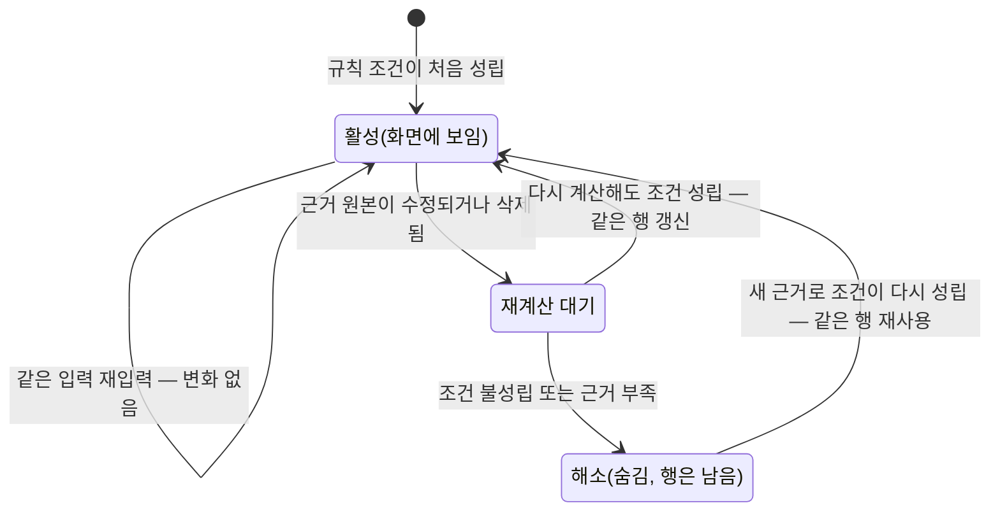
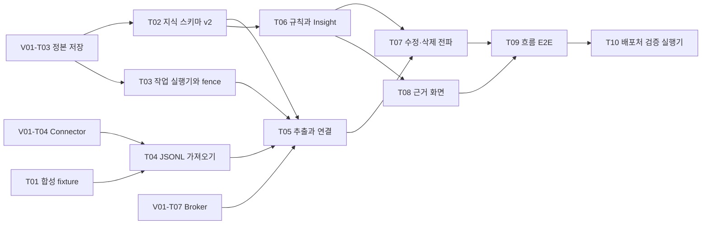

# 스펙: V02 세 출처 연결 → 일정 위험 Insight → 근거 화면 수직 검증

- 날짜: 2026-11-21 / 상태: 확정
- 관련: 이슈 #17(V02), 총괄 #1, Phase 1 #3, 선행 #16(V01)·#14(R05), 확정 #37(R07). [V01 spec](2026-11-21-V01-vertical-skeleton.md), [ARCHITECTURE.md](../ARCHITECTURE.md), [adr/](../adr/README.md), [site-setup.md](../site-setup.md)

낯선 말은 [ARCHITECTURE 0절](../ARCHITECTURE.md#0-처음-나오는-말)에 풀이가 있다. `S14`·`S15`는 site-setup.md의 체크리스트 번호다.

## 배경

제품의 핵심 가치는 서로 다른 출처의 정보를 이어 개별 원본만으로는 알기 어려운 것을 알려 주는 데 있다(원 설계 10절). 원 설계가 든 예가 이 spec의 대상이다.

- 메일: A 프로젝트 완료 목표는 12월 5일
- Wiki: A 프로젝트는 B 시스템의 API에 의존
- 메신저: B 시스템의 API 개발은 12월 10일로 연기

기대 결과는 "A의 목표 일정이 의존 업무의 지연으로 위험하다"는 Insight이며, 이것은 확정 사실이 아니라 **추론**으로 표시되어야 한다. V02는 V01의 뼈대 위에서 이 흐름 하나를 가져오기부터 근거 화면까지 실제로 잇는다.

Phase 1에는 제3자 지식 엔진이 없다([ADR 0003](../adr/0003-phase1-without-engine.md)). 추출은 LLM Provider의 구조화 출력으로 하고, 날짜 비교와 중복 검사는 코드가 한다.

## 목표

- 합성 출처 3개를 가져오면 근거 3개가 달린 "의존 업무 지연" Insight 1건이 추론으로 표시되어 생긴다.
- 날짜를 바꾼 입력에서는 결과가 바뀐다.
- 같은 입력을 다시 넣어도 Insight가 늘지 않고, 원본을 고치거나 지우면 낡은 Insight가 숨겨지거나 다시 계산된다.
- 화면에서 근거를 원본의 version과 글자 위치까지 따라갈 수 있고, 가져온 원문 안의 스크립트와 원격 자원은 실행·로드되지 않는다.

## 비목표 (배포처에서 후속 진행)

**공용 저장소의 뒤 작업으로 넘기는 것**

- JSONL 말고 다른 형식의 가져오기, 폴더 감시: I02(#19).
- Connector 규격의 확정과 SDK 문서화: I01(#18). V02는 V01의 규격에 JSONL 구현을 더할 뿐이다.
- 스케줄러, 재시도 정책의 일반화, 절전 복구: I03(#20).
- 권한 철회, tombstone 보존 기간, 삭제한 원본의 복원: I04(#21).
- 유사도에 기대는 개체 해소, 병합 되돌리기, 시간 그래프: S02(#23).
- "의존 업무 지연" 말고 다른 Insight 유형, 중요도 순위: P01(#27). 알림: P02(#28).
- 벡터 검색, 질의응답: X01(#30). V02는 벡터 색인에 아무것도 넣지 않는다.
- 품질 수치(정확도 등)의 통과 기준: R05(#14)가 고정한 뒤 잰다. V02는 흐름이 성립하는지만 본다.

**배포처 후속 항목**(2개. 각각 [site-setup.md의 배포처 설정 체크리스트](../site-setup.md#배포처-설정-체크리스트)와 번호로 대응한다)

| 번호 | 항목 |
|---|---|
| S14 | 이 흐름을 Windows 설치본과 실제 Provider로 실행하고 기록 |
| S15 | 실제 수집 데이터에서의 추출·Insight 품질 확인 |

## 요구사항

**입력**

- **V02-R1 합성 fixture.** 세 출처(메일형, Wiki형, 메신저형)의 JSONL과 기대 결과를 `fixtures/`에 둔다. 변형도 함께 둔다: ① B의 날짜가 A의 목표일보다 이른 **날짜 변형** ② 스크립트 태그, 원격 이미지, "이전 지시를 무시하라"는 문장이 든 **악성 변형**. 모두 지어낸 내용이며 날짜에는 연도를 적는다. 형식은 R05(#14)의 골든 데이터와 맞춘다. `fixtures/`에서 가져온 원본에는 데이터 등급 "합성"이 붙는다.
- **V02-R2 JSONL 가져오기.** JSONL 한 줄이 원본 하나인 Connector 구현을 만들고 V01의 Connector 계약 테스트를 통과시킨다. 형식이 틀린 줄은 그 줄만 거부하고 몇 번째 줄인지 알린다. 같은 `external_id`에 다른 내용이 오면 새 version이 되고, 삭제 사건이나 화면의 삭제 요청은 tombstone이 된다. tombstone은 그 시점 이전의 version이 다시 들어오는 것을 막는다.

**정본과 작업**

- **V02-R3 지식 스키마 v2.** 마이그레이션으로 지식 항목, 관계, 근거(원본 version, 시작 위치, 끝 위치), Insight, tombstone, 작업 테이블과 knowledge revision 번호를 더한다. 지식 항목과 관계는 인식 유형(명시 사실, 사용자 승인, 추론, 가설), 상태(candidate, verified, disputed, superseded, rejected), 유효 시각, 관측 시각을 따로 갖는다.
- **V02-R4 작업 실행기.** 작업을 정본 SQLite 테이블에 두고 기한이 있는 임대로 집는다. 원본 version 저장과 추출 작업 등록은 한 트랜잭션이다. 같은 원본 version의 같은 종류 작업은 한 번만 등록된다. 재시작하면 임대 기한이 지난 작업을 다시 집는다.
- **V02-R5 version fence.** 작업은 등록될 때의 원본 version을 들고 다닌다. 결과를 쓰는 트랜잭션 안에서 그 version이 여전히 최신이고 tombstone이 없는지 확인하고, 아니면 결과를 버리고 작업을 `superseded`로 닫는다.

**추출과 연결**

- **V02-R6 추출.** 원본 version 하나에 대해 Broker의 `generateStructured`를 **1회** 부른다(응답이 스키마에 맞지 않을 때만 재시도 1회). 입력은 지시와 "가져온 문서" 구획을 나눈다. 응답의 각 항목은 근거(시작 위치, 끝 위치, 인용문)를 가져야 하고, **인용문이 원문의 그 위치 글자와 일치하지 않는 항목은 기록하지 않는다.** 추출된 항목은 상태 candidate로 들어간다.
- **V02-R7 기존 지식과의 연결.** 추출 전에, 이름이나 별칭이 원문에 글자 그대로 나오는 기존 지식 항목을 찾아 후보로 입력에 넣는다. LLM은 기존 항목의 ID를 가리키거나 새 항목을 제안한다. 코드는 유사도를 계산하지 않는다.
- **V02-R8 범위 제한.** [ADR 0003](../adr/0003-phase1-without-engine.md)의 다섯 줄을 지킨다. 한 번에 넣을 수 없는 크기의 원본은 chunk로 나누지 않고 작업을 "보류(크기 초과)"로 남긴다. 관계 조회는 규칙이 쓰는 정해진 질의뿐이다.

**Insight**

- **V02-R9 결정론 규칙 "의존 업무 지연".** 다음이 모두 참이면 Insight를 만든다: 항목 X에 목표일이 있다, X가 Y에 의존한다는 관계가 있다, Y에 예상 완료일이 있다, Y의 날짜가 X의 목표일보다 늦다, 세 지식이 모두 유효하다. 날짜 비교는 코드가 하고 이 규칙은 LLM을 부르지 않는다. Insight의 인식 유형은 "추론"이고 근거는 세 지식의 근거다.
- **V02-R10 Insight 유지.** Insight는 중복 키(규칙, X, Y)로 1건만 둔다. 조건이 그대로면 아무것도 바꾸지 않고, 근거가 바뀌면 같은 행을 갱신한다. 조건이 깨지거나 근거가 모자라면 "해소"로 바꿔 화면에서 숨기되 행과 사용자 상태는 남긴다.
- **V02-R11 수정과 삭제의 전파.** 새 version이 오면 이전 version에서만 나온 지식을 superseded로 바꾸고 다시 추출한다. 삭제되면 그 원본에서만 나온 지식을 무효화하고, 다른 원본도 근거로 가진 지식은 근거만 뗀다. 영향받은 Insight는 다시 계산한다.

**화면과 영속**

- **V02-R12 근거 화면.** Home의 Insight에서 근거 목록을 열고, 근거마다 원본의 version과 강조된 글자 위치를 볼 수 있다. Insight에는 "추론" 표지가 붙고, 근거가 없는 추론이 "확정"으로 보이는 길이 없다.
- **V02-R13 신뢰하지 않는 원문.** 가져온 원문에는 "가져온 자료(신뢰하지 않음)" 표지가 붙고 글자로만 그려진다. 원문 안의 스크립트는 실행되지 않고 원격 자원은 요청되지 않는다.
- **V02-R14 영속.** 재시작 뒤에도 원본, 지식, Insight, 사용자 상태가 남아 있고 끝나지 않은 작업이 이어진다.

**검증 수단과 문서**

- **V02-R15 흐름 E2E.** 가져오기부터 근거 화면까지를 Playwright로 브라우저와 Electron에서 실행한다. Provider는 fixture별로 정해 둔 내용을 돌려주는 test double이다(연결할 기존 항목의 ID는 입력에 든 후보에서 고른다).
- **V02-R16 배포처 검증 실행기와 결과 기록.** 같은 흐름을 설치본과 실제 Provider로 돌리는 실행기를 둔다. 실행 기록에는 Provider 종류(`test-double` 또는 `real`), Provider 이름과 버전, OS, 앱 버전이 반드시 들어간다. 실행기는 Provider가 test double이거나 Windows 설치본이 아니면 `배포처 후속`으로 시작하는 알림을 출력하고 0이 아닌 값으로 끝난다.
- **V02-R17 문서.** [site-setup.md](../site-setup.md)의 S14 항목을 실행기의 실제 명령과 기록 위치로 고친다(제목 `## 배포처 설정 체크리스트`는 그대로 둔다). V01의 문서 대응 테스트에 이 spec의 배포처 후속 항목을 더한다. README에는 실행 명령 한 줄과 문서 링크만 둔다.

## 인터페이스 / 설계 개요

가져오기에서 Insight까지의 순서, fence와 tombstone이 걸리는 자리는 [ARCHITECTURE 6절](../ARCHITECTURE.md)의 그림에 있다. 여기에는 V02가 새로 정하는 것만 적는다.

### Insight 한 건의 상태

V02-R10과 V02-R11을 합친 것이다. "해소"에서 다시 "활성"으로 돌아올 때 새 행을 만들지 않는 것이 중복을 막는 핵심이다.

### 추출 응답의 모양 (잠정. T05에서 확정)

| 필드 | 내용 |
|---|---|
| 항목 | 유형, 이름, 기존 항목 ID(연결할 때) 또는 새 항목 표시 |
| 사실 | 어느 항목의 무엇인가(목표일, 예상 완료일), 값(날짜는 연-월-일), 인식 유형 |
| 관계 | 주체 항목, 관계 유형(의존), 대상 항목 |
| 근거 | 사실과 관계마다 시작 위치, 끝 위치, 인용문 |

유형과 관계 유형의 이름은 원 설계 7절의 목록에서 고르되, V02의 추출 스키마에는 이 흐름이 쓰는 것만 넣는다.

### 작업 분해

한 작업이 PR 하나다. `V01-T…`는 [V01 spec](2026-11-21-V01-vertical-skeleton.md)의 작업이다. 그림은 주된 흐름만 그렸고 선행 작업의 전체 목록은 아래 표가 기준이다.

| ID | 산출물 | 요구사항 | 기준 | depends_on | 검증 증거 |
|---|---|---|---|---|---|
| V02-T01 | 합성 fixture 3종, 날짜 변형, 악성 변형, 기대 결과, 문서 대응 테스트 확장 | R1, R17(테스트) | C1(입력), H1 | R05(#14), V01-T01 | fixture가 가져오기 스키마를 통과하는 테스트 |
| V02-T02 | 스키마 v2 마이그레이션, 지식·근거·관계·Insight·tombstone 저장 모듈, knowledge revision | R3 | C1(저장), C3(영속) | V01-T03 | v1에서 v2로 올리는 마이그레이션 테스트, 저장 모듈 단위 테스트 |
| V02-T03 | 작업 테이블, 임대, fence 검사, 재시작 재개 | R4, R5 | C3 | V01-T03 | 낡은 version의 결과가 버려지는 통합 테스트, 재시작 재개 통합 테스트 |
| V02-T04 | JSONL Connector, 줄 단위 오류 보고, 수정·삭제 사건, Sources 화면의 가져오기 | R2 | C1(입력), C3(재입력) | V02-T01, V01-T04, V01-T05 | Connector 계약 테스트, 재입력 시 수가 늘지 않는 통합 테스트 |
| V02-T05 | 추출 스키마와 지시문, span 대조, 연결 후보 조회, 크기 초과 보류, fixture별 Provider double | R6, R7, R8 | C1(추출·연결) | V02-T02, V02-T03, V02-T04, V01-T07 | span 불일치 항목이 기록되지 않는 단위 테스트, 세 출처의 A와 B가 같은 항목으로 이어지는 통합 테스트 |
| V02-T06 | "의존 업무 지연" 규칙, Insight 중복 키와 상태 | R9, R10 | C1(Insight), C3(중복) | V02-T02 | 날짜 경우별 단위 테스트(늦음, 같음, 이름, 의존 없음) |
| V02-T07 | 새 version과 삭제의 전파, 지식 무효화, Insight 재계산 | R11 | C3 | V02-T05, V02-T06 | 수정 후 해소, 다시 수정 후 같은 행으로 활성, 삭제 후 숨김의 통합 테스트 |
| V02-T08 | Home의 Insight, 근거 목록, 원본 version과 span 보기, 신뢰하지 않는 원문 표시 | R12, R13 | C2 | V02-T06, V01-T05 | 근거 화면 E2E, 악성 변형 E2E |
| V02-T09 | 흐름 전체 E2E(브라우저, Electron), 재입력, 재시작 | R14, R15 | C3, C4(E2E 부분) | V02-T07, V02-T08, V01-T06 | 두 환경의 E2E 출력과 실행 기록(Provider 종류 `test-double`) |
| V02-T10 | 배포처 검증 실행기, 실행 기록 양식, 실행 절차, site-setup S14 갱신 | R16, R17 | C4(실행기), H2 | V02-T09 | 실행기가 사외에서 거부하는 2건 |

## 완료 기준 (테스트 가능한 형태)

C1~C4는 이슈 #17의 문장 그대로다. H1·H2는 이 프로젝트가 배포처로 넘어가는 프로젝트라서 spec 양식이 요구하는 두 기준이며, 이슈의 문장이 아닌 별도 항목으로 이 spec에만 둔다.

- [ ] **V02-C1** (R1, R2, R3, R6, R7, R8, R9): A 완료 12/5, A→B 의존, B API 12/10 지연을 실제 추출·저장·연결하여 추론임을 표시한 위험 Insight를 만든다. 다른 날짜를 주면 결과가 바뀐다.
- [ ] **V02-C2** (R12, R13): 근거 3개를 UI에서 원본 version/span까지 열고 unsupported 추론을 확정 사실로 보이지 않는다. import한 원문은 untrusted data로 표시하며 원문 안의 script·remote resource는 실행·로드되지 않는다.
- [ ] **V02-C3** (R2, R4, R5, R10, R11, R14): 재입력은 중복 Insight를 만들지 않고 수정·삭제 뒤 stale 결과를 숨기거나 재계산한다. 재시작 후 데이터가 유지된다.
- [ ] **V02-C4** (R15, R16): Playwright E2E와 Windows 설치본에서 같은 흐름을 실행한다. Windows 설치본과 실제 provider 실행은 배포처에서 수행하며 그 전까지 이 기준은 미충족이다. 테스트 double 결과와 실제 provider 결과를 구분해 기록한다.
- [ ] **V02-H1** (R17): 이 spec의 "배포처 후속 항목" 2개 각각에 대해 site-setup.md의 `## 배포처 설정 체크리스트` 아래에 같은 번호의 항목이 있으면 통과하고, 하나라도 없거나 수가 다르면 문서 대응 테스트가 실패한다.
- [ ] **V02-H2** (R16): 배포처 검증 실행기를 ① test double Provider로 ② Windows 설치본이 아닌 환경에서 실행하면 각각 `배포처 후속`으로 시작하는 알림을 출력하고 0이 아닌 값으로 끝난다(경우마다 1건, 모두 2건). V02에는 구현하지 않고 넘기는 코드 경로가 없으므로, 양식의 "미구현 경로" 기준을 "사외 실행이 배포처 결과로 기록되는 길을 막는다"로 적용했다.

### 기준별 증명 테스트

테스트 수준의 뜻은 [V01 spec](2026-11-21-V01-vertical-skeleton.md#기준별-증명-테스트)과 같다.

| 기준 | 테스트 | 수준 | 확인하는 것 |
|---|---|---|---|
| C1 | `rule.dependency-delay` | 단위 | 12/5 대 12/10이면 Insight. 12/5 대 12/3, 같은 날, 의존 관계 없음이면 Insight 없음 |
| C1 | `extraction.validate` | 단위 | 인용문이 원문 위치와 다른 항목은 기록되지 않음. 스키마에 안 맞는 응답은 재시도 1회 뒤 실패. 크기 초과 원본은 "보류" |
| C1 | `flow.insight` | 통합 | fixture 3개를 가져오면 지식과 관계가 저장되고, A와 B가 출처를 넘어 같은 항목으로 이어지며, Insight 1건이 인식 유형 "추론"과 근거 3개로 생김 |
| C1 | `flow.date-variant` | 통합 | 날짜 변형 fixture에서는 Insight가 생기지 않음 |
| C1 | 배포처 검증 실행기 | 배포처 실행 | 실제 Provider가 같은 fixture에서 같은 Insight에 이르는지 |
| C2 | `evidence.e2e` | Playwright E2E | 근거 3개를 각각 열면 원본 version 번호와 강조된 글자가 fixture와 일치. "추론" 표지가 있고 "확정" 표지가 없음 |
| C2 | `insight.epistemic` | 단위 | 근거 없는 추론을 사실 유형으로 저장하려 하면 거부 |
| C2 | `untrusted.e2e` | Playwright E2E | 악성 변형에서 스크립트가 실행되지 않음(페이지에 표식이 생기지 않음), 원격 요청 0건, "신뢰하지 않음" 표지 표시 |
| C3 | `reimport.idempotent` | 통합 | 같은 JSONL을 두 번 넣어도 원본 version, 지식, Insight의 수가 그대로 |
| C3 | `update.recompute` | 통합 | B의 날짜를 12/3으로 고친 version → Insight 해소. 다시 12/12로 고치면 **같은 행**이 활성 |
| C3 | `delete.tombstone` | 통합 | 의존 관계 원본을 지우면 Insight 숨김. 삭제 전에 시작된 추출의 결과는 fence에 걸려 버려짐. 다른 원본도 근거인 지식은 남음. 삭제된 version을 다시 넣어도 되살아나지 않음 |
| C3 | `restart.persist` | 통합 | 백엔드 재시작 뒤 Insight와 사용자 상태가 그대로이고 임대된 채 남은 작업이 이어짐 |
| C3 | `stale.e2e` | Playwright E2E | 삭제 뒤 Home에서 그 Insight가 보이지 않음 |
| C4 | `v02-flow.e2e`(브라우저, Electron) | Playwright E2E | 가져오기부터 근거 화면까지. 실행 기록의 Provider 종류가 `test-double` |
| C4 | `run-record` | 단위 | 실행 기록에 Provider 종류가 없으면 거부. test double 실행은 `real`로 기록될 수 없음 |
| C4 | 배포처 검증 실행기 | 배포처 실행 | Windows 설치본과 실제 Provider로 같은 흐름 |
| H1 | `docs.site-setup` | 단위 | 비목표 표의 번호 2개가 체크리스트에 모두 있음 |
| H2 | `site-verify.refuse` | 통합 | 두 경우 각각에서 알림 문자열과 0이 아닌 종료 값 |

### 사외에서 충족할 수 있는 것과 배포처 실행 전까지 미충족인 것

| 기준 | 사외 | 배포처 실행 전까지 남는 것 |
|---|---|---|
| C1 | **부분.** 저장, 연결, 규칙, 날짜에 따른 결과 변화는 test double로 충족 가능 | **미충족**: "실제 추출". test double은 정해 둔 내용을 돌려줄 뿐이라 LLM이 원문에서 실제로 뽑아냈다는 증거가 아니다. S14 뒤에 충족 |
| C2 | **충족 가능**(개발 OS) | — |
| C3 | **충족 가능**(개발 OS) | Windows에서의 재시작 영속은 S14의 실행에 포함 |
| C4 | **부분.** Playwright E2E와 실행기 자체는 충족 가능 | **미충족**(기준이 명시): Windows 설치본과 실제 Provider 실행. 설치본은 배포 빌드이므로 CLI Provider를 쓰려면 검증된 조합이 등록되어 있어야 한다(S07). 그렇지 않으면 API 키 Provider(S05)로 실행한다. S10과 S14 뒤에 충족 |
| H1, H2 | **충족 가능** | — |

test double의 결과를 실제 Provider의 결과로 적지 않는다. R07(#37)이 닫히기 전에는 V02를 통과로 표시하지 않는다.

## 미해결 질문

구현을 막는 질문은 없다. 정해야 할 것이 둘 남아 있다.

1. **사외에서의 "실제 추출" 증거.** 사외에서 쓸 수 있는 API 키가 있다면 합성 fixture로 API 키 Provider의 실제 추출을 미리 한 번 돌려 C1의 일부 증거를 남길 수 있다. 개발 모드에서는 합성 데이터에 한해 실제 CLI도 부를 수 있다(V01-R10). 어느 쪽이든 할지는 사용자가 정한다. 하더라도 Windows 설치본 실행(C4)은 남는다.
2. **R05와의 순서.** fixture 형식을 R05(#14)의 골든 데이터와 맞추기로 했으나 R05는 아직 닫히지 않았다. R05가 늦으면 V02-T01이 형식을 먼저 정하고 R05가 그것을 받아들일지 정해야 한다.

## 변경 이력

| 날짜 | 변경 내용 | 대상 | 사유 |
|---|---|---|---|
| 2026-11-21 | 최초 작성(초안) | 이 문서 | 이슈 #17의 구현 spec, R06-C1·R06-C4 |
| 2026-11-21 | 상태를 확정으로. fixture의 "합성" 등급 명시. C4의 배포처 조건을 배포 빌드의 CLI 실행 규칙에 맞춤. H1·H2를 별도 항목으로 유지한다고 명시하고 해당 질문 삭제 | 상태, R1, 사외·배포처 표, 미해결 질문 | 조정자 판정 1·5·8 |
