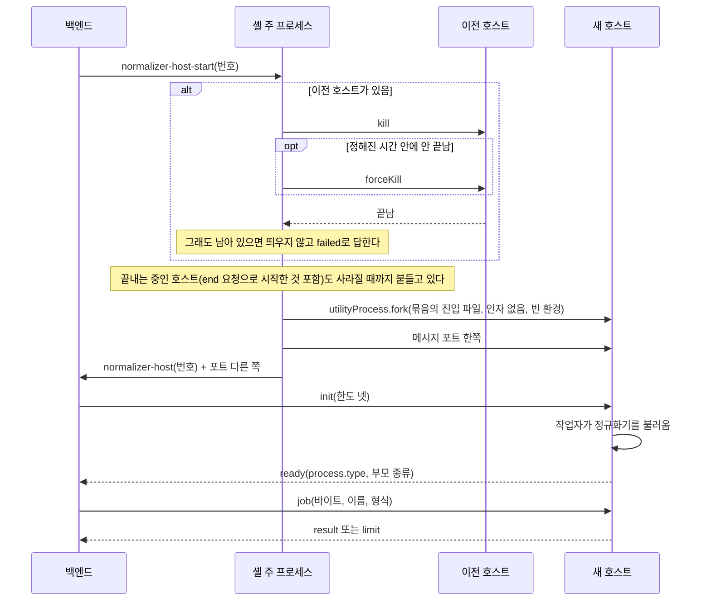
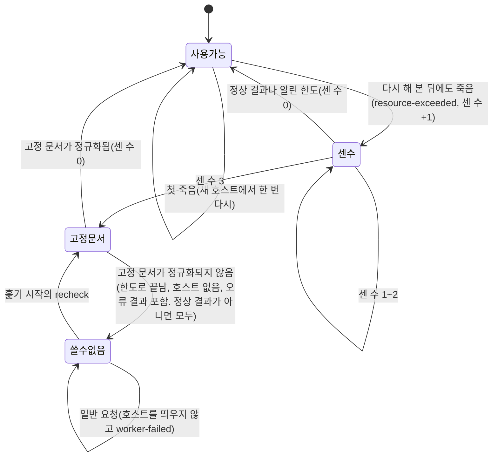
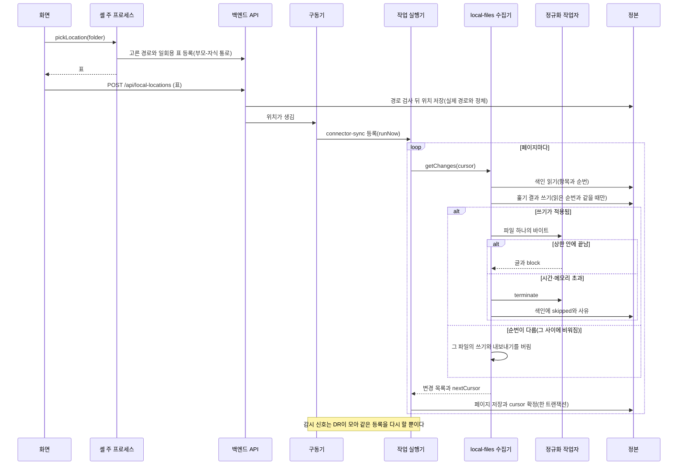
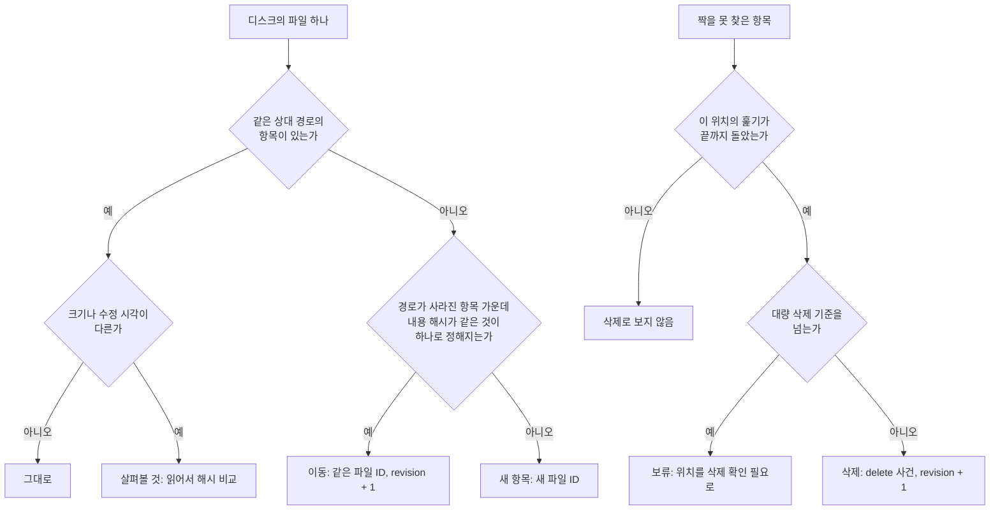
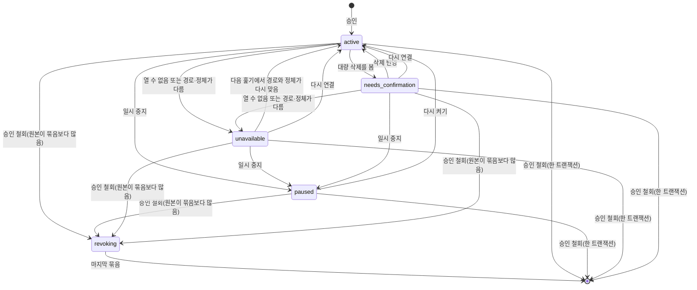
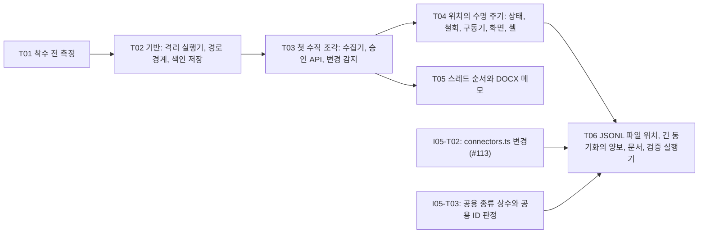

# 스펙: I02-B 로컬 파일·폴더 가져오기 — 승인한 위치를 읽고, 바뀐 것과 지운 것을 따라가기

- 날짜: 2026-11-22 / 상태: 확정(잠정 결정 포함)
- 관련: 이슈 #19(I02)의 남은 조각, 이슈 #116(JSONL 파일 인스턴스와 경로 제한)을 흡수, 맞물림 #113(배포처 수집기 등록, I05 spec), #32(H01 백업·복원), #33(H02 Windows 수명 주기). 선행 spec [I02-A 문서 정규화](2026-11-21-I02-document-normalization.md), [I01 Connector SDK](2026-11-21-I01-connector-sdk.md), [I03 작업 대기열](2026-11-21-I03-persistent-queue.md), [I04 무효화](2026-11-21-I04-invalidation.md), [V01](2026-11-21-V01-vertical-skeleton.md). 문서 [connector-sdk.md](../connector-sdk.md), [site-setup.md](../site-setup.md), [ADR 0015](../adr/0015-document-parsing-stack.md), [ADR 0016](../adr/0016-connector-sdk-v2.md)
- 기준 코드: `origin/main` `3493a75`(tombstone 장부 PR #118 포함). 이 문서가 코드에 대해 말하는 사실은 그 커밋에서 확인했다. 그 뒤 `main`에 들어온 것은 I05 spec 문서뿐이다(`9ae1f8a`. 코드는 같다).

낯선 말은 [ARCHITECTURE 0절](../ARCHITECTURE.md#0-처음-나오는-말)과 [connector-sdk.md](../connector-sdk.md) 머리의 표에 풀이가 있다. 이 문서에서 새로 쓰는 말은 다음과 같다.

| 말 | 뜻 |
|---|---|
| 승인 위치 | 사용자가 "여기는 읽어도 된다"고 하나씩 고른 폴더나 파일. 집 열쇠를 방마다 따로 주는 것과 같다. 다른 점은 열쇠를 줘도 제품이 **읽기만** 한다는 것이다(쓰거나 지우지 않는다) |
| 색인 | 수집기가 "어느 파일을 어떤 정체로, 어디까지 알렸는가"를 적어 두는 표. 도서관의 대출 대장과 비슷하다. 책(내용)은 들어 있지 않고 누가 무엇을 빌렸는지만 있다 |
| 훑기(pass) | 승인 위치의 디스크 상태를 색인과 맞춰 보는 일 한 번. 이 문서의 "재조정(reconciliation)"이 이것이다 |
| 감시(watcher) | OS가 "이 폴더에서 뭔가 바뀌었다"고 알려 주는 신호를 듣는 것. 초인종과 같다. 초인종이 고장 나도 정해진 시각의 순찰(주기적 훑기)이 집을 확인한다 |
| 격리 실행 | 믿을 수 없는 파일을 푸는 일을 따로 떼어 낸 작업자(worker)에서 돌리고, 시간이나 메모리를 넘기면 끊는 것 |
| 파일의 정체(`dev`, `ino`) | OS가 파일이나 폴더 하나에 붙인 번호 한 쌍(어느 볼륨의, 몇 번 파일인가). 경로는 이름표이고 이것은 주민번호에 가깝다. 이름표를 바꿔 달아도(이름 바꾸기, symlink 바꿔치기) 번호는 그대로다. 다른 점은 파일을 지우면 OS가 그 번호를 새 파일에 다시 줄 수 있다는 것이다 |
| 닫는 쪽(fail closed) | 판정할 수 없을 때 "읽지 않는다·승인하지 않는다" 쪽으로 정하는 것. 문이 고장 나면 열린 채가 아니라 잠긴 채로 두는 것과 같다 |

요구사항 번호는 `I02B-R<n>`, 기준은 `I02B-C<n>`, 작업은 `I02B-T<nn>`이다. I02-A가 `I02A-` 접두사를 썼으므로 같은 방식으로 `I02B-`를 쓴다. `I02-R<n>` 모양의 번호는 두 문서 어디에도 없어서 겹치지 않는다. 배포처 항목 번호는 **S23~S25로 확정**이다(S16~S17 I02-A, S18 I01, S19~S20 I03, S21~S22 I04). 새 ADR은 다음 빈 번호인 **0017**이다. [I05 spec](2026-11-22-I05-site-connector-registration.md)(#113)은 S26·S27과 ADR 0018을 쓴다(조정자가 두 spec의 번호를 함께 배정했다). I05 spec이 이 spec의 작업을 `I02B-T13`이라 부르는 곳은 이 문서의 I02B-T06(JSONL 파일 위치)을 뜻한다. 작업을 다시 묶으면서 번호가 바뀌었다.

## 배경

I02-A는 파일 하나를 글과 위치표로 바꾸는 순수 모듈(`@pki/document-normalize`)을 만들었다. 그러나 **제품 어디에서도 그 모듈을 부르지 않는다.** 사용자가 문서를 넣을 길은 JSONL뿐이다. 이슈 #19에서 남은 것은 다음과 같다.

- I02-C2의 나머지: 폴더 scope 승인, rename/move/debounce, 폴더를 훑을 때의 symlink 경계.
- I02-C3 전부: 스레드·참여자·댓글의 시간 순서 복원, 감시 누락 뒤의 재조정.
- I02-A가 넘긴 다섯 항목("I02-B에서 다시 확인할 것"): SourceRecord로 옮기기, 내용 해시와 파서 버전, 합성 등급, **시간 상한 없이는 가져오기에 넣지 않는다**, 원본 파일 보관과 삭제.

넷째 항목은 출시 전 조건이다. 파서에는 시간 상한이 없고 검토의 실측은 24 KB Markdown에 14 s, 3.1 MB PDF에 CPU 359 s였다. 폴더를 훑는 제품이 이런 파일 하나를 만나면 백엔드 전체가 멈춘다.

이슈 #116도 같은 자리에 있다. 파일을 읽는 JSONL 수집기(`jsonl-import` + `{ path }`)는 코드와 계약 시험으로만 있고, 제품에는 그런 인스턴스를 만들 길도, 경로를 가두는 규칙도 없다. "사용자가 고른 로컬 경로를 제품이 안전하게 읽는다"는 같은 문제이므로 한 번만 만든다.

지금 코드에서 이 설계가 기대는 사실은 다음과 같다.

- 수집기 인스턴스는 시작할 때 한 번 정해지고 실행 중에 늘지 않는다(`backend/src/connectors.ts`의 `createConnectorManager`). 인스턴스의 설정을 쓰는 곳도 없다.
- 제품이 아는 수집기 종류의 목록은 한 곳이다(`backend/src/composition.ts`의 `connectorKinds`). 시작할 때의 장부 재적용은 그 목록의 이름만 "아는 종류"로 본다(`backend/src/boot.ts`).
- 수집기 경로(`backend/src/adapters/` 등)는 import 허용 목록을 지켜야 한다. `node:worker_threads`와 `@pki/document-normalize`는 목록에 없다(`tooling/connectors/public-only.ts`).
- `deletionsOnRescan`을 참으로 선언하려면 수집기가 알린 정체의 기록을 **인스턴스 밖**에 두어야 한다(connector-sdk.md 2장).
- 출처 정보만 바뀐 레코드는 새 version을 만들지 않는다(I01-R13). 그래서 파일이 이름 그대로 다른 폴더로 옮겨지면 version에 적힌 경로는 낡는다.
- 수집기가 스스로 걸러 낸 항목을 알리는 `rejected`의 사유는 닫힌 목록(`REJECT_CODES`)이고, 목록 밖의 값 하나가 페이지 전체를 실패시킨다. 정규화 실패 사유는 그 목록에 없다.
- 데이터 디렉터리의 모든 항목과 정본의 모든 테이블은 분류되어 있어야 하고, 삭제는 분류된 곳 전부에 닿아야 한다(I04-R3, `backend/src/derivative-coverage.ts`).
- tombstone을 쓰는 길은 둘이다: 삭제 입구(`applyTombstone`, `knowledge-engine/src/tombstone-entry.ts`)와 시작할 때의 장부 재적용(`knowledge-engine/src/ledger-reapply.ts`). 둘 다 `tombstones` 테이블에 행을 쓰고, 같은 트랜잭션에서 `sources` 행의 정체를 키 있는 해시로 바꾼다(`hashSourceIdentity`).
- tombstone은 장부에 줄을 적을 수 있을 때만 커밋된다. 줄을 적을 수 없으면 `LedgerLineUnwritableError`, 장부가 잠겨 있으면 `LedgerDegradedError`(코드 `ledger-degraded`)로 트랜잭션 전체가 거부된다(`storage/src/canonical-transaction.ts`). API의 공통 처리기는 지금 앞의 것만 409 `ledger-unwritable`로 옮긴다(`backend/src/server.ts`).
- 화면의 사용자 삭제(`POST /api/sources/delete`)는 인스턴스 잠금을 잡지 않는다(`backend/src/server.ts`의 `deleteSource`). 그래서 동기화가 도는 중에도 끼어들 수 있다.
- Node에는 `O_NOFOLLOW`가 POSIX에만 있고 Windows에는 없다. I02-A의 코드도 그 상수를 "있으면 쓴다"로 다룬다(`packages/document-normalize/src/input.ts`). 폴더 핸들을 기준으로 그 안의 파일을 여는 방법(`openat`)은 Node에 없다.

## 목표

- 사용자가 폴더 하나를 승인하면, 그 안의 지원 형식 파일이 원본(Source)으로 들어오고 근거(Evidence)가 원래 자리(쪽, 시트·칸, 줄, 문단)를 가리킨다.
- 파일을 고치면 새 version이 생기고, 지우면 tombstone이 생겨 그 내용과 파생물이 지워진다. 이름을 바꾸거나 옮긴 파일은, 알아볼 수 있는 한, 같은 원본으로 남는다.
- 감시 신호를 **하나도 받지 못해도** 다음 전체 훑기가 끝나면 제품의 상태가 디스크와 같다.
- 정규화는 격리된 작업자에서 돌고, 시간·메모리 상한을 넘으면 끊기며, 그 파일만 사유와 함께 건너뛴다. 백엔드는 멈추지 않는다.
- 건너뛴 파일은 모두 사유와 함께 화면에 보인다. 소리 없이 빠지는 파일이 없다.
- 제품은 원본 파일의 사본을 만들지 않는다. 데이터 디렉터리에 새 항목이 생기지 않는다.
- 승인 위치의 저장, 경로를 가두는 규칙, 설정 화면은 하나이고, JSONL 파일 위치(#116)도 그것을 쓴다.
- 경로의 경계는 닫는 쪽으로 정한다. 지킬 수 없는 보장은 지킨다고 적지 않고 좁혀서 적는다(I02B-R46).

## 비목표 (배포처에서 후속 진행)

**이번에 하지 않는 것**

- 클라우드 드라이브의 API(OneDrive, Google Drive 등)로 읽기. 동기화 폴더가 로컬 폴더로 보이는 경우의 동작은 아래 S23·S25가 본다.
- 메일·메신저·Wiki 수집기. 배포처 포크의 일이다(S01~S03).
- OCR, 그림 속 글자, I02-A의 여덟 형식 밖의 새 형식. `.jsonl`은 문서 형식이 아니며 폴더 안에서 만나면 건너뛴다(I02B-R42).
- 실시간 공동 편집, 파일 쓰기·이름 바꾸기·지우기. 제품은 승인 위치를 읽기만 한다.
- 원본 파일의 사본 보관(I02B-R32가 "하지 않는다"로 정한다).
- 파일 시스템의 권한(ACL)을 `accessScope`로 옮기기. 로컬 파일의 범위는 "알 수 없음"이다(I02B-R35).
- 메모의 스레드를 따로 된 원본으로 쪼개기, XLSX 메모·PDF 주석의 복원. XLSX는 한계 표시로 알리고 PDF 주석은 늘 있는 한계에 적는다.
- 화면에서 한도 값을 고치는 입력란. 한도는 설정 API의 키로 두고 화면은 현재 값만 보인다.
- 수집기 인스턴스를 `site/` 안에서 등록하는 장치: #113(I05 spec). 이 spec의 `local-files`는 공용 종류이며 공용 구성 지점에 등록한다(I02B-R2).
- 백업 파일 형식과 복원 화면: H01(#32). 트레이 상주와 절전 복귀 시의 앱 수명 주기: H02(#33). 이 spec은 두 작업이 기댈 성질만 정한다(I02B-R20, R34).
- 정규화 호스트를 OS 수준의 샌드박스로 가두기(파일·네트워크 차단, 권한 낮추기). 정규화는 별도 프로세스에서 돌지만(I02B-R22) 그 경계가 막는 것은 **죽음과 메모리가 백엔드로 번지는 것**이고, 호스트는 백엔드와 같은 OS 사용자의 권한을 갖는다. 남는 위험 2에 적는다.
- 승인한 폴더에 쓸 수 있는 다른 프로그램이 시간을 맞춰 두 번 바꿔치기하는 공격을 완전히 닫기. 줄일 뿐이며 I02B-R47이 어디까지인지 적는다.

**배포처 후속 항목**(3개. 각각 [site-setup.md의 배포처 설정 체크리스트](../site-setup.md#배포처-설정-체크리스트)와 번호로 대응한다)

| 번호 | 항목 |
|---|---|
| S23 | Windows 11 설치본에서 로컬 파일 수집 검증 실행기를 돌리고 기록(아래 "Windows에서 확인할 것" W1~W12) |
| S24 | 실제 업무 폴더의 규모로 한도와 주기의 값을 정함(위치당 파일 수, 정규화 시간·메모리 상한, 안정화 시간, 훑기 주기, 철회 묶음 크기) |
| S25 | 네트워크 공유와 클라우드 동기화 폴더를 승인 위치로 허용할지 정하고, 허용한다면 구현·검증. 로컬 파일(범위 "알 수 없음")의 등급 매핑을 S08에서 함께 정함 |

**공용 저장소에 이슈로 남길 것**(이 spec이 풀지 않는 것. 조정자가 이슈를 연다)

| 표시 | 무엇을 | 왜 여기서 하지 않는가 |
|---|---|---|
| F1 | 이슈 #19 I02-C1의 "첨부 metadata": 메일 첨부의 이름·형식·크기와 근거 위치를 레코드에 싣는 일 | 첨부는 메일의 것이라 메일 수집기(S01)가 낸다. 지금 S01의 글에는 첨부가 없다. 이 spec은 S01에 한 문장을 더하고(I02B-R43) 추적 이슈는 따로 연다 |
| F2 | 장부 재적용이 줄마다 인스턴스의 평문 원본 전부를 해시해 찾는 비용(`ensureSourceByHash`) | I04의 코드다. `local-files`는 모든 위치의 원본이 한 인스턴스에 모이므로(D2) 복원 뒤 시작이 느려질 수 있다. 이 spec은 재기만 한다(남는 위험 8) |

## 요구사항

### 가. 모양: 수집기 종류 하나와 승인 위치

- **I02B-R1 `local-files` 수집기.** 파일·폴더 가져오기는 별도의 가져오기 경로가 아니라 Connector 규격 v2의 수집기 종류 `local-files`다. 저장, cursor, 작업 대기열, tombstone, 장부, 화면의 동기화 상태는 기존 것을 그대로 쓴다. 능력 선언은 `incremental`, `deletes`, `fullRescan`, `deletionsOnRescan`이 참이고 `accessScope`가 거짓이다. `@pki/testkit`의 계약 묶음(`connectorContract`)을 위반 0건으로 통과한다.
- **I02B-R2 인스턴스 하나, 위치마다 namespace.** 제품은 `local-files` 인스턴스를 **하나**(ID `local-files`) 등록한다. 승인 위치마다 무작위 위치 ID를 만들고 그것이 레코드의 `namespace`다. 원본의 정체는 `(local-files, 위치 ID, 파일 ID)`다. 승인 위치가 하나도 없어도 인스턴스는 준비 상태이고 변경 0건을 돌려준다. 그래서 위치를 더하고 빼는 일에 수집기 관리 모듈을 고칠 필요가 없다.
  - **위치 ID의 모양.** 무작위 16바이트를 base64url로 적은 22자(`[A-Za-z0-9_-]{22}`)다. 파일 ID도 같은 모양이다. 그래서 JSONL 파일 위치의 인스턴스 ID `jsonl-file:<위치 ID>`(I02B-R41)는 33자이고, 장부와 가져오기 스키마가 받는 인스턴스 ID의 한도(`MAX_INSTANCE_ID_LENGTH` = 128, `packages/contracts/src/import-record.ts`) 안이다. 한도를 넘는 ID는 장부가 줄을 거부해 삭제 자체가 거부되므로 모양을 여기서 고정한다.
  - **공용 종류의 목록은 하나다.** `local-files`는 제품이 아는 종류의 그 한 목록에 더한다. I05가 공용 종류 상수(`PUBLIC_CONNECTOR_KINDS`, 잠정 이름. I05-R7)를 만들어 "배포처가 쓸 수 없는 예약 이름"을 거기서 끌어낸다. 그 상수는 I05-T03이 공용 종류 모듈(`backend/src/`의 새 파일)에 두며 **아직 코드에 없다.** 지금 제품의 종류 목록은 `backend/src/composition.ts`의 `connectorKinds`다. 이 spec의 작업(I02B-T03)이 I05-T03보다 먼저 들어가면 `connectorKinds`에 더하고 I05-T03이 그 이름을 상수로 옮긴다. I05-T03이 먼저 들어가 있으면 I02B-T03이 그 상수에 더한다(잊으면 I05-C14가 실패한다). 어느 쪽이든 둘째 목록을 만들지 않는다. 시작할 때의 장부 재적용이 `local-files`를 아는 종류로 보는 것도 같은 목록에서 나온다(`backend/src/boot.ts`). **만드는 함수의 모양.** 수집기를 만드는 함수는 인자가 없고(`ConnectorFactory = () => Connector`, `backend/src/connectors.ts`), 시작 코드는 정본을 열기 전에도 `productConnectors()`를 불러 종류의 이름을 읽는다(`backend/src/boot.ts`). 그래서 `productConnectors()`는 지금처럼 **정본 없이 부를 수 있어야 하고**, `local-files`는 그 바탕 묶음에 인자 없는 함수로 든다. 그 함수는 불릴 때(인스턴스를 초기화할 때. 정본이 열린 뒤다) 구성 지점이 시작 중에 묶어 둔 포트(I02B-R4)를 읽는다(`boot.ts`가 수집기 관리 모듈을 늦게 묶는 것과 같은 방법). 포트가 묶이기 전에 불리면 그 인스턴스는 `unavailable`이다. 이 모양이면 I05-R1의 등록이 얹히는 바탕 묶음(`productConnectors()`의 결과)이 달라지지 않고, 종류의 이름은 정본 없이 읽힌다.
- **I02B-R3 승인 위치의 종류.** 종류는 셋이다.

  | 종류 | 고르는 것 | 읽는 수집기 |
  |---|---|---|
  | `folder` | 폴더 하나(하위 폴더 포함) | `local-files` |
  | `file` | 문서 파일 하나("파일 가져오기") | `local-files` |
  | `jsonl-file` | JSONL 파일 하나(#116) | 기존 `jsonl-import`(I02B-R41) |

  "파일 가져오기"는 한 번 복사하고 잊는 것이 아니라 파일 하나짜리 승인 위치다. 그 파일을 고치거나 지우면 폴더 안의 파일과 똑같이 따라간다. 사본을 두지 않으므로(I02B-R32) 따라가지 않는 가져오기는 삭제가 닿지 않는 원본을 만든다.
- **I02B-R4 수집기는 포트로만 밖을 만진다.** 수집기 구현(`backend/src/adapters/local-files-connector.ts`)은 import 허용 목록을 고치지 않고 그 안에서 산다. 색인을 읽고 쓰는 일과 격리 정규화는 구성 지점이 만드는 함수 둘(색인 포트, 정규화 포트)로 받는다. 디스크를 훑고 여는 일은 `@pki/connector-sdk`의 경로 경계 모듈(I02B-R6)을 쓴다. `tooling/connectors/public-only.ts`의 검사가 그대로 통과한다.

### 나. 승인과 경로 경계

이 절의 규칙이 무엇을 막고 무엇을 막지 못하는지는 "타. 경로 신뢰 경계의 위협 모델"(I02B-R46~R48)이 정한다.

- **I02B-R5 승인은 위치마다, 명시적으로.** 위치는 사용자가 하나씩 승인할 때만 생긴다. 제품은 승인한 적 없는 경로를 읽지 않는다. 승인 요청은 종류와 절대 경로를 받고 다음을 검사한다. 걸리면 닫힌 목록의 사유 코드로 거부하고 아무것도 저장하지 않는다.

  | 사유 코드 | 언제 |
  |---|---|
  | `not-absolute` | 절대 경로가 아니거나 `..` 구간이 남아 있다 |
  | `unsupported-path-form` | 절대 경로이지만 제품이 분류하지 않은 모양이다(I02B-R48의 닫힌 목록: Windows의 `\\?\`·`\\.\` 접두사, 드라이브 상대 경로, 대체 데이터 스트림, 8.3 짧은 이름으로 보이는 구간) |
  | `not-found`, `not-readable` | 없거나 열 수 없다 |
  | `location-unreachable` | 이미 승인한 위치의 폴더를 지금 읽을 수 없어(디스크가 빠짐 등) 그 위치와는 가장 가까운 읽을 수 있는 상위 폴더까지만 비교할 수 있고, 후보가 그 위쪽이 아니다. 겹치는지 알 수 없으므로 승인하지 않는다(후보가 그 위쪽이면 `overlaps-location`) |
  | `wrong-type` | `folder`인데 디렉터리가 아니거나, `file`·`jsonl-file`인데 일반 파일이 아니다 |
  | `identity-unavailable` | OS가 그 폴더나 파일의 정체(`dev`, `ino`)를 주지 않는다(값이 0이거나 읽을 수 없다). 정체 없이는 I02B-R47의 확인을 할 수 없다 |
  | `filesystem-root` | 볼륨의 맨 위(`/`, `C:\`)다 |
  | `inside-data-directory` | 앱의 데이터 디렉터리나 셸의 사용자 자료 폴더(Electron userData)이거나 그 안이다(I02B-R48의 판정) |
  | `overlaps-location` | 이미 승인한 다른 위치와 같거나, 그 안이거나, 그것을 품는다(I02B-R48의 판정) |
  | `network-location` | UNC 경로(`\\server\share`, `\\?\UNC\`)다. 문구는 `미구현, 배포처 후속`을 포함한다(S25) |
  | `unsupported-format` | `file`인데 여덟 형식이 아니거나, `jsonl-file`인데 확장자가 `.jsonl`이 아니다 |

  한 요청이 여러 사유에 걸리면 표의 위에서부터 처음 걸린 것 하나를 돌려준다(`\\?\UNC\`는 `network-location`이 `unsupported-path-form`보다 먼저다). UNC는 모양만으로 정해지므로 파일 시스템을 묻기 전에 `network-location`이다(공유를 찾으려고 네트워크에 닿지 않는다). 승인할 때 symlink를 끝까지 따라간 **실제 경로**(I02B-R6)와 그 폴더(또는 파일)의 **정체**(`dev`, `ino`)를 함께 저장한다. 화면에는 사용자가 고른 경로를 보인다.
- **I02B-R6 경로 경계 모듈.** `@pki/connector-sdk`에 경로 경계 모듈 하나를 둔다. 승인 검사, 폴더 훑기, 파일 열기가 모두 이것을 쓴다. 규칙은 다음과 같다.
  - **실제 경로는 OS에게 묻는다.** `fs.realpath.native`를 쓴다(Node가 스스로 계산하는 `fs.realpath`가 아니다). Windows의 junction과 짧은 이름을 OS가 푼 결과를 받기 위해서다. 그 결과가 정말 긴 이름과 저장된 대소문자로 돌아오는지는 이 저장소에서 확인하지 못했으므로(가정 G10, G18) 안쪽 판정은 이 문자열 하나에 기대지 않는다(I02B-R48).
  - **안쪽 판정은 구성 단위로 한다.** 문자열 앞부분 비교가 아니다(`/data/a`는 `/data/ab` 안이 아니다).
  - **symlink는 따라가지 않는다.** 훑다가 만난 symlink(파일이든 폴더든)는 사유 `symlink`로 건너뛴다. 가리키는 곳이 위치 안이어도 같다(순환과 중복을 한 규칙으로 막는다).
  - **폴더로 내려가기 전에 그 폴더의 실제 경로가 `위치의 실제 경로 + 상대 경로`와 같은지 본다.** 다르면 사유 `redirected`로 건너뛴다. OS가 symlink로 알리지 않는 재지정(Windows의 junction 등 재분석 지점)을 같은 검사로 막는다. 내려갈 때 그 폴더의 정체도 적어 둔다.
  - **제외 목록은 훑기와 읽기 모두의 필수 인자다.** 비어 있으면 빈 목록을 적어야 하고(생략하면 형식 오류, 실행 중에는 `TypeError`), 읽기는 제외된 폴더 아래의 파일을 사유 `excluded`로 거부한다(경로와 정체 둘 다). 훑기는 폴더를 나열한 **뒤에** 그 폴더의 실제 경로와 정체를 다시 재고, 달라졌으면 나열한 이름을 버리고 `redirected`로 건너뛴다.
- **파일은 I02B-R47의 순서로만 연다**(이름으로 본 것과 연 것이 같은 파일인지 확인한 뒤 그 핸들에서만 읽는다). 일반 파일이 아니면 사유 `not-regular-file`이다. 한 번 연 핸들에서 크기를 확인하고 그 핸들로만 `maxFileBytes`까지 읽는다(I02A-R2와 같은 규칙).
  - **데이터 디렉터리와 셸의 사용자 자료 폴더의 하위는 언제나 뺀다.** 승인 위치가 그것을 품고 있어도(예: 홈 폴더) 그 아래는 훑지 않는다. `secrets.json`이 `.json` 문서로 들어오는 길을 막는다. 판정은 I02B-R48의 두 길(경로와 정체)을 쓴다. 뺀 폴더는 건너뛴 파일이 아니라 "무시" 수에 센다.
  - 상대 경로가 `walk.maxRelativePathChars`보다 길면 `path-too-long`, 깊이가 `walk.maxDepth`를 넘으면 `too-deep`이다.
  - 하드 링크는 보통 파일로 읽는다. 승인한 폴더 안에 이름이 있는 파일은 그 폴더의 내용이다(남는 위험 3).
  - 대소문자만 다른 이름, 유니코드 정규형이 다른 이름은 **파일을 따라갈 때는** OS가 돌려준 이름 그대로 다룬다. 제품이 접거나 바꾸지 않는다. **경계 판정(데이터 디렉터리 안인가, 다른 위치와 겹치는가)만은** 대소문자를 접어서 비교한다(I02B-R48).
- **I02B-R7 위치의 상태.** 위치는 `active`, `paused`, `unavailable`, `needs-confirmation`, `revoking` 가운데 하나다(아래 상태도).
  - 훑기 시작에 위치를 열 수 없거나(`root-missing`, `root-not-readable`), 실제 경로나 **정체(`dev`, `ino`)가 승인 때와 하나라도 다르면**(`root-changed`) `unavailable`이다. 다음 훑기에서 셋이 모두 다시 맞으면 `active`로 돌아온다. 폴더를 다른 곳으로 옮겼다가 되돌린 경우가 그렇다(번호가 그대로다).
  - 같은 경로에 **다른 정체**의 폴더가 있으면 저절로 돌아오지 않는다. 사용자가 "다시 연결"(I02B-R9)로 "이 폴더가 맞다"고 확인해야 한다. 폴더를 지우고 사본으로 다시 만든 경우, 그리고 macOS·Linux에서 외장 디스크를 다시 꽂아 볼륨 번호(`dev`)가 달라진 경우가 여기에 든다. 번거롭지만 닫는 쪽이다: 같은 자리에 꽂힌 **다른** 디스크를 같은 위치로 보면 그 안에 없는 파일이 모두 삭제로 읽힌다. Windows에서 다시 꽂은 디스크의 번호가 유지되는지는 S23 W10이 본다(가정 G15).
  - **`unavailable`인 위치에서는 삭제를 하나도 알리지 않는다.** 외장 디스크를 뽑았다고 그 안의 원본이 모두 지워지면 안 된다.
  - `needs-confirmation`인 위치도 훑기 시작의 검사에 걸리면 `unavailable`이 된다. 보류된 삭제 표시는 그대로 남고, 위치가 돌아오면 `needs-confirmation`으로 돌아온다.
  - `paused`는 `active`, `unavailable`, `needs-confirmation` 어디에서든 걸 수 있고(사용자가 걸거나, 복원으로 보이는 시작에서 제품이 사유 `restored`로 건다. I02B-R34), 다시 켜면 `active`로 가서 다음 훑기가 상태를 다시 정한다.
  - `revoking`은 철회가 진행 중이라는 뜻이다(I02B-R49). 읽지 않고, 다른 상태로 돌아가지 않는다.
- **I02B-R8 대량 삭제는 확인을 받는다.**
  - **기준.** 분모는 그 훑기를 시작할 때 그 위치에서 상태가 `present`이고 "확인됨" 표시가 없는 항목의 수다(`skipped`, `deleted`, `forgotten`은 세지 않는다). 분자는 그 가운데 이번 훑기에서 사라진 것으로 본 수다(아직 확인받지 않은 보류 포함). 분자가 `deletionBrake.minFiles` 이상이고 분자 ÷ 분모가 `deletionBrake.ratio` 이상이면, 그 삭제들을 알리지 않고 항목마다 **보류 표시**를 달고 위치를 `needs-confirmation`으로 둔다. 그동안 새 파일과 고친 파일은 평소대로 들어온다.
  - **확인.** 사용자가 화면에서 "삭제 반영"을 고르면 요청은 화면이 보인 보류 수를 함께 보낸다. 지금의 보류 수와 다르면 409 `count-mismatch`로 거부한다(철회와 같은 까닭: 되돌릴 수 없는 일은 사용자가 본 수에만 한다). 맞으면 그 항목들에 "확인됨"을 적고 위치를 `active`로 돌린다.
  - **확인이 미치는 범위.** 확인은 그때 보류 표시가 있던 항목에만 미친다. 다음 끝까지 돈 훑기에서 그 항목 가운데 여전히 없는 것은 `delete`로 알리고, 돌아온 것은 표시를 뗀다. 확인 뒤에 새로 사라진 파일은 표시가 없으므로 위의 기준을 처음부터 다시 받는다.
  - "위치 다시 연결"(I02B-R9)을 고를 수도 있다. 삭제는 지식과 사용자 승인 값을 지우므로 되돌릴 수 없기 때문에 이 확인이 있다.
- **I02B-R9 다시 연결.** 사용자는 `unavailable`이나 `needs-confirmation`인 위치에 새 경로(같은 경로도 된다)를 줄 수 있다. 위치 ID는 그대로이고 I02B-R5의 검사를 다시 거치며(겹침 검사에서 자기 자신은 뺀다) 실제 경로와 정체를 새로 적는다. 다음 훑기는 상대 경로와 내용으로 기존 정체를 이어 간다. 폴더 이름을 바꿨을 때, 다른 정체의 폴더가 같은 자리에 왔을 때, 백업을 다른 PC에 복원했을 때 쓰는 길이다(H01). 잘못된 폴더에 연결하면 대부분의 파일이 사라진 것으로 보여 I02B-R8의 보류에 걸린다.
- **I02B-R10 일시 중지와 승인 철회.** 둘은 다른 동작이다.
  - **일시 중지**: 그 위치를 읽지 않는다. 원본, 근거, 색인은 그대로다. 다시 켜면 같은 정체로 이어진다. 화면은 "이 폴더의 변경과 삭제를 반영하지 않습니다"를 보인다.
  - **승인 철회**: 그 위치를 영영 읽지 않고, 그 위치에서 온 원본을 모두 **사용자 삭제**(`user-deleted`)로 지운다. I04의 `applyTombstone`을 `canonicalTransaction` 안에서 부른다. 원본의 tombstone, 그 색인 행의 삭제, 위치 행의 삭제는 **함께 성공하거나 함께 실패한다.** 장부가 거부하면 아무것도 지워지지 않는다. 원본이 많은 위치는 묶음으로 나눠 지우며 그동안 위치는 `revoking`으로 화면에 보인다. 자세한 규칙은 I02B-R49다. 같은 폴더를 다시 승인하면 새 위치 ID가 생기므로 옛 tombstone에 막히지 않는다.
  - 철회가 삭제를 뜻하는 까닭: 읽지 않는 위치의 원본은 파일이 지워져도 영영 삭제가 닿지 않는다. 그런 원본을 남기면 "출처에서 지우면 제품에서도 지워진다"는 약속이 깨진다. 멈추기만 원하는 사용자에게는 일시 중지가 있다. 출처 삭제(`source-deleted`)나 권한 상실(`access-revoked`)로 적지 않는 까닭은, 파일은 그대로 있고 사용자도 여전히 볼 수 있어서 둘 다 사실이 아니기 때문이다.

### 다. 정체와 변경 감지

- **I02B-R11 파일 ID.** `externalId`는 수집기가 파일을 처음 볼 때 만드는 **무작위 ID**다(모양은 I02B-R2). 경로도 내용도 담지 않는다. 그래서 tombstone 뒤에 색인에 남아도 아무것도 드러내지 않는다. 경로와 파일 ID의 대응은 색인이 갖는다.
- **I02B-R12 훑기의 짝짓기 순서.** 훑기는 디스크의 파일과 색인의 항목을 다음 순서로 짝짓는다(아래 흐름도).
  1. **같은 상대 경로**: 같은 항목이다. 편집기가 임시 파일을 써서 바꿔치기해 파일 번호가 달라져도 같다.
  2. **경로가 사라진 항목과 새 경로의 파일이 내용 해시가 같다**: 이동(이름 바꾸기 포함)이다. 후보가 여럿이면 OS의 파일 번호(같은 볼륨의 `dev`·`ino`)가 같은 것을 고른다. 그래도 하나로 정해지지 않으면 이동으로 보지 않는다.
  3. 그 밖의 사라진 항목은 **삭제**, 그 밖의 새 파일은 **새 항목**(새 파일 ID)이다.

  파일 번호만으로는 짝짓지 않는다. 지운 파일의 번호를 OS가 새 파일에 다시 줄 수 있고, 그것을 이동으로 보면 삭제가 묻힌다. 그래서 옮기면서 고친 파일은 삭제와 새 항목이 된다(안전한 쪽).
- **I02B-R13 변경 감지와 revision.** 색인은 항목마다 크기, 수정 시각, 내용 해시(읽은 바이트의 SHA-256), revision, 정규화기 버전을 갖는다.
  - 크기나 수정 시각이 달라진 파일은 "살펴볼 것"이 된다. 읽어 보니 해시가 같으면 아무것도 알리지 않는다.
  - revision은 색인의 항목별 정수이고 내용 변경, 이동, 삭제, 정규화기 버전 변경, 사용자의 "다시 가져오기" 때마다 1씩 오른다. 수정 시각은 쓰지 않는다(뒤로 갈 수 있다).
  - 삭제 사건의 revision은 그 항목의 마지막 revision보다 1 크다. 지운 항목은 되살리지 않는다. 같은 경로에 새 파일이 생기면 새 파일 ID다.
  - 사용자가 위치에 "전체 다시 훑기"를 시키면 수정 시각을 믿지 않고 모든 파일의 해시를 다시 잰다. 정해진 사유로 건너뛴 파일(I02B-R16)도 이때 다시 본다.
  - **내보내는 바이트는 색인이 적은 바이트여야 한다.** 훑기가 해시를 재려고 읽는 것과, 변경을 내보내려고 정규화할 때 읽는 것은 서로 다른 읽기다(정규화한 글을 쌓아 두지 않기 때문이다). 내보낼 때 읽은 바이트의 SHA-256이 색인의 내용 해시와 다르면 그 항목을 **내보내지 않고** "살펴볼 것"으로 되돌린다. 다음 훑기가 새 해시와 더 큰 revision으로 다시 알린다. 이 규칙이 없으면 같은 revision에 다른 글이 실려, 뒤에 같은 revision을 다시 내보낼 때 `revision-conflict`가 난다(I01-R10).
- **I02B-R14 정규화기 버전.** `@pki/document-normalize`는 정수 `NORMALIZER_VERSION`을 내보낸다. 같은 바이트의 정규화 결과가 달라지는 변경마다 올린다. 훑기는 버전이 다른 항목을 다시 정규화해 revision을 올려 알린다. 글이 같으면 제품은 새 version을 만들지 않고(I01-R10의 `unchanged`), 다르면 새 version이 된다. I02-A가 넘긴 질문("파서 버전을 올려 글이 바뀌면 새 version이 생긴다. 받아들일지")의 답은 "받아들인다"이다.
- **I02B-R15 덜 쓴 파일, 잠긴 파일, 임시 파일.**
  - **덜 쓴 파일.** 새 파일과 바뀐 파일은 다음 둘을 모두 만족할 때만 읽는다: ① 수정 시각이 지금으로부터 `settleMs`보다 오래되었다 ② `settleMs` 이상 떨어진 두 번의 관찰에서 크기와 수정 시각이 같았다. ②가 있는 까닭은 복사 도구가 원본의 수정 시각을 그대로 옮기기 때문이다(복사 중인 파일의 수정 시각이 한참 전으로 보인다). 관찰은 수집기의 메모리에 둔다. 재시작하면 한 번 더 기다릴 뿐이다. 조건을 못 채운 파일이 있으면 구동기가 `settleMs` 뒤의 훑기를 예약한다.
  - 열 수 없는 파일(다른 프로그램이 잠금, 권한 없음)은 사유 `locked` 또는 `not-readable`로 건너뛰고 다음 훑기에서 다시 본다(I02B-R16의 "잠깐의 사유"). 이미 들어와 있던 version은 그대로 둔다. **권한을 잃었다고 `access-revoked`를 내지 않는다**(일시적일 수 있고, 그 사건은 내용을 지운다).
  - 무시 목록의 이름은 훑지 않고 수만 센다: `~$`로 시작, `.~lock.`으로 시작, `~`·`.tmp`·`.swp`·`.swx`·`.part`·`.crdownload`로 끝남, `.DS_Store`, `Thumbs.db`, `desktop.ini`, 이름이 `.`으로 시작하는 파일과 폴더, `node_modules` 폴더. 목록은 코드 상수 `LOCAL_IGNORE_RULES` 한 곳이다.
- **I02B-R16 건너뜀은 언제나 보인다.** 읽지 못했거나 정규화하지 못한 파일은 색인에 상태 `skipped`와 사유 코드로 남고, 화면의 "건너뛴 파일" 목록에 상대 경로와 사유로 보인다(I02B-R38). 사유는 닫힌 목록 `LOCAL_SKIP_REASONS`다: I02-A의 오류 종류 전부, 격리 실행의 셋(I02B-R23), 경로 경계의 `symlink`·`redirected`·`not-regular-file`·`path-too-long`·`too-deep`·`identity-unavailable`, 그리고 `locked`·`not-readable`·`user-deleted`. 지원하지 않는 형식(`.hwp`, `.pptx`, `.jsonl` 등)은 `unsupported-format`이다. 건너뛴 사유는 Connector 규격의 `rejected`로 보내지 않는다(그 목록은 닫혀 있고 파일 이름을 실을 수 없다).
  - **언제 다시 보는가.** 사유는 둘로 나뉘고, 나눔은 코드 상수(`LOCAL_SKIP_REASONS`의 항목마다 `retry: "every-pass" | "on-change"`) 한 곳에 있다.

    | 부류 | 사유 | 다시 보는 때 |
    |---|---|---|
    | 잠깐의 사유 | `locked`, `not-readable`, `worker-failed`(호스트를 띄울 수 없거나, 호스트가 고장난 훑기에서 죽은 파일. I02B-R23), `redirected` | **훑기마다.** 파일이 바뀌지 않았어도 다시 읽어 본다(잠금이 풀려도 크기와 수정 시각은 그대로이기 때문이다) |
    | 정해진 사유 | 그 밖의 전부(형식·손상·크기·`timed-out`·`resource-exceeded`·경계 코드·`user-deleted`) | 파일의 크기나 수정 시각이 바뀔 때, `NORMALIZER_VERSION`이 바뀔 때, 사용자가 "전체 다시 훑기"나 "다시 가져오기"를 할 때. `resource-exceeded`는 여기에 더해 **메모리 한도 설정이 바뀔 때**도 다시 본다 |

    `resource-exceeded`는 **훑기마다 다시 하지 않는다.** 같은 파일은 같은 메모리를 쓰므로 같은 결과가 나고, 다시 할 때마다 호스트 프로세스가 한 번 죽고 다시 뜬다(힙 한도에 걸린 큰 파일은 죽기까지 6~36 s를 썼다. I02B-R50 측정). 훑기마다 되풀이하면 한 시간마다 같은 죽음을 보는 고리가 된다. 힙 한도, 호스트의 중단, 힙 밖 메모리 한도 가운데 무엇으로 끊겼든 같다: 힙 밖 한도는 읽는 시각에 따라 한도 근처의 파일이 걸리기도 하고 안 걸리기도 하지만(남는 위험 11), 그것을 이유로 훑기마다 다시 하면 한도를 크게 넘는 파일도 매번 다시 돌게 되어 따로 두지 않았다. **한도 설정이 바뀌면 다시 본다**: 건너뛸 때의 메모리 한도 값(`normalize.maxHeapMb`, `normalize.maxExternalMemoryBytes`)을 항목에 함께 적어 두고, 지금 값과 다르면 다음 훑기가 다시 정규화한다. `timed-out`도 같은 파일에 같은 결과가 날 가능성이 커서 훑기마다 다시 하지 않는다. 시간 한도를 올린 사용자는 "전체 다시 훑기"를 누른다(사유 문구가 그렇게 안내한다. 미해결 질문 12).

### 라. 감시와 재조정

- **I02B-R17 한 가지 길.** 디스크의 상태를 제품으로 옮기는 코드는 훑기 하나뿐이다. 감시 신호는 변경의 내용을 나르지 않는다. "이 위치를 곧 훑어라"는 표시만 남긴다. 감시 모듈을 통째로 빼도 결과는 같고 늦어질 뿐이다.
- **I02B-R18 불변식.** **`active`인 위치**에 어떤 변경이 어떤 순서로 일어나고 감시 신호가 그중 어느 것이든(전부 포함) 빠져도, 그 뒤에 **끝까지 돈 전체 훑기와 그 동기화**가 끝나면 다음이 성립한다. `paused`, `unavailable`, `needs-confirmation`, `revoking`인 위치는 일부러 이 문장들을 지키지 않는다(읽지 않거나 삭제를 미룬다).
  - 그 위치의 살아 있는 원본의 집합은 그 시점 디스크의 "지원 형식이고 읽을 수 있는 파일"의 집합과 같다(사용자가 지운 원본의 파일은 빼고).
  - 각 원본의 최신 version은 그 파일의 지금 내용을 정규화한 것이다.
  - 그 사이에 사라진 파일은 모두 tombstone이 되었다.
- **I02B-R19 삭제를 말해도 되는 훑기.** 한 위치의 삭제는 그 위치의 훑기가 다음을 모두 만족할 때만 알린다: 위치가 열렸고 I02B-R7의 검사를 통과했다, 한도에 걸려 중간에 끊기지 않았다, 취소되지 않았다. 읽지 못한 하위 폴더가 있으면 그 아래의 항목은 삭제로 보지 않는다. 지운 항목은 색인에 삭제 표시(파일 ID, revision, 순번)로 남으므로 cursor 없이 처음부터 다시 읽어도 `delete`가 다시 나온다. `deletionsOnRescan`이 참인 근거가 이것이다.
- **I02B-R20 구동기.** 백엔드에 로컬 파일 구동기 하나를 둔다.
  - 시작할 때 활성 위치가 있으면 훑기(동기화) 하나를 등록한다. 앱이 꺼져 있던 동안의 변경을 이것이 맞춘다. 절전에서 돌아온 뒤 놓친 신호는 주기적 훑기가 맞춘다(H02가 기댈 성질). 시작할 때 `revoking`인 위치가 있으면 그 철회를 먼저 이어 간다(I02B-R49). 복원으로 보이는 시작이면 읽는 위치를 모두 멈춘 뒤이므로 등록할 동기화가 없다(I02B-R34).
  - 주기적 훑기는 I03의 정해진 동기화(`connector-sync`, 기본 한 시간)다. 사용자가 Activity 화면에서 주기를 바꾸거나 끌 수 있다.
  - 감시 신호가 오면 `watch.quietMs` 동안 조용해질 때까지 기다렸다가(길어도 `watch.maxWaitMs`) 동기화 하나를 등록한다. 등록은 일정의 "지금 실행" 입구(`runNow`)를 쓴다. 이미 대기 중이면 더 만들지 않는다.
  - 감시를 걸 수 없는 위치(OS 한도, 권한)는 화면에 "실시간 감시 없음"으로 보이고 주기적 훑기만 받는다. 감시 실패는 오류가 아니다.
  - 동기화는 I03의 실행기에서 돌므로 취소, 재시도 분류, Activity 표시가 그대로 적용된다.
- **I02B-R21 큰 폴더에서의 비용.**
  - 한 위치에서 본 파일이 `walk.maxFilesPerLocation`을 넘으면 훑기를 멈추고 위치에 `limit-exceeded` 표시를 단다. 그때까지 본 새 파일과 고친 파일은 들어오고 삭제는 알리지 않는다(I02B-R19).
  - 훑기는 폴더 하나를 읽을 때마다 취소 신호를 보고 이벤트 루프에 자리를 내준다.
  - `getChanges` 한 번은 `pageBudgetMs`를 쓰면 `limit`에 못 미쳐도 그때까지의 변경으로 페이지를 끝낸다(`hasMore`는 참). 예산을 넘긴 뒤에는 다음 파일을 시작하지 않는다(이미 시작한 파일 하나는 `normalize.timeoutMs`까지 갈 수 있다).
  - 정규화는 한 번에 파일 하나다.
  - 동기화 하나가 I03의 실행 시간 상한(10분)보다 오래 걸릴 양이면, 실행기가 시간 상한으로 끊기 전에 **페이지 경계에서 양보**한다: 그 작업은 시도를 쓰지 않고 다시 대기한다(I03의 `yield`. cursor가 나아간 양보만 시도를 쓰지 않으며 1분 뒤에 다시 돈다, I03-R14). 저장된 페이지와 cursor는 그대로이므로 다음 실행이 이어서 한다. 이 규칙은 모든 수집기에 같다(I02B-T06). 이 작업이 들어오기 전에는 긴 동기화가 시간 상한으로 끊겨 재시도로 이어진다. 저장된 것은 잃지 않지만 Activity에 실패로 보인다.

### 마. 정규화 격리 (출시 전 조건)

- **I02B-R22 격리 실행기.** `@pki/document-normalize`가 `createIsolatedNormalizer(options)`를 내보낸다. 제품의 정규화 호출은 **모두** 이것을 지난다. 백엔드의 주 스레드에서 `normalizeDocument`를 직접 부르는 제품 코드는 없다(검사가 import를 막는다).
  - **정규화는 백엔드와 다른 프로세스에서 돈다.** 그 프로세스를 **정규화 호스트**라 부른다. 호스트는 작업 사이에 다시 쓰고(처음 뜰 때 약 0.4~0.6 s, 그 뒤 작업 하나에 약 1~1.5 ms. I02B-R50 측정), 죽으면 다음 작업 전에 다시 띄운다. 프로세스의 경계가 주는 것은 둘이다: 힙 한도로 프로세스가 통째로 중단되어도 죽는 것은 호스트뿐이고(가정 G19가 틀렸다: 같은 프로세스 안의 작업자는 30번 중 7번 프로세스 전체를 중단시켰다), 호스트를 끝내면 OS가 그 메모리를 모두 거둔다.
  - **호스트 안에서 정규화기는 `node:worker_threads`의 작업자 하나에서 돈다.** 작업자를 두는 까닭은 한도를 거는 수단 때문이다. 힙 한도는 작업자의 `resourceLimits`로 건다. 프로세스의 힙 크기 인자는 주 프로세스가 띄운 utility process에서 듣지 않았다(`execArgv`에 적혀 있어도 한도가 4,192 MiB였다. 측정). 힙 밖 메모리는 호스트의 주 스레드가 작업자의 값을 읽어서 건다(I02B-R23). 작업자가 바쁜 동안에도 주 스레드는 읽을 수 있다.
  - **호스트 프로그램은 하나, 띄우는 길은 둘이다**(띄우기 어댑터). ⓐ 백엔드가 보통의 Node로 돌 때(브라우저 개발 모드, 테스트): `child_process.fork`. ⓑ 묶인 Electron 앱에서(백엔드가 utility process다): 백엔드가 주 프로세스에 요청하고, 주 프로세스가 `utilityProcess.fork`로 호스트를 띄운 뒤 백엔드와 호스트를 잇는 메시지 포트를 넘겨준다. 호스트의 진입 파일은 두 길에서 같다. ⓑ가 따로 있는 까닭: utility process 안에서의 `child_process.fork`는 Electron의 `RunAsNode` fuse가 켜져 있을 때만 되고 꺼져 있으면 던진다(fuse 하나를 바꾼 임시 복사본에서의 측정). V01 spec은 R04가 설치본에서 그 fuse를 끄는 것으로 계획했다. 주 프로세스가 띄운 utility process는 fuse가 켜져 있든 꺼져 있든 떴고 8개 형식을 직접 호출과 같게 정규화했다(측정).
  - **ⓑ의 배관은 macOS의 묶인 테스트 앱(저장소 빌드의 Electron, `RunAsNode` fuse 켜짐)에서 한 번 되었다**(가정 G20, I02B-C50). 백엔드가 주 프로세스에 요청하고, 포트를 넘겨받아 백엔드와 호스트가 직접 주고받고, 백엔드가 호스트를 끝내 달라고 하는 것까지다. **`RunAsNode` fuse를 끈 실제 설치본과 Windows에서는 재지 않았다**(G22, S23 W9). 되지 않는 환경이 나오면 멈추고 사용자에게 묻는다. 고를 것은 둘이다: 설치본에서 `RunAsNode` fuse를 켜 둔다(그러면 ⓐ가 두 환경을 모두 맡는다), 또는 백엔드 프로세스 안의 작업자로 돌아가 측정된 중단 위험을 받아들인다. 이 spec은 그 선택을 미리 정하지 않는다.
  - 묶인 앱에서 작업자 파일이 실려 뜨는지는 개발 OS에서 저장소 빌드의 앱 폴더와 같은 묶음 설정의 대역 진입점으로 쟀고 떴다(I02B-R50, G3. 설치 프로그램 산출물과 진짜 `backend/shell.js`는 아니다).
  - 호스트는 백엔드와의 통로가 닫히면 스스로 끝난다(백엔드가 죽었을 때 호스트가 남지 않는다). 호스트는 작업자가 정규화기를 다 불러온 뒤에야 "준비됨"을 알린다(작업의 벽시계는 그 뒤에 시작한다. 바쁜 장비에서 작업자를 불러오는 시간이 작업의 시간으로 세어지지 않게 한다). 호스트의 인자는 띄우는 쪽만 정한다(어댑터 ⓐ, 주 프로세스의 고정 설정). 제품의 호스트 진입 파일(`host.ts`, 묶음의 `backend/host.js`)은 인자를 받지 않고 자기 옆의 작업자만 쓴다. `--worker <파일>`은 시험용 호스트 진입 파일(`testing/test-host.ts`)의 것이고 어떤 제품 묶음도 그 파일에 닿지 못한다(묶음 검사가 거절한다). 주 프로세스가 호스트를 띄울 때 진입 파일·인자 없음·빈 환경·표준 입출력 없음으로 정해 둔 것은 `apps/desktop/src/normalizer-host.test.ts`의 제품 중개 시험이 확인하고, 묶인 테스트 앱은 같은 중개 코드를 쓴다(제품 `main.ts`를 그대로 띄우는 시험은 아니다).
  - 작업자는 **바이트만** 받는다. 경로를 받지 않으므로 파일을 열 일이 없다. 파일은 백엔드가 경로 경계 모듈로 연다.
  - 한 번에 하나만 돌린다. 요청이 겹치면 줄을 선다.
- **I02B-R23 상한과 끊기.** 파일 하나의 정규화에 다음 상한을 건다.

  | 상한 | 넘으면 | 오류 종류 |
  |---|---|---|
  | `normalize.timeoutMs`(벽시계) | **먼저 호스트가 스스로 끝난다**: 호스트의 주 스레드는 작업자가 도는 동안 한가하므로 거기서 시간을 재고, 넘으면 `timed-out`을 알린 뒤 끝난다. **백엔드가 뒷받침한다**: 백엔드도 같은 시간을 재고, `timeoutMs`에 2 s를 더한 때까지 결과가 없으면 호스트를 끝낸다(ⓐ는 직접, ⓑ는 주 프로세스에 요청해서). 호스트의 주 스레드까지 멈춘 경우를 위한 것이다. 다음 작업 전에 새 호스트를 띄운다 | `timed-out` |
  | `normalize.maxHeapMb`(호스트 안 작업자의 V8 힙, `resourceLimits`) | 작업자가 스스로 끝나거나(`ERR_WORKER_OUT_OF_MEMORY`), **호스트 프로세스가 통째로 중단된다**(G19. 측정에서 30번 중 7번). 둘 다 예상한 결과이고 백엔드에는 닿지 않는다. 호스트가 살아 있으면 호스트도 끝낸다 | `resource-exceeded` |
  | `normalize.maxExternalMemoryBytes`(작업자의 `external_memory`: 힙 밖 Buffer·ArrayBuffer·WebAssembly 메모리. **호스트의 주 스레드**가 정규화 중에만 `externalPollMs` 간격으로 `worker.getHeapStatistics()`로 읽는다) | 호스트가 스스로 끝난다 | `resource-exceeded` |
  | — (작업 도중 호스트가 결과 없이 사라짐. 까닭을 알 수 없음) | 새 호스트를 띄운다 | `resource-exceeded`(아래 "까닭을 모르는 죽음") |
  | — (호스트를 띄울 수 없음, 또는 작업자가 메모리와 무관한 오류로 끝났다고 호스트가 알림) | 다음 작업 전에 다시 띄워 본다 | `worker-failed` |

  세 오류 종류는 격리 실행기의 결과에만 있다. `normalizeDocument`의 오류 목록(I02A-R5)은 바꾸지 않는다. 결과의 모양은 `NormalizeResult`와 같고 Promise는 거부되지 않는다. CPU는 따로 묶지 않는다. 벽시계 상한과 "한 번에 하나"가 CPU 사용의 상한이다.
  - **까닭을 모르는 죽음은 메모리로 본다.** 힙 한도의 중단은 호스트가 말을 남기지 못하고 사라지는 모양이다(보통의 Node에서는 `SIGABRT`. Electron 안에서 어떤 종료 코드로 보이는지는 재지 못했다). 그래서 작업 도중에 호스트가 결과 없이 사라지면, 신호를 알아보든 못 알아보든 `resource-exceeded`로 적는다. 그 파일은 훑기마다 다시 하지 않으므로(I02B-R16) 같은 파일이 호스트를 되풀이해 죽이는 고리가 생기지 않는다.
  - **한 번의 죽음을 그 파일의 탓으로 굳히지 않는다.** 같은 파일에서 처음 본 까닭 모를 죽음은 새 호스트에서 **한 번** 다시 해 본다. 다시도 결과 없이 사라질 때만 `resource-exceeded`로 적는다(호스트 밖의 까닭으로 끝난 한 번을 그 파일의 탓으로 영구히 적지 않는다). 힙 한도나 힙 밖 한도로 끊겼다고 호스트가 알린 경우는 까닭을 아는 것이라 다시 하지 않는다. 결과에는 까닭을 모르는 죽음이었다는 표시가 함께 실린다(사유 코드는 같다).
  - **호스트가 고장났는지 가려낸다.** 서로 다른 파일 3개가 **잇달아** 까닭 모를 죽음으로 끝나면(각각 다시 해 본 뒤에도), 격리 실행기는 묶음에 든 작은 고정 문서 하나(코드 상수의 Markdown 몇 줄)를 새 호스트에서 정규화해 본다. (같은 내용의 파일이 되풀이해 죽는 것은 하나로 센다.) 그것이 되면 세 파일의 탓으로 보고 계속한다. 그것도 결과 없이 끝나면 **호스트가 고장난 것**으로 본다(묶음의 잘못, 런타임이 바뀜, OS나 보안 프로그램이 프로세스를 끝냄). 그때부터 격리 실행기는 "쓸 수 없음"을 알리고, 그 뒤의 요청에는 호스트를 띄우지 않고 `worker-failed`로 답한다. 다음에 고정 문서가 정규화되면 풀린다(훑기를 시작할 때 한 번 다시 해 본다). 이 장치가 없으면 고장난 호스트가 만지는 파일마다 `resource-exceeded`가 되어, 훑기마다 다시 보지 않는 그 사유의 성질 때문에 파일 전부가 조용히 영영 빠진다.
  - **고장난 호스트를 만난 훑기.** 수집기는 격리 실행기가 "쓸 수 없음"을 알리면 그 훑기의 정규화를 멈춘다. 남은 파일은 건너뛰지 않는다("살펴볼 것"으로 남아 다음 훑기가 다시 본다). 이 훑기에서 까닭 모를 죽음으로 `resource-exceeded`라고 적은 파일들은 `worker-failed`(훑기마다 다시 봄)로 고쳐 적는다. 인스턴스에 `normalizer-unavailable` 표시를 달고 위치 목록에 보인다. 다음 훑기가 정규화를 하나라도 끝내면 표시가 사라진다(I02B-R16, R36, R38).
  - **끊은 뒤의 메모리.** 상한으로 끊을 때는 언제나 호스트 프로세스를 끝낸다. 작업자만 끝내고(`terminate`) 호스트를 살려 두지 않는다. 측정에서 작업자를 끝낸 뒤 10 s가 지나도 1.0~1.9 GiB가 프로세스에 남은 경우가 5번 중 3번이었다. 앞선 판은 이것 때문에 "끊은 뒤 메모리가 돌아왔는지 보고, 안 돌아왔으면 정규화를 멈춘다"는 감시를 두었다가, 그 감시가 기대던 상주 메모리 값을 믿을 수 없어 뺐다. 지금은 프로세스의 종료가 그 자리를 대신한다: 끝난 프로세스의 메모리는 OS가 거둔다(끝낸 뒤 시스템의 빈 메모리가 돌아오는 것을 재 보려 했으나 장비의 소음 때문에 판정하지 못했다. 프로세스가 사라진 것까지가 측정이다).
  - **무엇을 재는가.** 재려는 것은 백엔드 전체가 아니라 **작업자가 쓴 메모리**다. 힙은 `resourceLimits`가 따로 묶으므로 이 상한은 힙 밖(`external_memory`)만 본다. 읽는 쪽은 **호스트의 주 스레드**다(`worker.getHeapStatistics()`). 작업자가 동기 루프에서 쉬지 않고 버퍼를 잡는 동안에도 부모는 읽을 수 있고(20/20, 지연 중앙 0.1 ms), 작업자가 스스로 보고하는 방식은 그동안 메시지가 0건이라 쓸 수 없다(I02B-R50 측정). 값이 작업자 하나의 것이라 다른 일이 섞이지 않는다. 호스트의 주 스레드가 읽어 한도를 넘으면 스스로 끝나는 방식은 세 가지 띄우는 모양(보통의 Node 자식, utility process 안의 자식, 주 프로세스가 띄운 utility process) 모두에서 5번 중 5번 끊었다. 벽시계만으로는 막지 못한다: 3 s에 끝내도 폭탄은 이미 시험의 상한 2 GiB에 닿아 있었다(측정). **상주 메모리(RSS)는 쓰지 않는다**: macOS가 오래 안 쓴 메모리를 압축하고 내보내서, 작업자가 2.5~2.9 GiB를 쥐어도 주 프로세스가 본 상주 메모리는 20번 중 15번 한도(1.5 GiB)에 닿지 않았다(I02B-R50 측정, 마이너스까지 내려간 값도 있었다). **이 계기가 못 보는 것**: V8이 세지 않는 메모리(예: `node:sqlite`의 내부 메모리는 1 GiB를 쥐었을 때 값이 10 MiB였다). 정규화기의 실행 의존 74개 패키지에는 네이티브 모듈(gypfile, `binding.gyp`, `.node` 파일, install 스크립트)이 없고 정규화기 자체의 소스는 `node:sqlite`·`node:child_process`를 쓰지 않는다(I02B-R50이 grep으로 확인. 자체 소스만 훑었다). `node:zlib`는 의존 패키지 `yauzl`이 쓰지만 zlib의 메모리는 `external_memory`에 잡힌다(검토의 측정: 작업자에서 스트림 400개를 돌렸을 때 +37.5 MiB. 이 spec의 측정은 아니다). V8이 세지 않는 메모리에는 한도가 걸리지 않지만, 호스트가 따로 된 프로세스라 벽시계 상한이 호스트를 끝낼 때 그 메모리도 함께 거둬진다(남는 위험 13). 한도로 끊긴 파일은 `resource-exceeded`로 건너뛰고, 파일이나 한도가 바뀔 때 다시 본다(I02B-R16).
- **I02B-R24 작업자 안에서도 데이터로만.** 작업자는 스크립트를 실행하지 않고 네트워크에 연결하지 않는다(I02A-R6 그대로). I02-A의 네트워크 감시 테스트를 **작업자 안에서** 다시 돌려 0건임을 확인한다. OS 수준의 네트워크·파일 차단은 하지 않는다(남는 위험 2).
- **I02B-R25 시험 입력.** 검토가 잰 두 재현 입력(24 KB Markdown 14 s, 3.1 MB PDF CPU 359 s)은 저장소에 없다. 테스트가 생성 함수로 다시 만든다. 파일로 커밋하지 않는다(I02A-R20의 공격 입력 규칙). 상한 자체는 파서와 무관한 시험용 작업자 진입점(끝나지 않는 루프, 메모리 계속 잡기)으로도 증명한다.

### 바. SourceRecord와 Evidence로 옮기기

- **I02B-R26 레코드의 대응.**

  | 레코드 필드 | 값 |
  |---|---|
  | `namespace`, `externalId`, `revision` | 위치 ID, 파일 ID, 색인의 revision |
  | `title` | `metadata.title`이 있으면 그것, 없으면 확장자를 뺀 파일 이름 |
  | `body` | 정규화한 `text` 그대로 |
  | `blocks` | 정규화한 `blocks` 그대로(구간과 위치표). 블록이 없으면 필드를 두지 않는다 |
  | `sourceType` | `file` |
  | `author`, `createdAt` | `metadata.author`, `metadata.created`(있을 때만) |
  | `updatedAt` | 파일의 수정 시각(UTC) |
  | `participants` | DOCX 메모의 작성자들(I02B-R30). 없으면 필드를 두지 않는다 |
  | `metadata` | `format`, `relativePath`(그 revision 때의 상대 경로), `sizeBytes`, `encoding`, `limitations`(코드 목록), `normalizerVersion` |
  | `accessScope`, `sourceUrl`, `threadId` | 두지 않는다 |

  절대 경로는 레코드에 넣지 않는다(OS 사용자 이름이 들어 있다). 정규화 결과가 `NativeLocatorSchema`와 `blocksValid`를 통과하는지는 여덟 형식의 fixture 전부로 확인한다(I01-R7이 I02-B에 넘긴 검사).
- **I02B-R27 지금 경로는 색인이 답한다.** 이름이 그대로인 채 옮겨진 파일은 내용이 같아 새 version이 생기지 않는다(I01-R13). 그래서 version에 적힌 `relativePath`는 "그때의 경로"일 뿐이다. 화면이 보이는 "지금 위치"는 색인에서 읽는다. 이름을 바꾸면 `title`이 바뀌므로 새 version이 생긴다(`metadata.title`이 있는 문서는 생기지 않는다).
- **I02B-R28 근거는 version에 묶여 남는다.** 근거는 원본 version과 코드 포인트 구간을 가리키고, version은 바뀌지 않는다. 파일을 고쳐 새 version이 생겨도 옛 version의 근거는 같은 인용문과 같은 위치표를 돌려준다. 근거를 읽는 응답의 `locator`는 그 version의 block에서 계산된다(I01-R29, 이미 있음). 화면은 그 위치표를 사람이 읽는 말로 보인다(I02B-R39).
- **I02B-R29 스레드의 시간 순서 복원.** 저장소에 읽기 함수 `readThread`를 둔다. 같은 인스턴스에서 `threadId`가 같은 원본들의 최신 version을 다음 순서로 돌려준다.
  1. `createdAt`이 가리키는 **시각**의 오름차순(문자열 비교가 아니다. `+09:00`과 `Z`가 섞여도 맞다).
  2. 시각이 같으면 `(namespace, externalId)`의 코드 포인트 순.
  3. `createdAt`이 없는 것은 맨 뒤에, 그들끼리는 `(namespace, externalId)`의 코드 포인트 순.

  세 규칙 모두 저장된 값만 보므로 도착 순서가 뒤섞여도 결과는 같다. 참여자 목록은 그 순서에서 `author`와 `participants`가 처음 나온 차례다. tombstone에 덮인 원본은 빠지고, 결과는 `GET /api/sources`가 쓰는 것과 같은 원본 읽기 검사(`backend/src/read-gate.ts`)를 지난다. API `GET /api/sources/thread`와 원본 화면의 "같은 스레드" 목록이 이것을 쓴다. 로컬 문서 파일은 `threadId`가 없으므로 이 기능의 입력은 JSONL과 수집기가 낸 메시지·메일이다.
- **I02B-R30 DOCX 메모의 복원.** DOCX의 메모(comment)를 버리지 않고 본문 뒤에 붙인다.
  - 메모는 스레드(첫 메모와 그 답글)로 묶고, 스레드는 첫 메모의 시각 순, 스레드 안은 시각 순, 시각이 같으면 메모 번호 순이다.
  - 본문과 메모 구간 사이는 `\n\n`이다. 메모 하나는 블록 둘을 낸다: 머리(작성자와 시각. 없는 값은 뺀다)와 글.
  - 위치표는 DOCX 위치표에 선택 필드 `comment: { thread, index, part }`를 더한다(`thread`·`index`는 0부터, `part`는 `head` 또는 `text`). `paragraph`는 메모가 붙은 문단 번호다.
  - 위치표의 모양이 바뀌므로 `@pki/contracts`의 `NativeLocatorSchema`, I02-A spec의 "위치표의 모양" 표, I01-R7의 표를 **같은 PR**에서 고친다(I01-R7의 약속). 필드를 더하는 것뿐이라 규격 버전은 그대로 2다.
  - 한계 표시 `docx.comments-omitted`는 없앤다. XLSX에 메모가 있으면 새 한계 표시 `xlsx.comments-omitted`를 단다(복원하지 않는다).
- **I02B-R31 합성 등급.** `fixtures/documents/`의 자료를 앱으로 가져오면 일반 등급이다. 합성 목록 생성기를 넓히지 않는다. 시험은 일반 등급에 동의한 Provider 대역으로 돈다.

### 사. 원본 보관과 삭제 경로

- **I02B-R32 사본을 두지 않는다.** 제품은 원본 파일을 복사하지 않고 경로만 가리킨다. 정본에 들어가는 것은 정규화한 글과 block뿐이다. 이 작업 뒤에도 데이터 디렉터리의 항목은 지금과 같다. ARCHITECTURE의 "원본 파일과 첨부" 행을 이 결정으로 고친다.
- **I02B-R33 색인은 정본 안에, 원본의 정체로.** 승인 위치는 정본의 새 테이블 `local_locations`, 색인은 `local_file_entries`에 둔다.
  - `local_locations`는 운영 테이블이다(이유: 승인한 위치의 설정이며 원본의 내용이나 version을 가리키지 않는다).
  - **`local_file_entries`는 파생물 종류로 등록하지 않는다.** 파생물은 원본 version에서 **만들어진** 것이고, I04의 무효화 계약은 그래서 계보(어느 version에서 나왔나), "원본을 지우면 행이 사라진다", 낡은 입력을 `commitDerived`가 거부한다를 요구한다. 색인은 거꾸로다. 원본이 생기기 **전에** 적히고, 원본이 디스크의 어디에 있는지를 적으며, 삭제 뒤에도 일부러 행을 남긴다(삭제 표시, 사용자가 지운 파일을 다시 알아보기 위한 해시). 이것을 파생물로 등록하면 계약의 "있음"과 "계보"를 색인에만 다른 뜻으로 읽어야 한다. 색인은 `sources` 행의 정체 열과 같은 부류다: **원본이 무엇인지 가리키는 기록.** 그래서 테이블 분류는 `원본`이고(I04-R3의 `원본` 분류에 둘째 테이블로 더한다), 지우는 방식도 `sources`의 정체가 삭제 때 해시로 바뀌는 것(I04-R7)과 같다.
  - **항목이 갖는 것.** 평문 열(상대 경로, 내용 해시, 크기, 수정 시각, 파일 번호)과, **처음 적힐 때부터 함께 적는 키 있는 해시 셋**이다: 원본 정체의 해시(`identityKey`. 장부 줄의 `identityHash`와 같은 값), 상대 경로의 해시와 내용 해시의 해시(`keyedTextHash`). 해시를 미리 적어 두므로 비우기는 "평문 열을 지운다"는 SQL 하나로 끝난다(키를 쓰는 계산이 필요 없다).
  - **비우기는 tombstone 행의 쓰기에 묶인다.** `tombstones` 테이블에 행이 생기거나 해제되지 않은 채 바뀌면, 그 원본의 항목이 **같은 트랜잭션에서** 비워진다. 묶는 장치는 스키마의 트리거다(이 테이블에는 이미 트리거가 있다, `storage/src/migrations.ts`). 그래서 tombstone을 쓰는 길 전부(동기화의 `delete`, 화면의 사용자 삭제, 철회, 시작할 때의 장부 재적용, 앞으로 생길 길)가 따로 부르지 않아도 항목을 비운다. 항목은 원본 행이 평문이면 `(위치 ID, 파일 ID)`로, 이미 해시이면 정체의 해시로 찾는다.
    - 출처 삭제(`source-deleted`)면 평문 열을 지우고 파일 ID·revision·순번·삭제 표시만 남긴다(상태 `deleted`).
    - 사용자 삭제(`user-deleted`)면(파일은 디스크에 그대로 있다) 평문 열을 지우고 경로와 내용의 키 있는 해시를 남기며 상태를 `forgotten`으로 둔다. 권한 상실(`access-revoked`)은 `local-files`가 내지 않지만, 그 사유의 tombstone이 쓰이면 `forgotten`과 같게 비운다(닫는 쪽).
    - 비울 때마다 그 항목은 새 순번을 받는다. 다만 **살아 있지 않은 항목(상태 `deleted`, `forgotten`)은 어느 사유의 tombstone이 와도 건드리지 않는다**: `deleted`는 해시를 이미 지웠으므로 `forgotten`으로 바꿔도 알아볼 근거가 없고, `forgotten`을 `deleted`로 바꾸면 다시 들어오는 것을 막는 해시를 잃는다. 비우는 항목의 모양은 사유가 정한다: `deleted`는 두 해시도 지우고 revision을 1 올리며, `forgotten`은 두 해시와 revision을 그대로 둔다. 수집기가 스스로 `deleted`로 적고 낸 `delete`를 제품이 저장할 때 같은 항목이 순번을 한 번 더 받아 `delete`가 한 번 더 나가는 일을 막는다.
    - 트리거는 **인스턴스 `local-files`의 원본에만** 걸린다(`sources.connector_instance_id`로 거른다). 다른 수집기, 특히 JSONL 줄의 namespace와 `externalId`는 믿을 수 없는 글이라, 값이 우연히(또는 일부러) 위치 ID·파일 ID와 같아도 색인을 비우지 못해야 한다.
  - **순번의 출처는 하나다.** 순번은 정본의 한 행짜리 카운터 테이블 `local_index_seq`(운영 테이블: 수 하나이고 원본을 가리키지 않는다)에서 나온다. 색인 포트의 쓰기와 tombstone 트리거가 모두 같은 트랜잭션에서 그 카운터를 1 올리고 그 값을 항목에 적는다. 항목 행이 지워져도(철회) 카운터는 **내려가지 않는다.** 항목들의 가장 큰 순번(`MAX(seq)`)에서 다음 수를 얻지 않는다: 철회가 가장 큰 순번의 행을 지우면 그 수가 뒤로 가고, 새 항목이 이미 넘긴 cursor 이하의 순번을 받아 영영 나가지 않는다.
  - **색인 쓰기는 순번을 대조한다(되살리기 막기).** 훑기는 색인을 읽은 뒤 한참 있다가 쓴다. 그 사이에 사용자가 그 원본을 지우면, 훑기가 손에 든 옛 평문 경로를 다시 써서 비운 것을 되돌릴 수 있다. 사용자 삭제는 인스턴스 잠금을 잡지 않으므로 잠금으로는 이것을 막지 못한다. 그래서 색인 포트의 쓰기는 모두 조건이 붙는다.
    - **고치기**는 "그 항목의 순번이 훑기가 읽은 순번과 같을 때만" 적용된다. 다르면(그 사이에 비워졌거나 바뀌었다) 0행이 바뀌고, 수집기는 그 파일의 쓰기와 내보내기를 **버린다.** 다음 훑기가 지금 상태를 다시 읽는다.
    - **새 항목 넣기**는 같은 위치에 다음 `forgotten` 항목이 없을 때만 적용된다: ① 경로(의 키 있는 해시)가 같은 항목, 또는 ② 내용(의 키 있는 해시)이 같고 **그 항목의 경로에 지금 파일이 없는** 항목(사용자가 지운 파일이 옮겨진 것으로 본다). ②의 "지금 파일이 없는"은 넣기 요청이 함께 싣는 "이번 훑기가 그 위치에서 본, 같은 내용의 파일들의 경로"(평문. 키 있는 해시는 정본 안에서 만든다)로 같은 트랜잭션에서 판정한다. 그 위치에 `forgotten` 항목이 하나도 없으면 아무것도 해시하지 않는다. 사용자가 지운 파일이 제자리에 그대로 있으면, 바이트가 같은 다른 새 파일(빈 파일, 서식 사본)은 막지 않고 원본으로 들인다. 지운 파일과 바이트가 같은 파일이 여럿 새로 생기고 지운 파일은 제자리에 없으면 그 여럿이 모두 막힌다(어느 것이 옮겨진 것인지 가릴 수 없다. 닫는 쪽).
    - 읽지 않는 상태(`paused`, `unavailable`, `revoking`)인 위치의 항목에는 쓰지 않는다(상태를 읽는 것과 쓰는 것이 한 트랜잭션이다).

    정본의 쓰기는 한 번에 하나씩 돌므로(SQLite의 쓰기 잠금), 사용자 삭제와 색인 쓰기가 어떤 순서로 끼어도 "비운 뒤에 평문이 다시 적힌다"는 일어나지 않는다. 순번이 "이 표는 내가 본 뒤로 바뀌지 않았다"는 표(fencing token) 노릇을 한다.
  - 훑기는 경로를 평문으로 먼저 찾고 없으면 키 있는 해시로 찾는다(I01-R8이 원본 정체에 하는 것과 같다). `forgotten` 항목과 짝지어진 파일은 새 파일 ID를 받지 않고 알려지지 않으며 건너뛴 목록에 사유 `user-deleted`로 보인다. 옮겨진 `forgotten` 파일은 내용의 키 있는 해시로 알아본다. 옮기면서 고친 파일은 새 파일로 들어온다(남는 위험 4).
  - `forgotten` 항목은 그 위치를 철회할 때까지 남는다. 파일이 디스크에서 사라져도 지우지 않는다(백업에서 되살린 파일을 다시 알아보기 위해서다). 내용이 없는 작은 행이며 `walk.maxFilesPerLocation`의 수에 세지 않는다.
  - 사용자가 tombstone을 해제한 원본은 건너뛴 목록의 "다시 가져오기"로 들어온다. 이 쓰기는 그 원본의 tombstone이 **해제되어 있을 때만** 적용되고(같은 트랜잭션에서 확인한다. 아니면 409 `not-lifted`), 색인이 그 항목의 revision을 올리고 평문 경로를 다시 적는다(I01-R10: 해제 뒤에는 더 큰 revision만 들어온다).
- **I02B-R34 백업·복원과의 관계.** 색인과 cursor가 같은 정본 파일에 있으므로 백업은 둘을 함께 담고, 복원 뒤 둘은 서로 맞는다.
  - 복원한 PC에 그 경로가 없거나 정체가 다르면 위치는 `unavailable`이고 삭제는 나가지 않는다(I02B-R7). 사용자가 다시 연결하면(I02B-R9) 이어진다.
  - **백업 뒤의 삭제는 장부가 되돌려 놓는다.** tombstone 장부는 데이터 디렉터리에 있고 백업에 들지 않는다. 옛 정본을 복원하면 시작할 때(API가 열리기 전) 장부의 줄이 다시 적용된다(I04-R17, `backend/src/boot.ts`). 그 적용도 `tombstones`에 행을 쓰므로 I02B-R33의 트리거가 복원된 항목의 평문을 비운다. **백업에 항목이 있던 원본**은 백업 뒤에 한 출처 삭제, 사용자 삭제, 철회가 모두 그렇다. 백업 뒤에 처음 들어와 그 뒤에 사용자가 지운 파일은 예외다(남는 위험 19).
  - **철회를 마친 뒤의 백업 복원.** 복원본에는 철회하기 전의 위치 행이 돌아온다(장부는 원본만 알고 위치는 모른다). 원본은 장부가 다시 지우고 항목은 `forgotten`이 되므로 그 폴더의 파일은 다시 들어오지 않고 건너뛴 목록에 `user-deleted`로 보인다. 위치 행은 사용자가 다시 철회하면 없어진다. `revoking` 중에 뜬 백업을 복원하면 시작할 때 철회가 이어진다(I02B-R49).
  - **복원으로 보이는 시작에서는 읽기를 멈추고 사용자에게 묻는다.** 위의 경우 돌아온 위치 행은 `active`이고, 그대로 두면 제품이 사용자가 철회한 폴더를 다시 읽어 그 뒤에 생긴 파일을 들여온다. 철회 사실을 장부에 적어 두는 길은 쓰지 않는다: 장부의 줄은 원본 하나의 정체 해시와 tombstone 값만 담고(`storage/src/tombstone-ledger.ts`의 `LedgerLine`) 위치를 적을 자리가 없어서, 그렇게 하려면 I04의 장부 형식을 바꿔야 한다. 대신 시작할 때의 장부 재적용이 **줄을 하나라도 적용했거나**(정본이 장부보다 뒤처져 있었다), **장부가 없거나 다른 설치의 것이라 옆으로 치워졌으면**(백업 뒤의 일을 알 수 없다), 읽는 상태(`active`, `needs-confirmation`)인 **모든** 위치를 `paused`와 사유 `restored`로 바꾼다. 첫 동기화를 등록하기 전이다. 사용자가 위치마다 "다시 켜기"를 눌러야 읽는다. 화면은 "백업에서 복원된 것으로 보입니다. 이 폴더를 계속 읽으려면 다시 켜고, 철회했던 폴더라면 승인을 철회하세요"를 보인다. 어느 위치가 철회되었던 것인지는 제품이 알 수 없으므로 전부 멈춘다. 커밋 직전에 꺼져 장부의 줄 하나가 다음 시작에 적용된 경우에도 같은 일이 일어난다(드물고, 대가는 누르기 한 번이다).
  - **장부가 없거나 다른 설치의 것이면**(I04-R17이 그 경우를 정한다) 백업 뒤의 사용자 삭제와 철회는 되돌아오지 않는다(I04의 한계 그대로다). 디스크에서 지운 파일만은 다음 전체 훑기가 `delete`로 다시 알린다(`deletionsOnRescan`).

### 아. 접근 범위, 등급, 동의

- **I02B-R35 범위는 "알 수 없음".** `local-files`의 레코드는 `accessScope`를 싣지 않는다. 정본의 범위는 `null`이고 가장 엄격하게 다뤄진다(I01-R5). 사용자가 적은 범위가 아니므로 `scope_claimed` 표시도 달지 않는다. 등급은 Broker가 `grade(null)`로 정하고, 공용 저장소에서는 일반 등급 하나다(S08, S25).
  - 폴더 승인은 **읽기의 승인**이지 외부 전송의 동의가 아니다. 가져온 내용이 Provider로 나가는 일은 지금처럼 Provider별 동의와 전송 정책이 정한다(ADR 0014). 승인 화면에 이 문장을 적는다.
  - 훑기, 감시, 정규화는 네트워크에 연결하지 않는다.

### 자. API와 화면

- **I02B-R36 API.** 경로표(`@pki/contracts`의 `routes`)에 다음을 더한다. 인증은 기존 API와 같다(토큰, loopback, 허용 Origin).

  | 경로 | 하는 일 |
  |---|---|
  | `GET /api/local-locations` | 위치 목록: ID, 종류, 보이는 경로, 상태와 사유, 수(추적·건너뜀·무시·보류된 삭제·철회에 남은 원본), 마지막 훑기 시각, 감시 여부, `normalizer-unavailable` 표시(정규화 호스트가 고장나 정규화를 멈췄다. I02B-R23), 지금 한도 값 |
  | `POST /api/local-locations` | 승인(I02B-R5). 성공하면 동기화 하나를 등록한다 |
  | `POST /api/local-locations/pause`, `/resume`, `/relink`, `/rescan` | I02B-R7, R9, R10, R13의 동작 |
  | `POST /api/local-locations/confirm-deletions` | 삭제 반영(I02B-R8). 요청에 화면이 보인 보류 수를 함께 보내야 하며, 지금 수와 다르면 409 `count-mismatch` |
  | `POST /api/local-locations/revoke` | 승인 철회(I02B-R10, R49). 요청에 지울 원본 수를 함께 보내야 한다(화면이 확인 창에 보인 수). 거부는 모두 409이고 아무것도 지워지지 않는다: 수가 다르면 `count-mismatch`, 장부가 거부하면 `ledger-unwritable` 또는 `ledger-degraded`, 인스턴스 잠금을 못 얻으면 `instance-busy`. 성공은 `revoked`(다 지움) 또는 `revoking`(남은 수와 함께) |
  | `GET /api/local-locations/skipped` | 건너뛴 파일 목록(위치 ID, 쪽 매김): 상대 경로, 사유, 처음 건너뛴 시각 |
  | `POST /api/local-locations/reimport` | 건너뛴 파일 하나를 다시 가져오게 한다(revision을 올린다). `user-deleted`인 항목은 tombstone이 해제되어 있지 않으면 409 `not-lifted` |
  | `GET /api/sources/thread` | I02B-R29 |

  응답과 로그에 파일의 글은 싣지 않는다. 절대 경로는 위치 목록의 "보이는 경로"에만 있다.
  - **`ledger-degraded`의 답.** 지금 API의 공통 처리기는 `LedgerLineUnwritableError`만 409로 옮기고 `LedgerDegradedError`는 옮기지 않는다. 공통 처리기에 한 줄을 더해, **그 오류가 공통 처리기까지 올라오는 경로**가 장부 잠금 상태에서 409 `ledger-degraded`를 돌려주게 한다(I04-R17이 이미 이름 붙인 오류다). 위치 API만 따로 잡지 않는다. 올라오는 경로는 화면의 사용자 삭제(`POST /api/sources/delete`), tombstone 해제, 이 spec의 위치 API(철회, 삭제 반영, 다시 가져오기 등 `canonicalTransaction`을 여는 것)다. **가져오기(`/api/import/jsonl`, `/api/imports`)와 동기화는 바뀌지 않는다**: 페이지 저장이 트랜잭션의 오류를 모두 잡아 멈춤 코드 `storage-failed`로 돌려주므로(`backend/src/page-store.ts`) 그 경로는 지금처럼 `storage-failed`로 보인다. `@pki/contracts`의 오류 코드 목록(`packages/contracts/src/index.ts`. 지금 `ledger-unwritable`은 있고 `ledger-degraded`는 없다)에 `ledger-degraded`를 더한다.
- **I02B-R37 승인 경로의 출처.**
  - **설치본(배포 빌드)**: 경로는 셸의 폴더·파일 선택 창에서 나온다. preload에 `pickLocation(type)`을 더한다. 주 프로세스가 선택 창을 열고, 고른 경로와 일회용 표를 부모-자식 통로로 백엔드에 등록한 뒤 표만 화면에 돌려준다. 배포 빌드의 백엔드는 표가 있는 승인 요청만 받는다. 화면이 지어낸 경로는 승인되지 않는다.
  - **브라우저 개발 모드와 테스트 빌드**: 선택 창이 없으므로 화면의 입력란에 절대 경로를 적는다. 백엔드는 같은 I02B-R5 검사를 한다. 배포 빌드에는 이 입력란이 없다. 브라우저 개발 모드는 개발 진입(`backend/src/dev.ts`, 어떤 묶음에도 들어가지 않음)이 부팅 때 경로 입력을 받겠다고 알려서 구분한다. 소스에서 돌린 셸은 여전히 표만 받는다.
  - **선택 창 → 표 → 승인의 자동 시험.** 사람 없이 이 길을 지나는 시험은 시험 전용 셸 진입(`apps/desktop/e2e/pick-main.ts`)이 선택 창 호출에 정해 둔 경로로 답하게 한다. 대역 코드는 제품 모듈에 없으므로 어떤 빌드에도 들어갈 수 없다.
- **I02B-R38 화면: 설정의 "로컬 자료" 절.**
  - 위치 목록: 경로, 종류, 상태(읽는 중·일시 중지·찾을 수 없음·삭제 확인 필요·철회하는 중), 수, 마지막 훑기, "실시간 감시 없음"과 "문서를 읽는 프로그램이 뜨지 않아 멈춤"(`normalizer-unavailable`) 표시.
  - 동작: 폴더 추가, 파일 추가, JSONL 파일 추가, 일시 중지·다시 켜기, 전체 다시 훑기, 다시 연결, 삭제 반영, 승인 철회(멈춘 철회에는 "철회 계속").
  - 승인 철회와 삭제 반영은 확인 창을 거친다. 창은 지워질 원본의 수와 "이 폴더의 파일은 디스크에 그대로 남습니다. 제품이 가져온 내용과 거기서 나온 지식은 지워지며 되돌릴 수 없습니다"를 보인다.
  - 건너뛴 파일: 위치마다 사유별 수와 목록(상대 경로, 사유의 한국어 설명). 무시한 임시·숨김 파일은 수만 보인다.
  - 문구는 `apps/web/src/local-locations-text.ts` 한 곳에 두고 문구 테스트를 둔다(기존 `*-text.ts` 관례). 사유 코드마다 문구가 하나씩 있고, 코드 목록과 문구의 키가 다르면 테스트가 실패한다. 모든 동작은 키보드로 닿는 `button`이고, 상태는 색만으로 구별하지 않으며, 목록의 갱신은 `aria-live` 영역으로 알린다.
- **I02B-R39 화면: 근거와 원본.**
  - 근거 보기에 위치표를 말로 보인다: "3쪽", "시트 '집계' B3 칸", "12번째 줄", "문단 5", "메모". 문구는 `evidence-text.ts`에 둔다.
  - 로컬 파일에서 온 원본에는 지금 위치(색인의 상대 경로)와 "폴더에서 보기"를 보인다. 설치본에서는 preload의 `revealSource(sourceId)`가 주 프로세스에서 그 파일이 든 폴더를 파일 관리자로 연다. 주 프로세스는 경로를 화면에서 받지 않고 백엔드에 원본 ID로 묻는다. **파일을 연결 프로그램으로 열지 않는다**(원본 임의 실행 없음, I02-C3). 브라우저 개발 모드에서는 경로 글자만 보인다.
  - 파일이 사라졌지만 아직 삭제가 반영되지 않은 원본(일시 중지, 찾을 수 없음, 삭제 확인 필요)은 "원본 파일을 찾을 수 없음"을 보인다. 인용문은 저장된 version에서 그대로 보인다.
- **I02B-R40 한도는 설정.** 아래 "한도 기본값"의 값은 설정 API의 키(`localFiles.*`)로 읽고 쓴다. 0 이하, 정수가 아닌 값(비율 제외)은 거부한다. I02-A의 한도(`maxFileBytes` 등)도 같은 키 아래에서 정규화 포트로 넘어간다. site-setup의 "실행 중 설정" 표에 키를 더한다.

### 차. JSONL 파일 위치 (#116)

- **I02B-R41 `jsonl-file` 위치.** 사용자가 승인한 JSONL 파일 하나는 기존 `jsonl-import` 수집기의 인스턴스 하나(ID `jsonl-file:<위치 ID>`, 설정 `{ path }`)가 된다. 줄의 뜻, 범위의 표시(`scope_claimed`), `deletionsOnRescan` 거짓은 I01-R22·R23 그대로다.
  - 승인, 저장, 경로 검사, 화면은 가~자의 것을 쓴다. JSONL만을 위한 설정 화면이나 설정 파일은 만들지 않는다.
  - 파일 수집기(`backend/src/adapters/jsonl-connector.ts`)는 경로를 그대로 읽지 않고 경로 경계 모듈로 연다(I02B-R47의 순서: 승인 때 적어 둔 정체와 연 핸들의 정체가 같을 때만 읽는다. 일반 파일만, 데이터 디렉터리 안 금지).
  - 수집기 관리 모듈에 실행 중 인스턴스를 더하고 빼는 입구를 둔다(`jsonl-file` 위치의 승인·철회가 부른다). 더하면 기본 주기가 생기고(`ensureDefaultSchedules`), 빼면 그 인스턴스의 주기를 끈다. 재시작하면 `local_locations`의 `jsonl-file` 행에서 인스턴스를 다시 만든다. 이 입구는 I05(#113)가 고치는 파일(`backend/src/connectors.ts`, I05-T02)에 있으므로 그 작업이 들어온 뒤에 한다(I02B-T06).
  - 철회는 I02B-R10·R49와 같다: 그 인스턴스의 원본을 사용자 삭제로 지운다(잠금은 그 인스턴스의 것이다).
  - **다른 위치의 원본을 건드리지 못한다.** JSONL 줄의 `connector_instance_id`는 믿을 수 없는 글이고, 가져오기에는 그 값이 가리키는 옛 인스턴스의 namespace 없는(`""`) 원본으로 쓰기를 옮기는 길이 있다(`backend/src/page-store.ts`). `jsonl-file:*` 인스턴스는 이 spec 뒤에 처음 생기므로 namespace 없는 원본을 갖지 않는다. 그래서 한 `jsonl-file` 위치의 줄이 다른 `jsonl-file` 위치의 원본에 닿을 수 없다. 이 불변식을 테스트로 고정한다(I02B-C33).
  - **옛 인스턴스로 옮기는 길을 쓰지 않는다.** 위의 길은 `jsonl-file:*`가 아닌 옛 `jsonl-import` 인스턴스(API 가져오기가 만든 것)에 namespace 없는 원본이 있으면 여전히 열려 있다: 파일의 줄이 그 인스턴스의 ID를 적으면 쓰기가 그쪽 원본으로 간다. 사용자 자신의 자료이긴 하지만, 승인한 파일 하나가 다른 인스턴스의 원본을 고치거나 지울 수 있게 된다. 그래서 **`jsonl-file:*` 인스턴스의 동기화에서는 그 길을 쓰지 않는다.** 줄은 언제나 자기 인스턴스 안에(namespace는 줄이 적은 값 그대로) 들어간다. 화면의 붙여넣기 가져오기와 API 가져오기의 동작은 바뀌지 않는다.
- **I02B-R51 `jsonl-file:` 접두사는 공용의 것이다.** I05 spec은 포크의 등록이 공용 인스턴스의 ID를 쓰지 못하게 하고(`instance-id-reserved`), 무엇이 공용 ID인지는 판정 함수 하나(`isPublicInstanceId`, 잠정 이름. I05-T03이 만든다)가 답한다. `jsonl-file:`로 시작하는 ID는 그 판정에서 공용이어야 한다. 포크가 `jsonl-file:<무엇>`을 자기 인스턴스의 ID로 등록하면, 사용자의 승인 없이 그 이름의 원본을 만들거나 뒤에 승인되는 위치의 인스턴스와 겹칠 수 있기 때문이다. 접두사를 그 판정에 더하는 일은 I02B-T06이 한다(그래서 T06은 I05-T03이 들어온 뒤에 한다). I05의 자체 검사(I05-C14)는 시작할 때 만들어지는 ID만 보므로 실행 중에 생기는 이 ID를 잡지 못한다. 그래서 이 spec이 기준을 둔다(I02B-C48).
- **I02B-R42 폴더 안의 `.jsonl`.** `folder` 위치 안에서 만난 `.jsonl` 파일은 문서로 읽지 않는다. `unsupported-format`으로 건너뛰고 사유 문구가 "JSONL 파일 추가"를 안내한다. 형식 전환 스위치는 두지 않는다. 한 파일을 읽는 길은 종류마다 하나다.

### 카. 문서와 배포처

- **I02B-R43 문서.**
  - 새 ADR 0017 하나에 네 결정을 적는다: 사본을 두지 않는다, 색인은 정본 안의 "원본 정체" 기록이며 파생물 종류가 아니다, 정규화는 백엔드 밖의 호스트 프로세스에서 돈다(호스트 안에서는 작업자 하나), 경로 경계는 닫는 쪽이고 보장의 범위는 I02B-R46~R48이다. `docs/README.md` 색인에 올린다.
  - [ARCHITECTURE](../ARCHITECTURE.md): "원본 파일과 첨부" 행, 가정 표에 아래 "가정" 표의 항목.
  - [connector-sdk.md](../connector-sdk.md): #116을 "없다"로 적은 네 자리(5장의 주기 설명 안 괄호 문장, 7장의 4번 항목, 9장의 "열린 항목" 절, 11장 표의 행)를 이 spec의 결과로 고친다.
  - **I01 spec**: I01-R20의 표에 양보 행을 더하고 "결과는 `retry`, `held`, `dead_letter`, `done` 넷 가운데 하나"라는 문장을 다섯으로 고친다(`yield` 추가). 동기화 결과 표의 주인은 connector-sdk.md가 아니라 I01 spec이고, 대응 테스트 `sync.outcome-map`이 읽는 것도 그 표다.
  - **I04 spec**: I04-R3의 "`원본`은 원본의 정체 행인 `sources` 하나다"를 "`sources`와 `local_file_entries` 둘"로 고치고 뒤의 것이 tombstone 트리거로 비워진다는 문장을 더한다. 운영 목록에 `local_locations`와 `local_index_seq`를 더한다. I04-R1의 종류 목록은 바뀌지 않는다(색인은 종류가 아니다).
  - [site-setup.md](../site-setup.md): `## 배포처 설정 체크리스트` 아래에 S23~S25(제목은 그대로), 번호 대응 문장에 이 spec과 범위, "실행 중 설정" 표에 `localFiles.*`. S23의 본문은 W1~W12를 번호로 적는다. S01에 "메일 첨부의 이름·형식·크기와 근거 위치를 레코드에 싣는다(이슈 #19 I02-C1, 추적 이슈는 따로)"를 더한다.
  - I02-A spec: "위치표의 모양"과 "한계 표시 코드" 표(I02B-R30), 그리고 "I02-B에서 다시 확인할 것" 다섯 항목 옆에 이 spec의 요구사항 번호.
  - README에는 한 줄(로컬 폴더 가져오기)과 이 spec으로 가는 링크만 더한다.
- **I02B-R44 Windows 검증 실행기.** 실행기는 `verification/local-files/`에 둔다(`run.py`와 `RUNBOOK.md`. S14·S22의 실행기와 같은 방식이다). 설치된 앱에는 `pnpm`도 작업 공간도 없으므로 실행기는 저장소의 Python으로 돌고 **설치된 앱을 밖에서 본다.**
  - `python verification\local-files\run.py prepare --app <설치 경로> --folder <빈 폴더>`가 W1~W12의 시나리오 파일을 그 폴더에 만든다. 사람이 설치본에서 그 폴더를 승인하고 RUNBOOK의 순서(이름 바꾸기, 디스크 뽑기 등)를 따른 뒤 앱을 닫는다. `record`가 정본을 읽기 전용으로 열어 항목별 결과(통과·실패·판정 불가)와 OS, 앱 버전, 파일 시스템 종류를 JSON으로 기록한다. 파일 이름과 글은 기록하지 않는다.
  - **"Windows 설치본"의 판정.** 실행하는 OS가 Windows이고(`sys.platform == "win32"`) `--app`이 가리키는 폴더에 설치된 앱의 실행 파일이 있을 때다. 둘 중 하나라도 아니면 `배포처 후속`으로 시작하는 알림을 출력하고 3으로 끝난다(기존 실행기의 종료값 관례, `verification/v02-site-flow/run.py`).
  - 실행기의 테스트는 `verification/tests/`에 두고 `python3 -m unittest discover -s verification`으로 돈다(기존 관례).
- **I02B-R45 공용 저장소는 Windows 동작을 단정하지 않는다.** 이 spec의 기준 가운데 Windows에서만 확인되는 것은 "가정" 표와 S23에 있고, 공용 저장소의 문서와 PR은 그것을 확인된 것으로 적지 않는다.

### 타. 경로 신뢰 경계의 위협 모델

- **I02B-R46 누구를 막는가, 어디까지 막는가.** 경로에 대한 규칙은 다음 표의 적을 상대로 한다. **모든 경계 실패는 닫는 쪽이다**: 판정할 수 없으면 "안쪽이다·같은 것이 아니다"로 보고, 그 항목을 건너뛰거나 승인을 거부하며, 사유를 보인다. 플랫폼의 API로 지킬 수 없는 보장은 지킨다고 적지 않는다.

  | 적 | 할 수 있는 일 | 막는 것 | 남는 것(막지 못함) |
  |---|---|---|---|
  | 가져온 파일의 내용 | 파서를 오래 붙잡거나 메모리를 먹거나 죽인다. 스크립트·원격 자원을 넣는다 | 별도 호스트 프로세스와 상한(I02B-R22~R24). 힙 한도로 호스트가 통째로 중단되는 경우도 백엔드에는 닿지 않는다(G19), I02-A의 "데이터로만" | 파서의 취약점이 코드 실행에 이르면 호스트 프로세스의 권한(백엔드와 같은 OS 사용자)을 갖는다. 그 호스트는 백엔드에 보내는 결과의 모양과 크기를 마음대로 정할 수 있고(모양은 백엔드가 검사해 막고 크기는 복사 전에 막지 못한다), 호스트를 끝내도 살아남는 프로세스를 따로 띄울 수 있고, 같은 사용자의 비밀 저장 파일과 자격 증명 API에 닿는다(남는 위험 2) |
  | 승인 위치에 쓸 수 있는 다른 프로그램·다른 사용자 | 위치 안에 symlink·junction·하드 링크를 만든다. 훑는 도중에 폴더나 파일을 바꿔치기한다 | symlink는 따라가지 않음, 폴더의 실제 경로 확인, 이름으로 본 파일과 연 파일이 같은지 확인, 읽은 뒤 폴더 다시 확인(I02B-R6, R47) | 하드 링크(남는 위험 3). 제품의 확인 **사이사이에 맞춰 바꿨다가 되돌리는** 두 번의 바꿔치기(I02B-R47의 마지막 항목) |
  | 화면(렌더러) | 경로를 지어내 승인을 요청한다 | 배포 빌드는 선택 창에서 나온 표가 있는 요청만 받는다(I02B-R37). 모든 요청은 I02B-R5 검사를 지난다 | 브라우저 개발 모드와 테스트 빌드는 입력란을 받는다(배포 빌드가 아니다) |
  | 경로의 다른 표기 | 같은 폴더를 다른 글자로 적어(대소문자, 짧은 이름, 장치 접두사) 데이터 디렉터리 금지나 겹침 금지를 피해 간다 | 분류하지 않은 모양은 거부, 대소문자는 언제나 접어서 비교, 경로와 따로 정체로도 판정(I02B-R48) | Windows에서 정체(`ino`)가 믿을 만한지는 확인하지 못했다(G14, S23 W12) |
  | 다른 PC에 복원한 백업 | 같은 경로에 다른 폴더가 있다 | 경로와 정체가 모두 맞을 때만 읽는다. 아니면 `unavailable`이고 삭제 0건(I02B-R7) | — |

- **I02B-R47 파일을 여는 순서.** 경로 경계 모듈이 파일 하나를 읽는 순서는 하나다.
  1. 훑기가 폴더로 내려갈 때 그 폴더의 실제 경로가 기대값과 같은지 보고, 그 폴더의 정체를 적는다(I02B-R6).
  2. 이름으로 그 파일을 본다(`lstat`): symlink가 아니고 일반 파일이어야 한다. 그 정체(`dev`, `ino`)를 적는다. 정체가 0이거나 없으면 `identity-unavailable`로 건너뛴다.
  3. 연다. `O_NOFOLLOW`와 `O_NONBLOCK`을 **그 상수가 있는 OS에서만** 더한다(I02-A의 `packages/document-normalize/src/input.ts`와 같다). Windows에는 `O_NOFOLLOW`가 없다. `O_NONBLOCK`이 있는 까닭: 2와 3 사이에 이름이 FIFO(이름 있는 파이프)로 바뀌면 그냥 여는 호출은 쓰는 쪽이 나타날 때까지 돌아오지 않는다. 그런 호출이 몇 개 쌓이면 백엔드의 파일 입출력 전체가 멈춘다. 막히지 않고 열리면 4가 일반 파일이 아님을 보고 버린다.
  4. 연 핸들을 본다(`fstat`): 일반 파일이고 정체가 2에서 적은 것과 **같을 때만** 읽는다. 다르면 `redirected`로 건너뛰고 아무 바이트도 쓰지 않는다.
  5. 그 핸들에서만 읽는다(크기 확인, `maxFileBytes`까지).
  6. 읽은 뒤 부모 폴더의 실제 경로와 정체를 다시 잰다. 1에서 적은 것과 다르면 **읽은 바이트를 버리고** `redirected`로 건너뛴다.

  이 순서가 주는 보장과 주지 않는 보장은 다음과 같다.
  - **준다**: 읽은 바이트는 "이름으로 봤을 때 symlink가 아닌 일반 파일이었던 바로 그 파일"의 것이다. 2와 3 사이에 마지막 이름을 symlink로 바꿔치기해도(Windows처럼 `O_NOFOLLOW`가 없어도) 4가 잡는다. 1 뒤에 폴더가 위치 밖을 가리키게 바뀐 채로 남아 있으면 6이 잡는다.
  - **주지 않는다**: 1과 2 사이에 폴더를 바꿔치기하고, 5가 끝난 뒤 6이 재기 전에 **되돌려 놓는** 경우. Node에는 폴더 핸들을 기준으로 그 안의 파일을 여는 방법이 없어서 이 틈을 닫지 못한다. 줄일 뿐이다(I02A-R2가 경로 하나에 대해 내린 것과 같은 판단). 이 틈을 쓸 수 있는 프로그램은 이미 승인한 폴더에 쓸 수 있으므로, 같은 파일을 그 폴더에 복사해 둘 수도 있다.
  - Windows에서 `fstat`과 `lstat`의 `ino`가 같은 파일에 같은 값을 주는지, 파일 시스템마다(NTFS, exFAT, ReFS) 어떤지는 이 저장소에서 확인하지 못했다(가정 G14). 값이 믿을 수 없으면 4가 틀린 쪽으로 열리는 것이 아니라 `redirected`·`identity-unavailable`로 닫힌다. **표시: `site-verify`(S23 W12).** 확인되지 않은 범위는 "Windows에서 4의 비교가 정상 파일을 통과시키는가, 바꿔치기를 잡는가" 둘 다다. 거부하는 가지의 테스트는 저장소 안에 있다(I02B-C4).
- **I02B-R48 경로의 모양, 대소문자, 정체로 하는 판정.**
  - **분류하지 않은 모양은 받지 않는다.** 승인 요청의 경로는 다음 가운데 하나여야 한다: POSIX의 `/`로 시작하는 경로, Windows의 `X:\`(드라이브 글자 하나와 `:\`)로 시작하는 경로. Windows 규칙에서 다음은 닫힌 목록의 사유 `unsupported-path-form`으로 거부한다.

    | 모양 | 예 |
    |---|---|
    | 확장 길이·장치 접두사 | `\\?\C:\…`, `\\.\PhysicalDrive0`, `\\?\Volume{…}\…`, `\??\…` |
    | 드라이브 상대 경로 | `C:foo`, `C:` |
    | 드라이브 뒤에 `:`가 또 있는 경로(대체 데이터 스트림) | `C:\a\b.md:stream` |
    | 8.3 짧은 이름으로 보이는 구간 | `C:\PROGRA~1\…`(구간이 `~`와 숫자로 끝나는 8.3 모양) |
    | 끝이 점이나 공백인 구간, 예약 장치 이름 구간 | `C:\a.\`, `C:\CON\x` |

    UNC(`\\server\share`, `\\?\UNC\`)는 따로 `network-location`이다. 짧은 이름은 **알아볼 수 있는 만큼만** 막는다: 모양이 8.3이고 `~숫자`가 든 구간을 거부한다. 정말로 그런 이름의 폴더도 거부되지만(닫는 쪽) 선택 창은 긴 이름을 돌려주므로 실제로 걸릴 일은 드물다. 짧은 이름이 그 모양을 벗어나는 경우는 경로 글자로는 알아볼 수 없고, 아래의 정체 판정이 받친다. 이 분류는 문자열만 보는 순수 함수라서 **어느 OS에서든 Windows 규칙으로 테스트한다**(I02B-C37).
  - **대소문자는 언제나 접는다.** 제품은 볼륨이 대소문자를 구분하는지 알아내려 하지 않는다. "데이터 디렉터리 안인가"와 "다른 위치와 겹치는가"를 경로로 판정할 때는 **모든 OS에서** 대소문자를 접고 유니코드 정규형을 맞춘 뒤 구성 단위로 비교한다. 대소문자를 구분하는 볼륨에서는 `Docs`와 `docs`가 겹친다고 잘못 거부될 수 있다. 그 대가를 받아들인다(거부는 되돌릴 수 있고, 잘못 통과는 `secrets.json`을 읽는다).
  - **판정은 두 길이고, 하나라도 "안"이면 안이다.** ① 경로: 위의 접은 비교. ② 정체: 후보 폴더에서 볼륨의 맨 위까지 조상을 하나씩 올라가며 그 `(dev, ino)`가 금지 폴더(데이터 디렉터리, 셸의 사용자 자료 폴더, 다른 위치의 루트)의 것과 같은지 보고, 거꾸로 금지 폴더의 조상 가운데 후보와 같은 것이 있는지도 본다(거꾸로 보기는 **다른 위치의 루트에만** 한다. 데이터 디렉터리와 사용자 자료 폴더를 품은 폴더는 승인되고, 훑을 때 그 아래만 뺀다: I02B-R6). 어느 조상의 정체도 읽을 수 없으면 "안"으로 본다. 이미 승인한 위치의 루트까지의 조상은 다르다: 디스크를 뽑아 그 위치의 폴더를 열 수 없는 동안에는 그 위치의 **가장 가까운 읽을 수 있는 상위 폴더**와 비교하고, 후보가 그 위쪽이면 `overlaps-location`, 그렇지 않으면 겹치는지 알 수 없으므로 `location-unreachable`로 거부된다(번거롭지만 닫는 쪽. 위치를 다시 연결하거나 철회하면 풀린다). 저장된 위치의 정체가 숫자가 아니어도 같다. 훑기에서는 내려가는 폴더마다 그 정체가 금지 폴더의 것과 같으면 내려가지 않는다. ②는 글자가 어떻게 적혔든(대소문자, 짧은 이름, junction을 거친 표기) 같은 폴더를 같다고 본다.
  - **셸의 사용자 자료 폴더.** 데이터 디렉터리는 일부러 Electron의 userData와 다른 곳이다(`storage/src/data-directory.ts`). Windows에서 userData는 로밍 `%APPDATA%` 아래에 있고 이름이 `.`으로 시작하지 않아 무시 목록에 걸리지 않는다. 설치본에서는 주 프로세스가 백엔드를 띄울 때 그 경로를 넘기고(`apps/desktop/src/backend-process.ts`), 금지 폴더 목록에 든다. 브라우저 개발 모드에는 그 폴더가 없다. 설치본에서 그 경로가 실제로 무엇인지는 확인된 값이 아니다(가정 G16, S23 W11).
  - **표시: `site-verify`.** Windows에서 ①의 실제 경로가 긴 이름과 저장된 대소문자로 돌아오는지(G10, G18), ②의 `ino`가 믿을 만한지(G14)는 S23 W11·W12가 본다. 공용 코드의 거부 가지는 저장소 안의 테스트가 본다(I02B-C37, C38).

### 파. 철회와 착수 전 측정

- **I02B-R49 철회의 원자성과 묶음.** 철회(I02B-R10)는 다음 규칙으로 돈다. `local-files` 위치는 인스턴스 `local-files`의 잠금을, `jsonl-file` 위치는 그 인스턴스의 잠금을 쓴다.
  - **잠금.** 철회 요청은 인스턴스 잠금(`tryLockInstance`)을 잡는다. 그 인스턴스의 동기화가 돌고 있으면 그 작업에 취소를 요청하고 `revoke.lockWaitMs`까지 기다린다(동기화는 cursor에서 이어지므로 잃는 것이 없다). 그래도 못 잡으면 409 `instance-busy`이고 아무것도 바뀌지 않는다.
  - **첫 트랜잭션이 답을 정한다.** 잠금을 쥔 채 `canonicalTransaction` 하나에서: 요청의 수와 지금 살아 있는 원본 수를 대조하고(다르면 409 `count-mismatch`), 원본 `revoke.maxPerTransaction`개까지에 `user-deleted` tombstone을 쓰고 그 색인 행을 지운다. 그것이 전부였으면 남은 색인 행(원본이 없는 건너뛴 파일의 행 등)과 **위치 행까지 같은 트랜잭션에서** 지운다. 더 남았으면 같은 트랜잭션에서 위치의 상태를 `revoking`으로 바꾼다.
  - **장부가 거부하면 전부 되돌린다.** tombstone은 장부에 줄을 적을 수 있어야 커밋된다. 장부가 거부하면(`ledger-unwritable`, `ledger-degraded`) 첫 트랜잭션 전체가 되돌려지고, API는 409와 그 코드를 돌려주며, 위치·원본·색인이 요청 전과 같다. "위치 행은 지워졌는데 원본은 살아 있다"는 상태는 어느 시점에도 정본에 커밋되지 않는다.
  - **남은 묶음.** 원본이 `revoke.maxPerTransaction`보다 많으면 나머지는 뒤에서 묶음마다 트랜잭션 하나로 지운다. 묶음마다 잠금을 잡았다 놓고 이벤트 루프에 자리를 내준다(정본의 쓰기는 한 번에 하나이고 그동안 백엔드가 멈추기 때문이다). **마지막 묶음**은 잠금을 쥔 채 "그 위치의 살아 있는 원본이 0"임을 같은 트랜잭션에서 확인한 뒤에만 남은 색인 행과 위치 행을 지운다. 0이 아니면(그 사이에 끼어든 페이지가 원본을 만들었다) 묶음을 더 돈다.
  - **중간 상태는 보이고, 이어진다.** `revoking`인 위치는 읽지 않고, 위치 목록에 남은 원본 수와 함께 보인다. 수집기는 `revoking`인 위치의 변경을 내지 않고 색인에도 쓰지 않는다(I02B-R33). 묶음이 장부 거부로 멈추면 그 묶음만 되돌려지고 위치는 `revoking`에 사유(`ledger-unwritable`·`ledger-degraded`)를 단 채 남는다. 화면은 "철회 계속"을 보인다(같은 API, 수는 남은 수). 앱이 꺼졌다 켜지면 시작할 때(장부 재적용 뒤, 첫 동기화 등록 전) `revoking`인 위치의 묶음을 이어 간다.
  - **복원.** I02B-R34가 정한다. 철회의 tombstone은 묶음마다 장부에 있으므로 옛 정본을 복원해도 시작할 때 다시 적용된다.
- **I02B-R50 착수 전 측정(PoC).** 구현 묶음을 시작하기 전에, 설계가 기대는 가정 가운데 틀리면 설계가 바뀌는 것을 실제로 돌려서 재고 판정을 기록한다(I02B-T01). 흉내(mock)나 코드 읽기는 측정이 아니다.

  | 재는 것 | 가정 | "실패"이면 |
  |---|---|---|
  | 동기 루프 중인 파서를 `worker.terminate()`가 1 s 안에 끊는가(시험용 루프 작업자와 다시 만든 두 재현 입력) | G1, G13 | 정규화 포트의 구현을 자식 프로세스로 바꾼다(I02B-T02가 그 구현으로 시작). **결과: 통과.** 다만 뒤의 결정(D9)으로 벽시계는 호스트 프로세스를 끝내는 것으로 걸게 되어 설계는 이 성질에 더 기대지 않는다 |
  | `resourceLimits`가 힙만 묶는가, 버퍼를 계속 잡는 작업자를 부모가 읽는 작업자의 `external_memory`가 잡는가(동기 루프 중에도 읽히는가, 정상 파일에 한도가 여유 있는가, V8이 세지 않는 메모리는 없는가). 처음에 정한 계기는 "늘어난 상주 메모리"였고 그 측정이 실패해 계기를 바꾸고 다시 쟀다 | G2 | 부모가 동기 루프 중인 작업자의 값을 못 읽거나 버퍼 작업자를 못 잡으면 자식 프로세스로 바꾼다. **결과와 결정**: 처음 계기(상주 메모리)는 실패했고 바꾼 계기는 통과했다. 앞선 판은 여기서 "자식 프로세스도 상주 메모리로 보면 같은 문제를 겪을 것"이라는 추론을 근거로 작업자를 백엔드 프로세스 안에 두었는데, **그 근거는 거둔다**(검토 M4). 계기와 경계는 별개다. 자식 프로세스 안에서도 같은 계기(그 프로세스의 주 스레드가 작업자의 `external_memory`를 읽음)를 쓸 수 있고, 측정에서 5번 중 5번 끊었다. 자식 프로세스가 더 주는 것: 힙 한도의 중단이 자식에만 머문다(G19), 끝내면 OS가 메모리를 모두 거둔다(작업자만 끝낸 뒤 10 s 동안 1.0~1.9 GiB가 남은 경우가 5번 중 3번), V8이 세지 않는 메모리도 함께 거둔다. 주지 않는 것: macOS에서 자식을 상주 메모리로 재면 같은 과소 집계를 겪을 것이다(추론, 측정하지 않음. 그래서 그렇게 재지 않는다). 이 줄이 처음에 정한 길(잡지 못하면 자식 프로세스)을 따라 **정규화를 별도 호스트 프로세스로 옮긴다**(I02B-R22, D9) |
  | **묶인 테스트 산출물의 utility process 안에서** 작업자 진입 파일이 실려서 뜨고 한 파일을 정규화하는가(개발 OS) | G3 | 묶음 설정을 고치거나 자식 프로세스로 바꾼다. **결과: 통과(대역 진입점, 설치본 아님).** 호스트 프로세스 안에서도 같은 작업자 파일이 실려야 하므로 이 성질은 계속 쓰인다 |
  | macOS와 Linux에서 I02B-R47의 순서: `lstat`과 `fstat`의 정체가 같은 파일에 같은가, 2와 3 사이·1 뒤의 바꿔치기를 4와 6이 잡는가 | — | 못 잡는 틈을 I02B-R47의 "주지 않는다"에 더하고 C4를 좁힌다 |
  | macOS에서 `fs.realpath.native`가 대소문자만 다르게 적은 경로를 저장된 대소문자로 돌려주는가, 조상 정체 비교가 그 경우를 "안"으로 보는가 | G10 | 경로 길 ①을 믿지 않고 정체 길 ②만으로 판정한다고 I02B-R48을 고친다 |
  | 같은 볼륨 안의 이름 바꾸기에서 `dev`·`ino`가 유지되는가(개발 OS) | G5 | I02B-R12의 2번에서 파일 번호 보조 기준을 뺀다 |
  | 원본 200개의 tombstone 묶음 하나가 정본 쓰기를 얼마나 붙잡는가(합성 원본, 근거 포함) | — | `revoke.maxPerTransaction`의 기본값을 "묶음 하나가 1 s 안"이 되는 수로 바꾼다 |

  기록은 `docs/research/2026-11-22-I02B-T01-poc.md`에 남긴다: 항목마다 돌린 명령, 관찰한 출력, 판정(통과·실패·판정 불가), 그 판정으로 바뀌는 이 spec의 자리. Windows에서의 같은 측정은 이 PoC의 범위가 아니다(S23).

### 요구사항을 줄이면

- 가져오기는 수집기 종류 하나(`local-files`)이고 위치는 namespace다.
- 디스크를 제품으로 옮기는 길은 훑기 하나다. 감시는 훑기를 앞당길 뿐이다.
- 삭제는 "끝까지 돈 훑기"만 말할 수 있고, 위치가 사라졌거나 한꺼번에 많이 지워지면 말하지 않는다.
- 정규화는 언제나 백엔드 밖의 호스트 프로세스에서, 상한과 함께 돈다. 호스트가 죽어도 백엔드는 산다.
- 사본은 없다. 색인은 정본 안에 있고, tombstone이 쓰이는 그 트랜잭션에서 평문이 지워지며, 늦게 도착한 쓰기가 그것을 되살리지 못한다.
- 철회는 장부와 함께 성공하거나 함께 실패한다. 큰 위치의 철회는 보이는 중간 상태를 거쳐 이어진다.
- 경로의 경계는 닫는 쪽이다. 지킬 수 없는 보장은 좁혀서 적었다.

## 인터페이스 / 설계 개요

### 구성 요소와 경계

| 구성 요소 | 위치(잠정) | 맡는 일 | 기대는 것 |
|---|---|---|---|
| 경로 경계 모듈 | `packages/connector-sdk/src/local-path.ts` | 경로 모양 분류, 승인 검사, 훑기, 정체를 확인하며 열기 | `node:fs`, `node:path`뿐(테스트는 파일 시스템 대역을 끼울 수 있다) |
| 격리 실행기 | `packages/document-normalize/src/isolated.ts`(백엔드 쪽: 줄 세우기, 벽시계, 결과 대응), `host.ts`(호스트 프로그램의 진입 파일: 작업자를 띄우고 힙 밖 메모리를 읽는다), `isolated-worker.ts`(작업자), `spawn-node.ts`(띄우기 어댑터 ⓐ) | 호스트 프로세스, 그 안의 작업자, 상한, 끊기 | `node:child_process`, `node:worker_threads` |
| 띄우기 어댑터 ⓑ | `backend/src/normalizer-host-electron.ts`(백엔드 쪽: 셸 통로로 요청하고 포트를 받는다), `apps/desktop/src/normalizer-host.ts`와 `main.ts`(주 프로세스 쪽: `utilityProcess.fork`, 포트 넘기기, 끝내기) | 묶인 앱에서 호스트를 띄우고 잇고 끝낸다 | Electron, 백엔드의 셸 통로 |
| 색인 저장 | `storage/src/local-files.ts`, 마이그레이션(테이블 셋과 tombstone 트리거) | 위치와 항목의 읽기·쓰기, 순번, 조건 붙은 쓰기 | 정본 SQLite |
| 테이블 분류 | `backend/src/derivative-coverage.ts` | `local_locations` 운영, `local_file_entries` 원본 | I04-R3 검사 |
| `local-files` 수집기 | `backend/src/adapters/local-files-connector.ts` | 훑기, 짝짓기, 레코드 만들기 | 포트 둘, 경로 경계 모듈 |
| 구동기 | `backend/src/local-files-driver.ts` | 감시, 모으기, 동기화 등록, 철회 이어 가기 | 일정의 `runNow` |
| 위치 API | `backend/src/local-locations.ts` | 승인·철회 등 | 색인 저장, I04 입구, 인스턴스 잠금 |
| 화면 | `apps/web/src/local-locations.tsx` 등 | 설정의 "로컬 자료" 절 | API |
| 셸 | `apps/desktop/src/bridge.ts`, `preload.cjs`, `backend-process.ts` | 선택 창, 폴더에서 보기, userData 경로 넘기기 | Electron |
| 검증 실행기 | `verification/local-files/` | S23의 W1~W12 | Python, 설치된 앱 |

배포처로 넘어가는 프로젝트이므로 자르는 곳을 어댑터 경계로 적는다.

- **수집기 경계**: `local-files`는 `Connector` 규격의 구현이고 계약 묶음이 판정한다. 배포처의 실제 수집기와 같은 묶음이다.
- **정규화 포트**: `(bytes, format, limits) → NormalizeResult(+세 오류 종류)`. 구현은 호스트 프로세스 실행기 하나이고, 호스트를 띄우는 길만 둘이다(띄우기 어댑터 ⓐ ⓑ, I02B-R22). 계약 테스트는 "어떤 입력에도 Promise가 거부되지 않고 결과가 그 합집합 가운데 하나"임을 어댑터마다 확인한다. ⓑ의 배관이 되지 않으면(G20) 멈추고 사용자에게 묻는다(I02B-R22).
- **색인 포트**: 수집기가 쓰는 함수 묶음(위치 읽기, 항목 찾기, 순번을 대조하는 쓰기, 순번 뒤의 항목 읽기). 구현은 정본 저장 하나이고, 계약 테스트는 메모리 구현과 정본 구현이 같은 결과를 내는지(조건이 안 맞는 쓰기가 0행인 것 포함) 확인한다.

### 정규화 호스트의 흐름

띄우기 어댑터 ⓑ에서 백엔드가 호스트를 얻는 순서다. 요청은 번호 하나이고, 주 프로세스는 이전 호스트가 사라진 것을 확인한 뒤에야 다음 호스트를 띄운다(사라지지 않으면 `normalizer-host-failed`).



호스트가 일으키는 일을 격리 실행기가 결과로 바꾸는 상태다. "잇달아 센 수"는 서로 다른 내용의 파일이 까닭 모를 죽음으로 끝난 수이고, 정상 결과나 호스트가 알린 한도가 끼면 0이 된다.



### 포트와 색인의 모양 (잠정. I02B-T02·T03에서 확정)

```ts
// packages/document-normalize
type IsolatedErrorCode = NormalizeErrorCode | "timed-out" | "resource-exceeded" | "worker-failed";
// 호스트 프로세스를 띄우고 잇고 끝내는 길. ⓐ child_process.fork, ⓑ 주 프로세스에 요청(Electron)
interface HostSpawner {
  spawn(): Promise<HostHandle>;   // 메시지를 주고받는 통로와 kill(), 그리고 "사라졌다"는 알림
}
// 실패 결과(ok: false)에 붙는 표시: unexplainedDeath(까닭 모를 죽음이라 resource-exceeded로 적음, R23),
// unavailable(호스트가 고장남, 이 결과가 그 사실을 알린다), diag(시험 작업자의 기록, C45)
function createIsolatedNormalizer(options: {
  spawner: HostSpawner;
  timeoutMs: number; maxHeapMb: number; maxExternalMemoryBytes: number;
  externalPollMs?: number;
}): {
  normalize(input: { bytes: Uint8Array; name: string; format?: DocumentFormat },
            opts: { limits?: PartialLimits; signal?: AbortSignal }): Promise<IsolatedResult>;
  unavailable(): boolean;          // 고장난 호스트로 판정한 상태(R23)
  recheck(): Promise<boolean>;     // 훑기를 시작할 때: 쓸 수 없음이면 고정 문서를 한 번 다시 해 보고 풀림 여부를 답한다
  close(): Promise<void>;
};
const NORMALIZER_VERSION: number;

// backend/src/adapters/local-files-connector.ts 가 받는 것
interface LocalFilesPorts {
  index: LocalFileIndex;                       // 정본 구현을 구성 지점이 넘긴다
  normalize: IsolatedNormalizer["normalize"];
  excluded: () => readonly string[];           // 훑기에서 빼는 곳: 데이터 디렉터리, 셸의 사용자 자료 폴더
  limits: () => LocalFilesLimits;              // 설정에서 읽은 지금 값
  now: () => number;
}

// 색인 포트의 쓰기: 조건이 안 맞으면 applied가 거짓이고 아무것도 바뀌지 않는다(I02B-R33)
interface LocalFileIndex {
  // 적용되면 { applied: true, seq }, 아니면 { applied: false, reason }. 이유는 닫힌 목록이다:
  //   update: stale(순번이 다르거나 항목이 없음) | dead(deleted·forgotten) | location-closed | path-taken
  //   insert: forgotten | duplicate | location-closed
  updateEntry(externalId: string, expectedSeq: number, next: EntryFields): UpdateResult;
  // 경로는 평문으로 받는다(키 있는 해시는 정본 안에서 만든다). entry가 위치 ID를 갖는다
  insertEntry(entry: NewEntry, seenPathsOfSameContent: readonly string[]): InsertResult;
  // 읽기: lastSeq, entryOf, findByPath(평문 먼저, 없으면 해시), findForgottenByContent, entriesOfLocation, entriesAfter
}

// 정본의 색인 (T02에서 확정. root_dev·root_ino·file_no·mtime_ns는 10진수 글자: 64비트 번호가 JS 수에 안 든다.
//   위치 ID와 파일 ID는 CHECK로 22자 base64url을 강제한다. 지운 항목(deleted, forgotten)은 평문 열이
//   모두 NULL이어야 한다는 CHECK가 있다. deleted는 두 해시도 NULL이다)
// local_locations(id, type, display_path, real_path, root_dev, root_ino, state, state_reason,
//                 limit_exceeded, last_pass_at, created_at)
// local_index_seq(id = 1, value)   -- 순번의 한 행짜리 카운터. 내려가지 않는다
// local_file_entries(external_id, location_id, identity_hash,
//                    relative_path, path_hash, size, mtime_ns,
//                    content_hash, content_keyed_hash, file_no, revision, normalizer_version, seq,
//                    state,            -- present | skipped | deleted | forgotten
//                    pending_delete,   -- 0 | 1(보류) | 2(확인됨)
//                    skip_reason, skipped_at,
//                    skip_limits)      -- resource-exceeded로 건너뛸 때의 메모리 한도 값(I02B-R16)
```

cursor는 `seq:<마지막으로 넘긴 순번>`이다. 모양이 다르거나 색인의 마지막 순번보다 크면 `cursorExpired`로 답한다(예시 수집기와 같은 방식). "색인의 마지막 순번"은 카운터 `local_index_seq`의 값이다(I02B-R33. 항목들의 가장 큰 순번이 아니다). 순번은 색인 전체에서 하나씩 오르는 수이고, 항목이 바뀔 때마다(비워질 때 포함) 그 항목이 새 순번을 받는다. 그래서 색인은 "항목마다 한 줄, 지금 상태"이고 한 번 읽는 동안 같은 정체가 두 번 나오지 않는다. 같은 순번이 쓰기의 조건으로도 쓰인다(I02B-R33). 훑기는 cursor가 색인의 끝에 있을 때(그리고 처음부터 읽을 때)만 돌고, 정규화는 변경을 내보내는 그 순간에 한다. 정규화한 글은 색인에 두지 않는다.

### 한 번의 동기화가 지나가는 길

폴더를 승인한 뒤 첫 동기화, 그리고 감시 신호로 시작된 동기화의 차례다. 정규화가 실패한 파일은 변경을 내지 않고 색인에만 남는다는 점, 그리고 색인 쓰기가 조건에 걸리면 그 파일을 버린다는 점이 한 줄로는 보이지 않는다.



### 훑기의 짝짓기

I02B-R12의 순서다. "삭제를 말해도 되는가"(I02B-R19)와 "대량 삭제인가"(I02B-R8)가 삭제 쪽에만 걸린다.



### 위치의 상태



`unavailable`에서 돌아올 때 보류 표시가 남아 있으면 다음 훑기가 다시 `needs-confirmation`으로 둔다(I02B-R7). "일시 중지" 화살표는 사용자가 누른 것과, 복원으로 보이는 시작에서 제품이 사유 `restored`로 건 것(I02B-R34)을 함께 뜻한다.

항목(파일)의 상태는 표로 충분하다.

| 상태 | 뜻 | 알리는 것 |
|---|---|---|
| `present` | 추적 중이고 마지막으로 읽은 내용이 제품에 있다 | 바뀌면 `upsert` |
| `skipped` | 읽지 못했거나 정규화하지 못했다(사유 있음). 전에 들어온 version이 있으면 그대로 남는다 | 없음. 잠깐의 사유는 훑기마다, 정해진 사유는 파일이 바뀌거나 사용자가 시킬 때 다시 본다(I02B-R16) |
| `deleted` | 디스크에서 사라졌다. 평문 열은 지웠다 | `delete`(다시 읽을 때마다) |
| `forgotten` | 사용자가 제품에서 지웠다. 평문 열은 지웠고 키 있는 해시만 남았다 | 없음. tombstone 해제와 "다시 가져오기" 뒤에만 `upsert` |

### 한도 기본값

모두 잠정이고 설정이다(I02B-R40). 배포처 값이 아니라 아무 설정 없이 로컬에서 도는 값이다. I02B-T01의 측정이 값을 바꿀 수 있다.

| 설정 | 기본값 | 무엇을 막는가 |
|---|---|---|
| `normalize.timeoutMs` | 60,000 | 끝나지 않는 파서. I02-A의 실측에서 한도 안의 14.8 MB XLSX가 개발 장비에서 18.2 s였으므로 그 세 배쯤이다 |
| `normalize.maxHeapMb` | 1,536 | 호스트 안 작업자의 V8 힙. 512에서 올렸다: I02B-T01에서 9.6 MiB XLSX(시트 4개, 시트마다 22,000행×40열, 전체 88,000행)가 512에서는 한 번도 끝나지 못했고, 끝까지 도는 데 힙 약 900 MiB를 썼다(1,024와 2,048에서 10번 중 10번 끝남). I02-A가 한도 안으로 본 14.8 MB XLSX보다 작은 파일이다. **대가**: 호스트 하나가 최악의 경우 힙 1.5 GiB와 힙 밖 1.5 GiB를 함께 쥘 수 있고(읽기 간격만큼 더 넘을 수 있다, 남는 위험 15), 메모리 8 GiB인 장비에서는 그것만으로 3 GiB가 넘는다. 잠정값이다. T02가 I02-A의 그 14.8 MB 파일을 구할 수 있으면 그것으로 다시 잰다 |
| `normalize.maxExternalMemoryBytes` | 1,610,612,736 (1.5 GiB) | 작업자가 힙 밖에 쥔 메모리. I02B-T01의 실측(끝까지 돈 값): 정상 문서 형식 12개 최대 15.8 MiB, 재현 PDF를 128 MiB로 줄인 것 271 MiB, 큰 XLSX(시트 4개, 시트마다 22,000행×40열)는 힙 1,024 MB에서 끝까지 돌며 439.5 MiB. 3 GiB로 펴지는 재현 PDF는 90 s 만에 6.1 GiB로 한도에 걸린다 |
| `normalize.externalPollMs` | 250 | — |
| 호스트 시작 시간(상수 `STARTUP_MS`. 설정이 아니다) | 20,000 | 호스트가 떠서 작업자가 정규화기를 다 불러와 "준비됨"을 알리기까지. 넘으면 호스트를 끝내고 띄우기 실패(`worker-failed`)로 본다 |
| `walk.maxFilesPerLocation` | 50,000 | 끝없는 훑기와 색인 |
| `walk.maxDepth` | 32 | 깊은 폴더 |
| `walk.maxRelativePathChars` | 1,024 | 긴 경로 |
| `settleMs` | 2,000 | 덜 쓴 파일 |
| `watch.quietMs` / `watch.maxWaitMs` | 2,000 / 30,000 | 잇단 저장마다 훑기 |
| `deletionBrake.ratio` / `deletionBrake.minFiles` | 0.5 / 20 | 잘못된 폴더, 빈 마운트 지점 |
| `pageBudgetMs` | 20,000 | 한 페이지가 실행 시간 상한을 다 쓰는 것 |
| `revoke.maxPerTransaction` | 100 | 철회 트랜잭션 하나가 정본 쓰기와 백엔드를 오래 붙잡는 것. I02B-T01이 200개를 재 보니 5번 모두 1 s를 넘어 기본값을 바꿨다(200개는 15번 가운데 적어도 6번이 1 s를 넘었고, 100개는 15번 모두 1 s 안이었다. 최대 672 ms). [기록](../research/2026-11-22-I02B-T01-poc.md) 항목 7 |
| `revoke.lockWaitMs` | 5,000 | 철회 요청이 도는 동기화를 끝없이 기다리는 것 |

### 잠정 결정

모두 되돌릴 수 있는 쪽으로 골랐다. 바꾸려면 이 표의 "바꾸는 법"과 해당 요구사항을 고친다.

| # | 결정 | 이유 | 바뀌는 동작 | 바꾸는 법 |
|---|---|---|---|---|
| D1 | 가져오기는 Connector 종류 `local-files` | cursor·저장·tombstone·장부·작업·화면을 다시 만들지 않는다 | 파일 원본이 수집기 원본과 같은 규칙을 받는다 | 수집기를 빼고 별도 경로를 만든다(권하지 않음) |
| D2 | 인스턴스 하나, 위치는 namespace | 실행 중에 인스턴스를 늘리는 장치 없이 첫 조각이 나간다. I05와 같은 파일을 덜 건드린다 | 위치들이 한 잠금·한 주기·한 cursor를 나눈다 | I02B-T06의 입구가 생긴 뒤 위치마다 인스턴스로 옮긴다(정체가 바뀌므로 마이그레이션 필요) |
| D3 | 파일 ID는 무작위, 이동은 내용 해시로, 파일 번호는 보조 | 파일 번호의 재사용이 삭제를 묻는다. NTFS의 파일 번호를 Node로 믿을 수 있는지 이 저장소에서 확인할 수 없다 | 옮기면서 고친 파일은 삭제+새 원본 | I02B-R12의 2번 규칙을 넓힌다(S23의 W1 결과가 근거) |
| D4 | symlink는 위치 안을 가리켜도 건너뜀 | 순환·중복·탈출을 한 규칙으로 막는다 | symlink로 모은 폴더는 들어오지 않는다(사유가 보인다) | 경로 경계 모듈에 "안쪽이면 따라감"과 방문 집합을 더한다 |
| D5 | UNC 경로 거부 | 감시가 믿기 어렵고, 남의 자료가 섞이며, 읽기가 네트워크 접근이다 | 네트워크 공유를 승인할 수 없다 | S25에서 배포처가 정한다 |
| D6 | 승인 철회 = 사용자 삭제, 멈춤은 일시 중지 | 읽지 않는 위치의 원본에는 삭제가 닿지 않는다 | 철회하면 그 위치의 원본과 지식이 지워진다 | 철회를 "읽기만 멈춤"으로 바꾸고 추적 없는 원본의 표시를 더한다 |
| D7 | 대량 삭제 보류(50%, 20개) | 빈 마운트 지점과 잘못된 재연결이 지식을 지운다 | 폴더를 크게 정리하면 확인을 한 번 받는다 | 설정 값을 바꾸거나 `ratio`를 1보다 크게 해 끈다 |
| D8 | 권한 상실은 `access-revoked`가 아니라 건너뜀 | 로컬 권한 오류는 일시적일 수 있고 그 사건은 내용을 지운다 | 읽을 수 없게 된 파일의 옛 version이 남는다(사유가 보인다) | 연속 N번 실패하면 사건을 내도록 한다 |
| D9 | 정규화는 **별도 호스트 프로세스**에서 돈다(작업 사이에 다시 쓰고, 죽으면 다시 띄운다). 앞선 판의 "백엔드 프로세스 안의 `worker_threads`"를 바꾼다 | I02B-T01: 같은 프로세스 안의 작업자는 힙 한도로 죽을 때 30번 중 7번 프로세스 전체를 중단시켰다(보통의 Node, 512 MB, 유발 XLSX. G19 실패). 가두는 것을 잰 것은 둘이고 모양이 다르다. **이 설계의 모양**(자식 프로세스 안의 작업자, 작업자 힙 512 MB, n=10): 자식이 통째로 중단된 것이 3번, 작업자만 죽은 것이 7번, 부모는 10번 중 10번 살았다. **자식의 주 스레드에서 정규화한 모양**(프로세스 힙 인자 512, n=30. 이 설계의 모양이 아니다): 자식은 30번 모두 `SIGABRT`로 죽었고 부모는 30번 중 30번 살았다. 프로세스를 끝내면 메모리가 모두 돌아간다. I02B-R50이 처음부터 정해 둔 길이고, 앞선 판이 그 길을 벗어나며 댄 "같은 상주 메모리 문제"라는 근거는 거둔다(검토 M4, R50 둘째 줄) | 정규화가 죽어도 백엔드는 산다. 호스트를 처음 띄울 때 약 0.4~0.6 s가 들고 그 뒤는 작업당 약 1~1.5 ms다. 프로세스가 하나 더 뜬다. Electron 안에서 중단이 호스트에만 머무는지는 재지 못했다(유발 입력이 거기서는 끝까지 돌았다. G21) | 띄우기 어댑터 ⓑ가 되지 않으면 I02B-R22의 물음으로 간다. 작업마다 새 프로세스로 바꾸려면 호스트를 작업 뒤에 끝내면 된다(작업당 약 0.4~0.5 s) |
| D10 | 사본 없음, 경로만 | 디스크 두 배, 삭제가 닿을 곳이 하나 더, 사생활 | 파일이 사라지면 원문을 열 수 없다(인용문은 남는다) | 사본 종류를 등록부에 더하고 I04-R6의 파일 카나리를 통과시킨다 |
| D11 | 색인은 정본 안, **파생물 종류가 아니라 원본 정체 분류**. 비우기는 tombstone 트리거, 쓰기는 순번 대조 | 색인은 원본보다 먼저 적히고 삭제 뒤에도 행을 남기므로 무효화 계약(계보, 행이 사라짐, `commitDerived`)과 맞지 않는다. 트리거는 tombstone을 쓰는 모든 길에 저절로 걸린다. 순번 대조는 잠금 없이 "늦은 쓰기가 되살림"을 막는다 | 마이그레이션 하나(테이블 셋, 트리거). 등록부는 그대로 | 등록 종류로 바꾸려면 항목을 "평문 행"과 "남기는 표시" 두 테이블로 쪼개고, 색인 쓰기를 `commitDerived`로 옮겨 계약 일곱 경우를 그대로 통과시킨다 |
| D12 | 범위는 "알 수 없음"(`null`) | 파일 권한을 범위로 옮기지 않았고 사용자가 적은 값도 아니다 | 배포처에서 가장 엄격한 등급이 될 수 있다 | 위치마다 사용자가 범위를 적게 하고 `scope_claimed`로 다룬다 |
| D13 | 이름을 바꾸면 새 version(제목이 파일 이름일 때) | 제목은 내용 해시의 일부다(I01) | 이름만 바꿔도 다시 추출된다 | 제목을 내용 해시에서 빼는 것은 I01의 결정이다 |
| D14 | 설치본은 선택 창에서 나온 경로만 승인 | 승인은 제품이 읽는 범위를 넓힌다. 화면이 지어낸 경로를 믿지 않는다 | 설치본에는 경로 입력란이 없다 | 표 검사를 끈다(배포 빌드 한 곳) |
| D15 | DOCX 메모는 본문 뒤의 block, 따로 된 원본이 아님 | 색인이 파일 단위다. 메모마다 정체와 삭제를 두지 않는다 | 메모가 문서 본문의 일부로 추출된다 | 메모를 `threadId`가 있는 레코드로 낸다(색인을 파일 안 단위로 넓혀야 함) |
| D16 | "파일 가져오기"는 파일 하나짜리 승인 위치 | 사본이 없으므로 따라가지 않으면 삭제가 닿지 않는다 | 가져온 파일을 지우면 제품에서도 지워진다 | D10을 바꿀 때 함께 |
| D17 | 한도 편집 화면 없음, 설정 API만 | 값이 아직 실측 전이다(S24) | 값은 API나 배포처 설정으로 바꾼다 | 화면에 입력란을 더한다 |
| D18 | 철회는 첫 트랜잭션이 답을 정하고, 큰 위치는 `revoking`을 거쳐 묶음으로 | 5만 개의 tombstone을 한 트랜잭션에 넣으면 정본 쓰기와 백엔드가 그동안 멈춘다. 장부 거부를 요청의 답으로 바로 돌려줄 수 있다 | 큰 위치의 철회는 잠시 "철회하는 중"으로 보인다. 도는 동기화는 취소되고 이어진다 | `revoke.maxPerTransaction`을 키운다(한 번에). 중간 상태를 없애려면 I03의 작업 종류로 옮긴다 |
| D19 | 위치의 정체는 실제 경로와 `(dev, ino)` 셋 다. 하나라도 다르면 저절로 돌아오지 않음 | 같은 자리의 다른 디스크를 같은 위치로 보면 삭제가 쏟아진다. `ino`만 보면 볼륨마다 루트 번호가 같아 구별이 안 된다 | macOS·Linux에서 외장 디스크를 다시 꽂으면 "다시 연결"을 한 번 눌러야 할 수 있다 | 볼륨의 고유 이름(UUID)을 읽는 길이 생기면 `dev` 대신 그것을 쓴다 |
| D20 | 경계 판정은 언제나 대소문자를 접고, 경로와 정체 두 길 가운데 하나라도 "안"이면 안 | 볼륨의 성질을 알아내는 믿을 만한 방법이 없다. 잘못 통과하면 비밀 값 파일을 읽는다 | 대소문자를 구분하는 볼륨에서 이름만 다른 두 폴더를 함께 승인할 수 없다 | 볼륨이 구분한다고 **증명된** 경우에만 접지 않도록 한다 |
| D21 | 분류하지 않은 Windows 경로 모양은 모두 거부 | 모양마다 OS가 다르게 풀고, 이 저장소는 Windows에서 돌려 볼 수 없다 | `\\?\` 경로, 짧은 이름으로 보이는 경로를 승인할 수 없다 | S23의 결과로 모양을 하나씩 "받는다"로 옮긴다 |
| D22 | 메모리 상한은 작업자 자신의 `external_memory`를 부모가 읽은 값 | 백엔드 전체 값(상주 메모리 포함)은 정본 캐시와 다른 일이 섞이고, 상주 메모리는 macOS의 압축·내보내기 때문에 힙 밖 버퍼를 따라 늘지 않는다(I02B-R50 측정) | V8이 세지 않는 메모리는 보이지 않는다. 읽기 간격(250 ms) 사이에 잡히는 양만큼 한도를 넘어서 끊긴다 | 읽는 쪽은 호스트의 주 스레드다(D24). 호스트 프로세스를 OS의 값으로 재는 길로 바꾸려면 macOS의 과소 집계(추론, 측정하지 않음)와 Windows의 정의를 먼저 잰다 |
| D23 | 장부 잠금 상태의 409 `ledger-degraded`를 API 공통 처리기에 | 위치 API만 잡으면 다른 경로는 같은 오류에 다른 답을 한다 | 장부가 잠긴 동안 사용자 삭제, tombstone 해제, 위치 API가 409와 그 코드를 돌려준다. 가져오기와 동기화는 지금처럼 `storage-failed`다(I02B-R36) | 공통 처리기의 그 줄을 빼고 위치 API에서만 잡는다 |
| D24 | 호스트 안에서 정규화기는 작업자 하나에서 돈다. 힙 한도는 작업자의 `resourceLimits`, 힙 밖 한도는 호스트의 주 스레드가 읽는 작업자의 `external_memory`, 벽시계는 호스트가 스스로 재서 끝나고 백엔드가 호스트를 끝내는 것이 뒷받침 | 프로세스의 힙 크기 인자는 주 프로세스가 띄운 utility process에서 듣지 않았다(측정). `resourceLimits`는 모든 모양에서 들었다. 주 스레드가 읽는 계기는 세 모양 모두 5번 중 5번 끊었고, 벽시계만으로는 폭탄이 2 GiB에 닿았다. 벽시계를 호스트 안에서 먼저 재는 까닭: ⓑ에서 백엔드가 끝내려면 주 프로세스를 거쳐야 하는데 그 길은 재지 않았다(G20). 호스트 안의 타이머는 그 길에 기대지 않는다 | 힙 한도에 걸리면 작업자만 죽기도 하고 호스트가 통째로 죽기도 한다. 둘 다 `resource-exceeded`다 | 프로세스 수준의 메모리 한도를 믿을 만하게 걸 길이 생기면(OS의 작업 개체 등) 작업자를 빼고 호스트의 주 스레드에서 돌린다 |
| D25 | 호스트 프로그램은 하나, 띄우는 길은 둘: ⓐ `child_process.fork`(보통의 Node), ⓑ 주 프로세스가 띄우는 utility process(묶인 Electron) | utility process 안의 `child_process.fork`는 `RunAsNode` fuse가 꺼지면 던지고(측정, 임시 복사본), V01 spec은 설치본에서 그 fuse를 끄기로 했다. 주 프로세스가 띄우는 길은 fuse와 무관하게 됐다. 보통의 Node에는 주 프로세스가 없다 | 백엔드와 주 프로세스 사이에 "호스트를 띄워라·끝내라"는 요청이 생긴다. ⓑ의 배관은 macOS의 묶인 테스트 앱(fuse 켜짐)에서 한 번 됐다. fuse를 끈 설치본과 Windows는 재지 않았다(G20) | 설치본에서 fuse를 켜 두기로 하면 ⓑ를 지우고 ⓐ 하나로 간다(사용자의 결정. I02B-R22) |
| D26 | `maxHeapMb` 기본값 1,536(512에서) | 잰 큰 정상 XLSX가 힙 약 900 MiB를 쓴다. 512는 9.6 MiB 파일을 통과시키지 못했다 | 8 GiB 장비에서 호스트가 최악의 경우 3 GiB 넘게 쥘 수 있다 | 설정 값을 바꾼다(S24). T02가 I02-A의 14.8 MB 파일로 다시 재면 그 값으로. 약 900 MiB는 보통의 Node에서 잰 값이고 Electron 안에서는 다를 수 있다(G23). T02가 Electron 안에서의 힙 사용을 재서 적는다 |
| D27 | `resource-exceeded`는 훑기마다 다시 하지 않고, 파일이나 메모리 한도 설정이 바뀔 때만. 작업 도중 까닭 모를 호스트의 죽음도 `resource-exceeded`(한 번 다시 해 본 뒤에. 잇달아 세 번이면 고정 문서로 호스트의 고장을 가려낸다. I02B-R23) | 같은 파일은 같은 메모리를 쓰고, 다시 할 때마다 호스트가 죽는다. 중단을 신호로 알아볼 수 있는지는 Electron에서 재지 못했다 | 한도 근처에서 운 나쁘게 걸린 파일도 저절로 다시 들어오지 않는다(건너뛴 목록에 보인다) | I02B-R16의 표에서 그 사유를 "잠깐의 사유"로 옮긴다 |
| D28 | 한도 설정을 **낮추는** 요청은, 그 낮춘 값이 지금 추적 중인 항목을 훑기에서 빼 버릴 수 있으면(`walk.maxRelativePathChars`, `walk.maxDepth`를 지금 값보다 낮추는데 위치에 항목이 있는 경우) 거부한다. 올리는 것은 허용 | 낮춘 한도에 걸린 파일은 훑기가 "건너뜀"이 아니라 없는 것으로 보아 삭제(`source-deleted`)로 번질 수 있다(T03a 검토의 인계 FU8) | 두 한도는 위치가 비어 있을 때만 낮춘다. 다른 한도(`maxFilesPerLocation`은 `limit-exceeded`가 삭제를 막는다)는 영향 없다 | 거부 조건 한 곳(`backend/src/local-locations.ts`의 한도 쓰기). 훑기가 한도에 걸린 항목을 건너뜀으로 남기게 고치면 이 거부는 없애도 된다 |
| D29 | 브라우저 개발 모드의 입력 허용은 개발 진입(`dev.ts`)이 부팅 인자 `localFiles.typedPaths`로 켠다. `BUILD_KIND`는 그대로 | 묶음기 정의는 `dev.ts` 같은 소스 실행을 못 구분하고, 로더로 뒤집으면 시험 전용 분기가 전부 같이 열린다. `dev.ts`는 묶음기가 경로로 거부해 어떤 빌드도 이 값을 가질 수 없고, 소스에서 돌린 셸은 표만 받음을 시험이 본다 |
| D30 | Electron 쪽 C25는 소스에서 돌린 셸과 시험 전용 주 프로세스(선택 창 호출 대체)로 한다. 묶인 시험 앱과 `BUILD_KIND === "test"` 대역 모듈은 두지 않는다(T03 계획 D13을 뒤집음) | 묶인 앱은 Playwright에 필요한 디버깅 인자를 거부해 화면을 몰 수 없다. 소스 실행은 실제 화면·preload·`main.ts`·표 길을 `production` 빌드 종류로 지나고 제품 코드에 시험 분기가 없다 |

### 대안과 기각 사유

| 대안 | 기각 사유 |
|---|---|
| 수집기를 거치지 않는 별도 가져오기 경로(파일을 받아 바로 저장) | 변경 감지, 삭제, cursor, 재시도, 장부, 동기화 화면을 한 벌 더 만든다. 삭제가 닿지 않는 원본이 생긴다 |
| 위치마다 인스턴스 | 실행 중 인스턴스 추가가 먼저 필요하다. I05가 고치는 중인 부팅 동작과 같은 파일에서 부딪힌다. 첫 조각이 그 뒤로 밀린다 |
| `local-files`가 `.jsonl`도 읽는 형식 전환 | JSONL의 줄은 자기 정체와 사용자가 적은 범위를 갖고, 제품은 그 표시를 종류 `jsonl-import`에 걸어 두었다(`backend/src/page-store.ts`). 한 종류에 두 뜻이 섞인다 |
| JSONL 파일을 감시해 가져오기 API로 내용을 넣기 | 파일을 읽는 수집기가 이미 있다. 같은 파일을 읽는 길이 둘이 되고 수집기 코드는 쓰이지 않는 채 남는다 |
| 파일 ID = 경로의 해시 | 이름 바꾸기가 곧 삭제+생성이다(I02-C2). 지운 뒤에도 경로를 짐작해 대조할 수 있다 |
| 파일 ID = OS의 파일 번호 | 편집기의 바꿔치기 저장이 번호를 바꾸고, OS가 번호를 다시 쓴다. FAT·네트워크에는 믿을 번호가 없다 |
| 감시 신호의 내용(무슨 파일이 어떻게)으로 바로 반영 | 신호는 빠지고 겹치고 OS마다 다르다. 길이 둘이 되어 불변식을 둘 다에 증명해야 한다 |
| 색인을 데이터 디렉터리의 JSON 파일로 | cursor와 따로 백업·복원되어 어긋난다. 잃으면 모든 파일이 새 정체로 다시 들어오고 삭제를 영영 못 알린다 |
| 색인을 I04의 파생물 종류로 등록 | 초안의 선택이었다. 계약 ①은 "원본을 지우면 행이 사라진다"인데 색인은 일부러 행을 남기고, ⑤는 계보를 묻는데 색인은 원본보다 먼저 적히며, ⑥은 낡은 쓰기를 `commitDerived`가 거부하길 요구하는데 색인 쓰기는 그 길을 지나지 않는다. 통과시키려면 "있음"의 뜻을 색인에만 바꿔 읽어야 한다(D11) |
| 사용자 삭제가 인스턴스 잠금을 잡게 해서 되살림을 막기 | 동기화는 10분까지 잠금을 쥔다. 그동안 사용자의 삭제가 거부되거나 기다려야 한다. 순번 대조는 잠금 없이 같은 것을 막는다 |
| 비우기를 삭제 입구와 장부 재적용이 각각 부르기 | tombstone을 쓰는 길이 지금 둘이고 더 생길 수 있다. 한 곳이라도 빠뜨리면 평문이 남는다. 트리거는 빠뜨릴 수 없다 |
| 정규화한 글을 훑기 때 미리 만들어 쌓아 두기 | 내용이 정본 밖에 한 벌 더 생긴다(소거 대상 추가) |
| 정규화 실패를 Connector의 `rejected`로 알리기 | 사유 목록이 닫혀 있고 목록 밖의 값이 페이지 전체를 실패시킨다. 파일 이름도 실을 수 없다 |
| 정규화를 백엔드 프로세스 안의 `worker_threads`로 | 앞선 판의 선택이었다. I02B-T01에서 힙 한도로 작업자가 죽을 때 30번 중 7번 백엔드에 해당하는 프로세스 전체가 중단됐다(보통의 Node, 512 MB). 작업자를 끝낸 뒤에도 메모리가 10 s 넘게 남은 경우가 5번 중 3번이었다(D9) |
| 백엔드(utility process) 안에서 `child_process.fork`로 호스트를 띄우는 길 하나만 | `RunAsNode` fuse가 켜진 실행 파일에서만 된다. 끈 복사본에서는 던졌고, V01 spec은 설치본에서 끄기로 했다. 보통의 Node에서는 이 길이 띄우기 어댑터 ⓐ다(D25) |
| 호스트의 주 스레드에서 정규화하고 프로세스의 힙 크기 인자로 한도 걸기 | 주 프로세스가 띄운 utility process에서 그 인자가 듣지 않았다(한도 4,192 MiB). 동기 루프 중인 주 스레드는 자기 메모리를 읽어 끊을 수도 없다(D24) |
| 작업마다 새 호스트 프로세스 | 작업 하나에 약 0.4~0.5 s가 더 든다(부하 때 측정). 파일 5만 개의 첫 훑기에서 그 비용만 몇 시간이다. 다시 쓰는 호스트는 작업당 약 1~1.5 ms였다 |
| (채택으로 바뀜) 주 프로세스가 띄우는 utility process | 초안은 "브라우저 개발 모드에는 Electron이 없어 구현이 둘이 된다"는 이유로 버렸다. 지금은 묶인 앱에서 쓰는 길로 채택한다(띄우기 어댑터 ⓑ). 둘이 되는 것은 호스트가 아니라 띄우는 길뿐이다(D25) |
| 메모리 상한을 백엔드 전체 상주 메모리(의 절대값이나 늘어난 양)로 | 초안의 선택이었다. 정본 캐시와 다른 일의 메모리가 섞여 잘못 끊기고, macOS는 상주 메모리가 힙 밖 버퍼를 따라 늘지 않아 20번 중 15번 못 잡았다(D22, I02B-R50) |
| I02-A의 경로 입력(`allowedRoot`)으로 작업자가 직접 열기 | 변경 감지용 해시와 정규화가 서로 다른 읽기가 되어 어긋날 수 있고, 작업자가 파일 시스템을 만진다 |
| 원본 파일의 사본 보관 | D10. 근거의 인용문은 정본의 version에서 나오므로 사본 없이도 근거가 선다 |
| 승인 철회는 읽기만 멈춤 | D6. 삭제가 닿지 않는 원본이 남는다 |
| 철회 전체를 트랜잭션 하나로 | 위치당 5만 원본까지 tombstone과 무효화 전파가 한 트랜잭션에 든다. 그동안 정본의 다른 쓰기와 백엔드가 멈춘다(D18) |
| 위치 행을 먼저 지우고 원본은 뒤에서 지우기 | 중간에 장부가 거부하면 "위치는 없는데 원본은 살아 있다"가 된다. 삭제가 닿지 않는 원본이다 |
| 볼륨이 대소문자를 구분하는지 재서 판정 | 재는 방법이 OS와 파일 시스템마다 다르고 폴더마다 다를 수도 있다(Windows의 폴더별 설정). 틀리면 여는 쪽으로 틀린다(D20) |
| 실행 시간 상한을 수집기 종류마다 늘리기 | 상한은 작업 종류 단위라 배포처 수집기까지 한 시간씩 멈춰 있을 수 있게 된다. 양보(I02B-R21)는 상한을 그대로 둔다 |
| 검증 실행기를 `pnpm` 스크립트로 | 초안의 선택이었다. 설치된 앱에는 `pnpm`도 작업 공간도 없다. 기존 S14·S22 실행기처럼 저장소의 Python으로 설치된 앱을 밖에서 본다 |

### 가정 (이 저장소에서 확정되지 않은 것)

| # | 가정 | 설계가 여기에 기대는가 | 확인하는 곳 |
|---|---|---|---|
| G1 | `worker.terminate()`가 동기 루프 중인 파서(두 재현 입력)를 1 s 안에 끊는다 | 아니오(벽시계는 호스트 프로세스가 끝나는 것으로 건다. D9를 바꾸기 전에는 예였다) | I02B-T01. 안 되면 정규화 포트를 자식 프로세스 구현으로 바꾸고 ADR에 적는다. **측정(macOS, 2026-11-23): 통과.** 끊는 데 최대 415.7 ms(Node, 시험용 루프 n=20), Electron utility process 안 최대 319.2 ms. [기록](../research/2026-11-22-I02B-T01-poc.md) 항목 1 |
| G2 | `resourceLimits`는 V8 힙만 묶고 버퍼는 묶지 않는다. 부모가 읽는 작업자의 `external_memory`가 버퍼를 잡는다(동기 루프 중에도 읽힌다) | 예 | I02B-T01의 측정(macOS, 2026-11-23). 힙 한도: 통과. 처음 계기인 상주 메모리 감시: **실패**(버퍼를 2.5~2.9 GiB 쥔 20개 중 15개를 못 잡음, macOS의 압축·내보내기). 바꾼 계기 `external_memory`: **통과**(동기 루프 중인 작업자를 부모가 읽음 20/20 지연 중앙 0.1 ms, 한도 1.5 GiB로 잡힘 Node 20/20·Electron utility process 20/20, 정상 문서 형식 12개는 최대 15.8 MiB. 큰 XLSX는 힙 한도 512 MB에서 끝나지 못해 439.5 MiB는 죽기 직전까지의 최대값이다). 못 보는 것: V8이 세지 않는 메모리(`node:sqlite` 1 GiB가 10 MiB로 보임). [기록](../research/2026-11-22-I02B-T01-poc.md) 항목 2 |
| G3 | 묶인 설치본(Electron utility process 안)에서 작업자 진입 파일이 실려 돌아간다 | 예 | I02B-T01(개발 OS의 테스트 산출물), Windows는 S23 W9. **측정(macOS, 2026-11-23): 통과(대역 진입점).** 저장소 빌드의 앱 폴더 안에서 utility process가 묶은 작업자 파일로 8개 형식을 정규화했고 직접 호출 결과와 8/8 같았다. 진짜 `backend/shell.js`에는 아직 작업자 코드가 없어 같은 묶음 설정의 대역 진입점으로 보았다. 설치 프로그램 산출물은 아니다. [기록](../research/2026-11-22-I02B-T01-poc.md) 항목 3 |
| G4 | `fs.watch`의 재귀 감시가 개발 OS에서 신호를 준다. 빠지는 신호가 있다 | 아니오(I02B-R17) | I02B-T04의 측정, Windows는 S23 W6 |
| G5 | 같은 볼륨 안의 이름 바꾸기에서 `stat`의 `dev`·`ino`가 유지된다(NTFS 포함) | 아니오(보조 기준) | I02B-T01(개발 OS), S23 W1. **측정(macOS, 2026-11-23): 통과**(APFS 200/200, exFAT·대소문자 구분 APFS 이미지도 같음). NTFS는 미측정. [기록](../research/2026-11-22-I02B-T01-poc.md) 항목 6 |
| G6 | Node가 NTFS junction을 symlink로 알린다 | 아니오(실제 경로 검사가 따로 막는다) | S23 W2 |
| G7 | 클라우드 동기화 폴더의 자리 표시 파일을 읽으면 OS가 내려받는다. Node로는 미리 알 수 없다 | 아니오. 다만 읽기가 네트워크 접근이 된다 | S23 W3, S25 |
| G8 | Node가 Windows의 260자 넘는 경로를 다룬다 | 아니오(한도로 건너뜀) | S23 W5 |
| G9 | 드라이브 문자에 붙인 네트워크 드라이브는 경로만으로 알 수 없다 | 아니오. D5가 그 경우를 못 막는다 | S23 W4, S25 |
| G10 | 대소문자를 구분하지 않는 파일 시스템에서 `fs.realpath.native`가 저장된 대소문자로 돌려준다 | 아니오(대소문자를 접고, 정체로도 판정한다. I02B-R48) | I02B-T01(macOS), S23 W11. **측정(macOS APFS, 2026-11-23): 통과.** `native`는 저장된 글자, JS `fs.realpath`는 적은 글자를 돌려줬고 조상 정체 비교는 그 경우를 "안"으로 봤다. [기록](../research/2026-11-22-I02B-T01-poc.md) 항목 5 |
| G11 | DOCX 메모의 시각과 답글 관계를 mammoth가 주지 않으면 자체 스캐너(`ooxml-core.ts`)로 읽을 수 있다 | 예(I02B-R30) | I02B-T05 |
| G12 | Word가 적는 메모 시각이 UTC인지 현지 시각인지 판에 따라 다르다 | 아니오. 파일에 적힌 값 그대로 정렬한다 | I02B-T05의 fixture가 동작을 고정, 실제 문서는 S17 |
| G13 | 두 재현 입력을 생성 함수로 다시 만들 수 있다 | 아니오(시험용 작업자로도 증명) | I02B-T01. 못 만들면 그 입력은 미검증으로 적는다. **측정(2026-11-23): 통과.** 두 입력 모두 같은 바이트로 다시 만들어지고 상한 없이 5 s를 넘겼다(Markdown 5.2~19.3 s n=5, PDF 718.2 s n=1). I02-A 검토의 14 s·CPU 359 s와 같은 시간은 아니다. [기록](../research/2026-11-22-I02B-T01-poc.md) 항목 1 |
| G14 | `lstat`과 `fstat`의 `(dev, ino)`가 같은 파일에 같고 다른 파일에 다르다. Windows(NTFS, exFAT, ReFS)에서도 그렇다 | **예**(I02B-R47의 4, R48의 ②). 틀리면 닫는 쪽으로 틀린다(정상 파일을 건너뜀) | macOS·Linux는 I02B-T01. Windows는 S23 W12. **측정(2026-11-23): macOS 통과**(APFS 500/500 일치·서로 다른 파일 0쌍 중복, 심은 바꿔치기 7가지 중 6가지를 잡고 1가지는 R47이 "주지 않는다"고 쓴 틈 그대로). **Linux 판정 불가**(이 장비에서 돌릴 수 없음). [기록](../research/2026-11-22-I02B-T01-poc.md) 항목 4 |
| G15 | Windows에서 외장 디스크를 다시 꽂아도 `dev`(볼륨 일련번호)가 같다 | 아니오(다르면 "다시 연결"을 한 번 누른다) | S23 W10 |
| G16 | 설치본에서 Electron의 userData가 `%APPDATA%` 아래의 앱 이름 폴더이고 주 프로세스가 그 경로를 안다 | 아니오(모르면 그 폴더는 금지 목록에 없을 뿐이다. 정본과 비밀 값은 데이터 디렉터리에 있다) | S23 W11 |
| G17 | (폐기) 아무 일도 안 할 때 백엔드의 상주 메모리가 흔들리는 폭이 `rssSettleBytes`보다 작다 | 아니오(상주 메모리 계기를 뺌) | I02B-T01이 측정했다(실제 백엔드 5 s 창 19.0 MiB, 통과). 상주 메모리 감시를 `external_memory` 감시로 바꾸면서 이 가정에 기대는 설정(`rssSettleBytes`)이 없어졌다. [기록](../research/2026-11-22-I02B-T01-poc.md) 항목 2 |
| G18 | Windows에서 `fs.realpath.native`가 짧은 이름을 긴 이름으로, junction을 가리키는 곳으로 풀어 준다 | 아니오(모양 거부와 정체 판정이 받친다) | S23 W11 |
| G19 | 힙 한도(`resourceLimits`)로 작업자가 죽을 때 그 작업자를 띄운 프로세스는 살아 있다 | 아니오(틀렸으므로 기대지 않는다. 이것이 D9를 바꾼 까닭이다) | **측정(macOS, 보통의 Node, 2026-11-23): 실패.** 큰 XLSX(시트 4개, 시트마다 22,000행×40열, 9.6 MiB)를 작업자 힙 512 MB로 별도 프로세스 30번에 넣어 7번 프로세스 전체가 `SIGABRT`로 중단됐다(나머지 23번은 작업자만 `ERR_WORKER_OUT_OF_MEMORY`). 중단 한 번이 이 가정이 틀렸다는 증거이고, 중단 없는 반복은 맞다는 증거가 아니다. 자식 프로세스에 가둔 측정은 둘이다: 이 설계의 모양(자식 안의 작업자, n=10)에서 자식 중단 3번·부모 생존 10/10, 자식의 주 스레드에서 정규화한 모양(n=30. 설계의 모양이 아니다)에서 자식 중단 30번·부모 생존 30/30. Electron 안에서는 같은 파일이 512로도 끝까지 돌아 중단이 일어나지 않았다. [기록](../research/2026-11-22-I02B-T01-poc.md) 추가 측정 B1·B3. 고정하는 시험: I02B-C49 |
| G20 | 묶인 Electron 앱에서 백엔드(utility process)가 주 프로세스에 요청해 호스트용 utility process를 띄우고, 넘겨받은 메시지 포트로 호스트와 직접 주고받고, 호스트를 끝내게 할 수 있다 | **예**(D25의 ⓑ) | **미확인.** 잰 것은 주 프로세스가 utility process를 하나 더 띄워 메시지와 작업을 주고받은 것까지다(fuse가 켜져 있든 꺼져 있든 됨, 8개 형식이 직접 호출과 같음). 백엔드에서 시작하는 요청, 포트 넘기기, 끝내기는 만들지도 재지도 않았다. I02B-T02의 첫 산출물이고 I02B-C50이 닫는다. 되지 않으면 멈추고 사용자에게 묻는다(I02B-R22). Windows 설치본은 S23 W9 **I02B-T02a 측정(macOS, Electron 45.4.1, 묶인 테스트 산출물, 2026-11-23): 통과.** 백엔드(utility process)가 주 프로세스에 요청해 호스트용 utility process를 띄우고, 넘겨받은 포트로 Markdown 한 파일을 직접 호출과 같은 결과로 정규화했고(호스트가 `process.type`=`utility`, 부모=`electron-main`이라고 알림. 같은 바이너리에서 `child_process.fork`로 띄운 호스트는 부모=`node-ipc`로 구별됨), 끝나지 않는 루프는 `timed-out`(1,003 ms: `_workspace/pki-phase2h/i02b_t02a_r2_e2e.log`, 이전 실행 1,004 ms: `i02b_t02a_e2e.log`)이었고 다음 작업은 새 호스트에서 돌았으며, 밖에서 호스트를 두 번 죽이면 `resource-exceeded`(까닭 모를 죽음 표시), 요청 100번에도 살아 있는 호스트는 최대 1개, 백엔드를 끝내거나 죽이면 호스트도 사라졌다. 시험: `apps/desktop/artifact/artifact.normalizer.e2e.ts`. 말하지 않는 것: `RunAsNode`를 끈 실제 설치본, Windows(G22, S23 W9) |
| G21 | Electron 안에서도 힙 한도의 중단이 호스트 프로세스에만 머문다 | 예(D9) | **미확인(판정 불가).** 구조상 별도 프로세스이지만, 유발 입력이 Electron 안에서는 작업자 힙 512로도 끝까지 돌아 중단 자체가 일어나지 않았다(까닭은 확인하지 못했다). 그 안에서 힙을 일부러 터뜨리는 시험은 8 GiB 장비에서 하지 않았다. T02가 I02B-C50의 산출물 시험에서 작은 힙 한도의 힙 채우기 작업자로 본다(중단이 재현되지 않으면 그 사실을 적는다). [기록](../research/2026-11-22-I02B-T01-poc.md) B3 **I02B-T02a 부분 측정(macOS, Electron 45.4.1): 호스트 안 힙 채우기 작업자를 힙 한도 128 MB로 넣었을 때 호스트는 "작업자가 한도로 끝났다"고 스스로 알렸고(`ERR_WORKER_OUT_OF_MEMORY`) 호스트 프로세스의 중단은 재현되지 않았다. 백엔드는 살았고 `resource-exceeded`를 받았으며 다음 작업이 새 호스트에서 정규화됐다.** 호스트가 통째로 중단되는 경우는 Electron 안에서 여전히 본 적이 없으므로 "중단이 호스트에만 머문다"는 판정 불가로 남는다 |
| G22 | 설치본에서 `RunAsNode` fuse가 꺼진다 | 예(ⓑ를 따로 두는 까닭) | **계획이고 측정이 아니다.** V01 spec의 "T15가 넘기는 것" 9항이 R04의 패키저 설정으로 끈다고 적었다. 저장소에는 아직 fuse를 정하는 코드가 없다. 꺼졌을 때 utility process 안의 `child_process.fork`가 던지는 것은 fuse 하나를 바꿔 임시 서명한 복사본에서 한 번 쟀다(실제 설치본이 아니다. 그 실행을 감싼 명령의 종료 코드는 남기지 못했고, 근거는 Electron이 낸 오류 문장 `child_process.fork() is not supported when the runAsNode fuse is disabled`다). [기록](../research/2026-11-22-I02B-T01-poc.md) B2 |
| G23 | 같은 파일의 힙 사용이 Electron 안과 보통의 Node에서 비슷하다 | 아니오(틀려도 한도가 넉넉한 쪽으로 틀린다. 다만 힙을 터뜨리는 시험 입력의 크기에는 영향을 준다) | **미확인. 다르다는 관찰만 있다.** 유발 XLSX는 보통의 Node에서 작업자 힙 512로 한 번도 끝나지 못했는데(0/30) Electron 안에서는 512로 10번 중 10번 끝났다. 까닭은 재지 않았다. **가설(측정하지 않음)**: Electron의 V8이 포인터를 줄여 담는 설정이라 같은 자료에 힙을 덜 쓴다(그 프로세스의 기본 힙 한도가 4,192 MiB로 보인 것과도 맞는다). 그래서 `maxHeapMb` 1,536의 근거(약 900 MiB)는 Electron에서의 필요를 넘겨 잡은 것일 수 있고, I02B-C50의 힙 채우기 입력은 Electron 안에서 실제로 한도에 닿도록 키워야 한다. T02가 Electron 안에서 유발 입력의 최대 힙 사용을 재서 기록한다. [기록](../research/2026-11-22-I02B-T01-poc.md) B1·B3 **I02B-T02a 측정(유발 XLSX 9.6 MiB, 호스트 밖에서 20 ms마다 작업자의 `getHeapStatistics()`를 읽은 최댓값. 값마다 출처 기록을 적는다. 기록은 로컬 `_workspace/pki-phase2h/`):** Electron 45.4.1 utility process 안에서 힙 한도 1,536 MB일 때 최대 사용 힙 **530 MiB**(`i02b_t02a_r2_ev_g23_electron_run1.log`, `i02b_t02a_e2e.log`, `i02b_t02a_r2_e2e.log` 세 번 모두 530). 같은 입력을 Node 24.22.3에서는 1,536 MB일 때 **942 MiB**(`i02b_t02a_r2_ev_g23_node24.log`)다. **Electron 안의 힙 사용은 Node의 약 0.56배다**(530/942. 가설과 방향이 같다. 까닭은 재지 않았다). **힙 한도 512 MB의 결과는 실행마다 다르다**: Electron에서 끝까지 돌아 최대 507 MiB(`..._electron_run1.log`)였던 때와, `ERR_WORKER_OUT_OF_MEMORY`로 죽고 최대 501 MiB였던 때(`i02b_t02a_e2e.log`, `i02b_t02a_r2_e2e.log`)가 둘 다 있다. 한도 바로 위아래에 걸치는 입력이라 512에서의 결과를 사실로 적지 않는다. Node 24에서는 512 MB에서 `ERR_WORKER_OUT_OF_MEMORY`(511 MiB, 한 번 쟀다). 그래서 `maxHeapMb` 1,536의 근거(약 900 MiB)는 Electron에서는 넉넉하다. Electron 안에서 힙 한도에 닿는 시험은 입력을 키우지 않고 힙을 계속 채우는 시험용 작업자(`bomb:heap`, 한도 128 MB)로 한다(C50) |

### Windows에서 확인할 것 (S23의 내용)

이 저장소의 환경(macOS, Linux)에서 확인할 수 없다. 실행기(I02B-R44)가 돌리고 기록한다. 아래의 어느 것도 공용 저장소는 "확인됨"으로 적지 않는다(I02B-R45).

| # | 시나리오 | 보는 것 |
|---|---|---|
| W1 | NTFS에서 이름 바꾸기·이동, 바꿔치기 저장 | 파일 번호의 유지와 재사용, 이동이 같은 원본으로 남는지 |
| W2 | 위치 안의 junction과 디렉터리 symlink가 위치 밖을 가리킴. 훑는 도중 마지막 이름을 symlink로 바꿔치기(`O_NOFOLLOW` 없음) | 건너뛰고 사유가 남는지, 밖의 파일이 0건인지 |
| W3 | 클라우드 동기화 폴더의 "온라인 전용" 파일 | 읽기가 내려받기를 일으키는지, 걸리는 시간, 사유 |
| W4 | UNC 경로와 드라이브 문자에 붙인 네트워크 드라이브 | 전자는 거부, 후자는 어떻게 되는지 기록 |
| W5 | 260자 넘는 경로, 끝이 점·공백인 이름, 예약 이름 | 건너뛰거나 읽는지, 죽지 않는지 |
| W6 | 감시: 잇단 저장, 폴더 통째 이동, 절전·최대 절전 복귀 뒤 | 신호의 수와 누락, 다음 훑기 뒤 상태가 디스크와 같은지 |
| W7 | 대소문자만 다른 이름 바꾸기, 한글 이름(NFC·NFD) | 같은 원본으로 남는지 |
| W8 | Office가 연 채 잠근 파일, `~$` 파일 | `locked`로 건너뛰고 닫은 뒤(파일은 그대로인 채) 다음 훑기에 들어오는지 |
| W9 | 설치본에서 정규화 작업자, 두 재현 입력 | 상한 안에 끊기고 백엔드가 응답하는지 |
| W10 | 선택 창, "폴더에서 보기", 외장 디스크 뽑기와 다시 꽂기 | 표 없는 승인이 거부되는지, 파일이 실행되지 않는지, 뽑았을 때 삭제가 0건인지, 다시 꽂았을 때 저절로 돌아오는지(G15) |
| W11 | 데이터 디렉터리와 userData를 다른 표기로 승인 시도: 대소문자만 다르게, 8.3 짧은 이름으로, `\\?\` 접두사로, junction을 거쳐서 | 넷 다 거부되는지. `fs.realpath.native`가 돌려주는 글자(G10, G18), userData의 실제 경로(G16) |
| W12 | NTFS·exFAT·ReFS에서 `lstat`과 `fstat`의 `(dev, ino)` | 같은 파일에 같은지, 다른 파일에 다른지, 0이 나오는 파일 시스템이 있는지(G14). 정상 파일이 `redirected`·`identity-unavailable`로 잘못 건너뛰어지지 않는지 |

### I02-A가 넘긴 것의 처리

| I02-A "다시 확인할 것" | 이 spec |
|---|---|
| 1. SourceRecord로 옮기기 | I02B-R26~R28 |
| 2. 내용 해시와 파서 버전 | I02B-R13, R14 |
| 3. 합성 등급 | I02B-R31 |
| 4. 시간 상한 없이는 가져오기에 넣지 않는다 | I02B-R22~R25, R50 |
| 5. 원본 파일 보관과 삭제 | I02B-R32~R34, R49 |
| 한도를 앱의 설정으로 잇기 | I02B-R40 |
| 성능 목표의 측정 | I02B-C27 |

### 작업 분해 (잠정. 조정자가 확정된 spec과 대조한 뒤 발행한다)

측정 하나(T01)와 구현 묶음 다섯(T02~T06)이다. 묶음 하나가 PR 하나다. **첫 수직 조각**은 T03이 끝나는 곳이다: 폴더 하나를 승인하고, Markdown 파일 하나가 원본과 근거로 보이고, 그 파일을 지우면 tombstone이 생긴다.



| ID | 산출물 하나 | 주요 파일 | 요구사항 | 기준 | depends_on | I05와 독립인가 | 기대하는 검증 증거 |
|---|---|---|---|---|---|---|---|
| I02B-T01 | 착수 전 측정과 판정 기록 | `tooling/poc/i02b/`(측정 스크립트. 제품 코드가 아니다), `docs/research/2026-11-22-I02B-T01-poc.md`, `tooling/docs/i02b-poc.test.ts` | R50 | C46 | — | 예 | I02B-R50의 일곱 항목마다 돌린 명령, 관찰한 출력, 판정. "실패"가 있으면 이 spec의 어느 자리가 바뀌는지. 묶인 테스트 산출물 안에서 작업자가 뜬 출력 |
| I02B-T02 | 기반 셋: 격리 정규화 실행기(호스트 프로세스와 띄우기 어댑터 둘. **첫 산출물은 ⓑ의 배관과 그 시험**), 경로 경계 모듈, 색인 저장(테이블 셋, tombstone 트리거, 순번 카운터, 조건 붙은 쓰기, 테이블 분류) | `packages/document-normalize/src/isolated.ts`, `host.ts`(호스트의 진입 파일), `isolated-worker.ts`, `spawn-node.ts`(띄우기 어댑터 ⓐ), `testing/time-bombs.ts`, `version.ts`; 띄우기 어댑터 ⓑ: `backend/src/normalizer-host-electron.ts`, `backend/src/shell.ts`⚠(셸 통로의 요청), `apps/desktop/src/normalizer-host.ts`, `main.ts`⚠, `backend-process.ts`⚠, `apps/desktop/build/bundle.ts`⚠(호스트와 작업자 파일을 묶음에 싣기), `apps/desktop/artifact/`의 새 산출물 시험; 느린 시험용 `vitest` 설정(I02B-C49); `packages/connector-sdk/src/local-path.ts`, `index.ts`; `storage/src/migrations.ts`⚠, `storage/src/local-files.ts`, `backend/src/derivative-coverage.ts`⚠, I04 spec의 I04-R3 문장; import 검사(`tooling/`) | R5(검사 함수), R6, R14(상수), R22~R25, R33, R46~R48 | C3(검사 함수 수준), C4(경로 경계 모듈 수준: 밖의 바이트가 한 번도 읽혀 나오지 않음), C16~C19, C49, C50, C51, C22(저장 수준: tombstone을 쓰면 항목이 비워지고 정본 바이트에 카나리 없음), C23, C37, C38, C45 | T01 | 예. I05-T03은 이미 `main`에 있으므로(`880b2c4`, `0cae195`) 그것이 고친 `backend/src/shell.ts`·`apps/desktop/src/backend-process.ts`·`main.ts` 위에서 시작하면 된다(나란히 가는 PR과의 겹침이 아니다) | **맨 먼저** 묶인 테스트 산출물에서 백엔드가 주 프로세스를 거쳐 호스트를 띄워 한 파일을 정규화하고 끝낸 출력(I02B-C50). 유발 입력 30번에서 백엔드 쪽 프로세스 30번 생존과, 경계를 뺀 변형의 중단 횟수(I02B-C49). Electron 안에서 유발 입력이 쓴 최대 힙(G23). 두 재현 입력과 시험용 작업자의 종료 시간·오류 종류 출력. 탈출 시도 묶음에서 밖의 파일 읽기 0건. 세 틈에 끼운 바꿔치기가 잡힘. 순번 대조 줄과 트리거를 각각 지우면 빨개지는 테스트. 테이블 분류 검사 통과 |
| I02B-T03 | `local-files` 수집기, 공용 종류 등록, 승인 API·최소 화면, 변경 감지 전부(**첫 수직 조각의 끝**) | `backend/src/adapters/local-files-connector.ts`, 계약 테스트; `backend/src/composition.ts`⚠(정규화 포트에 띄우기 어댑터를 고르는 자리: 보통의 Node면 ⓐ, utility process면 ⓑ), `boot.ts`⚠, `server.ts`⚠, `local-locations.ts`; `packages/contracts/src/index.ts`⚠; `backend/package.json`, `pnpm-lock.yaml`⚠; `apps/web/src/local-locations.tsx`, `local-locations-text.ts`, `App.tsx`⚠; `apps/desktop/src/{bridge.ts,preload.cjs,backend-process.ts,backend-supervisor.ts,main.ts}`⚠, `backend/src/shell-main.ts`, `shell-options*.ts`, `dev.ts`; 측정 스크립트 | R1~R4, R3(`folder`), R5, R11~R16, R19, R21(한도·페이지 예산), R26, R31, R32, R35, R36(목록·승인), R37(개발 입력·설치본의 선택 창·표), R38(목록·추가), R40 | C1, C2, C3(API 수준), C4(훑기 수준: 밖의 표식이 어느 원본에도 색인에도 없음), C5, C6, C7, C9, C10, C14, C20, C21, C24, C25, C27, C30, C42, C43, C44, C47, C52 | T02 | 예. I05-T03은 이미 `main`에 있으므로 그것이 고친 `composition.ts`·`boot.ts` 위에서 시작하고, I05-T03이 만든 공용 종류 상수에 `local-files`를 더한다(I02B-R2) | `connectorContract` 위반 0건. e2e: 승인 → Markdown → 원본과 근거 → 파일 삭제 → tombstone. 소스에서 돌린 셸에서 선택 창 대역으로 같은 길(정규화는 띄우기 어댑터 ⓑ로 뜬 호스트에서). 이동 뒤 원본 ID 유지. 데이터 디렉터리 항목이 전과 같음. p95 측정값 |
| I02B-T04 | 위치의 수명 주기: 상태·대량 삭제 보류·재연결·일시 중지·철회(장부와 묶음), 구동기와 감시, 건너뛴 파일·근거 위치표 화면, 폴더에서 보기 | 수집기, `backend/src/local-locations.ts`, `local-files-driver.ts`, `local-revoke.ts`, `local-reveal.ts`, `shell-main.ts`, `boot.ts`⚠, `server.ts`⚠(공통 처리기의 `ledger-degraded`), `packages/contracts/src/index.ts`⚠(오류 코드 `ledger-degraded`), `storage/src/local-lifecycle.ts`; `apps/web/src/local-locations.tsx`, `evidence-view.tsx`⚠, `evidence-text.ts`⚠; `apps/desktop/src/bridge.ts`⚠, `preload.cjs`⚠, `backend-process.ts`⚠ | R7~R10, R17, R18, R20, R27, R28, R33(다시 가져오기), R34, R36(나머지), R37(표 없는 승인의 거부 확인), R38(나머지), R39, R49 | C8, C11, C12, C13, C15, C22(세 삭제 경로 통합), C26, C28, C29, C39, C40, C41 | T03 | 파일 겹침(`boot.ts`). 기능 의존은 없다 | 위치를 없앤 훑기에서 삭제 0건. 장부를 잠근 채 철회하면 409와 행 수 그대로. 묶음 사이에 끝낸 뒤 재시작하면 철회가 이어짐. 복원 대역에서 평문 경로 0건. 감시를 끈 채·빠뜨린 채의 최종 상태가 디스크와 같음. 표 없는 승인이 배포 빌드에서 거부 |
| I02B-T05 | 스레드의 시간 순서 복원, DOCX 메모 복원 | `storage/src/sources.ts` 또는 새 `thread.ts`, `packages/contracts/src/index.ts`⚠, `server.ts`⚠, 화면; `packages/document-normalize/src/formats/docx.ts`, `ooxml-core.ts`, `packages/contracts/src/connector.ts`⚠, I02-A·I01 spec 표 | R29, R30, R36(thread) | C31, C32 | T03(메모의 `participants`가 레코드에 실리는 것). 스레드 절반은 선행이 없다 | 예 | 뒤섞인 도착·섞인 오프셋·날짜 없는 둘의 fixture에서 같은 순서. 메모 fixture의 순서·블록·위치표, 한계 코드 세 집합 같음 |
| I02B-T06 | JSONL 파일 위치(#116)와 "파일 추가", 긴 동기화의 양보, 문서·배포처 체크리스트·Windows 검증 실행기 | `backend/src/connectors.ts`⚠, `adapters/jsonl-connector.ts`, `page-store.ts`⚠(옛 인스턴스로 옮기는 길), I05-T03이 만든 공용 종류 모듈⚠(접두사), `local-locations.ts`, 화면; `connector-sync-job.ts`⚠, `packages/connector-sdk/src/sync-outcomes.ts`⚠, I01 spec의 표(`sync-outcomes.ts`·I01-R20 표의 양보 행은 `credential-unusable` 행이 이미 있으면 그 뒤에, 없으면 표의 끝에 더한다); `docs/adr/0017-*.md`, `ARCHITECTURE.md`, `connector-sdk.md`, `site-setup.md`, I04 spec, `docs/README.md`, README, `tooling/docs/site-setup-i02b.test.ts`; `verification/local-files/`, `verification/tests/` | R3(`jsonl-file`, `file`), R21(양보), R41~R45, R51 | C33, C34, C35, C36, C48, H1, H2 | T04, **I05-T02(`connectors.ts` 변경)가 `main`에 들어온 뒤**(I05-T03의 공용 종류 상수와 공용 인스턴스 ID 판정은 이미 `main`에 있다) | 아니오(선행) | 승인한 JSONL 파일이 주기 동기화로 들어옴. 바꿔치기한 경로 거부. 실행 시간 상한보다 긴 동기화가 시도를 쓰지 않고 이어짐. `sync.outcome-map`이 I01 spec의 새 표와 맞음. 문서 대응 테스트. 실행기의 거부 1건과 내용 비노출. 실행 중 인스턴스 추가 입구가 `openConnector` 한 곳을 지나는 검사(I02B-C33. I06-C4 ⑦의 시험이며 이 작업의 PR이 `Closes #114`를 함께 단다) |

⚠는 다른 작업이나 다른 spec(I05, I04의 뒤 작업)과 함께 고치는 파일이다. 같은 ⚠ 파일을 고치는 묶음은 동시에 발행하지 않는다. T05는 T04와 동시에 할 수 있다(`server.ts`와 `contracts`의 경로표가 겹치므로 먼저 끝난 쪽에 뒤쪽이 맞춘다). `file` 종류(파일 하나짜리 위치)는 수집기에서는 폴더의 특수한 경우라 T03이 다루고, 화면의 "파일 추가"와 API의 그 종류는 T06이 "JSONL 파일 추가"와 함께 연다. C3과 C4는 함수 수준(T02)에서 먼저, 수집기와 저장된 원본이 있어야 하는 부분은 T03이 닫는다. C42(도는 동기화와 사용자 삭제의 경합)는 훑기와 원본이 있어야 하므로 T03의 것이고, 같은 장치의 저장 수준 확인은 C23에 있어 T02가 닫는다. C22는 저장 수준(T02)에서 먼저, 세 삭제 경로 전부는 T04가 닫는다. H2의 ②(UNC 거부)는 T03에서 먼저 통과하고 T06이 ①과 함께 닫는다.

**기준과 맡는 작업의 대응**(기준마다 닫는 작업이 하나 있다)

| 작업 | 닫는 기준 |
|---|---|
| T01 | C46 |
| T02 | C16, C17, C18, C19, C23, C37, C38, C45, C49, C50, C51 |
| T03 | C1, C2, C3, C4, C5, C6, C7, C9, C10, C14, C20, C21, C24, C25, C27, C30, C42, C43, C44, C47, C52 |
| T04 | C8, C11, C12, C13, C15, C22, C26, C28, C29, C39, C40, C41 |
| T05 | C31, C32 |
| T06 | C33, C34, C35, C36, C48, H1, H2 |

## 완료 기준 (테스트 가능한 형태)

I02B-C1~C52는 이 조각의 기준이고, H1·H2는 배포처로 넘어가는 프로젝트의 두 기준이다. 모든 기준의 테스트는 저장소 안에 남는다(손으로 돌려 본 결과는 기준의 충족이 아니다). 번호는 생긴 순서이며 C37부터가 검토 뒤에 더한 것이다. Windows에서만 확인되는 것은 기준이 아니라 S23의 W 항목이고, 맨 아래 표가 기준마다 확인되지 않는 범위를 적는다.

**모양과 대응**

- [ ] **I02B-C1** (R1, R2, R4): `connectorContract("local-files", …)`를 "처음 상태"와 "파일 하나를 고치고 하나를 지운 나중 상태"로 돌리면 위반이 0건이다. 삭제 표시를 색인에 남기는 줄을 지우면 `rescan-deletion-missing`이 나온다. 승인 위치가 0개인 인스턴스는 준비 상태이고 변경 0건을 돌려준다. `tooling/connectors/public-only.ts`의 검사가 수집기 파일을 통과시킨다.
- [ ] **I02B-C2** (R26, R28): 여덟 형식의 정상 fixture를 각각 승인 위치에 두고 동기화하면, 형식마다 원본 하나가 생기고 그 레코드가 `SourceRecordSchema`와 `blocksValid`를 통과하며 절대 경로 문자열이 레코드 어디에도 없다. 각 원본의 block 하나에 근거를 만들면 근거 읽기의 `locator`가 정규화 결과의 그 block의 위치표와 같다. 파일을 고쳐 version 2가 생긴 뒤에도 version 1의 근거는 같은 인용문과 같은 `locator`를 돌려준다.

**승인과 경계**

- [ ] **I02B-C3** (R5, R6): I02B-R5 표의 사유 코드마다 그 코드로 거부되는 승인 요청이 하나씩 있고, 거부마다 `local_locations`의 행 수가 그대로다. 테스트는 코드 상수의 목록과 사례의 목록을 대조해 **코드에 사례가 없으면 실패한다**(`not-readable`, `file`·`jsonl-file` 종류의 `wrong-type`, 두 종류의 `unsupported-format`, `identity-unavailable`(파일 시스템 대역) 포함). `overlaps-location`은 같은 곳·그 안·그것을 품는 곳 셋을 각각 본다. `network-location`의 문구는 `미구현, 배포처 후속`을 포함한다. symlink인 폴더를 승인하면 저장된 실제 경로는 symlink가 가리킨 곳이다.
- [ ] **I02B-C4** (R6, R47): 승인 위치 안에 ① 위치 밖의 파일을 가리키는 symlink ② 위치 밖의 폴더를 가리키는 symlink ③ 위치 안을 가리키는 symlink ④ 자기 조상을 가리키는 symlink(순환)를 두고 훑으면, 넷 다 사유 `symlink`로 건너뛰고 위치 밖 파일의 내용에 넣은 표식이 어느 원본에도 없으며 훑기가 끝난다. **바꿔치기**: 테스트가 I02B-R47의 순서 사이에 끼어들어 ⓐ 폴더의 실제 경로를 확인한 뒤 그 폴더를 위치 밖을 가리키는 symlink로 바꾸고 그대로 두면(6이 잡는다) ⓑ 이름으로 본 뒤 열기 전에 그 파일을 위치 밖 파일을 가리키는 symlink로 바꾸면(`O_NOFOLLOW`를 뺀 채로 돌려도 4가 잡는다) ⓒ 읽은 뒤 다시 재기 전에 폴더를 바꾸면(6이 잡고 읽은 바이트를 버린다), 셋 다 사유 `redirected`이고 밖의 표식이 어느 원본에도, 색인에도 없다. 핸들의 정체를 비교하는 줄을 지우면 ⓑ가, 읽은 뒤 다시 재는 줄을 지우면 ⓐ와 ⓒ가 실패한다. ⓓ 이름으로 본 뒤 열기 전에 그 이름을 FIFO로 바꾸면 훑기가 멈추지 않고 그 항목이 `not-regular-file`로 건너뛰어지며 나머지 파일이 들어온다(`O_NONBLOCK`을 빼면 이 경우가 시간 초과로 실패한다. FIFO가 있는 OS에서만 돈다). 정체가 0으로 나오는 파일(대역)은 `identity-unavailable`이다. **이 기준이 말하지 않는 것**: 바꿨다가 되돌리는 두 번의 바꿔치기(I02B-R47의 "주지 않는다")는 시험하지 않으며 막는다고 적지 않는다. 데이터 디렉터리를 품는 위치를 훑으면 데이터 디렉터리 안의 파일(`.json` 포함)이 하나도 색인에 없다. 깊이와 상대 경로 길이의 한도를 넘는 항목은 각각 `too-deep`, `path-too-long`이다.
- [ ] **I02B-C5** (R31, R35): `local-files`로 들어온 원본의 `access_scope`는 `null`이고 `scope_claimed`는 0이다. `fixtures/documents/`에서 가져온 원본의 등급은 합성이 아니라 일반 등급이다. 승인부터 근거가 보일 때까지 테스트가 감시한 네트워크 호출(I02A-C7과 같은 감시 목록)이 Provider 대역으로 가는 것 말고는 0건이다.

**정체와 변경**

- [ ] **I02B-C6** (R12, R27): 파일의 이름을 바꾸거나 하위 폴더로 옮긴 뒤 동기화하면 그 원본의 내부 ID가 그대로이고 tombstone이 생기지 않는다. 이름 그대로 옮긴 경우 version 수는 그대로이고 API가 돌려주는 지금 위치는 새 상대 경로다. 내용이 같은 파일 둘 가운데 하나만 옮기면(파일 번호로 가려지는 파일 시스템에서) 옮긴 쪽의 원본 ID가 유지된다. 가려지지 않는 경우와, 옮기면서 내용을 고친 경우는 `delete` 하나와 새 원본 하나가 된다. 파일을 지우고 다른 내용의 새 파일을 만들어 OS가 같은 파일 번호를 준 경우(대역으로 재현)에도 지운 원본은 tombstone이 된다.
- [ ] **I02B-C7** (R13, R14): 수정 시각만 바꾼 파일은 변경 0건이다. 내용을 고치면 revision이 1 오르고 새 version이 생긴다. `NORMALIZER_VERSION`을 올린 뒤의 동기화는 모든 항목을 더 큰 revision으로 다시 알리고, 글이 같은 원본은 version 수가 그대로이며 `revision-conflict`가 0건이다. "전체 다시 훑기"는 수정 시각과 크기를 그대로 둔 채 내용만 바꾼 파일을 찾아낸다.
- [x] **I02B-C8** (R17~R19): 변경 시나리오(만들기, 고치기, 이름 바꾸기, 옮기기, 지우기, 지운 자리에 새로 만들기를 섞은 고정 씨앗의 무작위 순서 50개 이상)를 ① 감시 없이 ② 감시 신호를 무작위로 절반 빠뜨리고 ③ 전부 전달하며 돌린 뒤 전체 훑기와 동기화를 끝내면, 세 경우 모두 I02B-R18의 세 문장이 성립하고 세 경우의 최종 원본 집합이 서로 같다. 삭제를 알리는 조건(I02B-R19) 가운데 "끝까지 돌았는가" 검사를 지우면 "훑기를 중간에 취소한 뒤 삭제 0건" 테스트가 실패한다.
- [ ] **I02B-C9** (R15): 가짜 시계에서 한 파일을 1 s 안에 20번 저장하면 `settleMs`가 지나기 전의 훑기는 그 파일을 읽지 않고, 지난 뒤의 훑기 한 번이 version 하나를 만든다. **수정 시각이 한 시간 전인 채로 크기가 훑기마다 커지는 파일**(복사 중인 파일의 대역)은 크기가 `settleMs` 동안 그대로일 때까지 읽히지 않는다("두 번의 관찰" 조건을 지우면 이 경우가 실패한다). 읽기를 거부하도록 만든 파일(권한, 잠금 대역)은 `not-readable`·`locked`로 건너뛰고 전에 있던 version이 남으며 `access-revoked` 사건이 0건이다. 거부를 풀면 **파일의 크기와 수정 시각이 그대로여도** 다음 훑기에서 들어온다.
- [ ] **I02B-C10** (R15, R16): `LOCAL_IGNORE_RULES`의 규칙마다 그 이름의 파일을 두면 색인에 항목이 생기지 않고 위치의 "무시" 수가 그만큼 오른다. **`LOCAL_SKIP_REASONS`의 코드마다** 그 코드를 내는 대역 파일(또는 대역 포트) 하나가 있고, 훑으면 건너뛴 목록에 그 코드와 상대 경로로 나온다. 테스트는 코드 목록과 사례 목록을 대조해 코드에 사례가 없으면 실패한다(I02A-C9의 방식. `zip-limit`, `encrypted`, `encoding-undecidable` 같은 I02-A의 오류 종류 포함). `.hwp`, `.pptx`, `.jsonl`은 셋 다 `unsupported-format`이다. 훑은 파일 수는 "원본이 된 수 + 건너뛴 수 + 무시한 수"와 같다(소리 없이 빠진 파일이 0).

**위치의 상태**

- [x] **I02B-C11** (R7, R34): 승인 위치의 폴더를 지우거나, 이름을 바꾸거나, 읽기 권한을 없앤 뒤 훑으면 위치가 `unavailable`과 그 사유가 되고 `delete` 사건이 0건이다. 이름을 되돌리거나 권한을 되돌리면(같은 정체) 다음 훑기에서 `active`가 되고 원본 수가 그대로다. **같은 경로에 다른 정체의 폴더**를 두면(지우고 다시 만든 폴더, 또는 `dev`만 다른 대역) `unavailable`·`root-changed`이고 다음 훑기에도 저절로 `active`가 되지 않으며 `delete`가 0건이다. 그 위치를 같은 경로로 "다시 연결"하면 `active`가 되고 원본의 내부 ID가 그대로다. `needs-confirmation`인 위치의 폴더를 없애면 `unavailable`이 되고, 되돌리면 보류 수가 그대로인 `needs-confirmation`으로 돌아온다.
- [x] **I02B-C12** (R8, R9): 파일 40개 가운데 25개를 지우고 훑으면 `delete`가 0건이고 위치가 `needs-confirmation`이며 보류된 삭제 수가 25다. 그동안 새로 만든 파일은 들어온다. 보류 수 25를 실은 "삭제 반영" 뒤의 훑기는 `delete` 25건을 낸다. **파일 50개 가운데 20개를 지운 경우(개수는 채우고 비율 40 %는 못 채움)**와 30개 가운데 19개를 지운 경우(비율 63 %는 채우고 개수는 못 채움)는 보류 없이 바로 `delete`가 나온다. 비율 검사를 지우면 앞의 경우가, 개수 검사를 지우면 뒤의 경우가 실패한다. 분모는 `present` 항목만이다: `present` 30개와 `skipped` 30개인 위치에서 `present` 20개를 지우면 보류된다(67 %). **확인의 범위**: 보류 수가 다른 "삭제 반영"은 409 `count-mismatch`이고 아무것도 바뀌지 않는다. 확인한 뒤 훑기 전에 보류 항목 가운데 3개의 파일을 되돌리면 `delete`는 22건이고 그 3개는 원본으로 남는다. 파일 100개 가운데 60개를 지워 보류하고 확인한 뒤, 훑기 전에 25개를 더 지우면 다음 훑기는 확인된 60개만 `delete`로 내고 나중의 25개는 새 보류가 된다(분모는 확인된 것을 뺀 40이다). 폴더의 이름을 바꾼 뒤 새 경로로 "다시 연결"하면 원본의 내부 ID가 모두 그대로이고 `delete`가 0건이다.
- [x] **I02B-C13** (R10): 일시 중지한 위치는 파일을 고치고 지워도 변경이 0건이고, 다시 켜면 그 변경이 들어온다. 승인을 철회하면 그 위치의 모든 원본에 사유 `user-deleted`의 tombstone이 생기고, 그 원본의 version·근거·색인 행·위치 행이 0건이며, 다른 위치의 원본은 그대로다. 요청의 원본 수가 지금 수와 다르면 409 `count-mismatch`이고 아무것도 지워지지 않는다. 같은 폴더를 다시 승인하면 새 위치 ID로 원본이 다시 들어온다(`blocked` 0건). 장부와 묶음에 대한 것은 I02B-C39, C40이 본다.

**비용**

- [ ] **I02B-C14** (R21, R40): 설정 API로 `localFiles.walk.maxFilesPerLocation`을 5로 낮추고 파일 8개의 위치를 훑으면 위치에 `limit-exceeded`가 붙고 `delete`가 0건이다. 그 키에 0, 음수, 정수가 아닌 값을 쓰면 거부되고 값이 그대로다. 이미 취소된 신호로 부른 훑기는 폴더를 하나도 읽지 않는다. 정규화가 느린 대역에서 `getChanges`는 `pageBudgetMs`를 넘긴 뒤 다음 파일을 시작하지 않고 `hasMore: true`로 돌아온다. 정규화 포트의 동시 호출 수는 언제나 1 이하다.
- [x] **I02B-C15** (R20): 가짜 시계에서 감시 신호 100개가 `watch.quietMs`보다 짧은 간격으로 오면 등록되는 동기화는 `watch.maxWaitMs`마다 하나를 넘지 않는다. 활성 위치가 있는 채로 시작하면 동기화 하나가 등록되고, 없으면 등록되지 않는다. 감시를 걸 수 없게 만든 위치는 목록에 "감시 없음"으로 나오고 주기 동기화는 그 위치의 변경을 가져온다.

**격리**

- [ ] **I02B-C16** (R22, R23): 시험은 모두 **격리 실행기를 거쳐**(호스트 프로세스 안에서) 돈다. 시험을 돌리는 프로세스 안에 작업자를 직접 띄우지 않는다(힙 한도의 중단이 시험 실행기를 죽일 수 있다. G19). 끝나지 않는 루프의 시험용 작업자에 `timeoutMs` 1,000을 주면 결과가 `timed-out`이고 2 s 안에 돌아오며, 바로 다음의 정상 파일이 정규화된다(새 호스트). 그 1 s 동안 시험 프로세스의 10 ms 간격 타이머가 **500 ms 넘게 비는 구간이 없다**. 힙을 계속 잡는 시험용 작업자는 `resource-exceeded`다(작업자만 죽든 호스트가 통째로 죽든 같은 결과이고, 시험 프로세스는 살아 있다). 작업 도중 호스트를 밖에서 죽이는 일을 처음과 다시 하는 때 두 번 모두 하면(시험이 `SIGKILL`) 결과가 `resource-exceeded`이고(한 번만 죽인 경우와 고장난 호스트는 I02B-C51), 호스트가 "작업자가 메모리와 무관한 오류로 끝났다"고 알리는 시험용 작업자는 `worker-failed`다. 네 경우 모두 Promise가 거부되지 않고 다음 정상 파일이 정규화된다. 시간 상한은 두 겹이다: 호스트가 스스로 끝나는 줄을 지워도 백엔드가 `timeoutMs` + 2 s 뒤에 호스트를 끝내 `timed-out`이 3.5 s 안에 돌아오고, 두 줄을 모두 지우면 테스트가 실패한다. 호스트의 주 스레드까지 멈춘 시험용 호스트(주 스레드의 동기 루프)도 백엔드가 끝낸다. 백엔드 쪽 통로를 닫으면 호스트 프로세스가 2 s 안에 사라진다. 메모리 감시는 I02B-C45가, 유발 입력의 반복은 I02B-C49가 본다.
- [ ] **I02B-C17** (R25): 생성 함수로 만든 두 재현 입력(Markdown, PDF)을 기본 한도로 격리 실행기에 넣으면 각각 `timeoutMs` + 1 s 안에 `timed-out` 또는 `resource-exceeded`로 돌아온다. 생성 함수가 그 시간을 재현하지 못하면(상한 없이 5 s 안에 끝남) 테스트가 그 사실로 실패한다(입력이 약해진 것을 통과로 읽지 않는다). I02B-T01이 입력을 다시 만들지 못한다고 판정한 경우에는 이 기준을 그 입력에 대해 "미검증"으로 적고 시험용 작업자의 경우(I02B-C16)만 남긴다. **돌리는 곳**: 입력마다 기본 상한 60 s를 다 쓰므로 기본 `pnpm test`가 아니라 C49와 같은 느린 설정으로 돈다(`vitest.normalizer-slow.config.ts`). Markdown의 단위 수는 30,000으로 키웠다(남는 위험 7이 허용한 여유. 8,000단위는 상한 60 s 안에 끝날 수 있다). 이 기준을 닫는 PR은 C49와 같이 그 설정으로 **언제, 어느 커밋에서 돌렸는지**와 두 입력의 결과(끝난 사유와 걸린 시간)를 증거로 적는다.
- [ ] **I02B-C18** (R22): 제품 코드(`backend/src`, 테스트 파일 제외) 가운데 `normalizeDocument`를 가져오는 파일이 0개다. 검사가 그런 import 하나를 넣은 대역에서 실패한다. 작업자에 넘어가는 메시지에 경로 문자열이 없다(바이트와 이름·형식뿐).
- [ ] **I02B-C19** (R24): I02-A의 네트워크 감시를 작업자 안에 건 채 모든 fixture를 격리 실행기로(호스트 프로세스 안의 작업자에서) 정규화하면 호출이 0건이고, 같은 테스트의 양성 대조가 작업자 안의 호출 1건을 잡는다.
- [ ] **I02B-C20** (R16, R23): 폴더에 시간 폭탄 대역 파일 하나와 정상 파일 둘이 있으면 동기화가 멈춤 코드 없이 끝나고, 정상 둘은 원본이 되며, 폭탄은 `timed-out`으로 건너뛴 목록에 있다. 동기화 결과의 `rejected`에는 정규화 사유가 0건이다.

**삭제 경로와 보관**

- [ ] **I02B-C21** (R19, R33): 파일을 지워 `source-deleted` tombstone이 생긴 뒤 cursor를 `null`로 다시 읽으면 그 원본의 `delete`가 다시 나오고, 그 색인 행에는 상대 경로와 내용 해시가 없다.
- [x] **I02B-C22** (R33): 상대 경로와 본문에 카나리 문자열을 넣은 파일을 가져온 뒤 ① 파일을 지워 출처 삭제 ② 화면에서 사용자 삭제 ③ 위치 철회를 각각 하면, 데이터 디렉터리의 모든 파일 바이트에서 두 카나리가 0건이다(I04의 카나리 검사와 같은 방법). ②에서 파일은 디스크에 남아 있고 다음 훑기는 그 파일에 새 파일 ID를 만들지 않으며 변경이 0건이고 건너뛴 목록에 `user-deleted`로 나온다. 그 파일을 다른 이름으로 옮겨도 같다. 도는 동기화와 사용자 삭제가 겹치는 경우는 I02B-C42가 본다. **같은 바이트의 다른 파일**: ②로 지운 파일이 제자리에 있는 동안 같은 바이트의 새 파일을 다른 이름으로 만들면 그 새 파일은 원본으로 들어온다. 지운 파일을 지우고(제자리에 없음) 같은 바이트의 새 파일을 만들면 들어오지 않고 `user-deleted`로 보인다.
- [ ] **I02B-C23** (R33): `checkTableCoverage`가 `local_locations`와 `local_index_seq`를 운영으로, `local_file_entries`를 `원본` 분류로 통과시킨다. 셋 중 하나의 분류를 빼면 검사가 실패한다. **`tombstones`에 걸린 색인 비우기 트리거가 없는 스키마(대역)에서는 `원본` 분류의 그 테이블에 대해 검사가 실패한다**(분류만 하고 비우는 장치가 없는 상태를 통과시키지 않는다). 등록부의 종류 수는 이 작업 전과 같다(색인은 종류가 아니다). 테스트가 `tombstones`에 행을 SQL로 직접 넣어도(어떤 입구도 거치지 않은 쓰기) 그 원본의 항목에서 평문 열이 비워진다. 다른 인스턴스(`jsonl-import` 종류)의 원본이 namespace와 `externalId`에 어떤 위치 ID와 파일 ID를 그대로 갖고 있을 때 그 원본에 tombstone을 써도 `local-files`의 그 항목은 그대로다(트리거의 인스턴스 조건을 지우면 실패한다). **색인 포트 수준의 되살리기 막기**: 항목을 읽어 순번을 얻고, tombstone을 써서 그 항목을 비운 뒤, 옛 순번으로 `updateEntry`를 부르면 `applied`가 거짓이고 행에 평문이 없다. 메모리 구현과 정본 구현이 같은 답을 낸다. 이미 `deleted`로 비워진 항목의 원본에 `source-deleted` tombstone을 쓰면 그 항목의 순번이 바뀌지 않는다.
- [ ] **I02B-C24** (R32): 첫 수직 조각의 e2e(승인 → 가져오기 → 추출 → 삭제)를 돌린 뒤 `checkDataDirectory`의 결과가 비어 있고 `OPERATIONAL_DATA_ENTRIES`와 등록 종류의 `dataPaths`가 이 작업 전과 같다.
- [ ] **I02B-C25** (R1~R5, R26, R36, R37): **첫 수직 조각.** 백엔드를 띄우고 폴더 하나를 `POST /api/local-locations`로 승인하면, 그 안의 Markdown 파일 하나가 `GET /api/sources`에 원본으로 나오고, Provider 대역의 추출 뒤 근거 읽기가 `{ format: "markdown", line }` 위치표와 인용문을 돌려준다. 그 파일을 지우고 동기화하면 원본이 목록에서 사라지고 `GET /api/tombstones`에 사유 `source-deleted`가 하나 있으며 그 근거가 0건이다. **소스에서 돌린 Electron 셸**에서는 시험 전용 주 프로세스가 선택 창 호출에 답하게 해(I02B-R37) 화면의 버튼 → `pickLocation` → 표 → 승인의 길을 지나고, 같은 가져오기가 띄우기 어댑터 ⓑ로 뜬 호스트 프로세스를 거쳐 돈다. 선택 창 대역이 배포 빌드에 없다는 것은 I02B-C29가 본다.
- [x] **I02B-C26** (R33): 사용자가 지운 로컬 파일 원본의 tombstone을 해제하고 건너뛴 목록에서 "다시 가져오기"를 하면 같은 원본 행에 새 version이 생긴다(새 원본 행 0건). tombstone을 해제하지 않은 채의 "다시 가져오기"는 409 `not-lifted`이고 색인 행에 평문 경로가 생기지 않는다.

**성능**

- [ ] **I02B-C27** (R21): 측정 스크립트가 `fixtures/documents/`의 정상 fixture 전부를 승인 위치로 가져오는 동안 파일 하나의 "읽기 → 정규화 → 저장"의 p50과 p95를 출력하고, 스크립트의 스모크 테스트가 그 두 수가 유한한 양수임을 확인한다. EVALUATION의 목표(p95 ≤ 3 s)와의 비교는 PR에 적고, 실제 문서에서의 값은 S24가 잰다.

**화면과 API**

- [ ] **I02B-C28** (R38, R39): `LOCAL_SKIP_REASONS`와 승인 거부 사유의 모든 코드에 한국어 문구가 하나씩 있고, 코드 집합과 문구의 키 집합이 다르면 테스트가 실패한다. 위치표 일곱 모양과 메모 각각이 정해진 문구로 그려진다. 위치 목록·건너뛴 목록·확인 창의 모든 동작이 이름 있는 `button`이고 키보드만으로 승인 철회까지 갈 수 있다(화면 테스트). 승인 철회의 확인 창은 지워질 원본 수와 I02B-R38의 문장을 보인다. `unavailable`인 위치에서 온 원본은 "원본 파일을 찾을 수 없음"과 저장된 인용문을 함께 보인다. `revoking`인 위치는 "철회하는 중"과 남은 수를 보인다. (T04: 위치표 일곱 모양은 그려지나 "메모" 모양은 없다. `NativeLocatorSchema`에 메모 모양이 없고 DOCX 메모는 제한 코드이므로 이 절은 충족하지 못했고 T05가 정한다. 그래서 이 항목은 닫지 않는다.)
- [x] **I02B-C29** (R37, R39): 배포 빌드의 백엔드는 표가 없거나, 쓴 표거나, 다른 경로에 묶인 표로 온 승인 요청을 거부하고 위치가 생기지 않는다. **선택 창 대역은 `apps/desktop/e2e/` 아래에만 있고 묶음기가 그 경로를 경로로 거부한다.** preload가 내보내는 함수의 목록이 `pickLocation`과 `revealSource`를 더한 것과 정확히 같다(표면 테스트). `revealSource`는 화면이 준 경로 문자열을 받지 않으며(스키마가 원본 ID만 받는다), 주 프로세스의 "파일 열기"(`shell.openPath`) 호출이 0건이다.
- [ ] **I02B-C30** (R36, R37): 테스트 빌드에서 화면의 경로 입력란으로 폴더를 승인할 수 있고, 배포 빌드의 화면 묶음에는 그 입력란이 없다. API 응답과 백엔드 로그에 파일의 글에 넣은 표식이 없다.

**스레드와 메모**

- [x] **I02B-C31** (R29): 한 스레드의 메시지 7개(`+09:00`과 `Z`가 섞이고, 둘은 같은 시각, **둘은 `createdAt` 없음**)를 모든 도착 순서 가운데 고정 씨앗의 20가지로 가져오면 `readThread`의 결과 순서와 참여자 목록이 20번 모두 같고 I02B-R29의 규칙과 맞는다. 문자열 비교로 정렬하도록 바꾸면 실패하고, 날짜 없는 것을 저장된 순서로 두도록 바꿔도 실패한다. 그 가운데 하나를 지우면(tombstone) 결과에서 빠진다. 골든 데이터의 스레드 14개는 모두 이미 시간 순이므로 이 테스트의 입력이 되지 못하며, 대신 "가져온 뒤 순서가 원래 순서와 같다"를 확인한다. (T05: `storage/src/thread.ts`의 `readThread`와 `storage/src/thread.test.ts`, 골든은 `backend/src/thread.golden.test.ts`. API `GET /api/sources/thread`와 원본 화면의 "같은 스레드" 목록은 이 기준 밖이라 T05가 닫지 않았다. 아래 변경 이력 참고)
- [x] **I02B-C32** (R30): 메모 스레드 둘(하나는 답글 둘, 시각이 파일 안 순서와 반대)이 든 DOCX fixture를 정규화하면 본문 뒤에 메모가 I02B-R30의 순서로 나오고, 메모마다 `head`와 `text` 블록이 있으며, 위치표의 `paragraph`가 메모가 붙은 문단이다. 레코드의 `participants`는 메모 작성자들이다. 결과가 고친 `NativeLocatorSchema`를 통과한다. I02A-C9의 세 집합(코드 상수, fixture가 낸 코드, spec 표)이 `docx.comments-omitted`를 빼고 `xlsx.comments-omitted`를 더한 채로 같다. (T05: `docx.test.ts`의 C32, `fixtures.test.ts`, `local-files-connector.test.ts`의 C32)

**JSONL 파일 위치와 긴 동기화**

- [ ] **I02B-C33** (R41): JSONL 파일 하나를 `jsonl-file`로 승인하면 재시작 없이 `GET /api/connectors`에 `jsonl-file:<위치 ID>`가 종류 `jsonl-import`, 준비 상태로 나오고 기본 주기가 하나 생긴다. 재시작한 뒤에도 그 인스턴스가 있다. 동기화하면 줄들이 원본이 되고 `scope_claimed`가 1이다. 승인 뒤 그 경로를 다른 파일을 가리키는 symlink로 바꿔치기하거나 **다른 파일로 갈아 끼우면**(정체가 다르다) 동기화가 그 내용을 읽지 않고 `connector-failed`로 멈춘다. 철회하면 인스턴스가 목록에서 빠지고 그 원본들이 `user-deleted`가 된다. **다른 위치를 건드리지 못한다**: `jsonl-file` 위치 둘을 만들고 한쪽 파일의 줄에 다른 쪽 인스턴스 ID를 `connector_instance_id`로 적어 가져와도 다른 쪽 위치의 원본 수와 version 수가 그대로다. **옛 인스턴스도 건드리지 못한다**: API 가져오기로 만든 `jsonl-import` 인스턴스에 namespace 없는 원본(옛 모양의 대역)이 있을 때, `jsonl-file` 위치의 파일에 그 인스턴스 ID와 그 `externalId`를 적은 `upsert` 줄과 `delete` 줄을 넣어 동기화해도 그 인스턴스의 원본·version·tombstone 수가 그대로이고, 줄은 `jsonl-file:<위치 ID>` 안의 원본이 된다. 같은 줄을 화면의 붙여넣기 가져오기로 넣으면 전과 같이 옛 원본으로 간다(바꾸지 않은 것을 고정한다). **여는 길은 하나다**: 실행 중 인스턴스 추가 입구는 수집기를 `openConnector` 한 곳을 지나 `context`를 받아 연다(I06-C4 ⑦에서 넘겨받은 항목이고, 그 시험이 I06-C4 ⑦의 시험이다. 이 작업의 PR이 #114를 닫는다: 자기 이슈와 함께 `Closes #114`를 단다). 그 입구가 다른 길로 수집기를 만들면 검사가 실패한다.
- [ ] **I02B-C34** (R3, R42): `folder` 위치 안의 `.jsonl` 파일은 원본이 되지 않고 `unsupported-format`으로 건너뛴 목록에 있다. 문서 파일 하나를 `file`로 승인하면 원본 하나가 생기고 같은 폴더의 다른 파일은 들어오지 않으며, 그 파일을 지우면 tombstone이 된다. 저장소의 제품 코드에서 JSONL 파일 경로를 읽는 곳은 `jsonl-connector.ts` 하나다(검사).
- [ ] **I02B-C35** (R21, R43): 가짜 시계에서 실행 시간 상한보다 오래 걸리는 동기화(페이지마다 지연을 넣은 대역 수집기)는 상한 전에 페이지 경계에서 끝나고, 그 작업이 시도 수의 증가 없이 다시 대기하며, 이어진 실행들이 모든 페이지를 저장하고 `dead_letter`가 0건이다. **I01 spec의 I01-R20 표**에 양보 행이 있고 `SYNC_OUTCOMES`에 같은 행이 있다. 한쪽만 고치면 기존 대응 테스트 `sync.outcome-map`(`packages/connector-sdk/src/sync-outcomes.test.ts`. I01 spec의 표를 읽는다)이 실패한다. 그 테스트의 "결과는 넷 가운데 하나" 검사는 `yield`를 더한 다섯으로 고쳐져 있다. `sync-outcomes.ts`와 I01-R20 표의 양보 행은 `credential-unusable` 행이 이미 있으면 그 뒤에, 없으면 표의 끝에 더한다(뒤에 오는 작업이 그 자리에 맞춘다).

**문서와 배포처**

- [ ] **I02B-C36** (R43, R45): 문서 테스트가 connector-sdk.md에서 다음을 본다. ① 제목 `### 열린 항목: 파일 인스턴스의 설정과 경로의 제한`으로 시작하는 줄이 없다 ② `파일 인스턴스`와 `없다`가 **같은 문장이나 같은 표 행에** 함께 있는 곳이 0이다(지금 문서에는 5장의 괄호 문장, 7장의 4번 항목, 9장의 본문, 11장 표의 행 넷이 있어 이 검사는 지금 실패한다) ③ 이 spec으로 가는 링크가 9장에 있다. ARCHITECTURE의 "원본 파일과 첨부" 행이 "사본을 두지 않는다"와 ADR 0017의 링크를 갖는다. `docs/README.md` 색인에 ADR 0017이 있다. site-setup의 S23 본문에 W1~W12의 번호가 각각 한 번씩 있고, S01에 "첨부"가 있다. I04 spec의 I04-R3에 `local_file_entries`, `local_locations`, `local_index_seq`가 있다. README에 더해진 것은 한 줄과 링크 하나뿐이다(절이 늘지 않는다).
- [ ] **I02B-H1** (R43): 이 spec의 "배포처 후속 항목" 3개 각각에 대해 site-setup.md의 `## 배포처 설정 체크리스트` 아래에 같은 번호의 항목이 정확히 한 번 있고, 체크리스트가 밝힌 이 spec의 범위에 든 항목 수가 3이면 통과한다. 하나라도 없거나 수가 다르면 문서 대응 테스트가 실패한다.
- [ ] **I02B-H2** (R5, R44): 배포처 후속 경로마다 한 경우씩이다. ① `verification/local-files/run.py`를 Windows가 아닌 OS에서, 또는 `--app`이 설치된 앱을 가리키지 않게 실행하면 `배포처 후속`으로 시작하는 알림을 출력하고 3으로 끝난다(S23. `verification/tests/`의 테스트). ② UNC 경로의 승인 요청은 4xx와 사유 `network-location`으로 끝나고 문구가 `미구현, 배포처 후속`을 포함하며 위치가 생기지 않는다(S25). S24는 값을 정하는 일이라 실행할 제품 경로가 없어 이 기준의 경우가 아니다(I02A-H2가 S16에 적용한 것과 같다). ①의 `prepare`를 저장소 밖 임시 폴더에 돌린 뒤의 기록 출력에는 그 안 파일의 이름과 글에 넣은 표식이 없다.

**검토 뒤에 더한 기준**

- [ ] **I02B-C37** (R5, R48): 경로 모양 분류 함수를 **Windows 규칙으로**(테스트를 돌리는 OS와 무관하게) 부르면, I02B-R48 표의 모양마다 적어도 하나의 예(`\\?\C:\a`, `\\.\PhysicalDrive0`, `\\?\Volume{…}\a`, `\??\C:\a`, `C:foo`, `C:`, `C:\a\b.md:stream`, `C:\PROGRA~1\a`, `C:\a.\b`, `C:\CON\x`)가 `unsupported-path-form`이고, `\\server\share\a`와 `\\?\UNC\server\share\a`는 `network-location`이며, `C:\Users\me\Documents`는 통과한다. 표의 모양 목록과 테스트의 사례 목록이 다르면 실패한다. 그 모양으로 온 승인 요청은 API에서 그 코드로 거부되고 위치가 생기지 않는다. **확인되지 않는 범위**: Windows가 이 모양들을 실제로 어떻게 푸는지는 이 테스트가 말하지 않는다(S23 W5, W11).
- [ ] **I02B-C38** (R6, R48): 파일 시스템 대역에서 실제 경로가 **글자는 다르고 정체는 같게** 돌아오는 폴더를 만들면(대소문자만 다른 표기, 짧은 이름 표기 각각) ① 데이터 디렉터리를 그 표기로 승인하는 요청은 `inside-data-directory` ② 데이터 디렉터리의 하위를 그 표기로 승인하는 요청도 `inside-data-directory` ③ 셸의 사용자 자료 폴더도 같다 ④ 이미 승인한 위치를 그 표기로 다시 승인하면 `overlaps-location`이다. 두 길이 각각 살아 있음을 따로 본다. **정체 길**: 정체 판정을 지우고 경로 판정만 남기면 짧은 이름 표기의 경우가 실패한다. **경로 길**: 대역이 두 표기에 **서로 다른**(0이 아닌) 정체를 주게 해 정체 길이 "다른 폴더"라고 답하게 한 채, 대소문자만 다른 표기로 ①~④를 다시 하면 여전히 그 코드로 거부된다. 이 상태에서 대소문자 접기를 지우면 실패한다(정체를 아예 주지 않는 대역은 쓰지 않는다. 그러면 표의 순서상 `identity-unavailable`이 먼저 나와 접기가 있든 없든 같은 답이 된다). 데이터 디렉터리를 품는 위치를 훑을 때, 데이터 디렉터리가 다른 표기로 보여도(대역) 그 아래로 내려가지 않는다. 개발 OS의 파일 시스템이 대소문자를 구분하지 않으면(macOS 기본) 대역 없이 실제 폴더로도 ①을 확인하고, 구분하면 그 경우를 "이 OS에서는 대역으로만"이라고 테스트 출력에 적는다.
- [x] **I02B-C39** (R36, R49): 장부를 잠금 상태로 둔 채(대역) 철회하면 409 `ledger-degraded`이고, 장부가 줄을 거부하게 만든 채(대역) 철회하면 409 `ledger-unwritable`이며, 두 경우 모두 그 위치의 원본·version·tombstone·색인 행·위치 행의 수와 위치의 상태가 요청 전과 같다. 원본이 `revoke.maxPerTransaction`보다 많은 위치의 첫 트랜잭션이 거부되어도 같다(상태가 `revoking`으로 바뀌지 않는다). 장부가 잠긴 동안 기존 `POST /api/sources/delete`도 500이 아니라 409 `ledger-degraded`를 돌려주고, 그 응답이 경로표의 오류 스키마를 통과한다(코드가 목록에 있다). 같은 동안의 JSONL 가져오기는 전과 같이 `storage-failed`다(이 spec이 바꾸지 않는 것을 고정한다). 그 인스턴스의 동기화가 잠금을 쥔 채 `revoke.lockWaitMs` 안에 놓지 않으면 409 `instance-busy`이고 아무것도 바뀌지 않는다.
- [x] **I02B-C40** (R10, R49): `revoke.maxPerTransaction`을 3으로 낮추고 원본 10개의 위치를 철회하면 응답이 `revoking`과 남은 수 7이고, 위치 목록에 상태 `revoking`과 남은 수가 보이며, 그 위치의 파일을 고쳐도 변경이 0건이다. 묶음이 끝날 때마다(테스트가 묶음 사이에서 정본을 읽는다) **위치 행이 없는데 그 위치의 살아 있는 원본이 있는 상태가 한 번도 없다.** 둘째 묶음 뒤에 백엔드를 끝내고 다시 시작하면 사람의 조작 없이 철회가 이어져 원본·색인 행·위치 행이 0이 된다. 셋째 묶음에서 장부가 거부하게 하면 그 묶음만 되돌려지고 위치는 `revoking`과 그 사유로 남으며, 거부를 푼 뒤 "철회 계속"(남은 수를 실은 같은 API)이 끝낸다. 마지막 묶음 직전에 그 위치의 원본 하나를 더 만들어 두면(끼어든 페이지의 대역) 위치 행이 지워지지 않고 묶음이 한 번 더 돈다. 마지막 묶음의 "살아 있는 원본 0" 확인을 지우면 이 경우가 실패한다. **순번은 뒤로 가지 않는다**: 순번이 가장 큰 항목들이 든 위치를 철회해 그 행들을 지운 뒤, 다른 위치에 새 파일을 만들고 철회 전에 확정된 cursor에서 읽으면 `cursorExpired`가 아니고 새 파일의 `upsert`가 나온다. 순번을 항목들의 `MAX(seq) + 1`로 매기도록 바꾸면 이 경우가 실패한다.
- [x] **I02B-C41** (R34): 복원 대역. 파일 셋을 가져온 정본을 복사해 두고(백업), 그 뒤 하나는 디스크에서 지워 동기화하고, 하나는 화면에서 사용자 삭제하고, 셋째가 든 다른 위치는 철회한다. 복사해 둔 정본으로 바꾸고 장부는 그대로 둔 채 시작하면, API가 열렸을 때 세 원본 모두 tombstone이 있고, 세 항목의 색인 행에 평문 경로와 내용 해시가 없으며, 정본 파일 바이트에 세 경로의 카나리가 0건이다. 다음 훑기는 디스크에 남은 두 파일을 원본으로 만들지 않는다(건너뛴 목록에 `user-deleted`). **복원 뒤에는 읽지 않는다**: 그 시작 뒤 읽는 상태였던 모든 위치가 `paused`와 사유 `restored`이고 등록된 동기화가 0건이다. 철회한 뒤에 그 폴더에 새로 만든 파일은 원본이 되지 않으며, 사용자가 그 위치를 다시 켠 뒤에야 들어온다(복원 뒤에 멈추는 줄을 지우면 그 파일이 들어와 실패한다). 장부 파일을 없앤 채 같은 정본으로 시작해도 위치들이 `paused`(`restored`)다. 장부가 아무 줄도 적용하지 않은 보통의 재시작에서는 위치의 상태가 그대로다. 철회했던 위치의 행은 남아 있고 다시 철회하면 없어진다. `revoking` 중에 복사한 정본으로 시작하면 철회가 이어져 끝난다.
- [ ] **I02B-C42** (R33): **도는 동기화와 사용자 삭제의 경합.** 색인 포트의 "읽기"와 "쓰기" 사이에 테스트가 끼어들어 그 원본을 화면의 삭제 API로 지운다. 경우는 셋이다: ⓐ 훑기가 "같은 경로, 내용이 바뀜"으로 고치려던 항목 ⓑ 훑기가 "이동"으로 새 경로를 적으려던 항목 ⓒ 훑기가 `forgotten`이 된 파일을 "새 항목"으로 넣으려던 경우. 만드는 법: 바이트가 같은 파일 둘(항목 A, B)을 가져온 뒤 두 경로를 모두 없애고 같은 바이트의 파일 하나를 새 경로에 둔다(파일 번호로 가려지지 않게 대역으로). 사라진 후보가 둘이라 I02B-R12의 2번이 이동으로 보지 않고 새 항목으로 넣으려 한다. 그 읽기와 쓰기 사이에 A의 원본을 지운다(후보가 하나뿐이면 훑기가 이동으로 보아 ⓑ가 된다). 셋 다 쓰기 뒤에 그 항목이 `forgotten`이고, 색인 행에 평문 경로와 내용 해시가 없으며, 정본 파일 바이트에 경로 카나리가 0건이고, 그 동기화가 그 파일의 `upsert`를 내지 않으며, 새 항목도 새 원본도 0건이다. 순번을 대조하는 조건을 지우면 ⓐ와 ⓑ가, `forgotten`과의 대조를 지우면 ⓒ가 실패한다. 메모리 구현과 정본 구현의 색인 포트가 이 셋에서 같은 답(`applied: false`)을 낸다.
- [ ] **I02B-C43** (R2): 승인으로 만들어진 위치 ID와 파일 ID가 모두 `[A-Za-z0-9_-]{22}`다. `jsonl-file:` 뒤에 그 모양의 ID를 붙인 문자열의 길이가 `MAX_INSTANCE_ID_LENGTH` 이하임을 테스트가 그 상수를 가져와 확인한다. 제품의 수집기 종류 목록(한 곳)에 `local-files`가 있고, 시작할 때 장부 재적용이 "아는 종류"로 쓰는 집합에도 있다: 인스턴스 `local-files`의 행이 없는 정본에 종류 `local-files`의 장부 줄을 다시 적용하면 "복구할 수 없음"으로 세어지지 않고 tombstone이 생긴다. 저장소의 제품 코드에 종류 이름 `local-files`를 **등록하는** 곳이 하나다(검사).
- [ ] **I02B-C44** (R13): 훑기가 해시를 잰 뒤, 내보내려고 다시 읽기 전에 파일의 내용을 바꾸면(테스트가 그 틈에 끼운다) 그 동기화는 그 파일의 `upsert`를 내지 않고 항목이 "살펴볼 것"으로 남으며, 다음 훑기가 새 내용을 더 큰 revision으로 낸다. 그 뒤 cursor를 `null`로 다시 읽어도 `revision-conflict`가 0건이다. 내보낼 때의 해시 대조를 지우면 이 테스트가 실패한다.
- [ ] **I02B-C45** (R23): 버퍼(힙 밖)를 쉬지 않는 동기 루프에서 계속 잡는 시험용 작업자를 격리 실행기에 넣으면 `resource-exceeded`로 돌아온다. **넘은 순간을 따로 잰다**: 시험용 작업자는 지금까지 잡은 양을 호스트의 주 스레드와 나눠 쓰는 메모리(`SharedArrayBuffer`)에 `Atomics`로 적고, 호스트는 그 값이 `maxExternalMemoryBytes`를 처음 넘은 시각과 자기가 한도 초과를 알아챈 시각을 결과에 함께 싣는다(시험 빌드의 진단 값). 두 시각의 차이가 `externalPollMs`의 세 배 안이다(시작부터 재지 않는다. 시작부터 잰 값은 한도에 닿기까지의 시간이 섞인다). **읽는 쪽은 호스트의 주 스레드다**: 작업자가 스스로 보고하는 구현이면 이 시험이 실패한다(동기 루프 중에는 메시지가 오지 않는다). **기준은 한도뿐이다**: 한도 밑에서 끝나는 작은 정상 파일은 정규화된다. 끊긴 뒤 호스트 프로세스가 사라져 있다(프로세스 ID로 확인). 변이: `external_memory`를 읽어 한도와 비교하는 줄을 지우면 이 시험이 실패한다.
- [ ] **I02B-C46** (R50): `docs/research/2026-11-22-I02B-T01-poc.md`가 있고, 문서 테스트가 I02B-R50 표의 일곱 항목 각각에 대해 그 문서에 ① 돌린 명령 ② 관찰한 출력 ③ 판정(`통과`, `실패`, `판정 불가` 가운데 하나)이 있는지 확인한다. 항목이 빠지거나 판정이 그 셋 밖이면 실패한다. 판정이 `실패`인 항목에는 "바뀌는 자리"가 적혀 있어야 한다. 이 테스트는 판정이 옳은지는 보지 않는다(그것은 검토의 일이다). 문서가 "코드를 읽어 보니"만으로 판정한 항목은 검토에서 `판정 불가`로 되돌린다.
- [ ] **I02B-C47** (R16, R23): `LOCAL_SKIP_REASONS`의 모든 코드가 `every-pass`와 `on-change` 가운데 하나를 갖는다(없는 코드가 있으면 실패). `locked`로 건너뛴 파일은 크기와 수정 시각이 그대로여도 다음 훑기가 다시 읽어 본다. `timed-out`으로 건너뛴 파일은 그대로인 동안 다음 훑기가 정규화 포트를 부르지 않고(호출 수 0), 수정 시각을 바꾸거나 `NORMALIZER_VERSION`을 올리거나 "전체 다시 훑기"를 하면 부른다. 메모리 상한으로 끊긴 파일(`resource-exceeded`)은 그대로인 동안 다음 훑기가 정규화 포트를 부르지 않는다(호출 수 0. 훑기마다 다시 하도록 바꾸면 실패한다). 파일을 바꾸거나, `normalize.maxHeapMb`나 `normalize.maxExternalMemoryBytes` 설정을 바꾸면 다음 훑기가 부른다. `normalize.timeoutMs`만 바꾸면 부르지 않는다. 호스트가 고장난 경우는 I02B-C52가 본다.
- [ ] **I02B-C48** (R51): 공용 인스턴스 ID 판정(I05-T03이 만든 함수)이 `jsonl-file:` 뒤에 무엇이 오든(빈 문자열, 위치 ID 모양, 그 밖의 글자) 참을 돌려준다. `jsonl-file:x`를 인스턴스 ID로 적은 등록을 I05의 등록 검사(`checkSiteRegistration`)에 넣으면 `instance-id-reserved`가 나온다. 판정에서 그 접두사를 빼면 두 경우가 실패한다. `local_locations`의 `jsonl-file` 행에서 인스턴스 ID를 만드는 코드와 이 판정이 **같은 접두사 상수**를 쓴다(글자를 두 곳에 적지 않는다. 검사).
- [ ] **I02B-C49** (R22, R23): **유발 입력의 반복.** 생성 함수로 만든 유발 XLSX(시트 4개, 시트마다 22,000행×40열. I02B-T01이 중단을 본 입력)를 `maxHeapMb` 512로 낮춘 격리 실행기(띄우기 어댑터 ⓐ)에 넣는 일을 30번 한다. 한 번이 프로세스 하나다: 백엔드 노릇을 하는 프로세스를 시험이 따로 띄우고 그 종료 코드와 신호를 남긴다. 통과: 30번 모두 그 프로세스가 살아서 `resource-exceeded`를 돌려주고, 바로 다음의 작은 정상 파일을 정규화한다(새 호스트). **이 시험은 빨개질 수 있어야 한다**: 같은 30번을 경계를 뺀 변형(작업자를 백엔드 노릇의 프로세스 안에 직접 띄움)으로 돌려 그 프로세스가 중단되는 횟수를 센다. 한 번 이상 중단되면 이 시험이 그 환경에서 뜻이 있다. **한 번도 중단되지 않으면 통과가 아니라 `판정 불가`로 보고한다**(그 환경에서는 경계가 있든 없든 같은 결과라 이 시험이 아무것도 가리지 못한다). 한 번에 6~36 s가 걸리므로 기본 `pnpm test`가 아니라 따로 된 설정으로 돈다(기존 `vitest.job-kill.config.ts`의 관례). 그래서 `pnpm test`는 이 시험을 돌리지 않는다: 이 기준을 닫는 PR은 그 설정으로 **언제, 어느 커밋에서 돌렸는지**와 두 변형의 횟수(생존 수, 중단 수)를 증거로 적는다. 말하지 않는 것: Electron 안과 Windows(G21, S23 W9). 중단은 확률로 일어난다(같은 입력과 장비에서 I02B-T01 7/30, `5f15f32` 4/30, `34afd51` 0/30). 경계 뺀 변형이 한 번도 중단되지 않은 실행은 그 실행만으로 `판정 불가`이고 시험은 건너뜀으로 보고한다(통과로 세지 않는다). 이 기준은 ① 호스트 있는 변형 30/30이 PR 머리 또는 그 앞 커밋의 실행으로 있고(뒤의 경우 그 사이에 바뀐 파일을 적는다), ② 경계 뺀 변형이 한 번 이상 중단된 실행 하나가 함께 있을 때 닫는다. ②가 머리보다 앞선 커밋의 실행이면, 그 커밋과 머리 사이에 경계 뺀 변형이 쓰는 파일(`isolated-worker.ts`, `normalize.ts`와 `formats/`, `testing/trigger-backend.ts`, `testing/time-bombs.ts`, `trigger-repeat.slow.ts`, 잠금 파일)이 바뀌지 않았음을(`git diff --stat`이 비어 있음) 증거로 적는다. 바뀌었으면 머리에서 ②가 나올 때까지 다시 돌린다. **현재 상태(2026-11-23)**: 느린 시험(C49, C17)은 사용자의 결정으로 멈춰 두었고 배포 전이나 배포처 검증에서 다시 돌린다. 그때까지 머리 `64cc7cd`에서의 C49·C17은 **미검증**이다. 있는 증거는 `34afd51`의 실행(호스트 있는 변형 30/30, 경계 뺀 변형 중단 0/30 = 그 실행은 판정 불가)과 `5f15f32`의 실행(경계 뺀 변형 중단 4/30)이고, 머리의 실행은 19번 돈 뒤 멈춘 부분 기록뿐이다(호스트 있는 변형 19번 모두 생존·`resource-exceeded`, 불완전).
- [ ] **I02B-C50** (R22): **띄우기 어댑터 ⓑ의 배관**(I02B-T02의 첫 산출물, G20). 묶인 테스트 산출물에서 ① 백엔드(utility process)가 셸 통로로 요청하면 주 프로세스가 호스트용 utility process를 띄우고 ② 백엔드가 넘겨받은 포트로 호스트에 Markdown 파일 하나의 바이트를 보내 직접 호출과 같은 결과를 받으며 ③ 끝나지 않는 루프의 시험용 작업자를 넣으면 `timeoutMs` 뒤 `timed-out`으로 돌아오고 호스트 프로세스가 사라지고 ④ 그 다음 작업이 새 호스트에서 돈다 ⑤ 백엔드를 끝내면 호스트도 사라진다. **길을 확인한다**: 호스트는 자기 `process.type`과 부모의 종류를 결과에 싣고, 시험은 그것이 주 프로세스가 띄운 utility process임을 확인한다(백엔드 안에서 `child_process.fork`로 띄운 호스트면 실패한다. 테스트 산출물은 `RunAsNode` fuse가 켜져 있어 그 지름길이 되기 때문에 이 확인이 없으면 엉뚱한 길로도 통과한다). **사라지는 호스트**: ⑥ 작업 도중 시험이 주 프로세스 쪽에서 호스트 프로세스를 밖에서 끝내면(kill) 백엔드는 그 작업을 새 호스트에서 한 번 다시 하고, 그것도 끝내면 `resource-exceeded`로 받으며, 다음 작업이 새 호스트에서 돈다. **주 프로세스가 믿지 않는 것**: 주 프로세스는 백엔드가 아닌 곳에서 온 요청으로는 호스트를 띄우지 않고, 요청에서 진입 파일 경로·실행 인자·환경 변수·그 밖의 띄우기 옵션을 받지 않는다(묶음 안의 정해진 파일만 정해진 방식으로 띄운다). 백엔드 하나에 호스트를 하나만 둔다(새 요청이 오면 앞 호스트를 끝낸 뒤 띄운다). 대역 백엔드가 요청을 100번 잇달아 보내도 살아 있는 호스트 프로세스는 언제나 하나 이하다. 작은 힙 한도의 힙 채우기 작업자를(Electron 안에서 실제로 한도에 닿는 크기로. G23) 넣었을 때 백엔드가 살아 `resource-exceeded`를 받는지도 본다(호스트가 통째로 중단되는 것이 재현되지 않으면 그 사실을 출력에 적는다. G21). **되지 않으면** 이 기준을 닫지 않고 멈춰서 I02B-R22의 물음을 사용자에게 올린다. 말하지 않는 것: `RunAsNode` fuse를 끈 실제 설치본과 Windows(G22, S23 W9). 산출물은 저장소 빌드의 앱 폴더이고 그 실행 파일의 fuse는 켜져 있다.
- [ ] **I02B-C51** (R23): **한 번의 죽음과 고장난 호스트**(격리 실행기 수준). ① 한 파일의 작업 도중 호스트를 밖에서 한 번 끝내면 그 파일은 새 호스트에서 다시 되어 정상 결과가 나온다(`resource-exceeded`가 아니다). 두 번 다 끝내면 `resource-exceeded`이고 "까닭 모를 죽음" 표시가 실린다. 힙 한도로 끊겼다고 호스트가 알린 파일은 다시 하지 않는다(호스트를 띄운 횟수로 확인). ② 모든 작업에서 결과 없이 사라지는 호스트 대역(띄우기 어댑터의 대역)에 서로 다른 파일을 잇달아 넣으면, 셋째 파일 뒤에 고정 문서를 한 번 해 보고 그 뒤로 "쓸 수 없음"을 알리며, 넷째부터는 호스트를 띄우지 않고 `worker-failed`로 답한다. ③ 세 파일만 죽이고 고정 문서는 되는 대역에서는 "쓸 수 없음"이 되지 않고 넷째 파일이 정규화된다. ④ 사이에 정상 결과가 하나 끼면 잇달아 센 수가 0으로 돌아간다. ⑤ "쓸 수 없음"인 동안의 일반 요청은 호스트를 띄우지 않고(②), 훑기를 시작할 때의 재확인(`recheck()`)이 고정 문서를 새 호스트에서 다시 해 본다: 대역을 고친 뒤에는 그 재확인이 풀고 다음 요청이 정규화되며, 아직 고장이면 상태가 그대로다. 고정 문서로 확인하는 줄을 지우면 ③이, 한 번 다시 하는 줄을 지우면 ①이 실패한다.
- [ ] **I02B-C52** (R16, R23, R36, R38): **고장난 호스트를 만난 훑기**(수집기와 화면). 모든 작업에서 결과 없이 사라지는 호스트 대역으로 파일 10개의 위치를 훑으면, 그 훑기 뒤 `resource-exceeded`인 항목이 0개이고(까닭 모를 죽음으로 적었던 것은 `worker-failed`로 고쳐 적혔다), 건너뛴 목록의 항목은 3개를 넘지 않으며, 나머지 파일은 건너뛴 목록에 없고, `GET /api/local-locations`에 `normalizer-unavailable`이 있으며 화면의 위치 목록에 그 문구가 보인다. 대역을 고친 다음 훑기가 10개를 모두 정규화하고 표시가 사라진다. 훑기를 멈추는 줄을 지우면 건너뛴 항목이 3개를 넘어 실패하고, 고쳐 적는 줄을 지우면 다음 훑기가 그 3개를 다시 보지 않아 실패한다.

### 이슈 기준과의 관계

| 이슈 #19 기준 | I02-A가 충족한 부분 | 이 조각의 기준 |
|---|---|---|
| I02-C1 형식별 보존, 근거 위치 | 표·시트·페이지·인코딩·위치표·한계 fixture | 근거에 위치표를 싣는 것: C2, C28. "첨부 metadata"는 메일의 것이라 이 조각이 닫지 않는다. S01에 문장을 더하고(C36) 추적 이슈를 따로 연다(F1) |
| I02-C2 폴더 scope 승인, rename/move/debounce, symlink 경계, 대형·손상, 스크립트·원격 자원, 압축 폭탄 | 경로 하나의 symlink, 대형·손상, 스크립트·원격, 압축 폭탄 | 승인: C3, C5, C13, C29, C37, C38. rename/move: C6. debounce: C9, C15. 폴더의 symlink 경계: C4. 대형·손상·압축 폭탄이 폴더에서 보이는 것: C10, C20 |
| I02-C3 스레드·참여자·댓글 순서, 감시 누락 뒤 재조정, 원본 임의 실행 없음 | 정규화 단계의 실행 없음 | 스레드·참여자: C31. 댓글(메모): C32. 재조정: C8, C11, C12. 실행 없음: C19, C29 |
| #116 | — | C3, C4, C33, C34, C36, C48 |
| 출시 전 조건(시간 상한) | — | C16~C20, C45, C46, C47 |

### 사외에서 충족할 수 있는 것, 배포처 실행을 기다리는 것

C1~C52와 H1, H2는 모두 개발 OS(macOS, Linux)와 저장소가 고정한 Node 24에서 저장소 안의 자동 테스트로 닫는다. 아래 표는 그 가운데 **Windows에서의 같은 성질을 말하지 않는** 기준과, 말하지 않는 범위다. 그 범위는 S23이 맡는다.

| 기준 | 저장소 안의 테스트가 말하는 것 | 말하지 않는 것(`site-verify`) |
|---|---|---|
| C4 | macOS·Linux에서 symlink와 세 틈의 바꿔치기가 잡힌다. `O_NOFOLLOW`를 뺀 채로도 정체 비교가 잡는다 | NTFS의 junction과 재분석 지점, Windows에서 `ino`가 믿을 만한가(W2, W12) |
| C6 | 개발 OS의 파일 번호와 대역 | NTFS의 파일 번호 유지와 재사용(W1) |
| C8, C15 | 감시 신호를 빠뜨려도 결과가 같다(신호는 대역) | Windows의 실제 감시 신호와 절전 복귀(W6) |
| C9 | 잠금과 권한의 대역 | Office의 실제 잠금(W8) |
| C11 | 정체가 다른 폴더의 대역, 개발 OS의 실제 폴더 | Windows에서 다시 꽂은 디스크의 `dev`(W10) |
| C16, C17, C25, C45, C49, C50 | 개발 OS의 Node와 개발 OS에서 묶은 테스트 산출물(저장소 빌드의 앱 폴더. `RunAsNode` fuse는 개발용 실행 파일 그대로 켜져 있다) | Windows 설치본 안의 호스트와 메모리 값, fuse를 끈 실제 설치본에서의 띄우기 어댑터 ⓑ, Electron 안에서 힙 한도의 중단이 호스트에만 머무는가(W9, G21, G22). 제품 중개 시험(`normalizer-host.test.ts`)이 호스트 진입 경로의 끝을 `/backend/host.js`로 비교하므로 Windows의 경로 구분자에서는 그대로 맞지 않을 수 있다. 느린 시험(C49, C17)의 PR 머리 실행도 말하지 않는다(사용자의 결정으로 멈춤) |
| C29 | 표의 검사, 묶음에 대역이 없음, preload 표면 | Windows의 실제 선택 창과 "폴더에서 보기"(W10) |
| C37 | 문자열 분류가 표와 같다 | Windows가 그 모양을 실제로 어떻게 푸는가(W5, W11) |
| C38 | 두 판정 길이 각각 살아 있다(대역). macOS에서는 실제 폴더로도 | Windows의 `fs.realpath.native`가 돌려주는 글자, userData의 실제 경로(W11) |
| 그 밖의 기준 | 전부 | — |
| (배포처) | — | S23: W1~W12의 실행과 기록. S24: 한도와 주기의 값. S25: 네트워크·클라우드 위치의 정책 |

## 미해결 질문

**작업을 막는 것**: 없음. **T02를 시작할 수 있다.** I02B-T01의 판정(2026-11-23, [기록](../research/2026-11-22-I02B-T01-poc.md))으로 고친 자리: 철회 묶음 크기 기본값(200 → 100), 메모리 상한의 계기(상주 메모리 → 작업자의 `external_memory`), 그리고 **정규화의 경계**(백엔드 안의 작업자 → 별도 호스트 프로세스. D9, D24~D27, R22, R23, R16). T02가 **맨 먼저** 할 일은 둘이다: ① 띄우기 어댑터 ⓑ의 배관을 묶인 테스트 산출물에서 돌려 I02B-C50을 닫는다(G20은 아직 `미확인`이다. 되지 않으면 멈추고 사용자에게 묻는다: 설치본에서 `RunAsNode` fuse를 켜 둘 것인가, 백엔드 안의 작업자로 돌아가 측정된 중단 위험을 받아들일 것인가) ② 유발 입력의 반복 시험 I02B-C49를 만든다(빨개지지 않으면 `판정 불가`로 보고한다). 이 둘의 판정 전에는 격리 실행기 위에 C16~C19·C45를 쌓지 않는다. T02의 나머지 둘(경로 경계 모듈, 색인 저장)은 이것과 무관하게 나란히 갈 수 있다. 앞에서 확인된 것: G1 통과, G2의 바꾼 계기 통과, G3 통과(대역 진입점, 설치본 아님). R47의 Linux 측정(`tooling/poc/i02b/r47-open-order.ts`를 Linux에서 돌린다)은 S23과 함께 남는다.

**진행은 하되 번복되면 다시 하는 것**: 위 "잠정 결정" 표의 D1~D27. 그 가운데 사용자의 판단이 결과를 크게 바꾸는 것은 넷이다.

1. **D6 승인 철회가 삭제를 뜻한다.** "읽기만 멈춤"을 기본으로 원하면 T04의 철회 동작과 C13, C39~C41이 바뀐다.
2. **D10 사본을 두지 않는다.** 원문을 제품 안에서 다시 열 수 있어야 한다면 사본 종류와 그 소거가 새 작업이 된다.
3. **D5 UNC 거부.** 공용 제품에서 네트워크 공유를 받아야 한다면 S25가 공용 작업으로 올라온다.
4. **D19 위치의 정체가 달라지면 저절로 돌아오지 않는다.** 외장 디스크를 자주 쓰는 사용자에게는 "다시 연결"이 번거롭다. 느슨하게 하려면 I02B-R7의 그 문장과 C11을 고치고, 같은 자리의 다른 디스크가 삭제를 일으키는 위험을 대량 삭제 보류(D7)에만 맡기게 된다.

**조정이 필요한 것**

5. **I05(#113)와의 순서.** 두 spec의 문서는 모두 확정이고 구현은 섞여 간다. T06은 `backend/src/connectors.ts`와 `connector-sync-job.ts`를 고치고 I05-T03이 만든 판정에 접두사를 더하므로 I05-T02가 들어온 뒤에 한다. I05-T03은 이미 `main`에 있다(`880b2c4`, `0cae195`). 그래서 T02·T03·T04가 I05-T03과 같은 파일을 고치는 것은 나란히 가는 PR의 겹침이 아니라 들어와 있는 코드 위에서 시작하는 일이다. `local-files`의 `initialize`는 디스크를 훑지 않고 다시 불려도 안전하므로 I05가 정할 시간 제한·재초기화 규칙을 그대로 받는다.
6. **공용 종류의 한 목록.** I05가 예약 이름을 끌어낼 상수의 이름과 모양은 I05가 정한다(I05-R7, I05-T03). 이 spec은 "`local-files`는 그 한 곳에 든다"만 고정한다(I02B-R2, C43). T03이 먼저 들어가면 지금의 `connectorKinds`에 더하고 I05-T03이 옮긴다. I05 spec은 포크의 등록이 `local-files`와 `jsonl-import`의 인스턴스를 만들지 못하게 한다(`instance-kind-reserved`). `jsonl-file:` 접두사를 공용 인스턴스 ID 판정에 넣는 일은 요구사항이 되었다(I02B-R51, C48, T06).
7. **번호.** S23~S25와 ADR 0017은 이 spec의 것으로 확정이다. I05는 S26·S27과 ADR 0018을 쓴다.
8. **I04의 문서.** I04-R3의 `원본` 분류를 넓히는 것은 I04 spec을 고치는 일이다(I02B-R43, T06). 분류 코드(`derivative-coverage.ts`)는 T02가 먼저 고치므로, T02의 PR이 I04 spec의 그 문장도 함께 고친다(코드와 문서가 한 PR에서 어긋나지 않게). T06은 나머지 문서를 맡는다.

**일부러 남긴 것**(이유와 함께)

9. **`forgotten` 항목을 언제 지우는가.** 위치를 철회할 때까지 남긴다(I02B-R33). 파일이 영영 사라진 뒤에도 남지만 내용이 없는 작은 행이고, 지우면 백업에서 되살린 파일이 사용자가 지운 내용을 다시 들여온다. 수가 문제가 되는 실측이 나오면 정책을 정한다.
10. **작업자만의 메모리를 재는 방법.** 힙은 `resourceLimits`, 힙 밖은 호스트의 주 스레드가 읽는 작업자의 `external_memory`다(D22, D24). V8이 세지 않는 메모리는 못 본다(남는 위험 13).
11. **철회를 마친 뒤 옛 백업을 복원하면 위치 행이 돌아온다**(I02B-R34). 원본은 다시 지워지고, 위치는 `paused`(`restored`)로 멈춰 사용자가 다시 켜기 전에는 읽히지 않는다. 위치 행까지 저절로 없애려면 장부가 위치를 알아야 하는데, 그것은 I04의 장부 형식을 바꾸는 일이라 여기서 하지 않는다. 그 대가로 복원 뒤에는 철회하지 않았던 위치도 한 번씩 다시 켜야 한다.
12. **시간 한도를 올린 뒤 `timed-out` 파일을 저절로 다시 보지 않는다.** 사용자가 "전체 다시 훑기"를 누른다(I02B-R16). 메모리 한도는 다르다: `resource-exceeded`는 건너뛸 때의 메모리 한도 값을 항목에 적어 두고 값이 바뀌면 다시 본다. 같은 열로 `timed-out`도 다룰 수 있으나 이번 결정의 범위가 아니라 넓히지 않았다.

**남는 위험**(받아들이고 기록한다)

1. **해제된 tombstone은 저절로 돌아오지 않는다.** 파일이 바뀌거나 사용자가 "다시 가져오기"를 눌러야 한다(I02B-R33). I01의 규칙(해제 뒤에는 더 큰 revision만)에서 나온다.
2. **정규화 호스트는 OS 수준의 샌드박스가 아니다.** 정규화 호스트는 같은 OS 사용자 권한으로 도는 별도 프로세스다. 이 경계가 막는 것은 파서의 **죽음과 메모리**가 백엔드로 번지는 것이다. 힙 한도로 호스트가 통째로 중단되거나 끝없이 돌거나 메모리를 쥐어도 끝나는 것은 호스트이고, OS가 그 메모리를 거둔다. 또 호스트는 경로가 아니라 바이트만 받고, 주 프로세스는 백엔드의 요청에서 번호 말고는 아무것도 받지 않으며, 정해진 진입 파일만 빈 환경으로 띄운다. **막지 못하는 것**: 파서의 취약점이 코드 실행에 이르면, 공격자는 그 사용자가 닿는 모든 파일(데이터 디렉터리와 앱의 비밀 저장 파일 포함)과 네트워크, 같은 사용자의 자격 증명 API에 닿는다. 호스트를 끝내도 살아남는 프로세스를 따로 띄울 수 있고, 백엔드에 보내는 결과의 모양과 크기를 마음대로 정할 수 있다. 그래서 백엔드는 호스트의 결과를 믿을 수 없는 데이터로 검사하지만(모양을 다시 짓고 길이에 상한을 둔다. 글의 상한은 그 작업의 한도에서 나오고(`maxFileBytes`와 `zip.maxTotalBytes` 가운데 큰 것), 블록 수는 글의 길이에서 나오며, 블록은 `start ≤ end ≤` 글의 길이를 지켜야 한다. 맞지 않으면 `worker-failed`로 답하고 그 호스트를 끝낸다), 메시지가 백엔드 메모리에 복사되는 것까지는 막지 못한다. OS 수준의 샌드박스(파일·네트워크 차단, 권한 낮추기)는 이 작업의 범위 밖이다. 시험은 바이트만 건넨다는 것과 작업자 안의 네트워크 0건을 보지만 그것은 막는 장치가 아니다.
3. **하드 링크.** 승인한 폴더에 쓸 수 있는 다른 프로그램이 위치 밖 파일의 하드 링크를 만들어 두면 그 내용이 들어온다. 그런 프로그램은 파일을 복사해 둘 수도 있으므로 승인의 뜻(이 폴더의 내용을 읽는다) 안으로 본다.
4. **사용자가 지운 원본의 파일을 옮기면서 고치면 새 원본으로 들어온다.** 경로도 내용도 달라 알아볼 수 없다.
5. **수정 시각과 크기를 그대로 둔 채 내용만 바꾼 파일**은 주기적 훑기가 놓친다. "전체 다시 훑기"가 잡는다.
6. **대소문자를 구분하는 파일 시스템의 `A.md`와 `a.md`**는 서로 다른 원본이다. 그 폴더를 구분하지 않는 파일 시스템으로 옮기면 하나가 사라진 것으로 보인다(삭제가 맞다).
7. **두 재현 입력은 I02-A 검토가 잰 파일과 같은 시간이 아니다**(G13). 생성 함수가 같은 종류의 입력을 만든다(Markdown 5.2~19.3 s, PDF 718.2 s). 검토의 14 s와 CPU 359 s는 아니다. 특히 Markdown 입력의 가장 짧은 시간 5.2 s가 C17의 5 s 선에 바짝 붙어 있다. T02는 그 시험이 흔들리지 않게 단위 수(8,000)를 키워 여유를 둘 수 있다(기준은 바꾸지 않는다).
8. **복원 뒤 시작이 느려질 수 있다.** 장부 재적용은 줄마다 그 인스턴스의 평문 원본을 모두 해시해 찾는다(`ensureSourceByHash`). `local-files`는 모든 위치의 원본이 한 인스턴스에 있다. 백업 뒤의 삭제가 많고 원본이 많으면 API가 열리기 전의 시간이 "줄 수 × 원본 수"로 는다. T04가 합성 규모(원본 5만, 줄 1천)로 시간을 재서 PR에 적고, 고치는 일은 I04의 코드라 따로 이슈로 둔다(F2).
9. **두 번의 바꿔치기.** 승인한 폴더에 쓸 수 있는 프로그램이 제품의 확인 사이에 폴더를 바꿨다가 되돌리면 위치 밖의 파일이 한 번 읽힐 수 있다(I02B-R47). Node로는 닫을 수 없고, 그런 프로그램은 같은 파일을 폴더에 복사해 둘 수도 있다.
10. **Windows에서 `O_NOFOLLOW`가 없다.** 마지막 이름의 바꿔치기는 정체 비교가 대신 잡는다고 설계했지만, 그 비교가 Windows에서 믿을 만한지는 확인하지 못했다(G14, W12). 믿을 수 없으면 정상 파일이 건너뛰어지는 쪽으로 틀린다.
11. **메모리 상한이 한도 근처에서 흔들린다.** 힙 밖 메모리를 250 ms 간격으로 읽으므로 한도 근처의 파일은 걸리기도 하고 안 걸리기도 한다. 걸리면 `resource-exceeded`이고 **훑기마다 다시 보지 않는다**(I02B-R16, D27). 운 나쁘게 걸린 파일은 건너뛴 목록에 남고, 파일이나 메모리 한도가 바뀌거나 사용자가 "다시 가져오기"를 눌러야 다시 들어온다.
12. **도는 동기화가 철회에 밀린다.** 철회는 그 인스턴스의 동기화를 취소한다(I02B-R49). `local-files`는 모든 위치가 한 인스턴스라, 한 위치의 철회가 다른 위치의 훑기를 잠시 멈춘다. cursor에서 이어진다.
13. **힙 밖 메모리 한도는 V8이 세는 메모리만 본다.** `node:sqlite`가 1 GiB를 쥐어도 `external_memory`는 10 MiB였다. 정규화기는 네이티브 모듈이 없고(실행 의존 74개 패키지 확인) 자체 소스는 `node:sqlite`·`node:child_process`를 쓰지 않아서 지금은 닿지 않는다. `node:zlib`는 의존 `yauzl`이 쓰지만 그 메모리는 `external_memory`에 잡힌다(검토의 측정). Windows(S23 W9)나 네이티브 파서를 더할 때 이 가정이 깨지면, 세지 않는 메모리에는 한도가 없고 벽시계 상한만 남는다. 호스트가 별도 프로세스라 끝낼 때 그 메모리도 거둬지지만, 끝내기 전까지 얼마나 쥐는지는 막지 못한다.
14. **힙 한도로 죽을 때 호스트 프로세스가 통째로 중단될 수 있다.** I02B-T01에서 큰 XLSX(시트 4개, 시트마다 22,000행×40열, 전체 88,000행)를 힙 512 MB의 작업자에 넣은 별도 프로세스 30번 가운데 7번은 `ERR_WORKER_OUT_OF_MEMORY`로 작업자만 죽지 않고 `FATAL ERROR: Reached heap limit` 뒤 `SIGABRT`로 프로세스 전체가 중단됐다(처음 본 한 번은 스택이 작업자의 zlib 콜백 안이었다). 원인은 확정하지 못했다(입력에 달려 있다: 검토의 작은 합성 힙 폭탄 54번은 0번이었다). 그래서 정규화를 별도 호스트 프로세스로 옮겼다(D9): 중단되는 것은 호스트이고 백엔드가 아니다. 남는 것: Electron 안에서 그 가둠을 재지 못했다(G21). 그리고 중단된 호스트를 다시 띄우는 약 0.4~0.6 s가 그 파일마다 든다.
15. **한도를 넘는 양이 읽기 간격만큼 크다.** 동기 루프에서 가장 빠르게 잡는 시험용 작업자는 한도(1.5 GiB)를 넘은 것이 확인될 때 1.6~2.7 GiB를 쥐고 있었다(Node, 250 ms 간격, 읽기 1~4번 만에 잡힘). 한도는 "그 값에서 끊는다"가 아니라 "그 값을 넘은 것이 보이면 끊는다"이다.
16. **띄우기 어댑터 ⓑ는 macOS의 묶인 테스트 앱(fuse 켜짐)에서만 되었다**(G20). 묶인 앱에서 정규화가 도는 길 전체가 이 배관에 기댄다. fuse를 끈 실제 설치본과 Windows에서 되지 않으면 이 조각은 사용자의 결정(I02B-R22)을 기다리며 멈춘다.
17. **호스트 하나가 메모리를 많이 쥘 수 있다.** 기본값으로 힙 1.5 GiB와 힙 밖 1.5 GiB, 거기에 읽기 간격만큼의 초과(남는 위험 15)다. 8 GiB 장비에서는 다른 프로그램이 밀려날 수 있다. 값은 잠정이고 S24가 정한다.
18. **설치본의 fuse는 아직 정해지지 않았다**(G22). ⓑ를 따로 둔 까닭은 V01 spec의 계획(`RunAsNode` 끔)이다. R04가 그 계획을 바꾸면 ⓑ는 필요 없는 배관이 된다(D25의 "바꾸는 법").
19. **백업 뒤에 들어와 그 뒤에 사용자가 지운 파일은 복원하면 돌아온다**(I02B-R34). 백업에는 그 항목이 없고 장부의 줄에는 정체 해시뿐이며(파일 ID는 새 무작위 값이다), 경로와 내용의 해시를 갖는 항목이 없어서 알아볼 길이 없다. 복원으로 보이는 시작에서 모든 위치를 멈추고 사용자에게 묻는 것(I02B-R34)이 유일한 완화다. 고치는 설계는 이 spec에 없다(I04의 장부 형식을 바꿔야 한다).
20. **경로 경계 모듈은 호출자가 준 위치 루트를 그대로 믿는다.** 승인한 위치와의 묶음은 호출자(T03의 수집기)가 지킨다. 훑기가 알린 파일의 `(dev, ino)`를 읽기에 `expectedId`로 넘기면 읽기가 그 파일이 아니면 `redirected`로 거부한다. **T03은 항상 그 값을 넘긴다.** 그래서 I02B-R47이 "주지 않는다"고 쓴 틈은 훑기와 읽기 사이의 바꿔치기까지 겹쳐야 열린다.
21. **폴더 하나의 항목 수에는 상한이 없다.** `readdir`가 이름을 모두 읽는다. 깊이와 경로 길이는 내려가기 전에 막지만 한 폴더에 수백만 개가 있으면 메모리를 쓴다. 위치당 파일 수 한도(`walk.maxFilesPerLocation`)는 T03의 훑기가 센다.

## 변경 이력

| 날짜 | 변경 내용 | 대상 | 사유 |
|---|---|---|---|
| 2026-11-22 | 최초 작성(초안) | 이 문서 | 이슈 #19의 남은 조각(I02-B)과 #116. I02-A의 "I02-B에서 다시 확인할 것" 다섯 항목과 출시 전 조건(정규화의 시간 상한)을 요구사항으로 고정 |
| 2026-11-22 | 독립 검토 반영, 상태를 확정(잠정 결정 포함)으로. ① 색인을 파생물 종류가 아니라 원본 정체 분류로 바꾸고 비우기를 tombstone 트리거에, 쓰기를 순번 대조에 묶음(R33, C23, C42) ② 철회를 tombstone 장부와 한 단위로: 첫 트랜잭션의 409, `revoking` 중간 상태와 묶음, 복원(R10, R34, R36, R49, C39~C41), 위치 ID의 모양(R2, C43) ③ 경로 신뢰 경계의 위협 모델, 여는 순서와 정체 확인, Windows 경로 모양의 닫힌 목록, 대소문자 접기와 정체 판정, `site-verify` 표시(R5~R7, R46~R48, C4, C37, C38) ④ 그 밖의 검토 항목: 대량 삭제 기준과 확인의 범위(R8, C12), 건너뜀의 두 부류(R16, C47), 메모리 상한을 늘어난 양으로(R23, C45), 내보낼 때의 해시 대조(R13, C44), 스레드 순서의 결정성(R29, C31), 테스트 빌드의 선택 창 대역(R37, C25, C29), 검증 실행기의 자리(R44, H2), 문서의 주인 표와 실제 문장(R43, C35, C36), 덜 쓴 파일의 두 번 관찰(R15, C9) ⑤ 번호 확정(S23~S25, ADR 0017), 공용 종류의 한 목록(R2) ⑥ 작업을 측정 하나와 구현 묶음 다섯으로 다시 묶고 기준마다 맡는 작업을 적음(R50, C46) | 이 문서 | PR #120의 독립 검토(필수 3건, 권고 15건, 관찰 8건). 기준 코드를 tombstone 장부가 든 `main`(`3493a75`)으로 옮김 |
| 2026-11-22 | 델타 재검토 반영. ① 순번의 출처를 내려가지 않는 한 행짜리 카운터 `local_index_seq`로 고정(R33, C23, C40) ② C42와 C4의 닫는 작업을 T03으로, 저장 수준 확인은 C23에(T02) ③ 여는 순서에 `O_NONBLOCK`과 FIFO 바꿔치기 경우(R47, C4) ④ 복원으로 보이는 시작에서는 읽는 위치를 모두 `paused`(`restored`)로(R34, C41). 장부에 철회를 적는 길은 장부 형식을 바꿔야 해서 쓰지 않음 ⑤ `jsonl-file:` 접두사의 예약을 요구사항과 기준으로(R51, C48), T06이 I05-T03도 기다림 ⑥ `ledger-degraded`가 409로 보이는 경로와 `storage-failed`로 남는 경로를 구분, 오류 코드 목록(R36, D23, C39) ⑦ C38의 대소문자 접기 변이 ⑧ 트리거를 `local-files` 인스턴스로 한정, 이미 비운 항목은 순번을 다시 받지 않음, `forgotten` 내용 해시의 막는 범위, C42 ⓒ의 만드는 법, 빌드 종류의 이름, 만드는 함수의 모양(R2), `jsonl-file` 동기화에서 옛 인스턴스로 옮기는 길을 쓰지 않음(R41, C33) | 이 문서 | PR #120의 델타 재검토(필수 1건 N1, 권고 N2~N7, 관찰 N8~N13) |
| 2026-11-23 | I02B-T01 착수 전 측정 결과를 반영. ① 가정 G1·G2·G3·G5·G10·G13·G14·G17에 확인 결과를 적음(G2는 상주 메모리 감시가 힙 밖 버퍼를 못 잡아 뒤 절반이 `실패`. 다음 행에서 계기를 바꿔 처리) ② `revoke.maxPerTransaction` 기본값 200 → 100(200개 묶음은 15번 가운데 적어도 6번 1 s를 넘었고 100개는 15번 모두 안이었음) ③ "작업을 막는 것"에 T01 판정의 상태 | 가정 표, 한도 기본값 표, 미해결 질문 | R50이 정한 결과 되돌림. 측정 기록은 [research/2026-11-22-I02B-T01-poc.md](../research/2026-11-22-I02B-T01-poc.md). macOS 한정이고 Windows·Linux는 측정하지 못했다 |
| 2026-11-23 | I02B-T01 결과로 메모리 상한의 계기를 바꿈. 상주 메모리 감시(RSS)는 macOS에서 힙 밖 버퍼를 20번 중 15번 못 잡아 **뺐고**, 부모가 `worker.getHeapStatistics()`로 읽는 작업자의 `external_memory`로 바꿈(동기 루프 중에도 읽힘 20/20, 한도 1.5 GiB로 잡힘 Node 20/20·Electron 20/20). `worker_threads` 구현은 유지. 설정 `maxRssGrowthBytes`·`rssPollMs`·`rssSettleBytes`·`rssSettleMs`와 `memoryPressure()`·`memory-pressure` 표시를 모두 지우고 `maxExternalMemoryBytes`·`externalPollMs`를 둠. 고친 자리: R22, R23(상한 표와 두 문단), R16 문구, R50(계기가 바뀐 사정과, 자식 프로세스도 OS 상주 메모리로 보면 같은 문제를 겪는다는 **추론**), 포트 모양, API 표, 한도 표, D9, D22, 버린 대안 표, G2, G17(폐기), C45, C47, 미해결 질문 10, 남는 위험 7·11, 새 남는 위험 13~15(V8이 안 세는 메모리, 힙 한도의 드문 프로세스 중단, 읽기 간격만큼의 초과), "작업을 막는 것"(T02 시작 가능). R47의 Linux 반쪽은 판정 불가로 S23·Linux 실행에 남고(G14), C17의 5 s 선이 측정 최소 5.2 s에 붙어 있다는 것을 남는 위험 7에 적음 | 마 절(R22~R23), R50, 인터페이스, 한도 표, 잠정 결정, 가정 표, 완료 기준 C45·C47, 미해결 질문, 남는 위험 | 조정자의 결정: 실패한 것은 계기이지 격리가 아니었다. 측정 기록 [research/2026-11-22-I02B-T01-poc.md](../research/2026-11-22-I02B-T01-poc.md) 항목 2 |
| 2026-11-23 | 독립 검토(PR #136)로 설계 결정 보류. 이 행은 **기록의 사실만** 바로잡는다: G2 칸의 "정상 파일 최대 439.5 MiB"를 정정(큰 XLSX는 힙 한도 512 MB에서 9번 모두 끝까지 가지 못했고 439.5 MiB는 죽기 직전까지의 최대값이며, 정상 문서 형식 12개의 최대는 15.8 MiB). 앞 행들이 적은 "`worker_threads` 구현은 유지"와 남는 위험 14·한도 표·R16 등 **요구사항과 결정은 이 행이 고치지 않았다**: 힙 한도 중단이 512 MB에서 30번 중 7번(23%) 프로세스 전체를 중단시켰고, 설치본에서 `child_process.fork`가 계획된 `RunAsNode` fuse 끔(V01 spec 467행)으로 막히며, main이 띄운 utility process는 되는 것을 추가로 쟀다. 설계 결정은 [기록](../research/2026-11-22-I02B-T01-poc.md)의 "추가 측정 B1~B3"와 "선택지 비교"로 아키텍트가 한다 | 가정 표 G2 | 검토 지적(M3)과 추가 측정. 측정 기록 research/2026-11-22-I02B-T01-poc.md |
| 2026-11-23 | I02B-T01의 추가 측정(B1~B3)에 따른 설계 결정을 반영. ① 정규화를 백엔드 안의 작업자에서 **별도 호스트 프로세스**로 옮김(D9를 바꿈. R50이 처음 정한 길이고, 앞선 판의 "같은 상주 메모리 문제" 근거는 거둠) ② 호스트 안에서는 작업자 하나: 힙은 `resourceLimits`, 힙 밖은 호스트의 주 스레드가 읽는 `external_memory`, 벽시계는 백엔드가 호스트를 끝냄(D24, R23) ③ 호스트 프로그램 하나에 띄우는 길 둘(보통의 Node는 `child_process.fork`, 묶인 Electron은 주 프로세스가 띄우는 utility process). ⓑ의 배관은 `미확인`이라 T02의 첫 산출물로(D25, G20, C50) ④ `maxHeapMb` 512 → 1,536(D26) ⑤ `resource-exceeded`는 훑기마다 다시 하지 않고 파일이나 메모리 한도가 바뀔 때만, 까닭 모를 호스트의 죽음도 같은 사유(D27, R16, C47) ⑥ 가정 G19(실패)·G20·G21·G22, 기준 C49(유발 입력 30번, 빨개지지 않으면 판정 불가)·C50, C16을 호스트를 거치게, C45의 넘은 순간을 따로 재게 ⑦ 넘치게 적은 문장 정정: G3의 증거(대역 진입점, 설치본 아님), 힙 쪽 "여유" 주장 삭제, 시트마다 22,000행, zlib의 근거 ⑧ 비목표·버린 대안·남는 위험 2·11·13·14와 새 16~18, "작업을 막는 것", T02·T03 행 ⑨ T06에 넘겨받은 두 줄(`openConnector` 한 곳, 양보 행의 자리) | 이 문서 | PR #136 독립 검토(M1~M4, S1~S5)와 추가 측정 B1~B3. 조정자의 결정 |
| 2026-11-23 | 델타 재검토(통과)의 메모 D-N1~D-N11 반영. ① 까닭 모를 호스트의 죽음은 한 번 다시 해 보고, 잇달아 세 번이면 고정 문서로 호스트의 고장을 가려내며, 고장이면 훑기를 멈추고 `normalizer-unavailable`을 보임(R23, R16, R36, R38, D27, C51, C52) ② C50: 주 프로세스가 띄운 utility process임을 확인, 주 프로세스 쪽에서 끝낸 호스트, 요청에서 인자·환경을 받지 않음, 호스트는 하나 ③ 가두는 측정의 인용을 모양별로 나눠 적음(D9, G19) ④ Electron 안의 힙 사용은 재지 않은 가설로(G23), T02의 측정 항목 ⑤ 벽시계는 호스트가 먼저 재고 백엔드가 뒷받침(R23, D24, C16) ⑥ 양보 행의 자리(C35), I05-T03이 이미 `main`에 있음을 반영(T02·T03·T06 행, 미해결 질문 5), R22의 "주 스레드"를 "백엔드"로, C49를 돌린 때를 증거로 적게, fuse 실험의 종료 코드를 남기지 못한 사실(G22) | 이 문서 | PR #136 델타 재검토의 메모(막는 항목 없음) |
| 2026-11-23 | I02B-T02a(격리 실행기) 구현 중 좁게 읽은 곳. ① 호스트가 "준비됨"을 작업자가 정규화기를 불러온 뒤에 알림(바쁜 장비에서 불러오는 시간이 작업의 벽시계에 세어지지 않게. R22) ② 호스트 인자는 띄우는 쪽만 정함, `--worker`는 시험용 작업자(R22) ③ 같은 내용의 파일이 되풀이해 죽는 것은 하나로 셈(R23, "서로 다른 파일"을 내용으로 읽음) ④ "쓸 수 없음"의 풀림은 훑기 시작의 재확인 `recheck()`이 맡고 일반 요청은 호스트를 띄우지 않음(C51 ⑤를 R23에 맞춤) ⑤ C17은 60 s를 쓰므로 느린 설정으로, Markdown 단위 수 30,000 ⑥ 포트 모양에 `unavailable()`·`recheck()`와 결과 표시 | R22, R23, C17, C51, 포트 모양 | 구현에서 둘 이상으로 읽히던 곳을 가장 좁게 읽고 spec을 먼저 고침 |
| 2026-11-23 | I02B-T02b(경로 경계 모듈·색인 저장) 구현 중 좁게 읽은 틈 다섯을 고침. ① UNC는 모양만으로 정해져 파일 시스템을 묻기 전에 `network-location`(R5) ② 정체로 거꾸로 보기는 다른 위치의 루트에만 하고, 읽을 수 없는 조상은 "안"(R48) ③ 색인 포트의 모양 확정: 쓰기 결과에 `reason`, `insertEntry`는 평문 경로를 받고 위치 ID는 entry가 가짐(포트 절) ④ 트리거는 `present`·`skipped` 항목만 비워서, 이미 `deleted`인 항목에 사용자 삭제가 와도 `forgotten`으로 바꾸지 않고(해시를 이미 지웠다) `forgotten`의 revision은 올리지 않으며 `deleted`는 revision이 1 오름(R33, R13) ⑤ 번호·시각·정체는 10진수 글자로 저장하고 ID 모양과 지운 항목의 평문 NULL을 CHECK로 강제 | R5, R33, R48, 포트와 색인의 모양 | I02B-T02b 구현에서 발견한 해석 틈. 독립 검토 대상 |
| 2026-11-24 | I02B-T02b 독립 검토(PR #150) 반영. ① R33 본문을 코드에 맞춤(살아 있는 항목만 비움, 요청은 평문 경로를 싣는다, 해시를 읽는 비용 제한) ② R34: 백업에 항목이 있던 원본만 되돌아온다고 좁히고 백업 뒤에 들어와 지운 파일의 복원 틈을 남는 위험 19에 올림 ③ R6·R47: 제외 목록은 훑기와 읽기의 필수 인자, 읽기의 `excluded`와 `expectedId`, 훑기의 나열 뒤 재확인 ④ R48: 위치 루트 쪽 조상을 읽을 수 없어도 "안"으로 닫음 ⑤ 남는 위험 20·21(경로 경계가 루트를 믿음, 폴더 항목 수 상한 없음) ⑥ 색인 열: 번호는 숫자만(`file_no`는 `ino` 또는 `dev:ino`), `location_id` 색인, 카운터 행의 둘째 삽입·REPLACE 거부 | R6, R33, R34, R47, R48, 남는 위험 | 독립 검토 BLOCK의 필수 수정과 권고 |
| 2026-11-24 | I02B-T02a 독립 검토(PR #158) 반영. ① 위협 모델과 남는 위험 2에 침해된 호스트가 할 수 있는 일(결과 오염·크기, 살아남는 프로세스, 같은 사용자의 비밀)과 막는 것을 적고, 백엔드가 호스트의 결과를 모양과 길이로 검사한다(R23) ② R22·D25·남는 위험 16: ⓑ가 macOS 묶인 테스트 앱(fuse 켜짐)에서 한 번 되었다고 고치고, 제품 `main.ts`의 인자 없음은 중개 단위 시험이 확인한다고 인용을 바로잡음 ③ 호스트 진입을 제품(`host.ts`, 인자 없음)과 시험(`testing/test-host.ts`, `--worker`)으로 가름 ④ C17에 C49와 같은 증거 의무 ⑤ 한도 표에 `STARTUP_MS` ⑥ 흐름도 둘(ⓑ 요청과 포트, 호스트 상태) ⑦ G20·G23의 숫자를 기록 파일에서 다시 옮기고, 힙 한도 512 MB의 결과가 실행마다 다름을 적음 | R22, R23, 위협 모델, D25, G20, G23, 남는 위험 2·16, C17, 한도 표 | 검토 BLOCK의 spec 쪽 지적 |
| 2026-11-24 | I02B-T02a 델타 검토 반영. ① 주 프로세스 중개가 끝내는 호스트를 `exit`까지 붙들어 두 호스트가 한꺼번에 살지 않게 함(끝내기 요청 뒤의 시작, 못 죽이는 호스트 포함. 흐름도 주석) ② 호스트 결과의 상한을 그 작업의 한도에서 구하고(글: `maxFileBytes`와 `zip.maxTotalBytes` 중 큰 것, 블록 수: 글 길이+1), 블록 `start ≤ end ≤` 글 길이와 성긴 배열 거절을 더하며 검사 비용을 낮춤(R23) ③ C49에 확률 통제와 두 반쪽의 증거 규칙 ④ 상태 흐름도의 고정 문서 실패 문구를 코드에 맞춤 ⑤ Windows 검증 밖 목록에 중개 시험의 경로 구분자 | R23, C49, 흐름도, 위협 모델 | 델타 검토 지적 |
| 2026-11-24 | I02B-T06 행과 I02B-C33에 I06 쪽 인계를 받는 쪽에서도 적음: 입구가 `openConnector`를 불러 `context`를 받고 I06-C4 ⑦의 시험을 더하며, 이 작업의 PR이 `Closes #114`를 함께 단다 | I02B-T06, I02B-C33 | I06-T05 독립 검토 S2(#114의 닫는 길이 보내는 쪽에만 적혀 있었다). 요구사항의 뜻은 바꾸지 않았다 |
| 2026-11-24 | 느린 시험(C49, C17)을 사용자의 결정으로 멈춰 두고 머리에서는 미검증으로 적음. C49 닫는 규칙의 ①을 PR 머리 또는 앞 커밋의 실행으로 고침 | C49, C17, 검증 밖 목록 | 장비 부하 |
| 2026-11-23 | I02B-T03b 착수에 따른 결정. ① R5 표에 `location-unreachable`을 더하고 R48의 닫는 쪽 서술을 "승인한 위치의 가장 가까운 읽을 수 있는 상위 폴더와 비교, 아니면 `location-unreachable`"로 고침 ② D28: 한도 설정을 낮추는 요청의 거부(T03a 검토 FU8) | R5, R48, D28 | T03a 검토 인계(#19)와 조정자의 결정 |
| 2026-11-23 | I02B-T03c 착수에 따른 결정. ① R37: 개발 모드 구분은 `dev.ts`의 부팅 인자, 선택 창 대역 문단을 시험 전용 셸 진입으로 교체 ② C25·C29: 묶인 시험 앱 대신 소스에서 돌린 셸, 대역은 `apps/desktop/e2e/` 경로 거부 ③ T03·T04 행의 파일·요구사항 이동 ④ D29·D30 | R37, C25, C29, T03, T04, D29, D30 | T03c 계획 P1·P2(조정자 승인). D13의 테스트 산출물 선택 창 대역은 묶음기가 디버깅 인자를 거부해 화면을 몰 수 없음 |
| 2026-11-24 | I02B-T04 구현에 따른 결정과 편차. ① 잠정 결정 P1~P18: 다시 열 때 색인과 원본을 맞춰 보는 F1 수정(P1), 읽지 않는 위치는 삭제도 알리지 않음(P2), 마이그레이션 없이 `state_reason`에 사유를 담음(P3), 대량 삭제 보류는 `pendingDelete` 표시로(P4), 건너뛴 목록의 정체는 `(위치, 상대 경로)`이고 `user-deleted`는 마지막 훑기의 메모리에서(P5), `revealSource`는 부모-자식 통로로(P6), 지금 위치는 읽기 게이트를 지나는 별도 경로(P7), 전체 다시 훑기는 인스턴스 전체(P8), 철회 수는 살아 있는 원본 수(P9), 다시 연결도 표를 요구(P10), 철회의 뒤 묶음은 프로세스 안 연쇄(P11), 복원 판정은 `needsRebuild`(P12), 감시는 `fs.watch` 재귀(P13), 새 한도 여섯 개(P14), C29의 배포 빌드 증거(P15), 메모 위치표는 그리지 않음(P16), D6 유지(P17), R8 측정은 일회용 스크립트(P18) ② 편차: 경로 8개(+ 지금 위치 1개), `skipped`와 지금 위치는 GET이 아니라 POST(경로표의 GET은 요청 본문이 없음), 지금 위치는 `localSourceInfo`로 원본 version ID를 키로 하고 `revealSource`도 version ID를 받음, 목록 `counts.sources` 추가, `revoke` 응답은 한 객체 `{state, revoked?, remaining?}`, 없는 위치는 404 `not-found`·상태 불일치는 400 `bad-request`, DOCX 위치표는 읽는 사람 기준 1부터(문단 4는 "문단 5"), 철회·삭제 반영·건너뛴 목록 화면, T04 행 파일 목록에 `shell-main.ts`·`local-revoke.ts`·`local-reveal.ts`·`local-lifecycle.ts` 반영 ③ C28의 "메모"는 미충족 ④ 검토 반영: R34는 복원 뒤 시작에서 `active`·`needs-confirmation`뿐 아니라 `unavailable` 폴더 위치도 `paused`(`restored`)로 멈춤(스스로 돌아와 철회한 폴더를 다시 읽는 길을 막음), 훑기의 상태 쓰기는 훑기가 판단한 상태에서만(비교 후 쓰기) 하여 사용자의 일시 중지를 덮지 않으며, 돌아온 위치는 같은 훑기에서 보류된 삭제로 `needs-confirmation`이 됨 | I02B-T04, C8, C11~C13, C15, C22, C26, C28, C29, C39~C41, R36 | 구현 결과를 spec에 맞춤. 복원 뒤 재적용 시간은 원본 5만·장부 1천에서 17.3초로 쟀다 |
| 2026-11-24 | I02B-T05 구현. 잠정 결정 ① 날짜 없는 메모는 날짜 있는 메모 뒤에, 그들끼리는 메모 번호 순 ② 메모 사이 구분자는 `\n`(본문과 메모 구간 사이만 R30대로 `\n\n`) ③ 본문에서 참조되지 않은 메모의 `paragraph`는 0 ④ 답글은 `commentsExtended.xml`의 `paraIdParent`로 잇고, 없으면 각 메모가 자기 스레드 ⑤ 오프셋 없는 `w:date`는 UTC로 읽어 정렬만 한다(표시는 적힌 그대로) ⑥ 작성자도 날짜도 없는 메모는 head 블록이 없다(빈 글은 블록을 만들지 않는다) ⑦ 참여자는 `NormalizedDocument.metadata.participants`로 실려 수집기가 레코드 `participants`로 옮긴다 ⑧ `readThread`의 `createdAt` 비교는 나노초 단위 정수로 한다 ⑨ 이 작업은 API `GET /api/sources/thread`, 읽기 검사 연결, 원본 화면의 "같은 스레드" 목록을 하지 않았다(T05 행의 `server.ts`·`contracts` 경로표·화면. 공유 파일을 만지는 동료가 있어 보류, 후속이 읽기 검사를 거친 `readThread` 호출만 더하면 된다). ⑩ 정규화기 버전(`NORMALIZER_VERSION`, R14)을 1에서 2로 올린다: 같은 바이트의 결과가 바뀌었다(DOCX 메모, participants, 한계 코드 교체) ⑪ 메모 작성자가 호스트 프로토콜의 한도(이름 하나 1,024자, 10,000개)를 넘으면 `participants`에서만 1,024자로 자르고(서로게이트 쌍은 나누지 않는다) 10,000개에서 멈춘다: 그대로 두면 호스트가 결과를 거부해 파일이 가져와지지 않는다. head 블록의 작성자 글은 자르지 않는다 C31·C32 체크 | I02B-C31, C32, R29, R30, T05 | #19의 T05 위임. 바꾸려면 해당 항목을 고쳐 `docx.ts`의 정렬·구분자 또는 `thread.ts`를 수정 |
