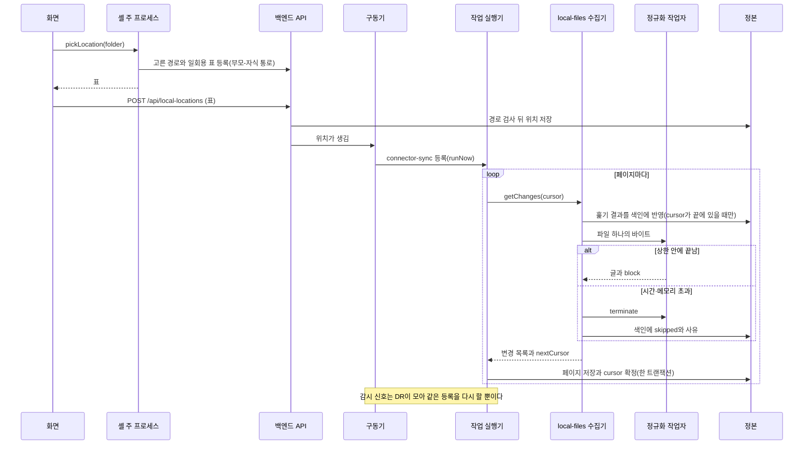
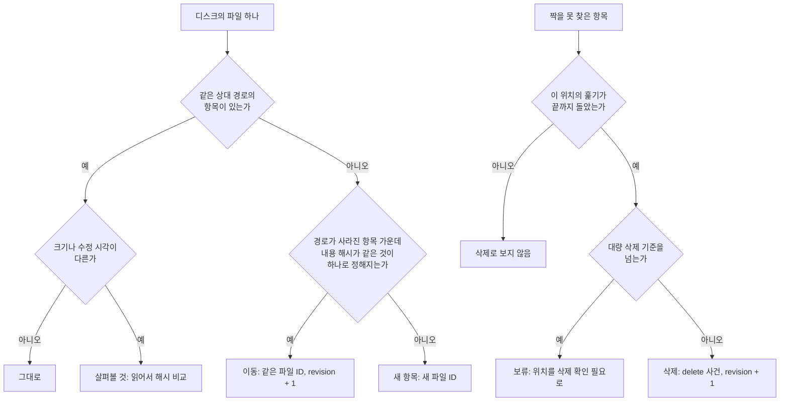
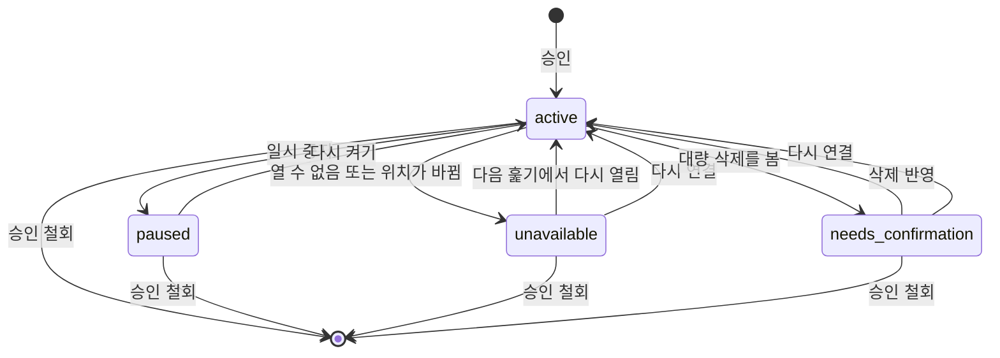
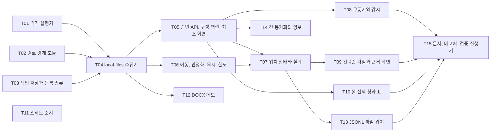

# 스펙: I02-B 로컬 파일·폴더 가져오기 — 승인한 위치를 읽고, 바뀐 것과 지운 것을 따라가기

- 날짜: 2026-11-22 / 상태: 초안
- 관련: 이슈 #19(I02)의 남은 조각, 이슈 #116(JSONL 파일 인스턴스와 경로 제한)을 흡수, 맞물림 #113(배포처 수집기 등록), #32(H01 백업·복원), #33(H02 Windows 수명 주기). 선행 spec [I02-A 문서 정규화](2026-11-21-I02-document-normalization.md), [I01 Connector SDK](2026-11-21-I01-connector-sdk.md), [I03 작업 대기열](2026-11-21-I03-persistent-queue.md), [I04 무효화](2026-11-21-I04-invalidation.md), [V01](2026-11-21-V01-vertical-skeleton.md). 문서 [connector-sdk.md](../connector-sdk.md), [site-setup.md](../site-setup.md), [ADR 0015](../adr/0015-document-parsing-stack.md), [ADR 0016](../adr/0016-connector-sdk-v2.md)

낯선 말은 [ARCHITECTURE 0절](../ARCHITECTURE.md#0-처음-나오는-말)과 [connector-sdk.md](../connector-sdk.md) 머리의 표에 풀이가 있다. 이 문서에서 새로 쓰는 말은 다음과 같다.

| 말 | 뜻 |
|---|---|
| 승인 위치 | 사용자가 "여기는 읽어도 된다"고 하나씩 고른 폴더나 파일. 집 열쇠를 방마다 따로 주는 것과 같다. 다른 점은 열쇠를 줘도 제품이 **읽기만** 한다는 것이다(쓰거나 지우지 않는다) |
| 색인 | 수집기가 "어느 파일을 어떤 정체로, 어디까지 알렸는가"를 적어 두는 표. 도서관의 대출 대장과 비슷하다. 책(내용)은 들어 있지 않고 누가 무엇을 빌렸는지만 있다 |
| 훑기(pass) | 승인 위치의 디스크 상태를 색인과 맞춰 보는 일 한 번. 이 문서의 "재조정(reconciliation)"이 이것이다 |
| 감시(watcher) | OS가 "이 폴더에서 뭔가 바뀌었다"고 알려 주는 신호를 듣는 것. 초인종과 같다. 초인종이 고장 나도 정해진 시각의 순찰(주기적 훑기)이 집을 확인한다 |
| 격리 실행 | 믿을 수 없는 파일을 푸는 일을 따로 떼어 낸 작업자(worker)에서 돌리고, 시간이나 메모리를 넘기면 끊는 것 |

요구사항 번호는 `I02B-R<n>`, 기준은 `I02B-C<n>`, 작업은 `I02B-T<nn>`이다. I02-A가 `I02A-` 접두사를 썼으므로 같은 방식으로 `I02B-`를 쓴다. `I02-R<n>` 모양의 번호는 두 문서 어디에도 없어서 겹치지 않는다. 배포처 항목 번호는 S23부터 쓴다(S16~S17 I02-A, S18 I01, S19~S20 I03, S21~S22 I04). #113의 spec이 같은 번호를 먼저 쓰면 머지 순서대로 다음 빈 번호로 옮긴다.

## 배경

I02-A는 파일 하나를 글과 위치표로 바꾸는 순수 모듈(`@pki/document-normalize`)을 만들었다. 그러나 **제품 어디에서도 그 모듈을 부르지 않는다.** 사용자가 문서를 넣을 길은 JSONL뿐이다. 이슈 #19에서 남은 것은 다음과 같다.

- I02-C2의 나머지: 폴더 scope 승인, rename/move/debounce, 폴더를 훑을 때의 symlink 경계.
- I02-C3 전부: 스레드·참여자·댓글의 시간 순서 복원, 감시 누락 뒤의 재조정.
- I02-A가 넘긴 다섯 항목("I02-B에서 다시 확인할 것"): SourceRecord로 옮기기, 내용 해시와 파서 버전, 합성 등급, **시간 상한 없이는 가져오기에 넣지 않는다**, 원본 파일 보관과 삭제.

넷째 항목은 출시 전 조건이다. 파서에는 시간 상한이 없고 검토의 실측은 24 KB Markdown에 14 s, 3.1 MB PDF에 CPU 359 s였다. 폴더를 훑는 제품이 이런 파일 하나를 만나면 백엔드 전체가 멈춘다.

이슈 #116도 같은 자리에 있다. 파일을 읽는 JSONL 수집기(`jsonl-import` + `{ path }`)는 코드와 계약 시험으로만 있고, 제품에는 그런 인스턴스를 만들 길도, 경로를 가두는 규칙도 없다. "사용자가 고른 로컬 경로를 제품이 안전하게 읽는다"는 같은 문제이므로 한 번만 만든다.

지금 코드에서 이 설계가 기대는 사실은 다음과 같다.

- 수집기 인스턴스는 시작할 때 한 번 정해지고 실행 중에 늘지 않는다(`backend/src/connectors.ts`의 `createConnectorManager`). 인스턴스의 설정을 쓰는 곳도 없다.
- 수집기 경로(`backend/src/adapters/` 등)는 import 허용 목록을 지켜야 한다. `node:worker_threads`와 `@pki/document-normalize`는 목록에 없다(`tooling/connectors/public-only.ts`).
- `deletionsOnRescan`을 참으로 선언하려면 수집기가 알린 정체의 기록을 **인스턴스 밖**에 두어야 한다(connector-sdk.md 2장).
- 출처 정보만 바뀐 레코드는 새 version을 만들지 않는다(I01-R13). 그래서 파일이 이름 그대로 다른 폴더로 옮겨지면 version에 적힌 경로는 낡는다.
- 수집기가 스스로 걸러 낸 항목을 알리는 `rejected`의 사유는 닫힌 목록(`REJECT_CODES`)이고, 목록 밖의 값 하나가 페이지 전체를 실패시킨다. 정규화 실패 사유는 그 목록에 없다.
- 데이터 디렉터리의 모든 항목과 정본의 모든 테이블은 분류되어 있어야 하고, 삭제는 분류된 곳 전부에 닿아야 한다(I04-R3, `backend/src/derivative-coverage.ts`).

## 목표

- 사용자가 폴더 하나를 승인하면, 그 안의 지원 형식 파일이 원본(Source)으로 들어오고 근거(Evidence)가 원래 자리(쪽, 시트·칸, 줄, 문단)를 가리킨다.
- 파일을 고치면 새 version이 생기고, 지우면 tombstone이 생겨 그 내용과 파생물이 지워진다. 이름을 바꾸거나 옮긴 파일은, 알아볼 수 있는 한, 같은 원본으로 남는다.
- 감시 신호를 **하나도 받지 못해도** 다음 전체 훑기가 끝나면 제품의 상태가 디스크와 같다.
- 정규화는 격리된 작업자에서 돌고, 시간·메모리 상한을 넘으면 끊기며, 그 파일만 사유와 함께 건너뛴다. 백엔드는 멈추지 않는다.
- 건너뛴 파일은 모두 사유와 함께 화면에 보인다. 소리 없이 빠지는 파일이 없다.
- 제품은 원본 파일의 사본을 만들지 않는다. 데이터 디렉터리에 새 항목이 생기지 않는다.
- 승인 위치의 저장, 경로를 가두는 규칙, 설정 화면은 하나이고, JSONL 파일 위치(#116)도 그것을 쓴다.

## 비목표 (배포처에서 후속 진행)

**이번에 하지 않는 것**

- 클라우드 드라이브의 API(OneDrive, Google Drive 등)로 읽기. 동기화 폴더가 로컬 폴더로 보이는 경우의 동작은 아래 S23·S25가 본다.
- 메일·메신저·Wiki 수집기. 배포처 포크의 일이다(S01~S03).
- OCR, 그림 속 글자, I02-A의 여덟 형식 밖의 새 형식. `.jsonl`은 문서 형식이 아니며 폴더 안에서 만나면 건너뛴다(I02B-R42).
- 실시간 공동 편집, 파일 쓰기·이름 바꾸기·지우기. 제품은 승인 위치를 읽기만 한다.
- 원본 파일의 사본 보관(I02B-R32가 "하지 않는다"로 정한다).
- 파일 시스템의 권한(ACL)을 `accessScope`로 옮기기. 로컬 파일의 범위는 "알 수 없음"이다(I02B-R35).
- 메모의 스레드를 따로 된 원본으로 쪼개기, XLSX 메모·PDF 주석의 복원. XLSX는 한계 표시로 알리고 PDF 주석은 늘 있는 한계에 적는다.
- 화면에서 한도 값을 고치는 입력란. 한도는 설정 API의 키로 두고 화면은 현재 값만 보인다.
- 수집기 인스턴스를 `site/` 안에서 등록하는 장치: #113. 이 spec의 `local-files`는 공용 종류이며 공용 구성 지점에 등록한다.
- 백업 파일 형식과 복원 화면: H01(#32). 트레이 상주와 절전 복귀 시의 앱 수명 주기: H02(#33). 이 spec은 두 작업이 기댈 성질만 정한다(I02B-R20, R34).

**배포처 후속 항목**(3개. 각각 [site-setup.md의 배포처 설정 체크리스트](../site-setup.md#배포처-설정-체크리스트)와 번호로 대응한다)

| 번호 | 항목 |
|---|---|
| S23 | Windows 11 설치본에서 로컬 파일 수집 검증 실행기를 돌리고 기록(아래 "Windows에서 확인할 것" W1~W10) |
| S24 | 실제 업무 폴더의 규모로 한도와 주기의 값을 정함(위치당 파일 수, 정규화 시간·메모리 상한, 안정화 시간, 훑기 주기) |
| S25 | 네트워크 공유와 클라우드 동기화 폴더를 승인 위치로 허용할지 정하고, 허용한다면 구현·검증. 로컬 파일(범위 "알 수 없음")의 등급 매핑을 S08에서 함께 정함 |

## 요구사항

### 가. 모양: 수집기 종류 하나와 승인 위치

- **I02B-R1 `local-files` 수집기.** 파일·폴더 가져오기는 별도의 가져오기 경로가 아니라 Connector 규격 v2의 수집기 종류 `local-files`다. 저장, cursor, 작업 대기열, tombstone, 장부, 화면의 동기화 상태는 기존 것을 그대로 쓴다. 능력 선언은 `incremental`, `deletes`, `fullRescan`, `deletionsOnRescan`이 참이고 `accessScope`가 거짓이다. `@pki/testkit`의 계약 묶음(`connectorContract`)을 위반 0건으로 통과한다.
- **I02B-R2 인스턴스 하나, 위치마다 namespace.** 제품은 `local-files` 인스턴스를 **하나**(ID `local-files`) 등록한다. 승인 위치마다 무작위 위치 ID를 만들고 그것이 레코드의 `namespace`다. 원본의 정체는 `(local-files, 위치 ID, 파일 ID)`다. 승인 위치가 하나도 없어도 인스턴스는 준비 상태이고 변경 0건을 돌려준다. 그래서 위치를 더하고 빼는 일에 수집기 관리 모듈을 고칠 필요가 없다.
- **I02B-R3 승인 위치의 종류.** 종류는 셋이다.

  | 종류 | 고르는 것 | 읽는 수집기 |
  |---|---|---|
  | `folder` | 폴더 하나(하위 폴더 포함) | `local-files` |
  | `file` | 문서 파일 하나("파일 가져오기") | `local-files` |
  | `jsonl-file` | JSONL 파일 하나(#116) | 기존 `jsonl-import`(I02B-R41) |

  "파일 가져오기"는 한 번 복사하고 잊는 것이 아니라 파일 하나짜리 승인 위치다. 그 파일을 고치거나 지우면 폴더 안의 파일과 똑같이 따라간다. 사본을 두지 않으므로(I02B-R32) 따라가지 않는 가져오기는 삭제가 닿지 않는 원본을 만든다.
- **I02B-R4 수집기는 포트로만 밖을 만진다.** 수집기 구현(`backend/src/adapters/local-files-connector.ts`)은 import 허용 목록을 고치지 않고 그 안에서 산다. 색인을 읽고 쓰는 일과 격리 정규화는 구성 지점이 만드는 함수 둘(색인 포트, 정규화 포트)로 받는다. 디스크를 훑고 여는 일은 `@pki/connector-sdk`의 경로 경계 모듈(I02B-R6)을 쓴다. `tooling/connectors/public-only.ts`의 검사가 그대로 통과한다.

### 나. 승인과 경로 경계

- **I02B-R5 승인은 위치마다, 명시적으로.** 위치는 사용자가 하나씩 승인할 때만 생긴다. 제품은 승인한 적 없는 경로를 읽지 않는다. 승인 요청은 종류와 절대 경로를 받고 다음을 검사한다. 걸리면 닫힌 목록의 사유 코드로 거부하고 아무것도 저장하지 않는다.

  | 사유 코드 | 언제 |
  |---|---|
  | `not-absolute` | 절대 경로가 아니거나 `..` 구간이 남아 있다 |
  | `not-found`, `not-readable` | 없거나 열 수 없다 |
  | `wrong-type` | `folder`인데 디렉터리가 아니거나, `file`·`jsonl-file`인데 일반 파일이 아니다 |
  | `filesystem-root` | 볼륨의 맨 위(`/`, `C:\`)다 |
  | `inside-data-directory` | 실제 경로가 앱의 데이터 디렉터리이거나 그 안이다 |
  | `overlaps-location` | 실제 경로가 이미 승인한 위치와 같거나, 그 안이거나, 그것을 품는다 |
  | `network-location` | UNC 경로(`\\server\share`, `\\?\UNC\`)다. 문구는 `미구현, 배포처 후속`을 포함한다(S25) |
  | `unsupported-format` | `file`인데 여덟 형식이 아니거나, `jsonl-file`인데 확장자가 `.jsonl`이 아니다 |

  승인할 때 symlink를 끝까지 따라간 **실제 경로**와 그 디렉터리의 볼륨 식별자를 함께 저장한다. 화면에는 사용자가 고른 경로를 보인다.
- **I02B-R6 경로 경계 모듈.** `@pki/connector-sdk`에 경로 경계 모듈 하나를 둔다. 승인 검사, 폴더 훑기, 파일 열기가 모두 이것을 쓴다. 규칙은 다음과 같다.
  - **안쪽 판정은 구성 단위로 한다.** 문자열 앞부분 비교가 아니다(`/data/a`는 `/data/ab` 안이 아니다). 비교하는 값은 OS가 돌려준 실제 경로다.
  - **symlink는 따라가지 않는다.** 훑다가 만난 symlink(파일이든 폴더든)는 사유 `symlink`로 건너뛴다. 가리키는 곳이 위치 안이어도 같다(순환과 중복을 한 규칙으로 막는다).
  - **폴더로 내려가기 전에 그 폴더의 실제 경로가 `위치의 실제 경로 + 상대 경로`와 같은지 본다.** 다르면 사유 `redirected`로 건너뛴다. OS가 symlink로 알리지 않는 재지정(Windows의 junction 등 재분석 지점)을 같은 검사로 막는다.
  - **파일은 마지막 구성 요소가 symlink이면 열지 않고**(`O_NOFOLLOW`), 일반 파일이 아니면 사유 `not-regular-file`이다. 한 번 연 핸들에서 크기를 확인하고 그 핸들로만 `maxFileBytes`까지 읽는다(I02A-R2와 같은 규칙).
  - **데이터 디렉터리의 하위는 언제나 뺀다.** 승인 위치가 데이터 디렉터리를 품고 있어도(예: 홈 폴더) 그 아래는 훑지 않는다. `secrets.json`이 `.json` 문서로 들어오는 길을 막는다.
  - 상대 경로가 `walk.maxRelativePathChars`보다 길면 `path-too-long`, 깊이가 `walk.maxDepth`를 넘으면 `too-deep`이다.
  - 하드 링크는 보통 파일로 읽는다. 승인한 폴더 안에 이름이 있는 파일은 그 폴더의 내용이다(남는 위험 3).
  - 대소문자만 다른 이름, 유니코드 정규형이 다른 이름은 OS가 돌려준 이름 그대로 다룬다. 제품이 접거나 바꾸지 않는다.
- **I02B-R7 위치의 상태.** 위치는 `active`, `paused`, `unavailable`, `needs-confirmation` 가운데 하나다(아래 상태도).
  - 훑기 시작에 위치를 열 수 없거나(`root-missing`, `root-not-readable`), 실제 경로나 볼륨 식별자가 승인 때와 다르면(`root-changed`) `unavailable`이다. 다음 훑기에서 다시 열리면 `active`로 돌아온다.
  - **`unavailable`인 위치에서는 삭제를 하나도 알리지 않는다.** 외장 디스크를 뽑았다고 그 안의 원본이 모두 지워지면 안 된다.
- **I02B-R8 대량 삭제는 확인을 받는다.** 한 번의 훑기가 한 위치에서 추적 중인 파일의 `deletionBrake.ratio` 이상이면서 `deletionBrake.minFiles`개 이상을 지워진 것으로 보면, 그 삭제들을 알리지 않고 위치를 `needs-confirmation`으로 둔다. 사용자가 화면에서 "삭제 반영"을 고르면 다음 훑기가 알리고, "위치 다시 연결"(I02B-R9)을 고를 수도 있다. 그동안 새 파일과 고친 파일은 평소대로 들어온다. 삭제는 지식과 사용자 승인 값을 지우므로 되돌릴 수 없기 때문이다.
- **I02B-R9 다시 연결.** 사용자는 `unavailable`이나 `needs-confirmation`인 위치에 새 경로를 줄 수 있다. 위치 ID는 그대로이고 I02B-R5의 검사를 다시 거친다. 다음 훑기는 상대 경로와 내용으로 기존 정체를 이어 간다. 폴더 이름을 바꿨을 때와, 백업을 다른 PC에 복원했을 때 쓰는 길이다(H01).
- **I02B-R10 일시 중지와 승인 철회.** 둘은 다른 동작이다.
  - **일시 중지**: 그 위치를 읽지 않는다. 원본, 근거, 색인은 그대로다. 다시 켜면 같은 정체로 이어진다. 화면은 "이 폴더의 변경과 삭제를 반영하지 않습니다"를 보인다.
  - **승인 철회**: 그 위치를 영영 읽지 않고, 그 위치에서 온 원본을 모두 **사용자 삭제**(`user-deleted`)로 지운다. I04의 `applyTombstone`을 `canonicalTransaction` 안에서 부르고, 인스턴스 잠금을 쥔 채 한다. 끝나면 위치 행과 그 색인 행을 지운다. 같은 폴더를 다시 승인하면 새 위치 ID가 생기므로 옛 tombstone에 막히지 않는다.
  - 철회가 삭제를 뜻하는 까닭: 읽지 않는 위치의 원본은 파일이 지워져도 영영 삭제가 닿지 않는다. 그런 원본을 남기면 "출처에서 지우면 제품에서도 지워진다"는 약속이 깨진다. 멈추기만 원하는 사용자에게는 일시 중지가 있다. 출처 삭제(`source-deleted`)나 권한 상실(`access-revoked`)로 적지 않는 까닭은, 파일은 그대로 있고 사용자도 여전히 볼 수 있어서 둘 다 사실이 아니기 때문이다.

### 다. 정체와 변경 감지

- **I02B-R11 파일 ID.** `externalId`는 수집기가 파일을 처음 볼 때 만드는 **무작위 ID**다. 경로도 내용도 담지 않는다. 그래서 tombstone 뒤에 색인에 남아도 아무것도 드러내지 않는다. 경로와 파일 ID의 대응은 색인이 갖는다.
- **I02B-R12 훑기의 짝짓기 순서.** 훑기는 디스크의 파일과 색인의 항목을 다음 순서로 짝짓는다(아래 흐름도).
  1. **같은 상대 경로**: 같은 항목이다. 편집기가 임시 파일을 써서 바꿔치기해 파일 번호가 달라져도 같다.
  2. **경로가 사라진 항목과 새 경로의 파일이 내용 해시가 같다**: 이동(이름 바꾸기 포함)이다. 후보가 여럿이면 OS의 파일 번호(같은 볼륨의 `dev`·`ino`)가 같은 것을 고른다. 그래도 하나로 정해지지 않으면 이동으로 보지 않는다.
  3. 그 밖의 사라진 항목은 **삭제**, 그 밖의 새 파일은 **새 항목**(새 파일 ID)이다.

  파일 번호만으로는 짝짓지 않는다. 지운 파일의 번호를 OS가 새 파일에 다시 줄 수 있고, 그것을 이동으로 보면 삭제가 묻힌다. 그래서 옮기면서 고친 파일은 삭제와 새 항목이 된다(안전한 쪽).
- **I02B-R13 변경 감지와 revision.** 색인은 항목마다 크기, 수정 시각, 내용 해시(읽은 바이트의 SHA-256), revision, 정규화기 버전을 갖는다.
  - 크기나 수정 시각이 달라진 파일은 "살펴볼 것"이 된다. 읽어 보니 해시가 같으면 아무것도 알리지 않는다.
  - revision은 색인의 항목별 정수이고 내용 변경, 이동, 삭제, 정규화기 버전 변경, 사용자의 "다시 가져오기" 때마다 1씩 오른다. 수정 시각은 쓰지 않는다(뒤로 갈 수 있다).
  - 삭제 사건의 revision은 그 항목의 마지막 revision보다 1 크다. 지운 항목은 되살리지 않는다. 같은 경로에 새 파일이 생기면 새 파일 ID다.
  - 사용자가 위치에 "전체 다시 훑기"를 시키면 수정 시각을 믿지 않고 모든 파일의 해시를 다시 잰다.
- **I02B-R14 정규화기 버전.** `@pki/document-normalize`는 정수 `NORMALIZER_VERSION`을 내보낸다. 같은 바이트의 정규화 결과가 달라지는 변경마다 올린다. 훑기는 버전이 다른 항목을 다시 정규화해 revision을 올려 알린다. 글이 같으면 제품은 새 version을 만들지 않고(I01-R10의 `unchanged`), 다르면 새 version이 된다. I02-A가 넘긴 질문("파서 버전을 올려 글이 바뀌면 새 version이 생긴다. 받아들일지")의 답은 "받아들인다"이다.
- **I02B-R15 덜 쓴 파일, 잠긴 파일, 임시 파일.**
  - 수정 시각이 지금으로부터 `settleMs` 안이면 아직 쓰는 중으로 보고 이번 훑기에서 읽지 않는다. 구동기가 `settleMs` 뒤의 훑기를 예약한다.
  - 열 수 없는 파일(다른 프로그램이 잠금, 권한 없음)은 사유 `locked` 또는 `not-readable`로 건너뛰고 다음 훑기에서 다시 본다. 이미 들어와 있던 version은 그대로 둔다. **권한을 잃었다고 `access-revoked`를 내지 않는다**(일시적일 수 있고, 그 사건은 내용을 지운다).
  - 무시 목록의 이름은 훑지 않고 수만 센다: `~$`로 시작, `.~lock.`으로 시작, `~`·`.tmp`·`.swp`·`.swx`·`.part`·`.crdownload`로 끝남, `.DS_Store`, `Thumbs.db`, `desktop.ini`, 이름이 `.`으로 시작하는 파일과 폴더, `node_modules` 폴더. 목록은 코드 상수 `LOCAL_IGNORE_RULES` 한 곳이다.
- **I02B-R16 건너뜀은 언제나 보인다.** 읽지 못했거나 정규화하지 못한 파일은 색인에 상태 `skipped`와 사유 코드로 남고, 화면의 "건너뛴 파일" 목록에 상대 경로와 사유로 보인다(I02B-R38). 사유는 닫힌 목록 `LOCAL_SKIP_REASONS`다: I02-A의 오류 종류 전부, 격리 실행의 셋(I02B-R23), 경로 경계의 `symlink`·`redirected`·`not-regular-file`·`path-too-long`·`too-deep`, 그리고 `locked`·`not-readable`·`user-deleted`. 지원하지 않는 형식(`.hwp`, `.pptx`, `.jsonl` 등)은 `unsupported-format`이다. 건너뛴 사유는 Connector 규격의 `rejected`로 보내지 않는다(그 목록은 닫혀 있고 파일 이름을 실을 수 없다).

### 라. 감시와 재조정

- **I02B-R17 한 가지 길.** 디스크의 상태를 제품으로 옮기는 코드는 훑기 하나뿐이다. 감시 신호는 변경의 내용을 나르지 않는다. "이 위치를 곧 훑어라"는 표시만 남긴다. 감시 모듈을 통째로 빼도 결과는 같고 늦어질 뿐이다.
- **I02B-R18 불변식.** 한 위치에 어떤 변경이 어떤 순서로 일어나고 감시 신호가 그중 어느 것이든(전부 포함) 빠져도, 그 뒤에 **끝까지 돈 전체 훑기와 그 동기화**가 끝나면 다음이 성립한다.
  - 그 위치의 살아 있는 원본의 집합은 그 시점 디스크의 "지원 형식이고 읽을 수 있는 파일"의 집합과 같다.
  - 각 원본의 최신 version은 그 파일의 지금 내용을 정규화한 것이다.
  - 그 사이에 사라진 파일은 모두 tombstone이 되었다(대량 삭제 보류 중인 위치는 확인 뒤에).
- **I02B-R19 삭제를 말해도 되는 훑기.** 한 위치의 삭제는 그 위치의 훑기가 다음을 모두 만족할 때만 알린다: 위치가 열렸고 I02B-R7의 검사를 통과했다, 한도에 걸려 중간에 끊기지 않았다, 취소되지 않았다. 읽지 못한 하위 폴더가 있으면 그 아래의 항목은 삭제로 보지 않는다. 지운 항목은 색인에 삭제 표시(파일 ID, revision, 순번)로 남으므로 cursor 없이 처음부터 다시 읽어도 `delete`가 다시 나온다. `deletionsOnRescan`이 참인 근거가 이것이다.
- **I02B-R20 구동기.** 백엔드에 로컬 파일 구동기 하나를 둔다.
  - 시작할 때 활성 위치가 있으면 훑기(동기화) 하나를 등록한다. 앱이 꺼져 있던 동안의 변경을 이것이 맞춘다. 절전에서 돌아온 뒤 놓친 신호는 주기적 훑기가 맞춘다(H02가 기댈 성질).
  - 주기적 훑기는 I03의 정해진 동기화(`connector-sync`, 기본 한 시간)다. 사용자가 Activity 화면에서 주기를 바꾸거나 끌 수 있다.
  - 감시 신호가 오면 `watch.quietMs` 동안 조용해질 때까지 기다렸다가(길어도 `watch.maxWaitMs`) 동기화 하나를 등록한다. 등록은 일정의 "지금 실행" 입구(`runNow`)를 쓴다. 이미 대기 중이면 더 만들지 않는다.
  - 감시를 걸 수 없는 위치(OS 한도, 권한)는 화면에 "실시간 감시 없음"으로 보이고 주기적 훑기만 받는다. 감시 실패는 오류가 아니다.
  - 동기화는 I03의 실행기에서 돌므로 취소, 재시도 분류, Activity 표시가 그대로 적용된다.
- **I02B-R21 큰 폴더에서의 비용.**
  - 한 위치에서 본 파일이 `walk.maxFilesPerLocation`을 넘으면 훑기를 멈추고 위치에 `limit-exceeded` 표시를 단다. 그때까지 본 새 파일과 고친 파일은 들어오고 삭제는 알리지 않는다(I02B-R19).
  - 훑기는 폴더 하나를 읽을 때마다 취소 신호를 보고 이벤트 루프에 자리를 내준다.
  - `getChanges` 한 번은 `pageBudgetMs`를 쓰면 `limit`에 못 미쳐도 그때까지의 변경으로 페이지를 끝낸다(`hasMore`는 참).
  - 정규화는 한 번에 파일 하나다.
  - 동기화 하나가 I03의 실행 시간 상한(10분)보다 오래 걸릴 양이면, 실행기가 시간 상한으로 끊기 전에 **페이지 경계에서 양보**한다: 그 작업은 시도를 쓰지 않고 다시 대기한다(I03의 `yield`). 저장된 페이지와 cursor는 그대로이므로 다음 실행이 이어서 한다. 이 규칙은 모든 수집기에 같다(I02B-T14). 이 작업이 들어오기 전에는 긴 동기화가 시간 상한으로 끊겨 재시도로 이어진다. 저장된 것은 잃지 않지만 Activity에 실패로 보인다.

### 마. 정규화 격리 (출시 전 조건)

- **I02B-R22 격리 실행기.** `@pki/document-normalize`가 `createIsolatedNormalizer(options)`를 내보낸다. 제품의 정규화 호출은 **모두** 이것을 지난다. 백엔드의 주 스레드에서 `normalizeDocument`를 직접 부르는 제품 코드는 없다(검사가 import를 막는다).
  - 작업자는 `node:worker_threads`의 작업자 하나다. Electron 설치본(백엔드가 utility process로 돈다)과 브라우저 개발 모드(백엔드가 Node로 돈다)가 **같은 구현**을 쓴다.
  - 작업자는 **바이트만** 받는다. 경로를 받지 않으므로 파일을 열 일이 없다. 파일은 주 스레드가 경로 경계 모듈로 연다.
  - 한 번에 하나만 돌린다. 요청이 겹치면 줄을 선다.
- **I02B-R23 상한과 끊기.** 파일 하나의 정규화에 다음 상한을 건다.

  | 상한 | 넘으면 | 오류 종류 |
  |---|---|---|
  | `normalize.timeoutMs`(벽시계) | 작업자를 끝내고(`terminate`) 새 작업자를 띄운다 | `timed-out` |
  | `normalize.maxHeapMb`(작업자의 V8 힙, `resourceLimits`) | 작업자가 스스로 끝난다 | `resource-exceeded` |
  | `normalize.maxRssBytes`(백엔드 프로세스의 상주 메모리. 주 스레드가 정규화 중에만 `rssPollMs` 간격으로 잰다) | 작업자를 끝낸다 | `resource-exceeded` |
  | — (작업자가 다른 까닭으로 죽음) | 새 작업자를 띄운다 | `worker-failed` |

  세 오류 종류는 격리 실행기의 결과에만 있다. `normalizeDocument`의 오류 목록(I02A-R5)은 바꾸지 않는다. 결과의 모양은 `NormalizeResult`와 같고 Promise는 거부되지 않는다. CPU는 따로 묶지 않는다. 벽시계 상한과 "한 번에 하나"가 CPU 사용의 상한이다.
- **I02B-R24 작업자 안에서도 데이터로만.** 작업자는 스크립트를 실행하지 않고 네트워크에 연결하지 않는다(I02A-R6 그대로). I02-A의 네트워크 감시 테스트를 **작업자 안에서** 다시 돌려 0건임을 확인한다. OS 수준의 네트워크·파일 차단은 하지 않는다(남는 위험 2).
- **I02B-R25 시험 입력.** 검토가 잰 두 재현 입력(24 KB Markdown 14 s, 3.1 MB PDF CPU 359 s)은 저장소에 없다. 테스트가 생성 함수로 다시 만든다. 파일로 커밋하지 않는다(I02A-R20의 공격 입력 규칙). 상한 자체는 파서와 무관한 시험용 작업자 진입점(끝나지 않는 루프, 메모리 계속 잡기)으로도 증명한다.

### 바. SourceRecord와 Evidence로 옮기기

- **I02B-R26 레코드의 대응.**

  | 레코드 필드 | 값 |
  |---|---|
  | `namespace`, `externalId`, `revision` | 위치 ID, 파일 ID, 색인의 revision |
  | `title` | `metadata.title`이 있으면 그것, 없으면 확장자를 뺀 파일 이름 |
  | `body` | 정규화한 `text` 그대로 |
  | `blocks` | 정규화한 `blocks` 그대로(구간과 위치표). 블록이 없으면 필드를 두지 않는다 |
  | `sourceType` | `file` |
  | `author`, `createdAt` | `metadata.author`, `metadata.created`(있을 때만) |
  | `updatedAt` | 파일의 수정 시각(UTC) |
  | `participants` | DOCX 메모의 작성자들(I02B-R30). 없으면 필드를 두지 않는다 |
  | `metadata` | `format`, `relativePath`(그 revision 때의 상대 경로), `sizeBytes`, `encoding`, `limitations`(코드 목록), `normalizerVersion` |
  | `accessScope`, `sourceUrl`, `threadId` | 두지 않는다 |

  절대 경로는 레코드에 넣지 않는다(OS 사용자 이름이 들어 있다). 정규화 결과가 `NativeLocatorSchema`와 `blocksValid`를 통과하는지는 여덟 형식의 fixture 전부로 확인한다(I01-R7이 I02-B에 넘긴 검사).
- **I02B-R27 지금 경로는 색인이 답한다.** 이름이 그대로인 채 옮겨진 파일은 내용이 같아 새 version이 생기지 않는다(I01-R13). 그래서 version에 적힌 `relativePath`는 "그때의 경로"일 뿐이다. 화면이 보이는 "지금 위치"는 색인에서 읽는다. 이름을 바꾸면 `title`이 바뀌므로 새 version이 생긴다(`metadata.title`이 있는 문서는 생기지 않는다).
- **I02B-R28 근거는 version에 묶여 남는다.** 근거는 원본 version과 코드 포인트 구간을 가리키고, version은 바뀌지 않는다. 파일을 고쳐 새 version이 생겨도 옛 version의 근거는 같은 인용문과 같은 위치표를 돌려준다. 근거를 읽는 응답의 `locator`는 그 version의 block에서 계산된다(I01-R29, 이미 있음). 화면은 그 위치표를 사람이 읽는 말로 보인다(I02B-R39).
- **I02B-R29 스레드의 시간 순서 복원.** 저장소에 읽기 함수 `readThread`를 둔다. 같은 인스턴스에서 `threadId`가 같은 원본들의 최신 version을 다음 순서로 돌려준다.
  1. `createdAt`이 가리키는 **시각**의 오름차순(문자열 비교가 아니다. `+09:00`과 `Z`가 섞여도 맞다).
  2. 시각이 같으면 `externalId`의 코드 포인트 순.
  3. `createdAt`이 없는 것은 맨 뒤에, 저장된 순서로.

  참여자 목록은 그 순서에서 `author`와 `participants`가 처음 나온 차례다. tombstone에 덮인 원본은 빠지고, 결과는 I04의 읽기 검사(`visible`)를 지난다. 도착 순서가 뒤섞여도 결과는 같다. API `GET /api/sources/thread`와 원본 화면의 "같은 스레드" 목록이 이것을 쓴다. 로컬 문서 파일은 `threadId`가 없으므로 이 기능의 입력은 JSONL과 수집기가 낸 메시지·메일이다.
- **I02B-R30 DOCX 메모의 복원.** DOCX의 메모(comment)를 버리지 않고 본문 뒤에 붙인다.
  - 메모는 스레드(첫 메모와 그 답글)로 묶고, 스레드는 첫 메모의 시각 순, 스레드 안은 시각 순, 시각이 같으면 메모 번호 순이다.
  - 본문과 메모 구간 사이는 `\n\n`이다. 메모 하나는 블록 둘을 낸다: 머리(작성자와 시각. 없는 값은 뺀다)와 글.
  - 위치표는 DOCX 위치표에 선택 필드 `comment: { thread, index, part }`를 더한다(`thread`·`index`는 0부터, `part`는 `head` 또는 `text`). `paragraph`는 메모가 붙은 문단 번호다.
  - 위치표의 모양이 바뀌므로 `@pki/contracts`의 `NativeLocatorSchema`, I02-A spec의 "위치표의 모양" 표, I01-R7의 표를 **같은 PR**에서 고친다(I01-R7의 약속). 필드를 더하는 것뿐이라 규격 버전은 그대로 2다.
  - 한계 표시 `docx.comments-omitted`는 없앤다. XLSX에 메모가 있으면 새 한계 표시 `xlsx.comments-omitted`를 단다(복원하지 않는다).
- **I02B-R31 합성 등급.** `fixtures/documents/`의 자료를 앱으로 가져오면 일반 등급이다. 합성 목록 생성기를 넓히지 않는다. 시험은 일반 등급에 동의한 Provider 대역으로 돈다.

### 사. 원본 보관과 삭제 경로

- **I02B-R32 사본을 두지 않는다.** 제품은 원본 파일을 복사하지 않고 경로만 가리킨다. 정본에 들어가는 것은 정규화한 글과 block뿐이다. 이 작업 뒤에도 데이터 디렉터리의 항목은 지금과 같다. ARCHITECTURE의 "원본 파일과 첨부" 행을 이 결정으로 고친다.
- **I02B-R33 색인은 정본 안에, 등록된 종류로.** 승인 위치는 정본의 새 테이블 `local_locations`, 색인은 `local_file_entries`에 둔다.
  - `local_locations`는 운영 테이블이다(이유: 승인한 위치의 설정이며 원본의 내용이나 version을 가리키지 않는다).
  - `local_file_entries`는 새 등록 종류 `local-file-entry`의 테이블이다. 그 종류는 층 `source`, 실행 위치 `canonical`이고 무효화 계약 테스트 묶음을 통과한다.
  - **tombstone이 그 원본을 덮으면 같은 트랜잭션에서 그 항목을 비운다.** 출처 삭제면 상대 경로·크기·시각·내용 해시를 지우고 파일 ID·revision·순번·삭제 표시만 남긴다. 사용자 삭제면(파일은 디스크에 그대로 있다) 상대 경로와 내용 해시를 I04의 키 있는 해시(`keyedTextHash`)로 바꾸고 상태를 `forgotten`으로 둔다.
  - 훑기는 경로를 평문으로 먼저 찾고 없으면 키 있는 해시로 찾는다(I01-R8이 원본 정체에 하는 것과 같다). `forgotten` 항목과 짝지어진 파일은 새 파일 ID를 받지 않고 알려지지 않으며 건너뛴 목록에 사유 `user-deleted`로 보인다. 옮겨진 `forgotten` 파일은 내용의 키 있는 해시로 알아본다. 옮기면서 고친 파일은 새 파일로 들어온다(남는 위험 4).
  - 사용자가 tombstone을 해제한 원본은 건너뛴 목록의 "다시 가져오기"로 들어온다. 색인이 그 항목의 revision을 올리고 평문 경로를 다시 적는다(I01-R10: 해제 뒤에는 더 큰 revision만 들어온다).
- **I02B-R34 백업·복원과의 관계.** 색인과 cursor가 같은 정본 파일에 있으므로 백업은 둘을 함께 담고, 복원 뒤 둘은 서로 맞는다. 복원한 PC에 그 경로가 없으면 위치는 `unavailable`이고 삭제는 나가지 않는다(I02B-R7). 사용자가 다시 연결하면(I02B-R9) 이어진다. 백업 뒤에 지운 파일은 다음 전체 훑기가 `delete`로 알린다.

### 아. 접근 범위, 등급, 동의

- **I02B-R35 범위는 "알 수 없음".** `local-files`의 레코드는 `accessScope`를 싣지 않는다. 정본의 범위는 `null`이고 가장 엄격하게 다뤄진다(I01-R5). 사용자가 적은 범위가 아니므로 `scope_claimed` 표시도 달지 않는다. 등급은 Broker가 `grade(null)`로 정하고, 공용 저장소에서는 일반 등급 하나다(S08, S25).
  - 폴더 승인은 **읽기의 승인**이지 외부 전송의 동의가 아니다. 가져온 내용이 Provider로 나가는 일은 지금처럼 Provider별 동의와 전송 정책이 정한다(ADR 0014). 승인 화면에 이 문장을 적는다.
  - 훑기, 감시, 정규화는 네트워크에 연결하지 않는다.

### 자. API와 화면

- **I02B-R36 API.** 경로표(`@pki/contracts`의 `routes`)에 다음을 더한다. 인증은 기존 API와 같다(토큰, loopback, 허용 Origin).

  | 경로 | 하는 일 |
  |---|---|
  | `GET /api/local-locations` | 위치 목록: ID, 종류, 보이는 경로, 상태와 사유, 수(추적·건너뜀·무시·보류된 삭제), 마지막 훑기 시각, 감시 여부, 지금 한도 값 |
  | `POST /api/local-locations` | 승인(I02B-R5). 성공하면 동기화 하나를 등록한다 |
  | `POST /api/local-locations/pause`, `/resume`, `/relink`, `/rescan`, `/confirm-deletions` | I02B-R7~R10, R13의 동작 |
  | `POST /api/local-locations/revoke` | 승인 철회(I02B-R10). 요청에 지울 원본 수를 함께 보내야 하며(화면이 확인 창에 보인 수), 지금 수와 다르면 409로 거부한다 |
  | `GET /api/local-locations/skipped` | 건너뛴 파일 목록(위치 ID, 쪽 매김): 상대 경로, 사유, 처음 건너뛴 시각 |
  | `POST /api/local-locations/reimport` | 건너뛴 파일 하나를 다시 가져오게 한다(revision을 올린다) |
  | `GET /api/sources/thread` | I02B-R29 |

  응답과 로그에 파일의 글은 싣지 않는다. 절대 경로는 위치 목록의 "보이는 경로"에만 있다.
- **I02B-R37 승인 경로의 출처.**
  - **설치본(배포 빌드)**: 경로는 셸의 폴더·파일 선택 창에서 나온다. preload에 `pickLocation(type)`을 더한다. 주 프로세스가 선택 창을 열고, 고른 경로와 일회용 표를 부모-자식 통로로 백엔드에 등록한 뒤 표만 화면에 돌려준다. 배포 빌드의 백엔드는 표가 있는 승인 요청만 받는다. 화면이 지어낸 경로는 승인되지 않는다.
  - **브라우저 개발 모드와 테스트 빌드**: 선택 창이 없으므로 화면의 입력란에 절대 경로를 적는다. 백엔드는 같은 I02B-R5 검사를 한다. 배포 빌드에는 이 입력란이 없다.
- **I02B-R38 화면: 설정의 "로컬 자료" 절.**
  - 위치 목록: 경로, 종류, 상태(읽는 중·일시 중지·찾을 수 없음·삭제 확인 필요), 수, 마지막 훑기, "실시간 감시 없음" 표시.
  - 동작: 폴더 추가, 파일 추가, JSONL 파일 추가, 일시 중지·다시 켜기, 전체 다시 훑기, 다시 연결, 삭제 반영, 승인 철회.
  - 승인 철회와 삭제 반영은 확인 창을 거친다. 창은 지워질 원본의 수와 "이 폴더의 파일은 디스크에 그대로 남습니다. 제품이 가져온 내용과 거기서 나온 지식은 지워지며 되돌릴 수 없습니다"를 보인다.
  - 건너뛴 파일: 위치마다 사유별 수와 목록(상대 경로, 사유의 한국어 설명). 무시한 임시·숨김 파일은 수만 보인다.
  - 문구는 `apps/web/src/local-locations-text.ts` 한 곳에 두고 문구 테스트를 둔다(기존 `*-text.ts` 관례). 사유 코드마다 문구가 하나씩 있고, 코드 목록과 문구의 키가 다르면 테스트가 실패한다. 모든 동작은 키보드로 닿는 `button`이고, 상태는 색만으로 구별하지 않으며, 목록의 갱신은 `aria-live` 영역으로 알린다.
- **I02B-R39 화면: 근거와 원본.**
  - 근거 보기에 위치표를 말로 보인다: "3쪽", "시트 '집계' B3 칸", "12번째 줄", "문단 5", "메모". 문구는 `evidence-text.ts`에 둔다.
  - 로컬 파일에서 온 원본에는 지금 위치(색인의 상대 경로)와 "폴더에서 보기"를 보인다. 설치본에서는 preload의 `revealSource(sourceId)`가 주 프로세스에서 그 파일이 든 폴더를 파일 관리자로 연다. 주 프로세스는 경로를 화면에서 받지 않고 백엔드에 원본 ID로 묻는다. **파일을 연결 프로그램으로 열지 않는다**(원본 임의 실행 없음, I02-C3). 브라우저 개발 모드에서는 경로 글자만 보인다.
  - 파일이 사라졌지만 아직 삭제가 반영되지 않은 원본(일시 중지, 찾을 수 없음, 삭제 확인 필요)은 "원본 파일을 찾을 수 없음"을 보인다. 인용문은 저장된 version에서 그대로 보인다.
- **I02B-R40 한도는 설정.** 아래 "한도 기본값"의 값은 설정 API의 키(`localFiles.*`)로 읽고 쓴다. 0 이하, 정수가 아닌 값(비율 제외)은 거부한다. I02-A의 한도(`maxFileBytes` 등)도 같은 키 아래에서 정규화 포트로 넘어간다. site-setup의 "실행 중 설정" 표에 키를 더한다.

### 차. JSONL 파일 위치 (#116)

- **I02B-R41 `jsonl-file` 위치.** 사용자가 승인한 JSONL 파일 하나는 기존 `jsonl-import` 수집기의 인스턴스 하나(ID `jsonl-file:<위치 ID>`, 설정 `{ path }`)가 된다. 줄의 뜻, 범위의 표시(`scope_claimed`), `deletionsOnRescan` 거짓은 I01-R22·R23 그대로다.
  - 승인, 저장, 경로 검사, 화면은 가~자의 것을 쓴다. JSONL만을 위한 설정 화면이나 설정 파일은 만들지 않는다.
  - 파일 수집기(`backend/src/adapters/jsonl-connector.ts`)는 경로를 그대로 읽지 않고 경로 경계 모듈로 연다(마지막 구성 요소 symlink 거부, 일반 파일만, 승인 때의 실제 경로와 같음, 데이터 디렉터리 안 금지).
  - 수집기 관리 모듈에 실행 중 인스턴스를 더하고 빼는 입구를 둔다(`jsonl-file` 위치의 승인·철회가 부른다). 더하면 기본 주기가 생기고(`ensureDefaultSchedules`), 빼면 그 인스턴스의 주기를 끈다. 이 입구는 #113이 고치는 파일(`backend/src/connectors.ts`)에 있으므로 그 작업과 순서를 맞춘다(I02B-T13).
  - 철회는 I02B-R10과 같다: 그 인스턴스의 원본을 사용자 삭제로 지운다.
- **I02B-R42 폴더 안의 `.jsonl`.** `folder` 위치 안에서 만난 `.jsonl` 파일은 문서로 읽지 않는다. `unsupported-format`으로 건너뛰고 사유 문구가 "JSONL 파일 추가"를 안내한다. 형식 전환 스위치는 두지 않는다. 한 파일을 읽는 길은 종류마다 하나다.

### 카. 문서와 배포처

- **I02B-R43 문서.**
  - 새 ADR 하나(다음 빈 번호)에 세 결정을 적는다: 사본을 두지 않는다, 색인은 정본 안의 등록 종류다, 정규화는 작업자에서 돈다.
  - [ARCHITECTURE](../ARCHITECTURE.md): "원본 파일과 첨부" 행, 가정 표에 아래 "가정" 표의 항목.
  - [connector-sdk.md](../connector-sdk.md): 7장·9장·11장의 #116 열린 항목을 이 spec의 결과로 고치고, 5장의 동기화 결과 표에 양보 행을 더한다.
  - [site-setup.md](../site-setup.md): `## 배포처 설정 체크리스트` 아래에 S23~S25(제목은 그대로), 번호 대응 문장에 이 spec과 범위, "실행 중 설정" 표에 `localFiles.*`. S23의 본문은 W1~W10을 번호로 적는다.
  - I02-A spec: "위치표의 모양"과 "한계 표시 코드" 표(I02B-R30), 그리고 "I02-B에서 다시 확인할 것" 다섯 항목 옆에 이 spec의 요구사항 번호.
  - README에는 한 줄(로컬 폴더 가져오기)과 이 spec으로 가는 링크만 더한다.
- **I02B-R44 Windows 검증 실행기.** `pnpm --filter @pki/backend local-files-verify <폴더>`를 둔다. 주어진 빈 폴더 안에서 아래 W1~W10의 시나리오를 만들고 돌려 항목별 결과(통과·실패·판정 불가)와 OS, 앱 버전, 파일 시스템 종류를 JSON으로 기록한다. 파일 이름과 글은 기록하지 않는다. Windows 설치본이 아닌 환경에서 실행하면 `배포처 후속`으로 시작하는 알림을 출력하고 0이 아닌 값으로 끝난다.
- **I02B-R45 공용 저장소는 Windows 동작을 단정하지 않는다.** 이 spec의 기준 가운데 Windows에서만 확인되는 것은 "가정" 표와 S23에 있고, 공용 저장소의 문서와 PR은 그것을 확인된 것으로 적지 않는다.

### 요구사항을 줄이면

- 가져오기는 수집기 종류 하나(`local-files`)이고 위치는 namespace다.
- 디스크를 제품으로 옮기는 길은 훑기 하나다. 감시는 훑기를 앞당길 뿐이다.
- 삭제는 "끝까지 돈 훑기"만 말할 수 있고, 위치가 사라졌거나 한꺼번에 많이 지워지면 말하지 않는다.
- 정규화는 언제나 작업자에서, 상한과 함께 돈다.
- 사본은 없다. 색인은 정본 안에 있고 삭제가 닿는다.

## 인터페이스 / 설계 개요

### 구성 요소와 경계

| 구성 요소 | 위치(잠정) | 맡는 일 | 기대는 것 |
|---|---|---|---|
| 경로 경계 모듈 | `packages/connector-sdk/src/local-path.ts` | 승인 검사, 훑기, 가둔 채 열기 | `node:fs`, `node:path`뿐 |
| 격리 실행기 | `packages/document-normalize/src/isolated.ts`, `isolated-worker.ts` | 작업자, 상한, 끊기 | `node:worker_threads` |
| 색인 저장 | `storage/src/local-files.ts`, 마이그레이션 | 위치와 항목의 읽기·쓰기, 순번 | 정본 SQLite |
| 등록 종류 `local-file-entry` | `knowledge-engine`의 등록부 | tombstone 때 항목 비우기 | I04 등록부 |
| `local-files` 수집기 | `backend/src/adapters/local-files-connector.ts` | 훑기, 짝짓기, 레코드 만들기 | 포트 둘, 경로 경계 모듈 |
| 구동기 | `backend/src/local-files-driver.ts` | 감시, 모으기, 동기화 등록 | 일정의 `runNow` |
| 위치 API | `backend/src/local-locations.ts` | 승인·철회 등 | 색인 저장, I04 입구 |
| 화면 | `apps/web/src/local-locations.tsx` 등 | 설정의 "로컬 자료" 절 | API |
| 셸 | `apps/desktop/src/bridge.ts`, `preload.cjs` | 선택 창, 폴더에서 보기 | Electron |

배포처로 넘어가는 프로젝트이므로 자르는 곳을 어댑터 경계로 적는다.

- **수집기 경계**: `local-files`는 `Connector` 규격의 구현이고 계약 묶음이 판정한다. 배포처의 실제 수집기와 같은 묶음이다.
- **정규화 포트**: `(bytes, format, limits) → NormalizeResult(+세 오류 종류)`. 구현은 작업자 실행기 하나이고, 계약 테스트는 "어떤 입력에도 Promise가 거부되지 않고 결과가 그 합집합 가운데 하나"임을 구현마다 확인한다. 작업자가 설치본에서 쓸 수 없다고 판명되면(가정 G3) 프로세스 구현으로 바꾸는 자리가 여기다.
- **색인 포트**: 수집기가 쓰는 함수 묶음(위치 읽기, 항목 찾기·쓰기, 순번 뒤의 항목 읽기). 구현은 정본 저장 하나이고, 계약 테스트는 메모리 구현과 정본 구현이 같은 결과를 내는지 확인한다.

### 포트와 색인의 모양 (잠정. T03·T04에서 확정)

```ts
// packages/document-normalize
type IsolatedErrorCode = NormalizeErrorCode | "timed-out" | "resource-exceeded" | "worker-failed";
function createIsolatedNormalizer(options: {
  timeoutMs: number; maxHeapMb: number; maxRssBytes: number; rssPollMs?: number;
}): {
  normalize(input: { bytes: Uint8Array; name: string; format?: DocumentFormat },
            opts: { limits?: PartialLimits; signal?: AbortSignal }): Promise<IsolatedResult>;
  close(): Promise<void>;
};
const NORMALIZER_VERSION: number;

// backend/src/adapters/local-files-connector.ts 가 받는 것
interface LocalFilesPorts {
  index: LocalFileIndex;                       // 정본 구현을 구성 지점이 넘긴다
  normalize: IsolatedNormalizer["normalize"];
  dataDirectory: string;                       // 훑기에서 빼는 곳
  limits: () => LocalFilesLimits;              // 설정에서 읽은 지금 값
  now: () => number;
}

// 정본의 색인 (열 이름은 잠정)
// local_locations(id, type, display_path, real_path, volume_id, state, state_reason,
//                 limit_exceeded, pending_deletes, last_pass_at, created_at)
// local_file_entries(external_id, location_id, relative_path, path_hash, size, mtime_ns,
//                    content_hash, file_no, revision, normalizer_version, seq,
//                    state,            -- present | skipped | deleted | forgotten
//                    skip_reason, skipped_at)
```

cursor는 `seq:<마지막으로 넘긴 순번>`이다. 모양이 다르거나 색인의 마지막 순번보다 크면 `cursorExpired`로 답한다(예시 수집기와 같은 방식). 순번은 색인 전체에서 하나씩 오르는 수이고, 항목이 바뀔 때마다 그 항목이 새 순번을 받는다. 그래서 색인은 "항목마다 한 줄, 지금 상태"이고 한 번 읽는 동안 같은 정체가 두 번 나오지 않는다. 훑기는 cursor가 색인의 끝에 있을 때(그리고 처음부터 읽을 때)만 돌고, 정규화는 변경을 내보내는 그 순간에 한다. 정규화한 글은 색인에 두지 않는다.

### 한 번의 동기화가 지나가는 길

폴더를 승인한 뒤 첫 동기화, 그리고 감시 신호로 시작된 동기화의 차례다. 정규화가 실패한 파일은 변경을 내지 않고 색인에만 남는다는 점이 한 줄로는 보이지 않는다.



### 훑기의 짝짓기

I02B-R12의 순서다. "삭제를 말해도 되는가"(I02B-R19)와 "대량 삭제인가"(I02B-R8)가 삭제 쪽에만 걸린다.



### 위치의 상태



항목(파일)의 상태는 표로 충분하다.

| 상태 | 뜻 | 알리는 것 |
|---|---|---|
| `present` | 추적 중이고 마지막으로 읽은 내용이 제품에 있다 | 바뀌면 `upsert` |
| `skipped` | 읽지 못했거나 정규화하지 못했다(사유 있음). 전에 들어온 version이 있으면 그대로 남는다 | 없음. 파일이 바뀌면 다시 본다 |
| `deleted` | 디스크에서 사라졌다. 경로와 해시는 지웠다 | `delete`(다시 읽을 때마다) |
| `forgotten` | 사용자가 제품에서 지웠다. 경로와 해시는 키 있는 해시다 | 없음. "다시 가져오기" 뒤에만 `upsert` |

### 한도 기본값

모두 잠정이고 설정이다(I02B-R40). 배포처 값이 아니라 아무 설정 없이 로컬에서 도는 값이다.

| 설정 | 기본값 | 무엇을 막는가 |
|---|---|---|
| `normalize.timeoutMs` | 30,000 | 끝나지 않는 파서 |
| `normalize.maxHeapMb` | 512 | 작업자의 V8 힙 |
| `normalize.maxRssBytes` | 2,147,483,648 (2 GiB) | 힙 밖의 버퍼까지 포함한 프로세스 메모리. I02-A의 실측 최대 1.04 GiB보다 위다 |
| `normalize.rssPollMs` | 250 | — |
| `walk.maxFilesPerLocation` | 50,000 | 끝없는 훑기와 색인 |
| `walk.maxDepth` | 32 | 깊은 폴더 |
| `walk.maxRelativePathChars` | 1,024 | 긴 경로 |
| `settleMs` | 2,000 | 덜 쓴 파일 |
| `watch.quietMs` / `watch.maxWaitMs` | 2,000 / 30,000 | 잇단 저장마다 훑기 |
| `deletionBrake.ratio` / `deletionBrake.minFiles` | 0.5 / 20 | 잘못된 폴더, 빈 마운트 지점 |
| `pageBudgetMs` | 20,000 | 한 페이지가 실행 시간 상한을 다 쓰는 것 |

### 잠정 결정

모두 되돌릴 수 있는 쪽으로 골랐다. 바꾸려면 이 표의 "바꾸는 법"과 해당 요구사항을 고친다.

| # | 결정 | 이유 | 바뀌는 동작 | 바꾸는 법 |
|---|---|---|---|---|
| D1 | 가져오기는 Connector 종류 `local-files` | cursor·저장·tombstone·장부·작업·화면을 다시 만들지 않는다 | 파일 원본이 수집기 원본과 같은 규칙을 받는다 | 수집기를 빼고 별도 경로를 만든다(권하지 않음) |
| D2 | 인스턴스 하나, 위치는 namespace | 실행 중에 인스턴스를 늘리는 장치 없이 첫 조각이 나간다. #113과 같은 파일을 덜 건드린다 | 위치들이 한 잠금·한 주기·한 cursor를 나눈다 | T13의 입구가 생긴 뒤 위치마다 인스턴스로 옮긴다(정체가 바뀌므로 마이그레이션 필요) |
| D3 | 파일 ID는 무작위, 이동은 내용 해시로, 파일 번호는 보조 | 파일 번호의 재사용이 삭제를 묻는다. NTFS의 파일 번호를 Node로 믿을 수 있는지 이 저장소에서 확인할 수 없다 | 옮기면서 고친 파일은 삭제+새 원본 | I02B-R12의 2번 규칙을 넓힌다(S23의 W1 결과가 근거) |
| D4 | symlink는 위치 안을 가리켜도 건너뜀 | 순환·중복·탈출을 한 규칙으로 막는다 | symlink로 모은 폴더는 들어오지 않는다(사유가 보인다) | 경로 경계 모듈에 "안쪽이면 따라감"과 방문 집합을 더한다 |
| D5 | UNC 경로 거부 | 감시가 믿기 어렵고, 남의 자료가 섞이며, 읽기가 네트워크 접근이다 | 네트워크 공유를 승인할 수 없다 | S25에서 배포처가 정한다 |
| D6 | 승인 철회 = 사용자 삭제, 멈춤은 일시 중지 | 읽지 않는 위치의 원본에는 삭제가 닿지 않는다 | 철회하면 그 위치의 원본과 지식이 지워진다 | 철회를 "읽기만 멈춤"으로 바꾸고 추적 없는 원본의 표시를 더한다 |
| D7 | 대량 삭제 보류(50%, 20개) | 빈 마운트 지점과 잘못된 재연결이 지식을 지운다 | 폴더를 크게 정리하면 확인을 한 번 받는다 | 설정 값을 바꾸거나 `ratio`를 1보다 크게 해 끈다 |
| D8 | 권한 상실은 `access-revoked`가 아니라 건너뜀 | 로컬 권한 오류는 일시적일 수 있고 그 사건은 내용을 지운다 | 읽을 수 없게 된 파일의 옛 version이 남는다(사유가 보인다) | 연속 N번 실패하면 사건을 내도록 한다 |
| D9 | 격리는 `worker_threads` + 벽시계 + 힙 한도 + RSS 감시 | 설치본과 브라우저 개발 모드가 한 구현을 쓴다. utility process는 주 프로세스만 만들 수 있다 | 작업자와 백엔드가 한 프로세스의 메모리를 나눈다 | 정규화 포트의 구현을 자식 프로세스로 바꾼다(G1·G3이 근거) |
| D10 | 사본 없음, 경로만 | 디스크 두 배, 삭제가 닿을 곳이 하나 더, 사생활 | 파일이 사라지면 원문을 열 수 없다(인용문은 남는다) | 사본 종류를 등록부에 더하고 I04-R6의 파일 카나리를 통과시킨다 |
| D11 | 색인은 정본 안, 등록 종류 | 백업·복원·cursor와 함께 움직이고 삭제가 닿는다 | 마이그레이션 하나, 등록 종류 하나 | 데이터 디렉터리의 파일로 옮기면 I04-R3의 운영 목록과 소거를 따로 만든다 |
| D12 | 범위는 "알 수 없음"(`null`) | 파일 권한을 범위로 옮기지 않았고 사용자가 적은 값도 아니다 | 배포처에서 가장 엄격한 등급이 될 수 있다 | 위치마다 사용자가 범위를 적게 하고 `scope_claimed`로 다룬다 |
| D13 | 이름을 바꾸면 새 version(제목이 파일 이름일 때) | 제목은 내용 해시의 일부다(I01) | 이름만 바꿔도 다시 추출된다 | 제목을 내용 해시에서 빼는 것은 I01의 결정이다 |
| D14 | 설치본은 선택 창에서 나온 경로만 승인 | 승인은 제품이 읽는 범위를 넓힌다. 화면이 지어낸 경로를 믿지 않는다 | 설치본에는 경로 입력란이 없다 | 표 검사를 끈다(배포 빌드 한 곳) |
| D15 | DOCX 메모는 본문 뒤의 block, 따로 된 원본이 아님 | 색인이 파일 단위다. 메모마다 정체와 삭제를 두지 않는다 | 메모가 문서 본문의 일부로 추출된다 | 메모를 `threadId`가 있는 레코드로 낸다(색인을 파일 안 단위로 넓혀야 함) |
| D16 | "파일 가져오기"는 파일 하나짜리 승인 위치 | 사본이 없으므로 따라가지 않으면 삭제가 닿지 않는다 | 가져온 파일을 지우면 제품에서도 지워진다 | D10을 바꿀 때 함께 |
| D17 | 한도 편집 화면 없음, 설정 API만 | 값이 아직 실측 전이다(S24) | 값은 API나 배포처 설정으로 바꾼다 | 화면에 입력란을 더한다 |

### 대안과 기각 사유

| 대안 | 기각 사유 |
|---|---|
| 수집기를 거치지 않는 별도 가져오기 경로(파일을 받아 바로 저장) | 변경 감지, 삭제, cursor, 재시도, 장부, 동기화 화면을 한 벌 더 만든다. 삭제가 닿지 않는 원본이 생긴다 |
| 위치마다 인스턴스 | 실행 중 인스턴스 추가가 먼저 필요하다. #113이 고치는 중인 부팅 동작과 같은 파일에서 부딪힌다. 첫 조각이 그 뒤로 밀린다 |
| `local-files`가 `.jsonl`도 읽는 형식 전환 | JSONL의 줄은 자기 정체와 사용자가 적은 범위를 갖고, 제품은 그 표시를 종류 `jsonl-import`에 걸어 두었다(`backend/src/page-store.ts`). 한 종류에 두 뜻이 섞인다 |
| JSONL 파일을 감시해 가져오기 API로 내용을 넣기 | 파일을 읽는 수집기가 이미 있다. 같은 파일을 읽는 길이 둘이 되고 수집기 코드는 쓰이지 않는 채 남는다 |
| 파일 ID = 경로의 해시 | 이름 바꾸기가 곧 삭제+생성이다(I02-C2). 지운 뒤에도 경로를 짐작해 대조할 수 있다 |
| 파일 ID = OS의 파일 번호 | 편집기의 바꿔치기 저장이 번호를 바꾸고, OS가 번호를 다시 쓴다. FAT·네트워크에는 믿을 번호가 없다 |
| 감시 신호의 내용(무슨 파일이 어떻게)으로 바로 반영 | 신호는 빠지고 겹치고 OS마다 다르다. 길이 둘이 되어 불변식을 둘 다에 증명해야 한다 |
| 색인을 데이터 디렉터리의 JSON 파일로 | cursor와 따로 백업·복원되어 어긋난다. 잃으면 모든 파일이 새 정체로 다시 들어오고 삭제를 영영 못 알린다 |
| 정규화한 글을 훑기 때 미리 만들어 쌓아 두기 | 내용이 정본 밖에 한 벌 더 생긴다(소거 대상 추가) |
| 정규화 실패를 Connector의 `rejected`로 알리기 | 사유 목록이 닫혀 있고 목록 밖의 값이 페이지 전체를 실패시킨다. 파일 이름도 실을 수 없다 |
| 격리를 Electron utility process로 | 백엔드는 이미 utility process이고 새 것을 만들 수 있는 것은 주 프로세스뿐이다. 브라우저 개발 모드에는 Electron이 없어 구현이 둘이 된다 |
| 격리를 `child_process.fork`로(처음부터) | 강한 격리지만 Electron 안의 백엔드에서 Node 자식을 띄우는 법이 이 저장소에서 확인되지 않았다. 포트 뒤에 두었으므로 필요하면 바꾼다(D9) |
| I02-A의 경로 입력(`allowedRoot`)으로 작업자가 직접 열기 | 변경 감지용 해시와 정규화가 서로 다른 읽기가 되어 어긋날 수 있고, 작업자가 파일 시스템을 만진다 |
| 원본 파일의 사본 보관 | D10. 근거의 인용문은 정본의 version에서 나오므로 사본 없이도 근거가 선다 |
| 승인 철회는 읽기만 멈춤 | D6. 삭제가 닿지 않는 원본이 남는다 |
| 실행 시간 상한을 수집기 종류마다 늘리기 | 상한은 작업 종류 단위라 배포처 수집기까지 한 시간씩 멈춰 있을 수 있게 된다. 양보(I02B-R21)는 상한을 그대로 둔다 |

### 가정 (이 저장소에서 확정되지 않은 것)

| # | 가정 | 설계가 여기에 기대는가 | 확인하는 곳 |
|---|---|---|---|
| G1 | `worker.terminate()`가 동기 루프 중인 파서(두 재현 입력)를 1 s 안에 끊는다 | **예**(D9) | T01. 안 되면 정규화 포트를 자식 프로세스 구현으로 바꾸고 ADR에 적는다 |
| G2 | `resourceLimits`는 V8 힙만 묶고 버퍼는 묶지 않는다. RSS 감시가 그것을 잡는다 | 예 | T01의 측정 |
| G3 | 묶인 설치본(Electron utility process 안)에서 작업자 진입 파일이 실려 돌아간다 | 예 | T05의 산출물 e2e(개발 OS), Windows는 S23 W9 |
| G4 | `fs.watch`의 재귀 감시가 개발 OS에서 신호를 준다. 빠지는 신호가 있다 | 아니오(I02B-R17) | T08의 측정, Windows는 S23 W6 |
| G5 | 같은 볼륨 안의 이름 바꾸기에서 `stat`의 `dev`·`ino`가 유지된다(NTFS 포함) | 아니오(보조 기준) | T06(개발 OS), S23 W1 |
| G6 | Node가 NTFS junction을 symlink로 알린다 | 아니오(실제 경로 검사가 따로 막는다) | S23 W2 |
| G7 | 클라우드 동기화 폴더의 자리 표시 파일을 읽으면 OS가 내려받는다. Node로는 미리 알 수 없다 | 아니오. 다만 읽기가 네트워크 접근이 된다 | S23 W3, S25 |
| G8 | Node가 Windows의 260자 넘는 경로를 다룬다 | 아니오(한도로 건너뜀) | S23 W5 |
| G9 | 드라이브 문자에 붙인 네트워크 드라이브는 경로만으로 알 수 없다 | 아니오. D5가 그 경우를 못 막는다 | S23 W4, S25 |
| G10 | 대소문자를 구분하지 않는 파일 시스템에서 실제 경로가 저장된 대소문자로 돌아온다 | 예(안쪽 판정) | T02(개발 OS가 그런 파일 시스템이면), S23 W7 |
| G11 | DOCX 메모의 시각과 답글 관계를 mammoth가 주지 않으면 자체 스캐너(`ooxml-core.ts`)로 읽을 수 있다 | 예(I02B-R30) | T12 |
| G12 | Word가 적는 메모 시각이 UTC인지 현지 시각인지 판에 따라 다르다 | 아니오. 파일에 적힌 값 그대로 정렬한다 | T12의 fixture가 동작을 고정, 실제 문서는 S17 |
| G13 | 두 재현 입력을 생성 함수로 다시 만들 수 있다 | 아니오(시험용 작업자로도 증명) | T01. 못 만들면 그 입력은 미검증으로 적는다 |

### Windows에서 확인할 것 (S23의 내용)

이 저장소의 환경(macOS, Linux CI)에서 확인할 수 없다. 실행기(I02B-R44)가 돌리고 기록한다.

| # | 시나리오 | 보는 것 |
|---|---|---|
| W1 | NTFS에서 이름 바꾸기·이동, 바꿔치기 저장 | 파일 번호의 유지와 재사용, 이동이 같은 원본으로 남는지 |
| W2 | 위치 안의 junction과 디렉터리 symlink가 위치 밖을 가리킴 | 건너뛰고 사유가 남는지, 밖의 파일이 0건인지 |
| W3 | 클라우드 동기화 폴더의 "온라인 전용" 파일 | 읽기가 내려받기를 일으키는지, 걸리는 시간, 사유 |
| W4 | UNC 경로와 드라이브 문자에 붙인 네트워크 드라이브 | 전자는 거부, 후자는 어떻게 되는지 기록 |
| W5 | 260자 넘는 경로, 끝이 점·공백인 이름, 예약 이름 | 건너뛰거나 읽는지, 죽지 않는지 |
| W6 | 감시: 잇단 저장, 폴더 통째 이동, 절전·최대 절전 복귀 뒤 | 신호의 수와 누락, 다음 훑기 뒤 상태가 디스크와 같은지 |
| W7 | 대소문자만 다른 이름 바꾸기, 한글 이름(NFC·NFD) | 같은 원본으로 남는지 |
| W8 | Office가 연 채 잠근 파일, `~$` 파일 | `locked`로 건너뛰고 닫은 뒤 들어오는지 |
| W9 | 설치본에서 정규화 작업자, 두 재현 입력 | 상한 안에 끊기고 백엔드가 응답하는지 |
| W10 | 선택 창, "폴더에서 보기", 외장 디스크 뽑기 | 표 없는 승인이 거부되는지, 파일이 실행되지 않는지, 삭제가 0건인지 |

### I02-A가 넘긴 것의 처리

| I02-A "다시 확인할 것" | 이 spec |
|---|---|
| 1. SourceRecord로 옮기기 | I02B-R26~R28 |
| 2. 내용 해시와 파서 버전 | I02B-R13, R14 |
| 3. 합성 등급 | I02B-R31 |
| 4. 시간 상한 없이는 가져오기에 넣지 않는다 | I02B-R22~R25 |
| 5. 원본 파일 보관과 삭제 | I02B-R32~R34 |
| 한도를 앱의 설정으로 잇기 | I02B-R40 |
| 성능 목표의 측정 | I02B-C27 |

### 작업 분해 (잠정. 확정 뒤 조정자가 대조한다)

작업 하나가 PR 하나다. **첫 수직 조각**은 T01~T05다: 폴더 하나를 승인하고, Markdown 파일 하나가 원본과 근거로 보이고, 그 파일을 지우면 tombstone이 생긴다. T01·T02·T03은 서로 다른 패키지라 동시에 할 수 있고, T11은 처음부터 따로 갈 수 있다.



| ID | 산출물 하나 | 주요 파일 | 요구사항 | 기준 | depends_on | 기대하는 검증 증거 |
|---|---|---|---|---|---|---|
| I02B-T01 | 격리 정규화 실행기 | `packages/document-normalize/src/isolated.ts`, `isolated-worker.ts`, `testing/time-bombs.ts`, `version.ts` | R14(상수), R22~R25 | C16~C19 | — | 두 재현 입력과 시험용 작업자의 종료 시간·오류 종류 출력, 상한 줄을 지우면 빨개지는 테스트, 작업자 안 네트워크 0건 |
| I02B-T02 | 경로 경계 모듈 | `packages/connector-sdk/src/local-path.ts`, `index.ts` | R5(검사), R6 | C3(검사 함수), C4 | — | 탈출 시도 묶음(`..`, symlink, 형제 이름, 데이터 디렉터리, 재지정)에서 밖의 파일 읽기 0건 |
| I02B-T03 | 색인 저장과 등록 종류 | `storage/src/migrations.ts`⚠, `storage/src/local-files.ts`, `knowledge-engine/src/canonical-kinds.ts`⚠, `backend/src/derivative-coverage.ts`⚠ | R33 | C22(저장 수준), C23 | — | 무효화 계약 묶음 통과, 테이블 분류 검사 통과, tombstone 뒤 정본 파일 바이트에 경로 카나리 없음 |
| I02B-T04 | `local-files` 수집기(경로 짝짓기와 삭제까지) | `backend/src/adapters/local-files-connector.ts`, 계약 테스트 | R1, R2, R4, R11, R12(1·3), R13, R16(색인), R19, R26 | C1, C2, C20, C21 | T01, T02, T03 | `connectorContract` 위반 0건(나중 상태 포함), 여덟 형식 fixture의 레코드가 스키마 통과, public-only 검사 통과 |
| I02B-T05 | 승인 API·구성 연결·최소 화면(**첫 수직 조각의 끝**) | `packages/contracts/src/index.ts`⚠, `backend/src/local-locations.ts`, `server.ts`⚠, `composition.ts`⚠, `boot.ts`⚠, `backend/package.json`, `pnpm-lock.yaml`⚠, `apps/web/src/local-locations.tsx`, `local-locations-text.ts`, `App.tsx`⚠ | R3(`folder`), R5, R31, R32, R35, R36(목록·승인), R37(개발 입력), R38(목록·추가) | C3, C5, C24, C25, C30 | T04 | e2e: 승인 → Markdown → 원본과 근거(위치표 포함) → 파일 삭제 → tombstone. 데이터 디렉터리 항목이 전과 같음. 산출물에서 작업자가 돈다 |
| I02B-T06 | 이동·안정화·무시·한도·정규화기 버전 | 수집기, `local-path.ts`, 설정 키, 측정 스크립트 | R12(2), R14, R15, R21(한도·페이지 예산), R40 | C6, C7, C9, C10, C14, C27 | T04 | 이동 뒤 원본 ID 유지, 잇단 저장 20번 뒤 version 1개, 한도 초과 훑기에서 삭제 0건, p95 측정값 |
| I02B-T07 | 위치 상태·대량 삭제 보류·재연결·일시 중지·철회 | 수집기, `local-locations.ts`, 화면 | R7~R10, R34, R36(동작), R38(동작·확인 창) | C11~C13 | T05, T06 | 위치를 없앤 훑기에서 삭제 0건, 철회 뒤 원본·색인·근거 0건과 tombstone 사유 `user-deleted` |
| I02B-T08 | 구동기와 감시 | `backend/src/local-files-driver.ts`, `boot.ts`⚠ | R17, R18, R20 | C8, C15 | T05 | 감시를 끈 채와 무작위로 빠뜨린 채의 변경 시나리오에서 최종 상태가 디스크와 같음. 감시 모듈을 빼도 상태 테스트 통과 |
| I02B-T09 | 건너뛴 파일·근거 위치표·지금 위치 화면 | `apps/web/src/local-locations.tsx`, `evidence-view.tsx`⚠, `evidence-text.ts`⚠, `local-locations.ts` | R16(화면), R27, R28, R33(다시 가져오기), R36(skipped·reimport), R38(건너뛴 파일), R39(브라우저) | C26, C28 | T07 | 사유 코드와 문구의 키 집합이 같음, 위치표 문구 테스트, 접근성 검사 |
| I02B-T10 | 셸의 선택 창·표·폴더에서 보기 | `apps/desktop/src/bridge.ts`⚠, `preload.cjs`⚠, `backend-process.ts`⚠, `backend/src/shell.ts` | R37(설치본), R39(설치본) | C29 | T05 | 표 없는 승인이 배포 빌드에서 거부, preload 표면 테스트, 파일 열기 호출 0건 |
| I02B-T11 | 스레드의 시간 순서 복원 | `storage/src/sources.ts` 또는 새 `thread.ts`, `contracts/index.ts`⚠, `server.ts`⚠, 화면 | R29, R36(thread) | C31 | — | 뒤섞인 도착·섞인 오프셋 fixture에서 같은 순서, tombstone 원본 제외 |
| I02B-T12 | DOCX 메모 복원 | `packages/document-normalize/src/formats/docx.ts`, `ooxml-core.ts`, `packages/contracts/src/connector.ts`⚠, I02-A·I01 spec 표 | R30 | C32 | T04 | 메모 fixture의 순서·블록·위치표, 한계 코드 세 집합 같음(I02A-C9) |
| I02B-T13 | JSONL 파일 위치(#116)와 화면의 "파일 추가" | `backend/src/connectors.ts`⚠(#113과 겹침), `adapters/jsonl-connector.ts`, `local-locations.ts`, 화면 | R3(`jsonl-file`, `file`), R41, R42 | C33, C34 | T07, #113의 `connectors.ts` 변경이 머지된 뒤 | 승인한 JSONL 파일이 주기 동기화로 들어옴, symlink로 바꿔치기한 경로 거부, 폴더 안 `.jsonl`은 건너뜀 |
| I02B-T14 | 긴 동기화의 양보 | `backend/src/connectors.ts`⚠, `connector-sync-job.ts`⚠, `packages/connector-sdk/src/sync-outcomes.ts`⚠, `docs/connector-sdk.md` 5장 | R21(양보) | C35 | T05, #113과 순서 조정 | 실행 시간 상한보다 긴 동기화가 시도를 쓰지 않고 이어짐, 문서 표와 상수 대응 테스트 |
| I02B-T15 | 문서·배포처 체크리스트·Windows 검증 실행기 | `docs/adr/`, `ARCHITECTURE.md`, `connector-sdk.md`, `site-setup.md`, `tooling/docs/site-setup-i02b.test.ts`, `backend/src/local-files-verify.ts`, README | R43~R45 | H1, H2, C36 | T08, T09, T10, T13 | 문서 대응 테스트, 실행기의 거부 1건과 내용 비노출 |

⚠는 다른 작업이나 다른 spec(#113, I04의 뒤 작업)과 함께 고치는 파일이다. 같은 ⚠ 파일을 고치는 작업은 동시에 발행하지 않는다. `file` 종류(파일 하나짜리 위치)는 수집기에서는 폴더의 특수한 경우라 T04가 다루고, 화면의 "파일 추가"는 T13이 "JSONL 파일 추가"와 함께 더한다. C3은 검사 함수 수준(T02)과 API 수준(T05)에서 각각 증명한다. C22는 저장 수준(T03)에서 먼저, 세 삭제 경로 전부는 T07이 끝난 뒤의 통합 테스트로 닫는다.

## 완료 기준 (테스트 가능한 형태)

I02B-C1~C36은 이 조각의 기준이고, H1·H2는 배포처로 넘어가는 프로젝트의 두 기준이다. 모든 기준의 테스트는 저장소 안에 남는다(손으로 돌려 본 결과는 기준의 충족이 아니다).

**모양과 대응**

- [ ] **I02B-C1** (R1, R2, R4): `connectorContract("local-files", …)`를 "처음 상태"와 "파일 하나를 고치고 하나를 지운 나중 상태"로 돌리면 위반이 0건이다. 삭제 표시를 색인에 남기는 줄을 지우면 `rescan-deletion-missing`이 나온다. 승인 위치가 0개인 인스턴스는 준비 상태이고 변경 0건을 돌려준다. `tooling/connectors/public-only.ts`의 검사가 수집기 파일을 통과시킨다.
- [ ] **I02B-C2** (R26, R28): 여덟 형식의 정상 fixture를 각각 승인 위치에 두고 동기화하면, 형식마다 원본 하나가 생기고 그 레코드가 `SourceRecordSchema`와 `blocksValid`를 통과하며 절대 경로 문자열이 레코드 어디에도 없다. 각 원본의 block 하나에 근거를 만들면 근거 읽기의 `locator`가 정규화 결과의 그 block의 위치표와 같다. 파일을 고쳐 version 2가 생긴 뒤에도 version 1의 근거는 같은 인용문과 같은 `locator`를 돌려준다.

**승인과 경계**

- [ ] **I02B-C3** (R5, R6): 승인 요청이 ① 상대 경로 ② 없는 경로 ③ 폴더 종류에 파일 ④ 볼륨의 맨 위 ⑤ 데이터 디렉터리와 그 하위 ⑥ 이미 승인한 위치와 같은 곳·그 안·그것을 품는 곳 ⑦ UNC 경로이면 각각 I02B-R5의 사유 코드로 거부되고 `local_locations`의 행 수가 그대로다. ⑦의 문구는 `미구현, 배포처 후속`을 포함한다. symlink인 폴더를 승인하면 저장된 실제 경로는 symlink가 가리킨 곳이다.
- [ ] **I02B-C4** (R6): 승인 위치 안에 ① 위치 밖의 파일을 가리키는 symlink ② 위치 밖의 폴더를 가리키는 symlink ③ 위치 안을 가리키는 symlink ④ 자기 조상을 가리키는 symlink(순환)를 두고 훑으면, 넷 다 사유 `symlink`로 건너뛰고 위치 밖 파일의 내용에 넣은 표식이 어느 원본에도 없으며 훑기가 끝난다. 훑는 도중 일반 폴더를 위치 밖을 가리키는 symlink로 바꿔치기해도(테스트가 그 틈에 끼운다) 밖의 파일이 읽히지 않는다. 데이터 디렉터리를 품는 위치를 훑으면 데이터 디렉터리 안의 파일(`.json` 포함)이 하나도 색인에 없다. 깊이와 상대 경로 길이의 한도를 넘는 항목은 각각 `too-deep`, `path-too-long`이다.
- [ ] **I02B-C5** (R31, R35): `local-files`로 들어온 원본의 `access_scope`는 `null`이고 `scope_claimed`는 0이다. `fixtures/documents/`에서 가져온 원본의 등급은 합성이 아니라 일반 등급이다. 승인부터 근거가 보일 때까지 테스트가 감시한 네트워크 호출(I02A-C7과 같은 감시 목록)이 Provider 대역으로 가는 것 말고는 0건이다.

**정체와 변경**

- [ ] **I02B-C6** (R12, R27): 파일의 이름을 바꾸거나 하위 폴더로 옮긴 뒤 동기화하면 그 원본의 내부 ID가 그대로이고 tombstone이 생기지 않는다. 이름 그대로 옮긴 경우 version 수는 그대로이고 API가 돌려주는 지금 위치는 새 상대 경로다. 내용이 같은 파일 둘 가운데 하나만 옮기면(파일 번호로 가려지는 파일 시스템에서) 옮긴 쪽의 원본 ID가 유지된다. 가려지지 않는 경우와, 옮기면서 내용을 고친 경우는 `delete` 하나와 새 원본 하나가 된다. 파일을 지우고 다른 내용의 새 파일을 만들어 OS가 같은 파일 번호를 준 경우(대역으로 재현)에도 지운 원본은 tombstone이 된다.
- [ ] **I02B-C7** (R13, R14): 수정 시각만 바꾼 파일은 변경 0건이다. 내용을 고치면 revision이 1 오르고 새 version이 생긴다. `NORMALIZER_VERSION`을 올린 뒤의 동기화는 모든 항목을 더 큰 revision으로 다시 알리고, 글이 같은 원본은 version 수가 그대로이며 `revision-conflict`가 0건이다. "전체 다시 훑기"는 수정 시각과 크기를 그대로 둔 채 내용만 바꾼 파일을 찾아낸다.
- [ ] **I02B-C8** (R17~R19): 변경 시나리오(만들기, 고치기, 이름 바꾸기, 옮기기, 지우기, 지운 자리에 새로 만들기를 섞은 고정 씨앗의 무작위 순서 50개 이상)를 ① 감시 없이 ② 감시 신호를 무작위로 절반 빠뜨리고 ③ 전부 전달하며 돌린 뒤 전체 훑기와 동기화를 끝내면, 세 경우 모두 I02B-R18의 세 문장이 성립하고 세 경우의 최종 원본 집합이 서로 같다. 삭제를 알리는 조건(I02B-R19) 가운데 "끝까지 돌았는가" 검사를 지우면 "훑기를 중간에 취소한 뒤 삭제 0건" 테스트가 실패한다.
- [ ] **I02B-C9** (R15): 가짜 시계에서 한 파일을 1 s 안에 20번 저장하면 `settleMs`가 지나기 전의 훑기는 그 파일을 읽지 않고, 지난 뒤의 훑기 한 번이 version 하나를 만든다. 읽기를 거부하도록 만든 파일(권한, 잠금 대역)은 `not-readable`·`locked`로 건너뛰고 전에 있던 version이 남으며 `access-revoked` 사건이 0건이다. 거부를 풀면 다음 훑기에서 들어온다.
- [ ] **I02B-C10** (R15, R16): `LOCAL_IGNORE_RULES`의 규칙마다 그 이름의 파일을 두면 색인에 항목이 생기지 않고 위치의 "무시" 수가 그만큼 오른다. `.hwp`, `.pptx`, `.jsonl`, 손상된 PDF, `maxFileBytes`를 넘는 파일은 각각 `unsupported-format`, `unsupported-format`, `unsupported-format`, `corrupt`, `too-large`로 건너뛴 목록에 상대 경로와 함께 나온다. 훑은 파일 수는 "원본이 된 수 + 건너뛴 수 + 무시한 수"와 같다(소리 없이 빠진 파일이 0).

**위치의 상태**

- [ ] **I02B-C11** (R7, R34): 승인 위치의 폴더를 지우거나, 이름을 바꾸거나, 읽기 권한을 없애거나, 같은 경로에 다른 볼륨 식별자의 폴더를 둔 뒤(대역) 훑으면 위치가 `unavailable`과 그 사유가 되고 `delete` 사건이 0건이다. 폴더를 되돌리면 다음 훑기에서 `active`가 되고 원본 수가 그대로다.
- [ ] **I02B-C12** (R8, R9): 파일 40개 가운데 25개를 지우고 훑으면 `delete`가 0건이고 위치가 `needs-confirmation`이며 보류된 삭제 수가 25다. 그동안 새로 만든 파일은 들어온다. "삭제 반영" 뒤의 훑기는 `delete` 25건을 낸다. 40개 가운데 19개를 지운 경우(비율 미만)와 30개 가운데 19개를 지운 경우(개수 미만)는 보류 없이 바로 `delete`가 나온다. 폴더의 이름을 바꾼 뒤 새 경로로 "다시 연결"하면 원본의 내부 ID가 모두 그대로이고 `delete`가 0건이다.
- [ ] **I02B-C13** (R10): 일시 중지한 위치는 파일을 고치고 지워도 변경이 0건이고, 다시 켜면 그 변경이 들어온다. 승인을 철회하면 그 위치의 모든 원본에 사유 `user-deleted`의 tombstone이 생기고, 그 원본의 version·근거·색인 행·위치 행이 0건이며, 다른 위치의 원본은 그대로다. 요청의 원본 수가 지금 수와 다르면 409이고 아무것도 지워지지 않는다. 같은 폴더를 다시 승인하면 새 위치 ID로 원본이 다시 들어온다(`blocked` 0건).

**비용**

- [ ] **I02B-C14** (R21, R40): 설정 API로 `localFiles.walk.maxFilesPerLocation`을 5로 낮추고 파일 8개의 위치를 훑으면 위치에 `limit-exceeded`가 붙고 `delete`가 0건이다. 그 키에 0, 음수, 정수가 아닌 값을 쓰면 거부되고 값이 그대로다. 이미 취소된 신호로 부른 훑기는 폴더를 하나도 읽지 않는다. 정규화가 느린 대역에서 `getChanges`는 `pageBudgetMs`를 넘긴 뒤 다음 파일을 시작하지 않고 `hasMore: true`로 돌아온다. 정규화 포트의 동시 호출 수는 언제나 1 이하다.
- [ ] **I02B-C15** (R20): 가짜 시계에서 감시 신호 100개가 `watch.quietMs`보다 짧은 간격으로 오면 등록되는 동기화는 `watch.maxWaitMs`마다 하나를 넘지 않는다. 활성 위치가 있는 채로 시작하면 동기화 하나가 등록되고, 없으면 등록되지 않는다. 감시를 걸 수 없게 만든 위치는 목록에 "감시 없음"으로 나오고 주기 동기화는 그 위치의 변경을 가져온다.

**격리**

- [ ] **I02B-C16** (R22, R23): 끝나지 않는 루프의 시험용 작업자에 `timeoutMs` 200을 주면 결과가 `timed-out`이고 1 s 안에 돌아오며, 바로 다음의 정상 파일이 정규화된다(새 작업자). 그동안 주 스레드의 타이머(10 ms 간격)가 멈추지 않는다. 힙을 계속 잡는 시험용 작업자는 `resource-exceeded`, 버퍼를 계속 잡는 것은 RSS 감시로 `resource-exceeded`, 스스로 죽는 것은 `worker-failed`다. 네 경우 모두 Promise가 거부되지 않는다. 시간 상한을 거는 줄, RSS를 재는 줄을 각각 지우면 해당 테스트가 실패한다.
- [ ] **I02B-C17** (R25): 생성 함수로 만든 두 재현 입력(Markdown, PDF)을 기본 한도로 격리 실행기에 넣으면 각각 `timeoutMs` + 1 s 안에 `timed-out` 또는 `resource-exceeded`로 돌아온다. 생성 함수가 그 시간을 재현하지 못하면(상한 없이 5 s 안에 끝남) 테스트가 그 사실로 실패한다(입력이 약해진 것을 통과로 읽지 않는다).
- [ ] **I02B-C18** (R22): 제품 코드(`backend/src`, 테스트 파일 제외) 가운데 `normalizeDocument`를 가져오는 파일이 0개다. 검사가 그런 import 하나를 넣은 대역에서 실패한다. 작업자에 넘어가는 메시지에 경로 문자열이 없다(바이트와 이름·형식뿐).
- [ ] **I02B-C19** (R24): I02-A의 네트워크 감시를 작업자 안에 건 채 모든 fixture를 격리 실행기로 정규화하면 호출이 0건이고, 같은 테스트의 양성 대조가 작업자 안의 호출 1건을 잡는다.
- [ ] **I02B-C20** (R16, R23): 폴더에 시간 폭탄 대역 파일 하나와 정상 파일 둘이 있으면 동기화가 멈춤 코드 없이 끝나고, 정상 둘은 원본이 되며, 폭탄은 `timed-out`으로 건너뛴 목록에 있다. 동기화 결과의 `rejected`에는 정규화 사유가 0건이다.

**삭제 경로와 보관**

- [ ] **I02B-C21** (R19, R33): 파일을 지워 `source-deleted` tombstone이 생긴 뒤 cursor를 `null`로 다시 읽으면 그 원본의 `delete`가 다시 나오고, 그 색인 행에는 상대 경로와 내용 해시가 없다.
- [ ] **I02B-C22** (R33): 상대 경로와 본문에 카나리 문자열을 넣은 파일을 가져온 뒤 ① 파일을 지워 출처 삭제 ② 화면에서 사용자 삭제 ③ 위치 철회를 각각 하면, 데이터 디렉터리의 모든 파일 바이트에서 두 카나리가 0건이다(I04의 카나리 검사와 같은 방법). ②에서 파일은 디스크에 남아 있고 다음 훑기는 그 파일에 새 파일 ID를 만들지 않으며 변경이 0건이고 건너뛴 목록에 `user-deleted`로 나온다. 그 파일을 다른 이름으로 옮겨도 같다.
- [ ] **I02B-C23** (R33): `checkTableCoverage`가 `local_locations`를 운영으로, `local_file_entries`를 종류 `local-file-entry`의 테이블로 통과시키고, 그 종류가 `@pki/testkit`의 무효화 계약 묶음을 통과한다. 등록을 빼면 분류 검사가 실패한다.
- [ ] **I02B-C24** (R32): 첫 수직 조각의 e2e(승인 → 가져오기 → 추출 → 삭제)를 돌린 뒤 `checkDataDirectory`의 결과가 비어 있고 `OPERATIONAL_DATA_ENTRIES`와 등록 종류의 `dataPaths`가 이 작업 전과 같다.
- [ ] **I02B-C25** (R1~R5, R26, R36): **첫 수직 조각.** 백엔드를 띄우고 폴더 하나를 `POST /api/local-locations`로 승인하면, 그 안의 Markdown 파일 하나가 `GET /api/sources`에 원본으로 나오고, Provider 대역의 추출 뒤 근거 읽기가 `{ format: "markdown", line }` 위치표와 인용문을 돌려준다. 그 파일을 지우고 동기화하면 원본이 목록에서 사라지고 `GET /api/tombstones`에 사유 `source-deleted`가 하나 있으며 그 근거가 0건이다. 만들어진 산출물(설치본 묶음)에서 같은 승인과 가져오기가 작업자를 거쳐 돈다.
- [ ] **I02B-C26** (R33): 사용자가 지운 로컬 파일 원본의 tombstone을 해제하고 건너뛴 목록에서 "다시 가져오기"를 하면 같은 원본 행에 새 version이 생긴다(새 원본 행 0건).

**성능**

- [ ] **I02B-C27** (R21): 측정 스크립트가 `fixtures/documents/`의 정상 fixture 전부를 승인 위치로 가져오는 동안 파일 하나의 "읽기 → 정규화 → 저장"의 p50과 p95를 출력하고, 스크립트의 스모크 테스트가 그 두 수가 유한한 양수임을 확인한다. EVALUATION의 목표(p95 ≤ 3 s)와의 비교는 PR에 적고, 실제 문서에서의 값은 S24가 잰다.

**화면과 API**

- [ ] **I02B-C28** (R38, R39): `LOCAL_SKIP_REASONS`와 승인 거부 사유의 모든 코드에 한국어 문구가 하나씩 있고, 코드 집합과 문구의 키 집합이 다르면 테스트가 실패한다. 위치표 일곱 모양과 메모 각각이 정해진 문구로 그려진다. 위치 목록·건너뛴 목록·확인 창의 모든 동작이 이름 있는 `button`이고 키보드만으로 승인 철회까지 갈 수 있다(화면 테스트). 승인 철회의 확인 창은 지워질 원본 수와 I02B-R38의 문장을 보인다. `unavailable`인 위치에서 온 원본은 "원본 파일을 찾을 수 없음"과 저장된 인용문을 함께 보인다.
- [ ] **I02B-C29** (R37, R39): 배포 빌드의 백엔드는 표가 없거나, 쓴 표거나, 다른 경로에 묶인 표로 온 승인 요청을 거부하고 위치가 생기지 않는다. preload가 내보내는 함수의 목록이 `pickLocation`과 `revealSource`를 더한 것과 정확히 같다(표면 테스트). `revealSource`는 화면이 준 경로 문자열을 받지 않으며(스키마가 원본 ID만 받는다), 주 프로세스의 "파일 열기"(`shell.openPath`) 호출이 0건이다.
- [ ] **I02B-C30** (R36, R37): 테스트 빌드에서 화면의 경로 입력란으로 폴더를 승인할 수 있고, 배포 빌드의 화면 묶음에는 그 입력란이 없다. API 응답과 백엔드 로그에 파일의 글에 넣은 표식이 없다.

**스레드와 메모**

- [ ] **I02B-C31** (R29): 한 스레드의 메시지 6개(`+09:00`과 `Z`가 섞이고, 둘은 같은 시각, 하나는 `createdAt` 없음)를 모든 도착 순서 가운데 고정 씨앗의 20가지로 가져오면 `readThread`의 결과 순서와 참여자 목록이 20번 모두 같고 I02B-R29의 규칙과 맞는다. 문자열 비교로 정렬하도록 바꾸면 실패한다. 그 가운데 하나를 지우면(tombstone) 결과에서 빠진다. 골든 데이터의 스레드 14개는 모두 이미 시간 순이므로 이 테스트의 입력이 되지 못하며, 대신 "가져온 뒤 순서가 원래 순서와 같다"를 확인한다.
- [ ] **I02B-C32** (R30): 메모 스레드 둘(하나는 답글 둘, 시각이 파일 안 순서와 반대)이 든 DOCX fixture를 정규화하면 본문 뒤에 메모가 I02B-R30의 순서로 나오고, 메모마다 `head`와 `text` 블록이 있으며, 위치표의 `paragraph`가 메모가 붙은 문단이다. 레코드의 `participants`는 메모 작성자들이다. 결과가 고친 `NativeLocatorSchema`를 통과한다. I02A-C9의 세 집합(코드 상수, fixture가 낸 코드, spec 표)이 `docx.comments-omitted`를 빼고 `xlsx.comments-omitted`를 더한 채로 같다.

**JSONL 파일 위치와 긴 동기화**

- [ ] **I02B-C33** (R41): JSONL 파일 하나를 `jsonl-file`로 승인하면 재시작 없이 `GET /api/connectors`에 `jsonl-file:<위치 ID>`가 종류 `jsonl-import`, 준비 상태로 나오고 기본 주기가 하나 생긴다. 동기화하면 줄들이 원본이 되고 `scope_claimed`가 1이다. 승인 뒤 그 경로를 다른 파일을 가리키는 symlink로 바꿔치기하면 동기화가 그 내용을 읽지 않고 `connector-failed`로 멈춘다. 철회하면 인스턴스가 목록에서 빠지고 그 원본들이 `user-deleted`가 된다.
- [ ] **I02B-C34** (R3, R42): `folder` 위치 안의 `.jsonl` 파일은 원본이 되지 않고 `unsupported-format`으로 건너뛴 목록에 있다. 문서 파일 하나를 `file`로 승인하면 원본 하나가 생기고 같은 폴더의 다른 파일은 들어오지 않으며, 그 파일을 지우면 tombstone이 된다. 저장소의 제품 코드에서 JSONL 파일 경로를 읽는 곳은 `jsonl-connector.ts` 하나다(검사).
- [ ] **I02B-C35** (R21): 가짜 시계에서 실행 시간 상한보다 오래 걸리는 동기화(페이지마다 지연을 넣은 대역 수집기)는 상한 전에 페이지 경계에서 끝나고, 그 작업이 시도 수의 증가 없이 다시 대기하며, 이어진 실행들이 모든 페이지를 저장하고 `dead_letter`가 0건이다. connector-sdk.md 5장의 표와 `SYNC_OUTCOMES`가 어긋나면 기존 대응 테스트가 실패한다.

**문서와 배포처**

- [ ] **I02B-C36** (R43, R45): connector-sdk.md의 7장·9장·11장에 "`jsonl-import` 파일 인스턴스를 설정하는 길이 없다"는 문장이 남아 있으면 문서 테스트가 실패한다. ARCHITECTURE의 "원본 파일과 첨부" 행이 "사본을 두지 않는다"와 새 ADR의 링크를 갖는다. site-setup의 S23 본문에 W1~W10의 번호가 각각 한 번씩 있다. README에 더해진 것은 한 줄과 링크 하나뿐이다(절이 늘지 않는다).
- [ ] **I02B-H1** (R43): 이 spec의 "배포처 후속 항목" 3개 각각에 대해 site-setup.md의 `## 배포처 설정 체크리스트` 아래에 같은 번호의 항목이 정확히 한 번 있고, 체크리스트가 밝힌 이 spec의 범위에 든 항목 수가 3이면 통과한다. 하나라도 없거나 수가 다르면 문서 대응 테스트가 실패한다.
- [ ] **I02B-H2** (R5, R44): 배포처 후속 경로마다 한 경우씩이다. ① `local-files-verify`를 Windows 설치본이 아닌 환경에서 실행하면 `배포처 후속`으로 시작하는 알림을 출력하고 0이 아닌 값으로 끝난다(S23). ② UNC 경로의 승인 요청은 4xx와 사유 `network-location`으로 끝나고 문구가 `미구현, 배포처 후속`을 포함하며 위치가 생기지 않는다(S25). S24는 값을 정하는 일이라 실행할 제품 경로가 없어 이 기준의 경우가 아니다(I02A-H2가 S16에 적용한 것과 같다). ①의 실행기를 저장소 밖 임시 폴더에 돌린 출력에는 그 안 파일의 이름과 글에 넣은 표식이 없다.

### 이슈 기준과의 관계

| 이슈 #19 기준 | I02-A가 충족한 부분 | 이 조각의 기준 |
|---|---|---|
| I02-C1 형식별 보존, 근거 위치 | 표·시트·페이지·인코딩·위치표·한계 fixture | 근거에 위치표를 싣는 것: C2, C28. "첨부 metadata"는 메일의 것이라 배포처 수집기의 일로 남는다(S01) |
| I02-C2 폴더 scope 승인, rename/move/debounce, symlink 경계, 대형·손상, 스크립트·원격 자원, 압축 폭탄 | 경로 하나의 symlink, 대형·손상, 스크립트·원격, 압축 폭탄 | 승인: C3, C5, C13, C29. rename/move: C6. debounce: C9, C15. 폴더의 symlink 경계: C4. 대형·손상이 폴더에서 보이는 것: C10, C20 |
| I02-C3 스레드·참여자·댓글 순서, 감시 누락 뒤 재조정, 원본 임의 실행 없음 | 정규화 단계의 실행 없음 | 스레드·참여자: C31. 댓글(메모): C32. 재조정: C8, C11, C12. 실행 없음: C19, C29 |
| #116 | — | C3, C4, C33, C34 |
| 출시 전 조건(시간 상한) | — | C16~C20 |

### 사외에서 충족할 수 있는 것, 배포처 실행을 기다리는 것

| 기준 | 사외 | 남는 것 |
|---|---|---|
| C1~C36, H1, H2 | **충족 가능**(개발 OS, 저장소가 고정한 Node 24) | Windows 11과 NTFS에서의 동작 전부. 특히 C4(재분석 지점), C6(파일 번호), C8·C15(감시), C16~C17(설치본의 작업자), C29(선택 창) |
| (배포처) | — | S23: W1~W10의 실행과 기록. S24: 한도와 주기의 값. S25: 네트워크·클라우드 위치의 정책 |

## 미해결 질문

**작업을 막는 것**: 없음. 다만 T01의 결과(G1)가 "끊기지 않는다"이면 T04 전에 정규화 포트의 구현을 자식 프로세스로 바꾼다.

**진행은 하되 번복되면 다시 하는 것**: 위 "잠정 결정" 표의 D1~D17. 그 가운데 사용자의 판단이 결과를 크게 바꾸는 것은 셋이다.

1. **D6 승인 철회가 삭제를 뜻한다.** "읽기만 멈춤"을 기본으로 원하면 T07의 철회 동작과 C13이 바뀐다.
2. **D10 사본을 두지 않는다.** 원문을 제품 안에서 다시 열 수 있어야 한다면 사본 종류와 그 소거가 새 작업이 된다.
3. **D5 UNC 거부.** 공용 제품에서 네트워크 공유를 받아야 한다면 S25가 공용 작업으로 올라온다.

**조정이 필요한 것**

4. **#113과의 순서.** T13·T14는 `backend/src/connectors.ts`와 `connector-sync-job.ts`를 고친다. #113의 spec이 같은 파일의 부팅 동작을 고치므로 그 작업이 먼저 들어온 뒤에 한다. `local-files`의 `initialize`는 디스크를 훑지 않고 다시 불려도 안전하므로 #113이 정할 시간 제한·재초기화 규칙을 그대로 받는다.
5. **배포처 번호 S23~S25와 ADR 번호.** 동시에 쓰이는 #113 spec과 겹치면 머지 순서로 옮긴다.
6. **I04의 뒤 작업과 같은 파일.** T03은 `derivative-coverage.ts`와 등록부를 고친다. tombstone 장부(I04-T10)는 이 초안의 기준 커밋(`4f4c883`)에는 없고, 이 작업 트리의 `origin/main` 추적 참조(`3493a75`)에는 들어와 있다. T03은 장부가 든 `main`에서 시작한다.

**남는 위험**(받아들이고 기록한다)

1. **해제된 tombstone은 저절로 돌아오지 않는다.** 파일이 바뀌거나 사용자가 "다시 가져오기"를 눌러야 한다(I02B-R33). I01의 규칙(해제 뒤에는 더 큰 revision만)에서 나온다.
2. **작업자는 OS 수준으로 갇혀 있지 않다.** 같은 프로세스 안의 스레드이므로, 파서의 취약점이 임의 코드 실행에 이르면 백엔드의 권한을 갖는다. 바이트만 넘기고 네트워크 0건을 시험하지만 막는 장치는 아니다. D9의 "바꾸는 법"이 대응이다.
3. **하드 링크.** 승인한 폴더에 쓸 수 있는 다른 프로그램이 위치 밖 파일의 하드 링크를 만들어 두면 그 내용이 들어온다. 그런 프로그램은 파일을 복사해 둘 수도 있으므로 승인의 뜻(이 폴더의 내용을 읽는다) 안으로 본다.
4. **사용자가 지운 원본의 파일을 옮기면서 고치면 새 원본으로 들어온다.** 경로도 내용도 달라 알아볼 수 없다.
5. **수정 시각과 크기를 그대로 둔 채 내용만 바꾼 파일**은 주기적 훑기가 놓친다. "전체 다시 훑기"가 잡는다.
6. **대소문자를 구분하는 파일 시스템의 `A.md`와 `a.md`**는 서로 다른 원본이다. 그 폴더를 구분하지 않는 파일 시스템으로 옮기면 하나가 사라진 것으로 보인다(삭제가 맞다).
7. **두 재현 입력의 제조법이 저장소에 없다**(G13). T01이 다시 만들지 못하면 실제 파서에서의 상한은 시험용 작업자로만 증명되고 그 사실을 PR에 미검증으로 적는다.

## 변경 이력

| 날짜 | 변경 내용 | 대상 | 사유 |
|---|---|---|---|
| 2026-11-22 | 최초 작성(초안) | 이 문서 | 이슈 #19의 남은 조각(I02-B)과 #116. I02-A의 "I02-B에서 다시 확인할 것" 다섯 항목과 출시 전 조건(정규화의 시간 상한)을 요구사항으로 고정 |
