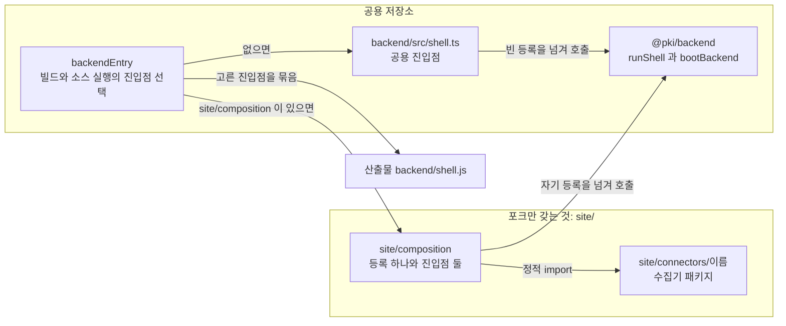
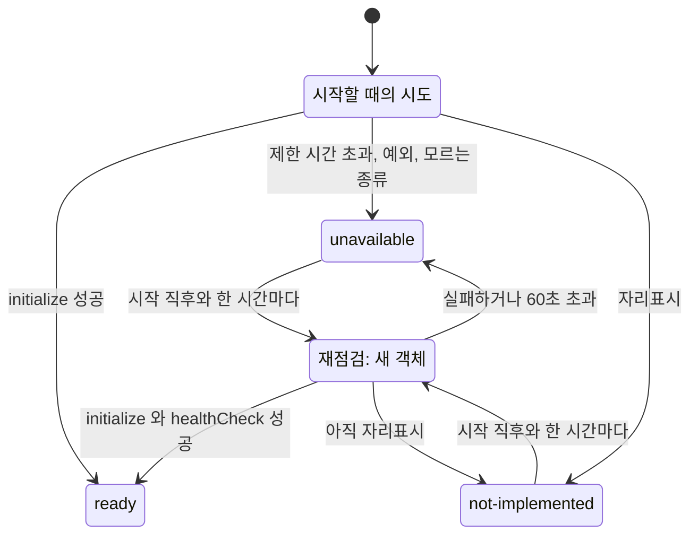

# 스펙: I05 배포처 수집기를 `site/` 안에서 등록하는 장치

- 날짜: 2026-11-22 / 상태: 초안
- 관련: 이슈 #113(이 spec), 함께 열린 #114(자격 증명)·#115(설치본의 인스턴스 범위 파일)·#116(파일 인스턴스), 선행 #18(I01). [I01 spec](2026-11-21-I01-connector-sdk.md)("T09가 넘기는 것", "T10이 넘기는 것"), [I03 spec](2026-11-21-I03-persistent-queue.md)(보류와 재점검), [I04 spec](2026-11-21-I04-invalidation.md)(I04-R14 접근 범위 정책), [V01 spec](2026-11-21-V01-vertical-skeleton.md)(V01-T15 산출물 검사), [ADR 0012](../adr/0012-upstream-and-fork-ownership.md), [ownership.md](../ownership.md), [connector-sdk.md](../connector-sdk.md), [site-setup.md](../site-setup.md)

낯선 말은 [ARCHITECTURE 0절](../ARCHITECTURE.md#0-처음-나오는-말)에 풀이가 있다. 이 spec에서 새로 쓰는 말은 아래 표에 있다. `I01-…`·`I03-…`·`I04-…`·`V01-…`은 그 spec의 번호, `S…`는 site-setup.md 체크리스트 번호다.

| 말 | 뜻 |
|---|---|
| 포크 | 배포처가 이 저장소를 복제해 만든 자기 저장소. 공용 저장소의 변경을 계속 받아 간다 |
| 등록(`SiteRegistration`) | 포크가 제품에 끼우는 것을 한 객체로 모은 것. 수집기 종류와 만드는 함수, 인스턴스, 등급 매핑, 접근 범위 정책이 들어간다 |
| 조립 패키지 | 포크가 `site/composition/`에 두는 작은 패키지. 등록 객체 하나와 진입점 둘을 갖는다 |
| 진입점 | 프로세스가 처음 실행하는 파일. 백엔드의 진입점은 지금 `backend/src/shell.ts`다 |
| 빌드 시점 결합 | 어떤 코드가 제품에 들어갈지를 실행 중이 아니라 빌드할 때 정하는 방식. 실행본은 자기 안에 묶인 코드만 실행한다 |
| 자리표시 | 공용 저장소가 실제 수집기 자리에 둔 `site-mail`, `site-messenger`, `site-wiki`. 실행하면 `미구현, 배포처 후속`을 알리고 실패한다 |

## 배경

[ownership.md 3절](../ownership.md)의 규칙은 "포크는 `site/` 안만 고친다"이다. 두 쪽이 같은 파일을 고치지 않아야 포크가 공용 변경을 받아 갈 때 충돌이 나지 않기 때문이다. 그런데 지금은 수집기를 `site/` 안에 두고도 제품에 연결할 방법이 없다. I01-T10이 확인한 대로 포크는 다음 공용 파일을 고쳐야 한다.

- `backend/src/composition.ts`: 수집기 종류 표 `connectorKinds`, 인스턴스 목록 `connectorInstances()`, 등급 매핑 `publicScopeGrading`을 쓰는 자리
- `pnpm-workspace.yaml`의 `packages:` 목록과 `backend/package.json`의 의존성
- `apps/desktop/src/layout.production.ts`의 `SCOPE_POLICY`(접근 범위 정책 이름)와 `backend/src/scope-policy.ts`의 `site` 갈래
- `pnpm install`이 바꾸는 `pnpm-lock.yaml`

시작 동작에도 빈 곳이 셋 있다.

- 백엔드는 모든 수집기의 `initialize`를 제한 시간 없이 기다린 뒤에 서비스를 시작한다. 하나가 끝나지 않으면 앱이 켜지지 않는다(`backend/src/connectors.ts`의 `createConnectorManager`).
- 만드는 함수가 예외를 던지거나 인스턴스가 표에 없는 종류를 적으면 시작이 중단된다(`unknown connector kind`).
- 한 시간마다의 재점검은 실패했던 **같은 객체**에 `initialize`를 다시 부른다. 규격 v2는 그렇게 불러도 안전하다고 약속한 적이 없다.

실제 수집기는 공용 저장소에 올 수 없고([ADR 0012](../adr/0012-upstream-and-fork-ownership.md)), 가져온 내용과 수집기가 돌려주는 값은 믿을 수 없는 자료다. 그래서 이 장치는 "포크의 코드를 어떻게 싣는가"와 "실린 코드가 잘못 동작해도 제품이 켜지는가"를 함께 정해야 한다.

## 목표

- 포크가 **파일을 더하기만 해서**(`site/` 안) 수집기를 제품의 종류로 등록한다. 공용 저장소의 추적 파일 가운데 포크에서 달라지는 것은 도구가 다시 만드는 `pnpm-lock.yaml` 하나다.
- 등급 매핑(`ScopeGrading`)과 접근 범위 정책(`ScopePolicy`)도 같은 등록 객체로 들어온다.
- 수집기 하나가 멈추거나 던지거나 모르는 종류여도 백엔드는 정해진 시간 안에 시작하고, 그 인스턴스만 `unavailable`이 된다.
- 재점검은 새 객체를 만들어 초기화한다. 제품은 한 객체의 `initialize`를 한 번만 부른다.
- 공용 저장소의 빌드 산출물은 지금과 같다. 포크의 빌드에는 등록한 수집기가 들어가고 테스트 코드는 들어가지 않는다.
- 실행본은 디스크에서 코드를 찾아 읽어 들이지 않는다.

## 비목표 (배포처에서 후속 진행)

**공용 저장소의 뒤 작업으로 넘기는 것**

- 수집기에 자격 증명을 건네는 통로: #114. 이 spec은 그 값이 들어올 자리만 한 곳으로 모은다(설계 개요 "#114와 #115가 들어올 자리").
- 설치본이 `site/config/connector-scopes.json`을 읽는 길: #115. 같은 장치로 싣기로 정하되 필드와 그 기준은 #115의 spec이 정한다.
- `jsonl-import` 파일 인스턴스를 제품에서 설정하는 길과 경로 제한: #116.
- 그 밖에 포크가 아직 공용 파일을 고쳐야 하는 빌드 값: 배포처 전송 규칙(`productEgress`), 묶을 Provider(`productProviders`), 검증된 CLI 조합 목록, 데이터 등급 목록. 등록 객체에 필드를 더해 옮길 수 있지만 각각 정책 판단이 따로 필요해 이 spec에서 다루지 않는다.
- 설치 스크립트가 필요한 의존성(`pnpm-workspace.yaml`의 `allowBuilds`)과 네이티브 실행 모듈(`apps/desktop/build/bundle.ts`의 `EXTERNAL_PACKAGES`)을 쓰는 수집기: 지원하지 않는다. 필요해지면 포크가 [ownership.md 5절](../ownership.md)의 방법으로 공용에 알린다.
- 브라우저 개발용 백엔드(`backend/src/dev.ts`)에 포크의 수집기를 싣는 진입점: 두지 않는다. 포크는 Electron 소스 실행으로 수집기를 본다.

**어느 작업에서도 하지 않는 것**

- **실행 중에 수집기를 설치하거나 읽어 들이는 일.** 폴더를 훑어 코드를 찾거나 경로를 조립해 동적으로 `import`하는 장치를 두지 않는다(이유는 "대안과 기각 사유" 1).
- 실제 메일·메신저·Wiki 수집기. 포크의 일이다(S01~S04).
- 규격의 변경. `Connector` 인터페이스와 `CONNECTOR_SDK_VERSION`(2)은 그대로다.

**배포처 후속 항목**(2개. [site-setup.md의 배포처 설정 체크리스트](../site-setup.md#배포처-설정-체크리스트)와 번호로 대응한다. S23·S24는 잠정 번호이며 미해결 질문 1이 확정한다)

| 번호 | 항목 |
|---|---|
| S23 | 포크의 조립 패키지(`site/composition/`)를 만들고 수집기, 인스턴스, 등급 매핑, 접근 범위 정책을 등록한다. 등록 검사와 `site-check`가 통과하고, 공용 변경을 한 번 받아 와 `site/` 밖의 충돌이 `pnpm-lock.yaml`뿐임을 기록한다 |
| S24 | 포크의 빌드를 Windows 11 설치본으로 만들어 등록한 수집기가 목록에 나오고 동기화되는지, 멈추는 수집기를 넣었을 때 앱이 제한 시간 안에 켜지는지 실행하고 기록한다 |

실제 수집기의 구현과 인증은 S01~S04가, 규격 v2의 실제 확인은 S18이 이미 갖고 있으므로 다시 세지 않는다.

## 요구사항

### 결합: 포크의 코드가 제품에 들어가는 길

- **I05-R1 진입점 주입.** 백엔드의 시작 코드는 등록 객체를 인자로 받는 함수가 된다(`runShell(site)`, `runSiteCheck(site, args)`, `bootBackend`의 `site` 옵션). 공용 진입점(`backend/src/shell.ts`, `backend/src/site-check.ts`)은 빈 등록 `publicSite`를 넘겨 그 함수를 부른다. 포크는 조립 패키지에 자기 진입점을 두고 자기 등록을 넘겨 같은 함수를 부른다. 결합은 전부 정적 `import`다.
- **I05-R2 진입점 선택.** `backendEntry(root)`가 백엔드 진입점의 경로를 정한다.
  - `site/composition/package.json`이 없으면 `backend/src/shell.ts`다.
  - 있으면 `site/composition/src/shell.ts`다. 그 파일이 없으면 경로를 적은 오류로 실패한다(조용히 공용 진입점으로 떨어지지 않는다).
  - 이 판정은 빌드(`apps/desktop/build/build.ts`)와 소스 실행(`apps/desktop/src/layout.ts`)만 쓴다. 배포 빌드의 셸(`layout.production.ts`)은 지금처럼 묶인 `./backend/shell.js`만 알고, 산출물에는 이 판정 코드가 없다.
- **I05-R3 워크스페이스.** 공용 `pnpm-workspace.yaml`의 `packages:` 목록에 `site/composition`과 `site/connectors/*` 두 줄을 둔다. 공용 저장소에는 그 폴더가 없다. 그 상태에서 `pnpm install --frozen-lockfile`이 통과하고 `pnpm-lock.yaml`이 바뀌지 않아야 한다(가정 A1, I05-T01이 잰다).
  - `pnpm typecheck`는 저장소 루트의 프로젝트와, 있으면 `site/composition`과 `site/connectors/*`의 `tsconfig.json`을 함께 본다(`tooling/workspace/typecheck.ts`). 공용 `tsconfig.json`은 포크의 프로젝트를 적지 않는다.
  - `tooling/workspace/tsconfig-references.test.ts`는 그 폴더가 없어도 통과하고, 있으면 `@pki-site/*` 의존성의 참조도 본다.
  - `pnpm lint`와 `pnpm test`는 지금도 `site/`를 포함한다. 이 spec은 그것을 바꾸지 않는다.
- **I05-R4 이름과 경계 규칙.** 포크의 패키지 이름은 `@pki-site/`로 시작한다(조립 패키지 `@pki-site/composition`, 수집기 `@pki-site/connector-<이름>`). 모듈 경계 규칙(`tooling/eslint/module-boundary.js`)은 이 범위를 `@pki/`와 같게 다룬다.
  - 수집기 구현은 자기 패키지의 `src/adapters/`에 두고 `<패키지>/adapters` 진입점으로만 내보낸다(지금 규칙 그대로).
  - 그 진입점을 가져올 수 있는 조립 지점에 조립 패키지의 `src/registration.ts`를 더한다. 다른 파일은 지금처럼 막힌다.
  - 공용 패키지는 `@pki-site/*`를 가져오거나 의존성으로 적지 못한다. 방향은 언제나 포크 → 공용이다.
- **I05-R5 lockfile.** 포크의 `pnpm-lock.yaml`은 `pnpm install`이 더한 것(포크 패키지의 `importers` 항목과 그 외부 의존성)만 공용과 다르다. 손으로 고치지 않는다. 공용 변경을 받아 올 때 이 파일이 충돌하면 공용 쪽 내용을 취하고 `pnpm install`을 다시 실행한다(가정 A3). 이 절차와 "이 파일이 `site/` 밖에서 달라지는 유일한 추적 파일"이라는 점을 문서에 적는다(I05-R21).

### 등록 계약

- **I05-R6 등록 객체.** `SiteRegistration`은 다음 필드를 갖는다. 전부 선택이고, 빈 객체가 공용 저장소의 등록 `publicSite`다.

  | 필드 | 뜻 | 없을 때 |
  |---|---|---|
  | `connectorKinds` | 종류 이름 → 수집기를 새로 만들어 돌려주는 함수(`ConnectorFactory`) | 자리표시 셋만 |
  | `connectorInstances` | 시작할 때의 인스턴스(`id`, `kind`, `config`) | 자리표시 인스턴스만 |
  | `scopeGrading` | 접근 범위 → 데이터 등급 매핑(S08) | `publicScopeGrading` |
  | `scopePolicy` | 접근 범위 정책(S21) | 공용 기본 정책 |

- **I05-R7 종류 이름.**
  - 이름은 `^[a-z][a-z0-9-]{0,63}$`를 따른다.
  - `jsonl-import`와 `test-fixtures`는 공용의 종류라 등록할 수 없다. 특히 `test-fixtures`는 합성 등급을 받을 수 있는 종류이므로, 포크의 수집기가 이 이름을 가지면 실제 자료가 합성으로 매겨진다.
  - 자리표시 이름 셋은 **같은 이름으로 등록해 대체할 수 있다**(ownership.md 2절의 약속 그대로). 대체하지 않은 자리표시는 종류와 인스턴스가 그대로 남아 `미구현, 배포처 후속`을 알린다.
  - 그 밖의 새 이름은 추가된다.
  - 만드는 함수가 돌려준 객체의 `manifest.type`은 종류 이름과 같아야 한다.
- **I05-R8 인스턴스.** `id`는 같은 모양 규칙을 따르고 서로 달라야 하며, `kind`는 등록된 종류여야 한다. 대체한 자리표시 종류의 인스턴스는 포크가 적은 것만 쓴다.
- **I05-R9 등록 검사.** `checkSiteRegistration(site)`는 위반을 **코드의 목록**으로 돌려준다. 문구나 수집기가 준 글은 싣지 않는다.

  | 코드 | 잡는 것 | 시작할 때도 적용 |
  |---|---|---|
  | `kind-name-invalid` | 이름 모양 위반 | 예: 그 종류를 등록하지 않는다 |
  | `kind-reserved` | 공용 종류 이름 | 예: 등록하지 않고 공용 것을 그대로 둔다 |
  | `instance-id-invalid` | 인스턴스 `id` 모양 위반 | 예: 그 인스턴스를 뺀다 |
  | `instance-id-duplicate` | 같은 `id`가 둘 이상 | 예: 첫 것만 쓴다 |
  | `instance-kind-unknown` | 등록되지 않은 종류의 인스턴스 | 예: 그 인스턴스는 `unavailable` |
  | `kind-factory-threw` | 만드는 함수가 예외를 던짐 | 아니오(I05-R11이 인스턴스 단위로 다룬다) |
  | `kind-manifest-mismatch` | `manifest.type`이 종류 이름과 다름 | 아니오(검사에서만) |
  | `scope-grading-invalid` | 매핑이 허용된 등급 밖을 답하거나, `strictest([])`·`grade(null)`이 가장 엄격한 등급이 아님 | 아니오(Broker가 호출마다 닫힌 쪽으로 거절한다) |

  시작할 때 적용되는 위반은 **시작을 멈추지 않는다.** 위 표대로 그 항목만 빼고, 로그에 `site-registration-rejected`와 코드, 건수를 남긴다.

### 시작 동작

- **I05-R10 `initialize` 시간 제한.** 시작할 때 인스턴스들은 함께 초기화되고, 각각 `INITIALIZE_TIMEOUT_MS`(잠정 10초) 안에 끝나지 않으면 `unavailable`이 된다. 백엔드는 그 시간 안에 서비스를 시작한다. 제한을 넘긴 시도가 나중에 성공하거나 실패해도 그 결과는 상태를 바꾸지 않는다.
- **I05-R11 한 인스턴스의 실패는 그 인스턴스만.** 만드는 함수가 던짐, `initialize`가 던짐, 제한 시간 초과, 모르는 종류의 네 경우 모두 시작은 계속되고 그 인스턴스만 `unavailable`이다.
  - 그 인스턴스의 동기화 요청은 `connector-unavailable`로 답한다.
  - 그 인스턴스의 수집 작업은 사유 `connector-unavailable`로 보류된다(I03-R16의 기존 동작).
  - 로그에는 정해진 코드와 인스턴스 `id`만 남는다: `connector-initialize-timeout`, `connector-factory-failed`, `connector-kind-unknown`. 수집기가 던진 글은 남기지 않는다.
  - `ConnectorNotImplementedError`는 지금처럼 `not-implemented`다.
- **I05-R12 저장된 자료의 모르는 종류.** 정본에 남은 인스턴스 행, 주기, 작업이 지금 등록에 없는 종류나 인스턴스를 가리켜도 시작은 끝난다. 그 작업은 지금처럼 `instance-not-found`로 닫힌다(I03의 기존 동작. 이 spec은 바꾸지 않고 시험으로 붙잡는다).
- **I05-R13 재점검은 새 객체.** 준비되지 않은 인스턴스의 재점검은 만드는 함수를 다시 불러 **새 객체**를 만들고, 그 객체를 초기화한 뒤 `healthCheck`를 묻는다.
  - 둘 다 성공하면 그 인스턴스가 새 객체로 바뀌고 `ready`가 된다. 아니면 새 객체를 버리고 `unavailable`로 남는다.
  - 제품은 한 객체의 `initialize`를 한 번만 부른다. `ready`인 인스턴스의 객체는 바꾸지 않는다.
  - 끝나지 않은 재점검이 있는 인스턴스는 다시 시작하지 않는다(`RECHECK_TIMEOUT_MS` 60초와 함께 기존 동작).

### 등급 매핑과 접근 범위 정책

- **I05-R14 등급 매핑.** 등록의 `scopeGrading`이 있으면 Broker가 그것을 쓴다. 빌드 종류와 무관하다. 없으면 `publicScopeGrading`이다. 테스트 빌드 전용 주입(`bootBackend`의 `scopeGrading`)은 지금처럼 테스트 빌드에서만 듣는다.
- **I05-R15 접근 범위 정책.** 정책은 이름과 등록으로 정해진다.

  | 넘어온 이름 | 등록에 `scopePolicy`가 | 결과 |
  |---|---|---|
  | 없음 | 있음 | 등록의 정책 |
  | 없음 | 없음 | 공용 기본 정책 |
  | `default` | 무관 | 공용 기본 정책 |
  | `site` | 있음 | 등록의 정책 |
  | `site` | 없음 | `미구현, 배포처 후속`으로 시작을 멈춘다(지금과 같다) |
  | 그 밖 | 무관 | 모르는 이름 오류로 시작을 멈춘다(지금과 같다) |

  배포 빌드는 이름을 넘기지 않는다. `layout.production.ts`의 `SCOPE_POLICY` 상수와 배포 빌드 백엔드의 `--scope-policy` 인자를 없앤다. 그래서 정책을 등록한 포크의 설치본은 언제나 그 정책을 쓰고, 설치본을 `default`로 돌리는 스위치는 없다. 이름은 소스 실행(`PKI_SCOPE_POLICY`)에만 남는다. 이것은 I04-R14의 "이름이 없으면 기본"을 "이름이 없으면 등록의 정책, 등록에 없으면 기본"으로 고치는 것이다.

### 산출물과 공용 전용 검사

- **I05-R16 공용 빌드는 그대로.** `site/composition/`이 없는 저장소에서 백엔드 묶음의 입력은 `backend/src/shell.ts`이고, 묶음에 남은 모듈에 `site/`, `packages/site-example/`, `packages/connector-example/` 아래의 것이 없다. 제품의 종류는 지금처럼 `jsonl-import`와 자리표시 셋이다(`connectors.public-only`의 단언을 바꾸지 않는다).
- **I05-R17 포크 빌드는 등록한 것만.** 조립 패키지의 진입점을 묶으면 등록과 그 수집기의 모듈이 들어가고, 테스트 파일과 `@pki/testkit`은 들어가지 않는다. 등록이 테스트 모듈에 닿으면 빌드가 실패한다(V01-T15의 경로 규칙이 `site/`에도 그대로 걸린다).
- **I05-R18 읽어 들이는 코드 없음.** 제품 코드(`backend/src`, `apps/desktop/src`, `knowledge-engine/src`, `storage/src`, `providers/src`)에는 `site/` 아래를 폴더로 훑거나 동적으로 `import`·`require`하는 코드가 없다. `checkPublicOnly`가 보는 범위와 자리 표시 목록(`site/README.md` 하나)은 바뀌지 않고, 공용 저장소와 포크 양쪽에서 통과한다.
- **I05-R19 `site-check`의 안내.** 조립 패키지가 있는 저장소에서 공용 명령 `pnpm --filter @pki/backend site-check`를 실행하면, 자리표시의 결과를 내는 대신 포크의 명령을 알리고 2로 끝난다. 포크가 구현한 종류에 `미구현`이 나오는 오해를 막는다.

### 공용 쪽 계약 테스트와 포크가 돌리는 것

- **I05-R20 예시 조립 패키지.** 공용 저장소에 `packages/site-example/`(`@pki/site-example`)을 둔다. 포크가 `site/composition/`에 쓸 것과 같은 모양(등록, 진입점 둘, 등록 검사 테스트)이며 수집기로 `@pki/connector-example`을 등록한다. 제품에는 들어가지 않는다. 이 패키지로 I05-R1, R6~R9, R14, R15, R17을 공용 저장소에서 시험한다. 문서의 코드 블록은 이 패키지의 발췌다.
- **I05-R21 포크의 명령.** 문서에 다음을 적는다. 수집기를 등록하기 전에 그 수집기의 계약 묶음(`connectorContract`)이 통과해야 한다는 것은 **문서의 절차**이며 빌드가 강제하지 않는다(계약 묶음에는 수집기마다 지어낸 원 시스템이 필요하고, 그것은 수집기 자신의 테스트만 갖는다).

  ```sh
  pnpm install
  pnpm lint && pnpm typecheck && pnpm test
  pnpm --filter @pki-site/composition site-check <종류>
  pnpm --filter @pki/desktop build
  ```

### 문서

- **I05-R22 connector-sdk.md.** 6장의 "`site/connectors/`에 두려면" 항목, 7장 전체, 11장의 #113 행, 5장의 재점검 문장을 새 장치로 고친다. 7장은 포크가 더하는 파일의 목록과 예시 패키지의 발췌, I05-R21의 명령, lockfile 절차를 갖는다.
- **I05-R23 ownership.md.** 3절의 폴더 그림에 `site/composition/`을 더하고, "현재의 예외" 문단을 줄인다. 남는 것은 `pnpm-lock.yaml`(도구가 만든 변경만), #114, #115, #116과 이 spec의 비목표에 적은 빌드 값이다.
- **I05-R24 site-setup.md와 ADR.** "빌드할 때 정해지는 것" 표의 수집기 인스턴스 행과 접근 범위 정책 이름 행, S08의 매핑을 끼우는 자리, S21의 구현 방법 ②③을 등록 객체로 고친다. 체크리스트에 S23·S24를 넣고 번호 범위 안내에 이 spec을 더한다. 결합 방식의 결정은 새 ADR(다음 빈 번호)에 남기고 `docs/README.md` 색인에 올린다.

**이 절을 줄이면**: 포크는 `site/composition/`에 등록 하나와 진입점 둘을 두고, 빌드가 그 진입점을 고른다. 등록은 검사되고, 잘못된 항목과 멈추는 수집기는 그 항목만 빠진다. 공용 빌드는 달라지지 않는다.

## 인터페이스 / 설계 개요

### 구성요소와 방향



화살표는 모두 포크에서 공용으로, 또는 빌드 도구에서 진입점으로 향한다. 공용 코드에서 포크의 코드를 가리키는 `import`는 없다. 그래서 공용 저장소에 포크의 파일이 없어도 타입 검사, 테스트, 빌드가 그대로 돈다.

### 포크가 더하는 파일

```text
site/
├── README.md                     공용 저장소가 갖는 유일한 파일
├── composition/                  포크: 조립 패키지 @pki-site/composition
│   ├── package.json              의존: @pki/backend, 자기 수집기 패키지들
│   ├── tsconfig.json
│   └── src/
│       ├── registration.ts       export const registration: SiteRegistration
│       ├── registration.test.ts  checkSiteRegistration(registration)이 빈 목록
│       ├── shell.ts              await runShell(registration)
│       └── site-check.ts         await runSiteCheck(registration, 인자)
├── connectors/<이름>/            포크: 수집기 패키지 @pki-site/connector-<이름>
│   ├── package.json              exports "./adapters"
│   ├── tsconfig.json
│   └── src/adapters/             구현과 계약 테스트
└── config/                       포크: 설정 값
```

진입점 둘은 각각 두세 줄이다. 공용 저장소가 나중에 진입점을 늘리면 포크는 같은 모양의 파일을 하나 더한다(충돌이 아니라 추가다).

### 이관 경계: 잘린 자리와 그 계약

배포처로 넘어가는 경계는 **`SiteRegistration`이라는 어댑터 경계**다. 공용 쪽은 이 경계 양편을 모두 갖춘 채 끝난다.

- 인터페이스: `SiteRegistration`(I05-R6)과 그것을 받는 함수 셋(I05-R1).
- 계약 테스트: `checkSiteRegistration`(I05-R9). 어떤 등록이든 같은 코드 목록으로 판정된다. 공용 저장소는 빈 등록과 예시 등록(`packages/site-example/`) 둘로 이 검사와 부팅, 묶기를 증명한다.
- 미구현 표시: 포크가 대체하지 않은 자리표시와 등록에 없는 `site` 정책은 `미구현, 배포처 후속`을 알리고 실패한다(I05-H2).
- 코드에 배포처 값을 두지 않는다. 엔드포인트, 계정, 범위 같은 값은 등록의 `config`와 `site/config/`에만 있고, 공용 기본(빈 등록)은 아무 설정 없이 로컬에서 돈다.

### 인스턴스의 상태



시작 때의 10초는 "앱이 켜지는 데 수집기가 걸 수 있는 최대 시간"이다. 느리지만 멀쩡한 수집기는 시작 직후의 첫 재점검(60초 한도)에서 `ready`가 된다. 비유하자면 문을 여는 시간과 손님을 기다리는 시간을 나눈 것이다. 다만 비유와 달리 늦게 온 첫 시도의 결과는 받지 않고 버린다. 그 객체가 반쯤 초기화된 상태일 수 있기 때문이다.

### #114와 #115가 들어올 자리

- **#114(자격 증명).** 수집기 객체를 만들고 초기화하는 일은 관리 모듈의 한 곳에서만 일어나게 한다(시작과 재점검이 같은 길을 쓴다, I05-R13). #114가 건넬 값은 그 한 곳의 호출과 `SiteRegistration`의 필드로 들어오면 되고, 이 spec은 그 모양을 정하지 않는다.
- **#115(인스턴스 범위 파일).** 같은 장치로 싣는다고 정한다. 포크의 `registration.ts`가 `site/config/connector-scopes.json`을 정적으로 가져와 등록의 필드로 넘기면 묶음 안에 값이 들어가므로 "설치본이 그 파일을 어디서 읽는가"라는 문제가 없어진다. 다만 필드를 더하는 일, 파일 상태 넷의 로그(`connector-scopes-absent` 등), S18의 확인 문장과 그 가드 테스트는 #115의 기준이므로 이 spec에 넣지 않는다. JSON을 정적으로 가져오는 것이 소스 실행과 묶기 양쪽에서 되는지도 #115가 잰다.

### 대안과 기각 사유

| 번호 | 대안 | 기각한 이유 | 다시 볼 조건 |
|---|---|---|---|
| 1 | **실행 중 로더.** 시작할 때 폴더를 훑어 수집기를 동적으로 읽어 들임 | 실행본이 디스크의 코드를 실행하게 된다. 설치 폴더나 데이터 폴더에 파일을 쓸 수 있는 누구든 정본과 비밀 값 통로를 가진 백엔드 안에서 코드를 돌릴 수 있다. 산출물 검사(V01-T15)는 "묶음에 남은 모듈 목록"으로 판정하는데 나중에 읽히는 코드는 그 목록에 없다. 수집기의 의존성도 묶이지 않아 따로 실어야 한다. ADR 0012가 "플러그인 폴더만"을 이미 기각했다 | 다시 빌드하지 않고 수집기를 설치해야 한다는 요구가 생길 때. 지금은 비목표다 |
| 2 | **생성된 등록표.** 도구가 `site/connectors/`를 훑어 `import` 목록 파일을 만들어 줌 | 백엔드의 타입 검사 프로젝트는 참조에 적힌 패키지만 가져올 수 있어서, 만든 파일이 포크 패키지를 가져오려면 `tsconfig`와 의존성까지 함께 만들어야 한다. 설치 훅, 낡음 검사, 추적되지 않는 파일이 타입 검사의 입력이 되는 일이 따라온다. 결과는 같고 장치만 많다 | 포크의 진입점 파일 수가 부담이 될 만큼 늘 때 |
| 3 | **해석 별칭.** `#site` 같은 이름을 포크 파일이 있으면 그리로, 없으면 공용 기본으로 풀기 | Node 소스 실행, 테스트 러너, 타입 검사, 번들러 넷이 각자 설정을 가져야 하고 Node의 `imports`는 파일이 있는지를 보지 못한다. 넷이 어긋나면 테스트는 통과하고 산출물만 틀린다 | — |
| 4 | **공용이 `site/`에 씨앗 파일을 두고 포크가 고침** | ADR 0012(사용자 지시로 확정)의 "안내문만 둔다"와 어긋난다. 두 쪽이 같은 파일을 만지게 되고, 그 파일을 고정하는 공용 테스트는 포크에서 실패한다 | 사용자가 ADR 0012를 고칠 때 |
| 5 | **`site/`를 별도 워크스페이스로**(자기 lockfile) | lockfile 충돌은 없어지지만 설치가 둘이 되고, 공용 패키지를 `link:`로 물어야 하며, Node와 pnpm 고정 값이 두 곳에 생긴다. pnpm이 겹친 워크스페이스를 어떻게 다루는지도 이 저장소에서 확인된 적이 없다 | I05-T01이나 T11에서 lockfile 충돌이 `pnpm install`로 고쳐지지 않을 때 |
| 6 | **규격이 `initialize` 재호출 안전을 약속** | 모든 포크 수집기가 반쯤 초기화된 상태를 스스로 되돌려야 하고, 계약 묶음은 실제 부분 실패를 흉내 낼 수 없어 약속을 증명하지 못한다. 새 객체를 만드는 쪽은 만드는 함수가 이미 인자 없는 함수이고 계약 묶음이 이미 새 객체를 여러 번 만든다 | 수집기를 만드는 비용이 커서 다시 만들 수 없는 종류가 생길 때 |
| 7 | **시작할 때 기다리지 않고 전부 뒤에서 초기화** | 시작 직후의 일들(기본 주기 만들기, 준비된 인스턴스의 보류 풀기)이 "시작이 끝나면 상태가 정해져 있다"에 기대고 있어 고칠 곳이 넓다 | 10초의 시작 지연도 받아들일 수 없을 때 |

### 작업 분해(잠정)

이 표는 잠정이다. 조정자가 spec을 확정한 뒤 다시 맞춘다. 한 행이 PR 하나다.

| ID | 산출물 하나 | 선행 | 기준 | 주로 바뀌는 파일 | 기대하는 증거(테스트 이름) |
|---|---|---|---|---|---|
| I05-T01 | 가정 A1~A6의 실측 기록(이 spec에 "T01이 넘기는 것" 절). 제품 코드 없음 | — | C3, C5의 전제 | 이 spec | 버리는 작업 트리에서 돌린 명령과 출력(로그 파일) |
| I05-T02 | `SiteRegistration`, `publicSite`, `checkSiteRegistration`, 종류·인스턴스 합치기 | — | C6 | `backend/src/site-registration.ts`(새), `composition.ts`, `composition.test.ts` | `site.registration`(코드마다 1건, 빈 등록 0건, 합치기 4건), 기존 `connectors.public-only` |
| I05-T03 | 시작할 때의 시간 제한과 인스턴스 단위 실패 | — | C8, C9, C10 | `backend/src/connectors.ts`, 새 `connectors.boot.test.ts`, `tooling/docs/connector-sdk.test.ts`의 "boot waits…" 가드, connector-sdk.md 7장의 그 문장 | `connectors.boot-bounded`, `connectors.boot-isolated`, `boot.stored-unknown-kind` |
| I05-T04 | 재점검이 새 객체를 만듦 | T03 | C11 | `backend/src/connectors.ts`, `connector-sync-job.test.ts`, 문서 대응 테스트의 `recheck`·`healthCheck` 줄, connector-sdk.md 5장 문장 | `connectors.recheck-fresh` |
| I05-T05 | 진입점 주입: `runShell`, `runSiteCheck`, `bootBackend`의 `site`, 등급 매핑, 시작 때의 등록 거르기, `site-check` 안내 | T02 | C1(부팅 쪽), C7, C12, C18 | `backend/src/shell.ts`, 새 `shell-main.ts`, `site-check.ts`, `boot.ts`, `composition.ts`, `shell-options.ts`, `index.ts` | `boot.site-registration`, `boot.registration-rejected`, `site-check`(기존 3건과 안내 1건), `claimed-scope.wiring` |
| I05-T06 | 접근 범위 정책을 등록에서 | T05 | C13 | `backend/src/scope-policy.ts`, `shell-options.production.ts`, `apps/desktop/src/layout.production.ts`, `layout.scope-policy.test.ts`, site-setup의 정책 행과 S21 문장, `tooling/docs/site-setup-i04.test.ts` | `scope-policy`(표의 여섯 행), `layout.scope-policy` |
| I05-T07 | 워크스페이스 두 줄, 경계 규칙, 타입 검사 실행기 | T01 | C3, C4 | `pnpm-workspace.yaml`, `tooling/eslint/module-boundary.js`와 그 테스트, 새 `tooling/workspace/typecheck.ts`, `tsconfig-references.test.ts`, 루트 `package.json` | `module-boundary`(5건), `workspace.typecheck-projects`, `tsconfig project references` |
| I05-T08 | 예시 조립 패키지 `packages/site-example/` | T05, T06, T07 | C1, C17 | `packages/site-example/**`(새), 루트 `tsconfig.json` | `site.example-registration`, `site.example-boot`, `site.no-public-reference` |
| I05-T09 | 진입점 선택과 산출물 검사 | T08 | C2, C14, C15, C16 | 새 `apps/desktop/src/backend-entry.ts`, `layout.ts`, `build/build.ts`, `build/bundle.test.ts`, `artifact/artifact.contents.e2e.ts` | `backend-entry`(3건), `bundle`(공용 입력 1건, 예시 입력 2건), `artifact.contents` |
| I05-T10 | 문서, ADR, site-setup S23·S24, 문서 대응 테스트 | T04, T06, T09 | C19, H1, H2 | `docs/connector-sdk.md`, `docs/ownership.md`, `docs/site-setup.md`, 새 ADR, `docs/README.md`, `tooling/docs/*.test.ts`, `backend/src/connector-sdk.docs.test.ts` | `docs.connector-sdk`, `docs.site-setup`(I05) |
| I05-T11 | 포크 모양 예행(검증 전용): 예시를 `site/`에 복사해 I05-R21의 명령과 공용 변경 받기를 한 번 실행한 기록(이 spec에 "T11이 넘기는 것" 절) | T10 | C5, C3의 명령 증거 | 이 spec | 명령과 출력, `git status --porcelain` |

- **함께 진행할 수 있는 것**: T01·T02·T03은 서로 기다리지 않는다. T07은 T01만 기다리므로 T02~T06과 나란히 간다.
- **같은 파일을 만지는 것(차례로)**: T03 → T04(`connectors.ts`), T02 → T05(`composition.ts`), T05 → T06(`boot.ts`, 셸 인자), T03·T04·T10(`tooling/docs/connector-sdk.test.ts`와 connector-sdk.md).
- T03과 T04가 문서 문장을 함께 고치는 이유: 그 문장과 짝인 가드 테스트가 있어서, 코드를 바꾸는 PR이 문장과 테스트를 같이 고쳐야 통과한다("T10이 넘기는 것" 4).

**이 절을 줄이면**: 결합은 "포크의 진입점이 공용 함수를 부른다"는 한 문장이다. 경계는 `SiteRegistration`이고, 그 계약은 `checkSiteRegistration`과 예시 패키지로 공용에서 증명한다. 실행 중 로더는 두지 않는다.

## 완료 기준 (테스트 가능한 형태)

기준마다 저장소 안의 테스트가 있다. 명령의 출력으로만 볼 수 있는 것(C3의 설치, C5)은 그렇게 적었다. H1·H2는 배포처로 넘어가는 프로젝트의 spec 양식이 요구하는 두 기준이다.

- [ ] **I05-C1** (R1, R4, R20): 예시 등록을 넘겨 백엔드를 띄우면 수집기 목록에 그 종류가 `ready`로 나오고, 동기화하면 원본이 저장된다. 그리고 공용 패키지(`packages/site-example/` 제외)의 `package.json`, `tsconfig.json`, 소스 어디에도 `@pki-site/`나 `@pki/site-example`이 나오지 않는다.
- [ ] **I05-C2** (R2): `backendEntry`에 임시 폴더를 주면 ① 조립 패키지가 없을 때 `backend/src/shell.ts` ② 있을 때 `site/composition/src/shell.ts` ③ `package.json`만 있고 진입점이 없을 때 그 경로를 적은 오류가 된다. 배포 빌드의 셸 묶음 글자에 `site/composition`이 없다.
- [ ] **I05-C3** (R3): ① `pnpm-workspace.yaml`의 `packages:` 목록 안에 두 줄이 있다 ② `site/composition`과 `site/connectors`가 없는 저장소에서 참조 검사 테스트가 통과한다 ③ 타입 검사 대상이 공용 저장소에서는 루트 하나이고, 포크 모양의 임시 폴더에서는 그 프로젝트들이 더해진다 ④ (명령 증거) 공용 저장소에서 `pnpm install --frozen-lockfile`이 통과하고 `git status --porcelain`이 비어 있다.
- [ ] **I05-C4** (R4): 경계 규칙이 다음 다섯을 판정한다. ① 조립 패키지의 `src/registration.ts`가 `<수집기>/adapters`를 가져오면 통과 ② 같은 패키지의 다른 파일이 가져오면 실패 ③ 수집기 패키지가 `src/adapters/` 밖에서 `Connector`를 구현하면 실패 ④ 공용 패키지가 `@pki-site/*`를 가져오면 실패 ⑤ 포크 패키지가 적지 않은 `@pki/*`를 가져오면 실패.
- [ ] **I05-C5** (R5, 명령 증거): 예시를 `site/`에 포크 모양으로 복사하고 `pnpm install`을 하면 `git status --porcelain`에 `site/` 아래와 `pnpm-lock.yaml`만 나온다. 공용 쪽에서 lockfile을 바꾼 commit을 합쳐 충돌이 난 뒤, 공용 쪽 내용을 취하고 `pnpm install`을 실행하면 `pnpm install --frozen-lockfile`이 통과한다.
- [ ] **I05-C6** (R6~R9): `checkSiteRegistration`이 ① 빈 등록과 예시 등록에 빈 목록 ② 표의 여덟 코드 각각을 그 위반 하나만 가진 등록에 돌려준다. 합친 결과는 ③ 자리표시 이름을 등록하면 그 종류가 대체되고 자리표시 인스턴스가 사라짐 ④ 대체하지 않은 자리표시는 종류와 인스턴스가 남고 초기화하면 `미구현, 배포처 후속` ⑤ 새 이름은 추가됨 ⑥ `test-fixtures`와 `jsonl-import`를 등록하면 등록되지 않음.
- [ ] **I05-C7** (R9): 시작할 때 적용되는 위반 다섯을 각각 가진 등록으로 띄우면 시작이 끝나고, 표의 결과대로 그 항목만 빠지며, 로그에 `site-registration-rejected`와 그 코드가 남는다.
- [ ] **I05-C8** (R10, R11): `initialize`가 끝나지 않는 수집기와 멀쩡한 수집기를 함께 등록하고 띄우면 ① 제한 시간 안에 시작이 끝남 ② 앞의 것은 `unavailable`, 뒤의 것은 `ready` ③ 앞의 것의 동기화 요청은 `connector-unavailable` ④ 그 수집 작업은 사유 `connector-unavailable`로 보류 ⑤ 제한 뒤에 그 `initialize`를 끝내도 상태가 그대로.
- [ ] **I05-C9** (R11): 만드는 함수가 던짐, `initialize`가 던짐, 인스턴스가 모르는 종류를 적음의 세 경우 각각 시작이 끝나고 그 인스턴스만 `unavailable`이며, 정해진 로그 코드가 남고, 던진 글은 로그와 목록 어디에도 없다.
- [ ] **I05-C10** (R12): 등록에 없는 인스턴스의 행, 주기, 대기 중 작업이 든 정본으로 띄우면 시작이 끝나고 그 작업은 `instance-not-found`로 닫히며 다른 인스턴스는 동기화된다.
- [ ] **I05-C11** (R13): ① 첫 객체의 초기화가 실패한 인스턴스를 재점검하면 만드는 함수가 다시 불리고 새 객체로 `ready`가 됨 ② 어느 객체의 `initialize`도 두 번 불리지 않음 ③ 새 객체가 실패하면 `unavailable`로 남음 ④ `ready`인 인스턴스는 재점검해도 객체가 그대로 ⑤ 끝나지 않은 재점검이 있으면 다음 차례에 다시 시작하지 않음.
- [ ] **I05-C12** (R14): 등록에 매핑을 넣고 띄우면 Broker가 그 매핑으로 등급을 매기고, 넣지 않으면 공용 매핑으로 매긴다.
- [ ] **I05-C13** (R15): 정책 표의 여섯 행이 각각 그 결과가 된다. 배포 빌드의 이름 함수는 값을 주지 않고, 배포 빌드의 인자 해석은 `--scope-policy`를 거부한다.
- [ ] **I05-C14** (R16): 공용 저장소에서 고른 진입점을 묶으면 남은 모듈에 `site/`, `packages/site-example/`, `packages/connector-example/` 아래의 것이 없다. `connectors.public-only`의 단언은 바뀌지 않은 채 통과한다.
- [ ] **I05-C15** (R17): 예시 진입점을 배포 빌드로 묶으면 ① 등록과 예시 수집기의 모듈이 남고 ② 테스트 파일과 `@pki/testkit`이 없으며 ③ 등록이 테스트 모듈을 가져오게 바꾼 변형은 묶기가 실패한다.
- [ ] **I05-C16** (R18): 제품 코드 다섯 뿌리에 `site/` 아래를 훑거나 동적으로 읽는 파일이 없다(탐지기는 통째로 적은 경로와 조각으로 만든 경로를 모두 잡고, 그 양성 사례가 함께 있다). `checkPublicOnly`가 빈 목록이다.
- [ ] **I05-C17** (R20, R21): 예시 패키지에 등록 검사 테스트와 부팅 테스트가 있고, 문서가 적은 명령이 저장소에 있는 명령이다.
- [ ] **I05-C18** (R19): 조립 패키지가 있는 임시 폴더에서 공용 `site-check`를 실행하면 포크의 명령을 알리고 2로 끝난다. 없을 때는 지금과 같다.
- [ ] **I05-C19** (R22~R24): 문서 대응 테스트가 다음을 판정한다.
  - connector-sdk.md 7장이 포크가 더하는 파일 목록, 예시 패키지에서 온 발췌(표지가 가리키는 파일에 그대로 있음), I05-R21의 명령, lockfile 절차를 갖는다. 11장에 #113 행이 없다.
  - ownership.md 3절의 예외 문단이 `composition.ts`, `pnpm-workspace.yaml`, `backend/package.json`을 더는 적지 않고 `pnpm-lock.yaml`, #114, #115, #116을 적는다.
  - site-setup.md의 두 행과 S08·S21이 `registration`을 가리키고 `SCOPE_POLICY`를 더는 적지 않는다.
  - 새 ADR이 `docs/README.md` 색인에 있다.
- [ ] **I05-H1** (R24): site-setup.md의 `## 배포처 설정 체크리스트` 아래에 S23과 S24가 각각 정확히 한 번 있고, 이 spec 번호 범위 안의 항목 수가 2다. 항목이 없거나 수가 다르면 실패한다.
- [ ] **I05-H2** (R7, R15): 다음 네 경우 각각 `미구현, 배포처 후속`을 알리고 0이 아닌 값으로 끝나거나 시작이 멈춘다. ① ② ③ 빈 등록에서 `site-check site-mail`, `site-messenger`, `site-wiki` ④ 정책을 등록하지 않은 채 이름 `site`로 시작.

## 미해결 질문

1. **S23·S24 번호.** I04 spec이 "S21 이후는 I04가 쓴다"고 적었고 지금 S21·S22를 쓴다. S23·S24가 I04의 뒤 작업과 겹치지 않는지 조정자가 확인한다. 겹치면 번호만 바꾼다(H1과 문서 대응 테스트는 번호로 센다).
2. **종류 이름 규칙의 출처.** `^[a-z][a-z0-9-]{0,63}$`는 tombstone 기록 작업(아직 합쳐지지 않은 브랜치)이 종류에 요구한다고 전달받은 모양이다. `main`에서 같은 모양은 작업 코드에만 쓰인다(`packages/contracts/src/index.ts`의 `JobCode`, `storage/src/jobs.ts`의 `isReasonCode`). 그 브랜치가 합쳐질 때 두 곳이 한 상수를 쓰는지 확인한다.

둘 다 사용자의 결정이 필요한 것은 아니다. 뒤 작업은 이 값으로 진행한다.

## 잠정 결정과 가정

| 결정·가정 | 고른 쪽과 이유 | 바꾸려면 |
|---|---|---|
| 결합 방식 | 빌드 시점, 진입점 주입. 정적 `import`만 써서 도구 넷이 같은 것을 본다 | "대안과 기각 사유" 1~3의 조건 |
| 조립 패키지의 자리 `site/composition/` | `site/` 자체를 패키지로 만들면 수집기 패키지가 그 안에 겹친다. 형제 폴더가 ownership.md의 그림에 한 줄로 들어간다 | `backendEntry`의 경로 둘과 워크스페이스 한 줄 |
| 이름 범위 `@pki-site/` | 공용이 나중에 쓸 `@pki/` 이름과 부딪치지 않고, 경계 규칙이 접두사 하나로 포크 패키지를 알아본다 | 경계 규칙의 범위 목록 |
| 시작 때 제한 10초, 설정으로 빼지 않음 | 수집기가 시작을 늦출 수 있는 최대 시간이다. 더 걸리는 수집기는 직후의 재점검(60초)에서 준비된다. 배포처마다 달라야 할 이유가 아직 없다 | `INITIALIZE_TIMEOUT_MS` 한 상수. 실제 값은 S24에서 잰다 |
| 준비 안 됨의 사유를 목록에 더하지 않음 | 수집기 목록의 `reason`은 닫힌 값 하나(`unsupported-sdk-version`)다. 새 사유를 더하면 계약, 화면 문구, 보류 사유 표가 함께 바뀐다. 진단은 로그 코드로 한다 | 화면에서 원인을 보여야 할 때 계약에 값을 더한다 |
| 등록 위반은 시작을 멈추지 않고 그 항목만 뺌 | 이슈의 요구(모르는 종류가 시작을 막지 않음)와 같은 방향이다. 예약 이름은 등록하지 않으므로 닫힌 쪽이다 | 위반이면 시작을 멈추게 하려면 I05-R9의 마지막 문장 |
| `kind-manifest-mismatch`·`scope-grading-invalid`는 검사에서만 | 앞의 것은 표시의 문제이고, 뒤의 것은 Broker가 호출마다 이미 닫힌 쪽으로 거절한다 | 시작 때도 적용하려면 I05-R9의 표 |
| 계약 묶음 통과는 문서의 절차 | 빌드는 수집기마다의 지어낸 원 시스템을 알 수 없다 | 포크의 CI가 생기면 그 단계로 강제한다 |
| 공용에 "`site/`에 안내문만 있다"는 검사를 두지 않음 | 그 검사는 포크에서 반드시 실패한다. I01-T10도 같은 이유로 그런 가드를 지웠다 | 공용 저장소임을 알리는 표지가 생길 때 |
| 가정 A1: `packages:`의 항목이 아무 폴더와도 맞지 않아도 pnpm 11이 오류 없이 넘어가고 lockfile을 바꾸지 않는다 | 확인되지 않았다. I05-T01이 잰다 | 실패하면 `site/*` 모양의 글롭을 시험하고, 그래도 안 되면 조정자에게 알린다(설계의 전제다) |
| 가정 A2: 포크 패키지를 더하면 lockfile에 그 `importers` 항목과 외부 의존성만 더해진다 | I01-T10의 시험(예시를 `site/connectors/`에 복사)이 설치와 계약 묶음까지는 확인했다. lockfile의 차이는 보지 않았다 | I05-T01, T11 |
| 가정 A3: 충돌한 lockfile은 공용 쪽을 취하고 `pnpm install`을 다시 하면 고쳐진다 | 확인되지 않았다 | 실패하면 대안 5를 다시 본다 |
| 가정 A4: Node 24의 소스 실행이 `site/composition/src/shell.ts`에서 `@pki/backend`를 지금 패키지들과 같은 방식으로 가져온다 | 공용 패키지끼리는 지금 그렇게 돈다. `site/` 자리에서는 보지 않았다 | I05-T01 |
| 가정 A5: 번들러가 `site/` 진입점에서 수집기의 의존성을 그 패키지 자리 기준으로 찾아 묶는다. 네이티브 모듈에 닿으면 빌드가 실패한다 | 확인되지 않았다 | I05-T01. 조용히 넘어가면 실패하게 만드는 일을 T09에 더한다 |
| 가정 A6: `tsc -b`가 프로젝트 경로 여럿을 한 번에 받는다 | 확인되지 않았다 | 안 되면 실행기가 차례로 부른다 |
| Windows에서의 확인 | 하지 않는다. 이 spec은 산출물의 배치를 바꾸지 않고 묶음의 입력만 바꾼다. 실제 확인은 S24다 | — |

## 후속(다른 문서의 고칠 곳)

| 문서 | 고칠 것 | 하는 작업 |
|---|---|---|
| I04 spec | I04-R14의 "이름이 없으면 기본"에 이 spec I05-R15를 가리키는 한 줄 | I05-T06 |
| I01 spec | "T10이 넘기는 것" 4·5·8항 가운데 이 spec이 닫은 것에 처리 표시 | I05-T10 |
| 이슈 #115 | "같은 장치로 싣는다"는 결정과 남는 기준(설계 개요) | 조정자 |

## 변경 이력

| 날짜 | 변경 내용 | 대상 | 사유 |
|---|---|---|---|
| 2026-11-22 | 최초 작성(초안). 결합은 빌드 시점의 진입점 주입, 재점검은 새 객체, 배포처 후속 번호는 S23·S24(잠정) | 이 문서 | 이슈 #113의 구현 spec |
