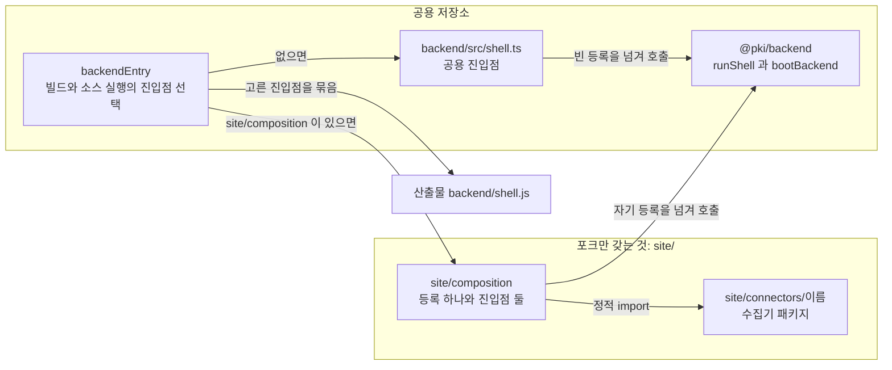
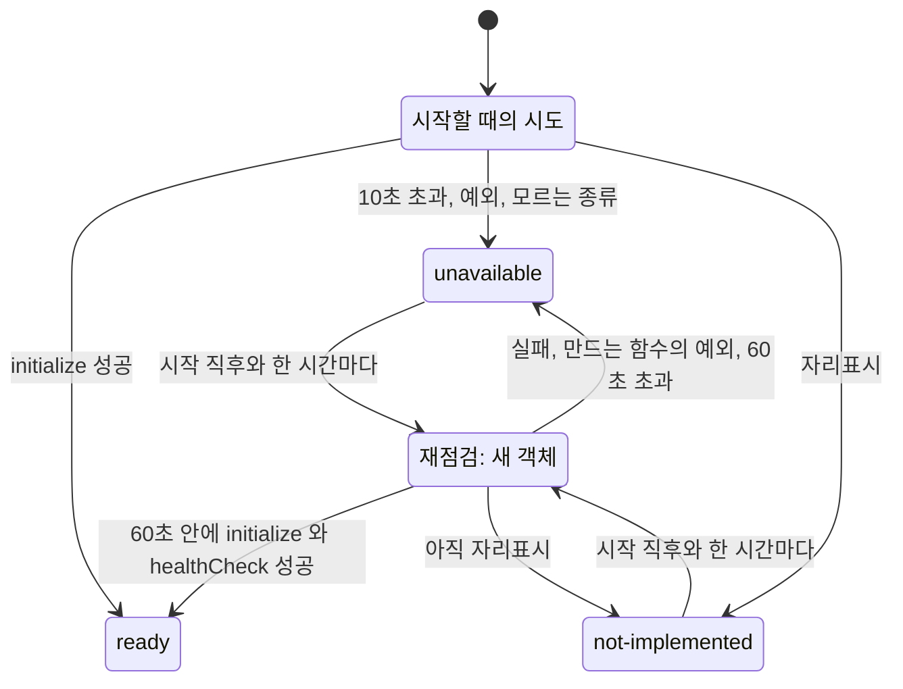

# 스펙: I05 배포처 수집기를 `site/` 안에서 등록하는 장치

- 날짜: 2026-11-22 / 상태: 확정(잠정 결정 포함). 작업 T01~T05는 구현되었으나 **이 spec은 아직 끝나지 않았다**: 공용 e2e 다섯이 포크 모양에서 실패해 C20 ③이 충족되지 않았다. I05-T06이 맡는다("I05-T05가 넘기는 것")
- 관련: 이슈 #113(이 spec), 함께 열린 #114(자격 증명)·#115(설치본의 인스턴스 범위 파일), #116(파일 인스턴스. [I02-B spec](2026-11-22-I02-local-file-import.md)이 흡수한다. 두 spec 모두 합쳐졌다: 이 spec이 PR #119, 그 spec이 PR #120), 선행 #18(I01). [I01 spec](2026-11-21-I01-connector-sdk.md)("T09가 넘기는 것", "T10이 넘기는 것"), [I03 spec](2026-11-21-I03-persistent-queue.md)(보류와 재점검), [I04 spec](2026-11-21-I04-invalidation.md)(I04-R14 접근 범위 정책), [V01 spec](2026-11-21-V01-vertical-skeleton.md)(V01-T15 산출물 검사), [ADR 0012](../adr/0012-upstream-and-fork-ownership.md), [ownership.md](../ownership.md), [connector-sdk.md](../connector-sdk.md), [site-setup.md](../site-setup.md)

낯선 말은 [ARCHITECTURE 0절](../ARCHITECTURE.md#0-처음-나오는-말)에 풀이가 있다. 이 spec에서 새로 쓰는 말은 아래 표에 있다. `I01-…`·`I03-…`·`I04-…`·`V01-…`·`I02B-…`은 그 spec의 번호, `S…`는 site-setup.md 체크리스트 번호다.

| 말 | 뜻 |
|---|---|
| 포크 | 배포처가 이 저장소를 복제해 만든 자기 저장소. 공용 저장소의 변경을 계속 받아 간다 |
| 등록(`SiteRegistration`) | 포크가 제품에 끼우는 것을 한 객체로 모은 것. 수집기 종류와 만드는 함수, 인스턴스, 등급 매핑, 접근 범위 정책이 들어간다 |
| 조립 패키지 | 포크가 `site/composition/`에 두는 작은 패키지. 등록 객체 하나와 진입점 둘을 갖는다 |
| 진입점 | 프로세스가 처음 실행하는 파일. 백엔드의 진입점은 지금 `backend/src/shell.ts`다 |
| 빌드 시점 결합 | 어떤 코드가 제품에 들어갈지를 실행 중이 아니라 빌드할 때 정하는 방식. 실행본은 자기 안에 묶인 코드만 실행한다 |
| 자리표시 | 공용 저장소가 실제 수집기 자리에 둔 `site-mail`, `site-messenger`, `site-wiki`. 실행하면 `미구현, 배포처 후속`을 알리고 실패한다 |
| 공용 종류 | 공용 코드가 수집기 종류로 쓰는 이름 가운데 자리표시가 아닌 것. 목록은 상수 하나에서 온다(I05-R7) |
| 사이트 종류 | 포크의 등록이 자기 `connectorKinds`에 적어 등록한 종류. 자리표시 이름을 대체한 것도 여기에 든다 |
| 포크 모양 | `site/composition/`과 `site/connectors/*`가 있는 저장소 트리. 공용 저장소에는 그 폴더가 없다 |

## 배경

[ownership.md 3절](../ownership.md)의 규칙은 "포크는 `site/` 안만 고친다"이다. 두 쪽이 같은 파일을 고치지 않아야 포크가 공용 변경을 받아 갈 때 충돌이 나지 않기 때문이다. 그런데 지금은 수집기를 `site/` 안에 두고도 제품에 연결할 방법이 없다. I01-T10이 확인한 대로 포크는 다음 공용 파일을 고쳐야 한다.

- `backend/src/composition.ts`: 수집기 종류 표 `connectorKinds`, 인스턴스 목록 `connectorInstances()`, 등급 매핑 `publicScopeGrading`을 쓰는 자리
- `pnpm-workspace.yaml`의 `packages:` 목록과 `backend/package.json`의 의존성
- `apps/desktop/src/layout.production.ts`의 `SCOPE_POLICY`(접근 범위 정책 이름)와 `backend/src/scope-policy.ts`의 `site` 갈래
- `pnpm install`이 바꾸는 `pnpm-lock.yaml`

시작 동작에도 빈 곳이 셋 있다.

- 백엔드는 모든 수집기의 `initialize`를 제한 시간 없이 기다린 뒤에 서비스를 시작한다. 하나가 끝나지 않으면 앱이 켜지지 않는다(`backend/src/connectors.ts`의 `createConnectorManager`).
- 만드는 함수가 예외를 던지거나 인스턴스가 표에 없는 종류를 적으면 시작이 중단된다(`unknown connector kind`).
- 한 시간마다의 재점검은 실패했던 **같은 객체**에 `initialize`를 다시 부른다. 규격 v2는 그렇게 불러도 안전하다고 약속한 적이 없다.

이 spec의 초안 뒤에 합쳐진 삭제 장부(I04-T10)에도 맞물리는 곳이 하나 있다. 시작할 때 장부의 삭제를 다시 적용하는 코드(`backend/src/boot.ts`의 `reapplyAtStart` 호출)는 "이 빌드가 아는 종류"를 `options.connectors ?? productConnectors()`의 종류와 `jsonl-import`로만 센다. 포크의 등록이 더한 종류는 거기에 없다. 그대로 두면 포크가 오래된 백업을 복원했을 때 자기 수집기의 삭제 줄이 "다시 적용하지 못한 삭제"로 건너뛰어지고, 지운 자료가 다음 동기화에서 되돌아올 수 있다.

실제 수집기는 공용 저장소에 올 수 없고([ADR 0012](../adr/0012-upstream-and-fork-ownership.md)), 가져온 내용과 수집기가 돌려주는 값은 믿을 수 없는 자료다. 그래서 이 장치는 "포크의 코드를 어떻게 싣는가"와 "실린 코드가 잘못 동작해도 제품이 켜지는가"를 함께 정해야 한다.

## 목표

- 포크가 **파일을 더하기만 해서**(`site/` 안) 수집기를 제품의 종류로 등록한다. 공용 저장소의 추적 파일 가운데 포크에서 달라지는 것은 도구가 다시 만드는 `pnpm-lock.yaml` 하나다.
- 등급 매핑(`ScopeGrading`)과 접근 범위 정책(`ScopePolicy`)도 같은 등록 객체로 들어온다.
- 수집기 하나의 `initialize`가 **비동기로 끝나지 않거나, 거부하거나, 만드는 함수가 던지거나, 모르는 종류여도** 백엔드는 정해진 시간 안에 시작하고, 그 인스턴스만 `unavailable`이 된다. 시간 제한이 막지 못하는 경우는 "신뢰 경계와 남는 위험"에 적는다.
- 재점검은 새 객체를 만들어 초기화한다. 제품은 한 객체의 `initialize`를 한 번만 부른다.
- 포크의 등록은 **공용 종류와 공용 인스턴스를 건드리지 못한다.** 공용 종류의 이름을 가져가거나 공용 종류의 인스턴스를 만들 수 없다.
- 공용 저장소의 빌드 산출물은 지금과 같다. 포크의 빌드에는 등록한 수집기가 들어가고 테스트 코드는 들어가지 않는다.
- 공용 저장소의 테스트는 포크 모양의 트리에서도 그대로 통과한다.
- 실행본은 디스크에서 코드를 찾아 읽어 들이지 않는다.

## 비목표 (배포처에서 후속 진행)

**공용 저장소의 뒤 작업으로 넘기는 것**

- 수집기에 자격 증명을 건네는 통로: #114. 이 spec은 그 값이 들어올 자리만 한 곳으로 모은다(설계 개요 "#114와 #115에 남기는 것").
- 설치본이 `site/config/connector-scopes.json`을 읽는 길: #115. **이 spec은 #115를 풀지 않는다.** 방법과 기준은 #115의 spec이 정한다(설계 개요 "#114와 #115에 남기는 것").
- `jsonl-import` 파일 인스턴스를 제품에서 설정하는 길과 경로 제한: #116. I02-B spec이 맡았다.
- 그 밖에 포크가 아직 공용 파일을 고쳐야 하는 빌드 값: 배포처 전송 규칙(`productEgress`), 묶을 Provider(`productProviders`), 검증된 CLI 조합 목록, 데이터 등급 목록. 등록 객체에 필드를 더해 옮길 수 있지만 각각 정책 판단이 따로 필요해 이 spec에서 다루지 않는다. ownership.md 3절의 그림에 있는 `site/providers/`도 같은 이유로 워크스페이스 목록에 넣지 않는다.
- 설치 스크립트가 필요한 의존성(`pnpm-workspace.yaml`의 `allowBuilds`)과 네이티브 실행 모듈(`apps/desktop/build/bundle.ts`의 `EXTERNAL_PACKAGES`)을 쓰는 수집기: 지원하지 않는다. 필요해지면 포크가 [ownership.md 5절](../ownership.md)의 방법으로 공용에 알린다.
- 브라우저 개발용 백엔드(`backend/src/dev.ts`)에 포크의 수집기를 싣는 진입점: 두지 않는다. 포크는 Electron 소스 실행으로 수집기를 본다.

**어느 작업에서도 하지 않는 것**

- **실행 중에 수집기를 설치하거나 읽어 들이는 일.** 폴더를 훑어 코드를 찾거나 경로를 조립해 동적으로 `import`하는 장치를 두지 않는다(이유는 "대안과 기각 사유" 1).
- **포크의 코드를 가두는 일(샌드박스).** 포크의 코드는 백엔드와 같은 프로세스에서 같은 권한으로 돈다("신뢰 경계와 남는 위험").
- 실제 메일·메신저·Wiki 수집기. 포크의 일이다(S01~S04).
- 규격의 변경. `Connector` 인터페이스와 `CONNECTOR_SDK_VERSION`(2)은 그대로다. 그래서 제품이 버린 수집기 객체를 닫아 주는 호출(`close` 같은 것)도 더하지 않는다.

**배포처 후속 항목**(2개. [site-setup.md의 배포처 설정 체크리스트](../site-setup.md#배포처-설정-체크리스트)와 번호로 대응한다. 번호는 조정자가 I02-B와 함께 배정했다: I02-B가 S23~S25, 이 spec이 S26·S27)

| 번호 | 항목 |
|---|---|
| S26 | 포크의 조립 패키지(`site/composition/`)를 만들고 수집기, 인스턴스, 등급 매핑, 접근 범위 정책을 등록한다. 등록 검사와 `site-check`가 통과하고, 공용 변경을 한 번 받아 와 `site/` 밖의 충돌이 `pnpm-lock.yaml`뿐임을 기록한다(수집기 의존성에 설치 스크립트가 있으면 `pnpm-workspace.yaml`의 `allowBuilds`에 더한 `false` 줄도 포함한다). 포크에서 `pnpm lint && pnpm typecheck && pnpm test`가 통과함도 함께 기록한다 |
| S27 | 포크의 빌드를 Windows 11 설치본으로 만들어 등록한 수집기가 목록에 나오고 동기화되는지, 멈추는 수집기를 넣었을 때 앱이 제한 시간 안에 켜지는지 실행하고 기록한다 |

실제 수집기의 구현과 인증은 S01~S04가, 규격 v2의 실제 확인은 S18이 이미 갖고 있으므로 다시 세지 않는다.

## 요구사항

### 결합: 포크의 코드가 제품에 들어가는 길

- **I05-R1 진입점 주입.** 백엔드의 시작 코드는 등록 객체를 인자로 받는 함수가 된다(`runShell(site)`, `runSiteCheck(site, args)`, `bootBackend`의 `site` 옵션). 공용 진입점(`backend/src/shell.ts`, `backend/src/site-check.ts`)은 빈 등록 `publicSite`를 넘겨 그 함수를 부른다. 포크는 조립 패키지에 자기 진입점을 두고 자기 등록을 넘겨 같은 함수를 부른다. 결합은 전부 정적 `import`다.
  - 등록은 **바탕 묶음 위에 합쳐진다.** 바탕은 지금처럼 `options.connectors`가 있으면 그것이고(소스 실행의 `--fixtures`, 시험이 넘기는 묶음) 없으면 `productConnectors()`다. 등록이 바탕을 통째로 바꾸거나 무시되는 일은 없다.
  - **패키지 진입점의 내보내기.** 포크가 보는 `@pki/backend`(`backend/src/index.ts`)는 포크의 파일이 쓰는 것만 내보낸다: `runShell`, `runSiteCheck`, `checkSiteRegistration`, `publicSite`, 타입 `SiteRegistration`·`SiteRegistrationCode`·`ConnectorFactory`·`ConnectorInstanceConfig`. **`bootBackend`와 그 옵션 타입은 내보내지 않는다. 서버를 띄우는 `startServer`(와 그 옵션·반환 타입)도 내보내지 않는다**(I05-T05. 이 저장소에서 `@pki/backend`로 그것을 가져오는 곳이 없었고, 등록 검사와 장부 재적용과 정책 결정을 건너뛰는 조립 함수라서 포크의 파일에 필요한 것이 아니다). 그 옵션(`connectors`, `scopePolicy`, 시험용 대체)은 등록 검사와 "설치본을 `default`로 돌리는 스위치는 없다"(I05-R15)를 건너뛰므로, 포크의 파일에 필요한 것은 진입점 둘뿐인 `runShell`·`runSiteCheck`다. 예시 패키지의 부팅 시험(C1 ①)은 진입점 파일을 경로로 띄워 본다(자식 프로세스). `backend/src`의 파일을 상대 경로로 가져오거나 `@pki/backend/<하위 경로>`로 가져오는 일은 포크 모양의 패키지(`@pki-site/*`와 `@pki/site-example`)에서 막힌다. 시험 파일도 마찬가지이며, 경계 규칙이 이를 붙잡는다(I05-R4, C4 ⑧). 시험이 내보내기 목록을 붙잡는다.
  - 어떤 이름이 공용 종류인지는 바탕이 아니라 상수(I05-R7)로 판정한다. 그래서 `--fixtures` 없이 띄울 때도 `test-fixtures`는 등록할 수 없다.
- **I05-R2 진입점 선택.** `backendEntry(root)`가 백엔드 진입점의 경로를 정한다.
  - `site/composition/package.json`이 없으면 `backend/src/shell.ts`다.
  - 있으면 `site/composition/src/shell.ts`다. 그 파일이 없으면 경로를 적은 오류로 실패한다(조용히 공용 진입점으로 떨어지지 않는다).
  - 이 판정은 빌드(`apps/desktop/build/build.ts`)와 소스 실행(`apps/desktop/src/layout.ts`)만 쓴다. 배포 빌드의 셸(`layout.production.ts`)은 지금처럼 묶인 `./backend/shell.js`만 알고, 산출물에는 이 판정 코드가 없다.
- **I05-R3 워크스페이스.** 공용 `pnpm-workspace.yaml`의 `packages:` 목록에 `site/composition`과 `site/connectors/*` 두 줄을 둔다. 공용 저장소에는 그 폴더가 없다. 그 상태에서 `pnpm install --frozen-lockfile`이 통과하고 `pnpm-lock.yaml`이 바뀌지 않아야 한다(가정 A1, I05-T01이 잰다).
  - `pnpm typecheck`는 저장소 루트의 프로젝트와, 있으면 `site/composition`과 `site/connectors/*`의 `tsconfig.json`을 함께 본다(`tooling/workspace/typecheck.ts`). 공용 `tsconfig.json`은 포크의 프로젝트를 적지 않는다.
  - `site/` 아래 패키지에 `tsconfig.json`이 없으면 타입 검사 실행기가 그 패키지 이름을 적어 실패한다(조용히 빼지 않는다).
  - `tooling/workspace/tsconfig-references.test.ts`는 그 폴더가 없어도 통과하고, 있으면 포크 패키지의 의존성 참조도 본다.
  - `pnpm-lock.yaml`의 `importers` 가운데 `site/`로 시작하는 항목은 디스크에 있는 포크 패키지와 정확히 같다(공용 저장소에서는 양쪽 다 0개). 시험이 붙잡는다. 디스크에 없는 패키지의 항목이 남아 있으면 시험이 실패하고, 고치는 법은 그 항목을 손으로 지우는 것이다(의존성이 없는 패키지가 남긴 빈 항목 `site/connectors/x: {}`은 `pnpm install`이 지우지 못한다. I05-T01). 디스크에 있는데 항목이 없으면 `pnpm install`을 실행한다.
  - `tooling/docs/readme-commands.test.ts`(워크스페이스 패키지의 스크립트가 README나 site-setup에 적혀 있는지 보는 시험)는 지금 글롭의 부모 폴더가 없으면 예외로 끝난다. 두 줄을 더하면 공용 저장소에서 바로 실패하므로, 부모 폴더가 없는 글롭은 건너뛰게 고친다. 그리고 `site/` 아래 패키지의 스크립트는 이 시험의 "공용 문서에 적혀 있어야 한다"에서 뺀다(포크의 명령은 포크가 자기 문서에 적는다. 넣어 두면 포크가 공용 README를 고쳐야 통과한다). 공용 예시 `@pki/site-example`의 스크립트는 빼지 않고 공용 문서에 적는다.
  - `pnpm lint`와 `pnpm test`가 보는 범위는 지금도 `site/`를 포함한다. 이 spec은 그 범위를 바꾸지 않는다.
- **I05-R4 이름과 경계 규칙.** 포크의 패키지 이름은 `@pki-site/`로 시작한다(조립 패키지 `@pki-site/composition`, 수집기 `@pki-site/connector-<이름>`). 모듈 경계 규칙(`tooling/eslint/module-boundary.js`)은 이 범위를 `@pki/`와 같게 다룬다.
  - 수집기 구현은 자기 패키지의 `src/adapters/`에 두고 `<패키지>/adapters` 진입점으로만 내보낸다(지금 규칙 그대로).
  - 그 진입점을 가져올 수 있는 조립 지점에 **두 파일**을 더한다: `@pki-site/composition`의 `src/registration.ts`와 공용 예시 `@pki/site-example`의 `src/registration.ts`(패키지 이름과 파일을 함께 본다). 같은 패키지의 다른 파일은 지금처럼 막힌다. 예시 패키지가 없으면 공용 저장소에서 이 장치를 증명할 방법이 없고, 규칙에 넣지 않으면 예시가 `pnpm lint`를 통과하지 못한다.
  - 조립 지점의 이름 `@pki-site/composition`은 폴더 `site/composition`의 패키지에만 통한다(같은 이름을 단 수집기 패키지의 `registration.ts`는 조립 지점이 아니다).
  - 패키지 밖을 가리키는 상대 경로 가운데 허용되는 것은 표 하나(`RELATIVE_ALLOWED`, 항목 `{pkg, target}`)가 정한다. 항목은 그 패키지가 가리키는 **해석된 경로**가 `resolve(패키지 폴더, target)`과 정확히 같을 때만 그 파일 하나를 연다(글자가 아니라 해석된 경로를 비교한다). 표는 비어 있고 항목은 그것을 필요로 하는 작업(I07)이 더한다.
  - 공용 패키지는 `@pki-site/*`를 가져오거나 의존성으로 적지 못한다. 방향은 언제나 포크 → 공용이다.
  - 경계 규칙은 패키지 이름으로 포크의 것을 알아본다. 그래서 `site/` 아래의 패키지가 `@pki/…` 이름을 쓰면 규칙을 벗어난다. 이를 막으려고 `site/composition`의 이름은 `@pki-site/composition`, `site/connectors/*`의 이름은 `@pki-site/`로 시작해야 한다는 검사를 둔다(`tooling/workspace/`의 시험. 공용 저장소에서는 볼 패키지가 없어 통과한다).
  - **글자 `@pki-site/`는 워크스페이스에 든 공용 패키지에 나오지 않는다**(`apps/*`, `backend`, `knowledge-engine`, `providers`, `storage`, `packages/*`의 소스, `package.json`, `tsconfig.json`. 테스트 파일도 소스다). 이 이름을 알아야 하는 것은 `tooling/` 아래(경계 규칙, 워크스페이스 검사와 그 시험)와 문서다. 그래서 공용 패키지의 시험 픽스처는 `@pki-site/`가 아닌 이름을 쓴다(예: `site-check`의 안내를 보는 시험이 임시 루트에 만드는 조립 패키지의 이름). 공용 코드는 포크 패키지의 이름을 알 필요가 없어야 하기 때문이다(I05-R19도 이름을 적지 않고 읽어 온다).
- **I05-R5 lockfile.** 포크의 `pnpm-lock.yaml`은 `pnpm install`이 더한 것(포크 패키지의 `importers` 항목과 그 외부 의존성)만 공용과 다르다. 손으로 고치지 않는다. 공용 변경을 받아 올 때 이 파일이 충돌하면 공용 쪽 내용을 취하고 `pnpm install`을 다시 실행한다(가정 A3). 이 절차와 "`site/` 밖에서 달라지는 추적 파일은 이 파일이고, 예외는 아래 하나다"라는 점을 문서에 적는다(I05-R21). 예외: 포크 의존성에 설치 스크립트가 있으면 `pnpm install`이 `ERR_PNPM_IGNORED_BUILDS`로 실패하고, 그 실패한 실행이 `pnpm-workspace.yaml`의 `allowBuilds`에 `<패키지>: set this to true or false` 줄을 스스로 써 넣는다. 포크는 그 줄을 `false`로 고친다(스크립트를 돌리지 않는다는 이 spec의 전제와 같은 값이고, I05-T01이 잰 값은 이것뿐이다. "I05-T01이 넘기는 것" 2). 스크립트가 정말 필요한 의존성(`true`)은 비목표(설치 스크립트가 필요한 의존성은 지원하지 않는다)이므로 ownership.md 5절로 공용에 알린다. 문서에 이 경우도 적는다(I05-R21). 포크 수집기의 의존성은 레지스트리에서 받는 것이어야 한다는 점도 함께 적는다(공용 시험 `tooling/workspace/lockfile-registry.test.ts`가 git·tarball·로컬 주소를 거부하고, 그 시험은 포크에서도 돈다).

### 등록 계약

- **I05-R6 등록 객체.** `SiteRegistration`은 다음 필드를 갖는다. 전부 선택이고, 빈 객체가 공용 저장소의 등록 `publicSite`다.

  | 필드 | 뜻 | 없을 때 |
  |---|---|---|
  | `connectorKinds` | 종류 이름 → 수집기를 새로 만들어 돌려주는 함수(`ConnectorFactory`) | 바탕 묶음의 종류만 |
  | `connectorInstances` | 시작할 때의 인스턴스(`id`, `kind`, `config`) | 바탕 묶음의 인스턴스만 |
  | `scopeGrading` | 접근 범위 → 데이터 등급 매핑(S08) | `publicScopeGrading` |
  | `scopePolicy` | 접근 범위 정책(S21) | 공용 기본 정책 |

  이 표 뒤에 [I07 spec](2026-11-22-I07-installed-scopes-file.md)(I07-R1)이 선택 필드 `connectorScopes`(인스턴스 범위, 없으면 모든 인스턴스가 알 수 없음)를 더했다.

- **I05-R7 종류 이름.**
  - 이름은 `^[a-z][a-z0-9-]{0,63}$`를 따른다. 삭제 장부가 종류에 요구하는 규칙과 같은 것이며(`storage/src/tombstone-ledger.ts`의 `isKind`, [connector-sdk.md](../connector-sdk.md) 4장 "삭제 장부"), 이 규칙을 벗어난 종류의 원본은 지울 수 없게 된다. 두 곳이 **한 상수**를 쓰도록 그 모양을 `@pki/contracts`로 옮겨 내보낸다.
  - **공용 종류는 등록할 수 없다**(`kind-reserved`). 공용 종류의 목록은 **상수 하나**(`PUBLIC_CONNECTOR_KINDS`, 잠정 이름)에서 온다. 이 상수는 공용 코드가 수집기 종류로 쓰는 이름 가운데 자리표시가 아닌 것 전부다: 공용 구성 지점이 등록하는 종류, 가져오기가 정본에 적는 종류(`JSONL_IMPORT_KIND`), 소스 실행과 시험 전용 종류. 지금 값은 `jsonl-import`와 `test-fixtures`다. **이 spec은 그 값을 고정하지 않는다.** 공용이 종류를 더하면(예: I02-B의 `local-files`) 상수에 더하는 것만으로 예약되고 이 spec과 그 기준은 바뀌지 않는다. 상수에 더하기를 잊으면 시험이 실패한다(I05-C14).
  - 예약이 필요한 까닭: 공용 종류는 제품이 따로 지키는 약속을 갖고 있다. `test-fixtures`는 Broker가 합성 등급으로 믿는 종류라서 포크의 수집기가 이 이름을 가지면 실제 자료가 합성으로 매겨진다. `jsonl-import`와 I02-B의 종류는 사용자의 경로 승인을 거쳐야만 파일을 읽는다.
  - 자리표시 이름 셋은 **같은 이름으로 등록해 대체할 수 있다**(ownership.md 2절의 약속 그대로). 대체하지 않은 자리표시는 종류와 인스턴스가 그대로 남아 `미구현, 배포처 후속`을 알린다.
  - 그 밖의 새 이름은 추가된다. 바탕 묶음이 이미 가진 이름(시험이 넘긴 묶음의 종류)을 등록하면 그 종류를 대체한다.
  - 만드는 함수가 돌려준 객체의 `manifest.type`은 종류 이름과 같아야 한다.
- **I05-R8 인스턴스.** 등록의 인스턴스는 **사이트 종류의 것만** 만들 수 있다.
  - `id`는 제품의 기존 한도를 따른다: 1자 이상 128자 이하(`@pki/contracts`의 `MAX_INSTANCE_ID_LENGTH`). 삭제 장부와 가져오기가 쓰는 한도와 같은 것이며, 등록을 위한 두 번째 규칙을 만들지 않는다. 등록 안에서 서로 달라야 한다.
  - `kind`는 **이 등록이 등록한 종류**(대체한 자리표시 이름 포함)여야 한다.
    - 공용 종류나 대체하지 않은 자리표시 이름을 적으면 `instance-kind-reserved`다. 포크가 `jsonl-import`나 `local-files`의 인스턴스를 등록으로 만들면 사용자의 경로 승인을 건너뛰게 되고, `test-fixtures`의 인스턴스를 만들면 합성 등급을 얻게 되기 때문이다.
    - 등록이 등록하지 않았지만 바탕 묶음에 있는 그 밖의 종류(시험이 넘긴 묶음의 종류)도 `instance-kind-reserved`다. 등록이 등록하지 않은 종류는 바탕에 있으면 모두 이 코드다.
    - 바탕에도 없는 이름을 적으면 `instance-kind-unknown`이다(오타에 해당한다).
  - `id`는 **공용 인스턴스의 ID**와 겹칠 수 없다(`instance-id-reserved`). 공용 인스턴스의 ID는 공용 종류 상수와 같은 모듈의 판정 함수 하나(`isPublicInstanceId`, 잠정 이름)가 답한다: 공용 구성 지점이 만드는 인스턴스의 ID(지금은 소스 실행의 `fixtures`)와 공용이 예약한 접두사, 그리고 **대체하지 않은** 자리표시의 ID. 바탕 묶음이 가진 인스턴스의 ID(시험이 넘긴 묶음의 것)도 같은 코드다. 자리표시 종류를 대체했다면 그 ID(`site-mail` 등)는 포크가 쓸 수 있다. 대체한 자리표시 종류의 인스턴스는 포크가 적은 것만 쓴다.
  - 두 `…-reserved` 위반은 **시작을 멈춘다**(I05-R9). 그 인스턴스만 빼고 계속 띄우는 쪽도 안전하지만, 이 둘은 등록 객체만 보고 판정되는 **빌드 전의 실수**이고 공용이 지키는 약속을 넘는 시도라서 조용히 넘기지 않는다.
  - 사용자가 가져오기로 만든 인스턴스의 ID는 실행 중에 생기므로 위 판정으로 막을 수 없다. 그 겹침은 정본의 기존 규칙이 맡는다(I05-R12).
- **I05-R9 등록 검사.** `checkSiteRegistration(site)`는 위반을 **코드의 목록**으로 돌려준다(한 위반마다 한 코드). 문구나 수집기가 준 글은 싣지 않는다. 두 번째 인자로 바탕 묶음을 받을 수 있고, 없으면 `productConnectors()`다. 합치기만 하는 `mergeSiteRegistration(site, base)`가 구조 검사 코드와 합친 묶음을 돌려주고, 시작은 그것을 쓴다(만드는 함수나 매핑을 부르지 않는다).

  | 코드 | 잡는 것 | 시작할 때 |
  |---|---|---|
  | `kind-name-invalid` | 이름 모양 위반 | 그 종류를 등록하지 않고 계속한다 |
  | `kind-reserved` | 공용 종류 이름 | 등록하지 않고 공용 것을 그대로 둔 채 계속한다 |
  | `instance-id-invalid` | 인스턴스 `id`가 한도 밖 | 그 인스턴스를 빼고 계속한다 |
  | `instance-id-duplicate` | 같은 `id`가 둘 이상 | 첫 것만 쓰고 계속한다 |
  | `instance-kind-unknown` | 어디에도 없는 종류의 인스턴스 | 그 인스턴스를 `unavailable`로 두고 계속한다(I05-R11) |
  | `instance-kind-reserved` | 공용 종류나 대체하지 않은 자리표시의 인스턴스 | **시작을 멈춘다** |
  | `instance-id-reserved` | 공용 인스턴스의 ID | **시작을 멈춘다** |
  | `kind-factory-threw` | 만드는 함수가 예외를 던짐 | 검사에서만(시작할 때는 I05-R11이 인스턴스 단위로 다룬다) |
  | `kind-manifest-mismatch` | `manifest.type`이 종류 이름과 다름 | 검사에서만 |
  | `scope-grading-invalid` | 매핑이 허용된 등급 밖을 답하거나, `strictest([])`·`grade(null)`이 가장 엄격한 등급이 아님 | 검사에서만(Broker가 호출마다 닫힌 쪽으로 거절한다) |

  이 표 뒤에 [I07 spec](2026-11-22-I07-installed-scopes-file.md)(I07-R5)가 `connector-scopes-field-invalid`와 `connector-scopes-entry-invalid` 두 행(둘 다 검사에서만)을 더했다. I05-C6 ②의 "열 코드"는 이 표의 I05가 정한 열 코드를 뜻한다.

  - **빼고 계속하는 넷**(`kind-name-invalid`, `kind-reserved`, `instance-id-invalid`, `instance-id-duplicate`)은 로그에 `site-registration-rejected`와 코드, 건수를 한 번 남긴다.
  - **`instance-kind-unknown`**은 빠지는 것이 없으므로 `site-registration-rejected`에 세지 않는다. 그 인스턴스마다 `connector-kind-unknown` 한 줄만 남는다(I05-R11). 한 사건에 로그 코드는 하나다.
  - **시작을 멈추는 둘**은 백엔드가 고정된 사유 `site-registration-invalid`로 시작 실패를 알린다. 부모(셸)에게 보내는 실패 알림은 이 사유 하나다(형식 `{type, reason}`은 그대로이고 필드를 더하지 않는다). 코드와 건수는 표준 오류의 한 줄(`startFailureLine`: `backend start failed: site-registration-invalid` 다음에 건수가 있는 코드만 `instance-kind-reserved=<건수>`, `instance-id-reserved=<건수>` 순으로)과 로그(`site-registration-invalid`에 코드와 건수, 코드마다 한 줄)에만 남기고, 어디에도 등록이 적은 글은 싣지 않는다. 사유 목록은 세 곳에 있어 셋 모두에 이 값을 더한다: 백엔드의 `backend/src/start-failure.ts`, 셸의 타입 `StartFailureReason`과 받은 메시지를 검사하는 목록(둘 다 `apps/desktop/src/backend-process.ts`). 사유별 화면 문구(`apps/desktop/src/start-failure-text.ts`)에도 한 줄을 더한다. 일부만 띄운 채 계속하는 일은 없다.
  - `runSiteCheck`도 시작을 멈추는 두 위반이 있는 등록을 ok로 알리지 않는다: 같은 코드와 건수를 표준 오류에 한 줄로 알리고 1로 끝난다.
  - `scope-grading-invalid`가 묻는 것은 정해져 있다: `grade(null)`, `grade([])`, `strictest([])`, 허용된 등급 전부를 넣은 `strictest`. 답이 허용된 등급(`SCOPE_CLASSES`) 안에 있어야 하고 앞의 셋은 가장 엄격한 등급이어야 한다. 실제 범위 값마다의 답은 검사할 수 없어 Broker의 호출별 거절이 맡는다.
  - `kind-reserved`로 등록되지 않은 종류의 인스턴스는 공용 종류를 가리키게 되므로 `instance-kind-reserved`다. 즉 공용 종류의 이름으로 인스턴스까지 만든 등록은 시작하지 못한다.

### 시작 동작

- **I05-R10 `initialize` 시간 제한.** 시작할 때 인스턴스들은 함께 초기화되고, 각각 `INITIALIZE_TIMEOUT_MS`(잠정 10초) 안에 끝나지 않으면 `unavailable`이 된다. 백엔드는 그 시간 안에 서비스를 시작한다. 제한을 넘긴 시도가 나중에 성공하거나 실패해도 그 결과는 상태를 바꾸지 않는다. 이 제한은 **비동기로 기다리는 시간**만 잰다. 수집기가 동기 코드로 멈추면 타이머가 돌지 못한다("신뢰 경계와 남는 위험").
- **I05-R11 한 인스턴스의 실패는 그 인스턴스만.** 만드는 함수가 던짐, `initialize`가 던짐, 제한 시간 초과, 모르는 종류의 네 경우 모두 시작은 계속되고 그 인스턴스만 `unavailable`이다.
  - 그 인스턴스의 동기화 요청은 `connector-unavailable`로 답한다.
  - 그 인스턴스의 수집 작업은 사유 `connector-unavailable`로 보류된다(I03-R16의 기존 동작).
  - 로그에는 정해진 코드와 인스턴스 `id`만 남는다: `connector-initialize-timeout`, `connector-factory-failed`, `connector-initialize-failed`(`initialize`가 예외를 던짐. 시작할 때만 남기고 재점검에서는 남기지 않는다), `connector-kind-unknown`. 수집기가 던진 글은 남기지 않는다.
  - `ConnectorNotImplementedError`는 지금처럼 `not-implemented`다.
- **I05-R12 저장된 자료와의 어긋남.** 정본에 남은 것이 지금 등록과 맞지 않아도 시작은 끝난다.
  - 정본의 인스턴스 행, 주기, 작업이 지금 등록에 없는 종류나 인스턴스를 가리키면 그 작업은 지금처럼 `instance-not-found`로 닫힌다(I03의 기존 동작. 이 spec은 바꾸지 않고 시험으로 붙잡는다).
  - 등록의 인스턴스 ID가 정본에 **이미 다른 종류로 묶여 있으면**(예: 사용자가 같은 ID로 JSONL을 가져온 적이 있다) 시작은 끝나고 그 인스턴스의 동기화만 실패한다. 정본은 한 ID를 한 종류에만 묶고(`storage/src/sources.ts`의 `registerConnectorInstance`), 가져오기는 설정된 다른 종류 수집기의 ID에 묶지 못한다(`backend/src/imports.ts`). 이것도 기존 동작이며, 그 실패가 다른 인스턴스로 번지지 않음을 시험으로 붙잡는다.
  - **삭제 장부의 재적용은 합친 종류를 안다.** 등록의 검사와 합치기는 장부 재적용(`reapplyAtStart`)보다 **먼저** 끝나고, 재적용이 "아는 종류"로 치는 것은 **합친 종류 표의 이름**(바탕 묶음의 종류와 거르기를 통과한 사이트 종류)과 `jsonl-import`다. 시작을 멈추는 등록 위반(I05-R9)은 장부와 정본을 건드리기 전에 멈춘다. 걸러진 종류와, 이 실행의 바탕에 없는 `test-fixtures`는 아는 종류에 넣지 않는다(망가진 줄이 인스턴스를 엉뚱한 종류에 묶지 못하게 하는 기존 보호를 넓히지 않는다).
  - **모르는 종류의 장부 줄은 조용히 사라지지 않는다.** 인스턴스 행이 없고 종류도 모르는 줄은 지금처럼 인스턴스를 만들지 않고(닫힌 쪽), "다시 적용하지 못한 삭제" 건수로 세어 상태 화면과 장부 이력에 남는다(I04-T10의 기존 동작. `knowledge-engine/src/ledger-reapply.ts`의 `unrecoverable`). 이 spec은 그 동작을 바꾸지 않고, 포크의 종류가 등록된 빌드에서는 그 줄이 **재적용됨**을 시험으로 붙잡는다. 남는 위험은 미해결 질문 6에 있다.
- **I05-R13 재점검은 새 객체.** 준비되지 않은 인스턴스의 재점검은 만드는 함수를 다시 불러 **새 객체**를 만들고, 그 객체를 초기화한 뒤 `healthCheck`를 묻는다.
  - 둘 다 성공하면 그 인스턴스가 새 객체로 바뀌고 `ready`가 된다. 아니면 새 객체를 버리고 `unavailable`로 남는다.
  - 만드는 함수가 재점검에서 던지면 `unavailable`로 남고 `connector-factory-failed`만 남는다. 재점검 차례 전체는 계속된다.
  - 종류가 없는 인스턴스(`instance-kind-unknown`)는 만드는 함수가 없으므로 재점검에서 아무것도 부르지 않고 `unavailable`로 남는다. 로그는 시작할 때의 한 줄뿐이다.
  - 제품은 한 객체의 `initialize`를 한 번만 부른다. `ready`인 인스턴스의 객체는 바꾸지 않는다.
  - 끝나지 않은 재점검이 있는 인스턴스는 다시 시작하지 않는다(`RECHECK_TIMEOUT_MS` 60초와 함께 기존 동작).
  - **60초를 넘겨 끝난 재점검의 결과는 버린다.** 시작할 때의 규칙(I05-R10)과 같은 규칙 하나다. 결과는 그것을 기다리고 있는 차례만 받는다. 그래야 "준비됨으로 바뀜"과 "보류된 작업을 풂"이 언제나 같은 자리에서 함께 일어난다. 지금 코드는 늦은 결과를 받아 상태만 바꾸므로 이것은 **동작의 변경**이다. 초기화에 60초가 넘게 걸리는 수집기는 준비되지 못한다(바꾸려면 `RECHECK_TIMEOUT_MS`).
  - 제한을 넘긴 시도가 아직 돌고 있어도 다음 재점검은 새 객체를 만든다. 시작 때의 시도를 "끝나지 않은 재점검"으로 쳐서 기다리게 하지 않는 까닭은, 그러면 10초를 조금 넘기는 멀쩡한 수집기가 한 시간 뒤에야 준비되기 때문이다. 그래서 **같은 인스턴스의 두 객체가 동시에 초기화 중일 수 있다.** 한 인스턴스에 남을 수 있는 **끝나지 않은** 객체는 많아야 둘이다(시작 때의 것 하나, 재점검의 것 하나. 재점검은 앞의 것이 끝나야 다시 시작한다). 규격 v2에는 취소나 닫기가 없으므로 제품은 버린 객체를 정리하지 못한다. 그래서 **늦게 끝나 버려진 객체**(성공했든 실패했든)는 닫히지 않은 채 남고, 그대로 두면 재점검 차례마다 하나씩 쌓인다. 초기화가 60초를 넘는 수집기가 대표적이다. 이것은 알려진 한계이며, 쌓이는 수에 끝을 두려고 **늦은 결과를 버린 재점검이 연달아 `RECHECK_LATE_LIMIT`(잠정 3)번이면 그 인스턴스의 재점검을 그만두고 다시 시작할 때까지 `unavailable`로 둔다**(로그 `connector-recheck-abandoned`와 인스턴스 `id`. 제한 안에 끝난 재점검이 한 번 있으면 수를 다시 센다). 그러면 한 인스턴스에 늦게 끝나 버려진 객체는 시작 때의 것 하나와 재점검의 것 셋을 넘지 않는다. 수집기 작성자 안내(connector-sdk.md)에 "`initialize`는 같은 설정의 다른 객체가 동시에 초기화 중일 수 있음을 전제로 한다(혼자만 잡는 잠금 파일이나 포트를 쓰지 않는다)"를 적는다.

### 등급 매핑과 접근 범위 정책

- **I05-R14 등급 매핑.** 등록의 `scopeGrading`이 있으면 Broker가 그것을 쓴다. 빌드 종류와 무관하다. 없으면 `publicScopeGrading`이다. 테스트 빌드 전용 주입(`bootBackend`의 `scopeGrading`)은 지금처럼 테스트 빌드에서만 듣고, 둘 다 있으면 등록의 것이 이긴다. 공용의 등급은 일반 하나(`SCOPE_CLASSES`)라서 결과만 보아서는 어느 매핑이 쓰였는지 알 수 없다. 그래서 시험은 호출을 기록하는 매핑으로 확인한다.
- **I05-R15 접근 범위 정책.** 정책은 이름과 등록으로 정해진다.

  | 넘어온 이름 | 등록에 `scopePolicy`가 | 결과 |
  |---|---|---|
  | 없음 | 있음 | 등록의 정책 |
  | 없음 | 없음 | 공용 기본 정책 |
  | `default` | 무관 | 공용 기본 정책(소스 실행에서만 줄 수 있는 이름이다. 포크 개발자가 실제 자료로 이 이름을 쓰면 아무것도 거부하지 않는 공용 기본 정책이 쓰인다. 개발 편의로 일부러 남긴다) |
  | `site` | 있음 | 등록의 정책 |
  | `site` | 없음 | `미구현, 배포처 후속`으로 시작을 멈춘다(지금과 같다) |
  | 그 밖 | 무관 | 모르는 이름 오류로 시작을 멈춘다(지금과 같다) |

  배포 빌드는 이름을 넘기지 않는다. `layout.production.ts`의 `SCOPE_POLICY` 상수와 배포 빌드 백엔드의 `--scope-policy` 인자를 없앤다. 그래서 정책을 등록한 포크의 설치본은 언제나 그 정책을 쓰고, 설치본을 `default`로 돌리는 스위치는 없다. 이름은 소스 실행(`PKI_SCOPE_POLICY`)에만 남는다. 이것은 I04-R14의 "이름이 없으면 기본"을 "이름이 없으면 등록의 정책, 등록에 없으면 기본"으로 고치는 것이다.

### 산출물과 공용 전용 검사

- **I05-R16 공용 빌드는 그대로.** 공용 진입점 `backend/src/shell.ts`를 묶으면 묶음에 남은 모듈에 `site/`, `packages/site-example/`, `packages/connector-example/` 아래의 것이 없다. 빈 등록으로 띄운 제품의 종류와 인스턴스는 `productConnectors()`가 주는 것과 같다. 이 spec은 제품의 종류가 **무엇인지**를 고정하지 않는다(그것은 종류를 더하는 spec의 몫이다).
- **I05-R17 포크 빌드는 등록한 것만.** 조립 패키지의 진입점을 묶으면 등록과 그 수집기의 모듈이 들어가고, 테스트 파일과 `@pki/testkit`은 들어가지 않는다. 등록이 테스트 모듈에 닿으면 빌드가 실패한다(V01-T15의 경로 규칙이 `site/`에도 그대로 걸린다). 공용 묶음이 지키는 나머지 규칙(`apps/desktop/build/bundle.ts`의 `DROPPED_MODULES`, 테스트 빌드 표지 검사)도 이 묶음에 똑같이 적용된다. 소스 실행용 모듈의 교체(`REPLACEMENTS`)도 같다: 포크 진입점이 부르는 셸 본체는 `shell-options.production.ts`를 받으므로 이 묶음의 진입점은 `--scope-policy`와 `--fixtures`를 받지 않는다(I05-R15의 "설치본을 `default`로 돌리는 스위치는 없다"가 포크의 빌드에서도 성립한다). 수집기 패키지의 의존성이 네이티브 모듈이면 묶기가 실패한다(`EXTERNAL_PACKAGES`에 든 이름은 제외. 그대로 두면 빌드가 조용히 지나간다, I05-T01).
- **I05-R18 읽어 들이는 코드 없음.** 제품 코드(`backend/src`, `apps/desktop/src`, `knowledge-engine/src`, `storage/src`, `providers/src`)에는 `site/` 아래를 폴더로 훑거나 동적으로 `import`·`require`하는 코드가 없다. **정해진 경로 하나가 있는지 보거나 그 JSON을 읽는 것**은 여기에 들지 않는다: `backendEntry`의 `site/composition/package.json` 확인, `site-check`의 그 파일 읽기(I05-R19), 기존의 `site/config/connector-scopes.json` 읽기(이 읽기는 I07-T02 뒤에 없어진다. I07-R2). `checkPublicOnly`가 보는 범위와 자리 표시 목록(`site/README.md` 하나)은 바뀌지 않고, 공용 저장소와 포크 양쪽에서 통과한다.
- **I05-R19 `site-check`의 안내.** 조립 패키지가 있는 저장소에서 공용 명령 `pnpm --filter @pki/backend site-check`를 실행하면, 자리표시의 결과를 내는 대신 포크의 명령을 알리고 2로 끝난다. 포크가 구현한 종류에 `미구현`이 나오는 오해를 막는다.
  - 공용 코드는 포크 패키지의 이름을 적어 두지 않는다. `site/composition/package.json`의 `name`을 읽어 `pnpm --filter <그 이름> site-check <종류>`를 알린다. 그 값이 패키지 이름의 모양이 아니거나 읽을 수 없으면 이름 없이 "`site/composition`의 `site-check`를 실행하라"는 안내만 낸다.
  - 저장소 루트는 인자로 받는다(I05-R25). 공용 진입점 `site-check.ts`는 실행 파일이라 가져올 수 없으므로, 안내와 `runSiteCheck(site, args)`는 `backend/src/site-check-main.ts`에 있고 포크의 `site-check.ts`는 `@pki/backend`에서 `runSiteCheck`를 가져온다.

### 공용 쪽 계약 테스트와 포크가 돌리는 것

- **I05-R20 예시 조립 패키지.** 공용 저장소에 `packages/site-example/`(`@pki/site-example`)을 둔다. 포크가 `site/composition/`에 쓸 것과 같은 모양(등록, 진입점 둘, 등록 검사 테스트)이며 수집기로 `@pki/connector-example`을 등록한다. 제품에는 들어가지 않는다. 이 패키지로 I05-R1, R6~R9, R14, R15, R17을 공용 저장소에서 시험한다. 문서의 코드 블록은 이 패키지의 발췌다. 다른 공용 패키지는 이 패키지를 의존성, `tsconfig` 참조, `import` 지정자 어디에도 적지 않는다(시험이 경로로 진입점 파일을 가리키는 것은 괜찮다). 예시 수집기 패키지(`@pki/connector-example`)를 의존성으로 갖는 워크스페이스 패키지는 이 예시 하나다(그 패키지의 "의존성이 아니다" 시험이 이 하나를 예외로 둔다).
- **I05-R21 포크의 명령.** 문서에 다음을 적는다. 수집기를 등록하기 전에 그 수집기의 계약 묶음(`connectorContract`)이 통과해야 한다는 것은 **문서의 절차**이며 빌드가 강제하지 않는다(계약 묶음에는 수집기마다 지어낸 원 시스템이 필요하고, 그것은 수집기 자신의 테스트만 갖는다).

  ```sh
  pnpm install
  pnpm lint && pnpm typecheck && pnpm test
  pnpm --filter @pki-site/composition site-check <종류>
  pnpm --filter @pki/desktop build
  ```

  예시 패키지의 `package.json`은 포크의 조립 패키지가 가질 것과 같은 이름의 스크립트(`site-check`)를 갖는다.

### 문서

- **I05-R22 connector-sdk.md.** 6장의 "`site/connectors/`에 두려면" 항목, 7장, 11장의 #113 행, 5장의 재점검 문장을 새 장치로 고친다. 7장은 포크가 더하는 파일의 목록과 예시 패키지의 발췌, I05-R21의 명령, lockfile 절차(설치 스크립트가 있는 의존성이면 `allowBuilds`도 달라지고 그 줄을 포크가 `false`로 고쳐야 한다는 점 포함), "신뢰 경계와 남는 위험"의 요약(포크의 코드는 가둬지지 않는다, 시간 제한이 막지 못하는 것, I05-R13의 동시 초기화 전제, 버려진 객체는 닫히지 않으며 늦은 재점검이 연달아 세 번이면 다시 시작할 때까지 재점검을 그만둔다는 점, 수집기 종류를 뺀 빌드로 백업을 복원하지 않는다는 주의)을 갖는다. I02-B가 고친 #116 관련 문장은 되살리지 않는다(I02B-C36이 계속 통과한다).
- **I05-R23 ownership.md.** 3절의 폴더 그림에 `site/composition/`을 더하고, "현재의 예외" 문단을 줄인다. 남는 것은 `pnpm-lock.yaml`(도구가 만든 변경만), `pnpm-workspace.yaml`의 `allowBuilds`에 포크 의존성을 위해 더한 `false` 줄(`packages:` 목록은 포함하지 않는다), #114, #115와 이 spec의 비목표에 적은 빌드 값이다. #116은 I02-B가 닫으므로 이 spec은 그 문단에 #116이 있어야 한다고도 없어야 한다고도 요구하지 않는다.
- **I05-R24 site-setup.md와 ADR.** "빌드할 때 정해지는 것" 표의 수집기 인스턴스 행과 접근 범위 정책 이름 행, S08의 매핑을 끼우는 자리, S21의 구현 방법 ②③을 등록 객체로 고친다. 체크리스트에 S26·S27을 넣고 번호 범위 안내에 이 spec을 더한다. 결합 방식의 결정은 새 ADR에 남기고 `docs/README.md` 색인에 올린다. ADR 번호는 I02-B의 ADR 바로 다음이다(지금 마지막이 0016이므로 I02-B가 0017, 이 spec이 0018. I02-B의 번호가 달라지면 그 다음 번호).

### 포크 모양에서의 공용 시험

- **I05-R25 공용 시험은 포크 모양에서도 통과한다.** 포크는 공용의 테스트 파일을 고치지 않고 `pnpm test`를 돌린다(I05-R21). 그러므로 `site/`가 있느냐로 결과가 달라지는 공용 시험이 있어서는 안 된다.
  - `site/`의 존재로 동작이 갈리는 코드는 **저장소 루트를 인자로 받는다**: `backendEntry`, `site-check`의 안내, 타입 검사 실행기의 프로젝트 찾기, 참조 검사, README 명령 검사(`readme-commands`)의 패키지 찾기, lockfile의 `importers` 검사, 포크 패키지 이름 검사. 이 목록은 닫혀 있고, 더할 때 이 요구사항을 고친다.
  - 그 코드의 시험은 실제 저장소 루트가 아니라 **임시 폴더를 루트로** 써서 세 모양(`site/` 아래에 안내문뿐인 트리, `site/connectors`만 있는 트리, 조립 패키지까지 있는 트리)을 모두 본다. 공용 시험은 `site/`의 폴더가 **있어도 없어도** 통과해야 한다. 기존 `backend/src/site-check.test.ts`의 세 경우도 조립 패키지가 없는 임시 루트로 실행한다.
  - 실제 저장소 루트로 돌 수밖에 없는 검사(산출물 e2e, lockfile 검사, 참조 검사의 실제 실행)는 **두 모양에서 모두 참인 것만** 단언한다. "묶음에 `site/`의 모듈이 없다"는 공용 진입점을 **직접 지정한** 묶음에서만 단언한다(I05-R16).

**이 절을 줄이면**: 포크는 `site/composition/`에 등록 하나와 진입점 둘을 두고, 빌드가 그 진입점을 고른다. 등록은 사이트 종류와 그 인스턴스만 더할 수 있고, 공용 종류에 손을 대는 등록은 시작하지 못한다. 그 밖의 잘못된 항목과 멈추는 수집기는 그 항목만 빠진다. 공용 빌드와 공용 시험은 달라지지 않는다.

## 인터페이스 / 설계 개요

### 구성요소와 방향



화살표는 모두 포크에서 공용으로, 또는 빌드 도구에서 진입점으로 향한다. 공용 코드에서 포크의 코드를 가리키는 `import`는 없다. 그래서 공용 저장소에 포크의 파일이 없어도 타입 검사, 테스트, 빌드가 그대로 돈다.

### 포크가 더하는 파일

```text
site/
├── README.md                     공용 저장소가 갖는 유일한 파일
├── composition/                  포크: 조립 패키지 @pki-site/composition
│   ├── package.json              의존: @pki/backend, 자기 수집기 패키지들
│   ├── tsconfig.json
│   └── src/
│       ├── registration.ts       export const registration: SiteRegistration
│       ├── registration.test.ts  checkSiteRegistration(registration)이 빈 목록
│       ├── shell.ts              await runShell(registration)
│       └── site-check.ts         await runSiteCheck(registration, 인자)
├── connectors/<이름>/            포크: 수집기 패키지 @pki-site/connector-<이름>
│   ├── package.json              exports "./adapters"
│   ├── tsconfig.json
│   └── src/adapters/             구현과 계약 테스트
└── config/                       포크: 설정 값
```

진입점 둘은 각각 두세 줄이다. 공용 저장소가 나중에 진입점을 늘리면 포크는 같은 모양의 파일을 하나 더한다(충돌이 아니라 추가다).

### 이관 경계: 잘린 자리와 그 계약

배포처로 넘어가는 경계는 **`SiteRegistration`이라는 어댑터 경계**다. 공용 쪽은 이 경계 양편을 모두 갖춘 채 끝난다.

- 인터페이스: `SiteRegistration`(I05-R6)과 그것을 받는 함수 셋(I05-R1).
- 계약 테스트: `checkSiteRegistration`(I05-R9). 어떤 등록이든 같은 코드 목록으로 판정된다. 공용 저장소는 빈 등록과 예시 등록(`packages/site-example/`) 둘로 이 검사와 부팅, 묶기를 증명한다.
- 미구현 표시: 포크가 대체하지 않은 자리표시와 등록에 없는 `site` 정책은 `미구현, 배포처 후속`을 알리고 실패한다(I05-H2).
- 코드에 배포처 값을 두지 않는다. 엔드포인트, 계정, 범위 같은 값은 등록의 `config`와 `site/config/`에만 있고, 공용 기본(빈 등록)은 아무 설정 없이 로컬에서 돈다.

### 신뢰 경계와 남는 위험

이 장치가 무엇을 믿고 무엇을 막는지를 한곳에 적는다. 비유하자면 포크의 수집기는 건물에 들어와 일하는 **직원**이지 손님이 아니다. 출입증 검사(등록 검사)와 회의 시간 제한(시간 제한)은 직원의 실수를 잡지만, 직원이 마음먹고 하는 일을 막지는 못한다. 다만 비유와 달리 이 직원이 **가져오는 서류**(수집한 내용과 오류 글)는 여전히 믿지 않는다.

**믿는 것과 믿지 않는 것**

| 대상 | 다루는 방식 |
|---|---|
| 포크의 코드(등록, 수집기, 그 의존성) | **빌드할 때 포크 소유자가 검토해 넣은, 믿는 코드.** 백엔드와 같은 프로세스에서 같은 권한으로 돈다: 정본 DB, 비밀 값 통로(`backend/src/secret-sources.ts`의 `channelSecrets`), 네트워크, 파일. 가두지 않는다 |
| 수집기가 돌려주는 값(레코드, 범위, 오류의 글) | **믿지 않는 자료.** I01의 기존 규칙 그대로 스키마로 검사하고, 오류의 글은 로그와 화면에 싣지 않는다(I05-R9, R11) |
| 정본에 남은 인스턴스·작업 | 지금 등록과 어긋날 수 있는 자료. 어긋나면 그 작업만 닫힌다(I05-R12) |
| 디스크의 파일(설치 폴더, 데이터 폴더) | 실행본은 거기서 코드를 읽어 들이지 않는다(I05-R18). 설치 폴더 자체를 바꿀 수 있는 공격자는 이 spec의 범위 밖이다(H03) |

**장치가 하는 일**: 등록 검사와 시작 때의 거르기는 **실수를 잡는 무결성 검사**이고, 시간 제한과 인스턴스 단위 실패는 **가용성 장치**다. 어느 것도 격리가 아니다.

**막는 것**

- 포크의 등록이 실수로 공용 종류의 이름을 가져가거나 공용 종류의 인스턴스를 만드는 일(I05-R7, R8).
- 수집기 하나의 느린 초기화, 거부, 예외, 모르는 종류가 앱의 시작을 막는 일(I05-R10, R11).
- 수집기가 던진 글이 로그나 화면으로 새는 일.
- 데이터 폴더에 파일을 놓아 실행본이 그것을 코드로 읽게 하는 일(실행 중 로더가 없다). 설치 폴더의 파일을 바꿀 수 있는 공격자는 범위 밖이다.
- 테스트 코드와 합성 등급을 믿는 시험용 수집기가 포크의 설치본에 실리는 일(I05-R17).

**막지 못하는 것**(남는 위험)

| 경우 | 왜 못 막는가 | 결과 | 누가 맡는가 |
|---|---|---|---|
| 만드는 함수나 `initialize`가 **동기 코드로 멈춤**(무한 반복, 동기 입출력) | 타이머는 이벤트 루프가 돌아야 울린다. 같은 프로세스의 동기 멈춤은 10초 제한이 끊지 못한다 | 백엔드가 응답하지 않고 앱이 시작하지 못한다 | 포크의 검토, S27의 실행 확인 |
| 포크 모듈이 **읽히는 도중에 예외**(정적 `import`의 모듈 최상위 코드) | `runShell`이 불리기 전에 진입점이 끝난다 | 백엔드 프로세스가 시작 전에 끝나고, 셸은 기존의 시작 실패로 알린다 | 포크의 `pnpm test`(조립 패키지의 부팅 테스트), S27 |
| 수집기가 프로세스를 끝내거나 메모리를 다 씀 | 같은 프로세스다 | 백엔드가 죽는다 | 포크의 검토 |
| 제한을 넘긴 초기화가 뒤에서 계속 돎 | 규격 v2에 취소와 닫기가 없다 | 끝나지 않은 객체는 인스턴스마다 많아야 둘이다. 그 밖에 늦게 끝나 버려진 객체(성공했든 실패했든)는 닫히지 않은 채 자원을 쥘 수 있고, 재점검을 그만두는 한도 때문에 인스턴스마다 넷(시작 때 하나, 재점검 셋)을 넘지 않는다. 제한 안에 실패해 버려진 객체도 닫히지 않는다(I05-R13) | 수집기 작성자 안내. 규격에 닫기를 더하는 일은 뒤 작업 |
| **악의적인 포크 코드나 그 의존성** | 믿는 코드로 실었다. 등록 검사는 코드의 행동을 보지 않는다 | 정본, 비밀 값, 네트워크에 모두 닿는다 | 포크의 코드 검토와 의존성 관리. 설치 스크립트는 돌지 않는다. 다만 설치 스크립트가 있는 의존성은 포크가 `pnpm-workspace.yaml`의 `allowBuilds`에 `false`를 적기 전에는 `pnpm install`이 실패한다. 스크립트가 정말 필요한 의존성은 비목표다(I05-R5) |
| 수집기 패키지가 `EXTERNAL_PACKAGES`의 이름(예: `better-sqlite3`)을 자기 버전으로 선언(소스를 읽은 것, I05-T01) | 그 이름은 묶음에서 빠지고 앱 폴더에는 `build.ts`의 `DECLARED_IN`이 정한 패키지만 복사된다 | 실행 때 수집기는 공용이 복사한 것을 쓰고 이를 확인하는 검사는 없다 | 포크의 검토 |
| 포크가 계약 묶음을 돌리지 않고 수집기를 등록 | 빌드가 강제하지 않는다(I05-R21) | 규격을 어긴 수집기가 실린다. 돌려준 값의 검사는 그대로 걸린다 | 문서의 절차, S18 |
| 린트가 보지 않는 길: `tsconfig`의 `paths` 별칭, 패키지 안의 심볼릭 링크, `createRequire(...)`로 부르기, 계산된 이름의 `import()`, `package.json`의 `imports`(`#이름`. 번들러가 어디까지 닿는지는 재지 않았다), 그리고 조립 지점에서 `export * from "@pki/storage"`·`import("@pki/storage")`로 Semantic 등록부의 사용자 진입에 닿는 것(경계 규칙 머리에 적힌 기존의 틈)(I05-T05 검토 W1, I05-T04 검토 W2·W3) | 모두 일부러 해야 닿는 길이고, 경계 규칙은 글자로 적힌 지정자만 본다 | 별칭과 링크는 번들러가 따라가 `backend/src`의 모듈이 묶일 수 있다. `createRequire`는 소스 실행에서만 닿고 산출물에서는 없는 경로를 부르는 오류가 된다. 계산된 `import()`는 번들러가 폴더 전체로 넓혀 빌드가 실패한다(그 이유는 우연이다) | 포크의 코드 검토. 문서 connector-sdk.md 7장에 적었다 |
| 네이티브 모듈 검사가 놓치는 것: 계산된 이름으로 네이티브 모듈을 불러오고 JS 코드로 내려가는 패키지, 빌드한 OS에 설치된 패키지만 본다는 것(I05-T04 검토 W1) | 번들러가 풀지 않은 모듈은 검사하지 못하고, 운영체제마다 다른 선택 의존성은 그 컴퓨터에 깔린 것만 있다 | 빌드가 조용히 지나가 내려갈 코드가 묶인다. 한 OS에서는 실패하고 다른 OS에서는 통과할 수 있다 | 포크의 검토, S27(Windows 설치본) |
| 예시의 `tsconfig.json`을 그대로 복사함(I05-T04 검토 W6) | 참조 경로가 폴더 깊이에 따라 달라진다(`../connector-example` → `../../packages/connector-example`) | `pnpm typecheck`가 참조한 프로젝트를 찾지 못해 실패한다(시끄럽다) | 문서 connector-sdk.md 7장 |
| `site/composition/package.json` 없이 `src/shell.ts`만 있음(I05-T04 검토 W4) | I05-R2 ①이 그렇게 정했다(패키지가 없으면 공용 진입점) | 오류 없이 공용 진입점이 묶인다. 같은 패키지 이름으로의 `pnpm --filter` 명령은 시끄럽게 실패한다 | 문서 connector-sdk.md 7장 |

### 인스턴스의 상태



시작 때의 10초는 "앱이 켜지는 데 수집기가 걸 수 있는 최대 시간"이다. 느리지만 멀쩡한 수집기는 시작 직후의 첫 재점검(60초 한도)에서 `ready`가 된다. 비유하자면 문을 여는 시간과 손님을 기다리는 시간을 나눈 것이다. 다만 비유와 달리 **늦게 온 결과는 시작 때든 재점검 때든 받지 않고 버린다.** 결과를 받는 자리를 "기다리고 있는 차례" 하나로 두어야 상태 바꾸기와 보류 풀기가 어긋나지 않기 때문이다. 그림에 없는 것: 두 `…-reserved` 위반은 인스턴스의 상태가 아니라 시작 자체의 실패다(I05-R9).

### #114와 #115에 남기는 것

- **#114(자격 증명).** 수집기 객체를 만들고 초기화하는 일은 관리 모듈의 한 곳에서만 일어나게 한다(시작과 재점검이 같은 길을 쓴다, I05-R13). #114가 건넬 값은 그 한 곳의 호출과 `SiteRegistration`의 필드로 들어오면 되고, 이 spec은 그 모양을 정하지 않는다.
- **#115(인스턴스 범위 파일).** **이 장치는 #115를 풀지 않는다.** #115의 과제는 "빌드할 때 파일을 산출물에 넣고 백엔드가 고정 경로에서 읽는다"와 "공용 빌드에는 파일이 없고 배포처 빌드에는 있다"이며, 지금의 읽는 코드(`backend/src/connector-scopes.ts`)와 문서 대응 테스트도 파일을 전제로 한다. 이 spec이 #115에 남기는 것은 셋이다.
  1. 빌드가 포크의 진입점을 고르는 자리(`backendEntry`)가 생긴다. #115의 "배포처 빌드에만 있다"는 산출물 검사가 같은 판정에 기댈 수 있다.
  2. `SiteRegistration`이라는 객체가 생긴다. 등록의 `registration.ts`가 JSON을 정적으로 가져와 필드로 넘기는 방법은 **후보 하나**이며, 고를지 말지와 그때 #115의 과제 문장을 어떻게 고칠지는 #115의 spec이 정한다. **그 spec([I07 spec](2026-11-22-I07-installed-scopes-file.md))이 이 후보를 골랐다**(I07-R1, 값은 등록의 `connectorScopes`로 들어온다).
  3. 이 spec은 `connector-scopes.ts`, 파일 상태의 로그 코드, S18의 확인 문장과 그 가드 테스트를 **바꾸지 않는다.** (그것들은 I07이 바꾼다. I07-T02.)

### 대안과 기각 사유

| 번호 | 대안 | 기각한 이유 | 다시 볼 조건 |
|---|---|---|---|
| 1 | **실행 중 로더.** 시작할 때 폴더를 훑어 수집기를 동적으로 읽어 들임 | 실행본이 디스크의 코드를 실행하게 된다. 설치 폴더나 데이터 폴더에 파일을 쓸 수 있는 누구든 정본과 비밀 값 통로를 가진 백엔드 안에서 코드를 돌릴 수 있다. 산출물 검사(V01-T15)는 "묶음에 남은 모듈 목록"으로 판정하는데 나중에 읽히는 코드는 그 목록에 없다. 수집기의 의존성도 묶이지 않아 따로 실어야 한다. (ADR 0012가 기각한 것은 "포크 없이 플러그인 폴더만 둔다"는 소유 구조이지 실행 중 로더 자체가 아니다. 여기의 기각은 위 이유에 따른 이 spec의 결정이다) | 다시 빌드하지 않고 수집기를 설치해야 한다는 요구가 생길 때. 지금은 비목표다 |
| 2 | **생성된 등록표.** 도구가 `site/connectors/`를 훑어 `import` 목록 파일을 만들어 줌 | 백엔드의 타입 검사 프로젝트는 참조에 적힌 패키지만 가져올 수 있어서, 만든 파일이 포크 패키지를 가져오려면 `tsconfig`와 의존성까지 함께 만들어야 한다. 설치 훅, 낡음 검사, 추적되지 않는 파일이 타입 검사의 입력이 되는 일이 따라온다. 결과는 같고 장치만 많다 | 포크의 진입점 파일 수가 부담이 될 만큼 늘 때 |
| 3 | **해석 별칭.** `#site` 같은 이름을 포크 파일이 있으면 그리로, 없으면 공용 기본으로 풀기 | Node 소스 실행, 테스트 러너, 타입 검사, 번들러 넷이 각자 설정을 가져야 하고 Node의 `imports`는 파일이 있는지를 보지 못한다. 넷이 어긋나면 테스트는 통과하고 산출물만 틀린다 | — |
| 4 | **공용이 `site/`에 씨앗 파일을 두고 포크가 고침** | ADR 0012(사용자 지시로 확정)의 "안내문만 둔다"와 어긋난다. 두 쪽이 같은 파일을 만지게 되고, 그 파일을 고정하는 공용 테스트는 포크에서 실패한다 | 사용자가 ADR 0012를 고칠 때 |
| 5 | **`site/`를 별도 워크스페이스로**(자기 lockfile) | lockfile 충돌은 없어지지만 설치가 둘이 되고, 공용 패키지를 `link:`로 물어야 하며, Node와 pnpm 고정 값이 두 곳에 생긴다. pnpm이 겹친 워크스페이스를 어떻게 다루는지도 이 저장소에서 확인된 적이 없다 | I05-T01이나 T05에서 lockfile 충돌이 `pnpm install`로 고쳐지지 않을 때 |
| 6 | **규격이 `initialize` 재호출 안전을 약속** | 모든 포크 수집기가 반쯤 초기화된 상태를 스스로 되돌려야 하고, 계약 묶음은 실제 부분 실패를 흉내 낼 수 없어 약속을 증명하지 못한다. 새 객체를 만드는 쪽은 만드는 함수가 이미 인자 없는 함수이고 계약 묶음이 이미 새 객체를 여러 번 만든다 | 수집기를 만드는 비용이 커서 다시 만들 수 없는 종류가 생길 때 |
| 7 | **시작할 때 기다리지 않고 전부 뒤에서 초기화** | 시작 직후의 일들(기본 주기 만들기, 준비된 인스턴스의 보류 풀기)이 "시작이 끝나면 상태가 정해져 있다"에 기대고 있어 고칠 곳이 넓다 | 10초의 시작 지연도 받아들일 수 없을 때 |
| 8 | **등록이 공용 종류의 인스턴스도 만들 수 있게 함** | `jsonl-import`·`local-files`는 사용자의 경로 승인과 경로 경계 검사를 거쳐야 파일을 읽고(I02-B), `test-fixtures`는 합성 등급을 얻는다. 등록으로 그 인스턴스를 만들면 그 보호를 모두 건너뛴다 | 공용 종류를 배포처가 미리 설정해야 하는 요구가 생길 때. 그때는 그 종류의 spec이 승인 절차와 함께 길을 연다 |
| 9 | **공용 `site-check`가 포크 패키지 이름을 적어 둠** | "공용 코드에 `@pki-site/`가 없다"(I05-R4)와 부딪친다. 이름을 포크의 `package.json`에서 읽으면 둘 다 지켜진다 | — |

### 작업 분해

PoC 하나와 구현 묶음 넷이다. 한 행이 PR 하나다. 묶음은 **차례로** 간다(T02 → T03 → T04 → T05). 같은 파일(`connectors.ts`, `composition.ts`, `boot.ts`, `tooling/docs/*.test.ts`, connector-sdk.md)을 잇달아 만지기 때문이다. T01만 T02·T03과 나란히 갈 수 있다.

코드를 바꾸는 묶음은 **그 코드를 붙잡고 있는 문서 문장과 문서 대응 테스트를 같은 PR에서** 고친다. 그 테스트들이 코드의 줄을 글자 그대로 고정하고 있어서, 따로 고치면 중간 PR이 통과하지 못한다(I01 spec "T10이 넘기는 것" 4). 아래 "바뀌는 파일"에 그 테스트를 적었다.

| ID | 산출물 하나 | 선행 | 기준 | 바뀌는 파일 | 기대하는 증거 |
|---|---|---|---|---|---|
| I05-T01 | **PoC: 가정 A1~A6의 실측 기록**(이 spec에 "T01이 넘기는 것" 절). 제품 코드 없음 | — | C3④, C5, C21의 전제 | 이 spec | 버리는 작업 트리에서 돌린 명령과 출력(로그 파일). 가정마다 맞음·틀림과, 틀리면 고른 다음 수 |
| I05-T02 | **시작과 재점검**: 시작 때의 시간 제한, 인스턴스 단위 실패, 새 객체 재점검, 늦은 결과 버림, 만들고 초기화하는 한 곳 | — | C8, C9, C10(①②), C11 | `backend/src/connectors.ts`, `backend/src/connector-sync-job.ts`와 `connector-sync-job.test.ts`, 새 `backend/src/connectors.boot.test.ts`, `backend/src/boot.ts`(로그 코드), **문서 대응**: `tooling/docs/connector-sdk.test.ts`의 "boot waits for every initialize…" 가드(`instances.map(…`, `unknown connector kind`), `await connector.initialize(config);` 고정, `recheck`·`healthCheck` 줄, `backend/src/connector-sdk.docs.test.ts`, connector-sdk.md 5장 재점검 문장과 7장의 시작 문장, I03 spec의 재초기화 주석(후속 표) | `connectors.boot-bounded`, `connectors.boot-isolated`, `boot.stored-mismatch`, `connectors.recheck-fresh`(열 경우), 고친 문서 대응 테스트 통과 |
| I05-T03 | **등록 계약과 주입**: `SiteRegistration`, `publicSite`, `checkSiteRegistration`, 공용 종류 상수와 공용 인스턴스 ID 판정, 종류 이름 모양 상수, 합치기, `runShell`·`runSiteCheck`·`bootBackend`의 `site`, 시작 때의 거르기와 시작 실패 사유, 등급 매핑, 접근 범위 정책, `site-check`의 안내 | T02 | C6, C7, C10(③④⑤), C12, C13, C14(①②), C18, H2, C20(①) | 새 `backend/src/site-registration.ts`와 공용 종류 모듈, `backend/src/composition.ts`, `boot.ts`(등록의 `site` 옵션, 장부 재적용의 아는 종류와 그 순서), `shell.ts`와 새 `shell-main.ts`, `site-check.ts`와 새 `site-check-main.ts`와 `site-check.test.ts`, `shell-options.ts`, `shell-options.production.ts`, `scope-policy.ts`와 그 테스트, `start-failure.ts`와 그 테스트, `index.ts`, `connectors.public-only.test.ts`, `packages/contracts/src/`(종류 이름 모양 상수), `storage/src/tombstone-ledger.ts`(그 상수를 씀), `providers/src/broker.ts`(합성으로 믿는 종류를 시험이 볼 수 있게), `apps/desktop/src/layout.production.ts`, `main.ts`, `backend-process.ts`(사유 목록 두 곳), `start-failure-text.ts`, `start-failure.test.ts`, `layout.scope-policy.test.ts`, **문서 대응**: `tooling/docs/connector-sdk.test.ts`의 `connectorKinds`·`connectorInstances`·`productConnectors`·`site-check` 스크립트 고정과 `connectorKinds` 블록을 잘라 보는 가드, `tooling/docs/site-setup-i01.test.ts`의 `: publicScopeGrading,`·`productCalls` 고정, `tooling/docs/site-setup-i04.test.ts`의 `SCOPE_POLICY` 행, site-setup.md의 두 빌드 표 행과 S08·S21 ②③ 문장, I04 spec의 I04-R14 한 줄(후속 표) | `site.registration`(코드마다 1건, 빈 등록 0건, 합치기 4건), `site.public-kinds`, `boot.site-registration`, `boot.registration-rejected`, `boot.registration-invalid`, `boot.site-registration-ledger`(3건), `claimed-scope.wiring`(호출 기록), `scope-policy`(표의 여섯 행), `layout.scope-policy`, `site-check`(임시 루트의 기존 3건, 안내 2건) |
| I05-T04 | **워크스페이스, 경계 규칙, 예시 패키지, 진입점 선택, 산출물 검사** | T01, T03 | C1, C2, C3(①②③⑤), C4, C14(③), C15, C16, C17, C20(②) | `pnpm-workspace.yaml`, `backend/tsconfig.json`(`noEmit: false`, `emitDeclarationOnly: true`, `outDir: "dist"`로 `storage`와 맞춘다. `@pki/backend`를 참조하는 첫 프로젝트가 생기면 지금의 `noEmit`이 TS6310을 내기 때문이다. I05-T01이 측정), `tooling/eslint/module-boundary.js`와 `module-boundary.test.ts`, 새 `tooling/workspace/typecheck.ts`와 그 테스트, 이 절의 검사들이 함께 쓰는 새 `tooling/workspace/packages.ts`(루트를 인자로 받는다), 새 `tooling/workspace/public-references.test.ts`·`site-packages.test.ts`·`lockfile-importers.test.ts`, `eslint.config.js`(묶음 시험이 쓰는 임시 입력 폴더를 린트에서 뺀다), `tooling/workspace/tsconfig-references.test.ts`, `tooling/docs/readme-commands.test.ts`, `README.md`나 `docs/site-setup.md`(예시 패키지의 스크립트 한 줄), `tooling/workspace/lockfile-registry.test.ts`(또는 그 옆의 새 테스트), 새 `tooling/workspace/fork-shape.test.ts`, 루트 `package.json`(`typecheck` 스크립트)과 루트 `tsconfig.json`, `packages/site-example/**`(새), `packages/connector-example/src/adapters/connector-example.contract.test.ts`("의존성으로 갖는 패키지가 없다"를 예시 패키지 하나로), 새 `apps/desktop/src/backend-entry.ts`와 그 테스트, `apps/desktop/src/layout.ts`, `apps/desktop/build/build.ts`, `apps/desktop/build/bundle.ts`(네이티브 모듈 검사), `build/bundle.test.ts`, `apps/desktop/artifact/artifact.contents.e2e.ts`, `pnpm-lock.yaml`(예시 패키지의 항목), **문서 대응**: `tooling/docs/connector-sdk.test.ts`의 읽어 들이기 탐지기와 그 음성 사례 | `module-boundary`(여덟 경우), `workspace.typecheck-projects`, `workspace.site-packages`, `workspace.lockfile-site-importers`, `tsconfig project references`, `readme-commands`(없는 부모 폴더, `site/` 패키지 제외, 예시 패키지 포함), `site.example-registration`, `site.example-boot`, `site.no-public-reference`, `backend-entry`(3건), `bundle`(공용 입력 1건, 예시 입력 3건, 네이티브 모듈에 닿는 변형 1건), `fork-shape`, `pnpm e2e`의 `artifact.contents` |
| I05-T05 | **문서, ADR, site-setup S26·S27, 포크 모양 예행 기록**(이 spec에 "T05가 넘기는 것" 절) | T04 | C19, H1, C3④, C5, C21 | `docs/connector-sdk.md`(6·7·11장), `docs/ownership.md`, `docs/site-setup.md`(S26·S27, 번호 범위 안내), 새 ADR(I02-B의 ADR 다음 번호), `docs/README.md`, 새 `tooling/docs/site-setup-i05.test.ts`, `tooling/docs/connector-sdk.test.ts`, `backend/src/connector-sdk.docs.test.ts`, I01 spec의 처리 표시(후속 표), 이 spec | `docs.connector-sdk`, `docs.site-setup`(I05), 그리고 버리는 작업 트리에서 예시를 `site/`에 복사해 I05-R21의 명령 전부와 공용 변경 받기를 한 번 실행한 명령·출력·`git status --porcelain` |
| I05-T06 | **공용 e2e 다섯을 두 모양에서 참으로**(`artifact.contents`, `artifact.gate`, `double-main`을 쓰는 `v02-flow` 셋), C2 문구를 셸 묶음(`main.js`)과 조회 글자로 | T05 | C2, **C20 ③** | `apps/desktop/artifact/artifact.contents.e2e.ts`, `apps/desktop/artifact/artifact.gate.e2e.ts`, `apps/desktop/e2e/double-main.ts`, 이 spec | 공용 트리와 포크 모양의 버리는 트리에서 `pnpm e2e` 종료 코드 0(각각 한 번). 고치는 방향(T05 검토의 판정): ① `artifact.contents`는 모든 묶음에서 `backend-entry.ts`가 쓰는 조회 글자(`site/composition/package.json`과 오류 문구 `has a package.json but no backend entry`)를 그 파일에서 읽어 찾고(글자가 바뀌어 시험이 공허해지지 않게 그 파일에 있는지도 단언), 폴더 이름 전체 `site/composition`은 `main.js`에서만 찾는다 ② `artifact.gate`는 두 모양에서 `fixtures` ID와 `test-fixtures` 종류가 없음을 단언하고, 나무가 공용 모양일 때(루트에서 계산: `backendEntry(root)`가 `backend/src/shell.ts`) 목록이 정확히 자리표시 셋임도 단언한다(공용 모양에서의 강도를 잃지 않는다) ③ `double-main`은 기대 진입을 `backendEntry(루트)`로 구한다(포크 모양에서도 이중은 공용 `DOUBLE_ENTRY`를 포크하므로 `v02-flow`는 포크의 등록이 아니라 공용 이중을 시험한다고 시험 주석에 적는다) |

- **기준과 작업의 대응**: C1~C21과 H1·H2가 모두 위 표의 한 행 이상에 있다. C3은 T04(자동 시험)와 T05(명령 증거 ④), C10은 T02(①②)와 T03(장부 ③④⑤), C14는 T03(종류)과 T04(묶음), C20은 T03(`site-check`), T04(①②)와 T06(③)으로, C2는 T04(①~③)와 T06(배포 빌드의 묶음 문구)으로 나뉜다. T06이 닫히기 전에는 C2의 마지막 문장과 C20 ③이 포크 모양에서 충족되지 않는다(T05 예행).
- **I02-B와의 순서**: 이 spec이 먼저 합쳐졌고(PR #119) I02-B spec도 합쳐졌다(PR #120. S23~S25와 ADR 0017을 갖는다). 구현은 섞여 간다. I02-B의 JSONL 파일 위치 작업(I02B-T06)은 `connectors.ts`를 만지므로 이 spec의 T02가 합쳐진 뒤에 간다. 공용 종류 상수는 T03이 만든다. I02-B의 종류가 T03보다 먼저 들어와 있으면 T03이 그 이름을 상수에 넣고, 나중에 들어오면 I02-B의 작업이 넣는다(잊으면 I05-C14 ①이 실패한다).

**이 절을 줄이면**: 결합은 "포크의 진입점이 공용 함수를 부른다"는 한 문장이다. 경계는 `SiteRegistration`이고, 그 계약은 `checkSiteRegistration`과 예시 패키지로 공용에서 증명한다. 포크의 코드는 믿는 코드로 실리고 가둬지지 않으며, 등록 검사와 시간 제한은 실수와 느린 초기화를 잡는 장치다. 실행 중 로더는 두지 않는다.

## 완료 기준 (테스트 가능한 형태)

**닫는 방법.** 표시가 없는 기준과 항목은 **저장소 안의 자동 테스트**(`pnpm test`, 산출물에 관한 것은 `pnpm e2e`)로 닫힌다. **[한 번의 증거]**는 자동 테스트로 만들 수 없어 작업이 명령과 출력을 한 번 기록하는 것이고, 그 뒤의 변화는 붙잡지 못한다(기준마다 검증되지 않는 범위를 적었다). **배포처에서만** 확인되는 것은 기준이 아니라 S26·S27이다. 이 저장소에는 CI가 없으므로 `pnpm install --frozen-lockfile`을 매번 돌려 주는 장치도 없다. H1·H2는 배포처로 넘어가는 프로젝트의 spec 양식이 요구하는 두 기준이다.

- [ ] **I05-C1** (R1, R4, R20): ① 예시 등록을 넘겨 백엔드를 띄우면 수집기 목록에 그 종류가 `ready`로 나오고, 동기화하면 원본이 저장된다. ② 워크스페이스에 든 공용 패키지의 소스, `package.json`, `tsconfig.json` 어디에도 글자 `@pki-site/`가 없다. ③ `packages/site-example/` 밖의 공용 패키지는 `@pki/site-example`을 의존성, `tsconfig` 참조, `import`·`export`·`import()` 지정자에 적지 않는다.
- [ ] **I05-C2** (R2): `backendEntry`에 임시 폴더를 주면 ① 조립 패키지가 없을 때 `backend/src/shell.ts` ② 있을 때 `site/composition/src/shell.ts` ③ `package.json`만 있고 진입점이 없을 때 그 경로를 적은 오류가 된다. 배포 빌드의 **Electron 셸 묶음(`main.js`)** 글자에 `site/composition`이 없고, 모든 묶음에 조회의 글자(`backend-entry.ts`가 쓰는 `site/composition/package.json`과 오류 문구)가 없다. 포크의 백엔드 묶음은 자기 모듈 이름을 영역 주석(`// site/composition/src/…`)으로 적으므로 그 묶음에서 폴더 이름만 찾는 것은 두 모양에서 참이 아니다(T05 예행. 이 문구를 지키는 시험을 맞추는 일은 I05-T06).
- [ ] **I05-C3** (R3): ① `pnpm-workspace.yaml`의 `packages:` 목록 안에 두 줄이 있다 ② `site/composition`과 `site/connectors`가 없는 저장소에서 참조 검사 테스트와 README 명령 테스트가 통과한다(패키지 찾기 함수에 부모 폴더가 없는 글롭을 가진 임시 루트를 주면 예외 없이 건너뛴다). README 명령 테스트는 `site/` 아래 패키지의 스크립트를 "적혀 있지 않음"으로 세지 않고, `@pki/site-example`의 스크립트가 공용 문서에 없으면 실패한다 ③ 타입 검사 대상이 조립 패키지가 없는 임시 루트에서는 루트 하나이고, 포크 모양의 임시 루트에서는 그 프로젝트들이 더해진다 ⑤ lockfile의 `site/` `importers` 집합이 디스크의 포크 패키지 집합과 같다(판정 함수에 두 모양의 입력을 주어 같을 때 통과, 한쪽에만 있을 때 실패. 실제 저장소에서도 통과한다). ④ **[한 번의 증거]**(T01, T05) 공용 저장소에서 `pnpm install --frozen-lockfile`이 통과하고 `git status --porcelain`이 비어 있다. 검증되지 않는 범위: 그 뒤의 pnpm 버전 변경.
- [ ] **I05-C4** (R4): 경계 규칙과 이름 검사가 다음 여덟을 판정한다. ① `@pki-site/composition`의 `src/registration.ts`가 `<수집기>/adapters`를 가져오면 통과 ② 같은 패키지의 다른 파일이 가져오면 실패 ③ 수집기 패키지가 `src/adapters/` 밖에서 `Connector`를 구현하면 실패 ④ 공용 패키지가 `@pki-site/*`를 가져오면 실패 ⑤ 포크 패키지가 적지 않은 `@pki/*`를 가져오면 실패 ⑥ `@pki/site-example`의 `src/registration.ts`가 `@pki/connector-example/adapters`를 가져오면 통과하고 같은 패키지의 다른 파일은 실패하며, 실제 예시 패키지가 `pnpm lint`의 경계 규칙을 위반 0건으로 통과한다 ⑦ 임시 루트의 `site/connectors/x`가 `@pki/x`라는 이름이거나 `site/composition`의 이름이 `@pki-site/composition`이 아니면 이름 검사가 실패한다 ⑧ 포크 모양의 패키지(`@pki-site/*`, `@pki/site-example`)의 파일이 `backend/src`를 상대 경로로(확장자가 있든 없든, `import()` 포함) 또는 `@pki/backend/<하위 경로>`로 가져오거나 절대 경로·`file:` 주소로 가져오면 시험 파일이든 아니든 실패한다(상대·절대·`file:`은 모두 가리키는 파일이 든 패키지로 판정한다).
- [ ] **I05-C5** (R5) **[한 번의 증거]**(T05): 예시를 `site/`에 포크 모양으로 복사하고 `pnpm install`을 하면 `git status --porcelain`에 `site/` 아래와 `pnpm-lock.yaml`만 나온다. 공용 쪽에서 lockfile을 바꾼 commit을 합쳐 충돌이 난 뒤, 공용 쪽 내용을 취하고 `pnpm install`을 실행하면 `pnpm install --frozen-lockfile`이 통과한다. 검증되지 않는 범위: 실제 포크의 의존성 조합, 그 뒤의 pnpm 버전 변경, Windows. 그리고 "`site/` 밖에서 달라지는 것은 lockfile뿐"이라는 불변식은 설치 스크립트가 없는 의존성에서만 성립한다. 설치 스크립트가 있는 의존성이면 `pnpm-workspace.yaml`의 `allowBuilds`도 달라지고(I05-R5), 예행의 예시 패키지에는 그런 의존성이 없어 이 증거는 그 경우를 보지 못한다. 이 불변식은 그 뒤의 공용 변경에 대해 자동 가드가 없다(포크가 S26에서 기록한다). 자동으로 붙잡는 부분은 C3 ⑤다. 닫는 방법은 그대로 **[한 번의 증거]**다.
- [ ] **I05-C6** (R6~R9): `checkSiteRegistration`이 ① 빈 등록과 예시 등록에 빈 목록 ② 표의 열 코드 각각을 그 위반 하나만 가진 등록에 돌려준다. 합친 결과는 ③ 자리표시 이름을 등록하면 그 종류가 대체되고 자리표시 인스턴스가 사라지며, 포크가 그 자리표시의 ID를 쓸 수 있음 ④ 대체하지 않은 자리표시는 종류와 인스턴스가 남고 초기화하면 `미구현, 배포처 후속` ⑤ 새 이름은 추가됨 ⑥ 공용 종류 상수의 **각 이름**을 등록하면 등록되지 않음(이름을 시험에 적지 않고 상수를 돌며 확인한다) ⑦ 128자 ID는 받고 129자와 빈 ID는 `instance-id-invalid`.
- [ ] **I05-C7** (R1, R8, R9): 시작할 때의 세 갈래가 각각 그 결과가 된다. ① 빼고 계속하는 위반 넷을 각각 가진 등록으로 띄우면 시작이 끝나고 그 항목만 빠지며 로그에 `site-registration-rejected`와 그 코드가 남는다 ② `instance-kind-unknown`을 가진 등록으로 띄우면 시작이 끝나고 그 인스턴스가 `unavailable`이며 로그에 `connector-kind-unknown`만 남고 `site-registration-rejected`는 없다 ③ 공용 종류 상수의 각 이름과 대체하지 않은 자리표시 이름을 `kind`로 적은 인스턴스(`instance-kind-reserved`), 공용 인스턴스의 ID를 적은 인스턴스(`instance-id-reserved`) 각각으로 띄우면 시작이 `site-registration-invalid`로 실패하고 서버가 열리지 않으며, 알림에 등록이 적은 글이 없다 ④ 바탕 묶음을 넘긴 시작(`fixtureConnectors`)에서도 등록이 그 위에 합쳐지고 `test-fixtures` 인스턴스를 적은 등록은 ③과 같이 실패한다.
- [ ] **I05-C8** (R10, R11): `initialize`가 끝나지 않는 수집기와 멀쩡한 수집기를 함께 등록하고 띄우면 ① 제한 시간 안에 시작이 끝남 ② 앞의 것은 `unavailable`, 뒤의 것은 `ready` ③ 앞의 것의 동기화 요청은 `connector-unavailable` ④ 그 수집 작업은 사유 `connector-unavailable`로 보류 ⑤ 제한 뒤에 그 `initialize`를 끝내도 상태가 그대로.
- [ ] **I05-C9** (R11): 만드는 함수가 던짐, `initialize`가 던짐, 인스턴스가 모르는 종류를 적음의 세 경우 각각 시작이 끝나고 그 인스턴스만 `unavailable`이며, 정해진 로그 코드가 남고, 던진 글은 로그와 목록 어디에도 없다.
- [ ] **I05-C10** (R12): ① 등록에 없는 인스턴스의 행, 주기, 대기 중 작업이 든 정본으로 띄우면 시작이 끝나고 그 작업은 `instance-not-found`로 닫히며 다른 인스턴스는 동기화된다 ② 인스턴스(바탕 묶음 또는 등록)의 ID가 정본에 다른 종류로 묶여 있는 정본으로 띄우면 시작이 끝나고 그 인스턴스의 동기화만 실패하며 다른 인스턴스는 동기화되고, 묶여 있던 원본은 바뀌지 않는다 ③ 사이트 종류 인스턴스의 삭제 줄이 든 장부와 그 인스턴스 행이 없는 정본(복원된 백업의 모양)으로 **그 종류를 등록한 등록을 넘겨** 띄우면 그 줄이 재적용되어 tombstone이 생기고 "다시 적용하지 못한 삭제"가 0이다 ④ 같은 장부와 정본으로 **빈 등록**을 넘겨 띄우면 시작은 끝나고 그 줄은 인스턴스를 만들지 않으며 "다시 적용하지 못한 삭제"가 1로 상태에 나온다 ⑤ 시작을 멈추는 등록(C7 ③)으로 띄우면 장부의 적용 위치와 정본이 바뀌지 않는다.
- [ ] **I05-C11** (R13): ① 첫 객체의 초기화가 실패한 인스턴스를 재점검하면 만드는 함수가 다시 불리고 새 객체로 `ready`가 됨 ② 어느 객체의 `initialize`도 두 번 불리지 않음 ③ 새 객체가 실패하면 `unavailable`로 남음 ④ `ready`인 인스턴스는 재점검해도 객체가 그대로 ⑤ 끝나지 않은 재점검이 있으면 다음 차례에 다시 시작하지 않음 ⑥ 만드는 함수가 재점검에서 던지면 `unavailable`로 남고 `connector-factory-failed`가 남으며 같은 차례의 다른 인스턴스는 재점검됨 ⑦ 60초를 넘겨 성공으로 끝난 재점검은 상태를 바꾸지 않고(`unavailable` 그대로, 객체도 바뀌지 않음) 그 뒤의 차례가 새 객체로 다시 시도함 ⑧ 종류가 없는 인스턴스는 재점검에서 만드는 함수도 `initialize`도 불리지 않고 `unavailable`로 남음 ⑨ 시작 때 제한을 넘긴 시도가 끝나지 않은 채로 첫 재점검이 돌면 새 객체가 만들어지고, 그 인스턴스의 끝나지 않은 객체는 둘을 넘지 않음 ⑩ 60초를 넘겨 끝나는 재점검이 연달아 세 번이면 네 번째 차례부터 그 인스턴스의 만드는 함수가 불리지 않고 `connector-recheck-abandoned`가 한 번 남으며, 그 사이에 제한 안에 끝난 재점검이 한 번 있으면 수를 다시 센다.
- [ ] **I05-C12** (R14): 호출을 기록하는 매핑을 등록에 넣고 띄우면 Broker의 등급 판정이 그 매핑을 부르고, 넣지 않으면 그 매핑이 불리지 않고 공용 매핑이 쓰인다.
- [ ] **I05-C13** (R15): 정책 표의 여섯 행이 각각 그 결과가 된다. 배포 빌드의 이름 함수는 값을 주지 않고, 배포 빌드의 인자 해석은 `--scope-policy`를 거부한다.
- [ ] **I05-C14** (R7, R16): ① 공용 구성 지점이 주는 종류(`productConnectors()`와 `fixtureConnectors()`의 `kinds`) 가운데 자리표시가 아닌 것, `JSONL_IMPORT_KIND`, Broker가 합성으로 믿는 종류가 **모두 공용 종류 상수에 있고**, 그 구성 지점이 만드는 인스턴스의 ID 가운데 자리표시가 아닌 것이 모두 공용 인스턴스 ID 판정에 걸린다(공용이 종류나 인스턴스를 더하면서 상수를 고치지 않으면 실패한다) ② 빈 등록으로 띄운 제품의 종류와 인스턴스가 `productConnectors()`가 주는 것과 같다 ③ 공용 진입점 `backend/src/shell.ts`를 **직접 지정해** 묶으면 남은 모듈에 `site/`, `packages/site-example/`, `packages/connector-example/` 아래의 것이 없다. 이 기준은 제품의 종류 이름을 시험에 적어 고정하지 않는다(`connectors.public-only`의 기존 단언은 그 종류를 더하는 작업이 고친다).
- [ ] **I05-C15** (R17): 예시 진입점을 배포 빌드로 묶으면 ① 등록과 예시 수집기의 모듈이 남고 ② 테스트 파일과 `@pki/testkit`이 없으며 ③ 등록이 테스트 모듈을 가져오게 바꾼 변형은 묶기가 실패하고 ④ 공용 묶음과 같은 `DROPPED_MODULES`·테스트 빌드 표지 검사를 통과하고, 소스 실행용 셸 옵션 모듈(`shell-options.ts`)이 아니라 `shell-options.production.ts`가 묶여 `--scope-policy`와 `--fixtures`를 받지 않는다 ⑤ 수집기 패키지가 네이티브 모듈에 닿는 변형은 묶기가 실패한다(`EXTERNAL_PACKAGES`에 든 이름은 제외). 여기서 네이티브 모듈은 패키지 폴더에 `binding.gyp`나 `prebuilds/` 폴더가 있거나 `.node` 파일이 든 패키지이고, 시험은 임시 폴더의 `node_modules`에 그런 파일만 둔 가짜 패키지로 하므로 저장소의 lockfile에 설치 스크립트가 있는 의존성이 들어가지 않는다. 이 검사는 `node_modules`를 걸러 내는 `bundle().modules`에 기대지 않는다(I05-T01이 측정).
- [ ] **I05-C16** (R18): 제품 코드 다섯 뿌리에 `site/` 아래를 훑거나 동적으로 읽는 파일이 없다. 탐지기는 통째로 적은 경로와 조각으로 만든 경로를 모두 잡고(양성 사례), 정해진 경로 하나의 존재 확인과 JSON 읽기(`backend-entry.ts`의 모양, `site-check`의 모양)는 잡지 않는다(음성 사례). `checkPublicOnly`가 빈 목록이다. 이 탐지기는 글자 모양을 보는 것이라 다른 방식으로 경로를 만드는 로더는 빠져나간다. 즉 낡은 문장을 잡는 장치이지 안전 가드가 아니다. "포크의 코드는 묶인 것만 실행된다"의 보장은 묶음의 모듈 목록을 보는 C14 ③과 C15다.
- [ ] **I05-C17** (R20, R21): 예시 패키지에 등록 검사 테스트와 부팅 테스트가 있다. 문서가 적은 명령 가운데 공용 저장소에 있는 것(`lint`, `typecheck`, `test`, `@pki/desktop`의 `build`)은 그 스크립트가 실제로 있고, 포크의 명령(`site-check`)은 예시 패키지의 `package.json`에 같은 이름의 스크립트로 있다. 검증되지 않는 범위: `@pki-site/composition`이라는 이름으로의 실행(포크에만 있다. S26).
- [ ] **I05-C18** (R19): 조립 패키지가 있는 임시 루트에서 `site-check`의 판정을 실행하면 ① 그 `package.json`의 `name`을 넣은 포크의 명령을 알리고 2로 끝난다 ② `name`이 없거나 패키지 이름의 모양이 아니면 이름 없는 안내를 내고 2로 끝난다 ③ 조립 패키지가 없는 임시 루트에서는 지금과 같다.
- [ ] **I05-C19** (R22~R24): 문서 대응 테스트가 다음을 판정한다.
  - connector-sdk.md 7장이 포크가 더하는 파일 목록, 예시 패키지에서 온 발췌(표지가 가리키는 파일에 그대로 있음), I05-R21의 명령, lockfile 절차, "가둬지지 않는다"와 동시 초기화 전제의 문장을 갖는다. 11장에 #113 행이 없다.
  - ownership.md 3절의 예외 문단이 `composition.ts`, `backend/package.json`, `pnpm-workspace.yaml`의 `packages:` 목록을 더는 적지 않고 `pnpm-lock.yaml`, `pnpm-workspace.yaml`의 `allowBuilds` `false` 줄(포크 의존성의 설치 스크립트용), #114, #115를 적는다(#116은 보지 않는다).
  - site-setup.md의 두 행과 S08·S21이 `registration`을 가리키고 `SCOPE_POLICY`를 더는 적지 않는다.
  - 새 ADR이 `docs/README.md` 색인에 있다.
- [ ] **I05-C20** (R25): ① 기존 `site-check` 시험 셋이 조립 패키지가 없는 임시 루트로 실행되어, 실제 저장소 루트에 `site/composition`이 있어도 결과가 같다 ② I05-R25의 목록에 든 코드 각각을 포크 모양의 임시 루트(`site/composition/package.json`과 진입점, `site/connectors/x`)로 부르면 포크 쪽 결과가 나오고, `site/` 아래에 안내문뿐인 임시 루트와 `site/connectors`만 있는 임시 루트로 부르면 예외 없이 공용 쪽 결과가 나온다(`fork-shape`. 시험 파일은 다른 패키지를 가져올 수 없으므로 `backendEntry`와 `site-check` 안내는 자식 프로세스에서 경로로 불러 본다) ③ 실제 저장소 루트로 도는 검사는 공용 진입점을 직접 지정한 묶음 밖에서 "`site/`의 모듈이 없다"를 단언하지 않는다(산출물 e2e는 두 모양에서 참인 규칙만 본다).
- [ ] **I05-C21** (R25) **[한 번의 증거]**(T05): 예시를 `site/`에 포크 모양으로 복사한 버리는 작업 트리에서 `pnpm lint && pnpm typecheck && pnpm test`가 공용 테스트 파일을 하나도 고치지 않은 채 통과한다. 검증되지 않는 범위: 그 뒤에 더해지는 공용 시험(실제 루트를 보는 시험이 새로 생기면 다음 예행이나 포크의 S26에서야 드러난다. 미해결 질문 1), `pnpm e2e`와 Windows.
- [ ] **I05-H1** (R24): site-setup.md의 `## 배포처 설정 체크리스트` 아래에 S26과 S27이 각각 정확히 한 번 있고, 이 spec 번호 범위 안의 항목 수가 2다. 항목이 없거나 수가 다르면 실패한다.
- [ ] **I05-H2** (R7, R15): 다음 네 경우 각각 `미구현, 배포처 후속`을 알리고 0이 아닌 값으로 끝나거나 시작이 멈춘다. ① ② ③ 빈 등록에서 `site-check site-mail`, `site-messenger`, `site-wiki` ④ 정책을 등록하지 않은 채 이름 `site`로 시작.

## 미해결 질문

검토에서 나온 것 가운데 일부러 남긴 것이다. 어느 것도 사용자의 결정이 있어야 진행되는 것은 아니다. 뒤 작업은 이 문서의 값으로 진행한다.

1. **"실제 루트를 보는 공용 시험"을 미리 막는 탐지기.** I05-R25는 지금의 목록을 임시 루트로 옮기고(C20) 포크 모양에서 한 번 돌려 본다(C21). 나중에 누가 실제 루트의 `site/`를 보는 시험을 더하면 자동으로는 잡히지 않는다. 테스트 파일을 훑는 탐지기를 둘 수 있으나, 무엇이 "루트를 보는 호출"인지를 글자로 판정해야 해서 빠져나가기 쉽고 오탐이 난다. 남긴 이유: 비용에 비해 붙잡는 것이 불확실하다. 다시 볼 때: 포크가 S26에서 공용 시험 실패를 한 번이라도 알릴 때.
2. **버린 수집기 객체의 정리.** 제한을 넘기거나 재점검에서 실패한 객체는 닫히지 않는다(I05-R13). 닫으려면 규격에 호출을 더해야 하고 그것은 규격 v3의 일이다. 남긴 이유: 규격 변경은 이 spec의 비목표다. 다시 볼 때: S27이나 S18에서 남은 객체가 자원을 쥐어 문제가 될 때.
3. **동기 멈춤과 모듈 최상위 예외.** 같은 프로세스에서는 막을 수 없다("신뢰 경계와 남는 위험"). 막으려면 수집기를 다른 프로세스나 작업자로 옮겨야 한다. 남긴 이유: 구조를 바꾸는 별도의 결정이고, 지금은 포크의 검토와 S27이 맡는다. 다시 볼 때: 배포처가 검토하지 않은 수집기를 실어야 할 때.
4. **가정 A1~A6.** I05-T01이 재서 "I05-T01이 넘기는 것"에 적었다. A1은 맞아 설계의 전제는 그대로다. 설계에 영향을 주는 항목은 그 절의 "설계에 영향"에 있다.
5. **실행 중에 생기는 공용 인스턴스 ID의 접두사.** I02-B가 사용자의 승인으로 만드는 인스턴스(`jsonl-file:<id>` 모양)의 접두사는 공용 인스턴스 ID 판정에 들어가야 하고, I02-B spec이 합쳐져 그 요구가 I02B-R51과 I02B-C48로 올라가 있다(I02B-T06이 맡는다). C14 ①은 구성 지점이 **시작할 때** 만드는 ID만 볼 수 있어 이것을 잡지 못한다. 겹치더라도 정본의 규칙(I05-R12)이 닫힌 쪽으로 막는다. 남긴 이유: 이 spec은 I02-B spec을 고치지 않는다. 전달은 끝났고 I02-B의 구현이 이를 닫는다(후속 표).
6. **종류를 모르는 빌드가 건너뛴 장부 줄.** 재적용은 건너뛴 줄도 "본 것"으로 적용 위치를 올린다(I04-T10의 기존 동작). 그래서 포크가 어떤 종류를 **뺀 빌드로** 백업을 복원해 띄웠다가 나중에 그 종류를 다시 넣으면, 그 사이에 건너뛴 삭제는 다시 적용되지 않는다. 건수는 화면과 이력에 남으므로 조용하지는 않다. 남긴 이유: 고치려면 장부의 적용 위치 규칙(I04)을 바꿔야 하고 이 spec의 범위 밖이다. 조정자가 I04의 뒤 작업으로 전한다(후속 표). 그때까지 문서(connector-sdk.md 7장)에 "수집기 종류를 뺀 빌드로 백업을 복원하지 않는다"를 적는다(I05-T05).

## 잠정 결정과 가정

| 결정·가정 | 고른 쪽과 이유 | 바꾸려면 |
|---|---|---|
| 결합 방식 | 빌드 시점, 진입점 주입. 정적 `import`만 써서 도구 넷이 같은 것을 본다 | "대안과 기각 사유" 1~3의 조건 |
| 조립 패키지의 자리 `site/composition/` | `site/` 자체를 패키지로 만들면 수집기 패키지가 그 안에 겹친다. 형제 폴더가 ownership.md의 그림에 한 줄로 들어간다 | `backendEntry`의 경로 둘과 워크스페이스 한 줄 |
| 이름 범위 `@pki-site/` | 공용이 나중에 쓸 `@pki/` 이름과 부딪치지 않고, 경계 규칙이 접두사 하나로 포크 패키지를 알아본다. 그 글자는 공용 패키지에 두지 않는다 | 경계 규칙의 범위 목록과 이름 검사 |
| 공용 종류는 상수 하나에서 | 예약 목록을 spec이나 시험에 적어 두면 공용이 종류를 더할 때마다 이 spec과 부딪친다(I02-B의 `local-files`가 그 예다) | 상수의 값 |
| 등록은 사이트 종류의 인스턴스만 만든다 | 공용 종류는 승인 절차나 합성 등급 같은 자기 보호를 갖고 있다. 등록이 그 인스턴스를 만들면 보호를 건너뛴다 | "대안과 기각 사유" 8의 조건 |
| 두 `…-reserved` 위반은 시작을 멈춘다 | 빌드 전에 등록 검사 테스트가 잡는 실수이고, 공용의 약속을 넘는 시도는 조용히 넘기지 않는다. 영향: 그런 등록을 실은 설치본은 켜지지 않는다 | 그 인스턴스만 빼고 계속하게 하려면 I05-R9의 표 두 행과 `StartFailureReason`의 값 |
| 그 밖의 등록 위반은 시작을 멈추지 않고 그 항목만 뺌 | 이슈의 요구(모르는 종류가 시작을 막지 않음)와 같은 방향이다. 예약 이름은 등록하지 않으므로 닫힌 쪽이다 | 위반이면 시작을 멈추게 하려면 I05-R9의 표 |
| 인스턴스 ID는 기존 한도(128자)만 | 삭제 장부와 가져오기가 이미 쓰는 한도다. 더 좁은 두 번째 규칙을 만들 이유가 없다 | `MAX_INSTANCE_ID_LENGTH` |
| 시작 때 제한 10초, 설정으로 빼지 않음 | 수집기가 시작을 늦출 수 있는 최대 시간이다. 더 걸리는 수집기는 직후의 재점검(60초)에서 준비된다. 배포처마다 달라야 할 이유가 아직 없다 | `INITIALIZE_TIMEOUT_MS` 한 상수. 실제 값은 S27에서 잰다 |
| 늦은 결과는 시작 때도 재점검 때도 버린다 | 결과를 받는 자리를 하나로 둔다. 영향: 지금은 60초 뒤에 끝난 재점검이 상태를 바꾸지만 앞으로는 바꾸지 않는다. 초기화가 60초를 넘는 수집기는 준비되지 못한다 | `RECHECK_TIMEOUT_MS`를 늘리거나 I05-R13의 그 항목 |
| 시작 때 제한을 넘긴 시도를 기다리지 않고 재점검이 새 객체를 만든다 | 기다리게 하면 조금 느린 수집기가 한 시간 뒤에야 준비된다. 영향: 한 인스턴스의 두 객체가 동시에 초기화될 수 있다(많아야 둘) | 시작 때의 시도를 "끝나지 않은 재점검"으로 치게 하려면 I05-R13의 마지막 항목과 C11 ⑨ |
| 늦은 재점검이 연달아 3번이면 다시 시작할 때까지 재점검을 그만둔다 | 닫을 수 없는 객체가 가동 시간 내내 쌓이는 것을 막는다. 영향: 초기화가 늘 60초를 넘는 수집기는 세 번 뒤로 앱을 다시 켜기 전까지 시도되지 않는다 | `RECHECK_LATE_LIMIT` 한 상수. 없애려면 I05-R13의 그 문장과 C11 ⑩ |
| 장부 재적용이 아는 종류는 합친 종류 표의 이름 | 포크의 삭제가 복원 뒤에도 유지되어야 한다. 걸러진 종류와 바탕에 없는 시험용 종류는 넣지 않아 기존 보호를 넓히지 않는다 | I05-R12의 그 항목 |
| `instance-kind-unknown`의 로그는 `connector-kind-unknown` 하나 | 빠지는 것이 없으므로 "거절" 건수에 세지 않는다. 한 사건에 코드 하나 | I05-R9의 두 번째 항목 |
| 준비 안 됨의 사유를 목록에 더하지 않음 | 수집기 목록의 `reason`은 닫힌 값 하나(`unsupported-sdk-version`)다. 새 사유를 더하면 계약, 화면 문구, 보류 사유 표가 함께 바뀐다. 진단은 로그 코드로 한다 | 화면에서 원인을 보여야 할 때 계약에 값을 더한다 |
| `kind-manifest-mismatch`·`scope-grading-invalid`는 검사에서만 | 앞의 것은 표시의 문제이고, 뒤의 것은 Broker가 호출마다 이미 닫힌 쪽으로 거절한다 | 시작 때도 적용하려면 I05-R9의 표 |
| 계약 묶음 통과는 문서의 절차 | 빌드는 수집기마다의 지어낸 원 시스템을 알 수 없다 | 포크의 CI가 생기면 그 단계로 강제한다 |
| 공용에 "`site/`에 안내문만 있다"는 검사를 두지 않음 | 그 검사는 포크에서 반드시 실패한다. I01-T10도 같은 이유로 그런 가드를 지웠다. I05-R25가 같은 원칙을 모든 공용 시험에 적용한다 | 공용 저장소임을 알리는 표지가 생길 때 |
| #115는 이 spec이 풀지 않는다 | #115의 과제는 파일을 산출물에 넣는 것이고 이 장치는 코드를 싣는 것이다. 같은 장치로 풀지는 #115의 spec이 정한다 | #115의 spec |
| 가정 A1: `packages:`의 항목이 아무 폴더와도 맞지 않아도 pnpm 11이 오류 없이 넘어가고 lockfile을 바꾸지 않는다 | **맞음**(I05-T01, macOS에서 측정). 폴더가 없어도 `pnpm install --frozen-lockfile`이 통과하고 lockfile이 바뀌지 않았다. 다만 이 글롭을 읽는 기존 시험 둘이 실패한다("I05-T01이 넘기는 것" 1) | 실패하면 `site/*` 모양의 글롭을 시험하고, 그래도 안 되면 조정자에게 알린다(설계의 전제다) |
| 가정 A2: 포크 패키지를 더하면 lockfile에 그 `importers` 항목과 외부 의존성만 더해진다 | **맞음**(I05-T01). lockfile에 32줄이 더해지고 지워진 줄은 0이다. 단, 포크 의존성에 설치 스크립트가 있으면 `pnpm-workspace.yaml`도 바뀐다("I05-T01이 넘기는 것" 2). 실제 포크의 의존성 조합은 T05 | I05-T01, T05 |
| 가정 A3: 충돌한 lockfile은 공용 쪽을 취하고 `pnpm install`을 다시 하면 고쳐진다 | **맞음**(I05-T01). 충돌 뒤 공용 쪽을 취하고 `pnpm install`을 하면 `--frozen-lockfile`이 통과한다. 한 가지 충돌 모양만 시험했다("I05-T01이 넘기는 것" 3) | 실패하면 대안 5를 다시 본다 |
| 가정 A4: Node 24의 소스 실행이 `site/composition/src/shell.ts`에서 `@pki/backend`를 지금 패키지들과 같은 방식으로 가져온다 | **맞음**(I05-T01). `site/composition/src/shell.ts`가 `@pki/backend`를 가져와 Node 24로 직접 실행되었다. 조건: 조립 패키지가 직접 가져오는 패키지를 모두 자기 `package.json`에 적어야 한다("I05-T01이 넘기는 것" 4) | I05-T01 |
| 가정 A5: 번들러가 `site/` 진입점에서 수집기의 의존성을 그 패키지 자리 기준으로 찾아 묶는다. 네이티브 모듈에 닿으면 빌드가 실패한다 | **부분**(I05-T01). 의존성은 포크 패키지 자리 기준으로 찾아 묶였지만, 네이티브 모듈에 닿아도 빌드가 **실패하지 않았다**("I05-T01이 넘기는 것" 5) | I05-T01. 조용히 넘어가면 실패하게 만드는 일을 T04에 더한다(그렇게 한다) |
| 가정 A6: `tsc -b`가 프로젝트 경로 여럿을 한 번에 받는다 | **부분**(I05-T01). 여러 경로를 한 번에 받고 오류도 모두 낸다. 그러나 `backend/tsconfig.json`이 선언 파일을 내보내도록 고쳐야만 통과한다(TS6310, "I05-T01이 넘기는 것" 6) | 안 되면 실행기가 차례로 부른다 |
| Windows에서의 확인 | 하지 않는다. 이 spec은 산출물의 배치를 바꾸지 않고 묶음의 입력만 바꾼다. 실제 확인은 S27이다 | — |

### I05-T01이 넘기는 것

가정 A1~A6을 이 저장소의 고정 도구(pnpm 11.17.0, `devEngines`가 받는 Node 24.22.3, TypeScript 6.0.3, 번들러 rolldown 1.2.19)로 쟀다. 버리는 작업 트리(`git worktree add --detach`)와 버리는 복제본에서만 돌렸고 제품 코드, 패키지 매니페스트, lockfile은 이 PR에 없다. 모든 명령과 출력, 종료 코드는 `_workspace/pki-phase2h/i05_t01_poc.log`에 있다(이 저장소에는 올라가지 않는 로컬 기록이다). macOS에서만 돌렸다. Windows는 돌리지 않았다.

| 가정 | 판정 | 본 것 한 줄 |
|---|---|---|
| A1 | 맞음 | 두 글롭을 더하고 폴더가 없을 때 `pnpm install --frozen-lockfile`, `pnpm install`이 모두 종료 코드 0이고 lockfile의 해시가 그대로 |
| A2 | 맞음 | 포크 패키지 둘을 더하고 `pnpm install`하니 lockfile에 32줄 추가, 삭제 0줄. 추가는 `importers` 항목, 외부 의존성 `packages`와 `snapshots`뿐 |
| A3 | 맞음 | 병합 충돌(`UU pnpm-lock.yaml`)에서 공용 쪽을 취하고 `pnpm install`하니 `--frozen-lockfile` 통과. 결과 lockfile은 공용 쪽에 포크 항목 32줄만 더한 것 |
| A4 | 맞음 | `pnpm exec node site/composition/src/shell.ts`가 `@pki/backend`를 가져와 종료 코드 0 (조건 있음) |
| A5 | 부분 | 의존성은 묶였다. 네이티브 모듈은 빌드를 **실패시키지 않고** 조용히 지나감 |
| A6 | 부분 | 경로 셋을 한 번에 받고 오류를 모두 냄. 단 `backend/tsconfig.json`을 고쳐야 통과 |

**1. A1 (글롭이 아무 폴더와도 맞지 않을 때)**

- 명령: 버리는 트리의 `pnpm-workspace.yaml`에 `site/composition`과 `site/connectors/*`를 더한 뒤(`site/`에는 `README.md`만 있다) `pnpm install --frozen-lockfile`, `pnpm install`, `git status --porcelain`, `shasum -a 256 pnpm-lock.yaml`.
- 본 것: 두 설치 모두 종료 코드 0, "Already up to date". `git status`는 `pnpm-workspace.yaml`만 바뀐 것으로 나왔고 lockfile 해시는 설치 전후가 같았다.
- 판정: 맞음. 대안 글롭 시험은 필요 없었다.
- 덧붙여 본 것: 같은 상태에서 `pnpm exec vitest run tooling/workspace tooling/docs/readme-commands.test.ts`는 실패했다. `tooling/workspace/tsconfig-references.test.ts`(둘)와 `tooling/docs/readme-commands.test.ts`(파일 전체)가 `readdirSync('site/connectors')`에서 `ENOENT`를 냈다. 글롭 끝이 `/*`인 줄의 부모 폴더가 없으면 터진다. I05-C3 ②가 이미 요구하는 수정이고 이 결과가 그 필요를 확인한다.
- T04가 할 일: 위 두 시험이 쓰는 패키지 찾기 함수에서 부모 폴더가 없는 글롭을 건너뛰게 한다(spec대로). 새로 정할 것은 없다.

**2. A2 (포크 패키지를 더하면 lockfile에 무엇이 바뀌나)**

- 명령: 버리는 트리에 `@pki-site/composition`(의존: `@pki/backend`, 수집기)과 `@pki-site/connector-x`(의존: `@pki/contracts`, 외부 패키지 `is-odd@3.0.1`)를 만들고 `pnpm install --frozen-lockfile`(설치 전), `pnpm install`, `git diff --numstat pnpm-lock.yaml`.
- 본 것: 설치 전의 `--frozen-lockfile`은 `ERR_PNPM_OUTDATED_LOCKFILE`로 종료 코드 1(예상대로). `pnpm install` 뒤 `32 0 pnpm-lock.yaml`(추가 32, 삭제 0), 조각(hunk)은 `importers`, `packages`, `snapshots` 셋이다. 이어서 `--frozen-lockfile`은 통과했다.
- 판정: 맞음.
- 덧붙여 본 것(설계에 영향 2): 포크 의존성 중 **설치 스크립트가 있는 패키지**(`bufferutil@4.1.0`로 측정)를 더하면 `pnpm install`이 `ERR_PNPM_IGNORED_BUILDS`로 종료 코드 1이 되고, 그 실패 실행이 **`pnpm-workspace.yaml`의 `allowBuilds`에 `bufferutil: set this to true or false`라는 줄을 스스로 써 넣는다.** 그 줄을 `bufferutil: false`로 고치고 다시 설치하면 종료 코드 0이다.
- T04의 C3 ⑤에 넘기는 입력(내 측정이 아니라 독립 검토의 재실행이다. 출처: `_workspace/pki-phase2h/phase3_reviewer_i05_t01.md`): 의존성이 하나도 없는 포크 패키지를 더하면 `pnpm install --frozen-lockfile`이 종료 코드 0이지만 lockfile `importers`에 `site/connectors/x: {}`를 쓴다. 그 폴더를 지워도 `pnpm install`(frozen이든 아니든)이 그 항목을 지우지 않는다(의존성이 있는 패키지는 지워진다). 그래서 의존성 없는 포크 패키지를 지운 포크에서는 C3 ⑤(lockfile의 `site/` `importers` 집합 = 디스크의 포크 패키지 집합)가 실패하고 `pnpm install`로 고쳐지지 않는다. T04는 이 경우의 판정과 고치는 법(그 항목을 지운다)을 정해야 한다.
- T04·T05가 할 일: C5의 "`git status`에 `site/`와 `pnpm-lock.yaml`만"은 설치 스크립트가 없는 의존성에서만 참이다. T05의 예행(예시 패키지의 의존성에 설치 스크립트가 없다)은 이 사정을 건드리지 못하므로, 문서(connector-sdk.md 7장, S26)에 이 경우를 적는다.

**3. A3 (충돌한 lockfile 고치기)**

- 명령: 버리는 복제본에서 `base` → `fork`(포크 패키지와 그 lockfile) 가지와 `public`(공용이 `storage`에 의존성 `is-number@7.0.0`을 더하고 lockfile이 바뀜) 가지를 만들고 `git merge public`. 충돌 뒤 `git checkout --theirs pnpm-lock.yaml`(공용 쪽), `pnpm install --frozen-lockfile`, `pnpm install`, `pnpm install --frozen-lockfile`.
- 본 것: `CONFLICT (content): Merge conflict in pnpm-lock.yaml`, 충돌 표지 2곳. 공용 쪽을 취한 직후의 `--frozen-lockfile`은 종료 코드 1(포크 패키지 항목이 없음)이었고, `pnpm install` 뒤에는 통과했다. 결과 lockfile을 `public` 가지와 비교하면 `32 0`, 즉 포크 항목만 더해졌다.
- 판정: 맞음. 대안 5는 다시 볼 필요가 없다.
- 검증되지 않은 범위: 충돌 모양은 하나(포크의 조각과 공용의 조각이 이웃한 경우, `merge`)다. `rebase`와 다른 충돌 모양은 시험하지 않았다. 실제 포크의 의존성 조합과 그 뒤의 pnpm 버전 변경은 T05와 포크의 몫이다.

**4. A4 (Node 24 소스 실행이 `site/`에서 `@pki/backend`를 가져오나)**

- 명령: `site/composition/src/shell.ts`(`import { startServer } from "@pki/backend"`와 `registration.ts`를 가져옴)를 `pnpm exec node site/composition/src/shell.ts`, 그 폴더 안에서 `pnpm exec node src/shell.ts`, `pnpm --filter @pki-site/composition exec node src/shell.ts`로 실행. 또 `pnpm exec vitest run site/composition`.
- 본 것: 셋 다 종료 코드 0이고 `startServer`가 `function`으로 나왔다(Node v24.22.3). vitest도 `site/composition`의 시험 1건을 찾아 통과시켰다(`vitest.config.ts`의 `**/*.test.ts` 포함 패턴에 `site/`가 이미 들어 있다).
- 판정: 맞음. 조건 하나: 첫 시도에서 `registration.ts`가 자기 `package.json`에 적지 않은 `@pki/contracts`를 가져오자 `ERR_MODULE_NOT_FOUND`로 실패했다(pnpm의 엄격한 `node_modules` 때문). 로그에 반대 사례로 남겼다.
- T04가 할 일: 조립 패키지와 예시 패키지의 `package.json`에 직접 가져오는 `@pki/*`를 모두 적는다. 이것은 I05-C4 ⑤(적지 않은 `@pki/*`를 가져오면 실패)와 같은 방향이고 새 요구가 아니다.

**5. A5 (번들러가 `site/` 진입점의 의존성을 찾아 묶나)**

- 명령: 저장소의 `apps/desktop/build/bundle.ts`의 `bundle()`을 `buildKind: "production"`으로 `site/composition/src/shell.ts`에 호출(임시 스크립트는 버리는 트리에만 두었다). 수집기 패키지에 `is-odd`(순수 JS, 그 아래 `is-number`), `bufferutil@4.1.0`(네이티브 `.node` 파일과 `node-gyp-build`), `better-sqlite3`(`EXTERNAL_PACKAGES`에 든 것)를 하나씩 가져오게 하고 세 번 묶었다. 또 등록이 `registration.test.ts`를 가져오게 한 변형.
- 본 것:
  - `is-odd`: 종료 코드 0. 남은 모듈 목록에 `site/composition/src/...`와 `site/connectors/x/src/adapters/...`가 있고, 산출물에 `is-number`와 `isOdd` 코드가 들어 있었다. 의존성을 수집기 패키지 자리(`site/connectors/x/node_modules`) 기준으로 찾아 묶었다.
  - `bufferutil`(네이티브): **종료 코드 0, 경고도 오류도 없음.** 산출물에는 `node-gyp-build`의 탐색 코드와 `try { require_node_gyp_build()(__dirname) } catch { require_fallback() }`가 묶여 들어가고 `.node` 파일은 들어가지 않는다. 이 패키지는 실행 때 `__dirname`이 묶음 파일의 폴더가 되어 미리 만든 바이너리를 못 찾고 순수 JS 대체 코드로 조용히 내려갈 것으로 읽힌다(묶은 코드를 읽은 추정이고 실행해 보지 않았다. 내려갈 코드가 없는 네이티브 패키지는 실행 때 실패할 것이다).
  - `better-sqlite3`: 종료 코드 0, 산출물에 `import "better-sqlite3";`가 남는다. (여기서부터는 측정이 아니라 소스를 읽은 것이다.) 앱 폴더의 `node_modules`에 복사되는 패키지는 `apps/desktop/build/build.ts`의 `DECLARED_IN`이 정한 뿌리(`better-sqlite3`는 `storage`, `@huggingface/transformers`는 `providers`)에서 `runtime-packages.ts`가 찾은 것뿐이다. 수집기 패키지가 따로 선언한 같은 이름은 그 목록과 무관하게 지나간다.
  - 등록이 테스트 모듈을 가져오는 변형: 종료 코드 1, `RolldownError: site/composition/src/registration.test.ts is a test-only module (file name)`, 산출물 파일 없음. I05-R17·C15 ③의 전제는 맞다.
- 판정: 부분. "의존성을 포크 패키지 자리 기준으로 찾아 묶는다"는 맞고 "네이티브 모듈에 닿으면 빌드가 실패한다"는 틀렸다.
- T04가 할 일(표의 처방 그대로, 측정으로 모양이 정해졌다): 네이티브 모듈이 조용히 지나가지 않도록 묶기를 실패시키는 검사를 더한다. 묶음의 모듈 목록(`bundle().modules`)은 `node_modules`를 걸러 내므로 그것으로는 못 잡는다. 후보 둘: (a) 산출물 글자에서 `node-gyp-build`, `.node"` 같은 표지를 찾는다, (b) `onLog`/플러그인의 `resolveId`에서 `binding.gyp`나 `prebuilds/` 폴더가 있는 패키지에 닿으면 실패시킨다. 어느 쪽이든 `EXTERNAL_PACKAGES`에 든 이름은 허용 목록으로 구분해야 한다. 고르는 것은 T04의 몫이다(잠정: (b), 글자 모양보다 패키지 구조를 보는 쪽이 덜 빠져나간다).
- 검증되지 않은 범위: 산출물을 실제로 실행하지 않았다. 설치본 패키징과 Windows의 네이티브 모듈 배치는 보지 않았다.

**6. A6 (`tsc -b`가 프로젝트 여럿을 한 번에 받나)**

- 명령: 버리는 트리에서 `pnpm exec tsc -b`(기준선, 종료 코드 0), `pnpm exec tsc -b . site/composition site/connectors/x`, 두 프로젝트에 일부러 형식 오류를 넣은 같은 명령, 순서를 바꾼 명령.
- 본 것:
  - 지금의 `backend/tsconfig.json` 그대로: 종료 코드 2, `site/composition/tsconfig.json(5,18): error TS6310: Referenced project '.../backend' may not disable emit.` `backend`가 `noEmit`(기준 설정에서 상속)이라 다른 프로젝트가 참조할 수 없다. 지금까지 `@pki/backend`를 의존하는 패키지가 없어서 드러나지 않았다(`storage`, `providers`, `packages/*`는 선언 파일만 내보내도록 `noEmit: false`, `emitDeclarationOnly: true`, `outDir: "dist"`를 갖는다).
  - `backend/tsconfig.json`에 그 세 줄을 더하자: 같은 명령이 종료 코드 0. 오류를 넣으면 두 프로젝트의 오류가 **모두** 출력되고 종료 코드 1이다(내 로그의 순서 바꾼 실행은 오류가 없는 경우뿐이다. 오류가 있을 때 순서를 바꿔도 같다는 것은 독립 검토의 재실행이 확인했고 출처는 `_workspace/pki-phase2h/phase3_reviewer_i05_t01.md`이다. 내 로그가 아니다). `backend/dist`는 `.gitignore`의 `dist/`에 걸려 추적되지 않는다.
- 판정: 부분. "경로 여럿을 한 번에 받는다"는 맞다. 그러나 `@pki/backend`를 참조하려면 `backend/tsconfig.json`을 고쳐야 한다.
- T03·T04가 할 일: `backend/tsconfig.json`에 위 세 줄을 더한다(`site-registration.ts`를 `packages/site-example`이 가져오는 순간 필요하므로 그것을 처음 만드는 작업, 즉 T04의 예시 패키지가 늦어도 같은 PR에서). 실행기(`tooling/workspace/typecheck.ts`)는 차례로 부를 필요 없이 경로를 한 번에 넘기면 된다.

**설계에 영향**

아래 셋은 조정자가 받아들였고, 같은 PR의 뒤 commit이 요구사항 R5·R17, 기준 C5·C15, 작업 표 T04, 신뢰 경계 표, R22와 S26 문장에 반영했다.

1. **I05-R5, I05-C5, "신뢰 경계" 표의 `allowBuilds` 문장(A2).** 포크 의존성에 설치 스크립트가 있으면 `pnpm install`이 종료 코드 1로 실패하고 `pnpm-workspace.yaml`을 스스로 고친다. 그래서 "`site/` 밖에서 달라지는 것은 lockfile뿐"이 그 경우엔 거짓이고, "`allowBuilds`를 지원하지 않으므로 설치 스크립트는 돌지 않는다"는 "스크립트는 돌지 않지만 `allowBuilds`에 그 패키지를 `false`로 적기 전에는 설치가 실패한다"로 읽어야 정확하다. 반영: R5에 "설치 스크립트가 있는 의존성은 `pnpm-workspace.yaml`의 `allowBuilds`에 `false`로 한 줄 더하고, 그 줄이 `site/` 밖에서 달라지는 두 번째 추적 파일이다"를 더하고, C5의 검증되지 않는 범위에 "설치 스크립트가 있는 의존성"을 더하며, S26과 connector-sdk.md 7장의 lockfile 절차에 적는다.
2. **I05-T03·T04의 "바뀌는 파일"(A6).** `backend/tsconfig.json`이 목록에 없다. 반영: T04의 파일 목록(또는 이를 먼저 필요로 하는 T03)에 `backend/tsconfig.json`(선언 파일 내보내기 세 줄)을 더한다. 요구사항은 바뀌지 않는다.
3. **I05-T04의 네이티브 모듈 검사(A5).** spec의 처방("조용히 넘어가면 실패하게 만드는 일을 T04에 더한다")이 이미 있으나 완료 기준에는 없다. 반영: I05-C15에 "수집기 패키지가 네이티브 모듈에 닿으면 묶기가 실패한다(`EXTERNAL_PACKAGES`는 제외)"를 ⑤로 더한다.

### I05-T05가 넘기는 것

I05-T05는 문서(connector-sdk.md 5·6·7·11장, ownership.md 3절, site-setup S26·S27과 번호 범위), ADR 0018, 문서 대응 시험을 쓰고, T04 검토에서 넘어온 작은 코드 넷과 `startServer` 정리를 하고, **포크 모양의 버리는 작업 트리**에서 I05-R21의 명령 전부와 공용 변경 받기를 한 번 돌렸다. 모든 명령, 종료 코드(명령에서 바로 읽었고 파이프나 `echo`로 가리지 않았다), 출력은 `_workspace/pki-phase2h/i05_t05_rehearsal.log`와 같은 이름의 폴더에 있다(이 저장소에는 올라가지 않는 로컬 기록이다). 한 번의 증거이며 macOS에서만 돌렸다. Windows는 돌리지 않았다. 셸의 `node --version`은 v26.5.0이었고 pnpm 스크립트가 저장소가 고정한 Node 24를 쓴다는 것은 프로젝트 문서의 설명이다(이 기록이 직접 재지는 않았다).

**예행의 모양.** 트리는 `git worktree add --detach`로 만들었다(처음 a07560e, 도중에 공용 시험의 타입 오류를 고친 64597d8로 옮겼다. 포크의 파일과 lockfile 변경은 그대로 두었다). `packages/site-example`을 `site/composition`으로 복사해 이름을 `@pki-site/composition`으로 바꾸고, 수집기 패키지 `site/connectors/x`(`@pki-site/connector-x`)를 더했다. 수집기는 공용 예시 수집기의 구현을 복사해 의존성 `slugify@1.6.6`(레지스트리 패키지, 설치 스크립트 없음, 자기 타입을 가짐)을 쓰게 한 것이고, 계약 묶음 테스트를 갖는다. 등록에는 예시 종류와 이 종류 둘을 넣었다. **I07-T03(설치본의 범위 파일)은 이 예행을 시작할 때 `origin/main`에 합쳐져 있지 않았다**(`scopes-file-misplaced` 판정이 트리에 없었고, 마지막으로 가져왔을 때도 같았다). 그래서 범위 파일은 놓지 않았다. 합쳐진 뒤의 예행은 I07 spec "I07-T01이 넘기는 것"과 I07-R7대로 범위 파일을 `site/config/connector-scopes.json`에 두고 `registration.ts`의 `import` 경로를 `../../config/connector-scopes.json`으로 고치고 예시 표지값을 바꾼 뒤 돌려야 한다. 이 예행은 그것을 보지 못한다.

| 명령 | 종료 코드 | 본 것 |
|---|---|---|
| (시작) `pnpm install --frozen-lockfile`, `git status --porcelain` | 0 | 상태가 비어 있음(0줄) |
| 예시를 `site/composition`으로 복사하고 `pnpm install` | 0 | 상태: ` M pnpm-lock.yaml`, `?? site/composition/` |
| `pnpm typecheck`, **예시의 `tsconfig.json`을 그대로 둠** | **2** | `TS6053: File '…/site/connector-example' not found` 등 셋과 `TS5083`. connector-sdk.md 7장의 "그대로 복사할 수 없다"의 증거 |
| 세 참조(`../X` → `../../packages/X`)를 고치고 수집기를 더한 뒤 `pnpm install` | 0 | lockfile **+38 −0**, 조각 셋(`importers`, `packages`, `snapshots`) |
| `pnpm install --frozen-lockfile` | 0 | `Already up to date` |
| `git status --porcelain`, `git diff --stat HEAD -- . ':(exclude)site' ':(exclude)pnpm-lock.yaml'` | 0 | ` M pnpm-lock.yaml`, `?? site/composition/`, `?? site/connectors/`. 공용 파일의 변경 0 |
| `pnpm lint` | 1, 뒤에 0 | 처음은 손으로 쓴 두 파일이 `prettier --check`에 걸림. `pnpm exec prettier --write site` 뒤 0 |
| `pnpm typecheck` | 2, 뒤에 0 | 처음은 두 가지: 수집기 패키지의 복사 실수(예행의 실수. 그 파일이 없는 모듈을 가져옴)와 **공용의 시험 `backend/src/connector-sdk.docs.test.ts`의 타입 오류 한 줄**(`exactOptionalPropertyTypes`. 이 PR이 고쳤다. 공용 트리의 `pnpm typecheck`는 그 시험을 쓰기 전에만 돌렸었다). 둘을 고친 뒤 0 |
| `pnpm --filter @pki-site/composition site-check connector-example`, `… fork-x` | 1, 1 | `connector-example: invalid config`, `fork-x: invalid config`. `site-check`는 빈 설정 `{}`으로 초기화하므로 설정을 요구하는 수집기는 자기 오류의 문구로 끝난다. **문서가 "ok"라고 적었던 것을 이 결과로 고쳤다**(7장, S26) |
| `… site-check site-mail`, `… site-check no-such-kind` | 1, 2 | `site-mail: 미구현, 배포처 후속`(대체하지 않은 자리표시), `usage: site-check <site-mail|site-messenger|site-wiki|connector-example|fork-x>` |
| `pnpm --filter @pki/backend site-check site-mail`(공용 명령, 조립 패키지가 있는 트리) | 2 | 포크의 명령 `pnpm --filter @pki-site/composition site-check <종류>`를 안내함(I05-R19) |
| `pnpm --filter @pki/desktop build` | 0 | `built apps/desktop/dist/app: main.js, backend/shell.js, web/, 43 runtime packages`. 백엔드 묶음에 `fork-x` 3곳, `slugify` 9곳. `--scope-policy`, `--fixtures`, `testBuildDecision`, `@pki/testkit`, `registration.test`는 각 0곳 |
| `pnpm test`(**전체**, 공용 테스트 파일을 하나도 고치지 않음) | 0 | 283 파일 통과·1 건너뜀, **5556 통과·26 건너뜀**, 354 s. 포크의 시험만 세면 3 파일 6건 |
| `pnpm e2e` | **1** | 60 통과, **5 실패**, 5 건너뜀(2.5분). 아래 "예행이 찾은 것" |
| 공용 변경 받기: 공용 가지(문서 한 줄과 공용 패키지의 의존성 하나, lockfile 변경)를 포크 가지에 `git merge` | 0 | 두 번은 lockfile이 충돌 없이 합쳐졌다(`storage`에, 그리고 `providers`에 `is-number`를 더함). 첫 번째는 합친 뒤 `pnpm install --frozen-lockfile` 0, `git status --porcelain` 0줄, 공용 가지와 다른 추적 파일은 `pnpm-lock.yaml` 하나(+38)로 확인했다 |
| 같은 병합이 **충돌하는 모양**(공용이 `providers`에 `slash@5.1.0`을 더함: 알파벳으로 포크의 `slugify` 항목 바로 앞) | 1(병합) | `UU pnpm-lock.yaml` 하나. 공용의 `docs/README.md`, `providers/package.json`은 병합에 실려 옴 |
| 고치는 법대로: `git checkout --theirs pnpm-lock.yaml`(병합이라 `theirs`가 공용), `pnpm install --frozen-lockfile` | 1 | `specifiers in the lockfile don't match specifiers in package.json: * 3 dependencies were added: @pki/testkit@workspace:*, @pki/contracts@workspace:*, slugify@1.6.6`(포크 항목이 없음) |
| `pnpm install`, `pnpm install --frozen-lockfile` | 0, 0 | 공용 가지의 lockfile과 비교해 **+38 −0**(포크 항목만). commit 뒤 `git status --porcelain` 0줄, 공용 가지와 다른 추적 파일은 `pnpm-lock.yaml` 하나 |
| 그 뒤 `pnpm lint`, `pnpm typecheck`, `pnpm exec vitest run tooling/workspace` | 0, 0, 0 | 7 파일 48건 통과 |
| 설치 스크립트가 있는 의존성(`bufferutil@4.1.0`)을 수집기에 더하고 `pnpm install` | **1** | `ERR_PNPM_IGNORED_BUILDS: Ignored build scripts: bufferutil@4.1.0`, 그리고 `pnpm-workspace.yaml`의 `allowBuilds`에 `bufferutil: set this to true or false` 줄이 써짐. `false`로 고치고 `pnpm install` 0, `--frozen-lockfile` 0. 달라진 추적 파일은 `pnpm-lock.yaml`과 `pnpm-workspace.yaml`(I05-T01 A2와 같은 결과를 이 트리에서 다시 봄) |

**예행이 찾은 것.**

1. **공용 e2e 다섯이 포크 모양에서 실패한다.** 셋의 원인이 있다. 포크가 만든 앱 자체의 문제는 아니다(포크가 만든 `backend/shell.js`와 셸을 띄우는 `artifact` 시험, 수명 주기·보안·런타임 시험은 통과했다). 이 PR은 그 시험을 고치지 않았다(기존 시험의 단언을 바꾸는 일이라 이 작업의 범위 밖으로 두었다). **I05-T06이 맡는다. 그때까지 C20 ③은 충족되지 않았다.**
   - `apps/desktop/artifact/artifact.contents.e2e.ts:69`("no bundle carries the lookup of a composition package"): 모든 묶음에서 글자 `site/composition`을 찾는다. 포크의 백엔드 묶음은 자기 모듈을 `// site/composition/src/registration.ts`와 `// site/composition/src/shell.ts`(번들러의 영역 주석)로 적으므로 2곳에서 걸린다. 같은 묶음에서 그 조회의 글자 `site/composition/package.json`은 0곳이다. 시험의 주석은 "포크 모양에서도 참"이라고 적었으나 틀렸다(I05-R25, C20 ③). 쉬운 고침: 조회의 글자(`site/composition/package.json`과 `has a package.json but no backend entry`)를 모든 묶음에서 찾고, 폴더 이름 전체는 셸 묶음(`main.js`)에서만 찾는다.
   - `apps/desktop/artifact/artifact.gate.e2e.ts:105`: 수집기 목록이 정확히 자리표시 셋이어야 한다고 단언한다. 포크의 등록은 자기 인스턴스를 더하므로 `example-notes`, `x-notes`가 더 나온다. 쉬운 고침: 시험 수집기가 없다는 부정형(`fixtures` ID와 `test-fixtures` 종류가 없다)으로 바꾼다.
   - `apps/web/e2e/v02-flow.e2e.ts`의 셋(재실행해도 같다. 기계 부하가 아니다): 시험용 셸의 `apps/desktop/e2e/double-main.ts`가 `PKI E2E: unexpected backend entry <루트>/site/composition/src/shell.ts; expected <루트>/backend/src/shell.ts`로 셸을 멈춘다. 포크 모양의 트리에서 소스 실행은 포크의 진입점을 고르기(I05-R2) 때문이다. Playwright 쪽에는 `electron.launch: WebSocket error: socket hang up`으로 보인다. 쉬운 고침: 기대 값을 `backendEntry(루트)`로 구한다.
2. **공용 시험의 타입 오류**(위 표). 이 PR이 고쳤다.
3. **`site-check`가 빈 설정으로 초기화한다**는 점이 문서에 없었다. 7장과 S26에 적었다.
4. **포크의 손으로 쓴 파일은 `prettier --check`에 걸린다.** 7장에 `pnpm exec prettier --write site`를 적었다.

**포크가 손으로 해야 하는 일**(예행에서 한 것). 조립 패키지의 `tsconfig.json`의 참조 세 줄을 `../../packages/…`로 고친다. 수집기 패키지의 `package.json`, `tsconfig.json`, 구현, 계약 테스트를 쓰고 조립 패키지의 `package.json`·`tsconfig.json`·`registration.ts`에 그 수집기를 더한다. 복사한 `registration.test.ts`의 기대 값을 자기 등록에 맞춘다(예시의 시험은 종류 하나를 단언한다). `pnpm install`을 실행하고 `pnpm-lock.yaml`의 변경을 commit한다. `pnpm exec prettier --write site`로 서식을 맞춘다. 공용 변경을 받아 올 때 `pnpm-lock.yaml`이 충돌하면 공용 쪽을 취하고 `pnpm install`을 다시 실행한다. 설치 스크립트가 있는 의존성이면 `allowBuilds`의 줄을 `false`로 고친다.

**검증하지 않은 것.** Windows(경로, 네이티브 모듈 검사, 설치본의 실행). 실제 포크의 의존성 조합과 실제 수집기(예행의 수집기는 공용 예시 수집기를 복사한 것이고 의존성은 하나다). 이 결과는 `rebase`로 공용 변경을 받는 경우를 보지 않았다(`merge`의 충돌 모양 하나와 충돌 없는 둘). 설치본을 실제로 설치해 켜고 동기화하는 일(S27)과 멈추는 수집기를 넣은 설치본의 시작 시간. 네이티브 모듈 검사가 놓치는 두 곳(계산된 이름의 불러오기, 빌드한 OS)은 이 예행에서 재지 않았다(T04 검토가 잰 것을 문서에 옮겼다). 범위 파일(I07-T03이 합쳐지기 전이다). 이 예행 뒤에 공용에 더해지는 시험은 다음 예행이나 포크의 S26에서 드러난다(미해결 질문 1). `pnpm e2e`의 위 다섯 실패는 시험의 고침과 함께 다시 돌려야 한다.

## 후속(다른 문서의 고칠 곳)

| 문서 | 고칠 것 | 하는 작업 |
|---|---|---|
| I04 spec | I04-R14의 "이름이 없으면 기본"에 이 spec I05-R15를 가리키는 한 줄 | I05-T03 |
| I03 spec | "I03-T09가 넘기는 것"의 "재초기화가 안전한지는 수집기 규격이 정하지 않았다"는 잠정 주석에, I05-R13이 새 객체로 풀었고 늦은 재점검 결과를 버리게 되었다는 한 줄 | I05-T02 |
| I01 spec | "T10이 넘기는 것" 4·5·8항 가운데 이 spec이 닫은 것에 처리 표시 | I05-T05(했다) |
| I02-B spec과 그 구현 | ① 공용이 더하는 종류(`local-files`)와 시작할 때 만드는 인스턴스의 ID를 공용 종류 모듈에 더한다(잊으면 I05-C14 ①이 실패한다) ② 실행 중에 만드는 인스턴스 ID의 접두사를 공용 인스턴스 ID 판정에 더한다(미해결 질문 5. I02-B spec이 I02B-R51·I02B-C48로 가져갔고 I02B-T06이 맡는다) ③ connector-sdk.md 7장은 나중에 들어오는 작업이 먼저 들어온 것에 맞춰 고친다 | ②는 I02-B의 spec에 반영됨 |
| 이슈 #115 | 이 spec은 #115를 풀지 않으며, 남기는 것 셋(설계 개요)과 "등록으로 싣는 방법은 후보 하나"라는 점 | 조정자 |
| 이슈 #113 | 번호 배정(S26·S27, ADR은 I02-B 다음)과 작업 묶음 다섯. 그리고 이슈의 과제 2("공용 파일을 고치지 않고 lockfile이 포크의 추가를 받는다")를 이 spec이 "도구가 다시 만든 `pnpm-lock.yaml`의 차이는 받아들인다"로 좁혔다는 점 | 조정자 |
| 이 spec의 T06 | 공용 e2e 다섯을 두 모양에서 참으로 고치고 C2 문구와 C20 ③을 닫는다(T05 예행이 찾음). 고치는 방향은 작업 표 T06 행 | 조정자(이슈 #113은 T06이 합쳐질 때까지 열려 있다) |
| I04 spec(삭제 장부) | 시작 때의 "아는 종류"가 합친 등록의 종류가 된다는 한 줄(I05-T03). 건너뛴 줄의 적용 위치 문제(미해결 질문 6)는 I04의 뒤 작업 후보 | I05-T03, 조정자 |

## 변경 이력

| 날짜 | 변경 내용 | 대상 | 사유 |
|---|---|---|---|
| 2026-11-22 | 최초 작성(초안). 결합은 빌드 시점의 진입점 주입, 재점검은 새 객체, 배포처 후속 번호는 S23·S24(잠정) | 이 문서 | 이슈 #113의 구현 spec |
| 2026-11-22 | 독립 검토 반영, 상태를 확정(잠정 결정 포함)으로. ① 공용 종류를 상수 하나에서 얻고 종류의 집합을 고정하지 않음(R7, R16, C6, C14) ② 등록은 사이트 종류의 인스턴스만 만들고, 공용 종류의 인스턴스와 공용 인스턴스 ID는 시작을 멈춤(R8, R9, C7). 인스턴스 ID는 기존 128자 한도 ③ 공용 시험이 포크 모양에서 통과해야 함(새 R25, C20, C21) ④ 글자 `@pki-site/`가 나올 수 있는 곳을 하나의 규칙으로(R4, R19, C1, C18) ⑤ 예시 패키지를 경계 규칙의 조립 지점에 넣고 포크 패키지 이름 검사를 둠(R4, C4) ⑥ 배포처 번호를 S26·S27로, ADR은 I02-B 다음 번호로. 근거 없던 I04 인용 삭제 ⑦ 재점검의 빈 곳(만드는 함수의 예외, 늦은 결과, 동시 초기화)을 R13·C11에 ⑧ "신뢰 경계와 남는 위험" 절 추가, 목표의 과장 수정, ADR 0012 인용 수정 ⑨ #115를 풀지 않는다고 고침 ⑩ 기준마다 닫는 방법 표시, 작업을 PoC 하나와 묶음 넷으로 다시 묶고 문서 대응 테스트와 빠진 파일을 적음 | 이 문서, `docs/README.md` | PR #119 독립 검토 두 건과 델타 재검토(통과. 남은 여섯을 반영: C10 ②의 주어, 버려진 객체의 한계와 재점검을 그만두는 한도 `RECHECK_LATE_LIMIT` 3과 C11 ⑩, 시작 실패 알림의 형식과 사유 목록 세 곳, 시험 픽스처의 이름, 바탕에만 있는 종류의 코드, "합친 종류 표의 이름"). 독립 검토 두 건(첫째: 필수 6, 권고 9, 관찰 6. 둘째: 필수 2, 권고 9, 관찰 8). 둘째에서 더한 것: ⑪ 삭제 장부 재적용이 합친 종류를 알고 등록 검사가 그보다 먼저 끝남(R12, C10) ⑫ README 명령 테스트가 `site/` 폴더가 있어도 없어도 통과(R3, R25, C3, C20) ⑬ 종류 없는 인스턴스의 재점검, 등급 매핑 검사가 묻는 것, lockfile 의존성 주소 |
| 2026-11-22 | 가정 A1~A6 실측 결과를 "I05-T01이 넘기는 것" 절에 기록하고 가정 표의 확인 칸과 미해결 질문 4를 갱신. A1~A4 맞음, A5·A6 부분. 요구사항 글자는 고치지 않고 "설계에 영향" 셋(설치 스크립트가 있는 의존성과 R5·C5, `backend/tsconfig.json`의 선언 파일 내보내기, 네이티브 모듈 검사 기준)을 제안으로 적음 | 이 문서 | I05-T01(#113). 버리는 트리에서 측정, 로그는 로컬 `_workspace/pki-phase2h/i05_t01_poc.log`. macOS만, Windows 미실행 |
| 2026-11-22 | I05-T01의 설계 영향 셋을 반영. ① R5·C5·신뢰 경계 표·R22·S26: `allowBuilds`가 `site/` 밖에서 달라지는 두 번째 추적 파일이 될 수 있음(실패한 `pnpm install`이 그 파일을 고침, 포크가 `false`로 고침) ② T04의 파일에 `backend/tsconfig.json` 선언 파일 내보내기 ③ C15 ⑤와 R17: 네이티브 모듈에 닿는 묶기는 실패. 또 낡은 병합 순서 문장 정정(이 spec이 PR #119로 먼저 합쳐졌고 I02-B spec은 #120으로 열려 있으며 JSONL 작업은 `I02B-T06`) | 이 문서 | 조정자의 결정(PR #124 후속) |
| 2026-11-22 | 독립 검토(PR #124) 반영. ① `allowBuilds`는 측정한 `false`만 허용하고 `true`가 필요한 의존성은 비목표(ownership.md 5절)로 되돌림(R5, S26, 신뢰 경계 표, R22, 앞의 변경 이력 행) ② R5의 "유일한 파일" 문장을 불변식과 예외로 다시 쓰고 R23·C19에 `allowBuilds` `false` 줄의 좁은 예외 ③ A6의 "약 16초"를 지우고 순서 바꾼 실행의 출처를 검토 보고서로 표시 ④ A5의 `better-sqlite3` 문장을 소스를 읽은 것으로 표시하고 `build.ts`의 `DECLARED_IN`으로 바로잡음 ⑤ 의존성 없는 포크 패키지의 빈 `importers` 항목을 C3 ⑤의 입력으로 기록(W1) ⑥ C15 ⑤에 네이티브 모듈의 정의, 잔여 위험 표에 `EXTERNAL_PACKAGES` 이름 한 줄(W4) ⑦ I02-B spec 합침(PR #120)에 따라 머리말, 순서 문장, 미해결 질문 5, 후속 표 ②③ 갱신 | 이 문서 | PR #124 독립 검토 BLOCK(F1~F4, W1·W3·W4)과 조정자의 결정 |
| 2026-11-22 | I05-R11의 로그 코드에 `connector-initialize-failed`를 더함(`initialize`가 던진 경우, 시작할 때만) | I05-R11 | I05-T02 독립 검토 F1: C9가 네 경우 모두 정해진 로그 코드를 요구하는데 R11은 셋만 적었음 |
| 2026-11-22 | I05-T03 구현 중 좁은 틈을 메움. ① 바탕 묶음이 가진 인스턴스 ID와 이름(시험이 넘긴 묶음)의 처리: ID는 `instance-id-reserved`, 같은 이름의 등록은 대체(R7, R8) ② `checkSiteRegistration`의 둘째 인자(바탕)와 `mergeSiteRegistration`, 시작 실패의 표준 오류 한 줄과 로그 줄의 모양(R9) ③ 등록의 등급 매핑이 테스트 빌드 주입보다 앞섬(R14) ④ `runSiteCheck`와 안내는 실행 파일이 아닌 `site-check-main.ts`에 둠(R19, T03 파일 목록) | I05-R7, R8, R9, R14, R19, 작업 분해 T03 | I05-T03 구현(#113): 스펙이 침묵한 자리에서 가장 좁은 읽기를 택하고 같은 PR에서 적음 |
| 2026-11-23 | I05-T03 검토 반영. ① 패키지 진입점은 포크의 파일이 쓰는 것만 내보내고 `bootBackend`는 내보내지 않음(R1) ② R9의 표준 오류 한 줄은 건수가 있는 코드만 정해진 순서로 ③ `runSiteCheck`가 시작을 멈추는 위반을 알림(R9) | I05-R1, R9 | I05-T03 독립 검토(보안 F1, W3, 기준 F2) |
| 2026-11-23 | I05-T04 구현 중 좁은 틈을 메움. ① 포크 모양의 패키지는 `backend/src`를 경로나 하위 경로로 가져오지 못하며 시험 파일도 같다. R1의 "`backend/src`의 파일을 경로로 가져온다"는 시험 파일에서도 경계 규칙이 이미 막아 왔으므로 "진입점 파일을 경로로 띄운다"로 고침(R1, C4 ⑧) ② 포크의 묶음도 소스 실행용 모듈의 교체를 받아 `--scope-policy`·`--fixtures`를 받지 않음(R17, C15 ④) ③ lockfile의 `site/` 항목이 디스크와 어긋날 때의 고치는 법(R3) ④ 예시 수집기 패키지의 "어느 워크스페이스 패키지의 의존성도 아니다" 시험은 예시 조립 패키지 하나를 예외로 둠(R20) ⑤ `fork-shape`는 다른 패키지의 코드(`backendEntry`, `site-check` 안내)를 자식 프로세스에서 경로로 불러 시험한다(시험 파일은 다른 패키지를 가져올 수 없다. C20 ②) | I05-R1, R3, R17, C4, C15, 작업 분해 T04 | I05-T03 검토(D1, D2)와 I05-T04 구현(#113): 스펙이 침묵한 자리에서 가장 좁은 읽기를 택하고 같은 PR에서 적음 |
| 2026-11-23 | I05-T04 검토 반영. ① 경계 규칙은 절대 경로와 `file:` 주소도 상대 경로처럼 가리키는 파일의 패키지로 판정(C4 ⑧) ② 패키지 밖 상대 경로 허용표 `RELATIVE_ALLOWED`(빈 채로, 해석된 경로 비교)(R4) ③ 조립 지점 이름은 `site/composition`의 패키지에만(R4) ④ `site/` 아래 패키지에 `tsconfig.json`이 없으면 타입 검사가 이름을 적어 실패(R3) ⑤ 이전 행의 ④⑤를 R20과 C20 ②의 본문으로 옮김 ⑥ C4와 T04 행의 "일곱"을 "여덟"로 | I05-R3, R4, R20, C4, C20, 작업 분해 T04 | I05-T04 독립 검토 두 건(C-F1~F6, B-S1·S2·W5·W7) |
| 2026-11-23 | I07 spec이 더한 것을 가리키는 한 줄씩. ① #115에 남기는 것 2: I07이 등록의 필드 후보를 골랐다 ② R18: 기존의 범위 파일 읽기는 I07-T02 뒤에 없어진다 ③ R6·R9의 표 뒤에 I07이 더한 필드와 두 코드 | I05-R6, R9, R18, 설계 개요 "#114와 #115에 남기는 것" | I07-T02(#115)가 I05 spec의 후속 표 ①~③을 처리함. 요구사항의 뜻은 바꾸지 않았다 |
| 2026-11-23 | I05-T05 구현: 문서(connector-sdk.md 5·6·7·11장, ownership.md 3절, site-setup S26·S27과 번호 범위), ADR 0018과 색인, I01 spec의 처리 표시, 문서 대응 시험을 씀. T04 검토 잔여: 포크 파일의 인라인 ESLint 설정 금지, 읽을 수 없는 `file:` 주소 거부, `startFailureReport`가 던지지 않음, 포크 조립 지점이 사용자 진입을 가져오는 경우의 시험. `startServer`는 쓰는 곳이 없어 패키지 진입점에서 뺌(R1). 잔여 위험 표에 넷을 더함(린트가 보지 않는 길, 네이티브 검사가 놓치는 것, 예시 `tsconfig.json`의 복사, 패키지 없는 진입 파일). "I05-T05가 넘기는 것" 절에 포크 모양 예행을 기록함. 예행에서 공용 e2e 다섯이 포크 모양에서 실패하는 것(세 원인)과 `site-check`가 빈 설정으로 초기화하는 점, 공용 시험의 타입 오류 한 줄을 찾음 | I05-R1, 위험 표, 이 절 | I05-T05(#113). 이 spec의 작업 다섯이 모두 구현됨. 포크 모양 예행은 macOS에서 한 번이고 Windows와 실제 포크는 S26·S27 |
