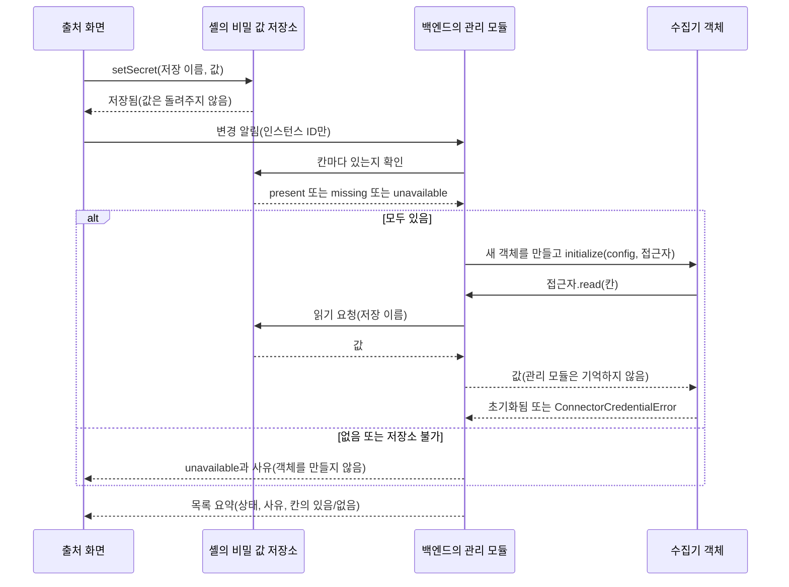
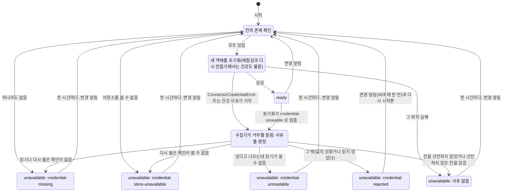

# 스펙: I06 수집기에 자격 증명을 넘기는 경로

- 날짜: 2026-11-22 / 상태: 확정(잠정 결정 포함)
- 관련: 이슈 #114(이 spec), 함께 열린 #113([I05 spec](2026-11-22-I05-site-connector-registration.md). spec과 I05-T01(PoC), I05-T02(시작과 재점검. PR #125)가 합쳐졌다. I05-T03~T05는 아직 없다)·#115(설치본의 인스턴스 범위 파일. [I07 spec](2026-11-22-I07-installed-scopes-file.md). spec은 합쳐졌다)·#116([I02-B spec](2026-11-22-I02-local-file-import.md). spec은 합쳐졌다), 선행 #18(I01)·#16(V01의 비밀 값 저장). [I01 spec](2026-11-21-I01-connector-sdk.md)(I01-R4 오류, R19 멈춤 코드, R20 결과 표, R25 계약 묶음), [I03 spec](2026-11-21-I03-persistent-queue.md)(I03-R16 보류와 재점검), [V01 spec](2026-11-21-V01-vertical-skeleton.md)(V01-R13 비밀 값), [ADR 0010](../adr/0010-encryption-at-rest.md), [ADR 0016](../adr/0016-connector-sdk-v2.md), [connector-sdk.md](../connector-sdk.md) 8장 "자격 증명", [site-setup.md](../site-setup.md) S04·S11, [ownership.md](../ownership.md)

낯선 말은 [ARCHITECTURE 0절](../ARCHITECTURE.md#0-처음-나오는-말)에 풀이가 있다. 이 spec에서 새로 쓰는 말은 아래 표에 있다. `I01-…`·`I02B-…`·`I03-…`·`I05-…`·`I07-…`·`V01-…`은 그 spec의 번호, `S…`는 site-setup.md 체크리스트 번호다.

| 말 | 뜻 |
|---|---|
| 자격 증명 | 수집기가 원 시스템에 접근할 때 내는 비밀 값. API 토큰, 앱 암호, 클라이언트 비밀 값 같은 것 |
| 칸(slot) | 한 인스턴스가 필요로 하는 자격 증명 하나에 붙인 짧은 이름(예: `token`). 값이 아니라 자리의 이름이다 |
| 비밀 값 저장소 | V01이 만든 것. Electron 셸이 OS가 지키는 키로 암호화한 암호문만 데이터 폴더의 `secrets.json`에 둔다(ADR 0010). 이 문서에서 "OS 저장소"는 이것을 가리킨다 |
| 접근자 | 값을 직접 들고 있지 않고, 부를 때마다 저장소에서 읽어 돌려주는 작은 객체. 이 spec에서는 `ConnectorCredentials` |
| 변경 알림 | 화면이 자격 증명을 저장하거나 지운 뒤 백엔드에 "이 인스턴스의 자격 증명이 바뀌었다"고 알리는 호출 |
| 다시 만들기 | 변경 알림을 받아 그 인스턴스의 수집기 객체를 새로 만들어 초기화하는 일. I05-R13의 재점검과 같은 길을 쓰되 `ready`인 인스턴스에도 한다(I06-R12) |
| canary | 시험이 자격 증명 값으로 쓰는 지어낸 표식 문자열. 어디에도 남지 않아야 하는 곳을 뒤져 이 문자열이 없음을 확인한다 |

## 배경

수집기가 제품에서 받는 것은 `initialize(config)`의 설정 하나다(`packages/contracts/src/connector.ts`의 `Connector`). 실제 메일·메신저·Wiki 수집기는 토큰이나 암호가 있어야 원 시스템에 닿는데, 제품이 그 값을 보관하고 건네는 길이 없다. [connector-sdk.md](../connector-sdk.md) 8장은 "자격 증명은 OS 자격 증명 저장소에 두고 레코드·설정 파일·로그에 넣지 않는다"는 **규칙**만 적고, 수단은 "아직 없다, 포크가 정해야 한다"고 적어 두었다.

수단이 없으면 포크가 고를 수 있는 길은 셋인데 모두 나쁘다.

- 값을 등록의 `config`에 적는다. 그러면 값이 저장소의 코드에 남고, `config`는 제품이 기본 주기를 정할 때 읽는 값이라(`backend/src/connectors.ts`의 `configOf`) 다른 코드로 흘러간다.
- 수집기가 OS 보관함을 직접 부른다. 그러려면 네이티브 모듈이 필요한데 I05는 포크 수집기의 네이티브 모듈을 지원하지 않는다(I05 비목표).
- 포크가 입력 화면을 따로 만든다. 그러려면 `site/` 밖의 화면 코드를 고쳐야 해서 [ownership.md 3절](../ownership.md)의 규칙을 어긴다.

한편 V01은 이미 비밀 값 저장소를 갖고 있다. 셸이 값을 암호화해 두고(`apps/desktop/src/secret-store.ts`), 백엔드는 쓸 때마다 셸에 물어 받으며(`backend/src/secret-sources.ts`의 `channelSecrets`), 화면은 저장·확인·삭제만 할 수 있고 되읽지 못한다(`apps/desktop/src/bridge.ts`). 지금 이 저장소에 든 것은 Provider의 API 키 하나뿐이고, 셸은 그 이름 모양만 백엔드에 내어 준다(`packages/contracts/src/secrets.ts`의 `isBackendReadableSecret`).

상태 쪽에도 빈 곳이 있다. 자격 증명이 없거나 만료된 인스턴스는 지금 "초기화 실패"와 구별되지 않는다. 목록의 사유는 `unsupported-sdk-version` 하나뿐이고, 수집 작업은 뭉뚱그린 사유 `connector-unavailable`로 보류된다(`backend/src/connector-sync-job.ts`의 `heldReason`). 사용자는 "값을 넣어야 한다"는 것을 화면에서 알 수 없다. 그리고 동기화 도중에 원 시스템이 자격 증명을 거부하면 수집기는 `ConnectorError`로 알릴 수밖에 없어서, 그 작업은 재시도를 다 쓰고 포기한 작업(dead letter)이 된다. 사람이 값을 고치면 풀리는 일인데 그렇게 다뤄지지 않는다.

I05는 이 값이 들어올 자리를 미리 한 곳으로 모아 두었다. 수집기 객체를 만들고 초기화하는 일은 관리 모듈의 한 곳에서만 일어나고 시작과 재점검이 그 길을 함께 쓴다(I05-R13, 설계 개요 "#114와 #115에 남기는 것"). 이 spec은 그 한 곳에 자격 증명을 끼운다.

## 목표

- 수집기 인스턴스마다 필요한 자격 증명을 **V01의 비밀 값 저장소 하나에** 두고, 수집기는 `initialize`가 받는 접근자로 그 값을 읽는다. 새 저장소를 만들지 않는다.
- 평문 값은 다음 어디에도 남지 않는다: 설정 파일, 정본 DB를 비롯한 데이터 폴더의 파일, 삭제 장부, 로그, API 응답, 오류 문구, `site-check` 출력, 계약 묶음의 출력.
- 값은 화면으로 **돌아가지 않는다.** 화면은 값을 넣고 지우고 "있음/없음"을 볼 수만 있다.
- 저장소를 쓸 수 없으면 그 인스턴스는 정해진 사유와 함께 `unavailable`이 된다. 환경 변수나 파일의 평문으로 조용히 넘어가지 않는다.
- 자격 증명이 **없음**, **저장소를 쓸 수 없음**, **저장된 값을 읽을 수 없음**, **원 시스템이 거부함(만료 포함)**의 네 경우가 각각 닫힌 사유 코드로 목록과 작업의 보류 사유에 보이고, 값을 고치면 다시 풀린다.
- 제품이 거부를 알게 된 값으로는 원 시스템을 되풀이해 두드리지 않는다. 다시 시도되는 횟수에는 상한이 있다(I06-R11). 수집기가 거부를 알리지 않으면 제품은 알 수 없고, 그 경우는 남는 위험에 적는다(I06-R19).
- 계약 묶음이 자격 증명과 관련된 규격 위반을 코드로 잡고, 그 출력에는 값이 실리지 않는다.
- 규격 버전은 2 그대로다. 자격 증명을 쓰지 않는 기존 수집기는 고치지 않아도 그대로 돈다.

## 비목표 (배포처에서 후속 진행)

**공용 저장소의 뒤 작업으로 넘기는 것**

- **수집기가 값을 저장소에 되쓰는 길.** 원 시스템이 새 토큰을 내어 주며 옛 토큰을 버리는 방식(회전하는 refresh token)에서는 수집기가 새 값을 저장해야 한다. 이 spec의 접근자는 읽기만 한다. 그런 원 시스템이면 사용자가 값을 다시 넣어야 한다(미해결 질문 1).
- **브라우저 창을 띄우는 로그인 절차**(OAuth 인가 코드 방식, SSO 창). 이 spec이 다루는 것은 사용자가 화면에 직접 넣는 값이다.
- **OS의 인증서 저장소나 파일에 든 클라이언트 인증서.** 이슈는 "토큰이나 인증서"라고 적었지만 이 spec이 다루는 것은 글자로 붙여 넣을 수 있는 값이다. 붙여 넣는 PEM은 한도 안에서 된다.
- 한 값이 8192자를 넘는 자격 증명(큰 인증서 묶음). 저장소의 값 한도(`SecretValueSchema`)를 그대로 쓴다.
- 더는 쓰이지 않는 자격 증명을 한 번에 정리하는 화면(I06-R15, 미해결 질문 2).
- 브라우저 개발용 백엔드(`backend/src/dev.ts`)에서 수집기 자격 증명을 주는 길. 그 실행에는 셸이 없어 저장소가 없고, I05도 그 진입점에 포크 수집기를 싣지 않는다.
- #115(인스턴스 범위 파일, I07). 이 spec은 `backend/src/connector-scopes.ts`를 건드리지 않는다.

**어느 작업에서도 하지 않는 것**

- 새 비밀 값 저장소나 OS 보관함용 네이티브 모듈. ADR 0010이 고른 저장 방식을 그대로 쓴다.
- 포크의 코드로부터 값을 지키는 일. 포크의 수집기는 백엔드와 같은 프로세스에서 같은 권한으로 도는 믿는 코드다(I05 "신뢰 경계와 남는 위험"). 칸 단위의 제한은 실수를 잡는 장치이지 격리가 아니다.
- 규격 버전을 3으로 올리는 일. 이 spec이 규격에 더하는 것은 모두 선택 항목이다.
- I05가 정한 것의 재정의: 진입점 주입, `SiteRegistration`의 기존 필드, 등록 검사의 기존 코드, 시작 시간 제한, 재점검의 규칙, 공용 종류 예약. 이 spec은 그 위에 더하기만 한다. 더하는 곳은 셋이며 각각 이름을 붙여 적는다: 인스턴스 정의의 선택 필드와 등록 검사의 코드 하나(I06-R2), 목록의 사유(I06-R9), **I05-R13에 더하는 "변경 알림에 의한 다시 만들기"**(I06-R12).

**배포처 후속 항목**(2개. [site-setup.md의 배포처 설정 체크리스트](../site-setup.md#배포처-설정-체크리스트)와 번호로 대응한다. **번호는 잠정이며 머지 순서로 조정한다.** 합쳐진 spec이 쓰는 번호는 I02-B가 S23~S25, I05가 S26·S27이고, 합쳐진 I07이 S30·S31이다. 이 spec은 그 사이의 S28·S29다)

| 번호 | 항목 |
|---|---|
| S28(잠정) | 실제 수집기가 쓰는 자격 증명의 종류를 정해 인스턴스마다 칸을 선언하고, Windows 11 설치본에서 다음을 실행해 기록한다. ① 화면에서 값을 넣으면 인스턴스가 사용 가능해지고 동기화된다 ② 틀린 값을 넣으면 "자격 증명이 거부됨"으로 멈추고 값을 고치면 풀린다 ③ 데이터 폴더의 `secrets.json`과 정본 DB, 로그에 그 값이 평문으로 없다 ④ Windows의 OS 보호(DPAPI)를 쓸 수 없는 계정에서는 값이 저장되지 않고 인스턴스가 "저장소를 쓸 수 없음"으로 보인다 ⑤ 인스턴스의 원 시스템 주소를 바꿀 때는 인스턴스 ID도 바꾼다는 규칙(I06-R3)을 포크의 등록이 지키는지 확인한다 |
| S29(잠정) | 실제 수집기와 그 의존성(HTTP 클라이언트 등)이 실제 원 시스템의 응답에서도 자격 증명을 레코드, 오류 문구, 자기 로그에 남기지 않는지 확인하고 기록한다. 원 시스템의 만료 주기와 계정 잠금 정책, 만료되었을 때 사용자가 값을 다시 넣는 절차도 함께 적는다. 값을 되써야 하는 방식(회전하는 토큰)이면 그 사실을 공용 저장소에 알린다([ownership.md 5절](../ownership.md)) |

수집기의 인증 방식을 고르는 일 자체는 S04가, 앱이 OS 보호 저장소를 쓸 수 있는지의 확인은 S11이 이미 갖고 있으므로 다시 세지 않는다.

## 요구사항

### 저장과 이름

- **I06-R1 저장소는 하나.** 수집기의 자격 증명은 V01의 비밀 값 저장소에만 둔다. 저장, 암호화, 파일 형식, "OS 보호를 쓸 수 없으면 아무것도 저장하지 않는다"는 규칙은 지금 그대로다(`apps/desktop/src/secret-store.ts`). 이 spec은 그 저장소에 **이름 모양 하나**를 더할 뿐이다(셸이 백엔드에 주는 존재 확인의 답 하나는 I06-R4가 더한다).
- **I06-R2 칸의 선언.** 인스턴스가 필요로 하는 칸은 인스턴스 정의의 선택 필드 `credentials`(칸 이름의 목록)로 선언한다. 이 필드는 I05의 `SiteRegistration.connectorInstances` 항목이 쓰는 타입(`ConnectorInstanceConfig`)에 **더해지는** 선택 필드이며, 없으면 지금과 같다.
  - 칸 이름은 `^[a-z][a-z0-9-]{0,15}$`를 따르고, 한 인스턴스 안에서 서로 다르며, 많아야 `MAX_CREDENTIAL_SLOTS`(잠정 8)개다.
  - 위반은 등록 검사(`checkSiteRegistration`, I05-R9)가 **새 코드 하나** `instance-credentials-invalid`로 돌려준다. 시작할 때는 I05의 `instance-id-invalid`와 같은 갈래다: 그 인스턴스를 빼고 계속하며 로그의 `site-registration-rejected`에 코드와 건수가 남는다. 이것은 I05-R9의 표에 행 하나를 **더하는** 것이고 기존 행은 바꾸지 않는다. I05-C6 ②의 "열 코드"는 I07이 정한 대로 I05 자신의 열 코드를 뜻하는 말로 남고, 이 코드는 I06-C2가 본다.
  - 선언에는 값을 적지 않는다. 선언은 코드에 남는 것이고 값은 저장소에만 있다.
- **I06-R3 저장 이름.** 한 칸의 저장 이름은 `connector.<32자리 16진수>.<칸>`이다. 16진수는 `종류`, 줄바꿈 한 글자, `인스턴스 ID`를 이은 글의 SHA-256 앞 32자리다(함수 `connectorCredentialName(kind, instanceId, slot)`, 잠정 이름).
  - 해시를 쓰는 까닭: 저장 이름은 64자 이하의 좁은 글자만 받는데(`SecretNameSchema`) 인스턴스 ID는 128자까지의 아무 글자다. Provider 키의 이름이 호스트를 해시하는 것과 같은 방식이다.
  - 종류를 함께 넣는 까닭: 같은 ID가 나중에 다른 종류의 인스턴스로 다시 쓰이더라도 옛 종류의 값이 새 종류의 수집기에 건네지지 않게 한다. 종류 이름에는 줄바꿈이 들 수 없으므로(I05-R7) 이은 글은 한 가지로만 읽힌다.
  - **저장 이름은 `config`(원 시스템의 주소)를 묶지 않는다.** Provider 키는 주소의 호스트에 묶여 다른 호스트로 가지 않지만, 수집기의 `config`는 제품이 모양을 모르는 값이라 어느 필드가 주소인지 알 수 없다. 그래서 같은 종류와 ID를 둔 채 `config`의 주소만 바꾼 빌드에서는 **옛 값이 새 주소로 건네진다.** 이를 막는 것은 포크의 일이다: 인스턴스가 가리키는 원 시스템을 바꿀 때는 인스턴스 ID도 바꾼다(그러면 값을 다시 넣게 된다). 이 규칙을 connector-sdk.md 8장과 S28에 적고, 남는 위험으로 I06-R19에 적는다.
  - 이 모양을 판정하는 함수 하나(`isConnectorCredentialSecret`, 잠정 이름)를 `@pki/contracts`에 둔다. 셸과 백엔드가 같은 함수를 쓴다.
- **I06-R4 셸이 내어 주는 범위.** 셸은 백엔드의 읽기 요청과 존재 확인 요청에 **Provider 키의 이름이거나 수집기 자격 증명의 이름일 때만** 답한다. 그 밖의 이름은 지금처럼 `unavailable`이다.
  - **Provider 키를 정리하는 요청(`prune`, `deleteOthers`)은 수집기 자격 증명을 지우지 않는다.** 지금 그 정리는 "백엔드가 읽을 수 있는 이름 가운데 하나만 남기고 전부"를 지운다(`secret-store.ts`의 `deleteOthers`). 그래서 읽을 수 있는 이름의 판정을 그대로 넓히면 Provider의 주소를 바꿀 때 수집기의 값이 함께 지워진다. 두 판정을 따로 두고, 정리는 Provider 키의 이름만 본다. **정리 요청의 남길 이름이 Provider 키의 이름이 아니면 셸은 아무것도 지우지 않고 `unavailable`로 답한다.** 지금 셸은 읽기, 존재 확인, 정리를 한 판정으로 거르므로(`apps/desktop/src/backend-process.ts`의 `answerSecret`), 그 판정을 넓히기만 하면 수집기 자격 증명의 이름을 남기는 정리 요청이 Provider 키를 모두 지우게 된다.
  - **OS 보호를 쓸 수 없을 때의 존재 확인.** 수집기 자격 증명 이름의 존재 확인에 셸은 OS 보호를 쓸 수 없으면(암호화를 쓸 수 없으면) 그 칸의 값이 **없어도** `unavailable`로 답한다. 지금 저장소의 `has`는 값이 없으면 OS에 묻지 않고 "없음"이라고 답하므로(`secret-store.ts`), 그대로 두면 OS 보호가 없는 새 PC에서 모든 칸이 "없음"으로 보이고 사용자는 저장되지 않을 값을 넣으라는 안내를 받는다. **Provider 키 이름의 답은 지금 그대로다.** 이 차이는 셸이 수집기 자격 증명의 이름에 답하는 갈래에만 두고 저장소의 `has`가 내는 답은 바꾸지 않는다(바꾸면 Provider 키 화면의 "없음"이 "쓸 수 없음"으로 달라진다).
  - 셸이 없는 실행(`NO_SECRET_STORE`)과 브라우저 개발의 환경 변수 출처(`envSecrets`)는 수집기 자격 증명의 이름에 `unavailable`로 답한다. 환경 변수에서 수집기 자격 증명을 읽는 길은 두지 않는다.

### 값을 넘기는 길

- **I06-R5 규격에 더하는 것.** `@pki/contracts`의 규격에 다음을 더한다. 모두 선택 항목이라 `CONNECTOR_SDK_VERSION`은 2 그대로이고, 인자 하나만 받는 기존 `initialize` 구현은 고치지 않아도 타입 검사와 실행이 그대로다.
  - `initialize(config, context?)`: 둘째 인자 `ConnectorContext`. 지금 든 것은 `credentials` 하나다.
  - `ConnectorCredentials`: `read(slot)` 하나. 그 칸의 값을 돌려주거나 `ConnectorCredentialError`로 거부한다.
  - `ConnectorCredentialError`: 자격 증명을 쓸 수 없음을 알리는 오류. **생성자가 인자를 받지 않고 문구가 고정이다.** 수집기는 원 시스템이 자격 증명을 거부했을 때(인증 실패, 만료, 철회) `initialize`나 `getChanges`에서 이 오류를 던진다. 접근자가 던진 것을 그대로 흘려보내도 된다.
  - `healthCheck`는 던지지 않는 호출이므로(I01-R2) 거부를 알리는 값을 따로 둔다: `{ state: "unavailable", reason: HEALTH_REASON_CREDENTIAL_REJECTED }`(상수, 잠정 이름. 값은 `credential-rejected`). 제품은 `healthCheck`의 `reason`을 **이 상수와 같은지만** 본다. 그 밖의 글은 지금처럼 어디로도 옮기지 않는다. 이 값이 아닌 `unavailable`은 거부로 읽히지 않는다(I06-R11). **이 값은 재점검과 다시 만들기에서만 읽힌다.** 제품은 시작할 때 `healthCheck`를 묻지 않는다(I05 그대로다). 그래서 시작과 동기화에서의 거부는 `ConnectorCredentialError`로 알려야 하고, 건강의 값만으로 알리는 수집기는 계약 묶음이 위반으로 잡는다(I06-R21).
  - 제품은 `initialize`를 부를 때 **언제나** `context`를 넘긴다. 칸을 선언하지 않은 인스턴스의 접근자는 무엇을 읽어도 거부한다.
  - 규격 버전 2가 이 spec 앞의 제품과 뒤의 제품을 함께 가리키게 된다. 앞의 제품은 `context`를 넘기지 않는다. 자격 증명을 쓰는 수집기는 `context`가 없으면 `ConnectorCredentialError`로 끝낸다고 문서에 적는다(I06-R24).
- **I06-R6 넘기는 자리는 한 곳.** 접근자는 I05가 만든 "수집기 객체를 만들고 초기화하는 한 곳"(I05-R13. 합쳐진 코드에서는 `backend/src/connectors.ts`의 `openConnector`다)에서만 만들어진다. 시작, 한 시간마다의 재점검, 변경 알림(I06-R12), 그리고 **실행 중에 인스턴스를 더하는 입구**(I02B-T06이 만든다. `jsonl-file` 위치의 승인이 부른다)가 모두 그 한 곳을 지나 `context`를 받는다. 그 차례는 다음과 같다.
  1. 선언한 칸마다 저장소에 **있는지만** 묻는다(값은 저장소를 떠나지 않는다).
  2. 하나라도 없거나 저장소를 쓸 수 없으면 **수집기 객체를 만들지 않고**(만드는 함수도 `initialize`도 부르지 않는다) 그 인스턴스를 사유와 함께 `unavailable`로 둔다(I06-R9).
  3. 모두 있으면 객체를 만들고 그 객체에 묶인 접근자를 `initialize(config, { credentials })`로 넘긴다.
  - 존재 확인은 선언한 칸 **모두에 한꺼번에** 묻고, 모든 답을 `CREDENTIAL_CHECK_TIMEOUT_MS`(잠정 3초) **하나의 제한** 안에서 기다린다(칸마다 3초가 아니다). 그 안에 오지 않은 답은 "저장소를 쓸 수 없음"이다. 이 시간은 그 인스턴스의 `INITIALIZE_TIMEOUT_MS`(I05-R10. 인스턴스마다의 제한이다) 안에 들며, 그보다 짧게 두어 저장소가 답하지 않을 때의 사유가 사유 없는 시간 초과가 아니라 저장소 쪽으로 정해지게 한다. 셸에 묻는 통로 자체의 제한(지금 10초, `channelSecrets`)과는 별개로 관리 모듈이 스스로 재는 시간이다.
- **I06-R7 접근자의 동작과 값의 수명.**
  - `read(칸)`은 부를 때마다 저장소에서 읽는다. 제품은 값을 **기억해 두지 않는다**: 관리 모듈의 인스턴스 표, 목록의 요약, `config`, 로그의 인자, 작업의 자료 어디에도 값을 넣지 않는다. 백엔드 프로세스의 메모리에 값이 있는 때는 둘뿐이다. ① 셸의 답을 수집기에게 돌려주는 그 한 번의 호출 동안 ② 수집기 객체가 스스로 쥐고 있는 동안(제품이 막을 수 없다. 수집기 작성자 안내에 "필요한 동안만 쥔다"를 적는다).
  - 선언하지 않은 칸을 읽으면 저장소에 묻지 않고 `ConnectorCredentialError`다.
  - 저장소가 "없음"이나 "쓸 수 없음"으로 답하거나 답이 늦으면 `ConnectorCredentialError`다. 접근자는 다른 종류의 오류를 던지지 않고, 그 오류에는 칸 이름도 저장 이름도 싣지 않는다.
  - **접근자는 자기가 받은 답의 종류를 적어 둔다.** 그 객체의 접근자가 저장소에서 "없음"을 받은 적이 있는지, "쓸 수 없음"(늦은 답 포함)을 받은 적이 있는지, 선언하지 않은 칸을 읽으려 한 적이 있는지의 표시 셋이다. 값은 적지 않는다. 표시는 그 객체의 것이고 새 객체는 빈 표시로 시작한다. 사유의 판정(I06-R9)이 이 표시를 쓴다.
  - **버려진 객체의 접근자는 끊긴다.** I05-R13에 따라 버려지는 객체(시간 제한을 넘긴 시도, 실패한 재점검, 새 객체로 교체된 것)의 접근자는 그때부터 무엇을 읽어도 저장소에 묻지 않고 거부한다. 닫을 수 없는 객체가 뒤에서 계속 돌더라도 새 값을 읽어 가지 못하게 한다.
- **I06-R8 `site-check`.** `site-check <종류>`(I05-R19의 함수)는 무엇을 읽어도 거부하는 접근자를 넘겨 초기화한다. 초기화가 `ConnectorCredentialError`로 끝나면 한 줄 `<종류>: ok (credential-required)`를 내고 0으로 끝난다. 이 명령이 묻는 것은 "자리표시가 아니라 구현이 등록되어 있는가"이고, 자격 증명이 있어야 더 나아간다는 답은 구현이 있다는 뜻이기 때문이다. 이 경우 오류의 문구는 출력하지 않는다.

### 상태와 보류

- **I06-R9 사유 넷.** 수집기 목록의 `reason`(지금 값은 `unsupported-sdk-version` 하나)에 네 값을 더한다. 상태는 넷 모두 `unavailable`이다. I05가 "화면에서 원인을 보여야 할 때 계약에 값을 더한다"고 남겨 둔 자리를 쓰는 것이다.

  | 사유 | 뜻 | 사용자가 할 일 |
  |---|---|---|
  | `credential-store-unavailable` | 저장소를 쓸 수 없다(셸이 없음, OS 보호를 쓸 수 없음, 파일을 읽을 수 없음, 답이 늦음) | 앱 안에서는 없다(S11) |
  | `credential-missing` | 선언한 칸 가운데 값이 없는 것이 있다 | 값을 넣는다 |
  | `credential-unreadable` | 값이 저장되어 있다고 나오는데 읽히지 않는다(암호문을 풀 수 없음, 풀린 값의 모양이 틀림, 읽기의 답이 늦음). OS의 키가 바뀐 경우(로밍 프로필 등, S11)가 여기에 든다 | 값을 지우고 다시 넣는다 |
  | `credential-rejected` | 값은 읽히는데 원 시스템이 받아 주지 않는다(틀림, 만료, 철회) | 값을 고쳐 넣는다 |

  판정은 두 자리에서 한다. **객체를 만들기 전**(I06-R6의 1·2)에는 존재 확인만으로 한다: 하나라도 `unavailable`이면 `credential-store-unavailable`, 아니고 하나라도 `missing`이면 `credential-missing`이다. **수집기가 거부를 알렸을 때**(`initialize`나 `getChanges`가 `ConnectorCredentialError`를 던졌거나 `healthCheck`가 I06-R5의 값을 답했을 때)에는 제품이 **수집기의 말이 아니라 저장소가 한 답으로** 정한다. 차례는 다음과 같고 먼저 맞는 것이 사유다.

  1. 칸을 선언하지 않은 인스턴스이거나, 그 객체가 선언하지 않은 칸을 읽으려 한 적이 있다 → **사유 없는 `unavailable`**(I05 그대로이고 한 시간마다 재점검된다). 넣을 칸이 화면에 없는 인스턴스에 "값을 고치라"는 사유를 붙이지 않는다. OS 로그인에 기대는 수집기(SSO 등)가 이 오류를 던지는 경우가 여기에 든다.
  2. 그 객체의 접근자가 "없음"을 받은 적이 있다 → `credential-missing`.
  3. 선언한 칸의 존재 확인을 다시 묻는다. 하나라도 `unavailable` → `credential-store-unavailable`. 아니고 하나라도 `missing` → `credential-missing`.
  4. (모두 `present`다) 그 객체의 접근자가 "쓸 수 없음"을 받은 적이 있다 → `credential-unreadable`.
  5. 그 밖 → `credential-rejected`.

  - **만료와 거부는 한 사유다.** 저장소는 값의 만료 시각을 모르고, 제품이 만료를 따로 아는 길은 수집기의 말뿐이다. 사용자가 할 일(값을 다시 넣는다)이 같으므로 나누지 않는다.
  - 그 인스턴스의 동기화 요청은 지금처럼 `connector-unavailable`로 답한다(I05-R11).
- **I06-R10 동기화 도중의 거부.** `getChanges`가 `ConnectorCredentialError`를 던지면 그 동기화는 새 멈춤 코드 `credential-unusable`로 멈춘다(I01-R19의 닫힌 목록에 하나를 더한다).
  - 같은 호출을 다시 시도하지 않는다(I01-R18의 재시도는 `ConnectorError`와 요청 한도에만 걸린다).
  - 앞서 저장한 페이지는 남고 cursor는 마지막으로 저장한 것이다(다른 멈춤과 같다).
  - 그 인스턴스는 I06-R9의 판정으로 `unavailable`이 된다(차례 1에 걸리면 사유가 없다). **상태를 바꾸는 것은 그 인스턴스의 지금 객체가 낸 결과뿐이다.** 교체되기 전의 객체가 돌던 동기화가 뒤늦게 이 코드로 멈춰도 인스턴스의 상태는 바뀌지 않는다.
  - I01-R20의 결과 표에 행 하나를 더한다: `credential-unusable` → `held`, 시도는 **쓰지 않음**(수집기를 불렀지만 제품의 `held` 닫기는 언제나 시도를 되돌린다. `storage/src/jobs.ts`의 `closeJob`. `held`이면서 시도를 쓰는 행은 지금 표에 없고 만들 수도 없다), 다음 실행은 "그 인스턴스가 `ready`가 될 때"(변경 알림, 앱을 다시 시작함, 사유가 `credential-rejected`가 아니면 시간당 재점검). 표는 상수 `SYNC_OUTCOMES`와 I01 spec의 표 두 곳에 있고 시험이 둘을 대조하므로 **같은 PR에서 함께** 고친다. I02B-T06도 같은 표와 상수에 양보 행을 더한다(I02B-C35). 두 작업은 차례로 간다("작업 분해").
  - **작업의 보류 사유는 작업을 닫는 때의 인스턴스 사유다.** 그때 인스턴스가 `unavailable`이고 사유가 있으면 그 사유(I06-R9의 넷 가운데 하나), 사유가 없으면 지금처럼 `connector-unavailable`이다. **그때 인스턴스가 `ready`이면**(교체되기 전의 객체가 돌던 동기화가 멈춘 경우다. I06-R12에서는 흔한 일이다) 사유는 `connector-unavailable`이고, 같은 닫기 바로 뒤에 그 인스턴스의 "준비됨 풀기"(`ready`인 인스턴스의 보류된 수집 작업을 줄에 되돌리는 기존 동작)가 그 작업을 다시 줄에 넣는다. 그래서 그 작업은 새 객체로 다시 돈다. 판정은 닫는 때의 상태로 하므로, 새 객체도 실패해 `ready`가 아니면 되돌리지 않고 그 사유로 보류된 채 남는다(되풀이해 도는 일이 없다). 지금 코드는 멈춤 코드로 끝난 동기화에 빈 사유를 넘기는데(`backend/src/connector-sync-job.ts`), 빈 사유는 닫기가 받지 않고 어느 해제 길도 풀지 않으므로 이 행은 반드시 위 규칙으로 사유를 채운다.
  - **판정이 먼저다.** 지금 객체가 `credential-unusable`로 멈추면 관리 모듈은 I06-R9의 판정으로 인스턴스의 상태를 바꾼 **뒤에** 동기화의 답을 돌려준다. 작업을 닫는 판정은 그 상태를 읽는다. 이 차례가 없으면 판정(존재 확인을 다시 묻는 데 길어야 `CREDENTIAL_CHECK_TIMEOUT_MS`)이 끝나기 전에 닫는 쪽이 `ready`를 읽어 그 작업을 되돌리고, 같은 객체가 거부된 값으로 원 시스템을 다시 부르게 된다. 그 기다림은 작업의 임대 시간 안에 들어야 한다(I06-T03이 확인한다).
  - 네 사유를 보류 사유의 표(`backend/src/held-release.ts`의 `HELD_REASONS`)에 수집기 갈래(`collector`)로 더한다. 풀리는 길은 기존 수집기 사유와 같다: 그 인스턴스가 `ready`가 될 때 인스턴스 단위로 풀린다.
  - 화면의 문구를 더한다: 작업의 보류 사유 넷(`apps/web/src/job-text.ts`), 멈춤 코드 하나(`apps/web/src/connector-text.ts`의 `SYNC_STOP_TEXT`), 수집기 표의 사유 넷(I06-R14).
- **I06-R11 재점검과 다시 시도의 상한.** I05-R13의 재점검에 다음을 더한다. 그 밖은 I05 그대로다.
  - 사유가 `credential-missing`이나 `credential-store-unavailable`인 인스턴스: 재점검은 I06-R6의 차례를 처음부터 다시 밟는다. 여전히 없으면 존재 확인만 하고 끝난다(원 시스템을 부르지 않는다). 생겼으면 새 객체로 초기화한다.
  - 사유가 `credential-unreadable`인 인스턴스: **한 시간마다 재점검된다**(I05 그대로 새 객체로). 읽히지 않는 값은 원 시스템에 내밀 수 없으므로 계정 잠금과 무관하고, OS의 키가 돌아오면 저절로 풀려야 한다.
  - 사유가 `credential-rejected`인 인스턴스: **한 시간마다의 재점검이 건너뛴다.** 존재 확인도, 만드는 함수도, `initialize`도 부르지 않는다. 같은 값으로 원 시스템을 되풀이해 두드리면 계정이 잠길 수 있기 때문이다. 이 인스턴스가 다시 시도되는 때는 변경 알림(I06-R12)과 앱을 다시 시작할 때뿐이다. 다시 시작하면 한 번 시도한다(거부되었다는 사실은 저장하지 않는다).
  - **거부는 어느 길로 알려져도 같은 사유가 된다.** `initialize`의 오류, `getChanges`의 오류(I06-R10), 재점검이나 다시 만들기에서 `healthCheck`가 답한 I06-R5의 값 셋 모두 I06-R9의 판정을 지나고, `credential-rejected`가 되면 위 건너뛰기가 걸린다.
  - **상한.** 한 인스턴스가 `credential-rejected`인 동안 제품이 그 수집기 객체를 새로 만들어 원 시스템을 부르게 하는 일은 ① 알림이 없으면 0번이고 ② 알림이 있으면 `CREDENTIAL_RETRY_MIN_MS`(잠정 30초)에 많아야 한 번이며(I06-R12) ③ 앱을 한 번 켤 때 한 번이다. ②는 사람이 값을 고치는 속도에 맞춘 값이다. 알림을 쉬지 않고 보내는 잘못된 호출자가 있으면 한 시간에 120번쯤까지 시도될 수 있고, 이 spec은 그것을 더 줄이지 않는다(I06-R19).
  - 이 상한은 **수집기가 거부를 알렸을 때만** 선다. `healthCheck`가 I06-R5의 값이 아닌 `unavailable`을 답하거나 수집기가 거부를 다른 오류로 던지면 제품은 그것이 거부인지 알 수 없고, 그 인스턴스는 I05대로 한 시간마다 같은 값으로 다시 시도된다. 계약 묶음의 `credential-rejection-unsignalled`(I06-R21)가 이를 잡고, 남는 위험으로 I06-R19에 적는다.
- **I06-R12 변경 알림에 의한 다시 만들기(I05-R13의 확장).** 백엔드에 `POST /api/connectors/credentials-changed`(본문 `{ connectorId }`)를 둔다. 값은 싣지 않는다. 이 경로는 다른 API와 같은 검사(세션 토큰, Origin, Host)를 지난다(`backend/src/server.ts`의 공통 검사. 따로 여는 길이 아니다).
  - **이것은 I05-R13에 이 spec이 더하는 확장 하나다.** I05-R13은 "`ready`인 인스턴스의 객체는 바꾸지 않는다"고 적었고 그것은 재점검의 규칙으로 그대로 남는다. 이 spec은 그 옆에 "변경 알림을 받으면 `ready`인 인스턴스도 새 객체로 다시 만든다"를 더한다. I05 spec의 그 문장에 이 확장을 가리키는 한 줄을 다는 일은 I06-T03이 한다(후속 표).
  - 받으면 그 인스턴스를 I06-R6의 차례로 **다시 만든다.** 새 객체가 초기화되고 `healthCheck`가 괜찮으면 그 객체로 바뀌어 `ready`가 되고 그 인스턴스의 보류된 작업이 풀린다. 아니면 I06-R9의 판정대로 `unavailable`이 된다. 옛 객체는 어느 쪽이든 버려지고 그 접근자는 끊긴다(저장소에 든 것은 이미 새 값이거나 없음이다).
  - **다시 만들기는 재점검과 같은 자리 하나를 쓴다.** 한 인스턴스에서 진행 중일 수 있는 재점검 또는 다시 만들기는 합쳐서 하나다. 그래서 한 인스턴스의 끝나지 않은 객체는 I05가 정한 대로 **많아야 둘**(시작 때의 것 하나, 재점검이나 다시 만들기의 것 하나)이고 이 spec은 그 한도를 늘리지 않는다.
    - 재점검이나 다시 만들기가 진행 중일 때 온 알림은 잃지 않고 미룬다. 진행 중인 것이 끝난 뒤 **한 번** 다시 만든다(알림이 여러 번 와도 한 번이다). 진행 중이던 것이 재점검이고 그것이 인스턴스를 `ready`로 만들었더라도 다시 만든다(그 재점검이 읽은 값이 바뀐 값인지 알 수 없다).
    - 다시 만들기가 진행 중인 인스턴스는 한 시간마다의 재점검이 건너뛴다(I05의 "끝나지 않은 재점검이 있으면 다시 시작하지 않는다"와 같은 규칙이다).
    - 결과를 받는 것은 I05대로 그것을 기다리는 차례 하나다. 재점검의 결과는 재점검이, 다시 만들기의 결과는 다시 만들기가 받는다.
    - 진행 중인 것이 끝내 끝나지 않으면 미뤄 둔 알림도 실행되지 않는다. 바뀐 값은 앱을 다시 시작할 때 반영된다(I05의 재점검이 이미 갖는 한계와 같다).
  - 시간 제한과 늦은 결과를 버리는 규칙은 I05의 재점검과 같다(`RECHECK_TIMEOUT_MS`). **늦게 끝나 버려진 다시 만들기는 `RECHECK_LATE_LIMIT`의 수에 든다**(닫히지 않는 객체가 하나 남는다는 점이 같다). 한도에 닿아 재점검을 그만둔 인스턴스(`connector-recheck-abandoned`)는 변경 알림으로도 다시 만들지 않는다. 다시 시작해야 한다. 초기화가 늘 60초를 넘는 수집기만 여기에 닿으며, 그런 수집기는 I05에서도 준비되지 못한다. **`ready`인 인스턴스의 다시 만들기가 제한을 넘기면 옛 객체를 버리고 사유 없는 `unavailable`이 된다**(I05의 재점검이 이어받는다). 옛 객체를 `ready`로 남기지 않는 까닭: 그 객체의 접근자는 이미 바뀐 값을 읽게 되는데 그 값으로 원 시스템이 괜찮은지 확인된 적이 없다. 확인되지 않은 것을 `ready`라고 보이지 않는다. 치르는 값은 I06-R19에 있다. `ready`가 아니던 인스턴스의 다시 만들기가 제한을 넘기면 I05의 재점검처럼 앞의 상태와 사유 그대로다. **제한 안에 끝난 다시 만들기는**(성공이든 실패든) 제한 안에 끝난 재점검과 같이 `RECHECK_LATE_LIMIT`의 수를 0부터 다시 센다.
  - **거부된 인스턴스의 다시 시도 간격.** 사유가 `credential-rejected`인 인스턴스에서 알림이 일으키는 다시 만들기는 `CREDENTIAL_RETRY_MIN_MS`(잠정 30초)에 한 번이다. 거부된 뒤의 **첫 알림은 곧바로** 다시 만들고(값을 고친 사용자를 기다리게 하지 않는다), 그 다시 만들기로부터 30초 안에 온 알림은 버리지 않고 그 시각 뒤의 한 번으로 모은다(마지막 값이 반영된다). 제품은 값을 들고 있지 않아 "값이 정말 바뀌었는지"를 알 수 없으므로 간격으로 막는다. 이 간격은 `credential-rejected`인 인스턴스에만 걸린다(`ready`인 인스턴스의 알림은 그때마다 다시 만든다). **두 미루기**(진행 중인 것이 끝나기를 기다림, 이 간격)**가 겹치면 늦은 쪽 뒤의 한 번이다.**
  - 그 인스턴스에서 돌고 있던 동기화는 쥐고 있던 옛 객체로 끝까지 간다. 끊긴 접근자를 읽어 `credential-unusable`로 멈출 수 있고, 그 결과는 인스턴스의 상태를 바꾸지 않으며 그 작업은 I06-R10의 규칙으로 새 객체에서 다시 돈다.
  - **답.** 곧바로 다시 만들기를 시작한 요청은 그것이 끝날 때까지 기다렸다가(길어야 `RECHECK_TIMEOUT_MS`) 답한다. 답은 그 인스턴스의 목록 요약과 `rebuild` 하나다: `done`(이 요청이 다시 만들기를 끝냈다. 제한을 넘긴 경우도 `done`이고 요약이 그 결과를 말한다), `queued`(진행 중인 것이나 간격 때문에 미뤄졌다. 기다리지 않고 지금의 요약으로 답한다), `skipped`(재점검을 그만둔 인스턴스라 하지 않았다). 모르는 ID는 `not-found`다.
- **I06-R13 목록에 보이는 것.** 칸을 선언한 인스턴스의 목록 요약에 `credentials`가 붙는다: 칸마다 `slot`(칸 이름), `name`(저장 이름), `state`(`present`·`missing`·`unavailable`). 값은 없다. `state`는 마지막으로 존재를 확인했을 때의 것이다(시작, 재점검, 변경 알림에서 확인한다). 존재 확인은 암호문을 풀어 보지 않으므로 읽히지 않는 값의 칸도 `present`로 보이고, 그때는 인스턴스의 사유(`credential-unreadable`)가 사정을 말한다. 칸을 선언하지 않은 인스턴스에는 이 필드가 없다.

### 값을 쓰는 곳

- **I06-R14 화면에서 넣는다.** 공용 제품의 출처 화면(수집기 표)이 칸을 선언한 인스턴스마다 칸의 상태, 값 입력란, 저장과 삭제를 보인다. 포크는 화면을 고치지 않는다.
  - 저장과 삭제는 지금의 preload 함수 `setSecret(name, value)`와 `deleteSecret(name)`를 쓴다(Provider 키와 같은 길). 이름은 목록이 준 `name`을 그대로 쓴다. **preload에 함수를 더하지 않는다.** 값은 화면에서 셸로 곧장 가고 백엔드 API를 지나지 않는다.
  - 저장이나 삭제가 성공하면 화면이 변경 알림(I06-R12)을 한 번 부르고, 입력란을 비운다. 저장이 실패하면("OS 보호를 쓸 수 없음") 그 문구를 보이고 알림을 부르지 않는다. **삭제가 실패하면**(저장소 파일을 읽거나 쓸 수 없음) "지우지 못했다"는 문구를 보이고 알림을 부르지 않으며, 칸의 표시는 바꾸지 않는다.
  - 알림의 답이 `queued`이면 화면은 "곧 반영된다"를 보이고, 목록을 곧바로 한 번 읽은 뒤 `CREDENTIAL_RETRY_MIN_MS`가 지나서 한 번 더 읽는다(미뤄진 다시 만들기의 결과를 보이려는 것이다. 곧바로 한 번만 읽으면 값을 빨리 두 번 고친 사용자에게 옛 "거부됨"이 남는다). 진행 중인 재점검 뒤로 미뤄진 경우는 그보다 늦게(길어야 `RECHECK_TIMEOUT_MS`) 끝날 수 있고, 그때는 화면을 다시 열거나 새로 고쳐야 보인다. `skipped`이면 "앱을 다시 시작해야 반영된다"를 보인다.
  - 화면은 값을 되읽는 길이 없다(preload에 읽는 함수가 없다. 지금 그대로다). 화면은 값을 API 요청, 주소, 브라우저 저장소에 넣지 않는다.
  - 셸이 없는 브라우저 개발 실행에서는 입력란을 보이지 않고 "이 실행에는 저장소가 없다"는 안내만 보인다.
  - 수집기 표는 사유 넷을 각각 다른 문구로 보인다.
- **I06-R15 인스턴스가 없어져도 값을 지우지 않는다.** 등록에서 빠진 인스턴스의 값은 저장소에 암호문으로 남는다. 제품은 시작할 때 저장소를 정리하지 않는다.
  - 남은 값은 어느 수집기에도 건네지지 않는다. 저장 이름이 종류와 ID에서 나오므로 그 종류와 ID의 인스턴스가 다시 등록될 때만 다시 쓰인다(그때 `config`가 달라졌어도 쓰인다. I06-R3).
  - 지우지 않는 까닭: 자동으로 지우면 공용 진입점이나 수집기를 뺀 빌드로 같은 데이터 폴더를 한 번 띄우는 것만으로 모든 값이 사라진다. 값은 다시 발급받기 어려울 수 있다. 사용자가 지우는 길은 인스턴스가 있을 때의 삭제 단추와, 앱의 데이터를 지우는 기존 절차다.

### 누출 없음

"없다"는 요구는 모두 시험이 canary로 뒤져 확인할 수 있는 모양으로 적는다.

- **I06-R16 제품이 값을 남기지 않는 곳.** 자격 증명의 값(원래 글, base64로 바꾼 글, 주소용으로 바꾼 글(percent-encoding))은 다음 어디에도 나타나지 않는다.
  1. 데이터 폴더의 모든 파일: 정본 DB와 그 보조 파일, 삭제 장부, 투영의 파일, `secrets.json`(여기에는 암호문만 있다).
  2. 설정 파일: 제품은 `site/config/` 아래나 그 밖의 어떤 설정 파일에도 값을 쓰지 않는다.
  3. 백엔드와 셸의 로그 줄, 표준 출력과 표준 오류(시작 실패 줄 포함).
  4. 모든 API 응답 본문과 셸이 화면에 돌려주는 답.
  5. 동기화 결과, 작업의 행과 이력, 보류 사유, 활동 목록.
  6. `site-check`의 출력.
  이것은 수집기가 **일부러 흘려도** 지켜져야 한다: 값을 문구, 오류의 이름, `cause`, `healthCheck`의 사유에 실어 던지는 수집기에 대해서도 위 여섯이 참이다. 제품은 수집기 오류의 문구를 옮기지 않는다는 기존 규칙(I01-R4)을 이 길 전부에서 지킨다. 여기서 "로그"는 **제품이 쓰는** 로그다. 수집기가 스스로 `console`에 쓰는 것은 같은 프로세스의 표준 출력으로 나가며 제품이 막지 못한다(I06-R19).
- **I06-R17 값은 화면으로 돌아가지 않는다.** 값이 지나는 길은 "화면 입력 → 셸의 저장소"와 "셸 → 백엔드 프로세스 → 수집기" 둘뿐이다. 백엔드의 어떤 API도, 셸의 어떤 preload 함수도 값을 답에 싣지 않는다. 셸은 값이 든 답을 백엔드 프로세스에만 보낸다.
- **I06-R18 평문으로 넘어가지 않는다.** 저장소를 쓸 수 없을 때 제품은 환경 변수, 설정 파일, 등록의 `config`에서 대신 읽지 않는다. 그 인스턴스는 `credential-store-unavailable`이고 수집기 객체는 만들어지지 않는다.
- **I06-R19 막지 못하는 것(남는 위험).** 다음은 제품이 실행 중에 잡을 수 없다. 누가 맡는지와 함께 문서에 그대로 적는다.

  | 경우 | 왜 못 막는가 | 누가 맡는가 |
  |---|---|---|
  | 수집기가 값을 **레코드의 본문이나 `metadata`에 넣어 돌려줌** | 제품은 값을 들고 있지 않아 받은 레코드를 값과 견줄 수 없다 | 계약 묶음의 `credential-in-record`(지어낸 원 시스템에서), S29 |
  | 수집기나 그 의존성이 **자기 로그나 파일에 값을 씀** | 같은 프로세스의 믿는 코드다 | 계약 묶음의 `credential-in-log`(`console`과 표준 출력·오류로 나간 것만. 파일이나 다른 통로로 쓴 것, 계약 묶음의 실행이 끝난 뒤에 나간 것은 못 본다), 수집기 작성자 안내, S29 |
  | 포크의 코드가 **다른 인스턴스의 값을 읽음** | 같은 프로세스의 코드는 셸에 직접 물을 수 있다 | 포크의 검토 |
  | **느린 수집기의 값을 바꾸면 멈춤** | `ready`인 인스턴스의 다시 만들기가 60초를 넘기면 옛 객체를 버린다(I06-R12) | 잘 돌던 인스턴스가 다음 재점검까지 길어야 한 시간 `unavailable`이다(늦은 것이 연달아 `RECHECK_LATE_LIMIT`번이면 다시 시작할 때까지). 한 시간 재점검이 되살린다. 초기화가 60초 가까이 걸리는 수집기는 S27·S28에서 드러난다 |
  | **알림을 쉬지 않고 보내는 호출자** | 간격은 30초이고 `ready`인 인스턴스에는 간격이 없다 | 거부된 값이 한 시간에 120번쯤까지 시도될 수 있고, `ready`인 인스턴스는 알림마다 다시 만들어져 돌던 동기화가 멈춘다. 알림은 세션 토큰을 가진 화면만 보낼 수 있다(I06-R12). 화면의 기존 보호가 맡는다 |
  | **주소만 바꾼 인스턴스가 옛 값을 받음** | 저장 이름이 `config`를 묶지 않는다(I06-R3) | 포크의 규칙(주소를 바꾸면 ID도 바꾼다), S28 ⑤ |
  | 수집기가 **거부를 알리지 않음**(`healthCheck`의 다른 사유, 다른 종류의 오류) | 제품은 그것이 거부인지 알 수 없다. 한 시간마다 같은 값으로 다시 시도된다(I06-R11) | 계약 묶음의 `credential-rejection-unsignalled`, S29의 잠금 정책 확인 |
  | **칸을 선언하지 않은** 수집기(OS 로그인에 기대는 것)의 인증 실패 | 넣을 값이 없어 사유 없는 `unavailable`이고 한 시간마다 다시 시도된다. 쓰이는 것은 OS 사용자 자신의 신원이다 | 포크의 검토, S29 |
  | 화면(렌더러)이 깨져 **값을 바꿔 넣거나 지움** | 화면은 어떤 저장 이름으로든 저장·삭제할 수 있다(읽지는 못한다). 다른 계정의 값으로 바꿔 넣어 그 계정의 자료가 수집되게 할 수 있다 | 화면의 기존 보호(V01의 CSP와 preload 검사). 이 spec은 더하지 않는다 |

### 계약 묶음

- **I06-R20 시나리오의 확장.** `@pki/testkit`의 `ConnectorScenario`에 선택 필드 둘을 더한다. 둘 다 없으면 계약 묶음은 지금과 글자 그대로 같은 결과를 낸다.
  - `credentials`: 칸 이름 → 지어낸 값. 계약 묶음이 이 값을 읽어 주는 접근자를 만들어 `initialize`에 넘긴다. 값은 16자 이상이어야 한다(짧으면 우연히 겹친다. 어기면 시나리오의 오류다).
  - `rejected`: 지어낸 원 시스템이 **거부하도록 꾸민** 설정과 값(`{ config, credentials }`). 있으면 거부 신호를 본다(아래 `credential-rejection-unsignalled`).
- **I06-R21 위반 코드 다섯.** I01-R25의 닫힌 목록 뒤에 다섯을 더한다. 코드만 돌려주며 값이나 문구는 돌려주지 않는다.

  | 코드 | 잡는 것 | 볼 수 있는 조건 |
  |---|---|---|
  | `credential-in-record` | 시나리오의 값이 `getChanges`나 `getDocument`가 돌려준 것 안에 있다 | `credentials`가 있을 때 |
  | `credential-in-health` | 시나리오의 값이 `healthCheck`의 답 안에 있다 | `credentials`가 있을 때 |
  | `credential-in-error` | 시나리오의 값이 수집기가 던진 오류의 문구, 이름, 열거되는 필드, `cause` 사슬 안에 있다. 계약 묶음이 이미 일으키는 실패(초기화 전의 호출, 취소된 호출)와 거부 시나리오의 실패를 본다 | `credentials`나 `rejected`가 있을 때 |
  | `credential-in-log` | **`checkConnector` 한 번이 도는 동안** `console`의 함수들과 `process.stdout`·`process.stderr`의 쓰기로 나간 글 안에 시나리오의 값이 있다 | `credentials`나 `rejected`가 있을 때 |
  | `credential-rejection-unsignalled` | 거부 시나리오로 새 객체를 초기화하고 한 번 읽었는데, `initialize`도 첫 `getChanges`도 `ConnectorCredentialError`로 끝나지 않았다. `healthCheck`의 값은 재점검 길의 신호이며 이 코드를 면하지 않는다 | `rejected`가 있을 때 |

  - 값의 대조는 I06-R16과 같은 세 모양(원래 글, base64, percent-encoding)으로 한다.
  - `credential-in-log`의 가로채기는 `checkConnector` 한 번의 실행 동안 한 번 걸고(수집기가 타이머나 끝나지 않은 약속으로 남긴 출력도 그 실행이 끝나기 전의 것이면 본다) 끝나면(실패해도) 원래대로 돌린다. 같은 프로세스에서 겹치는 실행은 차례로 돈다(겹쳐 걸면 돌려놓을 때 남의 함수를 되돌린다). 가로챈 글은 값이 있는지만 보고 버리며, 값이 없는 글은 원래 나가던 곳으로 그대로 내보낸다. 값이 있는 글은 내보내지 않는다(계약 묶음의 출력에 값이 남지 않게 한다). 그 동안 다른 곳에서 나간 글이 함께 걸릴 수 있으나, 위반이 되는 것은 값이 든 글뿐이다. 수집기가 파일이나 다른 통로에 쓴 것, 그리고 실행이 끝난 뒤에 나간 글은 이 코드로 잡히지 않는다(I06-R19).
- **I06-R22 계약 묶음의 출력에 값이 없다.** 계약 묶음이 스스로 던지는 오류(시나리오의 오류)와 vitest 묶음의 실패 보고에는 시나리오의 값이 실리지 않는다. 지금 계약 묶음은 수집기의 오류를 `cause`로 달아 던지는 곳이 **셋** 있다(`packages/testkit/src/connector.contract.ts`): 초기화의 실패, 나중 설정(`later`)으로 한 초기화의 실패, 읽는 도중 `getChanges`의 실패. 셋 모두에서, 그 오류에 값이 들어 있으면 `cause`를 달지 않고 `credential-in-error`를 기록한다.
- **I06-R23 예시.** 공용 예시 패키지(`packages/connector-example`)에 자격 증명을 쓰는 예시 수집기 하나를 더한다. 지어낸 원 시스템이 지어낸 토큰을 검사하고, 틀리면 수집기가 `ConnectorCredentialError`를 던진다. 이 예시는 두 시나리오(`credentials`, `rejected`)로 계약 묶음을 위반 없이 통과하고, 다섯 가운데 하나씩만 어기는 수집기 다섯이 각각 그 코드 하나만 받는다. 문서의 코드 블록은 이 예시의 발췌다.

### 문서

- **I06-R24 connector-sdk.md.** 다음을 고친다. 고친 문장은 문서 대응 테스트가 붙잡는다.
  - 8장 "자격 증명": "통로가 없다, 포크가 정한다"는 문단을 새 길로 바꾼다. 칸의 선언, 접근자로 읽는 법(예시의 발췌), `ConnectorCredentialError`를 던지는 때와 `healthCheck`에서 거부를 알리는 값, "건강 사유의 값은 재점검에서만 읽힌다. 시작과 동기화에서는 `ConnectorCredentialError`로 알린다", "`healthCheck`의 그 밖의 `unavailable`은 거부로 읽히지 않고 한 시간마다 다시 시도된다", "`context`는 이 길이 들어온 뒤의 제품에서는 언제나 있고, 없으면 수집기는 `ConnectorCredentialError`로 끝낸다", 값을 쥐는 시간에 관한 안내, 화면에서 값을 넣는 곳, 네 사유와 풀리는 길, 거부된 값이 다시 시도되는 상한, "인스턴스가 가리키는 원 시스템을 바꾸면 인스턴스 ID도 바꾼다", 막지 못하는 것(I06-R19의 표), 값을 되쓰는 길이 없다는 점.
  - 2장의 `initialize` 서명, 5장의 오류 종류와 결과 표(`credential-unusable` 행), 6장의 계약 코드 표와 시나리오 필드, 7장의 `site-check` 출력을 적은 문장(`ok (credential-required)`가 나오는 경우를 더한다), 11장 "아직 없는 것"에서 #114 행을 뺀다.
- **I06-R25 그 밖의 문서.**
  - site-setup.md: "실행 중 설정"에 수집기 자격 증명 행을 더하고(설정 파일에 두지 않으며 화면에서 넣는다), 체크리스트에 S28·S29를 넣고, 번호 범위 안내에 이 spec을 더하고, S04의 문장이 칸의 선언을 가리키게 한다.
  - ownership.md 3절 "현재의 예외" 문단에서 #114를 뺀다(I05-T05가 그 문단을 먼저 고친다). **그 문단에 #114가 있다고 단언하는 곳이 셋 있으므로 같은 PR에서 함께 고친다**: `tooling/docs/connector-sdk.test.ts`의 3절 낱말 목록, I05-T05가 만드는 문서 대응 테스트의 그 단언, I05 spec의 I05-R23과 I05-C19의 "#114…를 적는다"는 문장(I06-T05).
  - 새 ADR에 결정을 남긴다: 수집기 자격 증명을 V01의 저장소에 두는 것, 규격에 선택 항목으로 더하고 버전을 올리지 않는 것, 접근자로 넘기는 것, 거부를 수집기가 알리는 것. ADR 0010과 0016에는 새 ADR을 가리키는 한 줄을 더한다. **ADR 번호는 잠정 0019이며 머지 순서로 조정한다**(지금 마지막이 0016이고 합쳐진 spec에서 I02-B가 0017, I05가 0018, I07이 0020을 쓴다).
  - `docs/README.md` 색인에 새 ADR을 올린다(이 spec의 행은 이 spec을 쓰는 PR이 올린다).
  - I01 spec의 표 셋(R19 멈춤 코드, R20 결과 표, R25 위반 코드)은 그 표를 읽는 시험이 있으므로 코드를 더하는 작업이 같은 PR에서 고친다.

**이 절을 줄이면**: 값은 V01의 저장소에만 있고, 수집기는 `initialize`가 받은 접근자로 읽는다. 제품은 칸이 채워져 있는지만 확인하고 값을 들고 있지 않는다. 없음·저장소 불가·읽을 수 없음·거부가 각각 사유 코드로 보이고, 거부된 값은 사용자가 고칠 때까지 정해진 상한 안에서만 다시 쓰인다.

## 인터페이스 / 설계 개요

### 값이 지나는 길



비유하자면 저장소는 **은행의 대여 금고**이고 접근자는 그 금고를 열 때마다 창구에 다시 가야 하는 **출입증**이다. 관리 모듈은 출입증을 건네줄 뿐 금고 안의 것을 복사해 두지 않고, 수집기가 바뀌면 옛 출입증을 못 쓰게 한다. 다만 비유와 달리 수집기는 한 번 꺼낸 값을 자기 주머니에 계속 넣어 둘 수 있고, 제품은 그것을 막지 못한다(I06-R7).

### 규격과 내부 모양(잠정)

이름과 모양은 잠정이며 구현 작업이 다듬을 수 있다. 바뀌면 안 되는 것은 요구사항에 적은 성질이다.

```ts
// @pki/contracts — 규격에 더하는 것(I06-R5)
export class ConnectorCredentialError extends Error {
  constructor(); // 인자 없음. 문구는 고정이다
}
export const HEALTH_REASON_CREDENTIAL_REJECTED = "credential-rejected";
export interface ConnectorCredentials {
  /** 선언한 칸의 값. 쓸 수 없으면 ConnectorCredentialError로 거부한다. */
  read(slot: string): Promise<string>;
}
export interface ConnectorContext {
  readonly credentials: ConnectorCredentials;
}
export interface Connector {
  initialize(config: unknown, context?: ConnectorContext): Promise<void>;
  // 나머지는 그대로
}

// @pki/contracts — 저장 이름의 모양(I06-R3, R4)
export function isConnectorCredentialSecret(name: string): boolean;

// backend — 인스턴스 정의에 더하는 선택 필드(I06-R2)
export interface ConnectorInstanceConfig {
  id: string;
  kind: string;
  config: unknown;
  credentials?: readonly string[]; // 칸 이름. 값이 아니다
}

// backend — 새 모듈(잠정 backend/src/connector-credentials.ts)
export function connectorCredentialName(kind: string, instanceId: string, slot: string): string;
export type CredentialReason =
  | "credential-store-unavailable"
  | "credential-missing"
  | "credential-unreadable"
  | "credential-rejected";

// 목록 요약에 더하는 것(I06-R9, R13)
//   reason: "unsupported-sdk-version" | CredentialReason
//   credentials?: { slot: string; name: string; state: "present" | "missing" | "unavailable" }[]

// 변경 알림의 답(I06-R12): 목록 요약 + rebuild: "done" | "queued" | "skipped"
```

값이 들어오는 곳은 관리 모듈이 받는 `SecretSource`(지금 Provider에 넘기는 것과 같은 객체, `backend/src/boot.ts`의 `secrets` 옵션) 하나다. 시험은 이 자리에 메모리 대역을 넣는다.

### 인스턴스의 상태와 사유



그림에 없는 것: 사유 없는 `unavailable`의 재점검과 `not-implemented`는 I05가 정한 그대로다. 진행 중인 재점검이나 다시 만들기가 있을 때의 미루기(I06-R12)와 재점검을 그만둔 인스턴스(I05-R13)도 그리지 않았다.

### 이관 경계: 잘린 자리와 그 계약

배포처로 넘어가는 경계는 **칸의 선언과 `ConnectorContext`라는 어댑터 경계**다. 공용 쪽은 이 경계의 양편을 모두 갖춘 채 끝난다.

- 인터페이스: 인스턴스 정의의 `credentials`(I06-R2)와 `initialize`가 받는 `ConnectorContext`(I06-R5).
- 계약 테스트: 계약 묶음의 코드 다섯(I06-R21)과 등록 검사의 코드 하나(I06-R2). 어떤 수집기든 같은 코드 목록으로 판정된다. 공용 저장소는 예시 수집기(I06-R23)로 이 길 전체를 증명한다.
- 미구현 표시: 포크가 대체하지 않은 자리표시는 접근자를 받아도 지금처럼 `미구현, 배포처 후속`을 알린다(I06-H2).
- 코드에 배포처 값을 두지 않는다. 칸의 이름은 선언에, 값은 저장소에만 있다. 공용 기본은 칸을 선언한 인스턴스가 없어 아무 설정 없이 로컬에서 돈다.

### 신뢰 경계

| 대상 | 다루는 방식 |
|---|---|
| 화면(렌더러) | 값을 넣을 수만 있다. 어떤 이름으로든 저장·삭제할 수 있는 것은 지금과 같고, 읽지는 못한다. **새로 생기는 영향**: 화면이 깨지면 수집기 자격 증명을 바꿔 넣거나 지울 수 있고, 다른 계정의 값으로 바꿔 넣어 그 계정의 자료가 수집되게 할 수 있다(I06-R19) |
| 셸 | 값을 평문으로 다루는 유일한 저장 지점. 백엔드에는 정해진 두 이름 모양만 내어 준다(I06-R4) |
| 백엔드의 제품 코드 | 값을 지나가게만 하고 기억하지 않는다(I06-R7) |
| 변경 알림의 호출자 | 다른 API와 같은 검사를 지난 호출자. 값을 싣지 못하고, 거부된 인스턴스를 다시 시도하게 하는 횟수는 간격으로 묶인다(I06-R12) |
| 포크의 수집기 코드 | 믿는 코드(I05). 접근자의 칸 제한과 끊기는 실수를 잡는 장치다. 같은 프로세스의 코드는 셸에 직접 물을 수 있으므로 격리가 아니다 |
| 수집기가 돌려주는 것(레코드, 오류의 글, 건강 사유) | 믿지 않는 자료. 오류의 글은 어디로도 옮기지 않고(I06-R16), 건강 사유는 상수 하나와 같은지만 보며(I06-R5), 레코드 안의 값은 계약 묶음이 잡는다(I06-R19) |

### 대안과 기각 사유

| 번호 | 대안 | 기각한 이유 | 다시 볼 조건 |
|---|---|---|---|
| 1 | **값을 `config`에 합쳐 넘김** | `config`는 모양을 모르는 값이라 합칠 자리를 정할 수 없고, 제품이 기본 주기를 정할 때 읽는 값이라(`configOf`) 값이 다른 코드로 흘러간다. "설정에 비밀 값을 넣지 않는다"는 규칙과도 어긋난다 | — |
| 2 | **만드는 함수의 인자로 넘김**(`ConnectorFactory`가 context를 받음). 규격의 `Connector`는 그대로다 | 쓸 수 있는 방법이다. 고르지 않은 까닭: 계약 묶음과 `site-check`이 모두 `initialize`를 기준으로 수집기를 판정하고, 이슈의 과제가 "`initialize`에 넘기는 규격"이며, 만드는 함수는 I05가 등록 계약으로 막 정한 타입이다 | I05의 구현에서 만드는 함수가 다른 인자를 받게 될 때 |
| 3 | **값을 통째로 넘김**(칸 → 값의 표) | 관리 모듈이 값을 변수로 쥐게 되고, 수집기가 나중에 다시 읽을 길이 없다. 접근자는 제품이 값을 들지 않게 하고, 끊을 수 있다 | — |
| 4 | **수집기가 OS 보관함을 직접 부름** | 네이티브 모듈이 필요하다(I05가 지원하지 않는다). 값을 넣는 화면이 없어 포크가 화면을 고쳐야 한다. 제품이 "없음"과 "거부"를 구별할 수 없다 | — |
| 5 | **만료를 저장소의 메타데이터로 판정**(사용자가 만료일을 함께 입력) | 저장소는 만료를 모르고, 사용자가 넣은 날짜는 원 시스템의 사실과 어긋날 수 있다. 철회는 날짜로 알 수 없다. 원 시스템의 답이 유일한 사실이다 | 만료 전에 미리 알려야 한다는 요구가 생길 때. 그때는 수집기가 만료 시각을 알리는 선택 항목을 더한다 |
| 6 | **없어진 인스턴스의 값을 시작할 때 자동 삭제** | 수집기를 뺀 빌드나 공용 진입점으로 같은 데이터 폴더를 한 번 띄우면 모든 값이 사라진다(I06-R15) | 미해결 질문 2 |
| 7 | **값 입력을 포크 전용 수단으로**(포크의 화면이나 명령줄 도구) | 포크가 `site/` 밖의 화면을 고쳐야 하고, 명령줄 도구는 셸의 저장소(Electron의 암호화)에 닿을 수 없다 | 화면 없이 미리 값을 심어야 하는 배포 방식이 생길 때 |
| 8 | **규격 버전을 3으로 올림** | 깨지는 변경이 아니다. 버전을 올리면 모든 수집기가 `unsupported-sdk-version`이 되고 옮겨 갈 일이 생긴다(I01-R1) | 둘째 인자를 필수로 만들 때 |
| 9 | **셸이 저장 사실을 백엔드에 직접 알림**(화면의 변경 알림 대신) | 부모 채널의 메시지 종류가 하나 늘고 셸이 수집기 인스턴스를 알아야 한다. 화면의 알림이 빠져도 잘못된 값이 쓰이지는 않고 늦게 반영될 뿐이다 | 알림이 빠져 반영이 늦는 일이 관측될 때 |
| 10 | **거부된 인스턴스도 한 시간마다 재점검** | 틀린 값으로 원 시스템을 계속 두드린다. 계정 잠금으로 이어질 수 있다 | 원 시스템이 스스로 회복하는 거부(일시적인 인증 서버 장애)가 거부 신호로 흔히 올라올 때. 그런 실패는 수집기가 `ConnectorError`(재시도 가능)로 알려야 한다고 문서에 적는다 |
| 11 | **저장 이름에 `config`(주소)를 묶음** | `config`는 모양을 모르는 값이라 어느 필드가 주소인지 제품이 알 수 없다. `config` 전체를 해시하면 주기 같은 무관한 값을 고칠 때마다 값을 다시 넣어야 한다. 포크가 "주소를 나타내는 글"을 따로 선언하게 하면 되지만 선언을 잊으면 지금과 같고, 저장 이름의 규칙은 되돌리기 어렵다 | S28 ⑤에서 포크의 규칙만으로 부족하다고 알려 올 때. 그때는 인스턴스 정의에 "묶을 글"의 선택 필드를 더한다(이름 규칙을 옮기는 단계가 필요하다) |
| 12 | **변경 알림의 다시 만들기를 재점검과 따로 돌림**(자리가 둘) | 한 인스턴스의 끝나지 않은 객체가 셋이 되어 I05가 정한 한도를 넓히고, 같은 인스턴스에 두 새 객체의 결과가 다투게 된다 | — |
| 13 | **읽히지 않는 값을 `credential-rejected`나 `credential-store-unavailable`에 묶음** | 앞의 것은 한 시간 재점검을 꺼서 OS의 키가 돌아와도 풀리지 않는다. 뒤의 것은 사용자가 할 일(지우고 다시 넣는다)을 가린다 | — |

### 작업 분해

한 행이 PR 하나다. **이 표는 잠정이다.** 조정자가 spec을 확정한 뒤 I05의 실제 머지 상태와 맞춰 보고 작업을 만든다.

코드를 바꾸는 작업은 그 코드를 붙잡고 있는 문서 문장과 문서 대응 테스트를 **같은 PR에서** 고친다(I05 spec "작업 분해"와 같은 이유다. 표와 상수를 대조하는 시험이 있어 따로 고치면 중간 PR이 통과하지 못한다).

| ID | 산출물 하나 | 선행 | 기준 | 바뀌는 파일 | 기대하는 시험 |
|---|---|---|---|---|---|
| I06-T01 | **규격에 더하는 것과 계약 묶음**: `ConnectorContext`, `ConnectorCredentials`, `ConnectorCredentialError`, 건강 사유 상수, 시나리오의 두 필드, 위반 코드 다섯, 자격 증명을 쓰는 예시 수집기와 어기는 수집기 다섯 | 없음(파일 겹침: `tooling/docs/connector-sdk.test.ts`와 connector-sdk.md는 I05의 T02~T05, I02B-T06, I07-T04도 고친다. 그 PR들 사이에 끼워 합친다) | C3(①②), C16, C17, C18 | `packages/contracts/src/connector.ts`, `packages/testkit/src/connector.contract.ts`와 그 테스트, `packages/testkit/src/scripted-connector.ts`(둘째 인자를 받아 넘김), `packages/connector-example/src/adapters/`(새 예시, `violating-connectors.ts`, 계약·위반 테스트), `packages/connector-sdk/src/index.ts`(필요하면 다시 내보내기), **문서 대응**: I01 spec의 R25 표, connector-sdk.md 6장의 코드 표, `tooling/docs/connector-sdk.test.ts`(코드 표의 대조, 그리고 "no code gives a Connector a secret" 가드가 고정한 두 줄 가운데 **서명 줄** `initialize(config: unknown): Promise<void>;`을 새 서명으로 고친다. 그 가드의 다른 한 줄은 T03이 고친다) | `connector.credential-types`(인자 하나짜리 구현이 그대로 통과), `connector.contract.credentials`(코드마다 1건, 시나리오 없음의 불변 1건, 건강 사유로만 알린 거부는 위반 1건), `connector.contract.output-clean`(`cause` 세 곳, 가로챈 글), `connector-example.credentialed.contract`, `connector-example.violations`(다섯 추가) |
| I06-T02 | **저장 이름과 셸이 내어 주는 범위**: `isConnectorCredentialSecret`, `connectorCredentialName`, 셸의 답 범위, 정리 범위의 고정, OS 보호가 없을 때의 존재 확인, 셸 없는 출처의 답 | 없음(파일 겹침: `apps/desktop/src/backend-process.ts`는 I05-T03도 고친다) | C1, C15 | `packages/contracts/src/secrets.ts`와 그 테스트, 새 `backend/src/connector-credentials.ts`와 그 테스트, `apps/desktop/src/backend-process.ts`와 `backend-process.secrets.test.ts`, `apps/desktop/src/secret-store.ts`(셸이 암호화를 쓸 수 있는지 물을 길 하나. `has`의 답은 바꾸지 않는다)와 `secret-store.test.ts`(정리 뒤 남음, `has`의 답 불변), `apps/desktop/src/bridge.test.ts`, `backend/src/secret-sources.ts`와 `secret-sources.test.ts` | `secrets.connector-names`, `connector-credentials.name`, `backend-process.secrets`(두 모양과 그 밖, 정리의 남길 이름, OS 보호 없음), `secret-store`(정리 뒤 수집기 값이 남음), `secret-sources`(환경 변수 출처와 저장소 없음) |
| I06-T03 | **관리 모듈의 길**: 칸의 선언과 등록 검사 코드, 존재 확인, 접근자와 끊기와 표시, 사유 넷, 멈춤 코드와 결과 표, 보류 사유(닫는 때의 사유 규칙 포함), 재점검의 규칙, 변경 알림에 의한 다시 만들기(자리 하나, 미루기, 간격), `site-check`, 백엔드 쪽 누출 시험 | **I05-T02**(만들고 초기화하는 한 곳, 새 객체 재점검), **I05-T03**(`SiteRegistration`, `checkSiteRegistration`, `runSiteCheck`, `bootBackend`의 `site`), **I02B-T06**(`connectors.ts`의 실행 중 인스턴스 입구, `sync-outcomes.ts`와 I01-R20 표의 양보 행, `connector-sync-job.ts`. 같은 파일과 같은 표를 고치므로 그 뒤에 간다), I06-T01, I06-T02. 파일 겹침: I07-T02도 `connectors.ts`, `boot.ts`, 등록 모듈, `site-check.ts`, `site.registration` 시험, I05-R9의 표를 고친다. 둘 사이의 차례는 조정자가 정한다 | C2, C3(③), C4, C5, C6, C7, C8, C9(①②③⑤⑦⑧⑨), C12, C13, C14(①②④⑤와 ③의 변경 알림 밖 응답), H2 | `backend/src/connectors.ts`, `backend/src/connector-credentials.ts`, I05-T03이 만든 등록 모듈(잠정 `backend/src/site-registration.ts`), `backend/src/connector-sync-job.ts`, `backend/src/held-release.ts`, `backend/src/site-check.ts`, `backend/src/boot.ts`(관리 모듈에 `secrets`를 넘김), `packages/contracts/src/index.ts`(사유, 멈춤 코드, 목록의 `credentials`), `packages/connector-sdk/src/sync-outcomes.ts`, `apps/web/src/job-text.ts`와 `connector-text.ts`(닫힌 목록에 문구가 빠지면 타입 검사가 실패하므로 같은 PR), **문서 대응**: I01 spec의 R19 목록과 R20 표, connector-sdk.md 5장의 결과 표와 7장의 `site-check` 출력 문장, `tooling/docs/connector-sdk.test.ts`("no code gives a Connector a secret" 가드의 **호출 줄** `await connector.initialize(config);`. I05-T02가 그 줄을 먼저 옮겼으면 옮겨진 자리에서 고친다), **I05 spec**: I05-R9의 표와 I05-R13의 "`ready`인 인스턴스의 객체는 바꾸지 않는다"에 이 spec을 가리키는 한 줄씩, I05의 `site.registration` 시험이 코드의 수를 세고 있으면 그 수 | `site.registration`(새 코드 3건), `boot.registration-rejected`(새 코드), `connectors.credentials-handover`(일곱 경우), `connectors.credentials-absent`(다섯 경우), `connectors.credentials-rejected`(여덟 경우, 지금 객체의 멈춤은 되돌리지 않음), 판정을 기다리는 시간이 작업의 임대(`backend/src/job-runner.ts`의 `DEFAULT_LEASE_MS`, 지금 2분이고 심박으로 이어진다) 안에 든다는 확인, `sync.outcome-map`, `connector-sync-job`(보류 사유 넷, 교체된 객체의 멈춤), `job-text.coverage`, `connectors.credentials-recheck`, `connectors.credentials-reload`(미루기, 재점검과의 겹침, 간격, 그만둔 인스턴스), `connectors.credentials-kept`, `site-check`(자격 증명을 읽는 종류 1건, 자리표시 3건), `connectors.credentials-canary` |
| I06-T04 | **화면에서 넣고 바꾸는 길**: 변경 알림 API, 목록의 `credentials`, 출처 화면의 입력·삭제·문구 | I06-T03 | C9(④⑥), C10, C11, C14(③의 변경 알림 응답) | `backend/src/server.ts`, `packages/contracts/src/index.ts`(경로와 스키마), `backend/src/api.contract.test.ts`, `backend/src/api.security.test.ts`(새 경로의 토큰·Origin 검사), T03의 누출 시험(변경 알림 응답을 더한다), `apps/web/src/connector-table.tsx`와 그 테스트, `apps/web/src/connector-text.ts`와 그 테스트, 새 `apps/web/src/connector-credential.ts`와 그 테스트(Provider 키의 `api-key.ts`와 같은 모양), `apps/web/src/App.tsx` | `api.contract`(새 경로), `api.security`(새 경로), `connectors.credentials-api`, `connectors.credentials-canary`(변경 알림 응답), `connector-credential`(여덟 경우), `connector-table`(칸의 표시), `connector-text`(사유 넷) |
| I06-T05 | **문서, ADR, site-setup S28·S29** | I06-T04, **I05-T05**(connector-sdk.md 7·11장, ownership.md의 예외 문단, site-setup의 번호 범위 안내와 그 문서 대응 테스트를 먼저 고친다). 파일 겹침: I07-T04도 ownership.md 3절, connector-sdk.md 7·11장, `tooling/docs/connector-sdk.test.ts`, I05의 문서 대응 테스트, I01 spec의 처리 표시, site-setup.md, `docs/README.md`를 고친다 | C19, H1 | `docs/connector-sdk.md`(2·5·6·7·8·11장 가운데 앞 작업이 남긴 것), `docs/site-setup.md`, `docs/ownership.md`, 새 ADR(잠정 0019), `docs/adr/0010-…`·`0016-…`(가리키는 한 줄), `docs/README.md`, 새 `tooling/docs/site-setup-i06.test.ts`, `tooling/docs/connector-sdk.test.ts`(3절 낱말 목록의 `#114`, 8장과 11장의 가드), `backend/src/connector-sdk.docs.test.ts`, **I05-T05가 만든 문서 대응 테스트의 ownership.md `#114` 단언**(파일 이름은 I05-T05가 정한다. I05 spec은 `tooling/docs/site-setup-i05.test.ts`를 적었다), **I05 spec의 I05-R23과 I05-C19에서 `#114`를 적는다는 문장**(이 작업 뒤로 없어진다는 한 줄. I07-T04가 `#115`에 하는 것과 같은 방식이다), I01 spec의 처리 표시("T10이 넘기는 것"의 자격 증명 항목), 이 spec | `docs.connector-sdk`(8장의 문장과 발췌, 7장의 출력 문장, 11장에 #114 없음, 3절에 #114 없음), `docs.site-setup`(I06), 고친 I05 문서 대응 테스트 통과 |

- **기준과 작업의 대응**: C1~C19와 H1·H2가 모두 위 표의 한 행 이상에 있다. C3은 T01(①②)과 T03(③), C9는 T03(관리 모듈의 동작)과 T04(API의 답), C14는 T03과 T04(변경 알림 응답)로 나뉜다.
- **I05와의 순서**: T01과 T02는 I05의 코드에 기대지 않으므로 I05와 나란히 갈 수 있다. 다만 같은 파일을 만지는 곳(표의 "파일 겹침")은 먼저 합쳐진 PR 위에 다시 맞춘다. T03은 I05-T02와 I05-T03이 **합쳐진 뒤에만** 시작한다. I05-T02는 합쳐졌다(PR #125. 한 곳은 `openConnector`이고 `initialize`를 부르는 줄은 `initializeConnector`에 있다). I05-T03은 아직이다. 합쳐진 코드에서 이 spec이 기대는 것은 셋이다: 시작과 재점검이 `openConnector` 하나를 지난다, `healthCheck`는 재점검에서만 묻는다, 늦게 끝난 재점검은 인스턴스마다 세어 `RECHECK_LATE_LIMIT`에서 그만둔다. T03을 시작할 때 I05-T03이 만든 등록 모듈의 실제 이름과 모양을 읽고 이 spec의 잠정 이름을 맞춘다.
- **I02-B와의 순서**: I02-B의 JSONL 파일 위치 작업은 I02-B spec에서 **I02B-T06**이다(I05 spec의 초안이 `I02B-T13`이라 부르던 것). 그 작업은 I05-T02와 I05-T03 뒤에 가며 `connectors.ts`에 실행 중 인스턴스를 더하고 빼는 입구를 두고, `SYNC_OUTCOMES`와 I01-R20 표에 양보 행을 더한다(I02B-C35. 결과의 종류가 넷에서 다섯이 된다). T03은 그 뒤에 가고, 그 입구가 I06-R6의 한 곳을 지나는지를 C4 ⑦로 붙잡는다. I02B-T06이 T03보다 늦어지면 조정자가 순서를 바꾸고, 그때는 I02B-T06이 그 입구를 한 곳에 잇고 C4 ⑦을 닫는다.
- **I07과의 순서**: I07(#115)은 같은 등록 객체에 필드를 더하고 같은 표(I05-R9)에 코드를 더한다. 겹치는 파일은 "후속" 표의 I07 행에 있다. 두 spec은 서로의 동작을 바꾸지 않으므로 어느 쪽이 먼저여도 되고, 뒤에 가는 쪽이 앞의 PR 위에 맞춘다.

**이 절을 줄이면**: 규격에 선택 인자 하나, 오류 하나, 건강 사유의 값 하나를 더하고, 값은 접근자로 넘긴다. 경계는 칸의 선언과 `ConnectorContext`이고, 계약 묶음의 코드 다섯과 예시 수집기로 공용에서 증명한다. 제품은 값을 기억하지 않으며, 사유는 저장소가 한 답으로 정한다.

## 완료 기준 (테스트 가능한 형태)

**닫는 방법.** 모든 기준은 **저장소 안의 자동 테스트**(`pnpm test`)로 닫힌다. 손으로 한 번 돌려 본 것은 기준을 닫지 못한다. 시험은 실제 OS 보관함을 쓰지 않고, 암호화 대역(`Cipher`)과 메모리 `SecretSource`를 쓴다. 그래서 **Windows에서 OS 보호가 실제로 어떻게 동작하는지는 이 기준들이 증명하지 않는다.** 그것은 배포처에서 확인할 항목 S28(배포처 대기)이며 여기서 충족했다고 하지 않는다. 값은 모두 지어낸 것이다. H1·H2는 배포처로 넘어가는 프로젝트의 spec 양식이 요구하는 두 기준이다.

- [ ] **I06-C1** (R1, R3, R4): ① `connectorCredentialName`의 결과가 `SecretNameSchema`와 `isConnectorCredentialSecret`을 통과하고, 64자 종류·128자 ID·16자 칸에서도 64자 이하이며, 종류·ID·칸 가운데 하나만 달라도 다른 이름이 된다 ② 셸은 백엔드의 읽기와 존재 확인 요청에 Provider 키의 이름과 수집기 자격 증명의 이름일 때 저장소의 답을 주고, 둘 다 아닌 이름에는 `unavailable`을 준다 ③ Provider 키 둘과 수집기 자격 증명 하나가 든 저장소에 정리 요청(`prune`)을 하면 남길 Provider 키 하나와 **수집기 자격 증명이 남는다.** 남길 이름이 수집기 자격 증명의 이름인 정리 요청은 아무것도 지우지 않고 `unavailable`이다(Provider 키 둘이 그대로 남는다) ④ `NO_SECRET_STORE`와 `envSecrets`는 수집기 자격 증명의 이름에 읽기도 존재 확인도 `unavailable`이다 ⑤ 암호화를 쓸 수 없는 대역과 **빈** 저장소에서, 셸이 백엔드에 주는 존재 확인의 답은 수집기 자격 증명의 이름에 `unavailable`이고 Provider 키의 이름에는 지금처럼 `missing`이다. 저장소의 `has`가 화면에 주는 답은 이 변경 앞뒤로 같다.
- [ ] **I06-C2** (R2): `checkSiteRegistration`이 ① 모양을 벗어난 칸 이름 ② 같은 칸 이름 둘 ③ `MAX_CREDENTIAL_SLOTS`를 넘는 칸의 수 각각에 `instance-credentials-invalid`를 돌려주고, 올바른 선언과 선언 없는 등록에는 돌려주지 않는다. 그런 등록으로 띄우면 시작이 끝나고 그 인스턴스만 빠지며 로그의 `site-registration-rejected`에 그 코드가 있다.
- [ ] **I06-C3** (R5): ① 인자 하나만 받는 `initialize`를 가진 기존 구현(예시 수집기, 대본 수집기, 자리표시, JSONL 수집기)이 소스를 고치지 않은 채 타입 검사를 통과하고 계약 묶음의 결과가 그대로다. `CONNECTOR_SDK_VERSION`은 2다 ② `ConnectorCredentialError`는 인자 없이 만들어지고 문구가 상수와 같다 ③ 제품이 부른 `initialize`는 칸을 선언하지 않은 인스턴스에서도 둘째 인자를 받으며, 그 접근자는 무엇을 읽어도 `ConnectorCredentialError`로 거부한다.
- [ ] **I06-C4** (R6, R7): 칸 둘을 선언한 인스턴스와 값이 든 저장소 대역으로 띄우면 ① 인스턴스가 `ready`이고 수집기가 접근자로 읽은 값이 저장한 값과 같다 ② 같은 칸을 두 번 읽으면 저장소의 읽기도 두 번 불린다(기억하지 않는다) ③ 선언하지 않은 칸을 읽으면 `ConnectorCredentialError`이고 저장소는 불리지 않는다 ④ 저장소가 그 뒤 `missing`으로 답하거나, `unavailable`로 답하거나, **답하지 않으면** 읽기가 `ConnectorCredentialError`이고(세 경우), 그 오류의 문구에 칸 이름과 저장 이름이 없다 ⑤ 버려진 객체 셋(시작 때 제한을 넘긴 것, 재점검에서 실패한 것, 다시 만들기로 교체된 것) 각각의 접근자는 읽기가 거부되고 저장소가 불리지 않는다 ⑥ 시작, 재점검, 변경 알림의 세 길 모두에서 만드는 함수가 불리기 전에 칸의 존재 확인이 불린다 ⑦ 실행 중에 인스턴스를 더하는 입구(I02B-T06)로 더한 인스턴스의 `initialize`도 둘째 인자를 받는다.
- [ ] **I06-C5** (R6, R9, R18): ① 선언한 칸 하나가 없으면 만드는 함수도 `initialize`도 불리지 않고 그 인스턴스가 `unavailable`, 사유 `credential-missing`이다 ② 존재 확인 하나가 `unavailable`이면 사유가 `credential-store-unavailable`이고, `missing`과 섞여 있어도 이 사유다 ③ **칸 여덟**을 선언하고 그 가운데 하나의 존재 확인만 답하지 않게 하면, `CREDENTIAL_CHECK_TIMEOUT_MS` 한 번이 지난 때(여덟 번이 아니다) 그 인스턴스의 사유가 `credential-store-unavailable`로 정해지고 시작이 끝난다 ④ 저장소 없이 띄우고 환경 변수와 등록의 `config`에 canary를 두어도 수집기 객체가 만들어지지 않고 사유가 `credential-store-unavailable`이다 ⑤ 위 어느 경우에도 같은 등록의 다른 인스턴스는 `ready`다.
- [ ] **I06-C6** (R9, R10): ① `initialize`가 `ConnectorCredentialError`를 던지고 값이 모두 읽혔으면 사유가 `credential-rejected`다 ② 같은 오류인데 접근자가 `missing`을 받았거나 다시 물은 존재 확인이 `missing`이면 `credential-missing`, 다시 물은 존재 확인이 `unavailable`이면 `credential-store-unavailable`, **접근자의 읽기가 `unavailable`이었고 존재 확인은 모두 `present`이면 `credential-unreadable`**이다. 그 뒤 새 객체에서 값이 읽히고 수집기가 거부를 알리면 `credential-rejected`다(앞 객체의 표시가 넘어오지 않는다) ③ 둘째 페이지의 `getChanges`가 `ConnectorCredentialError`를 던지면 동기화가 `credential-unusable`로 멈추고, 첫 페이지의 원본과 cursor가 남으며, `getChanges`는 그 뒤 다시 불리지 않는다 ④ 그 뒤 인스턴스가 `unavailable`과 I06-R9의 사유가 되고 다음 동기화 요청은 `connector-unavailable`이다 ⑤ 교체되기 전의 객체가 돌던 동기화가 `credential-unusable`로 멈춰도 새 객체로 `ready`인 인스턴스의 상태는 바뀌지 않는다 ⑥ **교체되기 전의 객체가 돌던 정해진 동기화 작업**이 `credential-unusable`로 멈추면, 그 작업은 사유 `connector-unavailable`로 닫힌 뒤 같은 차례에 다시 줄에 들어가 새 객체로 끝난다(작업이 `held`로 남지 않고, 닫기가 예외를 던지지 않으며, 빈 사유로 닫힌 행이 없다). 새 객체도 실패해 인스턴스가 `ready`가 아니면 그 작업은 인스턴스의 사유로 `held`에 남고 다시 돌지 않는다. **지금 객체의 멈춤으로 닫힌 작업은 다시 줄에 들어가지 않고, 그 작업에서 `getChanges`는 한 번만 불린다**(다시 묻는 존재 확인의 답을 늦춘 대역으로도 같다) ⑦ 칸을 선언하지 않은 인스턴스가 `ConnectorCredentialError`를 던지거나, 선언한 인스턴스가 선언하지 않은 칸을 읽고 그 오류로 끝나면 사유 없는 `unavailable`이고 다음 한 시간 재점검에서 다시 시도된다 ⑧ 재점검에서 `initialize`는 성공하고 `healthCheck`가 `HEALTH_REASON_CREDENTIAL_REJECTED`를 답하면 사유가 `credential-rejected`이고, 다른 글을 답하면 사유 없는 `unavailable`이다.
- [ ] **I06-C7** (R10): ① 상수 `SYNC_OUTCOMES`에 `credential-unusable` 행(`held`, 시도를 쓰지 않음)이 있고 I01 spec의 표와 대조하는 기존 시험이 통과한다 ② 정해진 동기화 작업이 지금 객체의 `credential-unusable`로 끝나면 `held`로 닫히고 사유가 그 인스턴스의 사유이며 그 작업의 시도 수가 늘지 않는다 ③ 네 사유 각각으로 `unavailable`인 인스턴스의 수집 작업은 그 사유로 보류된다(`connector-unavailable`이 아니다) ④ 네 사유가 `HELD_REASONS`에 수집기 갈래로 있고 화면 문구가 있다(사유마다 문구가 있는지 보는 기존 시험이 통과한다) ⑤ 인스턴스가 `ready`가 되면 그 사유로 보류된 작업이 그 인스턴스 것만 풀린다.
- [ ] **I06-C8** (R11): ① `credential-missing`인 인스턴스를 재점검하면 존재 확인만 다시 불리고, 여전히 없으면 만드는 함수가 불리지 않는다 ② 그 사이 값이 생겼으면 새 객체로 `ready`가 되고 보류가 풀린다 ③ `credential-rejected`인 인스턴스는(`initialize`의 오류, `getChanges`의 오류, `healthCheck`의 값 가운데 어느 길로 그 사유가 되었든, 세 경우) 재점검 차례에서 존재 확인도 만드는 함수도 `initialize`도 불리지 않고, 같은 차례의 다른 인스턴스는 재점검된다 ④ 같은 저장소로 다시 띄우면 그 인스턴스의 `initialize`가 한 번 불린다 ⑤ `credential-unreadable`인 인스턴스는 재점검 차례에서 새 객체로 다시 시도되고, 읽기가 되살아나면 `ready`가 된다.
- [ ] **I06-C9** (R12): ① `credential-rejected`인 인스턴스에 값을 바꾸고 변경 알림을 보내면 곧바로 새 객체가 만들어져 `ready`가 되고 보류가 풀리며 답이 `done`이다 ② `ready`인 인스턴스에 변경 알림을 보내면 객체가 새것으로 바뀌고(같은 객체가 아니다) 옛 객체의 `initialize`는 다시 불리지 않는다 ③ `ready`인 인스턴스의 값을 지우고 변경 알림을 보내면 `unavailable`, `credential-missing`이 된다 ④ 모르는 ID의 변경 알림은 `not-found`다. 세션 토큰이 없거나 Origin이 허용되지 않은 요청은 다른 경로와 같은 오류로 거부되고 다시 만들기가 일어나지 않는다 ⑤ 다시 만들기가 진행 중일 때 알림이 두 번 더 오면 그 답은 `queued`이고, 진행 중인 것이 끝난 뒤 다시 만들기가 정확히 한 번 더 일어난다 ⑥ 변경 알림의 요청과 답의 스키마에 값 필드가 없고(엄격한 스키마), 답은 그 인스턴스의 목록 요약과 `rebuild` 하나다 ⑦ **한 시간 재점검이 진행 중인** 인스턴스에 알림이 오면 답이 `queued`이고, 그 재점검이 끝난 뒤(그것이 `ready`로 만들었어도) 다시 만들기가 한 번 일어나며, 그 인스턴스의 끝나지 않은 객체가 둘을 넘는 때가 없다. 다시 만들기가 진행 중인 인스턴스는 재점검 차례가 건너뛴다 ⑧ `credential-rejected`인 인스턴스에 값을 바꾸지 않은 채 알림을 `CREDENTIAL_RETRY_MIN_MS` 안에 열 번 보내면(가짜 시계) 만드는 함수가 불리는 것은 첫 알림의 한 번과 그 시간이 지난 뒤의 한 번, 모두 두 번이다. 늦게 끝나 버려진 다시 만들기가 `RECHECK_LATE_LIMIT`에 닿은 인스턴스의 알림은 `skipped`이고 만드는 함수가 불리지 않는다. 다시 만들기가 진행 중인 `credential-rejected` 인스턴스에 간격 안의 알림이 오면 다시 만들기는 두 조건이 모두 풀린 뒤(늦은 쪽 뒤) 한 번이다 ⑨ `ready`인 인스턴스의 다시 만들기가 `RECHECK_TIMEOUT_MS`를 넘기면 답이 `done`이고 그 인스턴스는 사유 없는 `unavailable`이며, 옛 객체의 접근자는 끊겨 있고 다음 동기화 요청은 `connector-unavailable`이다. 늦게 끝난 그 결과는 상태를 바꾸지 않고, 그 뒤의 재점검이 새 객체로 `ready`를 되살린다. 늦은 다시 만들기 둘 뒤에 제한 안에 끝난 다시 만들기가 하나 있으면 늦은 것의 수가 0으로 돌아가 그 뒤 늦은 것 둘로는 그만두지 않는다.
- [ ] **I06-C10** (R13): 칸을 선언한 인스턴스의 목록 요약에 칸마다 `slot`, `name`, `state`가 있고 `name`이 `connectorCredentialName`의 값과 같다. 칸을 선언하지 않은 인스턴스에는 `credentials` 필드가 없다. 값이 없는 칸은 `missing`, 저장소 없이 띄우면 `unavailable`이다.
- [ ] **I06-C11** (R14): 화면의 자격 증명 처리에 대역(`setSecret`·`deleteSecret`을 기록하는 객체, 요청을 기록하는 `fetch`)을 주면 ① 저장은 `setSecret(목록의 name, 값)`을 한 번 부르고 성공하면 변경 알림을 한 번 부르며 입력 값을 비운다 ② 삭제는 `deleteSecret`을 부르고 변경 알림을 부른다 ③ 저장이 `unavailable`이면 그 문구를 돌려주고 변경 알림을 부르지 않는다 ④ preload가 없으면 입력란을 그리지 않고 안내 문구를 보인다 ⑤ 사유 넷과 칸의 세 상태가 서로 다른 문구다 ⑥ 기록된 모든 요청의 주소와 본문에 canary가 없다 ⑦ 삭제가 `unavailable`이면 "지우지 못했다"는 문구를 돌려주고 변경 알림을 부르지 않는다 ⑧ 알림의 답 `queued`와 `skipped`가 각각 다른 문구가 된다.
- [ ] **I06-C12** (R15): 값이 든 저장소 대역으로, 그 인스턴스를 **뺀** 등록을 넘겨 띄우면 저장소에 삭제나 정리 요청이 한 번도 가지 않는다. 같은 저장소로 그 인스턴스를 다시 넣어 띄우면 `ready`다. 같은 ID를 다른 종류로 등록해 띄우면 그 수집기는 옛 값을 받지 못하고 `credential-missing`이다.
- [ ] **I06-C13** (R8): `initialize`에서 접근자를 읽는 종류에 `site-check`의 판정을 실행하면 한 줄 `<종류>: ok (credential-required)`와 0이 나오고, 그 수집기가 오류에 실은 글은 출력에 없다. 접근자를 읽지 않는 종류의 결과는 지금과 같다.
- [ ] **I06-C14** (R16, R17, R18): canary를 값으로 둔 저장소 대역과 **일부러 흘리는 수집기 대역**(값을 오류의 문구, 오류의 이름, `cause`, `healthCheck`의 사유에 싣는다. `console`에는 쓰지 않는다)으로 임시 데이터 폴더에서 백엔드를 띄워 다음을 모두 실행한다: 성공하는 동기화, `credential-unusable`로 멈추는 동기화, `connector-failed`로 멈추는 동기화, 정해진 동기화 작업의 보류, 재점검, 변경 알림, 원본 하나의 삭제(삭제 장부에 줄이 생긴다), `site-check`. 그 뒤 canary의 세 모양(원래 글, base64, percent-encoding)이 ① 데이터 폴더의 어느 파일에도 없고(정본 DB와 보조 파일, 삭제 장부 포함) ② 제품이 쓴 로그 줄과 표준 출력·표준 오류에 없고 ③ 그동안 받은 모든 API 응답 본문(수집기 목록, 동기화, 작업, 활동, 상태, 설정, 변경 알림)에 없고 ④ `site-check`의 출력에 없다. ⑤ 같은 검사가 **일부러 원본 본문에 써 넣은** 다른 canary는 찾아낸다(검사가 실제로 뒤진다는 증거).
- [ ] **I06-C15** (R1, R17): 암호화 대역을 쓴 셸의 저장소에 수집기 자격 증명의 이름으로 canary를 저장하면 ① `secrets.json`의 바이트에 canary의 세 모양이 없고 ② 저장·확인·삭제의 답 어디에도 값이 없으며 ③ preload가 내는 함수가 지금의 다섯 그대로다(읽는 함수가 없다) ④ 암호화를 쓸 수 없는 대역에서는 저장이 `unavailable`이고 파일이 만들어지지 않는다.
- [ ] **I06-C16** (R20, R21): ① 다섯 가운데 하나씩만 어기는 수집기 다섯이 각각 그 코드 **하나만** 받는다 ② `credentials`와 `rejected`가 없는 시나리오에서는 기존 수집기들의 결과가 이 변경 전과 같고, 그때는 `console`과 표준 출력의 가로채기가 걸리지 않는다 ③ 값이 16자보다 짧은 시나리오는 위반이 아니라 시나리오의 오류로 끝난다 ④ 값의 base64 모양과 percent-encoding 모양을 레코드에 실은 수집기도 `credential-in-record`를 받는다 ⑤ 상수 `CONNECTOR_VIOLATION_CODES`가 I01 spec의 R25 표와 같다(기존 대조 시험이 통과한다) ⑥ 거부 시나리오에서 `initialize`는 성공하고 `healthCheck`만 `HEALTH_REASON_CREDENTIAL_REJECTED`를 답하며 `getChanges`가 다른 오류를 던지는 수집기는 `credential-rejection-unsignalled`를 **받는다.** `getChanges`도 `ConnectorCredentialError`를 던지면 받지 않는다 ⑦ `checkConnector`가 예외로 끝나도 `console`의 함수들과 `process.stdout.write`·`process.stderr.write`가 실행 전의 것으로 돌아와 있고, 값이 없는 글은 가로채는 동안에도 원래 나가던 곳으로 나간다. `checkConnector` 둘을 동시에 불러도(겹치는 실행) 둘이 끝난 뒤 그 함수들이 처음의 것이고, 수집기가 호출의 답을 준 뒤 타이머로 값을 `console`에 쓰는 경우도 그 실행이 끝나기 전이면 `credential-in-log`다.
- [ ] **I06-C17** (R22): canary를 오류의 문구에 싣는 수집기 셋(초기화에서, 나중 설정의 초기화에서, 읽는 도중의 `getChanges`에서 던진다) 각각으로 `checkConnector`를 부르면, 던져진 오류를 문구·`cause` 사슬·`stack`까지 펼친 글에 canary가 없다. canary를 `console`에 쓰는 수집기로 불렀을 때 시험이 모은 표준 출력·표준 오류에 canary가 없다. `connectorContract`로 감싼 묶음의 실패 보고에 실리는 값(기대한 목록과 받은 목록)은 코드뿐이다.
- [ ] **I06-C18** (R23): 자격 증명을 쓰는 예시 수집기가 ① `credentials` 시나리오와 `rejected` 시나리오로 계약 묶음의 결과가 빈 목록이고 ② 틀린 토큰에 `ConnectorCredentialError`를 던지며 ③ 예시 패키지의 어느 파일에도 실제처럼 보이는 값이 아니라 지어낸 값임이 드러나는 토큰(`synthetic-`으로 시작)만 있다.
- [ ] **I06-C19** (R24, R25): 문서 대응 테스트가 다음을 판정한다.
  - connector-sdk.md 8장이 칸의 선언, 접근자로 읽는 발췌(표지가 가리키는 예시 파일에 그대로 있음), `ConnectorCredentialError`를 던지는 때와 건강 사유의 상수, "건강 사유의 값은 재점검에서만 읽힌다", 네 사유의 이름, "거부된 값은 한 시간마다 다시 시도되지 않는다", "원 시스템을 바꾸면 인스턴스 ID도 바꾼다", I06-R19의 표에 든 아홉 경우, "값을 되쓰는 길은 없다", "`context`가 없으면"의 안내를 갖고, "통로는 아직 없다"는 문장을 더는 갖지 않는다. 11장에 #114 행이 없다.
  - connector-sdk.md 5장의 결과 표와 6장의 코드 표가 상수(`SYNC_OUTCOMES`, `CONNECTOR_VIOLATION_CODES`)와 같고, 7장의 `site-check` 출력 문장이 `ok (credential-required)`를 적는다.
  - site-setup.md의 "실행 중 설정" 표에 수집기 자격 증명 행이 있고 그 행이 "설정 파일에 두지 않는다"를 적는다.
  - ownership.md 3절의 예외 문단이 #114를 더는 적지 않는다. 그 문단에 #114가 있다고 단언하던 시험 둘(`tooling/docs/connector-sdk.test.ts`의 3절 낱말 목록, I05-T05의 문서 대응 테스트)이 그 단언 없이 통과한다.
  - 새 ADR이 `docs/README.md` 색인에 있고, ADR 0010과 0016이 그 ADR을 가리킨다.
- [ ] **I06-H1** (R25): site-setup.md의 `## 배포처 설정 체크리스트` 아래에 이 spec의 두 항목(잠정 S28, S29)이 각각 정확히 한 번 있고, 이 spec 번호 범위 안의 항목 수가 2다. 항목이 없거나 수가 다르면 실패한다.
- [ ] **I06-H2** (R5): 빈 등록에서 자리표시 셋(`site-mail`, `site-messenger`, `site-wiki`) 각각에 대해, 접근자를 넘겨 초기화한 `site-check`가 `미구현, 배포처 후속`을 알리고 0이 아닌 값으로 끝난다(세 경우). 접근자를 받게 된 뒤에도 자리표시가 `ok (credential-required)`로 바뀌지 않음을 붙잡는다.

## 미해결 질문

어느 것도 사용자의 결정이 있어야 진행되는 것은 아니다. 뒤 작업은 이 문서의 값으로 진행한다.

1. **수집기가 값을 되쓰는 길.** 회전하는 토큰을 쓰는 원 시스템에서는 수집기가 새 토큰을 저장해야 다시 시작한 뒤에도 이어진다. 접근자에 `write`를 더하면 되지만, 수집기가 준 값을 저장소에 쓰는 것은 방향이 반대인 새 통로라서 크기 제한, 덮어쓰기 실패, 두 객체가 동시에 쓰는 경우(I05-R13)를 함께 정해야 한다. 남긴 이유: 실제 원 시스템의 인증 방식을 아직 모른다(S04, S29). 다시 볼 때: S29에서 되쓰기가 필요하다고 알려 올 때.
2. **더는 쓰이지 않는 값의 정리.** 등록에서 빠진 인스턴스의 값은 암호문으로 남는다(I06-R15). 화면에 "쓰이지 않는 자격 증명 N개 삭제"를 두려면 셸이 이름을 세어 주는 함수가 하나 더 필요하다. 남긴 이유: 남은 값은 어디에도 건네지지 않고, 자동으로 지우는 쪽이 더 위험하다. 다시 볼 때: 배포처가 값의 폐기를 요구할 때.
3. **거부되었다는 사실을 다시 시작 뒤에도 기억할지.** 지금은 기억하지 않아서 앱을 켤 때마다 거부된 값으로 한 번 시도한다. 기억하려면 정본에 인스턴스별 표시를 두어야 한다. 남긴 이유: 켤 때 한 번은 계정 잠금으로 이어지기 어렵고, 표시를 지우는 조건(값이 바뀜)을 저장소 밖에서 알아야 해서 장치가 커진다. 다시 볼 때: S28·S29에서 잠금 정책이 엄한 원 시스템이 확인될 때.
4. **I05의 실제 모양.** I05-T02는 합쳐져 "만들고 초기화하는 한 곳"은 `openConnector`로 정해졌다. I05-T03~T05는 아직 없어 그 부분은 I05 spec의 문장에 기대어 쓰였다. 등록 모듈의 파일 이름, `runSiteCheck`의 인자, I05-T05가 만드는 문서 대응 테스트의 파일 이름은 그것을 쓰는 작업을 시작할 때 읽어 맞춘다. I05의 구현이 spec과 달라져 이 spec의 요구사항과 부딪치면 조정자에게 알린다.
5. **읽히지 않는 값과 늦은 답의 구별.** `credential-unreadable`은 "풀 수 없음"과 "읽기의 답이 늦음"을 함께 덮는다(저장소의 읽기가 둘 다 `unavailable`로 답하거나 답하지 않는다). 늦은 답뿐이었다면 "지우고 다시 넣으라"는 안내는 과하다. 남긴 이유: 한 시간 재점검이 저절로 풀고, 구별하려면 저장소의 읽기에 답의 종류를 하나 더해야 한다(V01의 계약 변경). 다시 볼 때: S28에서 이 사유가 값을 다시 넣지 않고도 풀리는 일이 흔할 때.

## 잠정 결정과 가정

**되돌리기 어려운 것**(먼저 본다)

| 결정 | 왜 되돌리기 어려운가 | 고른 쪽과 이유 |
|---|---|---|
| 규격에 더한 모양(`initialize`의 둘째 인자, `ConnectorCredentials.read`, `ConnectorCredentialError`, 건강 사유의 상수) | 포크의 수집기가 이 모양에 맞춰 쓰인다. 나중에 바꾸면 깨지는 변경이고 규격 버전을 올려야 한다(I01-R1) | 선택 인자로 더한다. 필드를 더하는 것은 깨지지 않으므로 `ConnectorContext`를 객체로 두어 뒤에 더할 자리를 남긴다. 아직 포크의 수집기가 없으므로(S01~S03 전이다) S28이 시작되기 전까지는 싸게 바꿀 수 있다 |
| 저장 이름의 규칙(I06-R3). **주소를 묶지 않는다는 점 포함** | 사용자가 값을 넣은 뒤 규칙을 바꾸면 옛 값이 찾아지지 않아 모두 다시 넣어야 한다. 주소를 묶는 쪽으로 바꾸는 것도 같은 값의 이름을 바꾸는 일이다 | 종류와 ID의 해시. 주소가 바뀔 때 ID를 바꾸는 것은 포크의 규칙으로 둔다(대안 11). 바꿔야 하면 옛 이름에서 새 이름으로 옮기는 단계를 셸에 따로 둔다 |
| 정본에 남는 닫힌 코드: 작업 행의 보류 사유 넷과 멈춤 코드 `credential-unusable` | 코드가 작업의 행과 이력에 글자로 남는다. 이름을 바꾸면 옛 행이 모르는 사유가 되어 어느 해제 길에도 걸리지 않는다 | 이름을 바꾸지 않는다. 바꿔야 하면 옛 이름을 `HELD_REASONS`에 남겨 두거나 정본을 옮기는 단계를 둔다 |
| 계약 묶음의 시나리오 필드(`credentials`, `rejected`)와 위반 코드 다섯 | 포크의 수집기 테스트가 이 필드와 코드에 맞춰 쓰인다 | 선택 필드로 더한다. 코드는 더하기만 하고 뜻을 바꾸지 않는다 |
| (고르지 않은 쪽) 없어진 인스턴스의 값을 자동 삭제 | 지운 값은 되살릴 수 없다 | 지우지 않는다(I06-R15) |

**되돌릴 수 있는 것**

| 결정·가정 | 고른 쪽과 이유 | 바꾸려면 |
|---|---|---|
| 누가 값을 쓰는가 | 공용 제품의 출처 화면. 포크가 `site/` 밖을 고치지 않아도 되고 Provider 키와 같은 길을 쓴다 | 포크 전용으로 돌리려면 I06-R14와 I06-T04의 화면 부분을 빼고 대안 7을 다시 본다 |
| 칸은 인스턴스가 선언한다(종류의 `manifest`가 아니라) | 규격의 `manifest`를 건드리지 않고, 같은 종류의 두 인스턴스가 다른 칸을 가질 수 있다 | 종류 단위로 옮기려면 `ConnectorManifest`에 선택 필드를 더하고 I06-R2의 검사 자리를 옮긴다 |
| 칸 이름의 모양과 최대 8개 | 저장 이름 64자 한도 안에 든다. 8은 넉넉한 어림값이다 | `MAX_CREDENTIAL_SLOTS`와 칸 이름의 정규식 |
| 만료와 거부의 판정은 수집기가 알린다 | 원 시스템의 답이 유일한 사실이다(대안 5) | 만료 시각을 미리 알리는 선택 항목을 규격에 더한다 |
| 만료와 거부는 사유 하나(`credential-rejected`) | 사용자가 할 일이 같다 | `ConnectorCredentialError`에 구별 값을 더하고 사유를 나눈다(계약, 문구, 보류 사유 표가 함께 바뀐다) |
| 읽히지 않는 값은 따로 사유 하나(`credential-unreadable`)이고 한 시간마다 재점검된다 | 거부에 묶으면 재점검이 꺼지고, 저장소 불가에 묶으면 할 일이 가려진다(대안 13) | I06-R9의 차례 4와 I06-R11의 둘째 항목 |
| 사유는 저장소가 한 답으로 정한다 | 수집기의 말보다 제품이 직접 본 사실이 믿을 만하다. 수집기는 오류 하나만 알면 된다 | I06-R9의 판정 차례 |
| 저장소 불가가 없음보다 앞선다 | 저장소를 못 쓰는데 "값을 넣으라"고 보이면 사용자가 넣을 수 없는 것을 넣으려 한다. 이것이 빈 저장소에서도 서도록 셸의 답 하나를 고친다(I06-R4) | I06-R9의 순서와 I06-R4의 그 항목 |
| 칸을 선언하지 않은 인스턴스의 거부 신호는 사유 없는 `unavailable` | 화면에 넣을 칸이 없다. `credential-rejected`로 두면 다시 시작해야만 풀린다. 영향: 그런 수집기는 한 시간마다 다시 시도된다 | I06-R9의 차례 1 |
| 거부된 인스턴스는 시간당 재점검에서 건너뛴다 | 계정 잠금을 피한다. 영향: 원 시스템이 스스로 회복해도 사용자가 값을 다시 넣거나 앱을 다시 켜기 전에는 시도되지 않는다 | I06-R11의 셋째 항목과 C8 ③ |
| `healthCheck`에서 본 거부는 상수 하나로 알린다 | `healthCheck`는 던지지 않는다. 제품이 건강을 묻는 곳은 재점검과 다시 만들기뿐인데, 바로 그 두 곳에서 알리는 길이 없으면 값을 고쳐 넣은 직후의 거부가 사유 없는 `unavailable`이 되어 한 시간마다 같은 값으로 다시 시도된다. 시작과 동기화의 거부는 이 값으로 대신할 수 없다(I06-R5, R21) | 상수를 없애고 I06-R11의 "어느 길로" 항목에서 건강을 뺀다(그 구멍은 남는 위험이 된다) |
| 거부된 인스턴스의 알림 간격 30초 | 알림을 되풀이해 원 시스템을 두드리는 것을 묶는다. 첫 알림은 기다리지 않는다 | `CREDENTIAL_RETRY_MIN_MS` 한 상수 |
| 거부되었다는 사실을 저장하지 않는다 | 미해결 질문 3 | 정본에 인스턴스별 표시를 둔다 |
| 값이 바뀌면 `ready`인 인스턴스도 새 객체로 다시 만든다 | 옛 값으로 돌던 객체가 새 값을 읽게 할 다른 길이 규격에 없다. I05의 "새 객체" 장치를 그대로 쓰는, 이름 붙인 확장이다 | 다시 시작할 때만 반영하게 하려면 I06-R12 |
| 다시 만들기는 재점검과 자리 하나를 같이 쓰고, 늦은 것은 `RECHECK_LATE_LIMIT`에 든다 | 끝나지 않은 객체의 한도(둘)와 버려진 객체의 한도를 I05 그대로 둔다. 영향: 진행 중인 재점검이 끝나야 알림이 반영되고(길어야 60초), 재점검을 그만둔 인스턴스는 알림으로 살아나지 않는다 | 자리를 나누려면 I06-R12의 그 항목과 I05-R13의 한도(대안 12) |
| `ready`인 인스턴스의 다시 만들기가 제한을 넘기면 옛 객체를 버리고 사유 없는 `unavailable` | 확인되지 않은 값으로 도는 객체를 `ready`로 보이지 않는다. 영향: 느린 수집기는 값을 바꾼 뒤 길어야 한 시간 멈춘다(I06-R19) | 옛 객체를 `ready`로 남기려면 I06-R12의 그 문장과 C9 ⑨ |
| 변경 알림의 답은 곧바로 시작한 다시 만들기를 기다린다(길어야 60초) | 화면이 결과를 바로 보인다. 미뤄진 경우는 기다리지 않는다 | 언제나 곧바로 답하게 하려면 I06-R12의 "답" |
| 반영의 신호는 화면의 변경 알림 | 대안 9. 영향: 알림이 빠지면 다음 재점검이나 다시 시작 때 반영된다(거부된 인스턴스는 다시 시작 때) | 셸이 알리게 하려면 부모 채널에 메시지를 더한다 |
| 인스턴스가 없어져도 값을 지우지 않는다 | I06-R15 | 미해결 질문 2 |
| 존재 확인의 제한 3초(칸 전체에 한 번) | 인스턴스의 시작 제한 10초 안에 들어야 사유가 갈린다 | `CREDENTIAL_CHECK_TIMEOUT_MS` 한 상수 |
| `site-check`는 `ok (credential-required)`와 0 | 이 명령은 구현이 있는지를 묻는다. 실패로 두면 자격 증명이 필요한 수집기는 포크의 확인 절차(S26)를 통과할 수 없다 | I06-R8과 C13 |
| 멈춤 코드의 이름 `credential-unusable` | 없음, 읽을 수 없음, 거부를 함께 덮는 이름이다. 자세한 것은 인스턴스의 사유가 말한다 | 닫힌 목록의 한 값과 그 문구(위 "되돌리기 어려운 것"의 조건이 걸린다) |
| 계약 묶음이 수집기의 `console`과 표준 출력을 본다(`credential-in-log`) | 이슈의 과제가 로그를 이름 대고, 남는 위험을 계약 묶음에 맡기려면 코드가 있어야 한다. 파일로 쓴 것은 못 본다 | 코드를 빼고 I06-R19의 그 행을 "안내와 S29만"으로 고친다 |
| 값의 대조는 세 모양(원래 글, base64, percent-encoding) | `Authorization` 머리말과 주소에 흔히 실리는 모양이다. 다른 변형(해시, 일부만)은 잡지 못한다 | 계약 묶음과 누출 시험의 모양 목록 |
| 브라우저 개발 실행에는 길을 두지 않는다 | 저장소가 없고 I05가 그 진입점에 포크 수집기를 싣지 않는다 | `envSecrets`에 이름 모양을 더한다(평문 환경 변수이므로 개발 전용임을 함께 적는다) |
| 번호 S28·S29와 ADR 0019 | 합쳐진 I02-B(S23~S25, 0017)와 I05(S26·S27, 0018)의 다음이고, 합쳐진 I07(S30·S31, 0020)의 앞이다 | **머지 순서로 조정한다** |
| 가정: I05가 만드는 "한 곳"에 존재 확인과 접근자를 끼울 수 있다 | I05 spec이 그 자리를 이 spec을 위해 남겼다고 적었고, 합쳐진 `openConnector`가 만드는 함수와 `initialize` 사이를 한 함수 안에 둔다. 버려진 객체의 접근자를 끊으려면 그 함수가 접근자를 끊는 손잡이를 함께 돌려줘야 한다(지금은 객체와 결과만 돌려준다) | I06-T03이 `openConnector`의 돌려주는 값을 넓힌다 |
| 가정: 화면이 어떤 저장 이름으로든 `setSecret`을 부를 수 있다 | 지금의 preload와 셸의 검사가 이름의 모양(`SecretNameSchema`)만 본다 | 셸이 이름을 가려 받게 바뀌면 수집기 자격 증명의 모양을 그 허용 목록에 넣는다 |
| Windows에서의 확인 | 하지 않는다. 시험은 암호화 대역을 쓴다. 실제 확인은 S28(배포처 대기)과 기존 S11이다 | — |

## 후속(다른 문서의 고칠 곳)

| 문서 | 고칠 것 | 하는 작업 |
|---|---|---|
| I01 spec | R25 표에 코드 다섯, R19 멈춤 목록과 R20 표에 `credential-unusable`(I02B-T06이 더한 양보 행 옆), "T10이 넘기는 것"의 자격 증명 항목에 처리 표시 | I06-T01, T03, T05 |
| I05 spec | ① I05-R9의 표에 이 spec이 `instance-credentials-invalid` 한 행을 더한다는 한 줄(I05-C6 ②의 "열 코드"는 고치지 않는다. I05의 열 코드를 뜻하는 말로 남는다) ② I05-R13의 "`ready`인 인스턴스의 객체는 바꾸지 않는다"에 "변경 알림에 의한 다시 만들기(I06-R12)는 예외"라는 한 줄 ③ "준비 안 됨의 사유를 목록에 더하지 않음"이라는 잠정 결정을 이 spec이 자격 증명의 네 사유로 이었다는 한 줄 ④ I05-R23과 I05-C19의 "`#114`…를 적는다"가 I06-T05 뒤로 없어진다는 한 줄 | I06-T03(①②③), I06-T05(④) |
| I05-T05가 만드는 문서 대응 테스트 | ownership.md 3절에 `#114`가 있다는 단언을 뺀다 | I06-T05 |
| I03 spec | 보류 사유 표에 수집기 갈래 사유 넷이 더해졌다는 한 줄 | I06-T03 |
| ADR 0010, 0016 | 새 ADR을 가리키는 한 줄 | I06-T05 |
| 이슈 #114 | 번호 배정(잠정 S28·S29, ADR 0019)과 작업 묶음 다섯. 과제 2의 "만료"를 이 spec이 "원 시스템이 거부함"과 한 사유로 묶었다는 점, "인증서"는 붙여 넣는 값까지만 다룬다는 점 | 조정자 |
| I02-B spec과 그 구현 | I02B-T06이 만드는 실행 중 인스턴스 입구가 I05의 한 곳을 지나야 한다는 점(I06-C4 ⑦), 두 작업이 `SYNC_OUTCOMES`와 I01-R20 표를 차례로 고친다는 점 | 조정자가 I02-B에 전한다 |
| I07(#115) spec | 두 spec이 함께 만지는 것: `backend/src/connectors.ts`, `backend/src/boot.ts`, I05-T03이 만드는 등록 모듈(둘 다 등록 객체에 선택 필드를 더한다)과 `site.registration` 시험, `backend/src/site-check.ts`와 그 시험, I05-R9의 코드 표(이 spec이 한 행, I07이 두 행), ownership.md 3절의 예외 문단(이 spec이 `#114`, I07이 `#115`), connector-sdk.md 7·11장과 `tooling/docs/connector-sdk.test.ts`, I05-T05의 문서 대응 테스트, I01 spec의 처리 표시, site-setup.md(체크리스트와 번호 범위 안내), `docs/README.md`, ADR 번호(이 spec 0019, I07 0020). 이 spec은 `backend/src/connector-scopes.ts`를 건드리지 않는다. 서로의 동작은 바꾸지 않는다 | 조정자(차례를 정한다) |

## 변경 이력

| 날짜 | 변경 내용 | 대상 | 사유 |
|---|---|---|---|
| 2026-11-22 | 최초 작성(초안). 값은 V01의 비밀 값 저장소에 두고 `initialize`의 둘째 인자(접근자)로 넘김, 사유 셋과 멈춤 코드 하나, 거부된 값은 다시 시도하지 않음, 계약 묶음의 위반 코드 넷, 배포처 후속 번호는 S28·S29(잠정) | 이 문서, `docs/README.md` | 이슈 #114의 구현 spec |
| 2026-11-22 | 독립 검토 반영(초안 유지). **필수 셋**: ① OS 보호가 없으면 빈 칸의 존재 확인도 `unavailable`(R1, R4, C1 ⑤) ② I05의 문서 대응 테스트와 I05-C19·R23의 `#114`, I05-C6 ②의 코드 수 문장을 고칠 작업을 이름 대어 정함(R2, R25, T03, T05, 후속 표, C19) ③ 교체된 객체의 동기화가 멈췄을 때의 보류 사유와 풀리는 길(R10, C6 ⑥). **동작이 바뀐 것**: `held`는 시도를 쓰지 않음(R10, C7, 미해결 질문 5 삭제) / 읽히지 않는 값을 새 사유 `credential-unreadable`로 나누고 한 시간 재점검을 유지, 사유가 셋에서 넷으로(R7, R9, R11, 그림, C6 ②, C8 ⑤) / 정리 요청의 남길 이름 검사(R4, C1 ③) / 존재 확인의 제한은 칸 전체에 한 번(R6, C5 ③) / 변경 알림의 다시 만들기를 I05-R13의 이름 붙인 확장으로 적고 재점검과 자리 하나를 같이 쓰게 해 끝나지 않은 객체의 한도를 둘로 유지, 재점검과의 겹침·늦은 결과·답의 모양을 정함(R12, C9 ⑤⑦⑧) / 칸을 선언하지 않은 인스턴스의 거부 신호는 사유 없는 `unavailable`(R9, C6 ⑦) / `healthCheck`에서 본 거부를 알리는 상수와 다시 시도의 상한(R5, R11, C6 ⑧, C8 ③, C16 ⑥) / 거부된 인스턴스의 알림 간격과 경로의 검사(R12, C9 ④⑧) / 저장 이름이 주소를 묶지 않는다는 점과 포크의 규칙(R3, R19, S28 ⑤, 대안 11) / 계약 묶음의 다섯째 코드 `credential-in-log`(R19, R21, C16, C17) / `cause`를 다는 세 곳(R22, C17). **사실 정정**: I02B-T06, 실행 중 인스턴스 입구, I07과 함께 만지는 파일, 합쳐진 spec의 번호(R6, C4 ⑦, 작업 분해, 후속 표). **그 밖**: 문서 가드와 7장의 출력 문장을 작업에 넣음, 기준과 작업의 대응, 화면이 깨졌을 때의 영향, `context`가 없는 제품, 되돌리기 어려운 것 둘 추가, 그림의 화살표, 답이 기다리는지, 인증서 비목표, 삭제 실패와 늦은 답의 기준, `docs/README.md`의 문장 | 이 문서, `docs/README.md` | 독립 검토(필수 M1~M3, 권고 S1~S14, 관찰 W1~W8)와 조정자의 결정(S2, S5, S7·S8, S9, S10, 번호) |
| 2026-11-22 | 델타 재검토 반영, 상태를 확정(잠정 결정 포함)으로. ① 지금 객체가 멈추면 상태를 판정한 뒤에 동기화의 답을 돌려주고, 그렇게 닫힌 작업은 되돌리지 않음(R10, C6 ⑥, T03) ② `ready`인 인스턴스의 다시 만들기가 제한을 넘기면 옛 객체를 버리고 사유 없는 `unavailable`, 제한 안에 끝난 다시 만들기는 늦은 것의 수를 다시 셈(R12, R19, C9 ⑨) ③ 건강 사유의 값은 재점검과 다시 만들기에서만 읽히고 `credential-rejection-unsignalled`를 면하지 않음. 상수는 남김(R5, R21, R24, 그림, C16 ⑥) ④ I05-C6 ②의 "열 코드"는 합쳐진 I07처럼 고치지 않음(R2, T03, 후속 표) ⑤ I05-T02가 합쳐진 사실과 `openConnector`의 실제 모양, I07이 합쳐진 사실(관련, R6, 작업 분해, 미해결 질문 4, 가정) ⑥ `queued` 뒤 목록을 한 번 더 읽음, 알림을 쉬지 않고 보내는 호출자의 상한을 있는 그대로, 가로채기를 실행 한 번 단위로, 그림의 글, 두 미루기가 겹칠 때(R11, R12, R14, R19, R21, C9 ⑧, C16 ⑦) | 이 문서, `docs/README.md` | 델타 재검토(N1~N5 권고, N6~N10 관찰)와 조정자의 결정(N2) |
