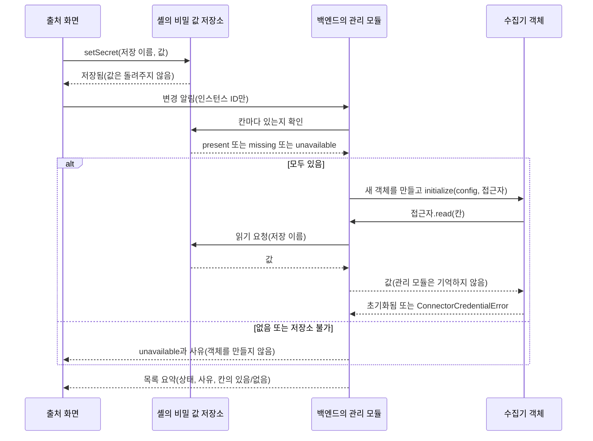
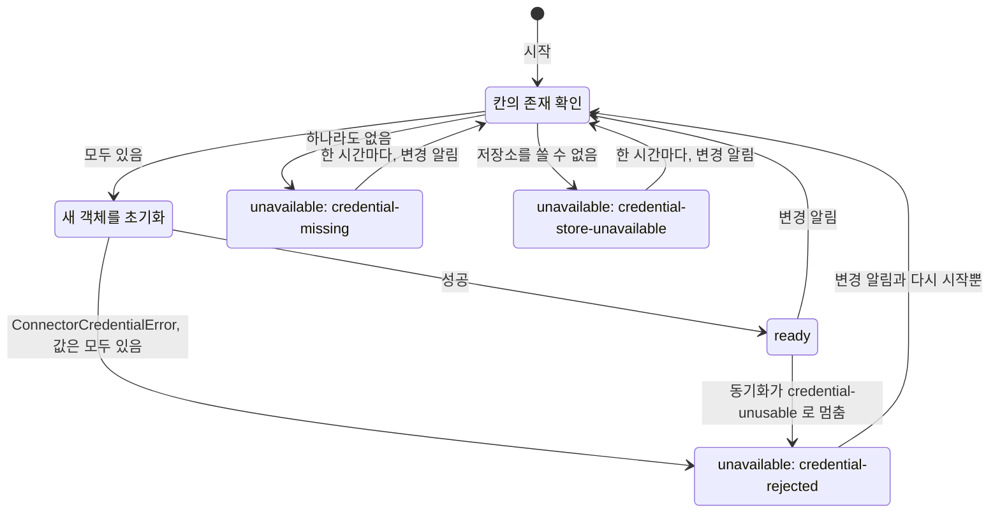

# 스펙: I06 수집기에 자격 증명을 넘기는 경로

- 날짜: 2026-11-22 / 상태: 초안
- 관련: 이슈 #114(이 spec), 함께 열린 #113([I05 spec](2026-11-22-I05-site-connector-registration.md). 구현이 진행 중이며 아직 합쳐지지 않았다)·#115(설치본의 인스턴스 범위 파일. 따로 쓰는 spec), 선행 #18(I01)·#16(V01의 비밀 값 저장). [I01 spec](2026-11-21-I01-connector-sdk.md)(I01-R4 오류, R19 멈춤 코드, R20 결과 표, R25 계약 묶음), [I03 spec](2026-11-21-I03-persistent-queue.md)(I03-R16 보류와 재점검), [V01 spec](2026-11-21-V01-vertical-skeleton.md)(V01-R13 비밀 값), [ADR 0010](../adr/0010-encryption-at-rest.md), [ADR 0016](../adr/0016-connector-sdk-v2.md), [connector-sdk.md](../connector-sdk.md) 8장 "자격 증명", [site-setup.md](../site-setup.md) S04·S11, [ownership.md](../ownership.md)

낯선 말은 [ARCHITECTURE 0절](../ARCHITECTURE.md#0-처음-나오는-말)에 풀이가 있다. 이 spec에서 새로 쓰는 말은 아래 표에 있다. `I01-…`·`I03-…`·`I05-…`·`V01-…`은 그 spec의 번호, `S…`는 site-setup.md 체크리스트 번호다.

| 말 | 뜻 |
|---|---|
| 자격 증명 | 수집기가 원 시스템에 접근할 때 내는 비밀 값. API 토큰, 앱 암호, 클라이언트 비밀 값 같은 것 |
| 칸(slot) | 한 인스턴스가 필요로 하는 자격 증명 하나에 붙인 짧은 이름(예: `token`). 값이 아니라 자리의 이름이다 |
| 비밀 값 저장소 | V01이 만든 것. Electron 셸이 OS가 지키는 키로 암호화한 암호문만 데이터 폴더의 `secrets.json`에 둔다(ADR 0010). 이 문서에서 "OS 저장소"는 이것을 가리킨다 |
| 접근자 | 값을 직접 들고 있지 않고, 부를 때마다 저장소에서 읽어 돌려주는 작은 객체. 이 spec에서는 `ConnectorCredentials` |
| 변경 알림 | 화면이 자격 증명을 저장하거나 지운 뒤 백엔드에 "이 인스턴스의 자격 증명이 바뀌었다"고 알리는 호출 |
| canary | 시험이 자격 증명 값으로 쓰는 지어낸 표식 문자열. 어디에도 남지 않아야 하는 곳을 뒤져 이 문자열이 없음을 확인한다 |

## 배경

수집기가 제품에서 받는 것은 `initialize(config)`의 설정 하나다(`packages/contracts/src/connector.ts`의 `Connector`). 실제 메일·메신저·Wiki 수집기는 토큰이나 암호가 있어야 원 시스템에 닿는데, 제품이 그 값을 보관하고 건네는 길이 없다. [connector-sdk.md](../connector-sdk.md) 8장은 "자격 증명은 OS 자격 증명 저장소에 두고 레코드·설정 파일·로그에 넣지 않는다"는 **규칙**만 적고, 수단은 "아직 없다, 포크가 정해야 한다"고 적어 두었다.

수단이 없으면 포크가 고를 수 있는 길은 셋인데 모두 나쁘다.

- 값을 등록의 `config`에 적는다. 그러면 값이 저장소의 코드에 남고, `config`는 제품이 기본 주기를 정할 때 읽는 값이라(`backend/src/connectors.ts`의 `configOf`) 다른 코드로 흘러간다.
- 수집기가 OS 보관함을 직접 부른다. 그러려면 네이티브 모듈이 필요한데 I05는 포크 수집기의 네이티브 모듈을 지원하지 않는다(I05 비목표).
- 포크가 입력 화면을 따로 만든다. 그러려면 `site/` 밖의 화면 코드를 고쳐야 해서 [ownership.md 3절](../ownership.md)의 규칙을 어긴다.

한편 V01은 이미 비밀 값 저장소를 갖고 있다. 셸이 값을 암호화해 두고(`apps/desktop/src/secret-store.ts`), 백엔드는 쓸 때마다 셸에 물어 받으며(`backend/src/secret-sources.ts`의 `channelSecrets`), 화면은 저장·확인·삭제만 할 수 있고 되읽지 못한다(`apps/desktop/src/bridge.ts`). 지금 이 저장소에 든 것은 Provider의 API 키 하나뿐이고, 셸은 그 이름 모양만 백엔드에 내어 준다(`packages/contracts/src/secrets.ts`의 `isBackendReadableSecret`).

상태 쪽에도 빈 곳이 있다. 자격 증명이 없거나 만료된 인스턴스는 지금 "초기화 실패"와 구별되지 않는다. 목록의 사유는 `unsupported-sdk-version` 하나뿐이고, 수집 작업은 뭉뚱그린 사유 `connector-unavailable`로 보류된다(`backend/src/connector-sync-job.ts`의 `heldReason`). 사용자는 "값을 넣어야 한다"는 것을 화면에서 알 수 없다. 그리고 동기화 도중에 원 시스템이 자격 증명을 거부하면 수집기는 `ConnectorError`로 알릴 수밖에 없어서, 그 작업은 재시도를 다 쓰고 포기한 작업(dead letter)이 된다. 사람이 값을 고치면 풀리는 일인데 그렇게 다뤄지지 않는다.

I05는 이 값이 들어올 자리를 미리 한 곳으로 모아 두었다. 수집기 객체를 만들고 초기화하는 일은 관리 모듈의 한 곳에서만 일어나고 시작과 재점검이 그 길을 함께 쓴다(I05-R13, 설계 개요 "#114와 #115에 남기는 것"). 이 spec은 그 한 곳에 자격 증명을 끼운다.

## 목표

- 수집기 인스턴스마다 필요한 자격 증명을 **V01의 비밀 값 저장소 하나에** 두고, 수집기는 `initialize`가 받는 접근자로 그 값을 읽는다. 새 저장소를 만들지 않는다.
- 평문 값은 다음 어디에도 남지 않는다: 설정 파일, 정본 DB를 비롯한 데이터 폴더의 파일, 삭제 장부, 로그, API 응답, 오류 문구, `site-check` 출력, 계약 묶음의 출력.
- 값은 화면으로 **돌아가지 않는다.** 화면은 값을 넣고 지우고 "있음/없음"을 볼 수만 있다.
- 저장소를 쓸 수 없으면 그 인스턴스는 정해진 사유와 함께 `unavailable`이 된다. 환경 변수나 파일의 평문으로 조용히 넘어가지 않는다.
- 자격 증명이 **없음**, **저장소를 쓸 수 없음**, **원 시스템이 거부함(만료 포함)**의 세 경우가 각각 닫힌 사유 코드로 목록과 작업의 보류 사유에 보이고, 값을 고치면 다시 풀린다.
- 거부된 값으로 원 시스템을 되풀이해 두드리지 않는다.
- 계약 묶음이 자격 증명과 관련된 규격 위반을 코드로 잡고, 그 출력에는 값이 실리지 않는다.
- 규격 버전은 2 그대로다. 자격 증명을 쓰지 않는 기존 수집기는 고치지 않아도 그대로 돈다.

## 비목표 (배포처에서 후속 진행)

**공용 저장소의 뒤 작업으로 넘기는 것**

- **수집기가 값을 저장소에 되쓰는 길.** 원 시스템이 새 토큰을 내어 주며 옛 토큰을 버리는 방식(회전하는 refresh token)에서는 수집기가 새 값을 저장해야 한다. 이 spec의 접근자는 읽기만 한다. 그런 원 시스템이면 사용자가 값을 다시 넣어야 한다(미해결 질문 1).
- **브라우저 창을 띄우는 로그인 절차**(OAuth 인가 코드 방식, SSO 창). 이 spec이 다루는 것은 사용자가 화면에 직접 넣는 값이다.
- 한 값이 8192자를 넘는 자격 증명(큰 인증서 묶음). 저장소의 값 한도(`SecretValueSchema`)를 그대로 쓴다.
- 더는 쓰이지 않는 자격 증명을 한 번에 정리하는 화면(I06-R15, 미해결 질문 2).
- 브라우저 개발용 백엔드(`backend/src/dev.ts`)에서 수집기 자격 증명을 주는 길. 그 실행에는 셸이 없어 저장소가 없고, I05도 그 진입점에 포크 수집기를 싣지 않는다.
- #115(인스턴스 범위 파일). 이 spec은 `backend/src/connector-scopes.ts`를 건드리지 않는다.

**어느 작업에서도 하지 않는 것**

- 새 비밀 값 저장소나 OS 보관함용 네이티브 모듈. ADR 0010이 고른 저장 방식을 그대로 쓴다.
- 포크의 코드로부터 값을 지키는 일. 포크의 수집기는 백엔드와 같은 프로세스에서 같은 권한으로 도는 믿는 코드다(I05 "신뢰 경계와 남는 위험"). 칸 단위의 제한은 실수를 잡는 장치이지 격리가 아니다.
- 규격 버전을 3으로 올리는 일. 이 spec이 규격에 더하는 것은 모두 선택 항목이다.
- I05가 정한 것의 재정의: 진입점 주입, `SiteRegistration`의 기존 필드, 등록 검사의 기존 코드, 시작 시간 제한, 재점검의 새 객체 규칙, 공용 종류 예약. 이 spec은 그 위에 더하기만 한다(I06-R2, R6이 더하는 곳을 적는다).

**배포처 후속 항목**(2개. [site-setup.md의 배포처 설정 체크리스트](../site-setup.md#배포처-설정-체크리스트)와 번호로 대응한다. **번호는 잠정이며 머지 순서로 조정한다.** I02-B가 S23~S25, I05가 S26·S27을 쓰므로 그 다음 번호를 골랐다. 함께 쓰이는 #115의 spec과 겹치면 조정자가 다시 배정한다)

| 번호 | 항목 |
|---|---|
| S28(잠정) | 실제 수집기가 쓰는 자격 증명의 종류를 정해 인스턴스마다 칸을 선언하고, Windows 11 설치본에서 다음을 실행해 기록한다. ① 화면에서 값을 넣으면 인스턴스가 사용 가능해지고 동기화된다 ② 틀린 값을 넣으면 "자격 증명이 거부됨"으로 멈추고 값을 고치면 풀린다 ③ 데이터 폴더의 `secrets.json`과 정본 DB, 로그에 그 값이 평문으로 없다 ④ Windows의 OS 보호(DPAPI)를 쓸 수 없는 계정에서는 값이 저장되지 않고 인스턴스가 "저장소를 쓸 수 없음"으로 보인다 |
| S29(잠정) | 실제 수집기와 그 의존성(HTTP 클라이언트 등)이 실제 원 시스템의 응답에서도 자격 증명을 레코드, 오류 문구, 자기 로그에 남기지 않는지 확인하고 기록한다. 원 시스템의 만료 주기와, 만료되었을 때 사용자가 값을 다시 넣는 절차도 함께 적는다. 값을 되써야 하는 방식(회전하는 토큰)이면 그 사실을 공용 저장소에 알린다([ownership.md 5절](../ownership.md)) |

수집기의 인증 방식을 고르는 일 자체는 S04가, 앱이 OS 보호 저장소를 쓸 수 있는지의 확인은 S11이 이미 갖고 있으므로 다시 세지 않는다.

## 요구사항

### 저장과 이름

- **I06-R1 저장소는 하나.** 수집기의 자격 증명은 V01의 비밀 값 저장소에만 둔다. 저장, 암호화, 파일 형식, "OS 보호를 쓸 수 없으면 아무것도 저장하지 않는다"는 규칙은 지금 그대로다(`apps/desktop/src/secret-store.ts`). 이 spec은 그 저장소에 **이름 모양 하나**를 더할 뿐이다.
- **I06-R2 칸의 선언.** 인스턴스가 필요로 하는 칸은 인스턴스 정의의 선택 필드 `credentials`(칸 이름의 목록)로 선언한다. 이 필드는 I05의 `SiteRegistration.connectorInstances` 항목이 쓰는 타입(`ConnectorInstanceConfig`)에 **더해지는** 선택 필드이며, 없으면 지금과 같다.
  - 칸 이름은 `^[a-z][a-z0-9-]{0,15}$`를 따르고, 한 인스턴스 안에서 서로 다르며, 많아야 `MAX_CREDENTIAL_SLOTS`(잠정 8)개다.
  - 위반은 등록 검사(`checkSiteRegistration`, I05-R9)가 **새 코드 하나** `instance-credentials-invalid`로 돌려준다. 시작할 때는 I05의 `instance-id-invalid`와 같은 갈래다: 그 인스턴스를 빼고 계속하며 로그의 `site-registration-rejected`에 코드와 건수가 남는다. 이것은 I05-R9의 표에 행 하나를 **더하는** 것이고 기존 행은 바꾸지 않는다.
  - 선언에는 값을 적지 않는다. 선언은 코드에 남는 것이고 값은 저장소에만 있다.
- **I06-R3 저장 이름.** 한 칸의 저장 이름은 `connector.<32자리 16진수>.<칸>`이다. 16진수는 `종류`, 줄바꿈 한 글자, `인스턴스 ID`를 이은 글의 SHA-256 앞 32자리다(함수 `connectorCredentialName(kind, instanceId, slot)`, 잠정 이름).
  - 해시를 쓰는 까닭: 저장 이름은 64자 이하의 좁은 글자만 받는데(`SecretNameSchema`) 인스턴스 ID는 128자까지의 아무 글자다. Provider 키의 이름이 호스트를 해시하는 것과 같은 방식이다.
  - 종류를 함께 넣는 까닭: 같은 ID가 나중에 다른 종류의 인스턴스로 다시 쓰이더라도 옛 종류의 값이 새 종류의 수집기에 건네지지 않게 한다. 종류 이름에는 줄바꿈이 들 수 없으므로(I05-R7) 이은 글은 한 가지로만 읽힌다.
  - 이 모양을 판정하는 함수 하나(`isConnectorCredentialSecret`, 잠정 이름)를 `@pki/contracts`에 둔다. 셸과 백엔드가 같은 함수를 쓴다.
- **I06-R4 셸이 내어 주는 범위.** 셸은 백엔드의 읽기 요청과 존재 확인 요청에 **Provider 키의 이름이거나 수집기 자격 증명의 이름일 때만** 답한다. 그 밖의 이름은 지금처럼 `unavailable`이다.
  - **Provider 키를 정리하는 요청(`prune`, `deleteOthers`)은 수집기 자격 증명을 지우지 않는다.** 지금 그 정리는 "백엔드가 읽을 수 있는 이름 가운데 하나만 남기고 전부"를 지운다(`secret-store.ts`의 `deleteOthers`). 그래서 읽을 수 있는 이름의 판정을 그대로 넓히면 Provider의 주소를 바꿀 때 수집기의 값이 함께 지워진다. 두 판정을 따로 두고, 정리는 Provider 키의 이름만 본다.
  - 셸이 없는 실행(`NO_SECRET_STORE`)과 브라우저 개발의 환경 변수 출처(`envSecrets`)는 수집기 자격 증명의 이름에 `unavailable`로 답한다. 환경 변수에서 수집기 자격 증명을 읽는 길은 두지 않는다.

### 값을 넘기는 길

- **I06-R5 규격에 더하는 것.** `@pki/contracts`의 규격에 다음을 더한다. 모두 선택 항목이라 `CONNECTOR_SDK_VERSION`은 2 그대로이고, 인자 하나만 받는 기존 `initialize` 구현은 고치지 않아도 타입 검사와 실행이 그대로다.
  - `initialize(config, context?)`: 둘째 인자 `ConnectorContext`. 지금 든 것은 `credentials` 하나다.
  - `ConnectorCredentials`: `read(slot)` 하나. 그 칸의 값을 돌려주거나 `ConnectorCredentialError`로 거부한다.
  - `ConnectorCredentialError`: 자격 증명을 쓸 수 없음을 알리는 오류. **생성자가 인자를 받지 않고 문구가 고정이다.** 수집기는 원 시스템이 자격 증명을 거부했을 때(인증 실패, 만료, 철회) 이 오류를 던진다. 접근자가 던진 것을 그대로 흘려보내도 된다.
  - 제품은 `initialize`를 부를 때 **언제나** `context`를 넘긴다. 칸을 선언하지 않은 인스턴스의 접근자는 무엇을 읽어도 거부한다.
- **I06-R6 넘기는 자리는 한 곳.** 접근자는 I05가 만든 "수집기 객체를 만들고 초기화하는 한 곳"(I05-R13)에서만 만들어진다. 시작, 한 시간마다의 재점검, 변경 알림(I06-R12)이 모두 그 한 곳을 지난다. 그 차례는 다음과 같다.
  1. 선언한 칸마다 저장소에 **있는지만** 묻는다(값은 저장소를 떠나지 않는다).
  2. 하나라도 없거나 저장소를 쓸 수 없으면 **수집기 객체를 만들지 않고**(만드는 함수도 `initialize`도 부르지 않는다) 그 인스턴스를 사유와 함께 `unavailable`로 둔다(I06-R9).
  3. 모두 있으면 객체를 만들고 그 객체에 묶인 접근자를 `initialize(config, { credentials })`로 넘긴다.
  - 존재 확인은 `CREDENTIAL_CHECK_TIMEOUT_MS`(잠정 3초) 안에 답이 없으면 "저장소를 쓸 수 없음"이다. I05의 시작 시간 제한(10초)보다 짧게 두어, 저장소가 답하지 않을 때의 사유가 "시간 초과"가 아니라 저장소 쪽으로 정해지게 한다. 시작 전체는 I05-R10의 제한을 그대로 따른다.
- **I06-R7 접근자의 동작과 값의 수명.**
  - `read(칸)`은 부를 때마다 저장소에서 읽는다. 제품은 값을 **기억해 두지 않는다**: 관리 모듈의 인스턴스 표, 목록의 요약, `config`, 로그의 인자, 작업의 자료 어디에도 값을 넣지 않는다. 백엔드 프로세스의 메모리에 값이 있는 때는 둘뿐이다. ① 셸의 답을 수집기에게 돌려주는 그 한 번의 호출 동안 ② 수집기 객체가 스스로 쥐고 있는 동안(제품이 막을 수 없다. 수집기 작성자 안내에 "필요한 동안만 쥔다"를 적는다).
  - 선언하지 않은 칸을 읽으면 저장소에 묻지 않고 `ConnectorCredentialError`다.
  - 저장소가 "없음"이나 "쓸 수 없음"으로 답하거나 답이 늦으면 `ConnectorCredentialError`다. 접근자는 다른 종류의 오류를 던지지 않고, 그 오류에는 칸 이름도 저장 이름도 싣지 않는다.
  - **버려진 객체의 접근자는 끊긴다.** I05-R13에 따라 버려지는 객체(시간 제한을 넘긴 시도, 실패한 재점검, 새 객체로 교체된 것)의 접근자는 그때부터 무엇을 읽어도 저장소에 묻지 않고 거부한다. 닫을 수 없는 객체가 뒤에서 계속 돌더라도 새 값을 읽어 가지 못하게 한다.
- **I06-R8 `site-check`.** `site-check <종류>`(I05-R19의 함수)는 무엇을 읽어도 거부하는 접근자를 넘겨 초기화한다. 초기화가 `ConnectorCredentialError`로 끝나면 한 줄 `<종류>: ok (credential-required)`를 내고 0으로 끝난다. 이 명령이 묻는 것은 "자리표시가 아니라 구현이 등록되어 있는가"이고, 자격 증명이 있어야 더 나아간다는 답은 구현이 있다는 뜻이기 때문이다. 이 경우 오류의 문구는 출력하지 않는다.

### 상태와 보류

- **I06-R9 사유 셋.** 수집기 목록의 `reason`(지금 값은 `unsupported-sdk-version` 하나)에 세 값을 더한다. 상태는 셋 모두 `unavailable`이다. I05가 "화면에서 원인을 보여야 할 때 계약에 값을 더한다"고 남겨 둔 자리를 쓰는 것이다.

  | 사유 | 언제 | 어떻게 판정하나 |
  |---|---|---|
  | `credential-store-unavailable` | 저장소를 쓸 수 없다(셸이 없음, OS 보호를 쓸 수 없음, 파일을 읽을 수 없음, 답이 늦음) | 선언한 칸의 존재 확인 가운데 하나라도 `unavailable` |
  | `credential-missing` | 선언한 칸 가운데 값이 없는 것이 있다 | 위가 아니고, 존재 확인 가운데 하나라도 `missing` |
  | `credential-rejected` | 값은 있는데 원 시스템이 받아 주지 않는다(틀림, 만료, 철회) | 수집기가 `ConnectorCredentialError`를 던졌고, 그 직후 다시 물은 존재 확인이 모두 `present` |

  - 수집기가 `ConnectorCredentialError`를 던졌을 때 제품은 **수집기의 말이 아니라 저장소의 상태로** 사유를 정한다. 다시 물어 없으면 `credential-missing`, 쓸 수 없으면 `credential-store-unavailable`, 모두 있으면 `credential-rejected`다. 칸을 선언하지 않은 인스턴스가 이 오류를 던지면 `credential-rejected`다.
  - **만료와 거부는 한 사유다.** 저장소는 값의 만료 시각을 모르고, 제품이 만료를 따로 아는 길은 수집기의 말뿐이다. 사용자가 할 일(값을 다시 넣는다)이 같으므로 나누지 않는다.
  - 그 인스턴스의 동기화 요청은 지금처럼 `connector-unavailable`로 답한다(I05-R11).
- **I06-R10 동기화 도중의 거부.** `getChanges`가 `ConnectorCredentialError`를 던지면 그 동기화는 새 멈춤 코드 `credential-unusable`로 멈춘다(I01-R19의 닫힌 목록에 하나를 더한다).
  - 같은 호출을 다시 시도하지 않는다(I01-R18의 재시도는 `ConnectorError`와 요청 한도에만 걸린다).
  - 앞서 저장한 페이지는 남고 cursor는 마지막으로 저장한 것이다(다른 멈춤과 같다).
  - 그 인스턴스는 I06-R9의 판정으로 `unavailable`이 된다. **상태를 바꾸는 것은 그 인스턴스의 지금 객체가 낸 결과뿐이다.** 교체되기 전의 객체가 돌던 동기화가 뒤늦게 이 코드로 멈춰도 인스턴스의 상태는 바뀌지 않는다.
  - I01-R20의 결과 표에 행 하나를 더한다: `credential-unusable` → `held`, 시도를 **씀**(수집기를 불렀다), 다음 실행은 "자격 증명 변경 알림, 앱을 다시 시작함, 사유가 `credential-rejected`가 아니면 시간당 재점검". 보류 사유는 인스턴스의 사유(I06-R9의 셋 가운데 하나)다. 표는 상수 `SYNC_OUTCOMES`와 I01 spec의 표 두 곳에 있고 시험이 둘을 대조하므로 **같은 PR에서 함께** 고친다.
  - 세 사유를 보류 사유의 표(`backend/src/held-release.ts`의 `HELD_REASONS`)에 수집기 갈래(`collector`)로 더한다. 풀리는 길은 기존 수집기 사유와 같다: 그 인스턴스가 `ready`가 될 때 인스턴스 단위로 풀린다.
  - 화면의 문구를 더한다: 작업의 보류 사유 셋(`apps/web/src/job-text.ts`), 멈춤 코드 하나(`apps/web/src/connector-text.ts`의 `SYNC_STOP_TEXT`), 수집기 표의 사유 셋(I06-R14).
- **I06-R11 재점검.** I05-R13의 재점검에 다음 둘을 더한다. 그 밖은 I05 그대로다.
  - 사유가 `credential-missing`이나 `credential-store-unavailable`인 인스턴스: 재점검은 I06-R6의 차례를 처음부터 다시 밟는다. 여전히 없으면 존재 확인만 하고 끝난다(원 시스템을 부르지 않는다). 생겼으면 새 객체로 초기화한다.
  - 사유가 `credential-rejected`인 인스턴스: **한 시간마다의 재점검이 건너뛴다.** 존재 확인도, 만드는 함수도, `initialize`도 부르지 않는다. 같은 값으로 원 시스템을 되풀이해 두드리면 계정이 잠길 수 있기 때문이다. 이 인스턴스가 다시 시도되는 때는 변경 알림(I06-R12)과 앱을 다시 시작할 때뿐이다. 다시 시작하면 한 번 시도한다(거부되었다는 사실은 저장하지 않는다).
- **I06-R12 변경 알림.** 백엔드에 `POST /api/connectors/credentials-changed`(본문 `{ connectorId }`)를 둔다. 값은 싣지 않는다.
  - 받으면 그 인스턴스를 I06-R6의 차례로 **다시 만든다.** 지금 `ready`인 인스턴스도 마찬가지다(재점검과 다른 점이다. 재점검은 `ready`인 객체를 바꾸지 않는다). 새 객체가 초기화되고 `healthCheck`가 괜찮으면 그 객체로 바뀌어 `ready`가 되고 그 인스턴스의 보류된 작업이 풀린다. 아니면 I06-R9의 사유와 함께 `unavailable`이 된다. 옛 객체는 어느 쪽이든 버려지고 그 접근자는 끊긴다(저장소에 든 것은 이미 새 값이거나 없음이다).
  - 시간 제한과 늦은 결과를 버리는 규칙은 I05의 재점검과 같다(`RECHECK_TIMEOUT_MS`).
  - 그 인스턴스에서 돌고 있던 동기화는 쥐고 있던 옛 객체로 끝까지 간다. 끊긴 접근자를 읽어 `credential-unusable`로 멈출 수 있고, 그 결과는 인스턴스의 상태를 바꾸지 않는다(I06-R10).
  - 다시 만드는 일이 진행 중일 때 알림이 또 오면 잃지 않는다. 진행 중인 것이 끝난 뒤 **한 번 더** 다시 만든다(알림이 여러 번 와도 한 번이다).
  - 답은 그 인스턴스의 목록 요약이다. 모르는 ID는 `not-found`다.
- **I06-R13 목록에 보이는 것.** 칸을 선언한 인스턴스의 목록 요약에 `credentials`가 붙는다: 칸마다 `slot`(칸 이름), `name`(저장 이름), `state`(`present`·`missing`·`unavailable`). 값은 없다. `state`는 마지막으로 확인했을 때의 것이다(시작, 재점검, 변경 알림에서 확인한다). 칸을 선언하지 않은 인스턴스에는 이 필드가 없다.

### 값을 쓰는 곳

- **I06-R14 화면에서 넣는다.** 공용 제품의 출처 화면(수집기 표)이 칸을 선언한 인스턴스마다 칸의 상태, 값 입력란, 저장과 삭제를 보인다. 포크는 화면을 고치지 않는다.
  - 저장과 삭제는 지금의 preload 함수 `setSecret(name, value)`와 `deleteSecret(name)`를 쓴다(Provider 키와 같은 길). 이름은 목록이 준 `name`을 그대로 쓴다. **preload에 함수를 더하지 않는다.** 값은 화면에서 셸로 곧장 가고 백엔드 API를 지나지 않는다.
  - 저장이나 삭제가 성공하면 화면이 변경 알림(I06-R12)을 한 번 부르고, 입력란을 비운다. 저장이 실패하면("OS 보호를 쓸 수 없음") 그 문구를 보이고 알림을 부르지 않는다.
  - 화면은 값을 되읽는 길이 없다(preload에 읽는 함수가 없다. 지금 그대로다). 화면은 값을 API 요청, 주소, 브라우저 저장소에 넣지 않는다.
  - 셸이 없는 브라우저 개발 실행에서는 입력란을 보이지 않고 "이 실행에는 저장소가 없다"는 안내만 보인다.
  - 수집기 표는 사유 셋을 각각 다른 문구로 보인다.
- **I06-R15 인스턴스가 없어져도 값을 지우지 않는다.** 등록에서 빠진 인스턴스의 값은 저장소에 암호문으로 남는다. 제품은 시작할 때 저장소를 정리하지 않는다.
  - 남은 값은 어느 수집기에도 건네지지 않는다. 저장 이름이 종류와 ID에서 나오므로 그 종류와 ID의 인스턴스가 다시 등록될 때만 다시 쓰인다.
  - 지우지 않는 까닭: 자동으로 지우면 공용 진입점이나 수집기를 뺀 빌드로 같은 데이터 폴더를 한 번 띄우는 것만으로 모든 값이 사라진다. 값은 다시 발급받기 어려울 수 있다. 사용자가 지우는 길은 인스턴스가 있을 때의 삭제 단추와, 앱의 데이터를 지우는 기존 절차다.

### 누출 없음

"없다"는 요구는 모두 시험이 canary로 뒤져 확인할 수 있는 모양으로 적는다.

- **I06-R16 제품이 값을 남기지 않는 곳.** 자격 증명의 값(원래 글, base64로 바꾼 글, 주소용으로 바꾼 글(percent-encoding))은 다음 어디에도 나타나지 않는다.
  1. 데이터 폴더의 모든 파일: 정본 DB와 그 보조 파일, 삭제 장부, 투영의 파일, `secrets.json`(여기에는 암호문만 있다).
  2. 설정 파일: 제품은 `site/config/` 아래나 그 밖의 어떤 설정 파일에도 값을 쓰지 않는다.
  3. 백엔드와 셸의 로그 줄, 표준 출력과 표준 오류(시작 실패 줄 포함).
  4. 모든 API 응답 본문과 셸이 화면에 돌려주는 답.
  5. 동기화 결과, 작업의 행과 이력, 보류 사유, 활동 목록.
  6. `site-check`의 출력.
  이것은 수집기가 **일부러 흘려도** 지켜져야 한다: 값을 문구, 오류의 이름, `cause`, `healthCheck`의 사유에 실어 던지는 수집기에 대해서도 위 여섯이 참이다. 제품은 수집기 오류의 문구를 옮기지 않는다는 기존 규칙(I01-R4)을 이 길 전부에서 지킨다.
- **I06-R17 값은 화면으로 돌아가지 않는다.** 값이 지나는 길은 "화면 입력 → 셸의 저장소"와 "셸 → 백엔드 프로세스 → 수집기" 둘뿐이다. 백엔드의 어떤 API도, 셸의 어떤 preload 함수도 값을 답에 싣지 않는다. 셸은 값이 든 답을 백엔드 프로세스에만 보낸다.
- **I06-R18 평문으로 넘어가지 않는다.** 저장소를 쓸 수 없을 때 제품은 환경 변수, 설정 파일, 등록의 `config`에서 대신 읽지 않는다. 그 인스턴스는 `credential-store-unavailable`이고 수집기 객체는 만들어지지 않는다.
- **I06-R19 막지 못하는 것.** 다음은 제품이 실행 중에 잡을 수 없고, 계약 묶음(I06-R20~R22)과 수집기 작성자 안내, S29가 맡는다. 문서에 그대로 적는다.
  - 수집기가 값을 **레코드의 본문이나 `metadata`에 넣어 돌려주는 일.** 제품은 값을 들고 있지 않으므로 받은 레코드를 값과 견줄 수 없다.
  - 수집기나 그 의존성이 자기 로그나 파일에 값을 쓰는 일.
  - 포크의 코드가 다른 인스턴스의 값을 읽는 일(같은 프로세스의 믿는 코드다).

### 계약 묶음

- **I06-R20 시나리오의 확장.** `@pki/testkit`의 `ConnectorScenario`에 선택 필드 둘을 더한다. 둘 다 없으면 계약 묶음은 지금과 글자 그대로 같은 결과를 낸다.
  - `credentials`: 칸 이름 → 지어낸 값. 계약 묶음이 이 값을 읽어 주는 접근자를 만들어 `initialize`에 넘긴다. 값은 16자 이상이어야 한다(짧으면 우연히 겹친다. 어기면 시나리오의 오류다).
  - `rejected`: 지어낸 원 시스템이 **거부하도록 꾸민** 설정과 값(`{ config, credentials }`). 있으면 거부 신호를 본다(아래 넷째 코드).
- **I06-R21 위반 코드 넷.** I01-R25의 닫힌 목록 뒤에 넷을 더한다. 코드만 돌려주며 값이나 문구는 돌려주지 않는다.

  | 코드 | 잡는 것 | 볼 수 있는 조건 |
  |---|---|---|
  | `credential-in-record` | 시나리오의 값이 `getChanges`나 `getDocument`가 돌려준 것 안에 있다 | `credentials`가 있을 때 |
  | `credential-in-health` | 시나리오의 값이 `healthCheck`의 답 안에 있다 | `credentials`가 있을 때 |
  | `credential-in-error` | 시나리오의 값이 수집기가 던진 오류의 문구, 이름, 열거되는 필드, `cause` 사슬 안에 있다. 계약 묶음이 이미 일으키는 실패(초기화 전의 호출, 취소된 호출)와 거부 시나리오의 실패를 본다 | `credentials`나 `rejected`가 있을 때 |
  | `credential-rejection-unsignalled` | 거부 시나리오로 새 객체를 초기화하고 한 번 읽었는데, `initialize`도 첫 `getChanges`도 `ConnectorCredentialError`로 끝나지 않았다 | `rejected`가 있을 때 |

  값의 대조는 I06-R16과 같은 세 모양(원래 글, base64, percent-encoding)으로 한다.
- **I06-R22 계약 묶음의 출력에 값이 없다.** 계약 묶음이 스스로 던지는 오류(시나리오의 오류)와 vitest 묶음의 실패 보고에는 시나리오의 값이 실리지 않는다. 지금 계약 묶음은 초기화가 실패하면 수집기의 오류를 `cause`로 달아 던지는데(`packages/testkit/src/connector.contract.ts`), 그 오류에 값이 들어 있으면 `cause`를 달지 않고 `credential-in-error`를 기록한다.
- **I06-R23 예시.** 공용 예시 패키지(`packages/connector-example`)에 자격 증명을 쓰는 예시 수집기 하나를 더한다. 지어낸 원 시스템이 지어낸 토큰을 검사하고, 틀리면 수집기가 `ConnectorCredentialError`를 던진다. 이 예시는 두 시나리오(`credentials`, `rejected`)로 계약 묶음을 위반 없이 통과하고, 넷 가운데 하나씩만 어기는 수집기 넷이 각각 그 코드 하나만 받는다. 문서의 코드 블록은 이 예시의 발췌다.

### 문서

- **I06-R24 connector-sdk.md.** 다음을 고친다. 고친 문장은 문서 대응 테스트가 붙잡는다.
  - 8장 "자격 증명": "통로가 없다, 포크가 정한다"는 문단을 새 길로 바꾼다. 칸의 선언, 접근자로 읽는 법(예시의 발췌), `ConnectorCredentialError`를 던지는 때, 값을 쥐는 시간에 관한 안내, 화면에서 값을 넣는 곳, 세 사유와 풀리는 길, 거부된 값은 다시 시도되지 않는다는 점, 막지 못하는 것 셋(I06-R19), 값을 되쓰는 길이 없다는 점.
  - 2장의 `initialize` 서명, 5장의 오류 종류와 결과 표(`credential-unusable` 행), 6장의 계약 코드 표와 시나리오 필드, 11장 "아직 없는 것"에서 #114 행을 뺀다.
- **I06-R25 그 밖의 문서.**
  - site-setup.md: "실행 중 설정"에 수집기 자격 증명 행을 더하고(설정 파일에 두지 않으며 화면에서 넣는다), 체크리스트에 S28·S29를 넣고, 번호 범위 안내에 이 spec을 더하고, S04의 문장이 칸의 선언을 가리키게 한다.
  - ownership.md 3절 "현재의 예외" 문단에서 #114를 뺀다(I05-T05가 그 문단을 먼저 고친다).
  - 새 ADR에 결정을 남긴다: 수집기 자격 증명을 V01의 저장소에 두는 것, 규격에 선택 항목으로 더하고 버전을 올리지 않는 것, 접근자로 넘기는 것, 거부를 수집기가 알리는 것. ADR 0010과 0016에는 새 ADR을 가리키는 한 줄을 더한다. **ADR 번호는 잠정 0019이며 머지 순서로 조정한다**(지금 마지막이 0016이고 I02-B가 0017, I05가 0018을 쓴다).
  - `docs/README.md` 색인에 새 ADR을 올린다(이 spec의 행은 이 spec을 쓰는 PR이 올린다).
  - I01 spec의 표 셋(R19 멈춤 코드, R20 결과 표, R25 위반 코드)은 그 표를 읽는 시험이 있으므로 코드를 더하는 작업이 같은 PR에서 고친다.

**이 절을 줄이면**: 값은 V01의 저장소에만 있고, 수집기는 `initialize`가 받은 접근자로 읽는다. 제품은 칸이 채워져 있는지만 확인하고 값을 들고 있지 않는다. 없음·저장소 불가·거부가 각각 사유 코드로 보이고, 거부된 값은 사용자가 고칠 때까지 다시 쓰이지 않는다.

## 인터페이스 / 설계 개요

### 값이 지나는 길



비유하자면 저장소는 **은행의 대여 금고**이고 접근자는 그 금고를 열 때마다 창구에 다시 가야 하는 **출입증**이다. 관리 모듈은 출입증을 건네줄 뿐 금고 안의 것을 복사해 두지 않고, 수집기가 바뀌면 옛 출입증을 못 쓰게 한다. 다만 비유와 달리 수집기는 한 번 꺼낸 값을 자기 주머니에 계속 넣어 둘 수 있고, 제품은 그것을 막지 못한다(I06-R7).

### 규격과 내부 모양(잠정)

이름과 모양은 잠정이며 구현 작업이 다듬을 수 있다. 바뀌면 안 되는 것은 요구사항에 적은 성질이다.

```ts
// @pki/contracts — 규격에 더하는 것(I06-R5)
export class ConnectorCredentialError extends Error {
  constructor(); // 인자 없음. 문구는 고정이다
}
export interface ConnectorCredentials {
  /** 선언한 칸의 값. 쓸 수 없으면 ConnectorCredentialError로 거부한다. */
  read(slot: string): Promise<string>;
}
export interface ConnectorContext {
  readonly credentials: ConnectorCredentials;
}
export interface Connector {
  initialize(config: unknown, context?: ConnectorContext): Promise<void>;
  // 나머지는 그대로
}

// @pki/contracts — 저장 이름의 모양(I06-R3, R4)
export function isConnectorCredentialSecret(name: string): boolean;

// backend — 인스턴스 정의에 더하는 선택 필드(I06-R2)
export interface ConnectorInstanceConfig {
  id: string;
  kind: string;
  config: unknown;
  credentials?: readonly string[]; // 칸 이름. 값이 아니다
}

// backend — 새 모듈(잠정 backend/src/connector-credentials.ts)
export function connectorCredentialName(kind: string, instanceId: string, slot: string): string;
export type CredentialReason =
  "credential-store-unavailable" | "credential-missing" | "credential-rejected";

// 목록 요약에 더하는 것(I06-R9, R13)
//   reason: "unsupported-sdk-version" | CredentialReason
//   credentials?: { slot: string; name: string; state: "present" | "missing" | "unavailable" }[]
```

값이 들어오는 곳은 관리 모듈이 받는 `SecretSource`(지금 Provider에 넘기는 것과 같은 객체, `backend/src/boot.ts`의 `secrets` 옵션) 하나다. 시험은 이 자리에 메모리 대역을 넣는다.

### 인스턴스의 상태와 사유



그림에 없는 것: 초기화의 그 밖의 실패(예외, 시간 초과, 건강하지 않음)는 I05가 정한 대로 사유 없는 `unavailable`이고 그 재점검도 I05 그대로다. `ConnectorCredentialError`가 났는데 다시 물으니 값이 없거나 저장소를 쓸 수 없으면 `REJECTED`가 아니라 그 사유의 상태로 간다(I06-R9).

### 이관 경계: 잘린 자리와 그 계약

배포처로 넘어가는 경계는 **칸의 선언과 `ConnectorContext`라는 어댑터 경계**다. 공용 쪽은 이 경계의 양편을 모두 갖춘 채 끝난다.

- 인터페이스: 인스턴스 정의의 `credentials`(I06-R2)와 `initialize`가 받는 `ConnectorContext`(I06-R5).
- 계약 테스트: 계약 묶음의 코드 넷(I06-R21)과 등록 검사의 코드 하나(I06-R2). 어떤 수집기든 같은 코드 목록으로 판정된다. 공용 저장소는 예시 수집기(I06-R23)로 이 길 전체를 증명한다.
- 미구현 표시: 포크가 대체하지 않은 자리표시는 접근자를 받아도 지금처럼 `미구현, 배포처 후속`을 알린다(I06-H2).
- 코드에 배포처 값을 두지 않는다. 칸의 이름은 선언에, 값은 저장소에만 있다. 공용 기본은 칸을 선언한 인스턴스가 없어 아무 설정 없이 로컬에서 돈다.

### 신뢰 경계

| 대상 | 다루는 방식 |
|---|---|
| 화면(렌더러) | 값을 넣을 수만 있다. 어떤 이름으로든 저장·삭제할 수 있는 것은 지금과 같고, 읽지는 못한다 |
| 셸 | 값을 평문으로 다루는 유일한 저장 지점. 백엔드에는 정해진 두 이름 모양만 내어 준다(I06-R4) |
| 백엔드의 제품 코드 | 값을 지나가게만 하고 기억하지 않는다(I06-R7) |
| 포크의 수집기 코드 | 믿는 코드(I05). 접근자의 칸 제한과 끊기는 실수를 잡는 장치다. 같은 프로세스의 코드는 셸에 직접 물을 수 있으므로 격리가 아니다 |
| 수집기가 돌려주는 것(레코드, 오류의 글, 건강 사유) | 믿지 않는 자료. 오류의 글은 어디로도 옮기지 않고(I06-R16), 레코드 안의 값은 계약 묶음이 잡는다(I06-R19) |

### 대안과 기각 사유

| 번호 | 대안 | 기각한 이유 | 다시 볼 조건 |
|---|---|---|---|
| 1 | **값을 `config`에 합쳐 넘김** | `config`는 모양을 모르는 값이라 합칠 자리를 정할 수 없고, 제품이 기본 주기를 정할 때 읽는 값이라(`configOf`) 값이 다른 코드로 흘러간다. "설정에 비밀 값을 넣지 않는다"는 규칙과도 어긋난다 | — |
| 2 | **만드는 함수의 인자로 넘김**(`ConnectorFactory`가 context를 받음). 규격의 `Connector`는 그대로다 | 쓸 수 있는 방법이다. 고르지 않은 까닭: 계약 묶음과 `site-check`이 모두 `initialize`를 기준으로 수집기를 판정하고, 이슈의 과제가 "`initialize`에 넘기는 규격"이며, 만드는 함수는 I05가 등록 계약으로 막 정한 타입이다 | I05의 구현에서 만드는 함수가 다른 인자를 받게 될 때 |
| 3 | **값을 통째로 넘김**(칸 → 값의 표) | 관리 모듈이 값을 변수로 쥐게 되고, 수집기가 나중에 다시 읽을 길이 없다. 접근자는 제품이 값을 들지 않게 하고, 끊을 수 있다 | — |
| 4 | **수집기가 OS 보관함을 직접 부름** | 네이티브 모듈이 필요하다(I05가 지원하지 않는다). 값을 넣는 화면이 없어 포크가 화면을 고쳐야 한다. 제품이 "없음"과 "거부"를 구별할 수 없다 | — |
| 5 | **만료를 저장소의 메타데이터로 판정**(사용자가 만료일을 함께 입력) | 저장소는 만료를 모르고, 사용자가 넣은 날짜는 원 시스템의 사실과 어긋날 수 있다. 철회는 날짜로 알 수 없다. 원 시스템의 답이 유일한 사실이다 | 만료 전에 미리 알려야 한다는 요구가 생길 때. 그때는 수집기가 만료 시각을 알리는 선택 항목을 더한다 |
| 6 | **없어진 인스턴스의 값을 시작할 때 자동 삭제** | 수집기를 뺀 빌드나 공용 진입점으로 같은 데이터 폴더를 한 번 띄우면 모든 값이 사라진다(I06-R15) | 미해결 질문 2 |
| 7 | **값 입력을 포크 전용 수단으로**(포크의 화면이나 명령줄 도구) | 포크가 `site/` 밖의 화면을 고쳐야 하고, 명령줄 도구는 셸의 저장소(Electron의 암호화)에 닿을 수 없다 | 화면 없이 미리 값을 심어야 하는 배포 방식이 생길 때 |
| 8 | **규격 버전을 3으로 올림** | 깨지는 변경이 아니다. 버전을 올리면 모든 수집기가 `unsupported-sdk-version`이 되고 옮겨 갈 일이 생긴다(I01-R1) | 둘째 인자를 필수로 만들 때 |
| 9 | **셸이 저장 사실을 백엔드에 직접 알림**(화면의 변경 알림 대신) | 부모 채널의 메시지 종류가 하나 늘고 셸이 수집기 인스턴스를 알아야 한다. 화면의 알림이 빠져도 잘못된 값이 쓰이지는 않고 늦게 반영될 뿐이다 | 알림이 빠져 반영이 늦는 일이 관측될 때 |
| 10 | **거부된 인스턴스도 한 시간마다 재점검** | 틀린 값으로 원 시스템을 계속 두드린다. 계정 잠금으로 이어질 수 있다 | 원 시스템이 스스로 회복하는 거부(일시적인 인증 서버 장애)가 `ConnectorCredentialError`로 흔히 올라올 때. 그런 실패는 수집기가 `ConnectorError`(재시도 가능)로 알려야 한다고 문서에 적는다 |

### 작업 분해

한 행이 PR 하나다. **이 표는 잠정이다.** 조정자가 spec을 확정한 뒤 I05의 실제 머지 상태와 맞춰 보고 작업을 만든다.

코드를 바꾸는 작업은 그 코드를 붙잡고 있는 문서 문장과 문서 대응 테스트를 **같은 PR에서** 고친다(I05 spec "작업 분해"와 같은 이유다. 표와 상수를 대조하는 시험이 있어 따로 고치면 중간 PR이 통과하지 못한다).

| ID | 산출물 하나 | 선행 | 기준 | 바뀌는 파일 | 기대하는 시험 |
|---|---|---|---|---|---|
| I06-T01 | **규격에 더하는 것과 계약 묶음**: `ConnectorContext`, `ConnectorCredentials`, `ConnectorCredentialError`, 시나리오의 두 필드, 위반 코드 넷, 자격 증명을 쓰는 예시 수집기와 어기는 수집기 넷 | 없음(파일 겹침: `tooling/docs/connector-sdk.test.ts`와 connector-sdk.md는 I05의 T02~T05도 차례로 고친다. I05의 PR 사이에 끼워 합친다) | C3, C16, C17, C18 | `packages/contracts/src/connector.ts`, `packages/testkit/src/connector.contract.ts`와 그 테스트, `packages/testkit/src/scripted-connector.ts`(둘째 인자를 받아 넘김), `packages/connector-example/src/adapters/`(새 예시, `violating-connectors.ts`, 계약·위반 테스트), `packages/connector-sdk/src/index.ts`(필요하면 다시 내보내기), **문서 대응**: I01 spec의 R25 표, connector-sdk.md 6장의 코드 표, `tooling/docs/connector-sdk.test.ts` | `connector.credential-types`(인자 하나짜리 구현이 그대로 통과), `connector.contract.credentials`(코드마다 1건, 시나리오 없음의 불변 1건), `connector.contract.output-clean`, `connector-example.credentialed.contract`, `connector-example.violations`(넷 추가) |
| I06-T02 | **저장 이름과 셸이 내어 주는 범위**: `isConnectorCredentialSecret`, `connectorCredentialName`, 셸의 답 범위, 정리 범위의 고정, 셸 없는 출처의 답 | 없음(파일 겹침: `apps/desktop/src/backend-process.ts`는 I05-T03도 고친다) | C1, C15 | `packages/contracts/src/secrets.ts`와 그 테스트, 새 `backend/src/connector-credentials.ts`와 그 테스트, `apps/desktop/src/backend-process.ts`와 `backend-process.secrets.test.ts`, `apps/desktop/src/secret-store.test.ts`(정리 뒤 남음), `apps/desktop/src/bridge.test.ts`, `backend/src/secret-sources.ts`와 `secret-sources.test.ts` | `secrets.connector-names`, `connector-credentials.name`, `backend-process.secrets`(두 모양과 그 밖), `secret-store`(정리 뒤 수집기 값이 남음), `secret-sources`(환경 변수 출처와 저장소 없음) |
| I06-T03 | **관리 모듈의 길**: 칸의 선언과 등록 검사 코드, 존재 확인, 접근자와 끊기, 사유 셋, 멈춤 코드와 결과 표, 보류 사유, 재점검의 두 규칙, 다시 만들기, `site-check`, 백엔드 쪽 누출 시험 | **I05-T02**(만들고 초기화하는 한 곳, 새 객체 재점검), **I05-T03**(`SiteRegistration`, `checkSiteRegistration`, `runSiteCheck`, `bootBackend`의 `site`), I06-T01, I06-T02 | C2, C4, C5, C6, C7, C8, C9(①②③⑤), C12, C13, C14, H2 | `backend/src/connectors.ts`, `backend/src/connector-credentials.ts`, I05-T03이 만든 등록 모듈(잠정 `backend/src/site-registration.ts`), `backend/src/connector-sync-job.ts`, `backend/src/held-release.ts`, `backend/src/site-check.ts`, `backend/src/boot.ts`(관리 모듈에 `secrets`를 넘김), `packages/contracts/src/index.ts`(사유, 멈춤 코드, 목록의 `credentials`), `packages/connector-sdk/src/sync-outcomes.ts`, `apps/web/src/job-text.ts`와 `connector-text.ts`(닫힌 목록에 문구가 빠지면 타입 검사가 실패하므로 같은 PR), **문서 대응**: I01 spec의 R19 목록과 R20 표, connector-sdk.md 5장의 결과 표 | `site.registration`(새 코드 3건), `boot.registration-rejected`(새 코드), `connectors.credentials-handover`(여섯 경우), `connectors.credentials-absent`(다섯 경우), `connectors.credentials-rejected`(다섯 경우), `sync.outcome-map`, `connector-sync-job`(보류 사유 셋), `job-text.coverage`, `connectors.credentials-recheck`, `connectors.credentials-reload`, `connectors.credentials-kept`, `site-check`(자격 증명을 읽는 종류 1건, 자리표시 3건), `connectors.credentials-canary` |
| I06-T04 | **화면에서 넣고 바꾸는 길**: 변경 알림 API, 목록의 `credentials`, 출처 화면의 입력·삭제·문구 | I06-T03 | C9(④⑥), C10, C11 | `backend/src/server.ts`, `packages/contracts/src/index.ts`(경로와 스키마), `backend/src/api.contract.test.ts`, `apps/web/src/connector-table.tsx`와 그 테스트, `apps/web/src/connector-text.ts`와 그 테스트, 새 `apps/web/src/connector-credential.ts`와 그 테스트(Provider 키의 `api-key.ts`와 같은 모양), `apps/web/src/App.tsx` | `api.contract`(새 경로), `connectors.credentials-api`, `connector-credential`(여섯 경우), `connector-table`(칸의 표시), `connector-text`(사유 셋) |
| I06-T05 | **문서, ADR, site-setup S28·S29** | I06-T04, **I05-T05**(connector-sdk.md 7·11장, ownership.md의 예외 문단, site-setup의 번호 범위 안내를 먼저 고친다) | C19, H1 | `docs/connector-sdk.md`(2·5·6·8·11장), `docs/site-setup.md`, `docs/ownership.md`, 새 ADR(잠정 0019), `docs/adr/0010-…`·`0016-…`(가리키는 한 줄), `docs/README.md`, 새 `tooling/docs/site-setup-i06.test.ts`, `tooling/docs/connector-sdk.test.ts`, `backend/src/connector-sdk.docs.test.ts`, I01 spec의 처리 표시("T10이 넘기는 것"의 자격 증명 항목), 이 spec | `docs.connector-sdk`(8장의 문장과 발췌, 11장에 #114 없음), `docs.site-setup`(I06) |

- **기준과 작업의 대응**: C1~C19와 H1·H2가 모두 위 표의 한 행 이상에 있다. C9는 T03(관리 모듈의 동작)과 T04(API의 답)로 나뉜다.
- **I05와의 순서**: T01과 T02는 I05의 코드에 기대지 않으므로 I05와 나란히 갈 수 있다. 다만 같은 파일을 만지는 곳(표의 "파일 겹침")은 I05의 PR이 합쳐진 뒤 그 위에 다시 맞춘다. T03은 I05-T02와 I05-T03이 **합쳐진 뒤에만** 시작한다. 이 spec은 I05의 그 코드가 지금 있다고 전제하지 않는다. T03을 시작할 때 "만들고 초기화하는 한 곳"의 실제 이름과 모양을 읽고 이 spec의 잠정 이름을 맞춘다.
- **I02-B와의 순서**: I02-B의 JSONL 파일 위치 작업(I02B-T13)도 `connectors.ts`를 만진다. I05가 정한 순서(I05-T02 다음에 I02B-T13)를 따르고, T03은 그 둘 뒤에 간다.

**이 절을 줄이면**: 규격에 선택 인자 하나와 오류 하나를 더하고, 값은 접근자로 넘긴다. 경계는 칸의 선언과 `ConnectorContext`이고, 계약 묶음의 코드 넷과 예시 수집기로 공용에서 증명한다. 제품은 값을 기억하지 않으며, 사유는 저장소의 상태로 정한다.

## 완료 기준 (테스트 가능한 형태)

**닫는 방법.** 모든 기준은 **저장소 안의 자동 테스트**(`pnpm test`)로 닫힌다. 손으로 한 번 돌려 본 것은 기준을 닫지 못한다. 시험은 실제 OS 보관함을 쓰지 않고, 암호화 대역(`Cipher`)과 메모리 `SecretSource`를 쓴다. 그래서 **Windows에서 OS 보호가 실제로 어떻게 동작하는지는 이 기준들이 증명하지 않는다.** 그것은 배포처에서 확인할 항목 S28(배포처 대기)이며 여기서 충족했다고 하지 않는다. 값은 모두 지어낸 것이다. H1·H2는 배포처로 넘어가는 프로젝트의 spec 양식이 요구하는 두 기준이다.

- [ ] **I06-C1** (R1, R3, R4): ① `connectorCredentialName`의 결과가 `SecretNameSchema`와 `isConnectorCredentialSecret`을 통과하고, 64자 종류·128자 ID·16자 칸에서도 64자 이하이며, 종류·ID·칸 가운데 하나만 달라도 다른 이름이 된다 ② 셸은 백엔드의 읽기와 존재 확인 요청에 Provider 키의 이름과 수집기 자격 증명의 이름일 때 저장소의 답을 주고, 둘 다 아닌 이름에는 `unavailable`을 준다 ③ Provider 키 둘과 수집기 자격 증명 하나가 든 저장소에 정리 요청(`prune`)을 하면 남길 Provider 키 하나와 **수집기 자격 증명이 남는다** ④ `NO_SECRET_STORE`와 `envSecrets`는 수집기 자격 증명의 이름에 읽기도 존재 확인도 `unavailable`이다.
- [ ] **I06-C2** (R2): `checkSiteRegistration`이 ① 모양을 벗어난 칸 이름 ② 같은 칸 이름 둘 ③ `MAX_CREDENTIAL_SLOTS`를 넘는 칸의 수 각각에 `instance-credentials-invalid`를 돌려주고, 올바른 선언과 선언 없는 등록에는 돌려주지 않는다. 그런 등록으로 띄우면 시작이 끝나고 그 인스턴스만 빠지며 로그의 `site-registration-rejected`에 그 코드가 있다.
- [ ] **I06-C3** (R5): ① 인자 하나만 받는 `initialize`를 가진 기존 구현(예시 수집기, 대본 수집기, 자리표시, JSONL 수집기)이 소스를 고치지 않은 채 타입 검사를 통과하고 계약 묶음의 결과가 그대로다. `CONNECTOR_SDK_VERSION`은 2다 ② `ConnectorCredentialError`는 인자 없이 만들어지고 문구가 상수와 같다 ③ 제품이 부른 `initialize`는 칸을 선언하지 않은 인스턴스에서도 둘째 인자를 받으며, 그 접근자는 무엇을 읽어도 `ConnectorCredentialError`로 거부한다.
- [ ] **I06-C4** (R6, R7): 칸 둘을 선언한 인스턴스와 값이 든 저장소 대역으로 띄우면 ① 인스턴스가 `ready`이고 수집기가 접근자로 읽은 값이 저장한 값과 같다 ② 같은 칸을 두 번 읽으면 저장소의 읽기도 두 번 불린다(기억하지 않는다) ③ 선언하지 않은 칸을 읽으면 `ConnectorCredentialError`이고 저장소는 불리지 않는다 ④ 저장소가 그 뒤 `missing`이나 `unavailable`로 답하면 읽기가 `ConnectorCredentialError`이고, 그 오류의 문구에 칸 이름과 저장 이름이 없다 ⑤ 버려진 객체 셋(시작 때 제한을 넘긴 것, 재점검에서 실패한 것, 다시 만들기로 교체된 것) 각각의 접근자는 읽기가 거부되고 저장소가 불리지 않는다 ⑥ 시작, 재점검, 변경 알림의 세 길 모두에서 만드는 함수가 불리기 전에 칸의 존재 확인이 불린다.
- [ ] **I06-C5** (R6, R9, R18): ① 선언한 칸 하나가 없으면 만드는 함수도 `initialize`도 불리지 않고 그 인스턴스가 `unavailable`, 사유 `credential-missing`이다 ② 존재 확인 하나가 `unavailable`이면 사유가 `credential-store-unavailable`이고, `missing`과 섞여 있어도 이 사유다 ③ 존재 확인이 `CREDENTIAL_CHECK_TIMEOUT_MS` 안에 답하지 않으면 시작이 끝나고 사유가 `credential-store-unavailable`이다 ④ 저장소 없이 띄우고 환경 변수와 등록의 `config`에 canary를 두어도 수집기 객체가 만들어지지 않고 사유가 `credential-store-unavailable`이다 ⑤ 위 어느 경우에도 같은 등록의 다른 인스턴스는 `ready`다.
- [ ] **I06-C6** (R9, R10): ① `initialize`가 `ConnectorCredentialError`를 던지고 값이 모두 있으면 사유가 `credential-rejected`다 ② 같은 오류인데 다시 물었을 때 값이 없으면 `credential-missing`, 저장소를 쓸 수 없으면 `credential-store-unavailable`이다 ③ 둘째 페이지의 `getChanges`가 `ConnectorCredentialError`를 던지면 동기화가 `credential-unusable`로 멈추고, 첫 페이지의 원본과 cursor가 남으며, `getChanges`는 그 뒤 다시 불리지 않는다 ④ 그 뒤 인스턴스가 `unavailable`과 I06-R9의 사유가 되고 다음 동기화 요청은 `connector-unavailable`이다 ⑤ 교체되기 전의 객체가 돌던 동기화가 `credential-unusable`로 멈춰도 새 객체로 `ready`인 인스턴스의 상태는 바뀌지 않는다.
- [ ] **I06-C7** (R10): ① 상수 `SYNC_OUTCOMES`에 `credential-unusable` 행이 있고 I01 spec의 표와 대조하는 기존 시험이 통과한다 ② 정해진 동기화 작업이 `credential-unusable`로 끝나면 `held`로 닫히고 사유가 그 인스턴스의 사유다 ③ 세 사유 각각으로 `unavailable`인 인스턴스의 수집 작업은 그 사유로 보류된다(`connector-unavailable`이 아니다) ④ 세 사유가 `HELD_REASONS`에 수집기 갈래로 있고 화면 문구가 있다(사유마다 문구가 있는지 보는 기존 시험이 통과한다) ⑤ 인스턴스가 `ready`가 되면 그 사유로 보류된 작업이 그 인스턴스 것만 풀린다.
- [ ] **I06-C8** (R11): ① `credential-missing`인 인스턴스를 재점검하면 존재 확인만 다시 불리고, 여전히 없으면 만드는 함수가 불리지 않는다 ② 그 사이 값이 생겼으면 새 객체로 `ready`가 되고 보류가 풀린다 ③ `credential-rejected`인 인스턴스는 재점검 차례에서 존재 확인도 만드는 함수도 `initialize`도 불리지 않고, 같은 차례의 다른 인스턴스는 재점검된다 ④ 같은 저장소로 다시 띄우면 그 인스턴스의 `initialize`가 한 번 불린다.
- [ ] **I06-C9** (R12): ① `credential-rejected`인 인스턴스에 값을 바꾸고 변경 알림을 보내면 새 객체가 만들어져 `ready`가 되고 보류가 풀린다 ② `ready`인 인스턴스에 변경 알림을 보내면 객체가 새것으로 바뀌고(같은 객체가 아니다) 옛 객체의 `initialize`는 다시 불리지 않는다 ③ `ready`인 인스턴스의 값을 지우고 변경 알림을 보내면 `unavailable`, `credential-missing`이 된다 ④ 모르는 ID의 변경 알림은 `not-found`다 ⑤ 다시 만들기가 진행 중일 때 알림이 두 번 더 오면, 진행 중인 것이 끝난 뒤 다시 만들기가 정확히 한 번 더 일어난다 ⑥ 변경 알림의 요청과 답의 스키마에 값 필드가 없고(엄격한 스키마), 답은 그 인스턴스의 목록 요약과 같다.
- [ ] **I06-C10** (R13): 칸을 선언한 인스턴스의 목록 요약에 칸마다 `slot`, `name`, `state`가 있고 `name`이 `connectorCredentialName`의 값과 같다. 칸을 선언하지 않은 인스턴스에는 `credentials` 필드가 없다. 값이 없는 칸은 `missing`, 저장소 없이 띄우면 `unavailable`이다.
- [ ] **I06-C11** (R14): 화면의 자격 증명 처리에 대역(`setSecret`·`deleteSecret`을 기록하는 객체, 요청을 기록하는 `fetch`)을 주면 ① 저장은 `setSecret(목록의 name, 값)`을 한 번 부르고 성공하면 변경 알림을 한 번 부르며 입력 값을 비운다 ② 삭제는 `deleteSecret`을 부르고 변경 알림을 부른다 ③ 저장이 `unavailable`이면 그 문구를 돌려주고 변경 알림을 부르지 않는다 ④ preload가 없으면 입력란을 그리지 않고 안내 문구를 보인다 ⑤ 사유 셋과 칸의 세 상태가 서로 다른 문구다 ⑥ 기록된 모든 요청의 주소와 본문에 canary가 없다.
- [ ] **I06-C12** (R15): 값이 든 저장소 대역으로, 그 인스턴스를 **뺀** 등록을 넘겨 띄우면 저장소에 삭제나 정리 요청이 한 번도 가지 않는다. 같은 저장소로 그 인스턴스를 다시 넣어 띄우면 `ready`다. 같은 ID를 다른 종류로 등록해 띄우면 그 수집기는 옛 값을 받지 못하고 `credential-missing`이다.
- [ ] **I06-C13** (R8): `initialize`에서 접근자를 읽는 종류에 `site-check`의 판정을 실행하면 한 줄 `<종류>: ok (credential-required)`와 0이 나오고, 그 수집기가 오류에 실은 글은 출력에 없다. 접근자를 읽지 않는 종류의 결과는 지금과 같다.
- [ ] **I06-C14** (R16, R17, R18): canary를 값으로 둔 저장소 대역과 **일부러 흘리는 수집기 대역**(값을 오류의 문구, 오류의 이름, `cause`, `healthCheck`의 사유에 싣는다)으로 임시 데이터 폴더에서 백엔드를 띄워 다음을 모두 실행한다: 성공하는 동기화, `credential-unusable`로 멈추는 동기화, `connector-failed`로 멈추는 동기화, 정해진 동기화 작업의 보류, 재점검, 변경 알림, 원본 하나의 삭제(삭제 장부에 줄이 생긴다), `site-check`. 그 뒤 canary의 세 모양(원래 글, base64, percent-encoding)이 ① 데이터 폴더의 어느 파일에도 없고(정본 DB와 보조 파일, 삭제 장부 포함) ② 모은 로그 줄과 표준 출력·표준 오류에 없고 ③ 그동안 받은 모든 API 응답 본문(수집기 목록, 동기화, 작업, 활동, 상태, 설정, 변경 알림)에 없고 ④ `site-check`의 출력에 없다. ⑤ 같은 검사가 **일부러 원본 본문에 써 넣은** 다른 canary는 찾아낸다(검사가 실제로 뒤진다는 증거).
- [ ] **I06-C15** (R1, R17): 암호화 대역을 쓴 셸의 저장소에 수집기 자격 증명의 이름으로 canary를 저장하면 ① `secrets.json`의 바이트에 canary의 세 모양이 없고 ② 저장·확인·삭제의 답 어디에도 값이 없으며 ③ preload가 내는 함수가 지금의 다섯 그대로다(읽는 함수가 없다) ④ 암호화를 쓸 수 없는 대역에서는 저장이 `unavailable`이고 파일이 만들어지지 않는다.
- [ ] **I06-C16** (R20, R21): ① 넷 가운데 하나씩만 어기는 수집기 넷이 각각 그 코드 **하나만** 받는다 ② `credentials`와 `rejected`가 없는 시나리오에서는 기존 수집기들의 결과가 이 변경 전과 같다 ③ 값이 16자보다 짧은 시나리오는 위반이 아니라 시나리오의 오류로 끝난다 ④ 값의 base64 모양과 percent-encoding 모양을 레코드에 실은 수집기도 `credential-in-record`를 받는다 ⑤ 상수 `CONNECTOR_VIOLATION_CODES`가 I01 spec의 R25 표와 같다(기존 대조 시험이 통과한다).
- [ ] **I06-C17** (R22): 초기화 오류의 문구에 canary를 싣는 수집기로 `checkConnector`를 부르면, 던져진 오류를 문구·`cause` 사슬·`stack`까지 펼친 글에 canary가 없다. `connectorContract`로 감싼 묶음의 실패 보고에 실리는 값(기대한 목록과 받은 목록)은 코드뿐이다.
- [ ] **I06-C18** (R23): 자격 증명을 쓰는 예시 수집기가 ① `credentials` 시나리오와 `rejected` 시나리오로 계약 묶음의 결과가 빈 목록이고 ② 틀린 토큰에 `ConnectorCredentialError`를 던지며 ③ 예시 패키지의 어느 파일에도 실제처럼 보이는 값이 아니라 지어낸 값임이 드러나는 토큰(`synthetic-`으로 시작)만 있다.
- [ ] **I06-C19** (R24, R25): 문서 대응 테스트가 다음을 판정한다.
  - connector-sdk.md 8장이 칸의 선언, 접근자로 읽는 발췌(표지가 가리키는 예시 파일에 그대로 있음), `ConnectorCredentialError`를 던지는 때, 세 사유의 이름, "거부된 값은 다시 시도되지 않는다", 막지 못하는 것 셋, "값을 되쓰는 길은 없다"를 갖고, "통로는 아직 없다"는 문장을 더는 갖지 않는다. 11장에 #114 행이 없다.
  - connector-sdk.md 5장의 결과 표와 6장의 코드 표가 상수(`SYNC_OUTCOMES`, `CONNECTOR_VIOLATION_CODES`)와 같다.
  - site-setup.md의 "실행 중 설정" 표에 수집기 자격 증명 행이 있고 그 행이 "설정 파일에 두지 않는다"를 적는다.
  - ownership.md 3절의 예외 문단이 #114를 더는 적지 않는다.
  - 새 ADR이 `docs/README.md` 색인에 있고, ADR 0010과 0016이 그 ADR을 가리킨다.
- [ ] **I06-H1** (R25): site-setup.md의 `## 배포처 설정 체크리스트` 아래에 이 spec의 두 항목(잠정 S28, S29)이 각각 정확히 한 번 있고, 이 spec 번호 범위 안의 항목 수가 2다. 항목이 없거나 수가 다르면 실패한다.
- [ ] **I06-H2** (R5): 빈 등록에서 자리표시 셋(`site-mail`, `site-messenger`, `site-wiki`) 각각에 대해, 접근자를 넘겨 초기화한 `site-check`가 `미구현, 배포처 후속`을 알리고 0이 아닌 값으로 끝난다(세 경우). 접근자를 받게 된 뒤에도 자리표시가 `ok (credential-required)`로 바뀌지 않음을 붙잡는다.

## 미해결 질문

어느 것도 사용자의 결정이 있어야 진행되는 것은 아니다. 뒤 작업은 이 문서의 값으로 진행한다.

1. **수집기가 값을 되쓰는 길.** 회전하는 토큰을 쓰는 원 시스템에서는 수집기가 새 토큰을 저장해야 다시 시작한 뒤에도 이어진다. 접근자에 `write`를 더하면 되지만, 수집기가 준 값을 저장소에 쓰는 것은 방향이 반대인 새 통로라서 크기 제한, 덮어쓰기 실패, 두 객체가 동시에 쓰는 경우(I05-R13)를 함께 정해야 한다. 남긴 이유: 실제 원 시스템의 인증 방식을 아직 모른다(S04, S29). 다시 볼 때: S29에서 되쓰기가 필요하다고 알려 올 때.
2. **더는 쓰이지 않는 값의 정리.** 등록에서 빠진 인스턴스의 값은 암호문으로 남는다(I06-R15). 화면에 "쓰이지 않는 자격 증명 N개 삭제"를 두려면 셸이 이름을 세어 주는 함수가 하나 더 필요하다. 남긴 이유: 남은 값은 어디에도 건네지지 않고, 자동으로 지우는 쪽이 더 위험하다. 다시 볼 때: 배포처가 값의 폐기를 요구할 때.
3. **거부되었다는 사실을 다시 시작 뒤에도 기억할지.** 지금은 기억하지 않아서 앱을 켤 때마다 거부된 값으로 한 번 시도한다. 기억하려면 정본에 인스턴스별 표시를 두어야 한다. 남긴 이유: 켤 때 한 번은 계정 잠금으로 이어지기 어렵고, 표시를 지우는 조건(값이 바뀜)을 저장소 밖에서 알아야 해서 장치가 커진다. 다시 볼 때: S28·S29에서 잠금 정책이 엄한 원 시스템이 확인될 때.
4. **I05의 실제 모양.** 이 spec은 I05 spec의 문장에 기대어 쓰였고 I05의 코드는 아직 없다. "만들고 초기화하는 한 곳"의 함수 이름, 등록 모듈의 파일 이름, `runSiteCheck`의 인자는 I06-T03을 시작할 때 읽어 맞춘다. I05의 구현이 spec과 달라져 이 spec의 요구사항과 부딪치면 조정자에게 알린다.
5. **`held`로 닫힌 작업의 시도 수.** I06-R10은 `credential-unusable`이 시도를 쓴다고 적었다(수집기를 불렀으므로 I01-R20의 원칙 그대로다). I03의 실행기가 `held`로 닫을 때 시도 수를 어떻게 다루는지는 이 spec을 쓰면서 끝까지 확인하지 못했다. I06-T03이 확인하고, 실행기가 `held`에서 시도를 되돌린다면 표의 그 칸을 "쓰지 않음"으로 고친다(동작의 차이는 보류가 풀린 뒤 남은 시도 수 하나다).

## 잠정 결정과 가정

**되돌리기 어려운 것**(먼저 본다)

| 결정 | 왜 되돌리기 어려운가 | 고른 쪽과 이유 |
|---|---|---|
| 규격에 더한 모양(`initialize`의 둘째 인자, `ConnectorCredentials.read`, `ConnectorCredentialError`) | 포크의 수집기가 이 모양에 맞춰 쓰인다. 나중에 바꾸면 깨지는 변경이고 규격 버전을 올려야 한다(I01-R1) | 선택 인자로 더한다. 필드를 더하는 것은 깨지지 않으므로 `ConnectorContext`를 객체로 두어 뒤에 더할 자리를 남긴다 |
| 저장 이름의 규칙(I06-R3) | 사용자가 값을 넣은 뒤 규칙을 바꾸면 옛 값이 찾아지지 않아 모두 다시 넣어야 한다 | 종류와 ID의 해시. 바꿔야 하면 옛 이름에서 새 이름으로 옮기는 단계를 셸에 따로 둔다 |
| (고르지 않은 쪽) 없어진 인스턴스의 값을 자동 삭제 | 지운 값은 되살릴 수 없다 | 지우지 않는다(I06-R15) |

**되돌릴 수 있는 것**

| 결정·가정 | 고른 쪽과 이유 | 바꾸려면 |
|---|---|---|
| 누가 값을 쓰는가 | 공용 제품의 출처 화면. 포크가 `site/` 밖을 고치지 않아도 되고 Provider 키와 같은 길을 쓴다 | 포크 전용으로 돌리려면 I06-R14와 I06-T04의 화면 부분을 빼고 대안 7을 다시 본다 |
| 칸은 인스턴스가 선언한다(종류의 `manifest`가 아니라) | 규격의 `manifest`를 건드리지 않고, 같은 종류의 두 인스턴스가 다른 칸을 가질 수 있다 | 종류 단위로 옮기려면 `ConnectorManifest`에 선택 필드를 더하고 I06-R2의 검사 자리를 옮긴다 |
| 칸 이름의 모양과 최대 8개 | 저장 이름 64자 한도 안에 든다. 8은 넉넉한 어림값이다 | `MAX_CREDENTIAL_SLOTS`와 칸 이름의 정규식 |
| 만료와 거부의 판정은 수집기가 알린다 | 원 시스템의 답이 유일한 사실이다(대안 5) | 만료 시각을 미리 알리는 선택 항목을 규격에 더한다 |
| 만료와 거부는 사유 하나(`credential-rejected`) | 사용자가 할 일이 같다 | `ConnectorCredentialError`에 구별 값을 더하고 사유를 나눈다(계약, 문구, 보류 사유 표가 함께 바뀐다) |
| 사유는 저장소의 상태로 정한다 | 수집기의 말보다 제품이 직접 본 사실이 믿을 만하다. 수집기는 오류 하나만 알면 된다 | I06-R9의 판정 순서 |
| 저장소 불가가 없음보다 앞선다 | 저장소를 못 쓰는데 "값을 넣으라"고 보이면 사용자가 넣을 수 없는 것을 넣으려 한다 | I06-R9의 표 순서 |
| 거부된 인스턴스는 시간당 재점검에서 건너뛴다 | 계정 잠금을 피한다. 영향: 원 시스템이 스스로 회복해도 사용자가 값을 다시 넣거나 앱을 다시 켜기 전에는 시도되지 않는다 | I06-R11의 둘째 항목과 C8 ③ |
| 거부되었다는 사실을 저장하지 않는다 | 미해결 질문 3 | 정본에 인스턴스별 표시를 둔다 |
| 값이 바뀌면 `ready`인 인스턴스도 새 객체로 다시 만든다 | 옛 값으로 돌던 객체가 새 값을 읽게 할 다른 길이 규격에 없다. I05의 "새 객체" 규칙과 같은 장치를 쓴다 | 다시 시작할 때만 반영하게 하려면 I06-R12의 첫 항목 |
| 반영의 신호는 화면의 변경 알림 | 대안 9. 영향: 알림이 빠지면 다음 재점검이나 다시 시작 때 반영된다(거부된 인스턴스는 다시 시작 때) | 셸이 알리게 하려면 부모 채널에 메시지를 더한다 |
| 인스턴스가 없어져도 값을 지우지 않는다 | I06-R15 | 미해결 질문 2 |
| 존재 확인의 제한 3초 | 시작 제한 10초보다 짧아야 사유가 갈린다 | `CREDENTIAL_CHECK_TIMEOUT_MS` 한 상수 |
| `site-check`는 `ok (credential-required)`와 0 | 이 명령은 구현이 있는지를 묻는다. 실패로 두면 자격 증명이 필요한 수집기는 포크의 확인 절차(S26)를 통과할 수 없다 | I06-R8과 C13 |
| 멈춤 코드의 이름 `credential-unusable` | 없음과 거부를 함께 덮는 이름이다. 자세한 것은 인스턴스의 사유가 말한다 | 닫힌 목록의 한 값과 그 문구 |
| 값의 대조는 세 모양(원래 글, base64, percent-encoding) | `Authorization` 머리말과 주소에 흔히 실리는 모양이다. 다른 변형(해시, 일부만)은 잡지 못한다 | 계약 묶음과 누출 시험의 모양 목록 |
| 브라우저 개발 실행에는 길을 두지 않는다 | 저장소가 없고 I05가 그 진입점에 포크 수집기를 싣지 않는다 | `envSecrets`에 이름 모양을 더한다(평문 환경 변수이므로 개발 전용임을 함께 적는다) |
| 번호 S28·S29와 ADR 0019 | I02-B(S23~S25, 0017)와 I05(S26·S27, 0018)의 다음이다 | **머지 순서로 조정한다.** #115의 spec과 겹치면 조정자가 다시 배정한다 |
| 가정: I05가 만드는 "한 곳"에 존재 확인과 접근자를 끼울 수 있다 | I05 spec이 그 자리를 이 spec을 위해 남겼다고 적었다. 코드는 아직 없다 | 미해결 질문 4 |
| 가정: 화면이 어떤 저장 이름으로든 `setSecret`을 부를 수 있다 | 지금의 preload와 셸의 검사가 이름의 모양(`SecretNameSchema`)만 본다 | 셸이 이름을 가려 받게 바뀌면 수집기 자격 증명의 모양을 그 허용 목록에 넣는다 |
| Windows에서의 확인 | 하지 않는다. 시험은 암호화 대역을 쓴다. 실제 확인은 S28(배포처 대기)과 기존 S11이다 | — |

## 후속(다른 문서의 고칠 곳)

| 문서 | 고칠 것 | 하는 작업 |
|---|---|---|
| I01 spec | R25 표에 코드 넷, R19 멈춤 목록과 R20 표에 `credential-unusable`, "T10이 넘기는 것"의 자격 증명 항목에 처리 표시 | I06-T01, T03, T05 |
| I05 spec | I05-R9의 코드 표에 이 spec이 `instance-credentials-invalid` 한 행을 더한다는 점, "준비 안 됨의 사유를 목록에 더하지 않음"이라는 잠정 결정을 이 spec이 자격 증명의 세 사유로 이었다는 점을 한 줄씩 | 조정자(I05의 구현이 끝난 뒤) |
| I03 spec | 보류 사유 표에 수집기 갈래 사유 셋이 더해졌다는 한 줄 | I06-T03 |
| ADR 0010, 0016 | 새 ADR을 가리키는 한 줄 | I06-T05 |
| 이슈 #114 | 번호 배정(잠정 S28·S29, ADR 0019)과 작업 묶음 다섯. 과제 2의 "만료"를 이 spec이 "원 시스템이 거부함"과 한 사유로 묶었다는 점 | 조정자 |
| #115의 spec | 이 spec은 `connector-scopes.ts`를 건드리지 않으며, 두 spec이 함께 만지는 파일은 `docs/README.md`(각자 한 행)와 site-setup.md의 번호 범위 안내뿐이라는 점 | 조정자 |

## 변경 이력

| 날짜 | 변경 내용 | 대상 | 사유 |
|---|---|---|---|
| 2026-11-22 | 최초 작성(초안). 값은 V01의 비밀 값 저장소에 두고 `initialize`의 둘째 인자(접근자)로 넘김, 사유 셋과 멈춤 코드 하나, 거부된 값은 다시 시도하지 않음, 계약 묶음의 위반 코드 넷, 배포처 후속 번호는 S28·S29(잠정) | 이 문서, `docs/README.md` | 이슈 #114의 구현 spec |
