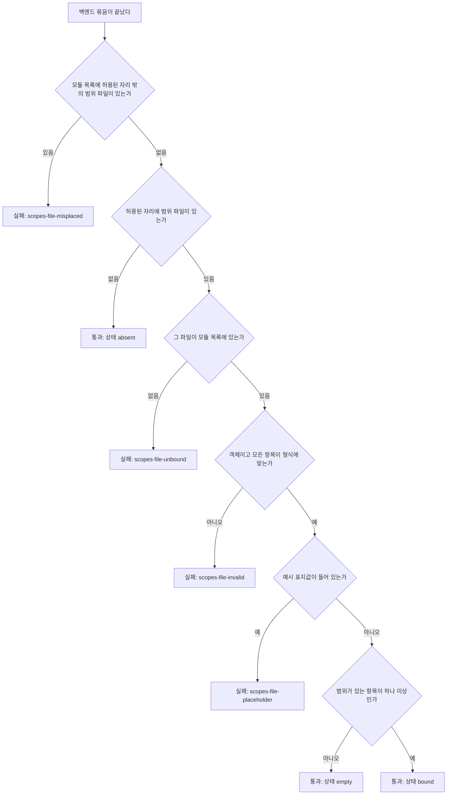

# 스펙: I07 설치본이 인스턴스 범위(`site/config/connector-scopes.json`)를 얻는 길

- 날짜: 2026-11-22 / 상태: 확정(잠정 결정 포함)
- 관련: 이슈 #115(이 spec), 함께 열린 #113([I05 spec](2026-11-22-I05-site-connector-registration.md). "#114와 #115에 남기는 것")·#114(자격 증명, I06), 선행 #18([I01 spec](2026-11-21-I01-connector-sdk.md) "T06이 넘기는 것" 3·10②), #33(H02 Windows 배포), [ADR 0012](../adr/0012-upstream-and-fork-ownership.md), [ownership.md](../ownership.md), [site-setup.md](../site-setup.md) S08·S18, [connector-sdk.md](../connector-sdk.md) 7·11장

낯선 말은 [ARCHITECTURE 0절](../ARCHITECTURE.md#0-처음-나오는-말)과 I05 spec 머리의 표에 풀이가 있다. 이 spec에서 새로 쓰는 말은 아래 표에 있다. `I01-…`·`I05-…`는 그 spec의 번호, `S…`는 site-setup.md 체크리스트 번호다.

| 말 | 뜻 |
|---|---|
| 인스턴스 범위 | 배포처가 수집기 인스턴스마다 정해 둔 접근 범위. 사용자가 가져오기에서 **적어 낸** 범위(청구)가 이 범위보다 느슨한 등급을 얻지 못하게 하는 기준이다(I01-R15) |
| 범위 파일 | 포크가 인스턴스 범위를 적는 파일 `site/config/connector-scopes.json`. 형식은 `{ "<인스턴스 ID>": ["범위", ...] \| null }`(I01 "T06이 넘기는 것" 3) |
| 묶는다 | 빌드할 때 값을 실행본의 코드 묶음(`backend/shell.js`) 안에 넣는 것. 실행본은 그 뒤로 그 값을 디스크에서 다시 읽지 않는다 |
| 닫힌 쪽 | 값을 알 수 없을 때 가장 엄격하게 다루는 쪽. 인스턴스 범위가 "알 수 없음"이면 가져온 원본은 가장 엄격한 등급이다 |
| 조용한 미적용 | 배포처가 값을 채웠는데 설치본에서는 쓰이지 않고, 그 사실이 어디에도 드러나지 않는 상태. 닫힌 쪽이라 새지는 않지만 배포처는 자기 설정이 듣는 줄 안다 |
| 미끼 파일 | 시험이 "여기에 두면 읽힐지도 모르는" 자리에 일부러 놓는 범위 파일. 읽히면 실패다 |

## 배경

I01-T06은 인스턴스 범위를 범위 파일에서 읽게 했다. 지금의 읽는 코드는 `backend/src/connector-scopes.ts`이고, 파일의 위치를 **자기 모듈 위치 기준의 상대 경로**(`new URL("../../site/config/connector-scopes.json", import.meta.url)`)로 정해 모듈이 읽힐 때 한 번 읽는다. 소스에서 실행하면 저장소 루트의 `site/config/`가 된다. 그런데 설치본에서는 다음 세 가지가 비어 있다.

- **빌드가 그 파일을 싣지 않는다.** `apps/desktop/build/build.ts`는 화면, 묶음 둘, `preload.cjs`, 앱 폴더의 `package.json`, 실행 패키지만 앱 폴더에 쓴다. 문서 대응 테스트(`tooling/docs/site-setup-i01.test.ts`)도 "빌드는 이 파일을 이름 대지 않는다"를 붙잡고 있다.
- **설치본의 읽는 자리가 우연히 정해진다.** 읽는 코드가 `backend/shell.js`로 묶이면 같은 상대 경로는 **앱 폴더의 바깥**(앱 폴더의 부모 아래 `site/config/`)을 가리키게 된다. 아무도 고른 적 없는 자리이고, 거기에 파일을 쓸 수 있는 누구든 인스턴스 범위를 "알 수 없음"에서 "아는 값"으로 바꿀 수 있다. (묶음 도구가 이 경로를 그대로 두는지는 실행해 확인하지 않았다. 가정 B1)
- **없어도 조용하다.** 파일이 없으면 모든 인스턴스가 알 수 없음이라 닫힌 쪽이다. 공용 빌드에서는 그것이 정상이라, 배포처 빌드에서 파일이 빠진 것과 구별할 길이 로그 한 줄(`connector-scopes-absent`)뿐이다. S18은 그 로그가 설치본에서 어디에 남는지도 확인하지 못했다고 적는다.

이슈 #115의 과제는 "빌드 시점에 파일을 산출물에 넣고 백엔드가 고정 경로에서 읽는다"였다. 그 뒤에 합쳐진 I05 spec은 포크의 값이 제품에 들어오는 길을 **빌드 시점의 등록 객체 하나**(`SiteRegistration`)로 모았고, #115에는 "등록의 `registration.ts`가 JSON을 정적으로 가져와 필드로 넘기는 방법은 후보 하나이며 고를지는 #115의 spec이 정한다"고 남겼다. 이 spec이 그 결정을 한다.

## 목표

- 포크가 범위 파일에 적은 값은 **포크의 빌드라면 반드시** 실행본 안에 있고, 실행본은 그 값만 쓴다. 설치 과정이나 패키징이 파일 하나를 빠뜨려서 값이 사라지는 길이 없다.
- 실행본이 인스턴스 범위를 얻는 자리는 하나이고, **환경 변수, 명령줄 인자, 현재 폴더, 데이터 폴더나 설치 폴더에 놓인 파일로 바꿀 수 없다.**
- 값이 없거나 형식이 틀리면 지금처럼 닫힌 쪽이고, 포크의 빌드에서는 그 사실이 **빌드 실패나 정해진 표시로 드러난다.**
- 공용 빌드의 산출물에는 범위 파일도 그 값도 없다.
- 포크가 예시 값을 그대로 두었거나 범위를 하나도 적지 않은 빌드는 알아볼 수 있다.
- 설치본에서 "값이 정본까지 갔는가"를 재는 절차가 배포처 검증 실행기에 있고, 사외에서 실행하면 거부한다.

## 비목표 (배포처에서 후속 진행)

**이 spec이 하지 않는 것**

- **I05가 정한 것을 다시 정하지 않는다.** `SiteRegistration`의 기존 필드, `backendEntry`, `runShell`·`runSiteCheck`·`bootBackend`의 `site` 옵션, `checkSiteRegistration`의 기존 코드 열, 예시 패키지의 자리와 이름은 I05의 것이다. 이 spec은 필드 하나와 검사 코드 둘, `site-check`의 인자 하나, 모듈 경계 규칙의 예외 하나(I07-R16)를 **더하기만** 한다.
- **등급 계산은 바꾸지 않는다.** Broker가 청구한 범위와 인스턴스 범위를 견주는 규칙(I01 "T06이 넘기는 것" 4), 범위 파일의 형식, `connector_instances.configured_scope` 열, "설정 API와 화면은 이 값을 쓰지도 보이지도 않는다"는 그대로다.
- **실행 중에 값을 바꾸는 길을 두지 않는다.** 설정 화면, 설정 API, 다시 빌드하지 않는 갱신은 없다. 값을 바꾸려면 다시 빌드한다(지금과 같다).
- **설치 폴더를 고칠 수 있는 공격자를 막지 않는다.** 묶음 파일 자체를 고치는 일은 코드를 고치는 일과 같고 H03(#34)의 범위다. 이 spec은 "코드보다 고치기 쉬운 따로 놓인 설정 파일"을 만들지 않는 데까지만 한다.
- **자격 증명**(#114, I06)과 **브라우저 개발용 백엔드**(`backend/src/dev.ts`)에 포크의 값을 싣는 일. 뒤의 것은 I05의 비목표를 따른다. 그래서 `dev.ts`로 띄운 백엔드는 포크에서도 인스턴스 범위가 모두 알 수 없음이다(닫힌 쪽. 지금은 소스 트리의 파일을 읽으므로 **동작이 바뀐다**).
- **실제 Windows 설치본에서의 실행.** 이 저장소의 어떤 테스트도 Windows 설치본을 만들거나 띄우지 않는다. 그 확인은 아래 S31이며, 이 spec은 그것을 했다고 적지 않는다.

**배포처 후속 항목**(2개. [site-setup.md의 배포처 설정 체크리스트](../site-setup.md#배포처-설정-체크리스트)와 번호로 대응한다. **번호는 잠정이다 — 머지 순서로 조정한다.** I02-B가 S23~S25, I05가 S26·S27, I06이 S28·S29를 가졌다)

| 번호 | 항목 |
|---|---|
| S30 | 포크가 범위 파일을 채우고 등록에 묶는다. `site-check --scopes`가 0으로 끝나고, 포크의 빌드가 통과하며, 빌드 보고서의 상태가 `bound`임을 기록한다(범위 값은 기록하지 않는다). 실행 중에 만들어지는 가져오기 인스턴스(I02-B의 `jsonl-file:…`)는 ID를 미리 알 수 없어 범위 파일에 적을 수 없다. 적을 수 있는 인스턴스가 하나도 없으면 범위 파일을 두지 않고 그 사실을 기록한다(이때 `site-check --scopes`는 0이 아니고 보고서는 `absent`다) |
| S31 | 포크의 빌드를 Windows 11 설치본으로 만들어 검증 실행기의 `scopes-check`를 실행하고, 정본에 복사된 인스턴스 범위가 범위 파일의 값과 같다는 판정을 기록한다(S18의 "설치본에서" 확인이 이 항목으로 옮겨 온다) |

## 요구사항

### 값이 들어오는 길

- **I07-R1 등록 필드.** `SiteRegistration`(I05-R6)에 선택 필드 `connectorScopes`를 더한다. 타입은 `unknown`이다(범위 파일의 내용은 형식을 믿지 않고 읽을 때 검사한다). 없으면 모든 인스턴스가 알 수 없음이다. 공용 등록 `publicSite`는 이 필드를 갖지 않는다.
  - 포크는 `site/composition/src/registration.ts`에서 범위 파일을 **정적 `import`로** 가져와 이 필드에 그대로 넘긴다. 정적이라는 것은 지정자가 글자 그대로 적혀 있어 빌드 도구가 그 파일을 묶음에 넣는다는 뜻이다.
  - 예시 조립 패키지(`@pki/site-example`, I05-R20)가 같은 모양을 갖는다. 예시의 범위 파일은 그 패키지 안(`packages/site-example/config/connector-scopes.json`)에 두고 지어낸 값만 적는다. 값 하나는 **예시 표지값**(I07-R8)이다. 이 자리는 예시 진입점을 묶을 때에만 허용된다(I07-R7).
- **I07-R2 얻는 자리는 등록 하나.** 백엔드가 인스턴스 범위를 얻는 곳은 `bootBackend`가 받은 등록의 `connectorScopes`뿐이다.
  - 제품 코드는 범위 파일을 디스크에서 읽지 않는다. 지금의 `CONNECTOR_SCOPES_FILE`, 파일을 읽는 `loadConnectorScopes`, 모듈이 읽힐 때 채워지는 전역 `CONNECTOR_SCOPES`, 상태 `unreadable`은 **지운다**.
  - 인스턴스 범위는 환경 변수, 명령줄 인자, 현재 폴더, 데이터 폴더·설치 폴더·저장소 루트에 놓인 파일 어느 것으로도 달라지지 않는다.
  - 값은 프로세스 전역이 아니라 **띄운 백엔드마다** 갖는다. 시작할 때의 전체 복사, 동기화가 인스턴스를 등록할 때의 복사(`backend/src/connectors.ts`의 `runSync`), 가져오기가 인스턴스를 등록할 때의 복사(`backend/src/imports.ts`의 `importContent`), 삭제 장부를 시작 때 다시 적용하는 길(`backend/src/ledger-boot.ts`)이 모두 같은 표 하나를 건네받는다.
- **I07-R3 해석은 지금 규칙 그대로, 닫힌 쪽.** 값의 검사는 지금의 `parseConnectorScopes`가 글을 해석한 뒤에 하는 것과 같다.
  - 값이 객체가 아니면(배열, `null`, 글, 수) 전체를 쓰지 않는다.
  - 항목의 값이 `null`이거나 빈 문자열이 없는 문자열 배열이 아니면 그 항목만 쓰지 않는다.
  - 객체의 **자기 키만** 돌며 읽는다. `__proto__` 같은 이름의 키가 묶는 도중에 사라지거나 달리 읽혀도 어떤 인스턴스도 알 수 없음보다 넓어지지 않는다.
  - 어느 경우에도 인스턴스가 알 수 없음보다 넓어지는 길은 없다. 복사의 시점과 "파일에 없는 인스턴스의 이전 값은 지워진다"도 그대로다.
- **I07-R4 상태와 로그.** 시작할 때마다 백엔드 로그에 다음 넷 가운데 **정확히 한 줄**이 남는다. 쓰지 않은 항목이 있으면 `connector-scopes-rejected`(수만)가 한 줄 더 남는다.

  | 로그 코드 | 뜻 | 함께 적는 것 |
  |---|---|---|
  | `connector-scopes-absent` | 등록에 필드가 없다(공용 빌드의 정상 상태) | `configured: 0` |
  | `connector-scopes-invalid` | 필드가 객체가 아니다 | `configured: 0` |
  | `connector-scopes-empty` | 객체이지만 범위가 있는 항목이 하나도 없다(빈 객체이거나 모두 `null`) | `configured: 0` |
  | `connector-scopes-bound` | 범위가 있는 항목이 하나 이상이다 | `configured: <그 수>` |

  - 지금은 값이 모두 쓰였을 때 아무 줄도 남지 않는다. `bound` 줄을 더하는 까닭은, "네 코드가 없다"로 판정하는 S18의 확인이 로그가 아예 남지 않아도 통과하기 때문이다(S18이 스스로 적은 거짓 통과). 있어야 할 줄을 보는 쪽으로 바꾼다.
  - 범위 값, 인스턴스 ID, 파일 이름은 로그에 싣지 않는다.
- **I07-R5 등록 검사의 코드 둘.** `checkSiteRegistration`(I05-R9)의 표에 두 행을 더한다. 기존 행은 건드리지 않는다.

  | 코드 | 잡는 것 | 시작할 때 |
  |---|---|---|
  | `connector-scopes-field-invalid` | `connectorScopes`가 있는데 객체가 아님 | 검사에서만(시작은 I07-R3의 닫힌 쪽으로 계속된다) |
  | `connector-scopes-entry-invalid` | 형식이 틀린 항목이 하나 이상 | 검사에서만(그 항목만 쓰지 않고 계속된다) |

  두 코드는 시작 로그의 코드(I07-R4)와 이름이 겹치지 않는다. `connector-scopes-invalid`는 로그 코드 하나만 가리킨다.

  포크의 `registration.test.ts`가 이미 `checkSiteRegistration(registration)`이 빈 목록임을 보므로(I05), 포크는 따로 부를 것 없이 이 검사를 얻는다.
- **I07-R6 `site-check --scopes`.** `runSiteCheck`(I05-R1)가 인자 `--scopes`를 받으면 수집기 종류를 보는 대신 넘겨받은 등록의 인스턴스 범위 상태를 알린다. `--scopes`는 종류 이름의 모양(I05-R7)이 아니어서 종류와 겹치지 않는다.

  | 등록의 상태 | 출력 | 종료 값 |
  |---|---|---|
  | 필드 없음 | `미구현, 배포처 후속`과 S30을 가리키는 한 줄 | 0이 아님 |
  | 객체가 아님, 또는 틀린 항목이 있음 | 상태와 틀린 항목의 수 | 0이 아님 |
  | 예시 표지값이 들어 있음 | "예시 값이 그대로다" | 0이 아님 |
  | 범위가 있는 항목이 0 | "범위가 있는 항목이 없다" | 0이 아님 |
  | 그 밖 | 항목 수와 범위가 있는 항목 수 | 0 |

  출력에는 수와 상태만 있고 범위 값과 인스턴스 ID는 없다. 조립 패키지가 있는 저장소에서 공용 명령을 실행했을 때의 안내(I05-R19)는 이 인자에도 그대로 먼저 적용된다.

### 빌드와 산출물

- **I07-R7 빌드 검사.** `pnpm --filter @pki/desktop build`는 백엔드를 묶은 뒤 판정 하나를 하고, 실패면 빌드를 멈춘다. 판정은 포크의 코드를 실행하지 않고 다음 셋만 본다: 묶은 진입점이 무엇인지, 백엔드 묶음에 남은 모듈 목록 가운데 이름이 `connector-scopes.json`으로 끝나는 저장소 모듈, 그리고 허용된 자리의 파일. 갈래는 설계 개요의 그림 "빌드 판정"에 있다. 끝은 일곱이다: 통과 셋(`absent`, `empty`, `bound`)과 실패 넷(`scopes-file-misplaced`, `scopes-file-unbound`, `scopes-file-invalid`, `scopes-file-placeholder`).

  - **범위 파일의 자리는 고정이다.** 허용된 자리는 둘뿐이다.

    | 묶는 진입점 | 허용된 자리 |
    |---|---|
    | 공용 진입점과 포크의 조립 패키지 진입점(실제 빌드가 고르는 것은 이 둘뿐이다) | 저장소 루트의 `site/config/connector-scopes.json` |
    | 예시 조립 패키지의 진입점(공용 저장소의 시험만 묶는다) | `packages/site-example/config/connector-scopes.json` |

  - 묶음의 모듈 목록에 **허용된 자리가 아닌** `connector-scopes.json`이 하나라도 있으면 `scopes-file-misplaced`로 실패한다(닫힌 쪽). 조립 패키지 안에 둔 범위 파일, 예시의 범위 파일을 가져온 포크의 진입점이 여기에 걸린다. 형식·예시 표지값 판정은 허용된 자리의 파일에 한다.

  - `scopes-file-unbound`가 잡는 것은 조용한 미적용의 두 모양이다: 조립 패키지 없이 범위 파일만 둔 포크, 조립 패키지는 있는데 `registration.ts`가 그 파일을 가져오지 않는 포크. 이 판정은 파일이 **묶였는지**만 본다. 가져오기만 하고 어디에도 쓰지 않은 등록은 묶는 도구가 그 모듈을 버리므로 이 실패로 잡힌다(I07-T01의 측정 6). 잡지 못하는 것은 가져온 값을 **다른 곳에는 쓰면서** `connectorScopes`에는 넘기지 않은 등록이다("남는 위험").
  - **알려진 한계**: 모듈 목록은 저장소 모듈만 담는다. `node_modules/` 아래와 저장소 밖의 경로는 목록에서 빠진다(`apps/desktop/build/bundle.ts`). 그래서 의존성 패키지 안의 JSON을 가져오거나 파일 이름을 바꾼 포크는 `scopes-file-misplaced`에 걸리지 않고 빌드가 `absent`로 통과한다. 이 경우는 받아들인 위험이며, 드러나는 곳은 빌드가 아니라 시작 로그(`bound`인데 보고서는 `absent`)와 S30의 기록(보고서가 `bound`가 아니다)이다. 문서(connector-sdk.md 7장)에 "범위 파일은 이 자리와 이 이름으로만 둔다"를 적는다.
  - 범위 파일이 없는데 `registration.ts`가 그것을 가져오면 묶기 자체가 실패한다(풀리지 않는 `import`는 지금도 빌드 실패다. `apps/desktop/build/bundle.ts`의 경고 처리).
  - 형식 판정에서는 키 `__proto__`와 **두 번 이상 나오는 키**도 틀린 항목으로 친다. 측정에서는 Node, vitest, 묶음이 이 둘을 똑같이 읽었다(`__proto__`는 자기 키로 남고, 중복 키는 마지막 값만 남는다. I07-T01의 측정 5). 그래도 틀린 항목으로 두는 까닭은 둘이다. 중복 키는 파일에 적힌 앞의 값이 **어느 도구에서도 조용히 사라지므로** 적은 사람이 뜻한 값이 쓰이는지 알 수 없다. `__proto__`는 인스턴스 ID로 쓸 까닭이 없고, 도구가 바뀌어 달리 읽게 되어도 넓어지지 않게 한다(I07-R3). **중복 키는 범위 파일의 원문 글자를 훑어 찾는다.** `JSON.parse`로 읽은 값에는 앞의 값이 이미 없어 중복을 볼 수 없기 때문이다. 같은 키인지는 이스케이프를 푼 뒤의 글자로 견준다(`"a"`와 `"\u0061"`은 같은 키다).
  - 빌드 보고서(`build-report.json`)에 `connectorScopes`를 더한다: 상태(`absent`·`empty`·`bound`), 항목 수, 범위가 있는 항목 수. 값과 ID는 싣지 않는다. 빌드의 마지막 출력 줄에도 상태를 적는다.
  - 판정 함수는 순수 함수이고 저장소 루트, 묶은 진입점, 모듈 목록을 인자로 받는다(I05-R25를 따른다).
- **I07-R8 예시 표지값.** 예시의 범위 파일이 쓰는 범위 값 하나를 상수로 정한다(잠정 `pki-example-scope`). 이 값은 공용이 예약한 지어낸 값이며, 실제 범위 파일에 들어 있으면 "예시를 복사하고 채우지 않았다"로 판정한다(I07-R6, R7). 예시의 범위 파일이 이 값을 갖고 있다는 것을 시험이 붙잡는다.
- **I07-R9 공용 산출물에는 파일도 값도 없다.**
  - 공용 진입점(`backend/src/shell.ts`)을 묶으면 남은 모듈에 범위 파일이 없고(예시의 것도), 묶음의 글자에 예시 표지값과 `connector-scopes.json`이 없다.
  - **어느 빌드든** 앱 폴더에 `connector-scopes.json`이라는 이름의 파일이 없다. 빌드는 범위 파일을 복사하지 않는다.
- **I07-R10 포크의 산출물에는 값이 백엔드 묶음 안에만 있다.** 조립 패키지의 진입점을 묶으면 범위 파일이 백엔드 묶음의 모듈 목록에 있고 그 값이 묶음 안에 있다. 셸의 묶음(`main.js`)과 화면(`web/`)에는 없다.
- **I07-R11 공용 시험은 포크 모양에서도 통과한다.** I05-R25를 그대로 따른다. 저장소 루트의 `site/config/`를 보는 코드는 I07-R7의 판정 하나이고 루트를 인자로 받는다. 실제 루트로 도는 산출물 검사는 두 모양에서 모두 참인 것만 단언한다("범위 파일이 루트의 허용된 자리에 있을 때에만 백엔드 묶음의 모듈 목록에 있고, 그 밖의 범위 파일은 목록에 없다").

### 모듈 경계 규칙의 예외

- **I07-R16 범위 파일 가져오기 하나만 허용한다.** 모듈 경계 규칙(`tooling/eslint/module-boundary.js`의 `pki/module-boundary`)은 상대 경로가 다른 패키지에 닿으면 막는다(`crossPackageRelative`). "어느 패키지인가"는 가장 가까운 `package.json`으로 정하므로, 조립 패키지(`site/composition/`)에서 보면 저장소 루트에 속한 `site/config/connector-scopes.json`은 다른 패키지다. 그래서 I07-R1의 가져오기는 지금 규칙에서 `pnpm lint`가 실패한다(I07-T01의 측정 3). 범위 파일의 자리는 고정이므로(I07-R7) 규칙에 **예외 하나**를 더한다. 다음 **셋(가져오는 쪽, 대상, 형태)이 모두** 맞을 때만 그 상대 경로 가져오기를 허용한다.
  - 가져오는 쪽: 포크의 조립 패키지의 `src/registration.ts`다(I05-R4가 조립 지점으로 정한 것과 같은 방식으로 패키지 이름과 파일을 함께 본다). 같은 패키지의 다른 파일, 다른 패키지의 `src/registration.ts`(예시 패키지 포함), 공용 패키지는 아니다.
  - 가져오는 대상: 풀린 경로가 조립 패키지 뿌리의 두 단계 위(`<조립 패키지 뿌리>/../..`, 즉 저장소 루트)의 `site/config/connector-scopes.json`과 **정확히 같다.** 현재 폴더나 규칙 파일의 자리로 루트를 정하지 않는다. `site/config/`의 다른 파일(다른 JSON, `.ts`)이나 다른 폴더의 `connector-scopes.json`은 아니다.
  - 가져오기의 형태: **정적 `import` 선언**(`import x from "…" with { type: "json" }`)뿐이다. 다시 내보내기(`export … from`), `import()`, `typeof import()`로 같은 파일을 가리키는 것은 지금처럼 막힌다. 등록의 `connectorScopes`로 넘기는 데 그 형태들은 필요 없다.
  - 이 예외는 `crossPackageRelative` 하나만 푼다. 테스트 모듈 판정은 그대로 먼저 걸린다. 선언한 의존성과 어댑터 판정은 원래 다른 패키지를 가리키는 상대 경로에는 걸리지 않는다.
  - 예시 조립 패키지는 범위 파일이 자기 폴더 안에 있어 예외가 필요 없다. 그 가져오기는 지금 규칙을 통과한다(측정 3의 대조).
  - 같은 파일을 I05-T04도 고친다(조립 지점 둘과 `@pki-site/` 범위). 이 예외는 I05-T04가 합쳐진 뒤에 그 위에 더한다.

### 설치본 확인 절차

- **I07-R12 검증 실행기의 `scopes-check`.** 배포처 검증 실행기에 설치본 확인 절차를 더한다. 이 요구사항은 **겉으로 보이는 동작만** 정한다. 명령의 자리와 내부 구조는 착수할 때 main에 있는 실행기의 관례를 따른다(다른 작업이 같은 파일을 고치고 있다. "작업 분해" I07-T05).
  - **거부가 먼저다.** Windows 설치본이 아닌 환경에서는 설정을 읽기 전에 `배포처 후속: S31 …`로 시작하고 `미구현, 배포처 후속`을 담은 알림 한 줄을 내고 실행기의 기존 "배포처 후속" 종료 값으로 끝난다(지금 3. S22의 삭제 시나리오와 같은 모양이다). 설치본 판정은 실행기의 기존 관문을 다시 쓴다.
  - **입력**: 설치본의 정체(기존 설정과 같다)와 **기대 값 파일의 경로**(포크의 범위 파일). 앱을 닫은 뒤 실행한다.
  - **하는 일**: 데이터 폴더의 정본 `pki.sqlite`를 읽기 전용으로 열어 `connector_instances`의 `id`와 `configured_scope`를 읽고, 기대 값 파일의 항목과 견준다. 정본은 정렬하고 중복을 없앤 값을 갖고 있으므로 기대 값도 같은 방식으로 고쳐서 견준다.
  - **판정**: 범위가 있는 기대 항목이 모두 정본에 같은 값으로 있으면 `PASS`. 하나라도 다르거나 정본의 값이 `NULL`이면 `FAIL`. 범위가 있는 기대 항목이 하나도 없거나, 기대 항목의 인스턴스가 정본에 아직 없으면(한 번도 동기화·가져오기를 하지 않았다) `INCONCLUSIVE`(아무것도 증명하지 못한 실행을 통과로 읽지 않는다). **`FAIL`이 `INCONCLUSIVE`보다 먼저다**: 다른 항목이 하나라도 있으면 정본에 없는 항목이 함께 있어도 `FAIL`이다. 기대 값 파일은 I07-R3과 같은 규칙으로 읽는다. 객체가 아니거나 틀린 항목(키 `__proto__`와 두 번 나오는 키 포함)이 있으면 견주지 않고 설정 오류로 끝난다(실행기의 기존 설정 오류 종료 값).
  - **기록**: OS, 앱 버전, 판정, 견준 수·같은 수·다른 수·정본에 없는 수. **범위 값과 인스턴스 ID는 결과 파일에 싣지 않는다.**
  - 이 절차가 증명하는 것은 "값이 정본까지 복사되었다"까지다. Broker가 그 값을 쓰는지는 공용 저장소의 시험이 본다(S18의 기존 문장 그대로).
- **I07-R13 실행기 문서.** 실행 절차를 실행기의 RUNBOOK에 한 절로 적고, `verification/README.md`의 표에 한 행을 "작성만 됨 — 실행된 적 없음"으로 더한다. 어떤 환경에서도 지어낸 정본으로 돌린 결과를 배포처 검증으로 기록하지 않는다.

### 문서

- **I07-R14 site-setup.md.** 문서는 이미 있다. 제목 `## 배포처 설정 체크리스트`는 그대로 둔다.
  - S18의 범위 파일 문단: "빌드 자원" 설명을 "포크의 등록이 빌드할 때 묶는다"로 고치고, 로그 코드를 I07-R4의 넷과 `connector-scopes-rejected`로 고친다(`connector-scopes-unreadable`은 사라진다). 그리고 "실행 중에 만들어지는 가져오기 인스턴스(I02-B의 `jsonl-file:…`)에는 범위 파일로 범위를 적을 수 없고, 그런 인스턴스는 알 수 없음(닫힌 쪽)이다"라는 한 문장을 넣는다.
  - S18의 "설치본에서 이 파일을 읽는 길은 만들지 않았다" 문단: 지우고, 설치본 확인은 S31을 가리키게 한다. #115 표기도 함께 지운다.
  - "빌드할 때 정해지는 것" 표에 인스턴스 범위 행을 더한다(자리: 등록의 `connectorScopes`, 공용 기본: 없음).
  - 체크리스트에 S30·S31을 넣고 번호 범위 안내에 이 spec을 더한다.
- **I07-R15 그 밖의 문서.**
  - [ownership.md](../ownership.md) 3절: "현재의 예외" 문단에서 #115를 뺀다. 범위 파일을 설명하는 문단에 "등록에 묶어야 쓰인다"를 한 문장 더한다.
  - [connector-sdk.md](../connector-sdk.md): 7장의 포크가 더하는 파일 설명과 발췌에 `connectorScopes`를 넣고, 발췌의 `import` 줄은 예시 패키지의 경로이므로 그 바로 아래에 포크가 쓰는 경로(`../../config/connector-scopes.json`)와 "범위 파일은 `site/config/connector-scopes.json`에만 둔다(다른 자리나 다른 이름이면 빌드가 멈추거나 판정을 벗어난다)"를 따로 적는다. 가져오기에 필요한 설정도 7장에 적는다(I07-T01의 측정 2): 측정한 모양(`references` 없는 최소 패키지)에서는 `tsconfig.json`에 더할 설정이 **없다**(`references`가 있는 실제 포크의 `tsconfig.json`은 재지 않았다), `import` 줄에는 `with { type: "json" }`가 **꼭 있어야 한다**(빠져도 타입 검사와 시험은 통과하고 Node의 소스 실행은 `ERR_IMPORT_ATTRIBUTE_MISSING`으로 실패한다. 묶기는 재지 않았다(통과하면 값이 묶음에 들어가 설치본은 정상, 실패하면 빌드가 멈춘다. 어느 쪽이든 조용하지 않다)), `resolveJsonModule`을 `false`로 두지 않는다. 이 가져오기가 모듈 경계 규칙의 예외로 허용된 단 하나라는 것(I07-R16)도 함께 적는다. 그리고 7장의 "없는 것" 목록과 11장의 표에서 #115 행을 지운다. 포크의 명령 목록에 `site-check --scopes`를 더한다.
  - I01 spec "T06이 넘기는 것" 3·10②에 이 spec이 닫았다는 처리 표시를 한다.
  - 결정을 새 ADR에 남기고 `docs/README.md` 색인에 올린다. **번호는 잠정 0020이다 — 머지 순서로 조정한다**(지금 마지막이 0016, I02-B가 0017, I05가 0018, I06이 0019).

**이 절을 줄이면**: 범위 파일은 따로 놓인 파일로 설치본에 가지 않는다. 포크의 등록이 빌드할 때 그 내용을 가져와 백엔드 묶음에 넣고, 백엔드는 등록이 준 값만 쓴다. 파일이 정해진 자리 밖에 있거나, 있는데 묶이지 않았거나 틀렸거나 예시 그대로면 빌드가 멈춘다. 설치본에서는 실행기가 정본의 값을 범위 파일과 견준다.

## 인터페이스 / 설계 개요

### 바뀌는 경계

| 경계 | 지금 | 이 spec 뒤 |
|---|---|---|
| 모듈 경계 규칙 | 조립 패키지가 저장소 루트의 파일을 상대 경로로 못 가져옴 | `registration.ts`의 범위 파일 하나만 허용(I07-R16) |
| 값의 출처 | 읽는 모듈이 자기 위치 기준 경로의 파일을 읽음 | `SiteRegistration.connectorScopes`(I05의 등록 객체에 필드 하나) |
| 읽는 모듈(`backend/src/connector-scopes.ts`) | 파일 읽기 + 해석 + 전역 값 + 복사 | 해석과 복사만. 파일 시스템, 환경, 인자, 모듈 위치를 보지 않는다 |
| 값을 쓰는 세 자리(`boot.ts`, `connectors.ts`, `imports.ts`)와 `ledger-boot.ts` | 전역 `CONNECTOR_SCOPES`를 기본값으로 씀 | 시작할 때 만든 표 하나를 건네받음 |
| 빌드(`apps/desktop/build/`) | 범위 파일을 모름 | I07-R7의 판정과 보고서 필드 |
| 로그 | 값이 모두 쓰이면 줄 없음 | 언제나 네 코드 가운데 한 줄 |
| 검증 실행기 | S18의 확인이 사람 손의 SQL | `scopes-check`(사외 거부) |

등록 객체에 더하는 것은 다음 한 줄이다(이름은 잠정).

```ts
/** site/config/connector-scopes.json을 정적으로 가져온 값. 없으면 모든 인스턴스가 알 수 없음. */
connectorScopes?: unknown;
```

포크의 `registration.ts`는 이렇게 된다(모양만. 실제 발췌는 예시 패키지에서 온다).

```ts
import connectorScopes from "../../config/connector-scopes.json" with { type: "json" };

export const registration: SiteRegistration = {
  // I05의 필드들 …
  connectorScopes,
};
```

### 빌드 판정

I07-R7의 판정이 가는 길이다. 물음 여섯이 차례로 이어지고, 앞의 물음에서 끝나지 않은 것만 다음 물음으로 간다. "허용된 자리"는 I07-R7의 표에 있다(묶은 진입점에 따라 하나다).



그림에 없는 것: 범위 파일이 없는데 `registration.ts`가 그것을 가져오면 이 판정에 오기 전에 묶기가 실패한다. 예시 진입점을 묶은 묶음에 이 판정을 하면 예시 표지값 때문에 `scopes-file-placeholder`가 나온다(시험이 그것을 본다. 실제 빌드는 예시 진입점을 묶지 않는다).

### 이관 경계: 잘린 자리와 그 계약

배포처로 넘어가는 자리는 I05가 만든 어댑터 경계 `SiteRegistration` 그대로이고, 이 spec은 그 경계에 필드 하나를 더한다.

- 인터페이스: `connectorScopes`(I07-R1).
- 계약 테스트: `checkSiteRegistration`의 두 코드(I07-R5). 어떤 등록이든 같은 코드 목록으로 판정된다. 공용 저장소는 빈 등록과 예시 등록 둘로 이것과 부팅, 묶기를 증명한다.
- 미구현 표시: 등록에 범위가 없는 채 `site-check --scopes`를 실행하면, 그리고 검증 실행기의 `scopes-check`를 사외에서 실행하면 `미구현, 배포처 후속`을 알리고 0이 아닌 값으로 끝난다(I07-H2).
- 공용 코드에는 배포처 값이 없다. 범위 값은 포크의 `site/config/`에만 있고, 공용 기본(빈 등록)은 아무 설정 없이 로컬에서 돈다.

### 대안과 기각 사유

비유하자면 범위 파일은 건물의 **출입 규정표**다. (가)는 규정표를 인쇄해 건물 로비에 붙여 두고 경비가 매일 아침 읽는 방식이고, (나)는 규정을 경비의 업무 지침서에 인쇄해 넣는 방식이다. 로비의 종이는 떼어 가거나 바꿔 붙이기 쉽고, 이사하다 빠뜨릴 수도 있다. 지침서에 든 것은 지침서와 운명을 같이한다. 다만 비유와 달리 지침서(묶음 파일)도 설치 폴더에 놓인 파일이므로 고칠 수 없는 것은 아니다. 그 차이는 아래 "고칠 수 있는 면"에 적었다.

| 기준 | (가) 파일을 산출물에 복사하고 고정 경로에서 읽음 | (나) 등록이 JSON을 정적으로 가져와 묶음 | (다) 둘 다 |
|---|---|---|---|
| 조용한 미적용 | 길이 여럿 남는다. ① 빌드가 복사해도 설치 파일을 만드는 도구(R04, 포크의 일)가 그 파일을 빠뜨릴 수 있다 ② 설치 형식에 따라 묶음 안의 경로를 실행 중에 읽지 못할 수 있다(확인된 적 없음) ③ 공용 빌드에서는 "파일 없음"이 정상이라, 배포처 빌드에서만 그것을 오류로 만들려면 "이 빌드는 파일이 있어야 한다"는 표시를 결국 묶음에 넣어야 한다 | 포크의 묶음에 코드가 있으면 값도 있다. 파일이 없으면 묶기가 실패하고, 파일이 있는데 묶이지 않으면 빌드 검사가 실패한다. 남는 것은 인스턴스 ID를 잘못 적은 경우와, 가져온 값을 다른 곳에 쓰면서 `connectorScopes`에는 넘기지 않은 등록이다(빌드 판정은 묶였는지만 본다. 뒤의 것은 `site-check --scopes`와 시작 로그가 드러낸다. 아래 "남는 위험") | (가)의 길이 그대로 남고, 두 값이 다를 때의 규칙이 더 필요하다 |
| 고칠 수 있는 면 | 설치 폴더에 **코드와 따로** 놓인 글 파일이 등급을 좌우한다. 글 한 줄을 고치면 되고, 코드 서명이나 묶음 무결성 검사가 생겨도 따로 놓인 자원은 그 대상이 아닐 수 있다 | 값은 코드 묶음 안에 있다. 고치려면 묶음 파일을 고쳐야 하고, 그것은 코드를 고치는 것과 같은 일이다(H03의 범위). 새로 생기는 면이 없다 | (가)와 같다 |
| 산출물 검사가 증명하는 것 | "파일이 앱 폴더에 있고 내용이 같다"까지. 실행본이 그것을 **읽는다**는 것은 따로 띄워 봐야 하고, Windows 설치본에서는 공용 저장소가 증명하지 못한다 | "값이 백엔드 묶음 안에 있다"(모듈 목록과 묶음의 글자). 값을 쓰는 코드와 같은 파일이므로 읽기 단계가 따로 없다 | 두 가지를 모두 검사해야 한다 |
| ADR 0012·I05와의 일관성 | 값은 `site/`에만 있으므로 ADR 0012와 맞는다. 실행 중에 디스크에서 읽는 것이 코드는 아니라서 I05-R18을 어기지는 않지만, I05가 모은 "포크의 것은 빌드할 때 등록 하나로 들어온다"에 두 번째 길을 더한다 | ADR 0012와 맞고, I05의 길 하나를 그대로 쓴다. I05가 구현된 뒤에는 등급 매핑(S08)과 접근 범위 정책(S21)도 같은 객체로 들어온다 | 길이 둘이다 |
| 지금의 읽는 코드와 문서 대응 테스트 | 덜 바뀐다. 읽는 코드의 경로 상수와 빌드만 고친다. 다만 "모듈 위치 기준 경로"는 묶음과 소스에서 다른 곳을 가리키므로 묶음용 짝 모듈이 하나 더 필요하다 | 더 바뀐다. 파일 읽기와 전역 값, 상태 `unreadable`을 지우고, 그것을 글자로 붙잡고 있는 테스트(아래 표)를 같은 PR에서 고친다. 그 테스트들은 "만든 작업이 이 문장과 시험을 함께 고친다"고 적어 둔 것이다(I01 "T10이 넘기는 것" 4) | 가장 많이 바뀐다 |
| 환경 변수·인자·현재 폴더로 바꿀 수 없음 | 경로를 모듈 위치로 고정하면 지켜진다. 다만 그 자리에 파일을 쓸 수 있으면 값이 바뀐다 | 읽는 경로가 없으므로 바꿀 대상이 없다 | (가)와 같다 |

**고른 것: (나).** 이슈의 걱정은 "값을 채웠는데 설치본에서 조용히 안 쓰인다"였고, (가)는 그 걱정이 생기는 단계(복사, 패키징, 실행 중 읽기)를 하나도 없애지 못한 채 검사만 더한다. (나)는 그 단계 자체가 없다. 치르는 값은 이슈 과제의 문장과 지금의 읽는 코드·문서 대응 테스트를 고치는 일이며, 한 번이면 끝난다.

**(가)로 되돌리려면**: I07-R1·R2를 "빌드가 범위 파일을 앱 폴더의 정해진 자리에 복사하고, 묶음용 짝 모듈이 그 자리를 읽는다"로 바꾸고, I07-R9의 "앱 폴더에 그 이름의 파일이 없다"를 뒤집고, 설치본에서 읽히는지를 S31의 필수 확인으로 올린다. 그리고 I07-R7의 "모듈 목록에 있는가"를 "앱 폴더에 복사된 파일이 있는가"로, I07-R4의 `absent`의 뜻을 "파일 없음"으로 되돌리고, C2 ③(읽는 모듈의 파일 시스템·`import.meta.url` 금지), C11, C12 ②③을 뒤집는다. 가정 B2~B4가 틀려 (나)가 서지 않을 때가 그 조건이다.

**그 밖에 기각한 것**

| 대안 | 기각한 이유 |
|---|---|
| 데이터 폴더의 파일에서 읽음 | 데이터 폴더는 사용자가 쓸 수 있다. 가져오는 사용자가 자기 청구의 기준을 스스로 정하게 된다 |
| 환경 변수나 인자로 경로를 받음 | 이슈가 명시적으로 막은 것이다. 설치본은 지금도 모르는 인자를 거부한다(`backend/src/shell-options.production.ts`) |
| 범위 검사를 `checkSiteRegistration`과 따로 둔 함수로 | I05의 표를 건드리지 않는 장점이 있으나, 포크가 검사 하나를 더 불러야 하고 잊으면 조용하다. 표에 행을 더하는 쪽이 조용한 미적용을 줄인다(잠정 결정 표에 바꾸는 법) |
| 빌드가 포크의 등록을 직접 실행해 상태를 물음 | 빌드 과정에서 포크의 코드가 돈다. 파일과 모듈 목록만 보는 판정으로 충분하다 |
| 모듈 경계 규칙의 거부를 포크의 `// eslint-disable-next-line pki/module-boundary` 한 줄로 품(측정: 통과한다) | 포크의 코드에서 경계 규칙을 끄는 것이 정해진 절차가 된다. 한 번 허용된 주석은 다른 줄에도 붙기 쉽고, 공용 규칙의 시험은 포크의 주석을 볼 수 없어 무엇이 꺼졌는지 붙잡지 못한다. 규칙 안의 좁은 예외(I07-R16)는 공용 시험이 그 폭을 붙잡는다 |
| 모듈 경계 규칙의 거부를 피하려고 범위 파일을 조립 패키지 안으로 옮김(측정: 규칙을 통과한다) | I07-R7이 고정한 자리와 부딪친다. 그 자리는 `scopes-file-misplaced`다 |
| 모듈 경계 규칙이 모든 `.json` 가져오기나 `site/config/` 전체를 허용 | 필요한 것은 가져오기 하나다. 넓게 풀면 포크의 다른 파일이나 공용 코드가 `site/config/`에 닿는 길이 열리고, 값이 들어오는 자리가 등록 하나라는 전제(I07-R2)가 흐려진다 |

### 지금 코드를 붙잡고 있는 것들

(나)가 고치거나 지우는 자리다. 코드를 바꾸는 작업이 같은 PR에서 고친다.

| 자리 | 지금 붙잡는 것 | 고치는 작업 |
|---|---|---|
| `backend/src/connector-scopes.test.ts` | "공용 저장소에는 파일이 없다", "경로는 저장소 루트의 `site/config/…`", 읽기 실패의 `unreadable` | I07-T02 |
| `backend/src/claimed-scope.wiring.test.ts`, `claimed-scope.import.test.ts` | 읽는 모듈을 통째로 바꿔치기해(`vi.mock`) 값을 넣음. 로그 세 상태 | I07-T02(등록을 넘기는 방식으로) |
| `tooling/docs/site-setup-i01.test.ts` | S18이 이름 대는 것 가운데 읽는 모듈의 경로 글자와 `"unreadable"`, "모듈 기준 URL로 소스 트리에서 읽는다", S18에 `#115`가 있다 | I07-T02(앞의 둘), I07-T04(`#115`) |
| 같은 파일 | "빌드는 범위 파일을 이름 대지 않는다" | I07-T03(뒤집는다) |
| `tooling/docs/connector-sdk.test.ts` | 문서에 `#115`와 `connector-scopes.json`이 나온다 | I07-T04 |
| I05가 더할 문서 대응 테스트(I05-C19) | ownership.md의 예외 문단이 `#115`를 적는다 | I07-T04(I05-T05가 합쳐진 뒤) |

### 남는 위험

- **인스턴스 ID를 잘못 적은 항목은 드러나지 않는다.** 범위 파일이 정본에 없는 ID를 적어도 형식은 맞다. 그 항목은 아무 인스턴스에도 닿지 않고, 의도한 인스턴스는 알 수 없음(닫힌 쪽)으로 남는다. 인스턴스는 실행 중에 생기기도 하므로 시작할 때 "없는 ID"를 오류로 볼 수 없다. S31의 `scopes-check`가 그런 항목을 `INCONCLUSIVE`로 드러낸다.
- **가져온 값을 다른 곳에 쓰면서 `connectorScopes`에는 넘기지 않은 등록은 빌드가 잡지 못한다.** 빌드 판정은 범위 파일이 묶음의 모듈 목록에 있는지만 본다. 가져오기만 하고 어디에도 쓰지 않으면 묶는 도구가 모듈을 버리므로 `scopes-file-unbound`로 잡힌다(I07-T01의 측정 6). 값이 어디엔가 쓰이기만 하면 모듈이 남으므로, 그 값을 `connectorScopes`가 아닌 곳에만 쓴 등록은 빌드가 `bound`로 통과한다. 이때 `site-check --scopes`가 0이 아닌 값으로 끝나고 시작 로그가 `absent`(또는 다른 수)를 남기므로 드러나기는 한다.
- **`node_modules/` 아래나 다른 이름의 범위 파일**은 빌드 판정이 보지 못한다(I07-R7의 알려진 한계).
- **범위를 적을 인스턴스가 없는 배포처는 S30의 `bound`에 닿지 못한다.** 가져오기 인스턴스가 모두 실행 중에 만들어지면(I02-B) 적을 ID가 없다. S30은 그 사실을 기록하는 것으로 끝난다(미해결 질문 2).
- **`import` 줄에서 `with { type: "json" }`를 빠뜨린 포크는 타입 검사와 시험이 통과한다.** Node의 소스 실행은 실패한다(`site-check`. Electron 소스 실행도 같은 Node 실행이라 실패할 것으로 보지만 재지 않은 추론이다). 그 실패는 시끄럽다(`ERR_IMPORT_ATTRIBUTE_MISSING`으로 시작하지 못한다). 속성 없는 가져오기의 묶기는 재지 않았다(통과하면 값이 묶음에 들어가 설치본은 정상, 실패하면 빌드가 멈춘다. 어느 쪽이든 조용하지 않다). 그래서 조용한 미적용은 아니다. 포크의 빌드에는 가드를 두지 않고, S30이 요구하는 `site-check --scopes` 실행이 이것을 드러낸다. 공용 쪽은 예시의 `import` 줄이 그 속성을 갖고 있음을 시험이 붙잡는다(C11 ⑥).
- **묶음 파일을 고치는 일**은 막지 않는다(비목표).
- **`dev.ts`로 띄운 포크의 백엔드**는 범위가 모두 알 수 없음이다(비목표).
- **예시 표지값 판정은 실수를 잡는 장치**다. 포크가 다른 지어낸 값을 채워 넣은 것은 알아보지 못한다.

### 작업 분해

PoC 하나와 구현 넷이다. 한 행이 PR 하나다. I05의 구현은 다른 세션이 진행 중이고 아직 합쳐지지 않았다. 아래 "선행"의 I05 작업이 main에 있어야 그 행을 시작한다. 이 표는 잠정이며, 조정자가 확정된 spec과 맞춰 본 뒤 발행한다.

| ID | 산출물 하나 | 선행 | 기준 | 바뀌는 파일 | 기대하는 증거 |
|---|---|---|---|---|---|
| I07-T01 | **PoC: 가정 B1~B6의 실측 기록**(이 spec에 "T01이 넘기는 것" 절). 제품 코드 없음 | 없음(버리는 작업 트리의 임시 패키지로 잰다. I05-T04가 먼저 합쳐져 있으면 예시 패키지로 잰다) | C17 | 이 spec | 가정마다 돌린 명령과 출력, 맞음·틀림, 틀리면 고른 다음 수 |
| I07-T02 | **백엔드의 결합**: 등록 필드, 파일 읽기와 전역 값 삭제, 표 하나를 네 자리에 건넴, 로그 네 상태, 등록 검사의 두 코드, `site-check --scopes` | **I05-T03**(등록 객체, `site` 옵션, `checkSiteRegistration`, `runSiteCheck`. I05-T02가 그 선행이다) | C1, C2(①②③), C3, C4, C5, C6, C7, H2 ① | `backend/src/connector-scopes.ts`와 그 테스트, `boot.ts`, `connectors.ts`, `imports.ts`, `ledger-boot.ts`, I05-T03이 만든 등록 모듈과 `site-check.ts`·그 테스트, `storage/src/migrations.ts`(v19 주석의 파일 이름 한 줄만. SQL은 그대로), I05 spec(후속 표 ①~③), `claimed-scope.wiring.test.ts`, `claimed-scope.import.test.ts`, **문서 대응**: `tooling/docs/site-setup-i01.test.ts`의 S18 고정 사실과 URL 가드, site-setup.md S18의 로그 코드 문장 | `connector-scopes.bind`, `boot.connector-scopes`, `boot.connector-scopes-decoys`, `connector-scopes.no-ambient-input`, `site.registration`(두 코드), `site-check`(`--scopes` 다섯 경우), 고친 문서 대응 테스트 통과 |
| I07-T03 | **빌드 검사와 산출물 검사, 예시의 범위 파일** | I07-T01, I07-T02, **I05-T04**(예시 패키지, `backendEntry`, 빌드가 진입점을 고름) | C2(④), C8, C9, C10, C11, C12, C13, C18 | `apps/desktop/build/build.ts`, `paths.ts`(보고서 타입), 새 판정 모듈과 그 테스트, `build/bundle.test.ts`, `apps/desktop/artifact/artifact.contents.e2e.ts`, `artifact.gate.e2e.ts`(또는 그 옆의 새 파일), `packages/site-example/`의 범위 파일·등록·`tsconfig.json`, `tooling/eslint/module-boundary.js`와 `module-boundary.test.ts`(I07-R16의 예외. I05-T04가 같은 파일에 더한 조립 지점 위에 얹는다), I05-T04가 만든 포크 모양 시험, I05 spec의 I05-R25 목록 한 줄과 I05-R4의 한 줄(후속 표 ④⑥), **문서 대응**: `tooling/docs/site-setup-i01.test.ts`의 "빌드는 이름 대지 않는다" | `build.scopes-check`(판정의 모든 갈래), `bundle`(공용 입력 1건, 예시 입력 2건), `site.example-scopes`(예시 등록으로 띄워 정본까지), `fork-shape`(다섯 모양과 타입 검사), `module-boundary`(예외의 통과 1건과 거부 10건), `pnpm e2e`의 `artifact.contents`와 `artifact.scopes-decoys` |
| I07-T04 | **문서, ADR, S30·S31** | I07-T03, **I05-T05**(connector-sdk.md 7장, ownership.md 예외 문단, 그 문서 대응 테스트를 I05가 먼저 고친다) | C16, H1 | `docs/site-setup.md`, `docs/ownership.md`, `docs/connector-sdk.md`, 새 ADR(잠정 0020), `docs/README.md`, 새 `tooling/docs/site-setup-i07.test.ts`, `tooling/docs/site-setup-i01.test.ts`(`#115`), `tooling/docs/connector-sdk.test.ts`, I05의 문서 대응 테스트(`#115` 한 줄), I05 spec(후속 표 ⑤), I01 spec의 처리 표시, 이 spec | `docs.site-setup`(I07), `docs.connector-sdk` |
| I07-T05 | **검증 실행기의 `scopes-check`와 그 문서** | I07-T02(로그 코드와 열의 뜻이 정해진다), **바깥 선행: I03-T13(배포처 검증 실행기, S19·S20)과 R04 사외 준비 spec의 구현이 main에 합쳐진 뒤** | C14, C15, H2 ② | 같이 쓰는 파일(다른 작업이 고치는 중): `verification/v02-site-flow/run.py`, 그 `RUNBOOK.md`, `verification/README.md`, `verification/common/`(읽기만 할 수도 있다), `verification/tests/test_v02_site_flow.py`. 새 파일: 절차의 모듈과 `verification/tests/test_i07_scopes_check.py`, 설정 예시. 그리고 site-setup.md S31의 실행 명령 한 문장과 3절의 결과 자리 | `python3 -m unittest discover -s verification -p 'test_*.py'`의 `test_i07_scopes_check`(거부, 판정 셋, 기록에 값 없음, 정본 불변) |

- **기준과 작업의 대응**: C1~C18과 H1·H2가 모두 위 표의 한 행 이상에 있다. C2는 T02(①②③)와 T03(④), H2는 T02(①)와 T05(②)로 나뉜다.
- **차례**: T01은 지금 시작할 수 있다. T02 → T03 → T04는 차례로 간다. T05는 T02 뒤에 바깥 선행이 풀리면 간다. T04는 T05를 기다리지 않는다(S31 항목은 T04가 넣고, 실행기 명령을 적는 한 문장은 T05가 더한다).
- **같은 파일을 만지는 다른 작업**: `backend/src/connectors.ts`는 I05-T02와 I02-B의 JSONL 파일 위치 작업이, 등록 모듈은 I06(#114)이 함께 만진다. 조정자가 차례를 정한다.
- **I05-T05의 예행과 맞물리는 곳**: I05-T05는 예시를 `site/`에 복사해 포크의 명령 전부(빌드 포함)를 한 번 돌린다. 이 spec의 T03이 먼저 합쳐져 있으면, 예시 패키지를 `site/composition/`에 그대로 복사한 트리는 범위 파일이 `site/composition/config/`에 놓여 빌드가 `scopes-file-misplaced`로 멈춘다(의도한 동작이다). 그 예행은 범위 파일을 `site/config/connector-scopes.json`으로 옮기고, `registration.ts`의 `import` 경로를 `../../config/connector-scopes.json`으로 고치고, 예시 표지값을 다른 지어낸 값으로 바꾼 뒤 돌린다(값을 바꾸지 않으면 `scopes-file-placeholder`로 멈춘다).

**이 절을 줄이면**: 고른 것은 (나)다. 값은 I05의 등록 객체를 타고 빌드할 때 묶음에 들어가고, 따로 놓인 파일은 설치본에 없다. 조용한 미적용은 빌드 검사가, 설치본에서의 확인은 실행기가 맡는다.

## 완료 기준 (테스트 가능한 형태)

**닫는 방법.** 표시가 없는 기준은 **저장소 안의 자동 테스트**로 닫힌다: `pnpm test`, 산출물에 관한 것은 `pnpm e2e`, 검증 실행기에 관한 것은 `python3 -m unittest discover -s verification -p 'test_*.py'`. 손으로 한 번 돌려 본 것은 기준을 닫지 못한다. **[한 번의 증거]**는 C17 하나다. **실제 Windows 설치본에서만** 확인되는 것은 기준이 아니라 S31이고, 이 spec의 어떤 기준도 그것을 했다고 말하지 않는다. H1·H2는 배포처로 넘어가는 프로젝트의 spec 양식이 요구하는 두 기준이다.

- [ ] **I07-C1** (R1, R2): ① 범위가 있는 항목을 가진 등록(시험이 만든 지어낸 등록)을 넘겨 백엔드를 띄우고 그 인스턴스로 가져오면 정본의 `configured_scope`가 그 값(정렬, 중복 없음)이 된다 ② 빈 등록을 넘기면 같은 가져오기 뒤에 `NULL`이다 ③ 한 프로세스에서 서로 다른 등록으로 백엔드 둘을 띄우면 각자의 정본에 각자의 값이 남는다(전역 값이 없다).
- [ ] **I07-C2** (R2): 값의 출처를 바꿀 수 없다. ① 현재 폴더의 `site/config/`, 데이터 폴더, 데이터 폴더 아래의 `site/config/`에 미끼 파일을 두고, 범위 파일의 경로처럼 보이는 환경 변수들을 준 채 띄워도 C1 ①②의 결과가 그대로다(미끼의 표지값이 정본 어디에도 없다) ② 배포 빌드의 인자 해석이 범위에 관한 인자(`--connector-scopes`)를 포함해 모르는 인자를 거부한다 ③ 읽는 모듈(`backend/src/connector-scopes.ts`)이 파일 시스템 모듈, `process.env`, `process.argv`, `process.cwd`, `import.meta.url`을 쓰지 않고, 제품 코드 다섯 뿌리(`backend/src`, `apps/desktop/src`, `knowledge-engine/src`, `storage/src`, `providers/src`. 테스트 파일 제외)에 글자 `connector-scopes.json`이 없다(지금 그 글자가 있는 곳은 지워질 읽는 모듈과 `storage/src/migrations.ts`의 주석 한 줄이며, 뒤의 것은 I07-T02가 고친다) ④ (`pnpm e2e`) 빌드한 `backend/shell.js`를 ①의 미끼 파일과 환경 변수, 그리고 **앱 폴더의 부모 아래 `site/config/`**(지금 코드가 묶인 뒤 가리키는 자리)의 미끼 파일과 함께 띄워 미끼가 이름 댄 인스턴스로 가져오면, 그 행의 `configured_scope`에 미끼의 표지값이 없다. ③은 글자를 보는 검사라 다른 방식의 읽기는 빠져나갈 수 있다. 보장은 ①과 ④다.
- [ ] **I07-C3** (R3): 해석 함수에 값을 주면 ① 배열·`null`·글·수는 전체를 쓰지 않음 ② 틀린 항목(문자열, 빈 문자열이 든 배열, 수)은 그 항목만 빠지고 수가 세어짐 ③ `null` 항목은 알 수 없음으로 남음 ④ 키 `__proto__`·`constructor`가 든 값에서도 다른 객체가 오염되지 않고, 어느 입력에서도 결과의 범위가 입력에 적힌 것보다 늘지 않는다.
- [ ] **I07-C4** (R2, R3): 등록의 값을 준 백엔드에서 ① 시작할 때 이미 있던 모든 인스턴스 행이 값에 맞춰지고, 값에 없는 인스턴스의 이전 값은 지워진다 ② 동기화가 처음 등록하는 인스턴스가 첫 원본이 저장되기 전에 값을 갖는다 ③ 가져오기(`POST /api/imports`)가 처음 등록하는 인스턴스도 같다 ④ 삭제 장부를 시작 때 다시 적용하는 길이 같은 값을 쓴다.
- [ ] **I07-C5** (R4): 필드 없음, 객체 아님, 범위 있는 항목 0, 범위 있는 항목 1 이상의 네 등록으로 각각 띄우면 로그에 그 상태의 코드가 **정확히 한 줄** 남고 다른 세 코드는 없다. 틀린 항목이 있으면 `connector-scopes-rejected`와 그 수가 한 줄 더 남는다. 등록에 넣은 범위 표지값과 인스턴스 ID가 로그 어디에도 없다.
- [ ] **I07-C6** (R5): `checkSiteRegistration`이 ① 객체가 아닌 `connectorScopes`에 `connector-scopes-field-invalid` ② 틀린 항목이 든 것에 `connector-scopes-entry-invalid` ③ 형식이 맞는 지어낸 `connectorScopes`를 가진 등록과 필드가 없는 등록에는 이 두 코드를 내지 않는다. 두 위반을 가진 등록으로 띄워도 시작은 끝난다.
- [ ] **I07-C7** (R6): `site-check --scopes`의 판정이 표의 다섯 행 각각에서 그 종료 값(앞의 넷은 0이 아님, 마지막은 0)과 출력이 되고, 출력에 범위 표지값과 인스턴스 ID가 없다. `--scopes` 없이 실행한 기존 경우들의 결과는 달라지지 않는다.
- [ ] **I07-C8** (R7, R8): 빌드 판정 함수에 임시 루트, 묶은 진입점, 모듈 목록을 주면 그림의 일곱 끝이 각각 나온다. ① 모듈 목록에 허용된 자리 밖의 범위 파일이 있음 → `scopes-file-misplaced`(조립 패키지 안의 `config/connector-scopes.json`, 포크 진입점의 목록에 든 예시 패키지의 범위 파일, 그리고 루트의 파일이 함께 있어도 같다) ② 허용된 자리에 파일이 없고 목록에도 없음 → `absent` ③ 허용된 자리에 파일이 있고 모듈 목록에 없음 → `scopes-file-unbound`(조립 패키지가 없는 루트와 있는 루트 둘 다) ④ 객체가 아니거나, 틀린 항목이나 키 `__proto__`가 있거나, 같은 키가 두 번 나옴(이스케이프만 다르게 적은 같은 키 포함) → `scopes-file-invalid`. 중복 키의 경우는 시험이 해석한 객체가 아니라 **원문 문자열**(임시 루트의 파일 글자)로 준다. 해석한 객체에는 중복이 남지 않아 그렇게 주면 시험이 아무것도 붙잡지 못한다 ⑤ 예시 표지값이 있음 → `scopes-file-placeholder` ⑥ 범위 있는 항목 0 → `empty` ⑦ 그 밖 → `bound`. ⑧ 예시 진입점과 예시 패키지의 범위 파일을 주면 `scopes-file-misplaced`가 아니라 `scopes-file-placeholder`가 나온다(예시의 자리는 예시 진입점에만 허용된다). 그리고 예시 패키지의 범위 파일이 예시 표지값 상수를 갖고 있다. 검증되지 않는 범위: `node_modules/` 아래나 다른 이름의 범위 파일(I07-R7의 알려진 한계).
- [ ] **I07-C9** (R7): (`pnpm e2e`) 빌드 보고서에 `connectorScopes`가 있고 그 상태와 두 수가 실제 저장소 루트로 판정 함수를 부른 결과와 같다. 보고서에 그 밖의 범위 정보(값, ID)가 없다.
- [ ] **I07-C10** (R9): 공용 진입점 `backend/src/shell.ts`를 **직접 지정해** 배포 빌드로 묶으면 남은 모듈에 `connector-scopes.json`으로 끝나는 것이 없고, 묶음의 글자에 예시 표지값과 `connector-scopes.json`이 없다.
- [ ] **I07-C11** (R1, R5, R10): 예시 진입점을 배포 빌드로 묶으면 ① 남은 모듈에 예시의 범위 파일이 있고 ② 묶음의 글자에 예시 표지값이 있으며 ③ 셸 진입점(`apps/desktop/src/main.ts`)의 묶음에는 둘 다 없다. 그리고 예시 등록으로 ④ `checkSiteRegistration`이 I07-R5의 두 코드를 내지 않고 ⑤ 백엔드를 띄워 예시의 범위 파일이 이름 댄 인스턴스로 가져오면 정본의 `configured_scope`가 그 파일의 값이 된다(등록에서 정본까지를 예시로 한 번 잇는다. C1 ①은 지어낸 등록으로 본다) ⑥ 예시의 `registration.ts`가 범위 파일을 가져오는 줄에 `with { type: "json" }`가 있다(이 속성이 빠져도 타입 검사와 vitest는 통과하므로 글자로 붙잡는다. 속성 없는 가져오기의 묶기는 재지 않았다).
- [ ] **I07-C12** (R9, R10, R11): (`pnpm e2e`) 빌드한 앱 폴더에서 ① `connector-scopes.json`이라는 이름의 파일이 실행 패키지 폴더를 포함해 어디에도 없다 ② 보고서의 백엔드 모듈 목록에 `site/config/connector-scopes.json`이 있는 것과 저장소 루트에 그 파일이 있는 것이 같고(둘 다 참이거나 둘 다 거짓), 목록에 `connector-scopes.json`으로 끝나는 그 밖의 모듈이 없다 ③ 셸의 모듈 목록과 `web/` 아래 파일의 글자에는 그 파일이 없다. 세 단언 모두 공용 저장소와 포크 모양 양쪽에서 참이다.
- [ ] **I07-C13** (R7, R11): I05-T04의 포크 모양 시험에 두 모양을 더한다. ① 넷째 모양(조립 패키지 없이 `site/config/connector-scopes.json`만 있는 임시 루트)에서 빌드 판정이 `scopes-file-unbound`를 낸다 ② 다섯째 모양(조립 패키지 안에 `config/connector-scopes.json`을 두고 그것이 모듈 목록에 든 임시 루트)에서 `scopes-file-misplaced`를 낸다. I05-R25의 목록에 든 다른 코드는 예외 없이 넷째 모양에서는 공용 쪽 결과를, 다섯째 모양에서는 포크 쪽 결과를 낸다(I05-C20 ②와 같은 뜻) ③ 조립 패키지가 `../../config/connector-scopes.json`을 가져오는 포크 모양의 임시 루트가 타입 검사를 통과한다(가정 B3의 타입 검사 쪽을 계속 붙잡는 시험이다. I07-T01이 이 시험이 임시 루트에서 설 수 있는지도 잰다. 설 수 없으면 T01이 멈추고 조정자에게 알리며 이 항목을 고친다. 임시 루트의 조립 패키지는 `@pki/` 패키지를 가져오지 않는 최소 모양이고, `tsconfig.json`은 문서가 적은 설정 그대로다. 모듈 경계 규칙 쪽은 이 시험이 아니라 C18이 본다. T01이 쟀다: 임시 루트에서 서고, 임시 루트에 기준 `tsconfig.base.json`의 사본이 있어야 하며 최소 패키지의 `tsconfig.json`은 `types`를 두지 않는다. `types: ["node"]`는 임시 루트에 `@types/node`가 없어 TS2688이다. "I07-T01이 넘기는 것" 3).
- [ ] **I07-C14** (R12): 검증 실행기의 판정에 지어낸 정본(임시 SQLite)과 지어낸 기대 값 파일을 주면 ① 모두 같으면 `PASS`(기대 값의 순서와 중복이 달라도) ② 하나가 다르거나 정본이 `NULL`이면 `FAIL`(정본에 없는 항목이 함께 있어도 `FAIL`) ③ 범위가 있는 기대 항목이 없거나 기대한 인스턴스의 행이 없으면 `INCONCLUSIVE` ④ 결과 파일들에 기대 값의 범위 표지값과 인스턴스 ID가 없고 네 가지 수가 있다 ⑤ 실행 뒤 정본 파일의 바이트가 실행 전과 같다 ⑥ 기대 값 파일이 객체가 아니거나 틀린 항목이 있으면 판정 없이 설정 오류로 끝난다. 이 시험은 판정과 기록의 형식만 증명하며 배포처 검증이 아니다.
- [ ] **I07-C15** (R13): 문서 대응 테스트가 실행기의 RUNBOOK에 이 절차의 절이 있고 `verification/README.md`의 표에 이 절차의 행이 "작성만 됨 — 실행된 적 없음"으로 있음을 판정한다.
- [ ] **I07-C16** (R14, R15): 문서 대응 테스트가 다음을 판정한다.
  - site-setup.md S18이 I07-R4의 다섯 로그 코드를 이름 대고 그 코드가 코드에 있으며, `connector-scopes-unreadable`과 "설치본에서 이 파일을 읽는 길은 만들지 않았다"와 `#115`가 없다. 실행 중에 만들어지는 가져오기 인스턴스에는 범위를 적을 수 없다는 문장이 `jsonl-file:`을 이름 대며 있다. "빌드할 때 정해지는 것" 표에 `connectorScopes`를 적은 행이 있다.
  - S30이 `site-check --scopes`와 빌드 보고서의 `bound`, 그리고 "적을 수 있는 인스턴스가 하나도 없으면 그 사실을 기록한다"를, S31가 `scopes-check`를 이름 대고(S31의 실행 명령 문장은 I07-T05 뒤에) 그것들이 저장소에 있다.
  - connector-sdk.md 7장에 `with { type: "json" }`가 꼭 있어야 한다는 문장, 측정한 모양(`references` 없는 최소 패키지)에서는 `tsconfig.json`에 더할 설정이 없다는 문장, `resolveJsonModule`을 `false`로 두지 않는다는 문장이 있다. ownership.md의 예외 문단과 connector-sdk.md의 "없는 것" 목록·11장 표에 `#115`가 없고, connector-sdk.md 7장의 발췌에 `connectorScopes`가 있으며 그 발췌가 예시 패키지의 파일에 그대로 있다(발췌 안의 줄은 예시의 것 그대로다). 발췌 **밖**에 포크의 경로 `../../config/connector-scopes.json`과 `site/config/connector-scopes.json`에만 둔다는 문장이 있다. 문서가 보이는 포크의 `import` 줄은 발췌 표지를 달지 않으므로 글자 대조의 대상이 아니다.
  - 새 ADR이 `docs/README.md` 색인에 있다.
- [x] **I07-C17** (R1, R7) **[한 번의 증거]**(T01. I07-T01이 닫음. B1~B6 모두 판정이 있다. B3은 모듈 경계 규칙 쪽이 틀림이었고, 조정자가 I07-R16의 예외로 정했다): 가정 B1~B6마다 돌린 명령과 출력이 이 spec의 "T01이 넘기는 것"에 있다. 검증되지 않는 범위: 그 뒤의 묶음 도구·Node·TypeScript 버전 변경(그 뒤의 변화는 C10·C11·C12가 붙잡는다), Windows, `pnpm --filter @pki/desktop build` 전체와 실제 `shell.ts`의 시작, `references`가 있는 실제 포크 `tsconfig.json`, `pnpm lint` 전체(prettier 포함), 속성 없는 가져오기의 묶기.
- [ ] **I07-C18** (R16): 모듈 경계 규칙의 시험이 다음 열하나를 판정한다(통과 하나, 거부 열). 시험은 임시 폴더를 루트로 쓰는 기존 방식 그대로다. 통과: ① 포크의 조립 패키지의 `src/registration.ts`가 조립 패키지 뿌리의 두 단계 위의 `site/config/connector-scopes.json`을 정적 `import` 선언으로 가져오면 위반이 없다. 거부(각각 `crossPackageRelative`): ② 같은 조립 패키지의 다른 파일(예: `src/shell.ts`)이 같은 파일을 가져옴 ③ 그 `registration.ts`가 `site/config/`의 다른 JSON을 가져옴 ④ 그 `registration.ts`가 `site/config/`의 `.ts`를 가져옴 ⑤ 그 `registration.ts`가 `site/config/` 밖의 `connector-scopes.json`(다른 패키지 안의 것)을 가져옴 ⑥ 조립 패키지가 아닌 포크 패키지(`site/connectors/x`)의 `src/registration.ts`가 그 범위 파일을 가져옴 ⑦ 예시 패키지(`@pki/site-example`)의 `src/registration.ts`가 그 범위 파일을 가져옴 ⑧ 공용 패키지의 파일(예: `backend/src/` 아래)이 그것을 가져옴 ⑨ 그 `registration.ts`가 같은 파일을 다시 내보냄(`export … from`) ⑩ 그 `registration.ts`가 같은 파일을 `import()`로 가져옴 ⑪ 그 `registration.ts`가 같은 파일을 `typeof import()`로 가리킴. 거부 경우마다 예외의 조건 하나만 어긴 것이어서, 예외에서 가져오는 쪽의 패키지 조건(⑥⑦⑧), 파일 조건(②), 대상의 정확한 경로 조건(③④⑤), 형태 조건(⑨⑩⑪) 가운데 **하나라도 지우면 그 경우의 시험이 실패한다.** I05-T04가 더한 조립 지점 둘의 판정을 그대로 다시 쓰면 ⑦이 실패한다. 예외를 통째로 지우면 ①이 실패한다.
- [ ] **I07-H1** (R14): site-setup.md의 `## 배포처 설정 체크리스트` 아래에 S30과 S31이 각각 정확히 한 번 있고, 이 spec 번호 범위 안의 항목 수가 2다. 항목이 없거나 수가 다르면 실패한다.
- [ ] **I07-H2** (R6, R12): 다음 두 경우 각각 `미구현, 배포처 후속`을 알리고 0이 아닌 값으로 끝난다(경로마다 1건, 모두 2건). ① 빈 등록에서 `site-check --scopes`(S30) ② Windows 설치본이 아닌 환경에서 검증 실행기의 `scopes-check`(S31. 설정 파일이 없어도 같다).

## 미해결 질문

어느 것도 사용자의 결정이 있어야 진행되는 것은 아니다. 뒤 작업은 이 문서의 값으로 진행한다.

1. **가정 B1~B6.** I07-T01이 쟀다("I07-T01이 넘기는 것"). B1·B4·B6 맞음, B2 부분, B5 이 버전에서 차이 없음(가정은 뒤집히지 않음), **B3 틀림**: 타입 검사는 통과하지만 모듈 경계 규칙 `pki/module-boundary`가 범위 파일 가져오기를 막는다. T01은 정한 대로 멈추고 알렸고, **조정자가 규칙에 좁은 예외 하나를 더하는 쪽으로 정했다**(I07-R16, C18. 기각한 두 길은 "대안과 기각 사유"). 그래서 설계 (나)는 그대로다. B2~B4 가운데 하나가 틀려 고칠 수 없으면 (가)로 되돌린다는 조건은 해당하지 않는다. 남은 미확인은 Windows와 실제 포크의 `tsconfig.json`(`references`가 있는 모양)이다.
2. **배포처가 미리 알 수 있는 인스턴스 ID가 무엇인가.** 인스턴스 범위가 쓰이는 것은 가져온(청구한) 원본뿐이다. I02-B는 사용자의 승인으로 실행 중에 인스턴스를 만들고 그 ID는 그때 정해진다. 그런 인스턴스에 배포처가 범위를 미리 적을 방법은 이 spec에 없다(적지 못한 인스턴스는 닫힌 쪽이다). 남긴 이유: 접두사나 종류 단위의 기본값을 두는 것은 범위 파일의 형식을 바꾸는 일이고 이슈 #115의 범위 밖이다. 다시 볼 때: 배포처가 S30에서 "적을 수 있는 인스턴스가 없다"를 기록할 때(S30의 글이 그 기록을 요구한다). 이 한계는 site-setup.md S18의 문장(I07-R14)과 후속 표의 I02-B 행에도 적는다.
3. **설치본의 로그가 어디에 남는가.** S18이 확인하지 못했다고 적은 그대로다. 그래서 설치본 확인은 로그가 아니라 정본을 읽는 쪽으로 정했다. 로그의 `bound` 줄은 소스 실행과 시험에서의 증거다.
4. **예시의 범위 파일이 적는 인스턴스 ID.** 예시 패키지는 I05-T04가 만들고 아직 없다. 가져오기에 쓸 ID 하나(잠정 `example-import`)를 I07-T03이 정한다. 공용 인스턴스 ID 판정(I05-R8)과 겹치지 않아야 한다.

## 잠정 결정과 가정

| 결정·가정 | 고른 쪽과 이유 | 바꾸려면 |
|---|---|---|
| 값이 들어오는 길 | (나) 등록이 정적으로 가져와 묶음. 복사·패키징·실행 중 읽기라는 조용한 미적용의 단계를 없앤다. **영향**: 이슈 #115의 과제 문장 둘이 바뀌고, 설치본에 범위 파일이 따로 놓이지 않는다 | "대안과 기각 사유"의 "(가)로 되돌리려면" |
| 필드의 타입 `unknown` | JSON을 가져온 값의 타입에 기대지 않고 읽을 때 검사한다. 형식이 틀린 파일이 타입 오류로 빌드를 막지 않고 정해진 코드로 판정된다 | 좁은 타입으로 바꾸면 I07-R5의 두 코드가 타입 검사와 겹친다 |
| 등록 검사에 행 둘을 더함 | 포크가 이미 부르는 검사 하나에 실린다. **영향**: I05의 표가 열 행에서 열두 행이 되고, I05-C6 ②의 "열 코드"는 I05의 열 코드를 뜻하는 말로 남는다 | 따로 둔 함수로 빼고 I07-R5·C6을 그 함수로 옮긴다 |
| 시작할 때는 틀린 범위로 멈추지 않음 | 닫힌 쪽으로 계속된다(지금과 같다). 멈추는 것은 빌드다 | I05-R9의 시작 실패 사유에 값을 더한다(I05의 것을 고치는 일이라 조정자와) |
| 빌드는 `misplaced`·`unbound`·`invalid`·`placeholder`에서 멈춤 | 넷 다 "채웠는데 안 쓰인다", "판정이 보지 못하는 자리에 있다", "채우지 않았다"가 분명한 실수다. **영향**: 범위 파일은 `site/config/`에만 둘 수 있고, 예시를 그대로 복사한 포크는 파일을 옮기고 값을 바꾸기 전까지 빌드하지 못한다. I05-T05의 예행도 그렇게 하고 돌린다 | 판정 함수의 그 갈래를 통과와 상태 표시로 바꾼다(I07-R7, C8) |
| `absent`·`empty`는 빌드를 멈추지 않음 | 범위를 적을 인스턴스가 없는 배포처가 있을 수 있다(미해결 질문 2). 보고서와 출력, 로그, `site-check --scopes`의 0이 아닌 종료로 드러난다 | 포크의 빌드에서 멈추게 하려면 판정 함수에 "조립 패키지가 있으면"을 더한다 |
| 예시 표지값 `pki-example-scope` | 지어낸 값 하나를 예약해 "예시 그대로"를 판정한다 | 상수 하나 |
| 판정 함수의 자리 | 빌드(`@pki/desktop`)와 백엔드가 함께 쓰는 순수 함수다. `@pki/desktop`은 `@pki/backend`에 의존하지 않고 둘 다 `@pki/contracts`와 `@pki/storage`에 의존한다(각 `package.json`). 잠정 `@pki/contracts` | I07-T02가 모듈 경계 규칙에 맞는 자리로 정한다. 저장소 루트의 경로 글자를 가진 부분은 제품 코드 다섯 뿌리 밖이어야 하고(C2 ③), 그 글자가 공용 백엔드 묶음에 남지 않아야 한다(C10) |
| 로그에 `bound` 줄을 더함 | "줄이 없으면 통과"를 "줄이 있으면 통과"로 바꾼다. **영향**: 값이 모두 쓰인 시작에도 한 줄이 남는다 | I07-R4의 표에서 그 행 |
| 로그 코드 `absent`·`invalid`·`rejected`의 이름을 유지 | S18과 문서 대응 테스트가 이 이름을 쓴다. 뜻만 "파일"에서 "등록의 필드"로 옮긴다 | — |
| 설치본 확인에 미끼 파일을 쓰지 않음 | 미끼가 읽히지 않음은 저장소의 e2e(C2 ④)가 본다. 실행기가 제품의 데이터 폴더에 파일을 쓰게 하지 않는다 | S31에 사람 손의 미끼 절차를 더한다 |
| 실행기 결과에 인스턴스 ID를 싣지 않음 | ID가 배포처의 시스템 이름을 드러낼 수 있다. 수만 싣는다 | 결과 형식 |
| 번호 S30·S31, ADR 0020 | **잠정 — 머지 순서로 조정**. I06(S28·S29, ADR 0019) 다음이다 | 조정자가 머지 순서에 맞춰 다시 배정 |
| 가정 B1: 지금의 읽는 코드는 묶인 뒤 앱 폴더의 부모 아래 `site/config/`를 가리킨다 | **맞음**(I07-T01, macOS). 묶은 `backend/shell.js`가 `new URL("../../site/config/connector-scopes.json", import.meta.url)`를 글자 그대로 남기고, 실행하면 `<앱 폴더의 부모>/site/config/connector-scopes.json`을 가리킨다. 그 자리에 둔 미끼 파일이 실제로 읽혔다("I07-T01이 넘기는 것" 1) | I07-T01. 어느 쪽이든 그 읽기는 지워지므로 설계는 바뀌지 않고, C2 ④의 미끼 자리만 달라진다 |
| 가정 B2: Node 24의 소스 실행, vitest, TypeScript 6(`module: preserve`)이 `with { type: "json" }` 정적 가져오기를 받는다. 가져오는 패키지의 `tsconfig.json`에 `resolveJsonModule`이 필요하다 | **부분**(I07-T01). 셋 다 받는다. 그러나 `resolveJsonModule`은 필요 없다(TypeScript 6.0.3은 `moduleResolution: bundler`에서 기본으로 켠다. 명시로 `false`일 때만 TS2732). 대신 **Node 24는 가져오기 속성이 없으면 `ERR_IMPORT_ATTRIBUTE_MISSING`**으로 실패하고 TypeScript(bundler)·vitest는 속성 없이도 받는다. 묶음 도구가 속성 없는 가져오기를 받는지는 재지 않았다("I07-T01이 넘기는 것" 2) | I07-T01. 안 되면 범위 파일을 값을 내보내는 `.ts` 모듈로 바꾸고 문서의 파일 이름을 고친다 |
| 가정 B3: 포크의 조립 패키지(`site/composition/`)가 자기 폴더 밖의 `site/config/connector-scopes.json`을 타입 검사(`composite` 프로젝트)와 모듈 경계 규칙을 어기지 않고 가져올 수 있다 | **틀림**(I07-T01. 타입 검사는 맞고 모듈 경계 규칙이 틀림). `composite` 프로젝트의 `tsc -b`는 `include` 밖의 JSON을 거부하지 않고 통과한다(같은 모양의 `.ts`는 TS6307). 그러나 `pki/module-boundary`가 `../../config/connector-scopes.json`을 `crossPackageRelative`로 막는다(포크의 `pnpm lint`가 실패한다). 규칙이 파일을 자기 패키지 뿌리(가장 가까운 `package.json`)로 판정하는 탓이고 tsconfig 설정으로 풀리지 않는다. 범위 파일의 자리는 고정이므로(I07-R7) 이 가정은 **설계의 전제**였다("I07-T01이 넘기는 것" 3). **결정(조정자)**: 규칙에 예외 하나를 더한다. 조립 패키지의 `src/registration.ts`가 저장소 루트의 `site/config/connector-scopes.json` 하나를 가져오는 것만 허용한다(I07-R16). 이유: 자리 고정(I07-R7)을 지키면서 포크가 규칙을 끄지 않게 하고, 예외의 폭을 공용 시험(C18)이 붙잡는다 | 예외를 없애려면 I07-R16·C18을 지우고 "대안과 기각 사유"의 두 길 가운데 하나를 다시 본다. `tsconfig.json`에 더할 설정은 없다는 것을 connector-sdk.md 7장에 적는다(I07-T04). 타입 검사 쪽은 C13 ③이, 규칙 쪽은 C18이 붙잡는다 |
| 가정 B4: 묶음 도구가 가져온 JSON을 묶음 안에 넣고, 그 파일이 남은 모듈 목록에 저장소 경로로 나온다 | **맞음**(I07-T01). 목록에 `site/config/connector-scopes.json`으로 나오고 값이 묶음 글자에 있다. 조립 패키지 안의 같은 이름 파일은 `site/composition/config/connector-scopes.json`으로 구별되게 나온다. `node_modules/` 아래 JSON은 값이 묶이는데도 목록에 없다(알려진 한계 그대로)("I07-T01이 넘기는 것" 4) | I07-T01. 목록에 나오지 않으면 묶음 설정이 읽은 모듈을 따로 기록하게 한다 |
| 가정 B5: 묶음 도구가 JSON의 키 `__proto__`와 중복 키를 Node의 JSON 가져오기와 다르게 읽을 수 있다 | **이 버전에서 차이 없음(가정은 뒤집히지 않음)**(I07-T01. 가정은 "다를 수 있다"여서 한 버전의 측정이 뒤집지는 못한다). rolldown 1.2.19의 묶음, Node 24, vitest가 `__proto__`(자기 키)와 중복 키(마지막 값)를 같게 읽었다. 판정은 그대로 둔다. 중복 키는 원문 글자로 찾는다(I07-R7)("I07-T01이 넘기는 것" 5) | I07-T01의 결과가 "같다"여도 판정은 그대로 둔다 |
| 가정 B6: 범위가 없는 값만 든 JSON에서도 묶음 도구가 그 모듈을 지우지 않는다(값을 통째로 넘기므로) | **맞음**(I07-T01). `{}`, 모두 `null`, `[]`, `null`을 필드로 통째로 넘겨도 모듈이 목록에 남고 값이 묶음에 있다. 그리고 한 속성만 읽으면 나머지가 지워진다. 덧붙여 **가져오고 쓰지 않으면 모듈이 목록에서 빠진다**("I07-T01이 넘기는 것" 6) | I07-T01. 지워지면 빌드 판정의 "모듈 목록" 대신 다른 표지를 쓴다 |
| Windows에서의 확인 | 하지 않는다. S31다 | — |

### I07-T01이 넘기는 것

가정 B1~B6을 이 저장소의 고정 도구(pnpm 11.17.0, `devEngines`가 받는 Node 24.22.3, TypeScript 6.0.3, 묶음 도구 rolldown 1.2.19, vitest 5.1.1, eslint 10.15.0)로 쟀다. 기준은 `origin/main`의 ec0e303이다. 버리는 작업 트리(`git worktree add --detach`)에서 `pnpm install --frozen-lockfile`을 하고, I05가 합쳐지지 않았으므로 버리는 포크 모양(`site/composition/`의 `package.json`·`tsconfig.json`·`src/registration.ts`·`src/shell.ts`, `site/config/connector-scopes.json`)을 직접 만들어 돌렸다. 잰 뒤 그 작업 트리는 지웠고 제품 코드, 패키지 매니페스트, lockfile은 이 PR에 없다. 모든 명령과 출력, 종료 코드는 `_workspace/pki-phase2i/i07_t01_poc.log`에 있다(이 저장소에는 올라가지 않는 로컬 기록이다). macOS에서만 돌렸다. Windows는 돌리지 않았다. 묶는 쪽은 `apps/desktop/build/bundle.ts`의 `bundle()`을 `buildKind: "production"`으로 불렀다(`build.ts`와 `pnpm --filter @pki/desktop build` 전체는 돌리지 않았다).

로그를 읽을 때: 이 셸의 기본 `node`는 v26.5.0이고 실험은 `pnpm exec node`(24.22.3)로 돌렸다. 한 번 기본 `node`로 돌린 줄(`B2-node26-contrast`)은 이름에 적었다. 몇몇 항목은 한 명령 줄 안에서 여러 명령을 이어서 `--- exit`의 값이 마지막 명령의 것이다. 그 항목은 줄 안의 `echo exit=`나 출력의 오류 문구로 판정했다.

| 가정 | 판정 | 본 것 한 줄 |
|---|---|---|
| B1 | 맞음 | 묶은 `backend/shell.js`가 경로를 글자 그대로 남기고, 실행하면 `<앱 폴더의 부모>/site/config/connector-scopes.json`을 가리킨다. 그 자리의 미끼 파일이 읽혔다 |
| B2 | 부분 | Node 24, vitest, `tsc`가 모두 받는다. 그러나 `resolveJsonModule`은 필요 없고, Node 24는 `with { type: "json" }`가 없으면 실패한다 |
| B3 | 틀림 | `tsc -b`는 통과(`include` 밖 JSON을 거부하지 않음). `pki/module-boundary`는 `crossPackageRelative`로 거부. 설정으로 풀리지 않음. C13 ③의 상시 시험은 설 수 있다 |
| B4 | 맞음 | 목록에 `site/config/connector-scopes.json`으로 나오고 값이 묶음 안에 있다. 조립 패키지 안의 같은 이름 파일은 다른 경로로 나온다 |
| B5 | 이 버전에서 차이 없음(가정은 뒤집히지 않음) | `__proto__`와 중복 키를 묶음, Node, vitest가 같게 읽었다 |
| B6 | 맞음 | 값 전체를 필드로 넘기면 `{}`·모두 `null`이어도 남는다. 한 속성만 읽으면 나머지는 지워진다. 가져오고 쓰지 않으면 목록에서 빠진다 |

**1. B1 (지금의 읽는 코드가 묶인 뒤 어디를 가리키나)**

- 명령: 버리는 트리에서 `bundle({ input: "backend/src/shell.ts", outFile: <apps/desktop/dist/app>/backend/shell.js, buildKind: "production" })`로 실제 진입점을 묶고 `grep`. 이어서 `backend/src/connector-scopes.ts`의 `CONNECTOR_SCOPES_FILE`과 `loadConnectorScopes()`를 찍는 탐침 진입점(버리는 트리에만 둠)을 같은 출력 자리(`apps/desktop/dist/app/backend/shell.js`)로 묶어 `pnpm exec node apps/desktop/dist/app/backend/shell.js`로 실행(미끼 파일 없을 때, `apps/desktop/dist/site/config/`에 미끼를 둔 뒤). 대조로 같은 탐침을 소스에서 `pnpm exec node backend/src/zz-probe.ts`.
- 본 것: 실제 묶음에 `const CONNECTOR_SCOPES_FILE = new URL("../../site/config/connector-scopes.json", import.meta.url);` 한 줄이 그대로 있고 모듈 목록에 `backend/src/connector-scopes.ts`가 있다. 묶음을 실행하면 `RESOLVED …/apps/desktop/dist/site/config/connector-scopes.json`(앱 폴더 `dist/app`의 부모 아래)이고, 파일이 없으면 `LOAD {"file":"absent",…}`, 그 자리에 `{"decoy":["DECOY-SCOPE"]}`를 두면 `LOAD {"file":"read","scopes":[["decoy",["DECOY-SCOPE"]]],…}`이다(같은 자리에 두면 읽힌다). 같은 탐침을 소스로 돌리면 저장소 루트의 `site/config/`를 읽고 `inst-a`를 `["scope-a","scope-z"]`로 정렬해 얻는다(루트의 파일은 묶음에서는 읽히지 않는다).
- 판정: 맞음. 묶음 도구는 `new URL(…, import.meta.url)`을 건드리지 않고 그대로 둔다.
- 검증되지 않은 범위: 탐침이 읽는 모듈 하나를 묶은 것이다. 실제 `shell.ts`를 띄워 로그를 보지 않았다. 실제 `build.ts`가 만드는 앱 폴더에서 돌리지 않았다(출력 자리만 같게 맞췄다). 설치본(패키징)과 Windows는 보지 않았다.
- 뒤 작업(T02·T03)이 할 일: C2 ④의 "앱 폴더의 부모 아래 `site/config/`" 자리는 이 측정으로 확인된 자리다(빌드의 `APP_DIR`이 `apps/desktop/dist/app`이므로 `apps/desktop/dist/site/config/connector-scopes.json`). 설계는 바뀌지 않는다.

**2. B2 (JSON 가져오기가 Node 24, vitest, tsc에서 서나, 필요한 tsconfig 옵션은)**

- 명령: 버리는 `site/composition/src/registration.ts`가 `import connectorScopes from "../../config/connector-scopes.json" with { type: "json" }`를 하고 `shell.ts`가 이를 찍는다. (i) `pnpm exec node site/composition/src/shell.ts`, 대조로 기본 `node`(v26.5.0)와 속성을 뺀 같은 줄. (ii) `pnpm exec vitest run site/composition`(속성 있음, 속성 없음). (iii) `pnpm exec tsc -b site/composition`(저장소의 `tsconfig.base.json`을 상속, `compilerOptions`는 `types: ["node"]`뿐, `include: ["src"]`). 그리고 `tsc -p site/composition --showConfig`, `--listFilesOnly`, 형식 오류를 일부러 넣은 변형, `resolveJsonModule: false`를 명시한 변형, `--module nodenext --moduleResolution nodenext`로 돌린 변형.
- 본 것:
  - Node 24.22.3: 속성 있을 때 종료 코드 0, `SHELL {"connectorScopes":{"inst-a":["scope-z","scope-a","scope-a"],"inst-b":null}}`. 속성을 빼면 `TypeError [ERR_IMPORT_ATTRIBUTE_MISSING]: Module ".../connector-scopes.json" needs an import attribute of "type: json"`(그 줄의 `--- exit 0`은 뒤의 `cat`의 값이고 오류는 위 출력이 보여 준다). 기본 `node` v26.5.0도 속성 있을 때 같은 값.
  - vitest 5.1.1: 속성 있음 통과, 속성 없음도 통과(vitest는 가져오기 속성을 요구하지 않는다).
  - `tsc -b site/composition`: **추가 옵션 없이 종료 코드 0.** `--showConfig`에 `resolveJsonModule`이 나오지 않는다(기준 설정에 없다). 즉 TypeScript 6.0.3은 `moduleResolution: bundler`에서 JSON 모듈을 기본으로 허용한다. 형식 오류를 넣으면(`const n: number = s["inst-a"]`) `TS2322: Type 'string[]' is not assignable to type 'number'`, 즉 JSON의 타입을 실제로 본다. `resolveJsonModule: false`를 명시하면 `TS2732: Cannot find module '../../config/connector-scopes.json'. Consider using '--resolveJsonModule'`. 속성을 뺀 가져오기는 `bundler`에서 통과하고 `nodenext`에서는 `TS1543`으로 실패한다.
  - `tsconfig.json`의 `include`는 `["src"]` 그대로여도 되고(`../config/*.json`을 더해도 통과는 같다), 같은 `composite` 프로젝트가 `include` 밖의 `.ts`를 가져오면 `TS6307`로 실패한다(JSON만 예외다).
- 판정: 부분. 셋이 받는 것은 맞다. 틀린 부분은 "`resolveJsonModule`이 필요하다"이고, 새로 드러난 조건은 Node 24 소스 실행이 가져오기 속성을 **요구**하는 것이다. TypeScript(bundler)·vitest는 속성 없이도 받으므로, 속성을 빼먹은 포크는 타입 검사와 시험이 통과하고 소스 실행(`node site/composition/src/shell.ts`)에서 실패한다. 속성 없는 가져오기의 묶기는 재지 않았다(통과하면 값이 묶음에 들어가 설치본은 정상, 실패하면 빌드가 멈춘다. 어느 쪽이든 조용하지 않다).
- 검증되지 않은 범위: 실제 포크의 `tsconfig.json`(`references`로 `@pki/*` 프로젝트를 참조하는 모양)에서는 돌리지 않았다. `exactOptionalPropertyTypes` 아래 `connectorScopes?: unknown`에 JSON 타입을 넘기는 것은 위 `registration: { connectorScopes?: unknown }`로 통과한 것까지다.
- 뒤 작업이 할 일: T04가 connector-sdk.md 7장에 적을 "그 설정"은 **추가 설정이 없다**이다. 적을 것은 두 가지다: `import` 줄은 `with { type: "json" }`를 갖는다(없으면 Node 소스 실행이 실패한다. 묶기는 재지 않았다), `resolveJsonModule`을 `false`로 두지 않는다. T03의 포크 모양 시험이 타입 검사 외에 Node 24 소스 실행 한 번도 하면 속성 누락을 잡는다(선택). 파일 이름이나 형식을 `.ts`로 바꾸는 대안(가정 표의 "바꾸려면")은 필요 없다.

**3. B3 (`site/composition/`이 `../../config/connector-scopes.json`을 `tsc -b`와 모듈 경계 규칙을 어기지 않고 가져오나)**

- 명령: 같은 버리는 `site/composition/`(자기 `package.json`, 자기 `tsconfig.json`)에서 `pnpm exec tsc -b site/composition`, 같은 명령에 `include`를 `["src", "../config/*.json"]`으로 바꾼 변형, `tsc -b --verbose`, 그리고 `pnpm exec eslint site/composition`(루트 `eslint.config.js`의 `pki/module-boundary`가 켜져 있다). 대조로 조립 패키지 안의 `site/composition/config/connector-scopes.json`을 `../config/…`로 가져오는 파일을 같은 규칙으로, `// eslint-disable-next-line pki/module-boundary`를 붙인 가져오기를, `tooling/eslint/module-boundary.js`를 읽어 규칙의 판정 방식을. 그리고 C13 ③의 상시 시험 모양: `mktemp -d`로 만든 임시 루트에 `tsconfig.base.json` 사본, `site/composition/{package.json,tsconfig.json,src/registration.ts}`, `site/config/connector-scopes.json`을 놓고 저장소의 `tsc`로 `tsc -b site/composition`.
- 본 것:
  - **타입 검사: 통과.** `tsc -b site/composition` 종료 코드 0. `--listFilesOnly`에 `site/config/connector-scopes.json`이 `site/composition/src/*.ts`와 함께 들어 있다. `include` 변형도 0(필요 없다). `tsc -b`는 `composite`인데도 JSON에는 `TS6307`을 내지 않는다(위 B2).
  - **모듈 경계 규칙: 거부.** `site/composition/src/registration.ts  1:29  error  '../../config/connector-scopes.json' reaches into another package by path; import its package name instead  pki/module-boundary`, `eslint` 종료 코드 1. 규칙은 `.`로 시작하는 지정자를 `packageRootOf(join(resolved, "_"))`(가장 가까운 `package.json`이 있는 폴더)로 풀어 자기 패키지 뿌리와 다르면 `crossPackageRelative`로 막는다. `site/config/connector-scopes.json`의 뿌리는 저장소 루트(`pki`)이고 조립 패키지의 뿌리는 `site/composition/`이라 다르다. 대조: 조립 패키지 안의 `../config/connector-scopes.json`은 같은 규칙을 통과했다(출력에 `registration.ts`의 오류 하나뿐). `// eslint-disable-next-line pki/module-boundary`를 붙이면 종료 코드 0.
  - tsconfig 설정(`include`, `resolveJsonModule`)은 이 거부와 무관하다. 규칙은 `tsconfig`를 읽지 않고 `package.json`의 위치만 본다.
  - **C13 ③의 상시 시험은 설 수 있다.** 임시 루트에서 `tsc -b site/composition`이 종료 코드 0이다. 단 조건 둘: 임시 루트에 `tsconfig.base.json`의 사본이 있어야 하고(최소 패키지가 `../../tsconfig.base.json`을 상속한다), 최소 패키지의 `tsconfig.json`에 `types: ["node"]`를 두면 임시 루트에 `@types/node`가 없어 `TS2688`로 실패한다(기준 설정의 `types: []`를 그대로 쓴다). 대조: 임시 루트에서 형식 오류를 넣으면 `TS2322`로 종료 코드 1, JSON을 지우면 `TS2307`로 종료 코드 1이므로 시험이 붙잡는 것이 있다.
- 판정: 틀림. 전제는 "타입 검사와 모듈 경계 규칙을 **둘 다** 어기지 않는다"였고, 앞쪽은 맞고 뒤쪽이 틀렸다. 이 spec의 B3 행이 정한 대로 tsconfig 설정으로 풀리는지 먼저 봤고(풀리지 않는다) 다음 수는 고르지 않았다.
- 검증되지 않은 범위: `references`가 있는 실제 포크 `tsconfig.json`, 포크의 다른 `@pki/*` 가져오기와 함께 있는 파일. `pnpm lint`(`eslint . && prettier --check .`)를 통째로 돌리지 않았다(`eslint site/composition`만). Prettier가 JSON을 어떻게 보는지는 보지 않았다.
- 뒤 작업이 할 일: **조정자가 고른다**(아래 "설계에 영향" 1). 어느 쪽이든 T03의 C13 ③은 위 조건으로 선다.

**4. B4 (묶음이 JSON을 안에 넣고 모듈 목록에 저장소 경로로 나오나)**

- 명령: `bundle({ input: "site/composition/src/shell.ts", … })`의 `modules`와 산출물 글자를 찍는 버리는 스크립트로, 위 포크 모양 진입점(`shell.ts` → `registration.ts` → JSON)을 묶고 산출물을 실행. 대조: (a) 조립 패키지 안의 `site/composition/config/connector-scopes.json`과 `site/config/…`, `node_modules/fake-dep/connector-scopes.json`(이름만 `fake-dep`인 버리는 패키지), `site/config/scopes-renamed.json`을 한 진입점에서 모두 가져옴, (b) 조립 패키지 안의 파일만 가져옴, (c) JSON이 없을 때.
- 본 것: 모듈 목록이 `["site/composition/src/registration.ts","site/composition/src/shell.ts","site/config/connector-scopes.json"]`이다(저장소 루트 기준 슬래시 경로, 목록은 이미 정렬되어 있다). 산출물에는 `connector-scopes.json`이라는 글자는 없고 값(`"scope-z"`, `"inst-b"`)이 객체 리터럴로 들어 있다. 산출물을 `pnpm exec node`로 실행하면 종료 코드 0이고 값이 같다. 대조 (a): 목록에 `site/composition/config/connector-scopes.json`, `site/config/connector-scopes.json`, `site/config/scopes-renamed.json`이 각각 나온다(경로로 구별된다). 그러나 `node_modules/fake-dep/connector-scopes.json`은 **값이 산출물에 들어 있는데(`DEP-SCOPE`) 목록에는 없다**. (b): 조립 패키지 안의 파일만 가져오면 목록에 `site/composition/config/connector-scopes.json`뿐이다. (c): JSON이 없으면 `[UNRESOLVED_IMPORT] Could not resolve '../../config/connector-scopes.json' in site/composition/src/registration.ts … Module not found.`로 `bundle()`이 실패한다(I07-R7의 "묶기 자체가 실패한다"를 확인).
- 판정: 맞음. 빌드 검사가 "이름이 `connector-scopes.json`으로 끝나는 저장소 모듈"로 맞추면 허용된 자리(`site/config/connector-scopes.json`)와 허용되지 않은 자리(`site/composition/config/…`)가 구별된다.
- 검증되지 않은 범위: Windows의 경로 구분자(`bundle.ts`가 `sep`로 나눠 `/`로 잇는 코드이고 돌려 보지 않았다). 다른 rolldown 버전.
- 뒤 작업이 할 일: T03의 판정 함수가 목록의 항목을 `site/config/connector-scopes.json`(공용·포크 진입점)과 `packages/site-example/config/connector-scopes.json`(예시 진입점)으로 견주고 그 밖의 `…connector-scopes.json`으로 끝나는 항목을 `scopes-file-misplaced`로 본다. `node_modules/` 아래와 이름을 바꾼 파일은 spec의 알려진 한계 그대로다. 이번 측정이 둘 다 확인했다: `node_modules/` 아래 파일은 목록에 없고, 이름을 바꾼 `scopes-renamed.json`은 목록에 있지만 이름이 `connector-scopes.json`으로 끝나지 않아 맞지 않는다.

**5. B5 (`__proto__`와 중복 키: Node의 가져오기 대 묶음의 내용)**

- 명령: `site/config/odd.json`에 `{"a":["first"],"__proto__":["PROTO-VAL"],"b":["1"],"b":["2"],"c":["esc-1"],"c":["esc-2"]}`(원문의 한 줄)를 놓고 같은 진입점이 `Object.keys`, `Object.hasOwn(o, "__proto__")`, `Object.getPrototypeOf(o) === Object.prototype`, `Object.entries`를 찍게 했다. (i) `pnpm exec node`(24)로 소스 실행, (ii) 저장소의 `JSON.parse`로 같은 파일을 읽어 기준, (iii) `bundle()`로 묶고 산출물 글자와 산출물 실행, (iv) vitest 안에서.
- 본 것: 넷 모두 같다. `KEYS ["a","__proto__","b","c"]`, `OWN__proto__ true`(자기 키), `PROTO-is-ObjectPrototype true`(프로토타입이 바뀌지 않음), `b ["2"]`, `c ["esc-2"]`. 즉 중복 키는 마지막 값이 이긴다. 묶음의 글자는 `a: ["first"], ["__proto__"]: ["PROTO-VAL"], b: ["2"], c: ["esc-2"]`로, `__proto__`는 계산된 키로 내보내져 자기 키가 되고 앞의 중복 값(`"1"`, `"esc-1"`)은 글자에서 사라진다.
- 판정: 이 버전에서 차이 없음(가정은 뒤집히지 않음). 묶음 도구가 Node와 다르게 읽는다는 것은 이 입력에서는 나타나지 않았다.
- 검증되지 않은 범위: 이스케이프로 다르게 적은 같은 키(입력에 그런 키가 들어가지 않았다), 다른 rolldown 버전, 다른 입력 모양(아주 큰 수, 키 순서가 정수인 키, BOM이 있는 파일), 소스 실행이 아닌 Node의 다른 버전.
- 뒤 작업이 할 일: spec의 "결과가 '같다'여도 판정은 그대로 둔다"를 따른다. 이 측정이 보여 주는 더 구체적인 이유 하나를 판정 함수의 설계에 쓴다: **중복 키는 `JSON.parse`로 읽으면 앞의 값이 이미 사라지고, 묶음 글자에서도 사라진다.** 그러므로 I07-R7의 "두 번 이상 나오는 키" 판정은 `JSON.parse`가 아니라 **원문 글자를 훑는 방식**이어야 하고(이스케이프를 푼 글자로 견줌), C8 ④의 시험은 `JSON.parse`로 읽은 객체가 아니라 원문 문자열로 준다.

**6. B6 (JSON을 필드로 통째로 넘겨도 지워지지 않나, 한 속성만 읽을 때는)**

- 명령: 진입점 여덟을 `bundle()`로 각각 묶어 모듈 목록과 산출물 글자의 값을 비교했다. (a) `{ name, connectorScopes }`로 통째로 넘겨 `JSON.stringify`로 찍음, (b) 같은데 필드를 읽지 않고 `registration.name`만 찍음, (c) 기본 가져오기에서 `scopes["inst-a"]`만 읽음, (d) 필드로 넘긴 뒤 `registration.connectorScopes["inst-a"]`만 읽음, (e) 이름 있는 가져오기 `import { "inst-a" as instA }`, (f) 가져와서 `void`만 함, (g) 부수효과만 `import "…json" with …;`, (h) 다른 모듈의 함수에 `{ name, connectorScopes }`를 넘겨 그 함수가 `Object.entries`로 읽음. 그리고 값이 비어 있는 JSON 넷(`{}`, `{"x":null,"y":null}`, `[]`, `null`)을 필드로 통째로 넘김(파일 이름만 다르다).
- 본 것:
  - 통째로 넘김 (a): 목록에 `site/config/connector-scopes.json`이 있고 값 전부(`scope-z`, `scope-a`, `inst-b`, `inst-a`)가 산출물에 있다. (b) 필드를 읽지 않아도 같다(묶음이 객체를 줄이지 않는다). (d)도 전부 남는다. (h) 목록에 있고 값 전부.
  - 값이 빈 네 가지 모두 목록에 남고 산출물에 `connectorScopes: {}`, `{x: null, y: null}`, `[]`, `null`이 그대로 있다.
  - 한 속성만 읽음 (c)·(e): 목록에는 있지만 산출물에 `inst-a`의 값(`["scope-z","scope-a","scope-a"]`)만 있고 `inst-b`와 키 이름 `inst-a`는 없다(속성을 풀어 인라인한다).
  - **쓰지 않음 (f)·(g): 목록에 없고 값도 산출물에 없다.** (모듈이 버려진다.)
- 판정: 맞음. 이 spec이 걱정한 "값을 통째로 넘기는데 모듈이 지워지는" 경우는 없다. 대조로 보인 두 가지는 설계에 영향이 있다(아래 2·3).
- 검증되지 않은 범위: 다른 rolldown 버전과 `minify` 설정(`bundle()`은 `dce-only`로 고정이다). 실제 `bootBackend`가 값을 소비하는 코드 모양(여기서는 `JSON.stringify`와 `Object.entries`).
- 뒤 작업이 할 일: T03의 "모듈 목록에 있는가" 판정은 그대로 둔다. 빈 값(`{}`나 모두 `null`)이 `empty`로 가려면 파일이 목록에 남아야 하는데 남는다(`empty` 상태가 판정 갈래로 선다). 단, 포크의 등록이 `connectorScopes`에 넘기지 않으면 모듈이 목록에서 빠지므로 `scopes-file-unbound`이다(2).

**설계에 영향**

**반영됨**: 아래 1~4는 뒤 commit이 요구사항·기준·작업 표에 반영했다(1은 I07-R16·C18과 "대안과 기각 사유", 2는 I07-R7과 "남는 위험", 3은 I07-R7과 C8 ④, 4는 I07-R15·C16·C11 ⑥과 "남는 위험"). 아래 1의 (가)·(나)·(다)는 **이 항목 안의 세 후보**를 가리키는 말이고, "대안과 기각 사유"의 설계 (가)·(나)·(다)와 다른 것이다. 조정자는 1의 (가)를 가져오기 하나로 좁혀 골랐다. 아래 글은 제안하던 때의 것 그대로다.

아래는 제안이다. 조정자가 받아들이면 뒤 commit이 요구사항·작업 표에 반영한다. 이 PR에서는 요구사항 글자와 작업 표를 고치지 않았다(고친 곳은 "이 PR이 고친 곳"에).

1. **B3의 모듈 경계 규칙 거부(조정자가 고른다).** 포크의 `site/composition/src/registration.ts`가 `../../config/connector-scopes.json`을 가져오면 `pnpm lint`가 `pki/module-boundary`로 실패한다. 후보는 셋이다. 어느 것도 이 T01이 고르지 않았다. (가) 경계 규칙이 `.json` 가져오기를 패키지 뿌리 검사에서 제외하거나 `site/config/`를 허용 자리로 두는 예외를 더한다(`tooling/eslint/module-boundary.js`와 `module-boundary.test.ts`가 I07의 바뀌는 파일에 들어온다. 지금 T03·T04 어느 행에도 없다. 같은 파일을 I05-T04도 고친다). (나) 포크가 그 한 줄에 `// eslint-disable-next-line pki/module-boundary`를 붙인다(측정: 종료 코드 0. 공용 규칙은 그대로이고 포크가 비활성화 주석을 달아야 하며, 문서가 그것을 안내해야 한다). (다) 범위 파일을 조립 패키지 안으로 옮긴다(이 spec이 닫은 길이다. 위 측정에서 이 위치의 가져오기는 규칙을 통과했으나 I07-R7의 자리 고정과 부딪힌다). 이 spec의 B3 행은 "거부되면 T01이 멈추고 조정자에게 알린다. 범위 파일을 조립 패키지 안으로 옮기는 길은 두지 않는다"이다. (가)는 규칙의 판정 방식(`package.json` 위치)을 JSON 하나에 한정해 넓히는 일이어서 규칙의 시험이 같은 PR에 필요하다. **C13 ③은 어느 쪽이든 선다**(위 3). (가)로 되돌리는 조건(대안 절)은 "고칠 수 없을 때"이므로 여기에 해당하지 않는다.
2. **"가져왔지만 넘기지 않은 등록은 빌드가 잡지 못한다"의 범위(B6).** "남는 위험"과 I07-R7의 이 문장은 부정확하다. 가져온 값을 **어디에도 쓰지 않으면**(`void`만, 부수효과 가져오기만) 모듈이 목록에서 빠져 `scopes-file-unbound`로 잡힌다. 잡지 못하는 것은 가져와서 **다른 곳에는 쓰면서** `connectorScopes`에는 넘기지 않는 등록이다(쓰이기만 하면 모듈이 남는다). 문장을 "쓰지 않으면 잡고, 다른 곳에 쓰면 못 잡는다"로 좁히면 정확하다. 판정 코드는 바뀌지 않는다.
3. **중복 키 판정의 입력(B5).** 위 5의 "뒤 작업이 할 일". T03의 판정 함수가 원문 글자를 받는다. 이미 R7이 "이스케이프를 푼 뒤의 글자로 견준다"고 적었고 C8 ④가 "같은 키가 두 번 나옴"을 시험하므로 요구사항은 그대로이고 구현 지침이다.
4. **connector-sdk.md 7장에 적을 설정(B2).** "추가 설정이 없다", 가져오기 속성이 필수, `resolveJsonModule`을 끄지 않는다(위 2). 가정 표의 "그 설정"이 비어 있다는 뜻이다.
5. **C2 ④의 미끼 자리(B1).** 확인됐다. 바뀌는 것 없음.

**이 PR이 고친 곳**(새 절 밖): 가정 표의 B1~B6 행의 확인 칸, 미해결 질문 1, I07-C13 ③의 임시 루트 조건 한 문장, I07-C17의 체크와 설명, 변경 이력 한 행. 요구사항, 작업 표, 다른 기준은 고치지 않았다.

### I07-T02가 넘기는 것

I07-T02(#115)가 백엔드의 결합을 끝냈다. 기준은 `origin/main`의 ce382d7(I05-T03이 합쳐진 뒤)이다. T03·T04·T05가 기대어도 되는 사실만 적는다.

- **등록 필드와 코드(`backend/src/site-registration.ts`).** `SiteRegistration.connectorScopes?: unknown`. `SiteRegistrationCode`에 `connector-scopes-field-invalid`·`connector-scopes-entry-invalid`가 더해졌고 `checkSiteRegistration`만 낸다(시작의 합치기 `mergeSiteRegistration`과 시작 실패는 그대로다). 둘 다 값이 닿는 즉시 판정하며 한 등록에서 각각 최대 한 번 나온다(틀린 항목이 여럿이어도 `entry-invalid`는 한 번).
- **읽는 모듈(`backend/src/connector-scopes.ts`).** 지운 것: `CONNECTOR_SCOPES_FILE`, `loadConnectorScopes`, `parseConnectorScopes`, 전역 `CONNECTOR_SCOPES`, 상태 `unreadable`, `node:fs` 가져오기. 남기거나 더한 것: `bindConnectorScopes(value: unknown): { scopes, state, rejected, entries, configured }`(`state`는 `absent | invalid | empty | bound`), `NO_SCOPES`(빈 표), `ConnectorScopes`, `applyConfiguredScope(db, id, scopes)`·`applyConfiguredScopes(db, scopes)`(표가 **필수 인자**이고 기본값이 없다). 값을 읽다가 던지는 객체(`get`이 던지거나 `Proxy`)는 `invalid`다. 키 `__proto__`는 **런타임에서는 틀린 항목이 아니다**(자기 키로 남아 보통의 인스턴스 ID다. 어떤 인스턴스도 넓어지지 않는다). 빌드 판정(I07-R7)만 이를 틀린 항목으로 더 엄격하게 본다. 중복 키는 파싱된 값에서 이미 합쳐져 런타임이 보지 못한다(원문 글자로 찾는 것은 빌드 판정의 몫).
- **로그 줄의 모양.** `@pki/providers`의 `log`가 표준 오류에 한 줄 JSON을 쓴다: `{"event":"connector-scopes-<absent|invalid|empty|bound>","configured":<수>}` 정확히 한 줄, 틀린 항목이 있으면 이어서 `{"event":"connector-scopes-rejected","count":<수>}`. 필드는 이것뿐이다.
- **표를 받는 다섯 자리.** 명세의 넷(`boot.ts`의 시작 때 전체 복사, `runSync`, `importContent`, `reapplyAtStart`)에 **다섯째가 있다**: Sources 화면의 JSONL 가져오기(`backend/src/jsonl-import.ts`의 `importInstance`가 `syncConnector`를 부른다). 지금까지 이 길도 같은 전역 값을 썼고 기존 테스트(`claimed-scope.import.test.ts`의 V02 경로)가 그 인스턴스 범위를 요구하므로 같은 표를 건넨다. `SyncOptions.scopes?`, `ImportOptions.scopes?`(imports.ts), `jsonl-import.ts`의 `ImportOptions`, `productImporter`·`productInstanceImporter`의 옵션이 그 통로이고, 건네지 않으면 `NO_SCOPES`(모두 알 수 없음)다.
- **예시 표지값 상수.** `EXAMPLE_SCOPE_MARKER`(`"pki-example-scope"`)는 `backend/src/site-check-main.ts`에 있다(`site-check --scopes`의 "예시 값이 그대로다" 행이 쓴다). 이 파일은 `shell.ts`의 가져오기에서 닿지 않으므로 공용 백엔드 묶음(C10)에 글자가 남지 않는다. **T03은 판정 함수의 자리를 정할 때 이 상수를 그 자리로 옮기고 `site-check-main.ts`가 거기서 가져오게 한다**(두 곳에 적지 않는다). 포크의 백엔드 묶음에 `runSiteCheck`가 닿는 경우(C11 ②는 표지값이 *있어야* 하는 쪽이라 무관하고, C10은 공용 진입점만 본다)는 재지 않았다.
- **`site-check --scopes` 출력.** 항상 `--scopes: …` 한 줄. 실패 행은 표준 오류와 종료 값 1, 마지막 행은 표준 출력(`--scopes: 항목 N개, 범위가 있는 항목 M개`)과 종료 값 없음(0). 시작을 멈출 위반(`instance-*-reserved`)이 있는 등록은 `--scopes` 전에 기존 방식으로 멈춘다.
- **`dev.ts`.** 바뀌지 않았다. 등록을 넘기지 않으므로 소스 트리의 범위 파일도 더는 읽지 않는다(비목표에 적은 동작 변화).
- **문서에 남긴 낡은 문장(T04가 닫는다).** site-setup.md S18은 로그 코드 문장만 고쳤다. "이 파일은 빌드 자원"·"파일을 읽을 수 없거나…"를 말하는 앞 문단과 `#115` 표기, 문서 대응 테스트의 `#115`·"만들지 않았다" 단언은 그대로다(R14·C16은 T04). 그 문단의 "지금 코드는 … 읽으므로" 한 문장만 사실에 맞게 고쳤다. connector-sdk.md·connector-sdk.test.ts·ownership.md는 건드리지 않았다.
- **테스트 이름.** 새 파일: `backend/src/connector-scopes.bind.test.ts`(C3와 복사), `boot.connector-scopes.test.ts`(C1, C4 ③, C5, C6 시작), `boot.connector-scopes-decoys.test.ts`(C2 ①. 저장소 루트 `site/config/`에 미끼를 잠시 만들었다 지운다. 포크처럼 이미 진짜 파일이 있으면 그 파일을 쓰지도 지우지도 않고 미끼로 취급한다), `connector-scopes.no-ambient-input.test.ts`(C2 ② ③). 고친 것: `claimed-scope.wiring/import`, `site.scope-grading(.production)`(전역 모의를 등록의 필드로 바꿈. 명세 표는 뒤의 둘을 적지 않았으나 같은 모의를 쓰고 있었다), `ledger.boot-reconcile`(C4 ④ 한 건 추가), `site-registration`(C6), `site-check`(C7, H2 ①).

## 후속(다른 문서의 고칠 곳)

| 문서 | 고칠 것 | 하는 작업 |
|---|---|---|
| 이슈 #115 | 과제 문장 둘을 (나)에 맞게 고침(바꾼 문장은 아래 "이슈 #115의 과제 문장"), 작업 다섯과 번호 배정 | 조정자 |
| I05 spec | ① "#114와 #115에 남기는 것"의 후보를 이 spec이 골랐다는 한 줄 ② I05-R18이 허용된 읽기로 든 "기존의 `site/config/connector-scopes.json` 읽기"는 I07-T02 뒤에 없어진다는 한 줄 ③ I05-R9의 표와 I05-R6의 표에 이 spec이 더한 행을 가리키는 한 줄 ④ I05-R25의 닫힌 목록에 I07-R7의 판정 함수를 더함 ⑤ I05-R23·C19의 "`#115`를 적는다"에 I07-T04 뒤로 없어진다는 한 줄 ⑥ I05-R4(이름과 경계 규칙)에 이 spec I07-R16의 예외를 가리키는 한 줄 | I07-T02(①~③), I07-T03(④⑥), I07-T04(⑤) |
| I05의 구현(I05-T05) | ownership.md 예외 문단의 `#115`를 요구하는 문서 대응 단언은 I07-T04가 고친다. 예행은 범위 파일을 `site/config/`로 옮기고 값을 바꾼 뒤 돌린다("작업 분해") | 조정자가 I05에 전한다 |
| I01 spec | "T06이 넘기는 것" 3(파일과 읽는 때)·10②에 처리 표시 | I07-T04 |
| I06(#114) spec | 같은 등록 객체에 필드를 더하고 `docs/README.md`에 행을 더한다. 번호는 I06이 S28·S29와 ADR 0019, 이 spec이 그 다음이다 | 조정자 |
| I02-B spec | I02B-R41(실행 중에 만드는 `jsonl-file:…` 인스턴스)에 "이 인스턴스에는 범위 파일로 인스턴스 범위를 적을 수 없다(이 spec 미해결 질문 2)"를 가리키는 한 줄. 이 spec은 I02-B spec을 고치지 않는다 | 조정자 |

### 이슈 #115의 과제 문장

이슈의 과제 셋 가운데 앞의 둘을 아래로 바꾼다. 셋째는 그대로다.

```text
- [ ] 포크의 등록(`SiteRegistration`)이 `site/config/connector-scopes.json`을 빌드할 때 정적으로 가져와 백엔드 묶음에 싣고, 백엔드는 그 값만 씀(실행 중에 파일을 읽지 않으며 환경 변수·명령줄 인자·현재 폴더·데이터 폴더의 파일로 바꿀 수 없음)
- [ ] 산출물 검사: 공용 빌드에는 파일도 값도 없고, 배포처 빌드에는 값이 백엔드 묶음 안에만 있음(앱 폴더에 따로 놓인 파일 없음). 범위 파일이 정해진 자리 밖에 있거나, 있는데 묶이지 않았거나, 형식이 틀렸거나, 예시 값 그대로면 빌드가 실패
- [ ] 설치본에서의 S18 확인 절차를 실행기에 더함(사외 실행 거부)
```

## 변경 이력

| 날짜 | 변경 내용 | 대상 | 사유 |
|---|---|---|---|
| 2026-11-22 | 최초 작성(초안). 값은 등록이 빌드할 때 묶는다((나)), 따로 놓인 파일은 설치본에 없다. 배포처 후속 번호 S28·S29와 ADR 0019는 잠정 | 이 문서, `docs/README.md` | 이슈 #115의 구현 spec |
| 2026-11-22 | 독립 검토 반영(초안 유지). ① 범위 파일의 자리를 고정: 허용된 자리 밖의 범위 파일이 묶이면 `scopes-file-misplaced`로 빌드 실패, 판정의 끝이 일곱, 모듈 목록이 `node_modules/`를 담지 않는 한계를 받아들인 위험으로 적음, 가정 B3의 "조립 패키지 안으로 옮김"을 없애고 거부되면 T01이 멈추고 알림, 예행 문장 정정(R1, R7, R11, 그림, C8, C12, C13, C16) ② C2 ③의 `migrations.ts` 주석과 판정 함수 자리의 조건 ③ C1 ①·C6 ③을 지어낸 등록으로, 예시로 정본까지 잇는 확인을 C11로 ④ I05 spec의 고칠 곳에 R25 목록과 R23·C19 ⑤ "가져왔지만 넘기지 않은 등록"을 남는 위험으로 ⑥ 중복 키를 틀린 항목으로 ⑦ 이슈 #115의 바꾼 과제 문장을 이 문서에 ⑧ 실행 중에 만들어지는 인스턴스의 한계를 S18 문장, S30의 글, 후속 표에 ⑨ (가)로 되돌릴 때 고칠 곳 보충, 실행기 판정의 우선순위와 기대 값 파일 규칙, 사실 표기 둘, 등록 검사 코드 이름을 `connector-scopes-field-invalid`로(로그 코드와 구별) ⑩ 번호를 S30·S31과 ADR 0020으로(I06이 S28·S29와 0019) | 이 문서 | 독립 검토(필수 1: F1, 권고 7: F2~F8, 관찰 W1·W3~W6)와 조정자의 번호 배정 |
| 2026-11-22 | 델타 재검토 반영, 상태를 확정(잠정 결정 포함)으로. C13의 "다른 코드"가 내는 결과를 모양별로 적음(I05-C20 ②와 같은 뜻), C13 ③의 임시 루트가 담는 것, I07-T02·T04의 파일 목록에 I05 spec, 가정 B3의 설정을 적는 문서와 작업, 요구사항 요약과 판정 함수 인자의 표기 | 이 문서, `docs/README.md` | 델타 재검토(통과. 권고 N1과 관찰 W-a~W-d) |
| 2026-11-22 | 가정 B1~B6 실측 결과를 "I07-T01이 넘기는 것" 절에 기록하고 가정 표의 확인 칸과 미해결 질문 1을 갱신, I07-C17을 닫음, C13 ③에 임시 루트 조건을 적음. B1·B4·B6 맞음, B2 부분, B5 틀림(차이 없음), B3 틀림(타입 검사 통과, 모듈 경계 규칙 `pki/module-boundary`가 거부). 요구사항 글자와 작업 표는 고치지 않고 "설계에 영향"을 제안으로 적음 | 이 문서 | I07-T01(#115). 버리는 작업 트리에서 측정, 로그는 로컬 `_workspace/pki-phase2i/i07_t01_poc.log`. macOS만, Windows 미실행 |
| 2026-11-22 | I07-T01의 측정 반영. ① 모듈 경계 규칙에 범위 파일 가져오기 하나만 허용하는 예외(새 I07-R16, 새 I07-C18, I07-T03의 파일에 `tooling/eslint/module-boundary.js`와 그 시험). 포크의 비활성화 주석과 파일을 옮기는 길은 기각 ② "가져왔지만 넘기지 않은 등록"을 좁힘: 쓰지 않으면 `scopes-file-unbound`로 잡히고, 다른 곳에 쓰면서 넘기지 않은 것만 남는다(R7, 남는 위험, 대안 표) ③ 중복 키는 원문 글자로 찾고 C8 ④의 시험은 원문 문자열로. Node와 묶음이 달리 읽는다는 근거 문장을 측정대로 고침 ④ connector-sdk.md 7장에 적을 것(추가 설정 없음, `with { type: "json" }` 필수, `resolveJsonModule`을 끄지 않음)과 예시의 속성 가드(R15, C16, C11 ⑥), 포크의 속성 누락은 남는 위험으로 ⑤ 가정 B3·B5 행, 미해결 질문 1, C13 ③, C17의 글을 결정에 맞춤 | 이 문서 | I07-T01의 B1~B6 측정(B3의 모듈 경계 규칙 쪽이 틀림)과 조정자의 결정 |
| 2026-11-22 | 측정 반영분의 검토 반영. ① 속성 없는 가져오기의 묶기는 재지 않았음을 적고(R15, 남는 위험, C11 ⑥, 가정 B2, 측정 2) 어느 결과든 조용하지 않음과 Electron 소스 실행이 추론임을 적음 ② 측정 5에서 근거 없는 "이스케이프가 다른 같은 키도 합쳐진다"를 지우고 검증되지 않은 범위로 옮김 ③ C17의 검증되지 않는 범위를 채움 ④ I07-R16의 대상을 "조립 패키지 뿌리의 두 단계 위"로 정의(현재 폴더나 규칙 파일의 자리를 쓰지 않음), 예외를 정적 `import` 선언으로 한정, 그대로 걸리는 판정의 표기 정정 ⑤ I07-C18을 통과 하나와 거부 열로(포크 패키지와 예시 패키지를 나누고, 다시 내보내기·`import()`·`typeof import()` 거부를 더함), I07-T03의 증거 수를 맞춤 ⑥ B5의 표기를 한 가지로, "더할 설정이 없다"에 측정한 모양을 붙임, 비목표의 "더하기만" 목록과 "바뀌는 경계" 표에 예외를 더함 | 이 문서 | 독립 검토(통과. 권고 T1~T5, 관찰 W1~W5)와 조정자의 선택(W2: 정적 `import` 선언으로 한정) |
| 2026-11-23 | I07-T02의 백엔드 결합을 "I07-T02가 넘기는 것" 절에 기록(이름, 로그 줄의 모양, 표를 받는 다섯째 자리, 예시 표지값 상수의 자리와 T03이 옮길 것, 낡게 남은 문서). 요구사항·기준·작업 표의 글자는 고치지 않았다 | 이 문서 | I07-T02(#115). 명세가 넷이라 적은 소비 자리가 다섯이었고(Sources 화면 JSONL 가져오기), 판정 함수 자리는 T03이 정한다 |
