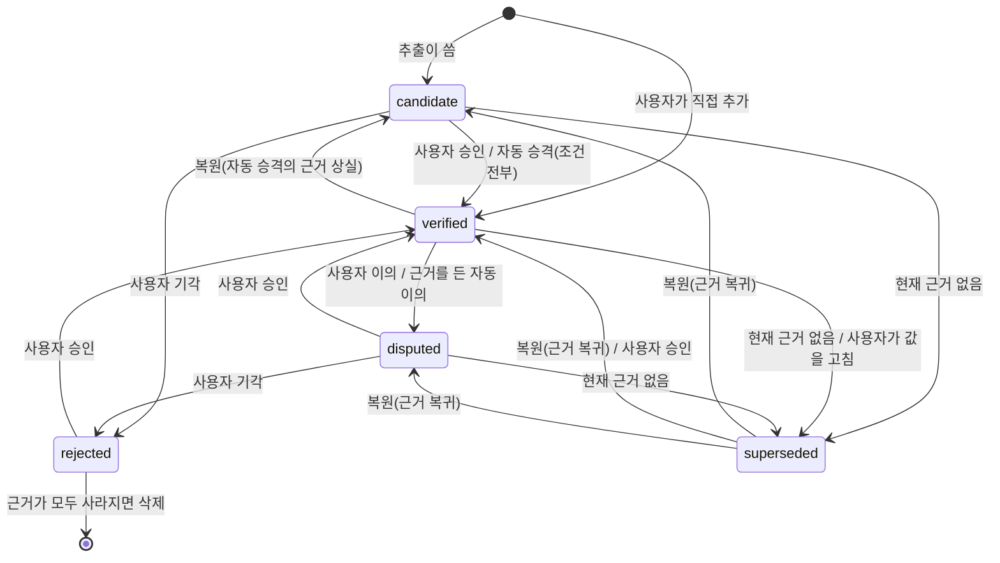
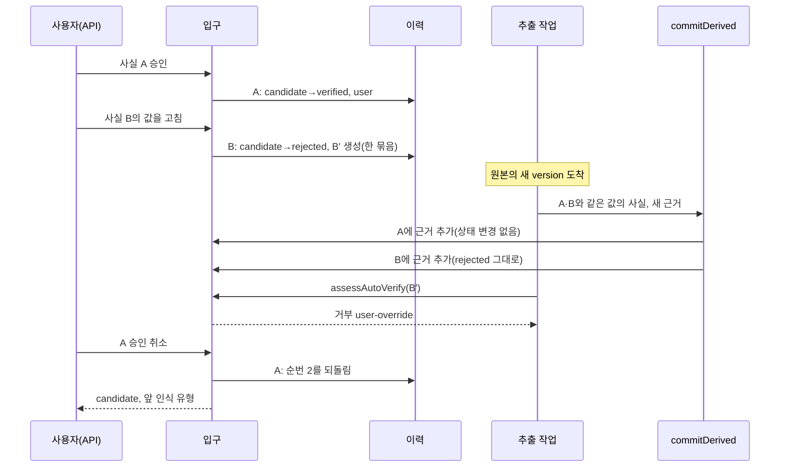
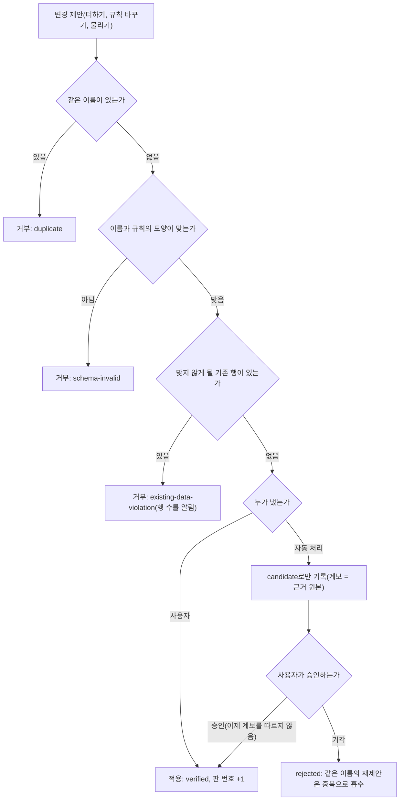
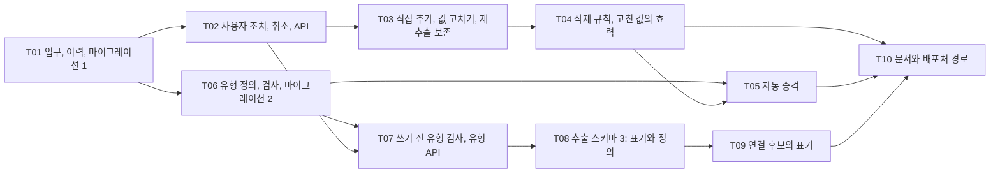

# 스펙: S01 Semantic 등록부·후보 검증·사용자 교정 보존

- 날짜: 2026-11-22 / 상태: 확정(잠정 결정 포함)
- 관련: 이슈 #22(S01), 총괄 #1(설계 분석 7·8·9번), Phase 3 #5, 선행 #21(I04), 후속 #23(S02)·#24(S03)·#25(K01)·#29(P03, 사용자 조치 입구를 쓰는 쪽)·#31(X02, 같은 입구를 화면에서 부르는 쪽). [원 설계 6절](../design/original-design.md), [V02 spec](2026-11-21-V02-vertical-slice.md), [I04 spec](2026-11-21-I04-invalidation.md), [ARCHITECTURE.md](../ARCHITECTURE.md), [ADR 0002](../adr/0002-authority-in-product-records.md)·[0003](../adr/0003-phase1-without-engine.md)·[0013](../adr/0013-failure-recovery.md), [site-setup.md](../site-setup.md)

낯선 말은 [ARCHITECTURE 0절](../ARCHITECTURE.md#0-처음-나오는-말)에 풀이가 있다. 이 spec이 새로 쓰거나 뜻을 좁히는 말은 아래와 같다.

| 말 | 뜻 |
|---|---|
| Semantic 등록부 | 제품이 아는 용어·개념·정의·관계와 그 유형 목록을, 각각 "지금 어떤 상태인가"와 함께 적어 둔 정본 기록. 새 저장소가 아니라 V02가 만든 항목·사실·관계 행에 이력과 규칙을 붙인 것이다. I04의 **파생물 등록부**(삭제할 때 무엇을 지울지 등록한 코드 목록)와 다른 것이므로 이 문서는 둘을 언제나 이 이름으로 구분해 부른다 |
| 등록 행 | Semantic 등록부의 한 줄. 항목 하나, 사실 하나, 관계 하나, 또는 유형 정의 하나 |
| 인식 유형 | 그 행을 **무엇에 기대어** 아는가. 명시 사실(`explicit`), 사용자 승인(`user-approved`), 추론(`inferred`), 가설(`hypothesis`) 넷. V02가 만든 `epistemic` 열이다 |
| confidence | 모델이 스스로 매긴 0~1의 숫자. 인식 유형과 다른 열이고 서로 계산하지 않는다 |
| 상태 | 그 행이 **지금 얼마나 받아들여졌는가**. `candidate`(후보), `verified`(검증됨), `disputed`(이의 있음), `superseded`(대체됨), `rejected`(기각됨) |
| 입구 | 상태와 인식 유형을 바꾸는 하나뿐인 함수 묶음. 이 밖의 코드는 두 값을 고치지 못한다 |
| 사용자 조치 | 사용자가 API로 한 승인, 기각, 이의, 값 고치기, 직접 추가, 취소 |
| 사용자가 정한 행 | 취소되지 않은 사용자 조치가 이력에 하나라도 있는 행. 자동 처리는 이 행을 정해진 몇 가지 방법으로만 건드릴 수 있다 |
| 사용자가 쓴 행 | 값을 사용자가 직접 입력한 행(`user_authored`). 원본에서 온 글이 아니므로 근거(원본의 한 구간)가 없어도 있을 수 있다 |
| 표기 | 한 항목을 가리키는 글자열 하나. 동의어, 약어, 한영 표기가 모두 표기다 |
| 유형 정의(ontology 요소) | "이런 종류의 항목이 있다", "이런 종류의 사실은 날짜 값을 갖는다", "이 관계는 A 유형에서 B 유형으로 향한다" 같은 규칙 하나 |

## 배경

원 설계 6절은 개인별 Semantic 지식을 제품의 핵심 자산으로 두고, 그것이 후보에서 검증으로 자라며, 사용자가 고친 것을 LLM이 근거 없이 덮어쓰지 못하게 하라고 요구한다. 총괄 이슈 #1의 설계 분석 7번은 그것을 세 가지로 좁혔다: 사용자 판단과 모델 confidence를 분리한다, 사용자 교정을 자동 재추출이 덮어쓰지 않는다, 자동 승격 조건을 명시한다.

**지금 있는 것**(origin/main의 코드를 읽어 확인했다. 실행해 본 것은 아니다).

- 항목·사실·관계 테이블은 이미 인식 유형 넷과 상태 다섯, 유효 시각, 관측 시각을 갖는다(`storage/src/migrations.ts`의 v5, `storage/src/knowledge.ts`). 정본 스키마는 v19다(이 문단은 spec을 쓸 때의 코드를 서술한다. S01-T01 뒤에는 v20이다).
- 추출은 모든 것을 `candidate`로 쓴다. 인식 유형은 사실이면 LLM이 고른 `explicit`이나 `hypothesis`, 항목과 관계는 언제나 `explicit`이다(`knowledge-engine/src/extraction.ts`, `providers/src/tasks.ts`).
- 같은 행(V02-R8)이 다시 추출되면 근거만 더해지고 행의 상태와 인식 유형은 그대로다(`saveFact`·`saveRelation`의 `ON CONFLICT DO NOTHING`).
- (spec을 쓸 때의 코드다. S01-T01이 아래 두 함수를 입구로 옮기고 지웠다.) 상태를 바꾸는 코드는 두 곳뿐이다. 새 version이 와서 현재 근거를 잃은 행을 `superseded`로 바꾸는 전파(`knowledge-engine/src/canonical-kinds.ts`가 `setKnowledgeStatus`를 부른다)와, 근거가 돌아온 `superseded` 행을 `candidate`로 되살리는 추출(`knowledge-engine/src/extraction.ts`가 `reviveSuperseded`를 부른다). 두 함수는 `storage/src/knowledge.ts`에 있고 `storage/src/index.ts`가 내보낸다.
- 파생물 쓰기는 `commitDerived`(fence, 계보, 범위 정책)를 지나고, 삭제는 파생물 등록부의 전파가 맡는다(I04). 테이블마다 어느 종류의 것인지 분류되어 있고, 분류 안 된 테이블은 검사가 막는다(`backend/src/derivative-coverage.ts`).

**없는 것.**

1. **`verified`·`disputed`·`rejected`로 가는 길이 없다.** 사용자가 승인하거나 기각할 API가 없고 자동 승격도 없다. 다섯 상태 가운데 실제로 쓰이는 것은 둘이다.
2. **변경 이력이 없다.** 상태가 언제, 누구에 의해, 무엇을 근거로 바뀌었는지 남지 않는다. 그래서 사용자 조치를 취소할 수 없다.
3. **되살리기가 사용자 승인을 지운다.** `reviveSuperseded`는 대체되기 전의 상태를 모르므로 언제나 `candidate`로 되돌린다(V02 "T07이 넘기는 것" 4가 "V02에는 사용자 승인이 없다"며 미뤄 둔 것). 사용자가 승인한 사실은 원본이 한 번 바뀌었다 돌아오면 승인을 잃는다.
4. **confidence를 둘 자리가 없다.** 어느 테이블에도 그 열이 없다.
5. **표기와 정의를 둘 자리가 없다.** 항목은 이름 하나만 갖는다(`storage/src/candidates.ts`, V02 미해결 질문 6). 동의어, 약어, 한영 표기, 문맥마다 다른 정의를 기록하지 못한다.
6. **유형 목록이 코드 상수다.** 항목 유형(`Project`, `System`), 사실 종류(`target_date`, `completion_date`), 관계 유형(`DEPENDS_ON`)이 `providers/src/tasks.ts`에 박혀 있다. 유형을 더하거나 방향·제약을 바꿀 때 기존 데이터가 어떻게 되는지 볼 장치가 없다.
7. **사용자가 직접 입력한 값의 자리가 없다.** 지금의 삭제 규칙은 근거가 하나도 남지 않은 행을 지운다(I04-R8). 사용자가 쓴 값은 근거가 없으므로, 따로 표시하지 않으면 있을 수 없거나 지워진다. I04 spec의 잠정 결정 9는 이 자리를 S01에 넘겼다.

**선행 작업의 상태.** 이슈 #22의 선행은 #21(I04)이고, #21은 2026-11-22 현재 열려 있다. 이 spec은 I04가 main에 들여온 `commitDerived`, 파생물 등록부, `ScopePolicy`, 읽기 검사(`visible`) 위에 쓴다. S01이 실제로 기대는 것은 I04의 **필수 작업**이므로 구현 착수 조건은 "이슈가 닫힘"이 아니라 "I04의 필수 작업이 main에 합쳐짐"이다. 선택 작업이던 I04-T12(이전 version 지우기, 변경 종류 `old-versions-pruned`)는 이미 main에 있고(`knowledge-engine/src/prune-versions.ts`), S01이 그것을 어떻게 다루는지는 R22에 적었다(미해결 질문 1).

**엔진 결정과의 관계.** 문서 색인은 Phase 3의 spec을 "R07의 엔진 결정 뒤"에 쓴다고 적어 두었다. R07은 배포처 실행을 기다리고 있어 그 전에 이 spec을 쓴다. ADR 0002가 "교정은 어느 경우든 제품이 갖는다"고 정했으므로 이 spec의 이력·사용자 조치·유형 정의는 엔진 결정과 상관없이 남는다. 항목·사실·관계 테이블 자체가 엔진으로 넘어가면(가정 A09) 요구사항 R1~R4의 저장 자리를 다시 정한다.

## 목표

1. 등록 행 하나의 상태는 정해진 전이로만 바뀌고, 바뀔 때마다 누가·언제·무엇을 근거로 바꿨는지가 남으며, 사용자 조치는 직전 상태로 취소할 수 있다.
2. 자동으로 `verified`가 되는 조건이 문서와 코드에 한 벌로 적혀 있고, 그 조건을 하나라도 채우지 못한 승격은 이유와 함께 거부된다.
3. 인식 유형과 confidence가 서로 다른 열에 있고 어느 쪽도 다른 쪽에서 계산되지 않는다.
4. 사용자가 정한 행을 자동 처리가 근거 없이 바꾸지 못하고, 같은 원본을 몇 번 다시 추출해도 사용자의 승인·기각·고친 값이 그대로다.
5. 한 항목의 동의어·약어·한영 표기와 문맥마다 다른 정의가 각각의 행으로 남고, 같은 글자의 표기가 서로 다른 항목에 붙어 있어도 합쳐지지 않는다.
6. 유형·방향·제약을 바꾸려는 변경은 중복 검사, 모양 검사, 기존 데이터 영향 검사를 지나야 적용되고, 사용자가 아닌 쪽이 낸 변경은 후보로만 남는다.
7. 위 기록은 모두 I04의 삭제·범위·fence 장치 위에 있다. 원본을 지우면 거기서 온 표기·정의·유형 후보도 함께 사라진다.

## 비목표 (배포처에서 후속 진행)

**공용 저장소의 뒤 작업으로 넘기는 것**

- 개체 해소(같은 것을 가리키는 두 항목 찾기·합치기·되돌리기·나누기), 항목 이름 고치기, 동명이인 구분: S02(#23) S02-C2. S01은 유사도를 계산하지 않고 항목을 합치지 않는다.
- 유형 목록 넓히기(Person, Organization, BusinessRule 등 열여섯 유형과 요청 관계 유형), 추출 지시문의 유형 목록을 등록부에서 만드는 일, LLM이 새 유형을 제안하는 추출 경로: S02(#23) S02-C1. S01은 그 변경이 지나야 하는 검사와 기록을 만든다.
- 유효 시각의 구간(`valid_from`·`valid_until`), SUPERSEDES·CONTRADICTS·SUPPORTS 관계, 서로 어긋나는 값의 자동 발견, 여러 단계 근거: S02(#23) S02-C3. S01은 "근거를 들고 이의를 제기하는" 입구만 만든다.
- Dataset·Grain·Measure·Metric·Join 같은 분석용 유형과, 실제 데이터 스키마 없이는 승격할 수 없다는 조건: S03(#24). S01의 자동 승격 조건은 S03이 조건을 더할 수 있는 모양으로 둔다(R9).
- 여러 근거를 묶어 새로 쓴 정의(추론), Wiki 페이지: K01(#25)·K02(#26). S01의 정의는 원문에 있는 글 그대로다.
- 사용자별 용어 사용 패턴(원 설계 6.1의 마지막 항목), 피드백으로 순위 바꾸기: P03(#29).
- Semantic 화면(목록, 승인·기각 단추, 이력 보기), 삭제로 사용자 조치가 사라지기 **전에** 알리는 일: X02(#31). S01은 그 화면이 부를 API와 그 계약 테스트까지 만든다(잠정 결정 7).
- "정확하지 않다"는 피드백을 사용자 조치로 옮기는 일: P03(#29) P03-C2. P03은 R7의 사용자 조치 입구를 그대로 쓴다.
- 백업과 복원에서 사용자 조치 되살리기: H01(#32). 사용자 조치는 정본 SQLite에만 있고 다시 만들 수 없다(ARCHITECTURE 4절).

**하지 않는 것**

- 새 그래프·벡터·기억 엔진, 별도의 Semantic 저장소. 기록은 제품의 SQLite 행이다(ADR 0002, ADR 0003).
- confidence 숫자로 상태를 정하는 일. 모델이 스스로 매긴 숫자는 보정되지 않았다.
- 배포처 고유 용어 사전을 미리 넣어 두는 가져오기 기능. 사용자가 API로 추가할 수 있고, 요구가 관측되면 그때 정한다.
- 여러 사용자. 사용자 조치의 주체는 이 PC의 한 사람이다(ARCHITECTURE 8절의 전제).

**배포처 후속 항목**(1개. [site-setup.md의 배포처 설정 체크리스트](../site-setup.md#배포처-설정-체크리스트)와 번호로 대응한다. **번호는 잠정이고 조정자가 합치는 순서에 맞춰 다시 배정한다.** S23~S25는 I02-B, S26·S27은 I05, S28·S29는 I06의 초안, S30·S31은 I07이 쓰고 있어 그다음 번호를 잡았다)

| 번호 | 항목 | 왜 배포처인가 |
|---|---|---|
| S32 | 설치본과 실제 Provider로 표기·정의 추출을 실행하고, 자동 승격을 켤지 정한다 | 자동 승격은 "믿어도 되는가"를 코드가 대신 판단하는 것이라, 실제 자료에서 틀린 승격이 얼마나 나오는지 재기 전에는 꺼 둔다(R9). 공용 저장소에는 실제 Provider도 실제 자료도 없다 |

## 요구사항

요구사항 번호는 `S01-R<n>`이다. 다른 spec의 번호를 가리킬 때는 `V02-R8`, `I04-R11`처럼 작업 코드를 붙인다.

### 등록부의 모양

- **S01-R1 등록 행은 V02의 행이다.** 항목·사실·관계 행이 곧 Semantic 등록부의 줄이다. 새 지식 테이블을 만들지 않는다. 원 설계 6.7의 필드는 아래처럼 대응한다.

  | 6.7의 필드 | 어디에 있는가 |
  |---|---|
  | `id`, `type`, `name` | 항목의 `id`, `type`, `name` |
  | `definition` | 그 항목의 사실 가운데 종류가 `definition`인 행들(R3) |
  | `aliases` | 그 항목의 사실 가운데 종류가 `alias.*`인 행들(R2) |
  | `attributes` | 그 항목의 나머지 사실 |
  | `confidence` | 새 열 `confidence`(R10) |
  | `status` | 기존 열 `status` |
  | `evidence_refs` | 기존 `evidence` 테이블 |
  | `created_at` | 기존 열 `observed_at` |
  | `updated_at`, `version` | 이력의 마지막 줄의 시각과 순번(R6). 따로 열을 두지 않는다 |
  | `valid_from` | 기존 열 `valid_at` |
  | `valid_until` | 없음. S02가 정한다 |

- **S01-R2 표기.** 한 항목의 다른 이름은 그 항목의 사실로 적는다. 종류는 셋이다: `alias.synonym`(동의어), `alias.abbreviation`(약어), `alias.translation`(다른 언어의 표기). 값은 표기 글자 그대로다.
  - 표기는 원문에 **글자 그대로** 있어야 하고 그 자리가 근거가 된다. 코드가 인용문 안에 그 표기가 있는지 확인하며, 없으면 버리고 버린 수에 센다.
  - 같은 항목에 같은 표기가 다시 오면 행을 더하지 않고 근거를 더한다. 같은지는 V02-R7의 가공(유니코드 정규화, 대소문자 통일, 공백 정리)을 거친 값으로 본다.
  - **같은 글자의 표기가 서로 다른 항목에 붙을 수 있고, 그렇다고 두 항목을 합치지 않는다**(원 설계 6.1의 "같은 명칭이 다른 문맥에 나오면 무조건 합치지 않는다").
- **S01-R3 개념과 문맥별 정의.** 항목 유형 `Concept`와 사실 종류 `definition`을 둔다. 정의의 값은 원문의 한 구간 그대로이고(값과 인용문이 같다), 길이는 코드 포인트 500 이하다. 넘으면 버린다. 사실 행에 `context` 열(짧은 꼬리표, 없을 수 있음)을 더해 그 정의가 어느 문맥의 것인지 적는다. 한 개념이 정의를 여럿 가질 수 있고, 정의마다 상태와 이력이 따로다.
- **S01-R4 유형을 가리지 않는다.** 입구, 이력, 사용자 조치, 삭제 규칙은 항목 유형이나 사실 종류의 이름을 보지 않는다. 업무 규칙·프로세스·역할 같은 도메인 지식(원 설계 6.4)은 S02가 유형을 더하면 같은 장치를 그대로 지난다. S01이 더하는 유형은 `Concept`, `definition`, `alias.*`뿐이다.

### 상태, 이력, 취소

- **S01-R5 전이와 하나뿐인 입구.** 상태는 아래 표의 전이로만 바뀐다. 표에 없는 전이는 `invalid-transition`으로 거부된다. 다만 행이 이미 그 상태인 것을 요청하면 표에 있든 없든 `unchanged`이고 이력을 쓰지 않는다(R12의 `unchanged`와 같은 뜻. "S01-T01이 넘기는 것" 3의 ④). 상태, 인식 유형, `user_authored` 표시를 바꾸는 코드는 입구 하나이고(`storage`의 한 모듈), 입구를 지나지 않은 `UPDATE`는 스키마가 막는다(방식은 S01-T01이 정한다. 권장: 이력 줄이 먼저 있어야 통과하는 트리거). 행을 처음 만드는 `INSERT`는 막지 않는다. 지금의 `setKnowledgeStatus`와 `reviveSuperseded`는 입구로 옮기고 지운다.

  | 전이 | 누가 | 조건 |
  |---|---|---|
  | `candidate` → `verified` | 사용자(승인) | — |
  | `candidate` → `verified` | 정책(자동 승격) | R9의 조건 전부 |
  | `candidate` → `rejected` | 사용자(기각) | — |
  | `verified` → `disputed` | 사용자(이의) | — |
  | `verified` → `disputed` | 정책(자동 이의) | 근거로 삼는 원본 version을 넘김(R12). S01에는 이것을 부르는 곳이 없다 |
  | `disputed` → `verified` | 사용자(승인) | — |
  | `disputed` → `rejected` | 사용자(기각) | — |
  | `superseded` → `verified` | 사용자(승인) | 물린 값을 사용자가 다시 받아들임. 인식 유형은 `user-approved` |
  | `rejected` → `verified` | 사용자(승인) | 기각했던 값을 사용자가 다시 받아들임. 인식 유형은 `user-approved` |
  | `candidate`·`verified`·`disputed` → `superseded` | 전파 | 현재 근거가 하나도 없게 됨(V02-R11 그대로). 사용자가 쓴 행은 뺀다(R14) |
  | `verified` → `superseded` | 사용자(값 고치기) | 고친 값의 행이 같은 조치에서 생김(R7) |

  전이가 아닌 것이 셋 있다. 이들은 새 상태를 정하지 않고 **이력에 적힌 앞 상태를 되돌린다.**

  | 복원 | 누가 | 무엇으로 돌아가는가 |
  |---|---|---|
  | 취소 | 사용자 | 그 사용자 조치 직전의 상태와 인식 유형(R8) |
  | 근거 복귀 | 추출 | `superseded`가 되기 직전의 상태와 인식 유형. **그 행의 마지막 이력이 전파가 한 `superseded`일 때만이다**(사용자가 취소해서 그 상태로 돌아온 행도 같다. 취소 줄은 그것이 되돌린 조치 **바로 앞의 줄**(취소로 되돌아간 상태를 만든 줄)의 주체로 본다). 사용자가 값을 고쳐 물린 행은 근거가 돌아와도 되돌리지 않는다(R13). 이력이 없는 행(S01 이전의 것)은 `candidate` |
  | 자동 승격의 근거 상실 | 정책 | 자동 승격 직전의 상태(`candidate`) |

  **종류마다 쓰는 줄이 다르다.** 사실과 관계는 표 전부를 쓴다(`superseded`·`rejected`에서 승인으로 돌아오는 두 줄도 사실과 관계 모두에 있다). **항목**은 근거를 갖지 않으므로(근거는 사실과 관계만 가리킨다) 사용자의 줄만 쓴다: 전파는 항목을 `superseded`로 바꾸지 않고(지금 코드도 항목은 지우기만 한다) 정책은 항목을 승격하지 않는다(잠정 결정 12). **유형 정의**는 사용자의 세 줄만 쓴다: `candidate` → `verified`(승인), `candidate` → `rejected`(기각), `verified` → `superseded`(물리기, R19). `disputed`가 없고, 전파·정책·근거 복귀가 없으며, 되돌아가는 길은 사용자의 취소뿐이다(R20).

- **S01-R6 이력.** 생성과 모든 전이·복원·인식 유형 변경이 이력 한 줄을 남긴다. 한 줄은 대상 행, 대상 안에서의 순번(1, 2, 3…), 시각, 주체(`user`, `extraction`, `propagation`, `policy`), 조치 이름, 앞뒤 상태, 앞뒤 인식 유형, 이유 코드, 근거로 삼은 원본 version(있으면), 한 조치가 여러 행을 바꿀 때 그것을 묶는 번호, 복원이면 어느 순번을 되돌렸는지를 갖는다.
  - **이력에는 글이 없다.** 이름, 값, 인용문, 외부 식별자를 담지 않는다. 고친 값은 행 자체에 있다.
  - 이력은 고치거나 지울 수 없고(트리거), 대상 행이 지워질 때만 함께 지워진다. SQLite는 외래 키로 함께 지울 때도 자식 테이블의 삭제 트리거를 부르므로, 막는 트리거는 "대상 행이 아직 있을 때만" 막아야 한다(S01-T01이 시험한다).
  - **이력에 남는 것은 번호뿐이다.** 살아남은 행의 이력에는 지워지거나 정리된 version을 가리키는 근거 번호(원본 ID와 version)가 그대로 남는다. 글이 아니고, 무효화 기록(I04-R4)이 원본 ID를 갖는 것과 같은 수준이다. 번호를 비우지 않는다(잠정 결정 16).
  - 근거 번호에 적는 것: 새 version이 와서 물릴 때는 그 원본의 새 version, 원본 삭제로 물릴 때는 그 원본과 tombstone이 덮은 version(`coversVersion`), 이전 version 정리로 물릴 때는 그 원본과 **남긴** version이다(정리는 한 구간을 지우고 변경은 남긴 version 하나만 싣는다: `{ sourceId, change.version }`).
  - 이력 테이블은 대상의 종류마다 하나다(항목, 사실, 관계, 유형 정의). 파생물 분류에서는 그 대상과 같은 종류에 속한다(R20).
  - S01 이전에 만들어진 행은 이력이 없다. 마이그레이션은 이력을 지어내지 않는다.
- **S01-R7 사용자 조치.** 다섯 가지다.
  - **승인**: `candidate`, `disputed`, `superseded`, `rejected`를 `verified`로. 인식 유형이 `user-approved`가 된다. 물린 행이나 기각한 행을 승인하는 것은 "이 값을 다시 받아들인다"는 뜻이고, 사용자가 예전 값으로 돌아가는 길이다(아래 "이미 있는 값"). 사실이나 관계를 승인하는 순간 그 행에 현재 근거가 없으면(어느 상태에서 왔든) 그 승인의 이력 줄에 이유 코드 `accepted-without-current-evidence`를 적는다(R12, R15가 이 코드를 본다).
  - **기각**: `candidate`나 `disputed`를 `rejected`로. 인식 유형은 그대로다.
  - **이의**: `verified`를 `disputed`로.
  - **직접 추가**: 사용자가 쓴 행을 만든다(사실, 표기, 정의, 관계, 항목). `verified`, `user-approved`, `user_authored`로 생기고 근거가 없다.
  - **값 고치기**: 사실 하나의 값을 사용자가 쓴 값으로 바꾼다. 같은 행을 고치지 않는다(같은 행 규칙 V02-R8 때문에 값이 다르면 다른 행이다). 새 값의 행을 "직접 추가"로 만들고, 옛 행을 물린다: `verified`였으면 `superseded`, `candidate`나 `disputed`였으면 `rejected`. 두 행의 변경은 한 조치로 묶인다.
  - **이미 있는 값.** "직접 추가"나 "값 고치기"로 쓰려는 값의 행이 그 항목에 이미 있으면(같은 행 규칙의 고유 키. 물린 행과 기각된 행도 포함) 새 행을 만들지 않고 `value-exists`로 거부하며, 그 행의 ID를 함께 알린다. 사용자는 그 행을 승인하면 된다(어느 상태의 행이든 R5에 승인으로 가는 줄이 있다). 거부 자체는 아무것도 바꾸지 않는다(잠정 결정 13). 값 고치기로 생긴 사용자가 쓴 행은 그대로 `verified`로 남는다. 예전 값만 남기려면 그 조치를 취소하거나(마지막 이력일 때) 그 행을 이의 → 기각한다.

  사용자 조치를 만드는 함수는 API 층만 부를 수 있다. 작업 실행기와 추출 코드는 그 함수에 닿지 못한다(V01-R8의 사용자 조치 기록과 같은 생각이다. 방식은 S01-T02가 정한다. 권장: 저장 패키지의 별도 입구와 모듈 경계 lint). 이 입구를 부르는 쪽은 S01의 API, 그 API를 화면에서 쓰는 X02, 정확성 피드백을 옮기는 P03(P03-C2)이다.
- **S01-R8 취소.** 취소는 한 행에 마지막으로 남은 이력이 사용자 조치일 때 그 조치를 되돌린다. 묶인 행이 있으면 함께 되돌린다.
  - 되돌린 뒤의 상태와 인식 유형은 그 조치의 이력 줄에 적힌 앞 값이다. 새로 계산하지 않는다.
  - 취소도 이력 한 줄이다(어느 순번을 되돌렸는지 적는다). 지나간 줄을 지우지 않는다.
  - "직접 추가"의 취소는 그 행을 지운다. 그 사이 추출이 그 행에 근거를 붙였으면 지우지 않고 `candidate`·`hypothesis`로 두고 `user_authored`를 내린다(잠정 결정 6). 그 뒤로 그 행은 원본에서 온 행과 같은 규칙을 따른다.
  - 거부: 그 행의 마지막 이력이 사용자 조치가 아니면 `not-latest`(그 뒤에 전파나 다른 변경이 있었다), 이미 취소한 조치면 `nothing-to-undo`. 자동 처리가 한 변경은 취소 대상이 아니다.
- **S01-R9 자동 승격의 조건.** 아래가 **모두** 참일 때만 정책이 `candidate`를 `verified`로 올린다. 하나라도 거짓이면 올리지 않고, 채우지 못한 조건의 목록을 돌려준다.
  1. 설정 `semantic.autoVerify`가 켜져 있다. **기본값은 꺼짐이다**(잠정 결정 3).
  2. 인식 유형이 `explicit`이다. 가설과 추론은 자동으로 승격하지 않는다.
  3. **서로 다른 원본 둘 이상**의 현재 근거가 있다. 같은 원본의 여러 version, 내용 해시가 같은 두 원본은 하나로 센다. tombstone이 덮은 원본은 세지 않는다.
  4. 그 행의 유형 정의가 `verified`다(R18).
  5. 값이 하나여야 하는 종류(유형 정의의 `cardinality`가 `one`)이면, 같은 항목에 같은 종류의 다른 값을 가진 유효한 행이 없다. "유효"는 R15의 뜻이다.

  confidence는 조건에 없다(R10). 판정은 추출이 근거를 붙인 뒤와 전파가 근거를 뗀 뒤, 같은 트랜잭션에서 한다. 자동으로 승격된 행이 조건 3이나 5를 잃으면 정책이 승격 직전의 상태로 되돌린다(R5의 복원). **대상은 사실과 관계다.** 항목과 유형 정의는 자동 승격하지 않는다(R5). 사용자가 정한 행은 조건을 보기 전에 `user-override`로 거부된다(R12). 그래서 "사용자가 정하지 않았다"는 조건 목록에 없다. 조건 목록은 닫힌 목록이 아니다: S03은 분석용 유형에 "실제 스키마 검증"을 더한다.

### 인식 유형과 confidence

- **S01-R10 두 값은 따로다.** 항목·사실·관계에 `confidence` 열을 더한다. 0 이상 1 이하의 수이거나 비어 있다. Provider가 추출 응답에 준 숫자를 그대로 적고, 주지 않으면 비운다. 행이 처음 생길 때만 적는다(잠정 결정 5).
  - 어떤 코드도 confidence에서 인식 유형이나 상태를 계산하지 않고, 인식 유형이나 상태에서 confidence를 계산하지 않는다.
  - 사용자 승인, 기각, 자동 승격, 복원은 confidence를 바꾸지 않는다.
  - 사용자가 쓴 행의 confidence는 비어 있다.
- **S01-R11 인식 유형이 바뀌는 때.** 넷뿐이고 모두 입구를 지나 이력에 남는다. ① 사용자 승인은 `user-approved`로 바꾼다. ② `hypothesis` 행에 추출이 `explicit`이라고 밝힌 근거를 붙이면 `explicit`으로 올린다(사용자가 정한 행은 빼고). ③ 복원은 이력의 앞 값으로 되돌린다. ④ 근거가 붙은 "직접 추가"를 취소하면 `hypothesis`가 된다(R8). `explicit`을 `hypothesis`로 내리는 자동 경로는 없다.

### 사용자 교정의 보존

- **S01-R12 자동 처리가 사용자가 정한 행에 할 수 있는 것.** 넷뿐이다. 그 밖의 변경은 `user-override`로 거부된다.
  1. 전파가 현재 근거를 잃은 행을 `superseded`로 바꾼다. 근거 번호는 R6에 적은 대로다. **사용자가 쓴 행에는 하지 않는다**(R14). **사용자가 현재 근거가 없는 행을 승인했으면**(그 승인 줄의 이유 코드 `accepted-without-current-evidence`), **그 승인이 그 행의 취소되지 않은 마지막 사용자 조치인 동안은 하지 않는다**: 사용자는 현재 근거가 없다는 것을 알고 받아들였으므로, 같은 이유로 다시 물리면 그 결정을 근거 없이 덮어쓰는 것이다. 어느 상태에서 승인했는지는 보지 않는다(`rejected`였던 행은 전파가 물리지 않아 지난 근거만 가진 채 남아 있다가 승인될 수 있다).
  2. 근거가 돌아왔을 때 `superseded` 직전의 상태로 되돌린다. **전파가 물린 행만이다**(R5). 사용자가 승인했던 행은 `verified`·`user-approved`로 돌아온다. 사용자가 값을 고쳐 물린 행은 돌아오지 않는다.
  3. `verified`를 `disputed`로 바꾼다. **근거로 삼는 원본 version을 넘겨야 하고**, 넘기지 않으면 `basis-required`로 거부된다. 값을 바꾸거나 기각하지는 못한다. 결정은 사용자가 한다. 이력의 주체는 `policy`다. **S01에는 이것을 부르는 코드가 없다.** 어긋나는 값을 찾는 것은 S02이고, S01은 입구와 그 시험까지 만든다(잠정 결정 14).
  4. 원본 삭제와 이전 version 정리의 전파가 행을 지운다(R14).

  자동 처리의 입구에는 기각하는 함수도 승인하는 함수도 없다. 그 밖의 호출(자동 승격 판정, `explicit`으로 올리기)이 사용자가 정한 행에 오면 `user-override`다.

  **건너뛴 호출도 `user-override`로 답한다.** 전파와 추출은 닿은 행마다 입구를 부르므로, 위에서 "하지 않는다"고 한 경우(사용자가 쓴 행이나 현재 근거 없이 승인한 행(`accepted-without-current-evidence`)에 대한 물리기, 사용자가 물린 행에 대한 근거 복귀)에 입구는 `refused: user-override`를 돌려주고 이력을 쓰지 않는다. 부르는 쪽은 이것을 오류로 다루지 않고 나머지 행을 계속 처리한다. `unchanged`는 "이미 그 상태"일 때만 쓴다.
- **S01-R13 다시 추출해도 그대로다.** 원본의 새 version이 와서 추출이 다시 돌 때:
  - 사용자가 승인한 행은 상태, 인식 유형, confidence가 그대로다. 근거만 더해진다.
  - 사용자가 기각한 행은 같은 값이 다시 추출되어도 `rejected`다.
  - 사용자가 값을 고쳐 물린 옛 행은 같은 값이 다시 추출되어도 물린 상태 그대로다. 옛 행이 `candidate`였든(`rejected`가 됨) `verified`였든(`superseded`가 됨) 같다. 그 행을 되돌리는 것은 사용자뿐이다(취소, 또는 그 행의 승인).
  - 사용자가 쓴 값의 행은 그대로다. 추출이 같은 값을 찾아 그 행에 근거를 붙였다가 다음 version에서 그 값이 빠져도 `superseded`가 되지 않는다(R14).
  - 원본이 그 내용을 뺐다가 다시 넣으면, 사용자가 승인했던 행은 승인된 상태로 돌아온다(R12의 2).
- **S01-R14 사용자가 쓴 행과 삭제.** 항목·사실·관계에 `user_authored` 열을 더한다. I04-R8의 재평가를 아래처럼 넓힌다.
  - 근거가 모두 사라진 행은 지금처럼 지운다. **사용자가 승인만 한 행도 지운다**(I04 잠정 결정 9: 값이 지운 원본에서 왔다).
  - **근거 수를 세는 두 규칙(현재 근거가 없으면 `superseded`, 근거가 하나도 없으면 삭제)은 사용자가 쓴 행을 건너뛴다.** 그 값은 원본이 아니라 사용자의 것이다. 사용자가 쓴 행은 근거가 없어도 있고, 추출이 붙였던 근거를 모두 잃어도 그대로다. 이 행이 사라지는 길은 아래의 항목 규칙과 사용자의 취소뿐이다. 계보는 R22가 정한다.
  - **항목은 원본에서 온 사실이나 관계가 하나도 남지 않으면 지운다. 그 항목에 붙은 사용자가 쓴 행도 함께 지운다.** 항목의 이름이 지운 원본에서 왔기 때문이다. 다만 사용자가 직접 만든 항목(`user_authored`)은 남는다(잠정 결정 4).
  - 함께 지워진 사용자가 쓴 행의 수는 무효화 기록(I04-R4)의 종류별 수에 들어간다.
  - **사용자는 지워지기 전에 알림을 받지 않는다.** 지운 뒤 종류별 수만 볼 수 있다. 이 규칙으로 사라지는 사용자 조치의 전체 목록은 잠정 결정 4에 있다.
- **S01-R15 고친 값이 실제로 쓰인다.** "의존 업무 지연" 규칙(V02-R9)의 "유효"를 넓힌다: 상태가 `superseded`·`rejected`가 아니고, **현재 근거가 하나 이상이거나, 사용자가 쓴 행이거나, 사용자가 현재 근거 없이 승인한 `verified` 행이다**(그 행의 취소되지 않은 마지막 사용자 조치가 이유 코드 `accepted-without-current-evidence`의 승인). 뒤의 둘을 아래에서 "사용자 입력 행"이라 부른다.
  - **범위.** 규칙이 사용자 입력 행을 입력으로 쓰면, 그 행의 계보를 Insight의 계보와 "묶어도 되는가"(`combinable`) 판정에 더한다. 사용자가 쓴 행의 계보는 R22대로 그 행이 붙은 항목의 계보이고, 현재 근거 없이 승인한 행의 계보는 그 행 자신의 것(그 행의 근거가 가리키는 원본 version들)이다. 지금 코드는 둘 다 현재 근거의 번호에서만 계산하므로, 더하지 않으면 그 값이 원본 범위를 벗어나 Insight의 글에 실린다.
  - **저장.** Insight와 그것이 쓴 사용자 입력 행을 잇는 테이블 `insight_user_inputs`(Insight, 사실이나 관계 가운데 하나)를 첫째 마이그레이션(S01-T01)이 만든다. `insight_evidence`는 현재 근거의 번호를 담는 자리라 근거가 없거나 지난 근거만 있는 행을 가리키지 못한다. 이 테이블은 종류 `insight`에 속하고 Insight나 그 행이 지워지면 함께 지워진다.
  - **표시.** Insight의 근거 목록에서 사용자 입력 행은 원본 구간 대신 "사용자 입력"이라는 표시로 나온다(글 없음).
- **S01-R16 연결 후보에 쓰는 표기.** 추출 전의 연결 후보 찾기(V02-R7)는 항목의 이름에 더해 **`verified`인 표기**를 본다. `candidate`·`disputed`·`rejected`·`superseded`인 표기는 보지 않는다. 비교 방식(글자 그대로, 같은 가공)은 그대로다. 이것은 ADR 0003의 3번 문장("별칭은 이미 기록된 이름과 사용자 교정에서만")을 넓힌다: 자동 승격을 켜면 사용자가 손대지 않은 표기도 연결에 쓰인다. 그 문장을 그 자리에서 고치지 않고, 새 ADR이 그 문장을 대체한다고 ADR 0003의 맨 위에 적는다(`docs/adr/README.md`의 규칙. 잠정 결정 8).

### 추출

- **S01-R17 추출 응답 스키마 3.** `extract` 작업의 스키마 version을 3으로 올린다.
  - 항목 유형에 `Concept`를 더한다.
  - `terms`: 항목, 표기, 표기의 종류(`synonym`, `abbreviation`, `translation`), 인용문.
  - `definitions`: 항목, 인용문(이것이 곧 값이다), 문맥 꼬리표(없을 수 있음), 인식 유형(`explicit`이나 `hypothesis`).
  - 사실·관계·표기·정의에 선택 항목 `confidence`(0~1).
  - 원본 version 하나에 Provider 호출 1회, 형식 오류 재시도 1회라는 한계(ADR 0003의 1번)는 그대로다. 표기와 정의도 같은 한 번의 응답에서 온다.
  - 응답 안의 글은 자료일 뿐 지시가 아니다. 인용문 대조, 버린 수의 기록, `commitDerived`를 지나는 쓰기는 V02·I04의 것을 그대로 쓴다.

### 유형 정의(ontology)

- **S01-R18 유형 정의의 기록.** 유형 정의를 정본 테이블에 둔다. 한 줄은 요소의 종류(`item-type`, `fact-kind`, `relation-type`), 이름, 규칙, 상태(같은 다섯), 판 번호(적용된 변경마다 1씩 오른다)를 갖는다.
  - 이름은 식별자다: 영문자로 시작하고 영문자·숫자·`_`·`.`만 쓰며 40자 이하다. 지금의 `Project`, `DEPENDS_ON`, `target_date`, 새 `alias.synonym`이 모두 여기에 든다. 글이 들어갈 자리를 두지 않는다.
  - 규칙은 종류마다 정해진 모양이다. 사실 종류: 붙을 수 있는 항목 유형, 값의 종류(`date`, `text`, `surface-form`), 값의 수(`one`, `many`). 관계 유형: 주체가 될 수 있는 항목 유형, 대상이 될 수 있는 항목 유형, 대칭 여부. **방향은 주체 유형에서 대상 유형으로다.**
  - 처음 값(seed)은 지금 코드 상수에 있는 것과 R4의 것이며 모두 `verified`다. 추출 지시문의 목록(`providers/src/tasks.ts`)과 seed가 어긋나면 테스트가 실패한다.
  - 유형 정의가 바뀌면 knowledge revision이 오른다.
  - 유형 정의의 상태는 R5에 적은 세 줄로만 바뀐다. 다섯 상태 가운데 `disputed`는 쓰지 않는다.
- **S01-R19 변경이 지나는 검사.** 유형 정의를 더하거나, 규칙(붙는 유형, 방향, 값의 종류, 값의 수, 대칭)을 바꾸거나, 물리는(`superseded`) 변경은 아래를 차례로 지난다. 검사만 하고 적용하지 않는 호출이 있다(화면이 결과를 먼저 보여 줄 수 있게).
  1. **중복 검사.** 같은 종류에 같은 이름이 있는가. 대소문자와 `_`·`.`·`-`를 무시하고 비교한다. `rejected`와 `superseded`인 것도 중복이다.
  2. **모양 검사.** 이름이 식별자인가, 규칙이 그 종류의 모양인가, 규칙이 가리키는 항목 유형이 있고 `verified`인가.
  3. **기존 데이터 영향 검사.** 그 유형을 쓰는 살아 있는 행(`rejected`·`superseded`가 아닌 것)의 수와, 변경 뒤 규칙에 맞지 않게 될 행의 수를 센다. 방향을 뒤집는 변경은 살아 있는 행 전부를 맞지 않는 것으로 센다(뜻이 모두 뒤집히므로). 물리는 변경도 살아 있는 행 전부를 센다.

  결과는 중복 목록, 모양 오류의 코드 목록, 영향(살아 있는 행 수, 맞지 않는 행 수)이다. **중복이 있거나, 모양 오류가 있거나, 맞지 않는 행이 하나라도 있으면 적용하지 않는다.** 제품은 기존 행을 스스로 고치거나 지우지 않는다. 사용자가 그 행들을 먼저 기각하거나, 다른 이름의 새 유형을 더한다(잠정 결정 9).
- **S01-R20 사용자가 아닌 쪽이 낸 변경.** 추출 같은 자동 처리가 낸 변경은 검사를 지나도 **적용되지 않고 `candidate` 유형 정의로만 남는다.** 사용자가 승인해야 `verified`가 되어 쓰인다. 유형 정의는 자동 승격하지 않는다.
  - 자동 처리는 근거로 삼는 원본 version을 넘겨야 하고, 그것이 그 후보의 계보다.
  - **`verified`인 동안 유형 정의는 계보를 따르지 않는다.** 승인한 순간부터 그것은 사용자가 받아들인 제품의 규칙이고 어느 원본에도 매이지 않는다. 계보 줄(`ontology_basis`)은 지우지 않고 남겨 두되, 종류의 `lineage`는 `verified`인 요소에 빈 목록을 답한다. 그래서 `verified`인 유형 정의, seed, 사용자가 직접 더한 유형 정의는 모두 계보 없는 행으로 다뤄진다.
  - **승인을 취소하면 남아 있는 계보 줄과 함께 `candidate`로 돌아간다.** 그 사이 제안한 원본이 모두 지워져 계보 줄이 하나도 남지 않았으면, 취소는 그 요소를 지운다(계보를 모두 잃은 후보와 같은 처리다). 계보 없는 후보가 남는 일은 없다. 사용자가 직접 더한 것은 처음부터 계보 줄이 없고, 그 추가의 취소는 그 요소를 지운다.
  - **쓰이고 있는 유형 정의의 승인이나 추가는 취소할 수 없다.** 유형 정의의 승인이나 사용자 추가를 취소하기 전에, 그 요소를 물린다고 보고 R19의 3(기존 데이터 영향 검사)을 돌리고, 규칙이 그 요소를 가리키는 `verified` 유형 정의가 있는지도 본다. 살아 있는 행이나 그런 유형 정의가 하나라도 있으면 취소를 `existing-data-violation`으로 거부하고(수만 알리고 이름은 싣지 않는다) 아무것도 바꾸지 않는다.
  - 규칙 바꾸기와 물리기도 이력 한 줄을 남긴다(글 없음, 앞뒤 판 번호). 물리기는 다른 사용자 조치처럼 취소할 수 있다. 규칙 바꾸기는 취소하지 않는다(`invalid-transition`). 되돌리려면 앞 규칙으로 새 규칙 바꾸기를 낸다(R19를 지난다).
  - 사용자가 기각한 이름을 자동 처리가 다시 내면 새 후보가 생기지 않는다(중복 검사가 흡수한다. R13과 같은 생각이다). 다만 기각된 후보는 계보를 그대로 가지므로 그 원본이 지워지면 함께 지워지고, 그 뒤에는 흡수되지 않는다(잠정 결정 4의 ㉮와 같은 손실).
  - **물리거나 기각한 이름은 다시 쓸 수 없다.** 중복 검사가 `rejected`와 `superseded`도 중복으로 보고, 유형 정의에는 되돌아가는 전이가 없다. 되살리는 길은 그 조치가 마지막 이력일 때의 취소뿐이다(알려진 한계. 미해결 질문 6).
  - S01에는 이 길로 변경을 내는 추출 경로가 없다(비목표의 S02). S01은 입구와 그 시험까지 만든다.
- **S01-R21 쓰기 전에 유형 정의에 맞춘다.** 추출 결과를 쓸 때 항목 유형, 사실 종류, 관계 유형이 `verified`인 유형 정의에 있어야 하고, 사실의 값이 값의 종류에 맞아야 하며(지금 코드의 날짜 검사가 이것이 된다), 관계의 주체·대상 항목 유형이 방향에 맞아야 한다. 맞지 않으면 그것만 버리고 버린 수(`dropped_other`)에 센다. 값의 수 `one`은 쓰기를 막지 않고 자동 승격만 막는다(R9의 5. 어긋나는 값을 푸는 일은 S02다).

### 기존 장치 위에 얹기

- **S01-R22 쓰기, 삭제, 범위, 읽기.**
  - 자동 처리의 쓰기는 모두 `commitDerived`를 지난다(I04-R11). fence, 계보, 범위 정책을 새로 만들지 않는다. 표기와 정의는 종류 `fact`의 항목이다.
  - 새 테이블은 모두 `TABLE_CLASSIFICATION`에 분류한다. 이력 테이블은 그 대상의 종류에, 유형 정의 테이블과 그 계보 테이블은 새 종류 `ontology`에 속한다.
  - 종류 `ontology`를 파생물 등록부에 등록한다(층은 knowledge). 원본이 지워지면 그 원본을 가리키는 계보 줄을 모두 지우고, 그래서 계보가 하나도 남지 않은 `candidate`·`rejected` 유형 정의를 지운다. 계보를 따르는 것은 `candidate`와 `rejected`뿐이고(R20), `verified`인 것은 계보 없는 행으로 다뤄져 어느 원본의 삭제에도 남는다(계약 ③. 그 계보 줄만 사라진다). 이 종류는 계보 없는 행이 있다고 밝히고(`has.withoutLineage`) 무효화 계약 묶음 ①~⑥을 통과한다.
  - **이전 version 정리(I04-T12, `old-versions-pruned`).** 이 변경은 이미 main에 있다. 사실·관계·항목·Insight 종류는 정리를 삭제와 같은 규칙으로 다룬다(`canonical-kinds.ts`의 `supported()`가 `pruned`를 답하고, 지워지는 것은 남긴 version보다 낮은 version의 근거다). 그래서 S01의 규칙도 정리에서 같다: 종류 `ontology`는 그 원본의 남긴 version보다 낮은 version을 가리키는 계보 줄을 지우고 계보가 하나도 남지 않은 후보를 지운다. 사용자가 쓴 행은 정리에서도 근거 수 규칙을 건너뛴다(R14). **R14의 항목 규칙도 정리에서 같다**: 원본에서 온 행이 모두 정리된 version에만 기대고 있던 항목은 지워지고 거기 붙은 사용자가 쓴 행도 함께 지워진다. 이력의 근거 번호는 남는다(R6). S01-T01(물리기), T03(물리기 건너뛰기), T04(삭제 건너뛰기와 항목 규칙), T06(종류 `ontology`)이 각자 `pruned`를 다룬다.
  - 표기, 정의, 문맥 꼬리표는 원본을 지운 뒤 파일에 남지 않는다(I04의 카나리 검사에 더한다).
  - **사용자가 쓴 행의 계보(이 문장이 유일한 정의다).** 사용자가 쓴 사실의 계보는 그 사실이 붙은 항목의 계보다. 사용자가 쓴 관계의 계보는 주체와 대상 두 항목의 계보를 합친 것이다. **사용자가 만든 항목의 계보는 언제나 비어 있다**: 추출이 그 항목에 다른 원본의 사실을 붙여도 항목 자체는 그 원본에 매이지 않는다(그 사실만 그 원본을 따른다). 종류 `item`은 계보 없는 행이 있다고 밝힌다(`has.withoutLineage`). I04의 잠정 결정 9는 사용자가 쓴 값을 "계보 없는 행"으로 둘 것이라 보았는데, 항목의 이름이 원본에서 온 것이라 그 항목의 계보를 따르게 했다.
  - 새 읽기 API는 `visible`을 지난다(I04-R13). 범위는 위 계보에서 계산한다.
- **S01-R23 API.** `packages/contracts`에 경로와 스키마를 더한다. 이름은 잠정이고 S01-T02·T07이 굳힌다.

  | 경로 | 하는 일 |
  |---|---|
  | `GET /api/semantic` | 등록 행 목록: 항목과 그 표기·정의·사실·관계, 상태, 인식 유형, confidence, 근거 수, 사용자가 정했는지, 사용자가 썼는지 |
  | `POST /api/semantic/history` | 행 하나의 이력 |
  | `POST /api/semantic/decide` | 승인, 기각, 이의 |
  | `POST /api/semantic/correct` | 직접 추가, 값 고치기 |
  | `POST /api/semantic/undo` | 취소 |
  | `GET /api/ontology` | 유형 정의 목록 |
  | `POST /api/ontology/check` | 변경을 검사만 한다 |
  | `POST /api/ontology/change` | 변경을 검사하고 적용한다 |
  | `POST /api/ontology/decide` | 후보 유형 정의의 승인, 기각 |

  거부는 코드로 답한다(`invalid-transition`, `user-override`, `basis-required`, `not-latest`, `nothing-to-undo`, `value-exists`, `not-found`, 유형 정의는 `duplicate`, `schema-invalid`, `existing-data-violation`). 오류 응답에 이름·값·인용문을 싣지 않는다.

### 문서와 배포처 경로

- **S01-R24 문서.** 아래를 구현 작업이 자기 PR에서 고친다(이 spec의 커밋은 고치지 않는다).
  - ARCHITECTURE: 3.2절 표의 "근거·시간·상태·교정 이력 관리" 줄에 입구와 이력을, 4절 표에 유형 정의와 이력을, 5.6절 등록표에 종류 `ontology`와 이력 테이블의 소속을 적는다.
  - ADR: "Semantic 등록부는 기존 행 위의 이력과 입구이고, 사용자가 정한 행은 자동 처리가 넷으로만 건드린다"를 새 ADR로 남긴다. 번호는 합쳐지는 때의 다음 번호다. 다른 spec들이 0017(I02-B), 0018(I05), 0019(I06의 초안), 0020(I07)을 잡아 두었으므로 그대로 쓰이면 0021이다(잠정. 조정자가 다시 배정한다). **ADR 0003은 본문을 고치지 않는다.** 3번 문장이 새 ADR로 대체되었다는 줄을 맨 위에 더한다(R16).
  - site-setup.md: `## 배포처 설정 체크리스트` 아래에 S32를 더한다. 무엇을 실행하고 무엇을 기록하는지(표기·정의 추출의 종류별 수, 자동 승격을 켰을 때 조건을 채운 수와 그 가운데 사용자가 틀렸다고 본 수. 글은 기록하지 않는다)를 적는다.
  - docs/README.md: 이 spec의 상태 칸.
- **S01-R25 배포처 경로.** S32의 실행 경로(V02 배포처 검증 실행기의 Semantic 시나리오)를 Windows 설치본과 실제 Provider가 아닌 환경에서 실행하면 `배포처 후속`으로 시작하는 알림을 내고 0이 아닌 값으로 끝난다. 조용히 아무것도 하지 않는 일이 없다.

## 인터페이스 / 설계 개요

### 등록 행 하나의 상태

실선은 전이, 꼬리표에 "복원"이 붙은 선은 이력의 앞 상태로 돌아가는 것이다. 어느 상태에서든 원본 삭제의 전파가 행을 지울 수 있다(그림에는 한 번만 그렸다).



"복원(근거 복귀)"는 전파가 물린 행에만 있다. 사용자가 값을 고쳐 물린 행은 `superseded`에 머문다. 그림은 사실과 관계의 것이고, 항목과 유형 정의는 이 가운데 사용자의 선만 쓴다(R5).

사용자 조치의 취소는 그림에 없다. 취소는 어느 화살표든 사용자가 그은 것을 거꾸로 되돌리는 것이고, 이슈 #22의 말대로 전이가 아니라 이력의 직전 상태 복원이다.

### 교정한 뒤 다시 추출될 때

사용자가 사실 하나를 승인하고 다른 하나의 값을 고친 뒤, 같은 원본의 새 version이 와서 추출이 다시 도는 경우다. 무엇이 입구를 지나고 무엇이 거부되는지가 이 spec의 핵심이라 순서로 그렸다.



### 입구의 모양

이름과 모양은 잠정이다. S01-T01·T02가 코드 타입으로 굳히고 ARCHITECTURE 5.6절 옆에 옮긴다.

```typescript
type Actor = 'user' | 'extraction' | 'propagation' | 'policy'
type EntryRef = { kind: 'item' | 'fact' | 'relation' | 'ontology'; id: number }
type Basis = { sourceId: number; version: number }            // 근거로 삼는 원본 version. 글이 아니다
type Refusal =
  | 'invalid-transition' | 'user-override' | 'basis-required'
  | 'not-latest' | 'nothing-to-undo' | 'value-exists' | 'not-found'
type AutoVerifyCondition =
  | 'disabled' | 'not-explicit' | 'independent-sources'
  | 'type-unverified' | 'conflicting-value'
type Outcome =
  | { status: 'applied'; seq: number }                         // 이력의 순번
  | { status: 'unchanged' }                                    // 이미 그 상태. 이력을 쓰지 않는다
  | { status: 'refused'; reason: Refusal }
  | { status: 'refused'; reason: 'auto-verify-unmet'; unmet: readonly AutoVerifyCondition[] }

// 자동 처리가 쓰는 입구. 트랜잭션은 부르는 쪽(commitDerived의 write, 전파)이 연다.
// 기각과 승인은 여기에 없다. 사용자가 정한 행에는 supersede·evidenceReturned·raiseDispute만 통하고 나머지는 user-override다.
// R12가 건너뛰라고 한 경우(사용자가 쓴 행이나 현재 근거 없이 승인한 행(accepted-without-current-evidence)의 supersede, 사용자가 물린 행의 evidenceReturned)도 user-override로 답하고 이력을 쓰지 않는다. 부르는 쪽은 계속 진행한다.
// 유형 정의(kind 'ontology')는 created만 받는다. 그 상태는 UserDecisions와 유형 변경 API로만 바뀐다.
interface AutomatedLifecycle {
  created(tx: SqlDriver, ref: EntryRef, actor: Actor, basis: Basis | null): void
  supersede(tx: SqlDriver, ref: EntryRef, basis: Basis): Outcome            // 전파
  evidenceReturned(tx: SqlDriver, ref: EntryRef, basis: Basis): Outcome     // 추출: 전파가 물린 행만 복원
  explicitEvidence(tx: SqlDriver, ref: EntryRef, basis: Basis): Outcome     // 추출: hypothesis → explicit
  raiseDispute(tx: SqlDriver, ref: EntryRef, basis: Basis | null): Outcome  // 주체 policy. basis가 없으면 basis-required. S01에는 부르는 곳이 없다
  assessAutoVerify(tx: SqlDriver, ref: EntryRef): Outcome                   // 정책: 사실·관계를 승격하거나 되돌린다
}

// 사용자 조치의 입구. 구성 지점이 API 층에만 건넨다.
interface UserDecisions {
  decide(tx: SqlDriver, ref: EntryRef, action: 'approve' | 'reject' | 'dispute'): Outcome   // 유형 정의에는 dispute가 없다
  add(tx: SqlDriver, entry: UserEntry): { ref: EntryRef; seq: number } | { status: 'refused'; reason: 'value-exists'; existing: EntryRef }
  replaceValue(tx: SqlDriver, fact: EntryRef, value: string): { replaced: EntryRef; added: EntryRef } | { status: 'refused'; reason: Refusal; existing?: EntryRef }
  undo(tx: SqlDriver, ref: EntryRef): Outcome
}
```

### 유형 정의의 변경이 지나는 길



```typescript
type ElementKind = 'item-type' | 'fact-kind' | 'relation-type'
type ElementRule =
  | { elementKind: 'item-type' }
  | { elementKind: 'fact-kind'; itemTypes: readonly string[]; valueType: 'date' | 'text' | 'surface-form'; cardinality: 'one' | 'many' }
  | { elementKind: 'relation-type'; subjectTypes: readonly string[]; objectTypes: readonly string[]; symmetric: boolean }
type OntologyChange =
  | { op: 'add'; name: string; rule: ElementRule }
  | { op: 'change-rule'; elementKind: ElementKind; name: string; rule: ElementRule }
  | { op: 'retire'; elementKind: ElementKind; name: string }
interface OntologyCheck {
  duplicates: readonly { name: string; status: KnowledgeStatus }[]
  schemaErrors: readonly string[]                       // 코드. 글이 아니다
  impact: { liveRows: number; violations: number }
  applicable: boolean                                   // 셋이 모두 비었을 때만 참
}
function checkOntologyChange(db: SqlDriver, change: OntologyChange): OntologyCheck
```

### 스키마 변경

정본 스키마는 이 spec을 쓸 때 v19였다(S01-T01이 v20으로 올렸다). S01은 마이그레이션을 **둘** 더한다. 번호는 합쳐지는 때의 다음 번호다. I02-B의 작업도 마이그레이션 하나를 더하므로(그 spec의 색인 저장), 늦게 합쳐지는 가지가 번호를 다시 매긴다(`migrations` 배열의 자리와 `migrations.test.ts`의 기대 version).

| 마이그레이션 | 작업 | 내용 |
|---|---|---|
| 첫째 | S01-T01 | 항목·사실·관계에 `confidence`, `user_authored`. 사실에 `context`. 이력 테이블 셋(`item_history`, `fact_history`, `relation_history`)과 고칠 수 없게 하는 트리거. Insight와 사용자 입력 행(R15)을 잇는 `insight_user_inputs`(새 테이블은 넷이고, 이 테이블은 S01-T04가 쓰기 시작할 때까지 비어 있다). 입구를 지나지 않은 상태·인식 유형·`user_authored` 변경을 막는 장치 |
| 둘째 | S01-T06 | `ontology_elements`, `ontology_basis`(계보), `ontology_history`(새 테이블 셋, 합쳐 일곱), seed, knowledge revision을 올리는 트리거 |

기존 행은 `confidence` 빈 값, `user_authored` 0, `context` 빈 값으로 옮겨지고 상태와 인식 유형은 바뀌지 않는다.

### 원 설계 6절을 누가 맡는가

| 절 | S01 | 다른 작업 |
|---|---|---|
| 6.1 Vocabulary | 동의어, 약어, 한영 표기, 문맥에 따른 뜻의 차이(같은 표기를 합치지 않음), 고유 명칭(표기의 하나로) | 사용자별 사용 패턴: P03 |
| 6.2 Concept | 개념 이름, 정의, 정의의 근거, 변경 이력 | 관련 용어·상하위 개념·연관 업무·관련 개체(관계 유형): S02 |
| 6.3 Ontology | 유형 정의의 기록, 방향, 제약, "후보 → 중복 검사 → 유효성 검증", 최소 공통 유형의 seed | 유형 목록 넓히기, LLM의 새 유형 제안 경로: S02 |
| 6.4 Domain Knowledge | 어떤 유형이든 같은 상태·이력·교정 장치를 지남(R4) | 도메인 유형 목록: S02 |
| 6.5 Analytical Semantic | — | 전부 S03 |
| 6.6 Discovery Pipeline | 표기 찾기, 개념·정의 추출, 후보 만들기, 검증, 등록부 갱신 | 개체 추출의 유형 넓히기·기존 지식 찾기·개체 해소·관계 추출: S02 |
| 6.7 Lifecycle | 전부(다섯 상태, 네 인식 유형, 근거 없는 덮어쓰기 막기, 변경 이력). `valid_until`만 S02 | — |

## 완료 기준 (테스트 가능한 형태)

C1~C3은 이슈 #22의 문장 그대로다. H1·H2는 이 프로젝트가 배포처로 넘어가는 프로젝트라서 spec 양식이 요구하는 두 기준이다. 모든 기준은 저장소 안의 자동 테스트로 판정한다. 손으로 돌린 명령의 출력은 기준을 채운 것으로 치지 않는다.

- [ ] **S01-C1** (R1, R5, R6, R7, R8, R9, R22, R23): 요청된 schema 및 candidate/verified/disputed/superseded/rejected 전이와 변경 감사 이력을 테스트한다. 자동 verified 승격 조건을 명시하고 조건을 채우지 못한 승격은 거부한다. 사용자 조치의 취소는 감사 이력의 직전 상태로 되돌린다.
- [ ] **S01-C2** (R10, R11, R12, R13, R14, R15): 명시 사실·사용자 승인·추론·가설을 confidence 숫자와 별도로 저장한다. 근거 없는 user override 덮어쓰기를 거부한다.
- [ ] **S01-C3** (R2, R3, R4, R16, R17, R18, R19, R20, R21, R22): 동의어/약어/한영 표기·문맥별 정의를 보존하고 ontology type/방향/제약 변경에 중복·schema·기존 데이터 영향 검사를 적용한다.
- [ ] **S01-H1** (R24): 이 spec의 "배포처 후속 항목" 1개에 대해 site-setup.md의 `## 배포처 설정 체크리스트` 아래에 같은 번호의 항목이 있으면 통과하고, 없거나 수가 다르면 문서 대응 테스트가 실패한다.
- [ ] **S01-H2** (R25): Semantic 시나리오 실행 경로를 Windows 설치본과 실제 Provider가 아닌 환경에서 실행하면 `배포처 후속`으로 시작하는 알림을 출력하고 0이 아닌 값으로 끝난다(경로 1건).

**기준을 읽는 법**

- **C1의 "요청된 schema"**는 원 설계 6.7의 필드이고, R1의 대응표가 그 답이다. `valid_until`은 S02로 넘겼다.
- **C1의 "거부한다"**는 채우지 못한 조건의 이름이 돌아오는 것까지다. 다섯 조건마다 한 경우씩 시험하고, 사용자가 정한 행은 `user-override`로 따로 시험한다.
- **C2의 "별도로 저장"**은 열이 둘이라는 것과, 한쪽을 바꿔도 다른 쪽이 그대로라는 것, 승격 판정이 confidence를 읽지 않는다는 것이다.
- **C2의 "근거 없는 덮어쓰기"**는 R12다. 근거가 있어도 자동 처리가 할 수 있는 것은 이의 제기까지다.
- **C3의 "보존"**은 다시 추출해도, 다른 항목에 같은 표기가 있어도, 한 정의를 승인해도 나머지가 그대로라는 것이다.

### 기준별 증명 테스트

테스트 수준의 뜻은 [V01 spec](2026-11-21-V01-vertical-skeleton.md#기준별-증명-테스트)과 같다. "빨간 경우"는 그 테스트가 지키는 장치를 빼면 실패한다는 것을 테스트 안에서 보이는 경우다. 파일 자리는 예상이며 작업이 굳힌다. LLM을 부르는 테스트는 없다. Provider는 기존 대역(`packages/testkit`의 fixture 추출)을 쓰고 자료는 모두 합성이다.

| 기준 | 테스트 | 수준 | 확인하는 것 |
|---|---|---|---|
| C1 | `schema.semantic-migration` | 단위 | v19 데이터베이스(행이 있는)를 올리면 새 열이 빈 값·0이고 상태와 인식 유형이 그대로. 이력 테이블이 비어 있음. 이력 행의 `UPDATE`와 직접 `DELETE`가 막히고, **대상 행을 지우면 이력이 함께 지워짐**(막는 트리거가 외래 키의 연쇄 삭제는 막지 않음). `storage/src/migrations.test.ts` |
| C1 | `lifecycle.transitions` | 단위 | R5의 표를 그대로 돈다: (앞 상태 5) × (뒤 상태 5) × (주체 4)의 모든 조합에서 표에 있는 것만 적용되고 나머지는 `invalid-transition`. 단 앞 상태와 뒤 상태가 같은 조합은 `unchanged`이고 이력을 쓰지 않음("S01-T01이 넘기는 것" 3의 ④). 사실과 관계는 표 전부, **항목은 사용자의 줄만**(전파의 `superseded`와 정책의 승격이 항목에서는 거부됨). 정책의 `verified` → `disputed`는 근거를 넘길 때만. 근거 복귀는 마지막 이력이 전파의 `superseded`일 때만. **사용자의 승인은 `superseded`와 `rejected`에서도 `verified`·`user-approved`로 가고(사실과 관계 모두), 다른 주체의 같은 전이는 거부됨.** 빨간 경우: 입구를 지나지 않은 `UPDATE … SET status`가 실패함. `storage/src/semantic-lifecycle.test.ts` |
| C1 | `lifecycle.history` | 단위 | 변경마다 이력이 정확히 한 줄(순번이 1씩 오름, 주체·앞뒤 상태·앞뒤 인식 유형·이유·근거 원본). 현재 근거가 없는 사실이나 관계의 승인은 이유 코드가 `accepted-without-current-evidence`이고, 현재 근거가 있는 행의 승인과 항목의 승인은 그렇지 않음. `unchanged`는 줄을 남기지 않음. 대상 행을 지우면 이력도 사라짐. 이력의 모든 열에 fixture의 이름·값·인용문 문자열이 없음 |
| C1 | `lifecycle.undo` | 통합 | 승인 → 취소가 `candidate`와 앞 인식 유형으로. **`disputed`에서 승인한 것의 취소는 `disputed`로, `hypothesis` 행을 승인한 것의 취소는 `hypothesis`로**(앞 값을 이력에서 읽지 않고 `candidate`·`explicit`으로 되돌리는 구현이면 이 두 경우가 실패한다). 기각 → 취소, 이의 → 취소도 같음. 값 고치기 → 취소가 두 행을 함께 되돌림(새 행은 사라짐). 취소를 두 번 하면 `nothing-to-undo`. 그 뒤에 전파가 지나간 행의 취소는 `not-latest`. 자동 처리의 변경은 취소되지 않음. 근거가 붙은 "직접 추가"의 취소는 행을 `candidate`·`hypothesis`로 남기고 `user_authored`를 내림 |
| C1 | `correction.duplicate-value` | 통합 | 그 항목에 이미 있는 값(`candidate`, `superseded`, `rejected` 각각)으로 "직접 추가"나 "값 고치기"를 하면 `value-exists`와 그 행의 ID가 오고, 행 수·상태·이력이 그대로. **돌아온 ID를 승인하면 세 경우 모두 `verified`·`user-approved`가 되고, 취소하면 앞 상태(`candidate`, `superseded`, `rejected`)와 앞 인식 유형으로 돌아감.** 사실과 관계(같은 주체·유형·대상의 관계가 이미 있는 경우) 모두. 현재 근거 없이 승인한 행은 그 승인의 이력 줄이 이유 코드 `accepted-without-current-evidence`를 갖고 다음 전파가 물리지 않음: `superseded`였던 행, 그리고 **지난 근거만 가진 `rejected` 행을 승인한 뒤 그 원본의 새 version이 와도 `verified` 그대로.** 취소한 뒤에는 근거가 돌아오면 전파가 물린 행으로서 복원됨 |
| C1 | `autoverify.conditions` | 통합 | 다섯 조건이 모두 참이면 `verified`(주체 `policy`). **조건을 하나씩만 거짓으로 만든 다섯 경우** 각각에서 승격되지 않고 그 조건의 이름이 돌아옴. 같은 원본의 두 version, 내용 해시가 같은 두 원본은 하나로 셈. 근거 원본 하나를 지우면(조건 3) `candidate`로 복원되고, **같은 항목에 다른 값의 유효한 행이 생겨도(조건 5) `candidate`로 복원됨.** 사용자가 정한 행의 판정은 `user-override`. 항목은 승격되지 않음. 설정이 없으면(기본값) 승격이 일어나지 않음. `knowledge-engine/src/auto-verify.test.ts` |
| C1 | `semantic.api` | 통합 | HTTP로 승인·기각·이의·취소·이력을 부르면 응답이 계약 스키마에 맞고 거부가 코드로 옴. 오류 응답에 fixture의 글이 없음. tombstone이 덮은 원본에서 온 행이 목록에 없음(`visible`). **항목의 원본이 하나뿐이고 시험용 범위 정책이 그 원본의 표시를 막으면, 그 항목에 붙은 사용자가 쓴 사실도 목록에 없음**(R22의 계보). `backend/src/semantic-api.test.ts`, `api.contract` |
| C1 | `lifecycle.actor-boundary` | 단위 | `knowledge-engine`과 작업 실행기의 코드가 사용자 조치의 입구를 가져오면 lint가 실패(임시 파일로 빨간 경우 1건) |
| C2 | `epistemic.confidence-independent` | 단위 | 인식 유형 넷 × confidence(빈 값, 0, 0.5, 1)의 모든 조합이 그대로 저장되고 읽힘. 범위 밖의 수는 거부. 승인·기각·복원 뒤 confidence가 그대로. confidence만 0.01과 0.99로 다른 두 행의 자동 승격 판정이 같음. 사용자가 쓴 행의 confidence는 빈 값 |
| C2 | `epistemic.changes` | 통합 | `hypothesis` 행에 `explicit` 근거가 붙으면 `explicit`으로 오르고 이력에 남음. `explicit` 행에 `hypothesis` 근거가 붙어도 그대로. (사용자가 정한 행이 오르지 않는 경우는 `user-override.guard`가 본다) |
| C2 | `user-override.guard` | 단위 | 사용자가 정한 행에 대해: 근거 없는 자동 이의는 `basis-required`. 근거를 넘긴 자동 이의는 `disputed`가 되고 값과 인식 유형은 그대로(이력의 주체는 `policy`). 자동 승격 판정과 `explicit`으로 올리기는 `user-override`. **건너뛰는 세 경우(사용자가 쓴 행의 물리기, 현재 근거 없이 승인한 행의 물리기, 사용자가 물린 행의 근거 복귀)의 호출이 `refused: user-override`를 돌려주고 이력 줄을 남기지 않음**(사용자가 쓴 행이 있어야 하는 경우는 T03의 `reextract.preserve`에서 본다). 사용자가 정하지 않은 행에서는 같은 호출이 표대로 동작. 자동 처리의 입구에 기각·승인 함수가 없음(타입으로 확인) |
| C2 | `reextract.preserve` | 통합 | 승인, 기각, 값 고치기, 직접 추가를 한 뒤 같은 원본의 새 version을 다시 추출하면 네 경우 모두 상태·인식 유형·값이 그대로. 물린 옛 값이 `candidate`로 돌아오지 않음. **`verified`였던 행의 값을 고친 뒤(옛 행이 `superseded`) 새 version이 옛 값을 다시 말해도 옛 행은 `superseded` 그대로.** **추출이 사용자가 쓴 행에 근거를 붙인 뒤 다음 version에서 그 값이 빠져도 그 행은 `verified` 그대로.** 원본이 내용을 뺐다가 다시 넣으면 승인했던 행이 `verified`·`user-approved`로 돌아옴. 빨간 경우: 복원을 지금의 `reviveSuperseded` 동작(언제나 `candidate`)으로 바꾸면 실패. `knowledge-engine/src/reextract-preserve.test.ts` |
| C2 | `correction.deletion` | 통합 | 원본을 지우면: 근거가 모두 사라진 사용자 승인 행은 지워짐(I04 `reevaluate` 그대로). 다른 원본의 근거가 남은 항목에 붙은 사용자가 쓴 행은 남음. 원본에서 온 행이 하나도 안 남은 항목과 거기 붙은 사용자가 쓴 행은 지워지고 그 수가 무효화 기록에 있음. 사용자가 만든 항목은 남음. **사용자가 만든 항목 U에 원본 A에서 추출된 사실이 붙어 있을 때 A를 지우면 그 사실만 사라지고 U는 남음. 원본이 A와 C인 항목에 붙은 사용자가 쓴 사실은 A를 지워도 남음. 추출이 근거를 붙였던 사용자가 쓴 행은 그 원본을 지워 근거가 0이 되어도 항목이 남는 한 남음.** 파일에 지운 원본의 카나리가 없음 |
| C2 | `correction.effective` | 통합 | Y의 완료일을 사용자가 X의 목표일보다 늦은 날로 고치면 Insight가 생기고, 이른 날로 고치면 해소됨. 취소하면 앞 결과로 돌아감. 근거 API가 그 행을 "사용자 입력"으로 표시하고 원본 구간을 싣지 않음. **기본 정책에서 그 Insight의 계보에 사용자가 쓴 행이 붙은 항목의 원본 C가 들어 있고, C를 다른 원본과 묶을 수 없다는 시험용 범위 정책에서는 그 Insight가 생기지 않음.** **물린 옛 완료일(현재 근거 없음)을 승인하면 Insight가 그 값으로 바뀌고 그 행이 `insight_user_inputs`에 있으며, 그 행의 원본을 다른 원본과 묶을 수 없다는 시험용 범위 정책에서는 Insight가 생기지 않음.** Insight가 지워지면 `insight_user_inputs`의 줄도 사라짐 |
| C3 | `extract.v3` | 단위·통합 | 스키마 3의 응답이 읽히고 Provider 호출이 1회. 인용문에 없는 표기, 500을 넘는 정의, 범위 밖의 confidence는 그것만 버려지고 버린 수에 셈. `providers`의 스키마 테스트와 `knowledge-engine/src/extraction.test.ts` |
| C3 | `vocabulary.forms` | 통합 | 동의어·약어·한영 표기가 각자의 종류로 저장되고 근거가 그 자리를 가리킴. 대소문자만 다른 같은 표기는 행이 늘지 않고 근거가 늘어남. **같은 표기가 두 항목에 붙어 있으면 행이 둘이고 항목이 합쳐지지 않음.** 다시 추출해도 행 수가 같음 |
| C3 | `definition.contexts` | 통합 | 한 개념에 문맥이 다른 정의 둘이 각자의 행으로 남고 꼬리표가 읽힘. 하나를 승인해도 다른 하나는 `candidate`. 하나를 기각한 뒤 다시 추출해도 `rejected`. 정의의 값이 인용문과 같음 |
| C3 | `linking.verified-forms` | 통합 | 원문에 `verified` 표기가 글자 그대로 있으면 그 항목이 연결 후보로 감. `candidate`·`rejected` 표기만 있으면 가지 않음. V02의 `linking`이 그대로 통과 |
| C3 | `ontology.checks` | 단위 | 중복: 대소문자·구분자만 다른 이름, `rejected`인 이름. 모양: 식별자가 아닌 이름, 없는 항목 유형을 가리키는 규칙, 닫힌 목록 밖의 값의 종류. 영향: 살아 있는 행이 있는 관계 유형의 방향 뒤집기(행 수가 맞음), 주체 유형 좁히기(맞지 않는 행 수가 맞음), 값의 수 `many`→`one`(값이 둘인 항목 수가 맞음), 살아 있는 행이 있는 유형 물리기. 각각 적용되지 않고 데이터가 그대로. 넓히는 변경은 적용되고 판 번호가 1 오르며 knowledge revision이 오름. **살아 있는 행이 하나도 없는 유형을 물리면 적용되어 `superseded`가 되고, 그 뒤 그 유형의 쓰기는 버려짐.** 규칙 바꾸기가 이력 한 줄을 남기고, 규칙 바꾸기의 취소는 `invalid-transition`. 앞 규칙으로 새 규칙 바꾸기를 내면 R19를 지나 적용됨. 검사만 하는 호출은 아무것도 바꾸지 않음 |
| C3 | `ontology.candidates` | 통합 | 자동 처리가 낸 변경은 검사를 지나도 `candidate`로만 남고 쓰기에 쓰이지 않음. 근거 원본 없이 내면 거부. 사용자가 승인하면 쓰이고 **그 요소의 `lineage`가 빈 목록이 되며 계보 줄은 남음. 승인한 뒤 제안한 원본을 지우면 요소는 남고 계보 줄만 사라짐. 승인을 취소하면 남은 계보 줄과 함께 `candidate`로 돌아가고 그 원본을 지우면 사라짐. 계보 줄이 하나도 남지 않은 상태에서 승인을 취소하면 요소가 지워짐. 그 유형의 살아 있는 행이 있거나 다른 `verified` 유형 정의의 규칙이 그 요소를 가리키면, 승인의 취소와 사용자 추가의 취소가 `existing-data-violation`(수만)으로 거부되고 아무것도 바뀌지 않음.** 유형 정의에 이의(`dispute`)를 내면 `invalid-transition`. 사용자가 기각한 이름을 다시 내도 새 후보가 생기지 않음. 유형 정의에는 자동 승격이 일어나지 않음 |
| C3 | `ontology.enforce` | 통합 | 추출 결과 가운데 `verified`가 아닌 유형, 값의 종류에 맞지 않는 값, 방향에 맞지 않는 관계는 그것만 버려지고 버린 수에 셈. seed가 추출 지시문의 목록과 같음(어긋나면 실패). 새 항목 유형을 변경 경로로 더한 뒤 그 유형의 항목이 승인·취소·삭제를 같은 장치로 지남(R4) |
| C3 | `derivatives.contract`(종류 `ontology`) | 단위·통합 | 종류 `ontology`의 실제 구현이 무효화 계약 묶음 ①~⑥을 통과. 계보 없는 행(③)은 **사용자가 직접 더한 유형 정의**다(묶음의 ⑤가 "계보는 그 행을 만든 원본"을 대조하므로, 원본에서 제안되어 승인된 것을 이 자리에 두지 않는다. 그 경우는 `ontology.candidates`가 본다). 그 원본만이 계보인 후보와 기각된 후보는 사라짐(①). 다른 원본의 계보가 남은 후보는 남음(②) |
| C1, C3 | `derivatives.schema-coverage` | 단위 | 새 테이블이 모두 분류되어(S01-T01 뒤에는 넷: 이력 셋과 `insight_user_inputs`. S01-T06 뒤에는 유형 정의의 셋을 더해 일곱) 기존 검사가 그대로 통과. `backend/src/derivative-coverage.test.ts` |
| C3 | `purge.canary-files`(더함) | 통합 | 카나리에 표기, 정의, 문맥 꼬리표를 더해도 삭제 뒤 파일에 없음 |
| H1 | `docs.site-setup` | 단위 | 비목표 표의 번호 1개가 체크리스트에 있음. `tooling/docs/site-setup-s01.test.ts` |
| H2 | `site-paths.refuse`(Semantic) | 통합 | 그 경로에서 알림 문자열과 0이 아닌 종료 값 |

### 사외에서 충족할 수 있는 것, 배포처 실행을 기다리는 것

| 기준 | 사외 | 남는 것 |
|---|---|---|
| C1 | **충족 가능**(개발 OS, 대역 Provider) | 자동 승격을 실제 자료에서 켰을 때의 정밀도(S32). 화면에서의 조작(X02) |
| C2 | **충족 가능** | 실제 Provider가 주는 confidence의 분포. 백업 복원 뒤 사용자 조치의 보존(H01) |
| C3 | **부분.** 저장, 검사, 보존은 충족 가능 | 실제 Provider가 표기와 정의를 인용문 그대로 돌려주는지와 그 품질(S32). LLM이 새 유형을 제안하는 경로(S02) |
| H1, H2 | **충족 가능** | — |

## 작업 분해

한 작업이 PR 하나다. 모든 작업은 **I04의 필수 작업이 main에 합쳐진 뒤**에 시작한다(I04-T12의 정리도 이미 main에 있으므로 그 위에서 시작한다. 미해결 질문 1). 테스트는 작업마다 먼저 실패하는 것으로 쓰고 구현을 붙인다. 각 작업의 테스트는 그 작업과 그 앞 작업만으로 돈다.

**가장 짧은 끝에서 끝까지의 길은 T01 → T02다.** 이 둘이 끝나면 "추출된 사실 → API로 승인 → 이력 → 취소"가 실제 HTTP 경로로 돈다. 나머지는 그 위에 얹는다.

**함께 진행할 수 있는 것**(각자의 worktree에서). T01 뒤에 T02와 T06이 함께 간다. T02 뒤에는 T03 → T04가 간다. **T07은 T02와 T06이 둘 다 합쳐진 뒤**에 가고(사용자 조치가 있어야 시험이 돈다) 그 뒤에 T08 → T09가 간다. **T05는 T04와 T06이 합쳐진 뒤**에 간다(조건 5의 "유효"가 T04가 넓힌 R15의 뜻이다). T05는 T07 → T08 → T09와 함께 갈 수 있다. T10은 마지막이다. 두 줄기가 같은 파일을 만지는 자리는 표 아래에 적었다.



| ID | 내용 | 요구사항 | 기준 | 선행 | 예상 파일·패키지 | 테스트 |
|---|---|---|---|---|---|---|
| S01-T01 | **마이그레이션 1**(새 열 셋, 이력 테이블 셋, `insight_user_inputs`, 변경을 막는 장치). 입구(`AutomatedLifecycle`)와 전이 표. 전파의 `superseded`와 추출의 되살리기를 입구로 옮기고 되살리기를 "전파가 물린 행의 직전 상태 복원"으로 바꿈. `setKnowledgeStatus`·`reviveSuperseded` 삭제. 생성 이력. 새 테이블 분류. **상태를 직접 쓰던 기존 시험 고치기**: 원하는 상태로 행을 만들어 넣게 바꾸고(`INSERT`는 막지 않는다), 만든 뒤 바꿔야 하는 시험은 testkit의 시험 전용 도우미(이력 줄을 지어 쓰고 입구를 지난다)를 쓴다. 항목을 `candidate`에서 `disputed`로 바꾸던 시험은 표에 있는 전이로 바꾼다 | R1, R5, R6, R10(열), R11 | C1, C2 | I04 필수 작업 머지 | `storage/src/migrations.ts`, `storage/src/semantic-lifecycle.ts`(새 파일), `storage/src/knowledge.ts`, `storage/src/index.ts`(내보내기), `knowledge-engine/src/canonical-kinds.ts`, `knowledge-engine/src/extraction.ts`, `backend/src/derivative-coverage.ts`, `packages/testkit`(시험 전용 도우미). 고칠 기존 시험: `storage/src/knowledge.test.ts`, `knowledge-engine/src/dependency-delay.test.ts`, `knowledge-engine/src/deletion.test.ts`, `knowledge-engine/src/canonical-kinds.test.ts` | `schema.semantic-migration`, `lifecycle.transitions`, `lifecycle.history`, `epistemic.confidence-independent`(저장 부분), `epistemic.changes`, `derivatives.schema-coverage`, V02의 `update.recompute`와 I04의 `reevaluate` 유지 |
| S01-T02 | 사용자 조치 셋(승인, 기각, 이의)과 취소, 사용자가 정한 행의 보호(R12. 현재 근거 없는 승인의 이유 코드와 그 행의 물리기 건너뛰기 포함), 사용자 입구를 API 층에만 건네는 장치, 읽기·조치 API와 계약 | R7(셋), R8, R12, R22(읽기), R23 | C1, C2 | S01-T01 | `storage/src/semantic-user.ts`(새 파일), `packages/contracts/src/index.ts`, `backend/src/server.ts`, `backend/src/composition.ts`, `tooling/eslint/module-boundary.js` | `lifecycle.undo`(승인·기각·이의), `user-override.guard`(사용자가 정한 행이 `explicit`으로 오르지 않는 경우 포함), `semantic.api`, `lifecycle.actor-boundary` |
| S01-T03 | 직접 추가와 값 고치기(묶음, 취소 포함, 이미 있는 값의 거부), 전파의 `superseded`가 사용자가 쓴 행을 건너뜀, 다시 추출해도 그대로임을 고정하는 시험 | R7(둘), R8(묶음), R13, R14(`superseded` 건너뛰기) | C1, C2 | S01-T02 | `storage/src/semantic-user.ts`, `backend/src/server.ts`, `packages/contracts/src/index.ts`, `knowledge-engine/src/canonical-kinds.ts`, `knowledge-engine/src/reextract-preserve.test.ts` | `lifecycle.undo`(값 고치기, 직접 추가), `correction.duplicate-value`, `reextract.preserve` |
| S01-T04 | 사용자가 쓴 행의 삭제 규칙(근거 0의 삭제를 건너뜀, 항목 삭제를 넓힘), 사용자가 쓴 행과 사용자가 만든 항목의 계보(R22), 규칙의 "유효"를 넓히고(사용자가 쓴 행, 현재 근거 없이 승인한 행) 그 사용자 입력 행의 계보를 Insight의 계보와 묶기 판정에 더함, `insight_user_inputs` 쓰기, 근거 API의 "사용자 입력" 표시 | R14, R15, R22(계보) | C2 | S01-T03 | `knowledge-engine/src/canonical-kinds.ts`, `knowledge-engine/src/dependency-delay.ts`, `storage/src/evidence-view.ts`, `packages/contracts/src/index.ts` | `correction.deletion`, `correction.effective`, `semantic.api`(사용자가 쓴 행의 범위), `derivatives.contract`(종류 `item`의 계보 없는 행), `purge.canary-files`(유지) |
| S01-T05 | 자동 승격: 설정 `semantic.autoVerify`(기본 꺼짐)와 설정 API, 다섯 조건, 조건을 잃었을 때의 복원, 추출과 전파 뒤의 판정 호출 | R9 | C1 | S01-T01, S01-T02, S01-T04, S01-T06 | `knowledge-engine/src/auto-verify.ts`(새 파일), `knowledge-engine/src/extraction.ts`, `knowledge-engine/src/canonical-kinds.ts`, `backend/src/server.ts`(설정) | `autoverify.conditions`, `epistemic.confidence-independent`(판정 부분) |
| S01-T06 | **마이그레이션 2**(유형 정의, 계보, 이력, seed). 변경 검사 셋과 적용, 자동 처리의 후보(검사 함수와 저장 함수 수준. 승인·기각·취소(`verified`인 동안 계보를 따르지 않음)는 T07), 종류 `ontology`의 등록과 분류 | R18, R19, R20, R22(종류) | C3 | S01-T01 | `storage/src/migrations.ts`, `storage/src/ontology.ts`(새 파일), `knowledge-engine/src/canonical-kinds.ts`(등록), `backend/src/derivative-coverage.ts`, `packages/testkit`(계약 묶음에 종류 추가) | `ontology.checks`, `ontology.candidates`(후보로만 남음, 근거 없는 제안의 거부), `derivatives.contract`(종류 `ontology`), `derivatives.schema-coverage`(일곱) |
| S01-T07 | 추출 결과를 쓰기 전에 유형 정의에 맞춤(지금의 날짜 검사를 값의 종류 검사로), seed와 지시문 목록의 대조, 유형 정의 API와 후보의 승인·기각·취소(`verified`인 동안 계보를 따르지 않음, 계보가 남지 않은 승인의 취소는 요소를 지움, 쓰이고 있는 요소의 취소는 `existing-data-violation`), 규칙 바꾸기의 이력, 물리기의 이력과 취소 | R4, R20(승인), R21, R23(유형) | C3 | S01-T02, S01-T06 | `knowledge-engine/src/extraction.ts`, `packages/contracts/src/index.ts`, `backend/src/server.ts` | `ontology.enforce`, `ontology.candidates`(승인·기각·취소 부분), `semantic.api`(유형 경로), V02의 추출 테스트 유지 |
| S01-T08 | 추출 스키마 3(`Concept`, `terms`, `definitions`, `confidence`), 표기와 정의의 쓰기(인용문 대조, 같은 표기 판정, 문맥 꼬리표), 합성 fixture와 합성 목록 갱신 | R2, R3, R10(쓰기), R17 | C3, C2 | S01-T07 | `providers/src/tasks.ts`, `knowledge-engine/src/extraction.ts`, `packages/testkit/src/fixture-extraction.ts`, `fixtures/`, 합성 목록 | `extract.v3`, `vocabulary.forms`, `definition.contexts`, `purge.canary-files`(더함) |
| S01-T09 | 연결 후보가 `verified` 표기를 봄. 새 ADR(등록부의 저장 자리, 사용자가 정한 행의 보호, 자동 승격을 꺼 둔 이유, 연결에 쓰는 표기)을 쓰고 ADR 0003의 맨 위에 3번 문장이 그 ADR로 대체되었다는 줄을 더함(본문은 그대로) | R16, R24(ADR) | C3 | S01-T08 | `storage/src/candidates.ts`, `knowledge-engine/src/linking.ts`, `docs/adr/`(새 ADR, 0003의 머리, `README.md` 색인). T03~T05가 구현하면서 이 ADR에 적힌 결정을 바꿨으면 T10이 그 ADR을 고친다 | `linking.verified-forms`, V02의 `linking`과 I04의 `egress.derived-grade` 유지 |
| S01-T10 | 문서(ARCHITECTURE 3.2·4·5.6절, site-setup S32, 문서 색인, T09의 ADR이 구현과 어긋난 곳 고치기), 문서 대응 테스트, 배포처 실행기의 Semantic 시나리오와 거부 | R24(ADR 제외), R25 | H1, H2 | S01-T04, S01-T05, S01-T09 | `docs/`, `tooling/docs/site-setup-s01.test.ts`(새 파일), `verification/v02-site-flow/` | `docs.site-setup`, `site-paths.refuse`(Semantic) |

**같은 파일을 만지는 자리**

- `storage/src/migrations.ts`와 `storage/src/migrations.test.ts`: T01과 T06. T01이 먼저 합쳐지므로 S01 안에서는 겹치지 않는다. **I02-B의 작업도 마이그레이션을 더한다. 늦게 합쳐지는 쪽이 번호를 다시 매긴다.**
- `backend/src/derivative-coverage.ts`: T01(테이블 넷)과 T06(테이블 셋). 줄을 더할 뿐이다.
- `packages/contracts/src/index.ts`와 `backend/src/server.ts`: T02, T03, T04, T05, T07. 경로를 더하는 줄이 붙어 있어 리베이스에서 겹칠 수 있다.
- `knowledge-engine/src/extraction.ts`: T01, T05, T07, T08. T07 → T08은 한 줄기라 차례대로다. T05는 판정 호출 한 줄을 더한다.
- `knowledge-engine/src/canonical-kinds.ts`: T01, T03, T04, T05, T06. I04-T12(이전 version 정리)가 고친 이 파일과 `packages/contracts/src/index.ts`, `storage/src/derivatives.ts`는 이미 main에 있다. S01의 작업은 그 위에서 시작하고 R22의 정리 규칙을 함께 다룬다.
- `docs/README.md`의 spec 표와 ADR 색인: 다른 작업도 줄을 더한다(이 spec의 줄은 I05, I02-B의 줄과 두 번 겹쳐 리베이스에서 모두 남겼다). ADR 번호도 합칠 때 정한다(R24).
- `verification/v02-site-flow/run.py`(T10): `feat/i03-t13-site-verify`가 고치고 있다. T10은 그것이 합쳐진 뒤의 main에서 시작하거나 리베이스한다.

**S01-T01이 넘기는 것 / 잠정 결정**(잠정). T01이 정한 것과 T02~T09가 이어받는 결합 지점이다. 잠정인 까닭은 독립 검토 전이기 때문이며, 검토가 끝나면 이 표시를 지운다. 바꿀 때는 이 절과 ARCHITECTURE 5.6절의 "상태 입구", `storage/src/semantic-lifecycle.test.ts`·`storage/src/migrations.test.ts`(`schema v20`)·`knowledge-engine/src/extraction.test.ts`(`semantic history`)·`backend/src/derivative-coverage.test.ts`를 함께 고친다.

1. **변경을 막는 장치는 트리거로 되었고, 이 spec이 이름 붙인 대체안(lint와 계약 테스트)은 쓰지 않았다.** `better-sqlite3` 13.2.0의 SQLite 3.54.1에서 시험했다(미검증 범위의 두 항목에 대한 답).
   - **상태·인식 유형·`user_authored`의 UPDATE.** 항목·사실·관계마다 `BEFORE UPDATE OF status, epistemic, user_authored` 트리거(`<표>_lifecycle_gate`)가 있다. 값이 실제로 바뀔 때, 그 행의 **가장 새 이력 줄**이 앞 상태·뒤 상태·앞 인식 유형·뒤 인식 유형을 바로 그 변경으로 적고 있지 않으면 `RAISE(ABORT)`다. 입구는 줄을 먼저 쓰고 행을 나중에 고치므로 통과하고, 입구 밖의 UPDATE는 줄이 없거나(앞 줄은 이미 쓰였다) 가장 새 줄이 다른 변경을 말해 막힌다. 줄 하나는 한 번만 통과시킨다: 고친 뒤의 행은 그 줄의 "뒤"에 있고 줄은 "앞"을 요구하기 때문이다. `user_authored`가 바뀌려면 그 줄의 조치 이름이 `undo`여야 한다(직접 추가의 취소, R8. 그 입구는 T03).
   - **이력의 삭제를 막는 트리거와 연쇄 삭제**(미검증 범위의 W2). 막는 트리거는 `WHEN EXISTS (대상 행)`일 때만 막는다. 대상 행을 지우면 SQLite가 행을 먼저 없앤 뒤 외래 키의 연쇄 삭제로 이력을 지우므로 그때는 조건이 거짓이라 지나간다. 실측: 이력 한 줄의 직접 `DELETE`와 `UPDATE`는 막히고, 대상 행을 지우면 이력이 함께 사라진다(`schema.semantic-migration`). 조건을 빼면 연쇄 삭제까지 막혀 시험이 빨개진다(변이 기록).
   - **막지 못하는 것(알려진 한계).** 이력 테이블에 줄을 직접 `INSERT`하는 코드는 막지 못한다. 트리거는 줄을 쓴 코드가 입구인지 알 수 없다. 그래서 입구 밖에서 이력 테이블에 쓰지 않는다는 것은 코드 검토와 T02의 모듈 경계 lint의 몫이다. 시험 전용 도우미(아래 9)가 정확히 이 길로 줄을 지어 쓴다. **`REPLACE INTO`와 `INSERT OR REPLACE`도 같다.** 항목·사실·관계에 쓰면 SQLite가 기존 행을 지우고 새 행을 넣으므로 연쇄 삭제로 그 행의 이력이 사라지고 새 행은 어느 상태로든 이력 없이 생긴다(지금 이런 코드는 없다). T02의 모듈 경계 lint는 이력 테이블에 대한 `INSERT`뿐 아니라 항목·사실·관계 테이블에 대한 `REPLACE INTO`·`INSERT OR REPLACE`도 입구 밖에서 막는다. **(S01-T02가 해결했다: `tooling/eslint/module-boundary.js`의 `registryWrite`. "S01-T02이 넘기는 것" 1.)**
2. **마이그레이션 1은 스키마 v20이다**(v19 → v20. 이 번호는 합쳐지는 때의 다음 번호이고 I02-B와 겹치면 늦은 쪽이 다시 매긴다: `migrations` 배열의 자리와 `migrations.test.ts`의 기대 version). 항목·사실·관계에 `confidence`(0 이상 1 이하의 숫자, 비어도 됨)와 `user_authored`(0 또는 1, 기본 0), 사실에 `context`. 이력 테이블 셋(`item_history`, `fact_history`, `relation_history`)과 `insight_user_inputs`(Insight, 사실이나 관계 가운데 하나. 두 쪽 모두 `ON DELETE CASCADE`. 고유 색인 둘과 외래 키 삭제를 위한 색인 둘). **기존 행은 이력을 갖지 않는다**(R6: 지어내지 않는다. 시험이 이력 테이블이 비어 있음을 본다). 이력의 근거 번호(원본 ID와 version)는 외래 키가 아니다. 그래서 그 version이 지워져도 줄이 남는다(잠정 결정 16).
3. **입구는 `storage/src/semantic-lifecycle.ts`다.** `@pki/storage`의 공개 입구로 나가는 것은 `automatedLifecycle`(`created`, `supersede`, `evidenceReturned`, `explicitEvidence`, `raiseDispute`)과 타입(`Actor`, `EntryRef`, `Basis`, `Outcome`, `Refusal`, `AutomatedLifecycle`)이다. 모든 주체를 받는 `applyTransition(tx, ref, actor, to, options)`와 전이 표 `TRANSITIONS`는 **내보내지 않는다.** T02의 `semantic-user.ts`가 같은 패키지 안에서 `applyTransition` 위에 사용자 조치를 만들고, 그것만 API 층에 건넨다. 그래서 `knowledge-engine`은 사용자 전이를 부를 길이 없다.
   - 블록(입구의 모양)과 다른 점: ① 모든 자동 함수가 끝에 선택 인자 `at`(시각)을 받는다. 전파는 자기 기록의 시각(`running.at`), 추출은 `now()`를 넘기므로 이력 줄의 시각이 그 변경의 다른 기록과 같다. 안 주면 SQLite 시계(UTC, 밀리초)다. ② `EntryRef.kind`는 `item`·`fact`·`relation`이다. `ontology`는 T06이 표와 이력 테이블과 함께 더한다. ③ `assessAutoVerify`와 `Outcome`의 `auto-verify-unmet`는 없다(T05). ④ `unchanged`는 "이미 그 상태"이고, **전이 표에 없는 쌍이라도 같은 상태를 다시 요청하면 `unchanged`**다(`invalid-transition`이 아니다. 잠정).
4. **R12의 사용자 보호는 T02가 입구에 더한다.** T01의 입구는 사용자가 정한 행을 알지 못한다(사용자 조치가 아직 없다). 그래서 정책의 승격 판정과 `explicit`로 올리기가 `user-override`를 돌려주는 규칙, 전파가 `accepted-without-current-evidence` 승인 행을 건너뛰는 규칙(R12의 1)은 T02다. T01이 이미 하는 것: 근거 복귀가 **사용자가 물린 행에는 `refused: user-override`**(이력을 쓰지 않음), 이력 줄에 이유 코드 `accepted-without-current-evidence`를 적는 계산(사실과 관계의 사용자 승인, 항목은 아님. T02가 부르는 `applyTransition`에 있다). **(R12의 사용자 보호는 S01-T02가 입구에 얹었다. "S01-T02이 넘기는 것" 2.)**
5. **전이 표의 읽기(잠정).** R5의 열세 줄을 `TRANSITIONS`에 그대로 적었다. 항목은 사용자의 줄만 쓴다. 정책의 `candidate` → `verified`와 `verified` → `disputed`는 사실·관계만이다. 사용자의 `verified` → `superseded`(값 고치기)는 사실·관계만이다(값을 고치는 대상이 사실이고, 관계에 같은 줄이 있다는 R5의 "사실과 관계는 표 전부"를 따랐다). 사용자의 승인은 인식 유형을 `user-approved`로 바꾼다. 그 밖의 인식 유형 변경은 전이가 아니라 복원이거나 `explicitEvidence`다. `raiseDispute`는 근거가 없으면 상태를 보기 전에 `basis-required`다.
6. **근거 복귀가 되돌아갈 상태를 읽는 방법**(R5). 행의 이력에서 "현재 상태를 만든 줄"을 찾는다: 마지막 줄이 `undo`이면 그 줄이 되돌린 줄(`reverts_seq`)의 **바로 앞 줄**로 가고, 그것도 `undo`이면 같은 일을 되풀이한다. 그 줄이 ① 없으면(이력 없는 행) `candidate`로, 인식 유형은 그대로 ② 전파의 `superseded`이면 그 줄의 앞 상태·앞 인식 유형으로 ③ 사용자의 줄이면 `user-override`(사용자가 물린 행) ④ 그 밖(예: `created`)이면 `invalid-transition`이다. ④를 거부로 두었다(조용히 되살리지 않는다. 잠정). `superseded`가 아닌 행은 `unchanged`이고 줄이 없다. 이 읽기의 `undo`·`reverts_seq`는 T02가 쓰기 시작한다. T01의 시험은 그 줄을 직접 만들어 읽기를 고정한다. **근거 복귀 줄은 `reverts_seq`에 그 "현재 상태를 만든 줄"의 순번을 적는다**(R6: 복원은 되돌린 순번을 갖는다. 이력은 고칠 수 없어 나중에 채울 수 없다). 이력이 없는 행의 복귀 줄은 `null`이다.
7. **조치 이름과 이유 코드(잠정).** 조치 이름: `created`, `approve`, `reject`, `dispute`, `replace`(값 고치기로 물림), `supersede`(전파), `auto-verify`(T05), `evidence-returned`, `explicit-evidence`, `undo`(T02). 이유 코드: `no-current-evidence`(전파가 물림), `accepted-without-current-evidence`. 이력의 `action`과 `reason`은 글이 아니라 이 닫힌 어휘이고, 시험이 이력의 모든 열에 fixture의 글이 없음을 본다.
8. **추출과 전파가 입구를 지나는 자리.** 추출의 `write`는 새로 만든 항목·사실·관계마다 `created`(주체 `extraction`, 근거 번호는 이 version), 근거를 붙인 뒤 `evidenceReturned`(근거 복귀), 인식 유형이 `explicit`인 답이면 `explicitEvidence`를 부른다. 사실의 `explicit`은 LLM이 고른 값이고 관계는 언제나 `explicit`이다. 전파의 `superseded`는 `automatedLifecycle.supersede`를 부르고 결과가 `applied`일 때만 보고서(`report.superseded`)에 센다(T03·T04가 건너뛰는 경우를 더하면 `user-override`는 세지 않는다). 근거 번호는 새 version이면 그 version, 삭제이면 tombstone이 덮은 version(`coversVersion`), 이전 version 정리이면 남긴 version이다(R6. 세 경우를 `deletion.test.ts`·`prune-versions.test.ts`·`extraction.test.ts`가 본다). `setKnowledgeStatus`와 `reviveSuperseded`는 지웠다.
9. **시험 전용 도우미 `setStatusForTest`**(`@pki/testkit`). 입구를 지나지 않고 행을 원하는 상태에 두려는 시험용이다. 이력 줄(조치 이름 `test-set`)을 지어 쓰고 행을 고쳐 스키마 트리거를 통과한다. testkit은 storage를 가져올 수 없어(storage가 testkit에 기대므로 순환이 된다) 입구를 부르지 못하고 SQL로 같은 일을 한다. 주체는 기본 `user`이고, 전파가 물린 행으로 다뤄져야 하는 시험은 `propagation`을 준다. 제품 코드가 가져오면 안 된다(testkit은 시험 전용이다).
10. **`confidence`.** `KnowledgeAttributes.confidence?`(`number | null`)로 쓰고 읽는다. 읽은 행에는 언제나 `confidence`가 있다(비었으면 `null`). 그래서 `knowledge.test.ts`의 행 비교 셋이 `confidence: null`을 더했다. 열의 CHECK는 0 이상 1 이하의 숫자만 받는다(글자나 범위 밖의 수는 거부). 쓰는 쪽(추출이 Provider의 숫자를 적는 것, R10·R17)은 T08이다.
11. **고친 기존 시험.** 상태를 직접 쓰던 시험을 입구나 도우미로 바꿨다. `storage/src/knowledge.test.ts`(상태 변경 시험을 입구의 시험으로, `reviveSuperseded` 시험은 `semantic-lifecycle.test.ts`의 근거 복귀 시험으로), `knowledge-engine/src/dependency-delay.test.ts`(`setStatusForTest`), `knowledge-engine/src/deletion.test.ts`(`UPDATE facts SET status`를 `setStatusForTest`로), `knowledge-engine/src/canonical-kinds.test.ts`(같은 도우미). 항목을 `candidate`에서 `disputed`로 바꾸던 시험은 `candidate` → `verified` → `disputed`의 두 사용자 전이가 되었다. `migrations.test.ts`의 "최신 version은 19"와 v5 표 목록이 v20에 맞춰졌고, `derivative-coverage.test.ts`의 "종류가 없는 표" 시험은 `fact_history`도 `fact` 종류라서 두 표를 본다.
12. **분류.** 이력 테이블은 그 대상의 종류(`item`, `fact`, `relation`)에, `insight_user_inputs`는 종류 `insight`에 분류했다(R22). 종류 `ontology`와 그 표는 T06이다.
13. **T02~가 이어받는 것.** (T02 몫은 끝났다: "S01-T02이 넘기는 것".) T02는 `applyTransition`(주체 `user`)과 `undo` 줄(`reverts_seq`)을 쓰고, R12의 보호를 `AutomatedLifecycle`에 얹는다(위 4). T03은 `user_authored`를 올리는 직접 추가와 묶음 번호(`batch`)를 쓴다(열은 있다). T04는 `insight_user_inputs`에 쓴다. T05는 `assessAutoVerify`와 `auto-verify` 조치를 만든다(표에는 이미 있는 줄). T06은 `ontology` 종류의 표와 `EntryRef` 종류를 더한다.
14. **뒤 작업이 지켜야 하는 것**(독립 검토가 적은 것).
    - **(S01-T02가 사용자 보호가 건너뛰는 한 경우로 빨간 경우를 시험했다. 사용자가 쓴 행의 건너뛰기는 T03이 시험한다. "S01-T02이 넘기는 것" 2.) 전파의 `applied`만 센다.** 전파는 입구가 `applied`를 돌려준 행만 `report.superseded`에 센다. T01에서는 거부가 닿지 않아 이 구분의 변이가 같은 결과(동치)다. T03·T04가 `user-override` 건너뛰기를 더할 때 빨간 경우(건너뛴 행이 세어지지 않음)를 함께 시험한다.
    - **시험되지 않은 복귀의 갈래.** `evidenceReturned`의 "전파의 `superseded`가 아닌 자동 줄"(`maker.actor !== "propagation"`) 갈래는 T01의 상태로는 닿지 않아 시험이 없다. 위조한 정책·추출의 `superseded` 줄(앞 상태가 있는)로 고정할 수 있다.
    - **(S01-T02가 해결했다: "S01-T02이 넘기는 것" 2.) R12의 `user-override`는 같은 상태 지름길보다 먼저다.** T02·T05가 사용자가 정한 행의 검사를 `applyTransition`의 `unchanged`(이미 그 상태) 앞에 두지 않으면, 사용자가 `verified`로 정한 행을 정책이 `verified`로 올리려 할 때 `user-override`가 아니라 `unchanged`가 된다. `basis-required`는 `raiseDispute`에만 있고, 패키지 안에서 `applyTransition(policy, disputed)`를 직접 부르면 건너뛴다.
    - **(S01-T02가 해결했다: 그런 줄은 읽는 쪽이 `invalid-transition`으로 거부한다. "S01-T02이 넘기는 것" 3.) `reverts_seq`가 빈 `undo` 줄은 조용히 통과한다.** `stateMaker`는 그런 줄을 순번 0으로 읽어 이력 없는 행처럼 `candidate`로 복원한다. T02는 그런 줄을 쓰지 않거나, 읽는 쪽이 거부하게 하고 시험한다.
    - **이력의 `action`과 `reason`은 CHECK 없는 글자 열이다.** "글이 없다"(R6)는 코드가 닫힌 어휘만 쓴다는 것과 카나리 시험이 받치고, 스키마는 막지 않는다.
    - **표를 다시 만드는 마이그레이션.** 항목·사실·관계를 `DROP`/`RENAME`으로 다시 만드는 뒤의 마이그레이션(v4·v5·v11·v12가 쓴 방식)은 연쇄 삭제로 이력을 지우고 `<표>_lifecycle_gate` 트리거도 없앤다. 그런 마이그레이션은 이력을 옮기고 트리거를 다시 만들어야 한다.
    - **(S01-T02가 해결했다: `explicitEvidence`가 사용자가 정한 행을 `user-override`로 거부한다. "S01-T02이 넘기는 것" 2.) 추출은 근거 복귀가 거부돼도 `explicitEvidence`를 부른다.** `evidenceReturned`가 `user-override`로 답해도(사용자가 물린 행) 이어서 `explicitEvidence`가 그 행을 `explicit`로 올려, 그 행의 "현재 상태를 만든 줄"이 사용자의 줄이 아니게 될 수 있다. R12의 `user-override` 검사를 얹는 T02가 이 호출 순서를 함께 본다.
    - **외래 키.** 이력의 연쇄 삭제는 연결의 `foreign_keys`가 켜져 있어야 한다. 드라이버가 연결을 열 때 `PRAGMA foreign_keys = ON`을 직접 건다(라이브러리의 컴파일 기본값에 기대지 않는다. 컴파일 기본값이 켜져 있어 값 시험은 pragma 줄이 없어도 통과하므로, 줄의 존재를 시험하는 별도 시험이 있다).

**S01-T02이 넘기는 것 / 잠정 결정**(잠정). T02가 정한 것과 T03~T09가 이어받는 결합 지점이다. 잠정인 까닭은 독립 검토 전이기 때문이며, 검토가 끝나면 이 표시를 지운다. 바꿀 때는 이 절과 ARCHITECTURE 5.6절의 "사용자 조치와 정한 행의 보호", `storage/src/semantic-user.test.ts`·`knowledge-engine/src/canonical-kinds.test.ts`(R12 묶음)·`knowledge-engine/src/extraction.test.ts`(`semantic history`)·`backend/src/semantic-api.test.ts`·`tooling/eslint/module-boundary.test.ts`를 함께 고친다.

1. **사용자 입구는 `storage/src/semantic-user.ts`의 `userDecisions`(`decide`, `undo`)다.** `applyTransition`(주체 `user`) 위에 있고, `@pki/storage`의 공개 입구로 나가지만 모듈 경계 lint(`tooling/eslint/module-boundary.js`)가 가져오는 곳을 정한다. 값 `userDecisions`는 조립 지점(`backend/src/composition.ts`)과 시험 파일, `@pki/testkit`만 가져올 수 있고, API 층(`backend/src/server.ts`)은 타입(`UserDecisions`, `UserAction`)만 가져온다. 값은 `boot.ts`가 `productUserDecisions()`로 `startServer`의 옵션 `decisions`에 건넨다. 가져오는 쪽을 이름으로 보므로 별칭, 다시 내보내기(`export { userDecisions } from`), 이름공간(`import * as s` 뒤 `s.userDecisions`와 `const { userDecisions } = s`)도 잡는다. 같은 lint가 **이력 테이블 INSERT**(`INSERT [OR …] INTO item_history|fact_history|relation_history`)와 **항목·사실·관계의 `REPLACE INTO`·`INSERT OR REPLACE`**를 관문 모듈(`storage/src/semantic-lifecycle.ts`), 시험 파일, testkit 밖에서 막는다(`registryWrite`). **`registryWrite`가 덮는 표는 항목·사실·관계와 그 이력 표뿐이다(맨 이름, 따옴표, `main.` 같은 스키마 접두사, `REPLACE INTO`와 `INSERT OR REPLACE`를 잡는다). 유형 정의 표(`ontology_*`)는 T07이 넓힌다.** 알려진 한계는 파일 머리말에 적었다: 표 이름이 실행 중에 만들어지는 SQL(`INSERT INTO ${table}`), `import("@pki/storage")`나 `export *`로 입구에 닿는 길, 입구를 쥔 모듈이 값을 밖으로 넘기는 길. (T01 "넘기는 것" 1의 두 가지 lint가 이것이다.)
2. **R12의 보호는 `applyTransition`과 `explicitEvidence`에 있다.** "사용자가 정한 행"은 **이력에 취소되지 않은 사용자 조치 줄이 하나라도 있는 행**이다. 사용자 조치 줄은 주체 `user`이고 조치 이름이 `approve`, `reject`, `dispute`, `replace`인 줄이다(T03이 직접 추가의 생성 줄을 더한다). 시험 도우미의 줄(`test-set`)과 취소 줄(`undo`)은 아니다. 줄을 취소한 줄(`reverts_seq`가 가리키는 줄)은 세지 않는다. 주체가 `user`가 아닌 `applyTransition` 호출은 **같은 상태 지름길(`unchanged`)보다 먼저** 이 행을 검사해, 전파의 `superseded`와 정책의 이의(근거 필수)가 아니면 `user-override`로 거부하고 줄을 쓰지 않는다. 지름길 앞에 두었으므로 사용자가 `verified`로 정한 행을 정책이 `verified`로 올리려 하면 `unchanged`가 아니라 `user-override`다. `explicitEvidence`도 같다: 사용자가 정한 행이면 인식 유형을 보기 전에 `user-override`다(추출의 `evidenceReturned` 뒤에 `explicitEvidence`가 이어서 불리는 순서는 그대로이고, 거부되는 쪽이 관문이다. 그래서 `extraction.ts`는 고치지 않았다. 사용자가 기각한 가설 사실에 이어지는 `explicit` 근거가 인식 유형을 올리지 않음을 `extraction.test.ts`가 본다). 전파의 `superseded`는 두 경우에 건너뛴다. 사용자가 쓴 행(열 `user_authored`가 1. T03이 직접 추가를 만들기 전이라 시험은 그 열을 `INSERT`로 채운다)과, **그 행의 취소되지 않은 마지막 사용자 조치가 이유 코드 `accepted-without-current-evidence`의 승인인 행**이다. 그 승인을 취소하거나 뒤의 사용자 조치(이의 등)가 마지막이 되면 보호가 끝난다. 정책의 이의에 근거가 없으면 `basis-required`인 검사를 `raiseDispute`에서 `applyTransition`으로 옮겼다(패키지 안에서 `applyTransition(tx, ref, "policy", "disputed")`를 직접 불러도 건너뛰지 못한다. T01 "넘기는 것" 14의 두 번째 갈래). 전파는 `applied`만 보고서에 세므로(T01 이후 그대로) 건너뛴 행은 세지 않는다. `canonical-kinds.test.ts`가 현재 근거 없는 승인(후보, 기각, 물린 행에서 승인)과 지난 근거만 남은 행을 함께 두고 본다.
3. **취소(`undo`)의 규칙(잠정).** 그 행의 **가장 새 이력 줄**을 본다. 줄이 없거나 그 줄이 취소 줄이면 `nothing-to-undo`(**다시 하기는 없다**: 취소한 조치를 되살리려면 같은 조치를 다시 한다. 그래서 취소의 취소가 아니라 새 조치다). 가장 새 줄이 사용자 조치가 아니면 `not-latest`(그 뒤에 전파·추출·정책의 줄이 있다). 사용자 조치이지만 `approve`·`reject`·`dispute`가 아니면 `invalid-transition`(값 고치기의 `replace`는 묶음을 함께 되돌려야 하므로 T03이 이 함수를 넓힌다). 되돌릴 수 있으면 그 줄의 앞 상태와 앞 인식 유형을 그대로 적는다(줄에서 읽는다. 상태 `candidate`·인식 유형 `explicit`을 가정하지 않는다). 취소 줄은 `reverts_seq`에 되돌린 줄의 순번을 적고 주체는 `user`다. 줄 하나에 두 번 취소하지 못하는 것은 위 순서(가장 새 줄이 취소 줄)에서 나온다. **`reverts_seq`가 빈 취소 줄**은 관문이 쓰지 않고, 읽는 쪽(`evidenceReturned`의 "현재 상태를 만든 줄" 찾기)이 `invalid-transition`으로 거부한다(T01 14의 A7. 조용히 `candidate`로 되살리지 않는다).
4. **현재 근거 없는 승인의 이유 코드는 T01이 쓰고 T02가 읽는다.** 승인 줄이 코드를 갖는 계산은 T01의 `applyTransition`에 있다(항목은 아님). T02는 그 줄을 읽어 전파를 건너뛰게 했다. 항목의 승인과 현재 근거가 있는 행의 승인은 줄에 코드가 없다(`semantic-user.test.ts`).
5. **API(잠정. 이름은 R23대로).** `GET /api/semantic`(`semantic`), `POST /api/semantic/history`(`semanticHistory`), `POST /api/semantic/decide`(`semanticDecide`, `{ kind, id, action }`), `POST /api/semantic/undo`(`semanticUndo`, `{ kind, id }`). `kind`는 `item`·`fact`·`relation`(`ontology`는 T07), 본문은 `strictObject`다(다른 키, 0 이하나 정수 아닌 id, 모르는 조치는 400 `bad-request`). 토큰·Host·Origin 검사는 기존 서버의 것이다.
   - **없는 행, 지워진 행, 읽기 관문이 숨긴 행은 모두 같은 404 `{ "error": "not-found" }`다**(`/api/insights/evidence`의 방식을 따랐다. R23은 `not-found`를 거부 코드에 나열했으나 이 3개 경로에서는 형제 경로와 같은 오류 응답으로 답한다. 바꾸려면 `semanticAction`과 `semanticHistory`의 `{ error: "not-found" }` 두 곳). 존재 확인과 `visible` 판정은 조치와 같은 트랜잭션 안에서 한다. 숨김에는 시험용 범위 정책(원본의 범위가 비밀), tombstone이 덮은 원본, 값이 비밀 원본 하나뿐인 사실(항목은 남고 그 사실만 숨는 경우)을 쓴다.
   - **관문의 거부는 200 본문의 코드**다: `{ "status": "refused", "reason": <코드> }`. 계약의 코드 목록은 R23의 여섯(`invalid-transition`, `user-override`, `basis-required`, `not-latest`, `nothing-to-undo`, `value-exists`)이다. 이 작업의 세 조치로 HTTP에서 닿는 것은 `invalid-transition`, `not-latest`, `nothing-to-undo`다. 나머지 셋은 자동 입구나 T03의 것이라 `semantic-user.test.ts`가 관문에서 본다. 오류 응답과 거부에는 이름·값·인용문이 없다.
   - **성공은 `{ status: "applied" | "unchanged", entry: { kind, id, status, epistemic }, seq? }`**(`seq`는 `applied`일 때 쓴 이력 줄의 순번). 같은 조치를 되풀이하면 `unchanged`이고 이력은 늘지 않는다.
   - **목록**은 항목마다 `facts`와 `relations`(주체가 그 항목인 관계)를 싣고, 행마다 상태, 인식 유형, `confidence`(없으면 null), `userDecided`, `userAuthored`를 싣는다. 사실과 관계는 `evidenceCount`(**현재** version의 근거 수. 전체 근거 수가 아니다)를 더 싣는다. 항목은 근거를 갖지 않으므로 수를 싣지 않는다. 한 번에 항목 100개까지고 `truncated`가 더 있음을 알린다(잠정). 숨겨진 행은 목록에서 통째로 빠진다. 표기·정의(`alias.*`, `definition`)는 사실로 나오므로 T08이 별도의 모양을 더하지 않아도 보인다(`context`가 사실에 있다).
   - **이력**은 줄마다 순번, 시각, 주체, 조치 이름, 앞뒤 상태와 인식 유형, 이유 코드, 근거 원본 ID와 version, 묶음 번호, 되돌린 순번이다. 글은 없다. 원본 ID는 숫자이고 이력에 이미 있다(R6).
   - 사용자 입구가 `startServer`에 주어지지 않으면 조치 두 경로는 404 `not-found`다(조립 지점인 `boot.ts`는 언제나 준다).
   - 조치 시각은 서버의 시계(`options.now`, 기본 `Date.now`)의 ISO 문자열이다.
6. **시험에서 줄을 위조한 곳(사용자가 지금 만들 수 없는 상태).** 사용자가 값을 고쳐 물린 행(`replace` 줄)은 T03이 만들기 전이라 `semantic-lifecycle.test.ts`(T01)와 `semantic-user.test.ts`, `extraction.test.ts`가 그 줄을 `INSERT`로 쓰거나 `applyTransition`(주체 `user`)으로 쓴다. 사용자가 쓴 행도 `user_authored`를 `INSERT`로 채운다. 그 밖의 상태(승인, 기각, 이의, 취소, 현재 근거 없는 승인, 승인한 행의 보호)는 모두 실제 사용자 조치(`userDecisions`)로 만든다.
7. **사용자가 조치해도 Insight는 다시 계산되지 않는다(T04에 넘김).** 규칙(V02-R9)은 `superseded`·`rejected`가 아닌 행을 입력으로 쓰므로(`dependency-delay.ts`) 사용자의 기각이나 승인이 그 입력을 바꿀 수 있다. T02의 조치는 규칙을 부르지 않는다(`knowledge-engine`이 사용자 입구에 닿지 않는 경계 때문에, 그리고 "고친 값의 효력"이 T04의 `correction.effective`이기 때문이다). 다음 원본 변경의 전파가 규칙을 다시 계산할 때까지 Insight가 낡을 수 있다. T04가 API 층이 조치 뒤에 규칙을 부르는 방식(또는 조치의 트랜잭션 안에서 부르는 입구)을 정한다.
8. **정책이 올린 `verified` 행에 사용자가 승인해도 `unchanged`다**(T05가 만든다). 표 R5는 같은 상태 요청을 `unchanged`로 두므로 사용자는 먼저 이의 → 승인으로 가야 `user-approved`가 된다. 이 경우를 `user-approved`로 바꾸는 승인이 필요한지는 T05가 정한다(바꾸려면 R5의 `unchanged` 예외를 더한다).
9. **T03이 이어받는 것.** 직접 추가의 생성 줄(주체 `user`, 조치 이름 `created`)을 사용자 조치로 세려면 `semantic-lifecycle.ts`의 `USER_ACTIONS`에 이름을 더하고, 값 고치기·직접 추가의 취소는 `semantic-user.ts`의 `undo`가 묶음(`batch`)을 함께 되돌리게 넓힌다(지금은 `invalid-transition`). 사용자가 쓴 행의 전파 건너뛰기는 관문에 이미 있고(열 `user_authored`), T03이 직접 추가로 만든 행으로 `reextract.preserve`와 `canonical-kinds`에서 시험한다.
10. **(W1) 사용자가 승인·기각해도 Insight는 다시 계산되지 않는다.** 위 7과 같은 것이다: T04의 `correction.effective`가 맡는다. T04 전에는 Insight가 사용자가 방금 기각한 값을 여전히 말할 수 있다.
11. **(W2) 취소는 한 단계다.** 승인 → 이의 → 취소 뒤에는 승인을 취소할 수 없다(가장 새 줄만 되돌린다). 사용자는 뒤의 조치로 보호를 끝낼 수 있다. 여러 단계 취소가 필요한지는 X02가 화면을 만들 때 다시 본다.
12. **시험되지 않은 채 남은 것.** 시험 전용 도우미의 줄(`test-set`)은 사용자 조치로 세지 않아(위 2), 도우미로 `verified`를 만든 행은 사용자가 정하지 않은 행이다(기존 시험이 그대로 통과한다). 사용자 조치 줄의 `at` 시각은 시험하지 않았다(다른 주체의 줄은 T01이 본다).

## 잠정 결정

사용자에게 묻지 않고 정한 것이다. 모두 되돌릴 수 있고, 바꾸는 방법을 함께 적었다.

1. **Semantic 등록부를 새 테이블로 만들지 않고 V02의 항목·사실·관계 행 위에 얹는다.** 이유: 그 행들이 이미 인식 유형과 상태를 갖고, 근거·삭제·범위·fence 장치가 그 행들에 맞춰져 있다. 표기와 정의를 사실의 종류로 두면 근거 테이블을 고치지 않아도 된다. 바꾸려면: R1~R3의 저장 자리를 새 테이블로 옮기고 종류를 파생물 등록부에 새로 등록한다. 입구, 이력, 사용자 조치의 규칙은 그대로다.
2. **상태 그림은 이슈 #22의 것에 V02가 이미 하는 전이와, 사용자가 물린 값·기각한 값을 다시 승인하는 두 줄을 더한 것이다.** 이슈의 그림에는 `candidate`·`disputed` → `superseded`와 `superseded`에서 돌아오는 길이 없지만 V02-R11이 그렇게 동작하고 그 테스트가 있다. 돌아오는 길은 "전이"가 아니라 "복원"으로 적어 이슈의 문장("취소는 전이가 아니라 직전 상태 복원")과 같은 생각으로 맞췄다. `verified`에서 바로 `rejected`로 가는 길은 이슈의 그림대로 두지 않았다(이의를 거친다). `superseded`·`rejected`에서 `verified`로 가는 사용자의 두 줄은 이슈의 그림에 없지만, 그것이 없으면 예전 값으로 돌아가거나 기각을 물리는 길이 취소뿐이고 취소는 그 조치가 마지막 이력일 때만 된다. 바꾸려면: R5의 표에 줄을 더한다.
3. **자동 승격은 기본값이 꺼짐이고 조건은 다섯이다.** 이유: 조건은 결정론이지만 "서로 다른 원본 둘"이 실제 자료에서 충분한지 재 본 적이 없다. 틀린 승격은 사용자가 믿는 표시를 더럽힌다. 조건과 시험은 모두 만들고, 켜는 것은 S32의 측정 뒤로 둔다. 바꾸려면: 설정의 기본값 한 줄.
4. **사용자가 쓴 행은 그 행이 붙은 항목이 사라지면 함께 사라진다. 사용자가 직접 만든 항목만 남는다.** 이유: 항목의 이름은 원본에서 왔다. 사용자가 쓴 행을 남기려고 그 항목을 남기면 지운 원본의 글(이름)이 남는다. 삭제의 약속(I04-C3)이 교정의 보존보다 앞선다. **이 규칙과 I04의 기존 규칙으로 사라지는 사용자 조치는 넷이다.** ㉮ **기각**: 근거가 모두 지운 원본에서 온 행은 기각된 것도 지워진다. 권한 상실 뒤 해제되어 그 원본을 다시 받으면(I04-R9) 틀렸다고 한 값이 새 `candidate`로 돌아오고 기각은 남아 있지 않다. ㉯ **승인**: 근거가 모두 사라진 승인된 행은 지워진다(I04의 기존 동작). ㉰ **사용자가 쓴 값**: 삭제나 정리로 원본에서 온 행이 하나도 남지 않은 항목에 붙은 것은 항목과 함께 지워진다. ㉱ **이전 version 정리**(I04-T12, `old-versions-pruned`): 근거가 모두 그 원본의 지운 이전 version에 있던 행은 승인된 것도 기각된 것도 지워진다(다른 원본의 지난 근거가 남은 행은 지워지지 않고 `superseded`가 된다). 정리 전에 만든 백업을 복원하면 지운 version이 돌아오는데(I04 spec "T12가 넘기는 것"), 그때 사용자 조치가 어떻게 되는지는 H01의 일이다. 네 경우 모두 사용자는 미리 알림을 받지 않고, 지운 뒤 무효화 기록의 종류별 수만 본다. 바꾸려면: ① 사용자가 항목의 이름을 "내 것으로" 확인하는 조치를 더해 그 항목을 `user_authored`로 바꾼다 ② 기각과 승인을 글 없는 기록(행의 키로 만든 해시, `scope_policy_drops`와 같은 방식)으로 남겨 같은 값이 돌아올 때 다시 적용한다 ③ 지우기 전에 사라질 사용자 조치의 수를 보여 주는 확인 단계를 X02가 더한다.
5. **confidence는 행이 처음 생길 때만 적는다.** 이유: 같은 행이 다시 추출될 때 쓰기는 근거만 더한다(V02-R8). 숫자를 갱신하려면 "어느 추출의 숫자가 그 행의 숫자인가"를 정해야 하는데 그것을 쓰는 곳이 아직 없다. 바꾸려면: 근거 줄마다 confidence를 두는 열을 더한다.
6. **"직접 추가"를 취소할 때 그 사이 근거가 붙었으면 행을 `candidate`·`hypothesis`로 남긴다.** 이유: 근거가 있는 행을 지우면 원본이 말한 것을 잃는다. 추출이 밝힌 인식 유형은 그 행이 이미 있어서 기록되지 않았으므로 가장 조심스러운 값을 쓴다. 다음에 `explicit` 근거가 붙으면 오른다(R11).
7. **화면은 만들지 않고 API와 계약 테스트까지 만든다.** 이유: Semantic 화면은 X02(#31)의 범위다. 영향: X02 전에는 사용자가 실제로 승인할 길이 API뿐이다. 바꾸려면: Home에 후보 목록과 단추 둘을 더하는 작업을 T02 뒤에 하나 넣는다.
8. **연결 후보에는 `verified` 표기만 쓴다.** 이유: 후보의 이름은 Provider로 나간다. LLM이 한 번 내놓은 표기로 다른 원본의 추출을 그 항목에 끌어당기면 틀린 표기 하나가 퍼진다. ADR 0003의 "별칭은 기록된 이름과 사용자 교정에서만"보다 넓다(자동 승격된 표기가 든다). 그래서 그 문장을 조용히 고치지 않고 새 ADR로 대체하며 ADR 0003에는 대체되었다는 줄만 더한다. 자동 승격이 꺼져 있는 동안은 실제로 사용자가 승인한 표기뿐이다. 바꾸려면: R16의 상태 목록.
9. **기존 행을 어기게 만드는 유형 변경은 적용하지 않는다(강제하는 선택지가 없다).** 이유: 방향이나 제약을 바꾸면서 기존 행을 제품이 고치거나 지우면 사용자가 모르는 사이 지식이 바뀐다. 사용자가 그 행들을 먼저 기각하거나 새 이름의 유형을 더하면 된다. 바꾸려면: 영향 받는 행을 함께 물리는 선택지를 R19에 더한다.
10. **정의는 원문의 글 그대로다.** 이유: 값과 인용문이 같으면 코드가 대조할 수 있고 지어낸 정의가 들어올 길이 없다. 여러 근거를 묶은 정의는 K01·K02의 일이다.
11. **주체는 넷이다(`user`, `extraction`, `propagation`, `policy`).** 결정론 규칙(V02-R9)은 Insight만 쓰고 등록 행의 상태를 바꾸지 않으므로 주체에 없다. S02가 충돌을 찾는 규칙을 더하면 주체를 더한다.
12. **항목은 자동 승격하지 않고 전파로 물리지도 않는다.** 이유: 항목은 근거를 직접 갖지 않아 "서로 다른 원본 둘"을 셀 대상이 없고, 지금 코드도 항목의 상태를 바꾸지 않는다. 항목의 상태는 사용자만 바꾼다. 바꾸려면: R9에 "항목의 근거는 그 사실과 관계의 근거"라는 줄을 더한다.
13. **이미 있는 값으로 추가하거나 고치려 하면 거부한다(`value-exists`).** 이유: 있는 행을 조용히 승인으로 바꾸면 한 조치가 두 가지 뜻을 갖고 취소가 무엇을 되돌리는지 흐려진다. 거부하고 그 행을 알려 주면 사용자가 그 행을 승인한다. 바꾸려면: R7에서 그 행의 승인으로 처리하게 한다.
14. **근거를 든 자동 이의의 주체는 `policy`이고 S01에는 부르는 곳이 없다.** 이유: 어긋나는 값을 찾는 일이 S02다. 입구와 거부 규칙을 지금 만들어 두어야 S02가 사용자가 정한 행을 건드릴 길이 하나로 정해진다. S02가 자기 주체를 더하면 이 줄을 고친다.
15. **유형 정의의 상태는 사용자의 세 전이뿐이고, `verified`인 동안은 계보를 따르지 않는다(계보 줄은 남긴다).** 이유: 유형 정의는 제품 전체의 규칙이라 원본 하나의 변화로 흔들리면 안 된다. 승인된 것을 계보 없는 행으로 다뤄야 삭제 계약(①: 그 원본만이 계보인 행은 사라진다)과 "사용자가 받아들인 규칙은 남는다"가 함께 성립한다. 계보 줄을 지우지 않는 것은 승인을 취소했을 때 계보 없는 후보가 생기지 않게 하려는 것이다. 영향: 승인된 유형 정의의 이름은 그것을 제안한 원본이 지워져도 남는다(이름은 식별자뿐이다). 그리고 원본에서 제안되어 승인된 요소는 "계보는 그 행을 만든 원본"(계약 ⑤)이라는 뜻에서 벗어난다. 계약 묶음의 fixture에는 그런 요소를 두지 않고 따로 시험한다. 승인이나 사용자 추가의 취소는 그 요소가 쓰이고 있으면(살아 있는 행, 또는 규칙이 그것을 가리키는 `verified` 유형 정의) 거부한다: 취소가 잠정 결정 9를 돌아가는 길이 되지 않게 한다. 바꾸려면: 승인된 것도 계보를 유지하고 함께 지운다(그러면 사용자의 결정이 원본 삭제로 사라진다).
16. **이력의 근거 번호는 그 version이 지워져도 비우지 않는다.** 이유: 번호는 글이 아니고 무효화 기록이 이미 원본 ID를 갖는다. 비우려면 삭제 전파가 살아남은 행의 이력을 고쳐야 하는데 이력은 고칠 수 없게 했다. 바꾸려면: 파생물 종류의 `invalidate`가 지워진 version을 가리키는 이력의 번호를 비우게 하고 이력의 수정 금지에 그 예외를 둔다.
17. **사용자가 쓴 행은 근거 수 규칙을 건너뛰고, 그 계보는 붙은 항목의 계보다.** 이유: 값은 사용자의 것이라 원본이 말을 바꿔도 물릴 이유가 없지만, 그 값이 붙은 항목은 원본에서 왔으므로 보이는 범위와 지워지는 때는 항목을 따라야 한다. I04의 잠정 결정 9가 예상한 "계보 없는 행"과 다르다. 바꾸려면: R22의 한 문장.
18. **건너뛴 자동 호출은 `refused: user-override`로 답한다.** 이유: 전파와 추출이 사용자의 행을 건드리려다 막힌 것이 결과에 보여야 시험할 수 있고, `unchanged`(이미 그 상태)와 뜻이 섞이지 않는다. 부르는 쪽은 오류로 다루지 않는다. 바꾸려면: R12의 마지막 문단.
19. **사용자가 현재 근거 없이 승인한 행은, 그 승인이 그 행의 취소되지 않은 마지막 사용자 조치인 동안 전파가 물리지 않고 규칙이 유효로 본다.** 판단의 기준은 승인하는 순간 현재 근거가 있었는가이고(이력 줄의 이유 코드 `accepted-without-current-evidence`), 어느 상태에서 승인했는가가 아니다. 이유: 지금의 전파는 "현재 근거가 없으면 물린다"를 상태만 보고 판단하므로, 근거가 없는 줄 알고 승인한 행을 다음 전파가 새 근거 없이 되물린다. 그리고 유효로 보지 않으면 예전 값으로 돌아간 것이 규칙에 닿지 않는다. 현재 근거가 있는 행을 승인한 것은 보통 규칙을 따른다(근거를 잃으면 물리고, 돌아오면 승인된 상태로 복원된다). 근거가 하나도 남지 않으면 지워지는 것은 같다(R14). 바꾸려면: R12의 1과 R15.
20. **유형 정의의 규칙 바꾸기와 물리기도 이력 한 줄을 남긴다(글 없음, 앞뒤 판 번호). 물리기는 취소할 수 있고, 규칙 바꾸기는 취소하지 않는다(`invalid-transition`).** 되돌리려면 앞 규칙으로 새 규칙 바꾸기를 낸다(R19를 지난다). 이유: 앞 규칙을 이력에 두면 원본에서 제안된 이름이 그 원본의 삭제 뒤에도 이력에 남는다. 규칙은 다른 유형 정의의 이름을 담고, 그 이름은 원본에서 제안되어 승인된 것일 수 있다. 그 요소가 승인 취소 뒤 원본과 함께 지워져도, 그 이름을 앞 규칙에 담은 다른 요소의 이력은 그 요소가 남는 한 지워지지 않는다. 바꾸려면: 앞 규칙을 이름이 아니라 요소의 번호로 이력에 두고(번호뿐이라 R6에 예외가 없다), 취소할 때 그 번호를 풀어 가리키는 요소가 없거나 `verified`가 아니면 `schema-invalid`로 거부한다.

## 대안과 기각 사유

| 대안 | 기각 사유 |
|---|---|
| Semantic 등록부를 별도 테이블 묶음(용어, 개념, 정의)으로 | 근거 테이블이 사실과 관계만 가리킨다. 새 테이블에 근거를 붙이려면 근거 테이블을 다시 만들고, 삭제·범위·fence를 새 종류마다 다시 등록해야 한다. 같은 일을 하는 장치가 둘이 된다 |
| 이력을 한 테이블에 대상 종류와 ID로 | 외래 키를 걸 수 없어 대상이 지워질 때 이력이 남는다. 지운 원본의 흔적을 손으로 치워야 하고, 테이블 분류가 "한 테이블은 한 종류"라는 지금 규칙에 맞지 않는다 |
| 이력에 앞뒤 값을 글로 저장 | 지운 원본의 글이 이력에 남는다. 고친 값은 행으로 남으므로 이력에 글이 필요 없다 |
| 상태를 이력에서 매번 계산(event sourcing) | 읽기마다 이력을 접어야 하고 V02·I04의 모든 질의가 상태 열을 본다. 얻는 것이 없다 |
| confidence가 문턱을 넘으면 자동 승격 | 모델이 스스로 매긴 숫자는 보정되지 않았고 Provider마다 다르다. 설계 분석 7번이 둘을 분리하라고 했다 |
| 사용자가 승인한 행은 원본이 바뀌어도 `superseded`로 바꾸지 않음 | 원본이 더는 그렇게 말하지 않는데 "검증됨"으로 남는다. 사용자가 승인한 것은 "원본이 말한 그것"이다. 대신 원본이 다시 말하면 승인된 상태로 돌아오게 했다 |
| 사용자가 쓴 행은 무엇이 지워져도 남김 | 잠정 결정 4의 이유. 지운 원본의 항목 이름이 남는다 |
| 유형 정의를 설정 파일이나 코드 상수로 유지 | 변경 이력, 후보 상태, 기존 데이터 영향 검사를 둘 자리가 없다. 원 설계 6.3이 사용자 자료에서 유형이 자란다고 했다 |
| LLM이 새 유형을 제안하는 추출 경로까지 S01에서 | 지시문의 유형 목록을 넓히는 일(S02-C1)과 한 몸이다. S01은 그 제안이 지나야 하는 입구와 시험을 먼저 만든다 |
| 지식 엔진(KnowledgeEngine 어댑터 뒤)에 상태와 교정을 맡김 | ADR 0002: 교정은 어느 경우든 제품이 갖는다. 조사에서 사용자 교정 보존은 어느 엔진에서도 평가되지 않았다 |

## 미검증 범위

- **기존 동작에 대한 서술은 origin/main의 코드를 읽은 것이다.** 테스트를 돌려 확인하지 않았다. 특히 "같은 행이 다시 추출되면 상태가 그대로"와 "전파가 `superseded`로 바꾸는 조건"은 `storage/src/knowledge.ts`와 `knowledge-engine/src/canonical-kinds.ts`를 읽은 결과다.
- ~~입구를 지나지 않은 `UPDATE`를 스키마로 막는 방식과 이력 삭제 트리거의 연쇄 삭제~~: S01-T01이 시험했고 둘 다 트리거로 되었다("S01-T01이 넘기는 것" 1). 줄을 직접 `INSERT`하는 코드는 트리거가 막지 못하는 한계가 남는다.
- **실제 Provider가 표기와 정의를 인용문 그대로 돌려주는가**, 스키마 3의 지시문이 한 번의 호출에 들어가는가는 모른다. 대역 Provider로는 알 수 없다(S32).
- **자동 승격 조건의 정밀도**는 재지 않았다. "서로 다른 원본 둘"이라는 숫자는 근거가 있는 문턱이 아니라 출발값이다.
- **I04-T12와의 결합**: R22의 정리 규칙은 main에 합쳐진 코드(`knowledge-engine/src/prune-versions.ts`, `canonical-kinds.ts`)와 그 시험의 이름을 읽고 적었다. 그 시험을 돌려 보지는 않았다. 정리 전의 백업을 복원했을 때의 사용자 조치는 다루지 않았다(H01).
- **성능**: 이력 줄이 행마다 붙고 판정이 쓰기마다 돈다. 행 수에 따른 비용을 재지 않았다.
- **Windows**: 이 spec의 어느 것도 Windows에서 돌려 보지 않았다. 저장소의 테스트는 개발 OS에서 돈다.
- **X02 전의 사용성**: 화면이 없으므로 사용자가 실제로 승인·취소하는 흐름은 API 시험으로만 본다.

## 미해결 질문

**작업을 막는 것**

1. **I04의 필수 작업이 모두 main에 있는지 착수 전에 확인한다.** 이슈 #21은 열려 있고(2026-11-22), 이 spec은 어느 작업이 남았는지 세지 않았다. T01은 I04가 넘긴 `commitDerived`, 파생물 등록부, 재평가(`reevaluate`) 위에서 시작한다. I04-T12(이전 version 정리)는 이미 main에 있으므로 T01·T03·T04·T06이 `old-versions-pruned`를 R22대로 다룬다.

**막지 않는 것**(잠정 결정으로 진행한다)

2. `verified`를 사용자가 한 번에 기각하는 길이 필요한가(지금은 이의 → 기각의 두 번이다). X02가 화면을 만들 때 다시 본다.
3. 문맥 꼬리표를 글자열로 둘지, 항목(프로젝트나 조직)을 가리키게 할지. S02가 개체를 넓힌 뒤 다시 본다. 지금은 글자열이고, 같은 정의가 두 문맥에서 나오면 처음의 꼬리표가 남는다.
4. 배포처 포크가 유형 정의의 seed를 더하는 길이 필요한가. 지금은 사용자의 API 변경뿐이다.
5. 같은 날의 다른 spec 둘(I02-B, I05)과 S 번호, ADR 번호, 마이그레이션 번호가 나란히 늘어난다. I06과 I07의 spec도 같은 번호를 잡는다. S 번호와 ADR 번호는 그 spec들이 정해 둔 것 다음을 잡았고(S32, 0021. 잠정), 마이그레이션 번호는 합쳐지는 순서로 정한다.
6. 물리거나 기각한 유형 정의의 이름을 다시 쓰는 길이 필요한가(R20의 알려진 한계). 지금은 취소뿐이다.

## 후속 — 다른 문서와 다른 작업에 넘기는 변경

이 spec의 커밋은 아래 문서를 고치지 않는다. 표의 작업이 자기 PR에서 고친다.

| 대상 | 고칠 곳 | 담당 |
|---|---|---|
| ARCHITECTURE.md | 3.2절 표, 4절 표, 5.6절 등록표(I04 등록표의 "사용자 교정·승인 기록" 줄을 이 spec의 답으로 바꿈: 이력은 대상의 종류에 속하고, 유형 정의는 종류 `ontology`) | S01-T10 |
| ADR 0003 | 맨 위에 "3번 문장은 새 ADR로 대체" 한 줄. 본문은 고치지 않는다 | S01-T09 |
| 새 ADR | 등록부의 저장 자리, 사용자가 정한 행의 보호, 자동 승격을 꺼 둔 이유, 연결에 쓰는 표기(ADR 0003의 3번 문장을 대체) | S01-T09 |
| site-setup.md | S32 | S01-T10 |
| V02 spec | "T07이 넘기는 것" 4(되살리기는 언제나 `candidate`)가 이 spec의 R5로 바뀐다는 줄 | S01-T01 |
| I04 spec | 잠정 결정 9와 등록표의 S01 줄이 이 spec의 R14·R22로 굳었다는 줄. 결정 9가 예상한 "계보 없는 행"이 아니라 항목의 계보를 따른다는 것 | S01-T04 |
| 이슈 #29(P03) | 정확성 교정(P03-C2)이 R7의 사용자 조치 입구를 쓴다는 것 | 조정자 |
| 이슈 #23(S02), #24(S03) | S02가 유형을 더할 때 R19의 변경 경로를 쓴다는 것, S03이 R9의 조건 목록에 조건을 더한다는 것. **S02가 추출 지시문의 유형 목록을 등록부에서 만들 때 그 이름들의 전송 등급을 따로 정해야 한다는 것**: `verified`인 유형 정의는 계보가 비어 있어, 원본에서 제안된 이름도 범위 검사(`visible`)와 계보 기반 등급 계산을 그냥 지난다. S01에는 그 이름이 Provider로 나가는 길이 없다 | 조정자 |

## 변경 이력

| 날짜 | 변경 내용 | 대상 | 사유 |
|---|---|---|---|
| 2026-11-22 | 최초 작성(초안) | 이 문서 | 이슈 #22의 구현 spec. 원 설계 6.1~6.4·6.6·6.7과 이슈의 C1~C3 |
| 2026-11-22 | 독립 검토 반영. ① 사용자가 쓴 행의 계보를 R22 한 곳에서 정의(항목의 계보를 따름, 사용자가 만든 항목은 언제나 비어 있음) ② 유형 정의는 승인할 때 계보 줄을 지워 계보 없는 행이 됨 ③ 근거 복귀의 복원을 전파가 물린 행으로 한정 ④ 근거 수 규칙이 사용자가 쓴 행을 건너뜀 ⑤ 사용자가 쓴 입력의 계보를 Insight의 계보와 묶기 판정에 더하고 `insight_user_inputs`를 첫째 마이그레이션에 ⑥ T05·T07의 선행에 T02 ⑦ 자동 승격 조건을 다섯으로(사용자가 정한 행은 `user-override`) ⑧ 항목과 유형 정의가 쓰는 전이, 자동 이의의 주체, 이미 있는 값의 거부(`value-exists`)를 정의 ⑨ 삭제·정리로 사라지는 사용자 조치 넷을 잠정 결정 4에 열거 ⑩ 이력의 근거 번호가 남는다는 것으로 문장 고침 ⑪ 선행을 "I04 필수 작업 머지"로, 이전 version 정리 때의 동작 ⑫ ADR 0003은 본문을 고치지 않고 새 ADR로 대체 ⑬ 기존 시험의 상태 직접 쓰기와 T01의 파일 목록, 시험 보강 | R5~R9, R11~R16, R18, R20, R22~R24, 그림 설명, 입구 블록, 증명 테스트 표, 작업 분해, 잠정 결정 3·4·8·12~17, 미해결 질문 | 독립 검토(필수 6, 권고 9, 참고 7) |
| 2026-11-22 | 재검토 반영. ① 사용자의 승인이 `superseded`와 `rejected`에서도 `verified`로 감(이미 있는 값의 거부 뒤에 갈 길). `superseded`에서 승인한 행은 그 승인이 마지막 이력인 동안 전파가 다시 물리지 않음 ② 합쳐진 I04-T12에 맞춤: 정리의 근거 번호는 남긴 version, 항목 규칙도 정리에서 같음, 잠정 결정 4의 ㉰·㉱ 표현, T01·T03·T04·T06이 `pruned`를 다룸 ③ 유형 정의는 승인해도 계보 줄을 남기고 `verified`인 동안만 계보를 따르지 않음(첫 검토 반영의 "승인할 때 계보 줄을 지움"을 바꿈). 계보가 남지 않은 승인의 취소는 요소를 지움 ④ 낡은 번호(R9의 5) ⑤ T05의 선행에 T04 ⑥ 건너뛴 자동 호출은 `refused: user-override` ⑦ 작업별 새 테이블 수(넷, 셋), 살아 있는 행이 없는 유형의 물리기 시험, 순서 그림의 호출 이름, ADR을 T10이 다시 봄 | R5~R7, R12, R13, R20~R22, 그림 둘, 입구 블록, 스키마 변경 표, 증명 테스트 표, 작업 분해, 잠정 결정 2·4·15·18·19, 미검증 범위, 미해결 질문 1 | 재검토(필수 1, 권고 5, 참고 4) |
| 2026-11-22 | 배포처 후속 번호를 S28에서 S32로, 새 ADR의 예상 번호를 0019에서 0021로(둘 다 잠정) | 비목표, R24, R25, 기준과 표의 S 번호, 미해결 질문 5 | 리베이스한 main의 I07 spec이 S28·S29와 ADR 0019를 I06에, S30·S31과 0020을 I07에 배정해 두었다 |
| 2026-11-22 | 두 번째 재검토 반영. ① 전파가 물리지 않는 기준을 "`superseded`에서 승인"에서 "현재 근거 없이 승인"(이력의 이유 코드 `accepted-without-current-evidence`, 마지막 사용자 조치인 동안)으로 바꿈. 그런 행은 규칙에서 유효이고 `insight_user_inputs`에 적히며 그 계보가 Insight의 계보와 묶기 판정에 들어감 ② 쓰이고 있는 유형 정의의 승인·추가는 취소할 수 없음(`existing-data-violation`) ③ 유형 정의의 규칙 바꾸기와 물리기의 이력과 취소 ④ 취소 줄을 누구의 것으로 보는지의 문장, 값 고치기 뒤 옛 값을 승인해도 고친 값의 행이 남는다는 문장, T06 행의 낡은 문구 ⑤ S02에 넘기는 전송 등급 | R5, R7, R12, R15, R20, 입구 블록, 스키마 변경 표, 증명 테스트 표, 작업 분해(T02, T04, T06, T07), 잠정 결정 15·19·20, 후속 표 | 두 번째 재검토(필수 2, 글 3, 참고 2) |
| 2026-11-22 | 세 번째 재검토 반영. ① 유형 정의의 규칙 바꾸기는 취소하지 않음(`invalid-transition`). 이력은 글 없이 앞뒤 판 번호만 갖고, 직전 반영에서 둔 "앞 규칙을 이력에" 예외를 없앰(원본에서 제안된 이름이 삭제 뒤 이력에 남는 길이었다) ② 현재 근거 없는 승인의 이유 코드는 사실과 관계의 승인에만 ③ "마지막 사용자 조치"를 "취소되지 않은 마지막 사용자 조치"로 | R6, R7, R12, R15, R20, 증명 테스트 표(`lifecycle.history`, `ontology.checks`), 작업 분해(T07), 잠정 결정 19·20 | 세 번째 재검토(필수 1, 글 2) |
| 2026-11-23 | S01-T01 구현: 스키마 v20(마이그레이션 1), 입구 `automatedLifecycle`과 전이 표, 이력, 전파·추출의 상태 변경을 입구로, `setKnowledgeStatus`·`reviveSuperseded` 삭제, 분류. 변경을 막는 장치는 트리거로 되었고(연쇄 삭제와 함께 섬), "S01-T01이 넘기는 것" 절 추가 | 작업 분해 뒤 "S01-T01이 넘기는 것 / 잠정 결정", 미검증 범위(트리거 시험 결과) | S01-T01 구현 |
| 2026-11-23 | S01-T01 검토 반영: 근거 복귀 줄이 `reverts_seq`를 적음, 같은 상태 요청은 `unchanged`임을 R5와 C1 증명 행에 적음, 이력 시각이 전파·추출의 기록 시각임을 시험, 드라이버의 `foreign_keys` 명시, `REPLACE INTO`를 알려진 한계에 추가, 뒤 작업이 지킬 것("S01-T01이 넘기는 것" 14), 낡은 현재형 문장 표시 | R5, 증명 테스트 표(`lifecycle.transitions`), 스키마 변경, 배경, "S01-T01이 넘기는 것" 1·6·14 | S01-T01 독립 검토 A·B |
| 2026-11-23 | S01-T02 구현: 사용자 입구 `userDecisions`(승인·기각·이의·취소), 사용자가 정한 행의 보호(R12: 같은 상태 지름길 앞의 `user-override`, 현재 근거 없는 승인과 사용자가 쓴 행의 전파 건너뛰기, `explicitEvidence` 거부, 이의 근거 필수를 `applyTransition`으로), 사용자 입구를 조립 지점에만 건네는 lint와 이력 INSERT·REPLACE lint, `reverts_seq` 없는 취소 줄 거부, 읽기·조치 API 넷과 계약, "S01-T02이 넘기는 것" 절 추가, T01 "넘기는 것"의 해결된 항목 표시 | 작업 분해 뒤 "S01-T02이 넘기는 것 / 잠정 결정", "S01-T01이 넘기는 것" 1·4·13·14, ARCHITECTURE 5.6절 | S01-T02 구현 |
| 2026-11-23 | S01-T02 검토 반영: `isUserAction`의 주체 검사(정책 이의는 사용자 조치가 아님)와 읽기 관문의 관계 걸러내기·`evidenceCount`·`truncated` 경계의 시험, `registryWrite`가 맨 `REPLACE INTO <이력 표>`와 따옴표·스키마 접두사 표기를 잡음, 이름공간 구조분해(`const { userDecisions } = s`)를 잡음, 위 "넘기는 것" 1을 실제 잡히는 것에 맞춤, W1·W2와 `registryWrite`의 범위(유형 정의 표는 T07) 명시 | "S01-T02이 넘기는 것" 1·10·11 | S01-T02 독립 검토 |
