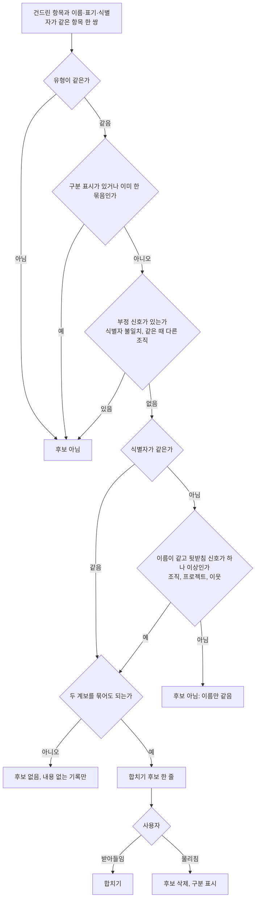
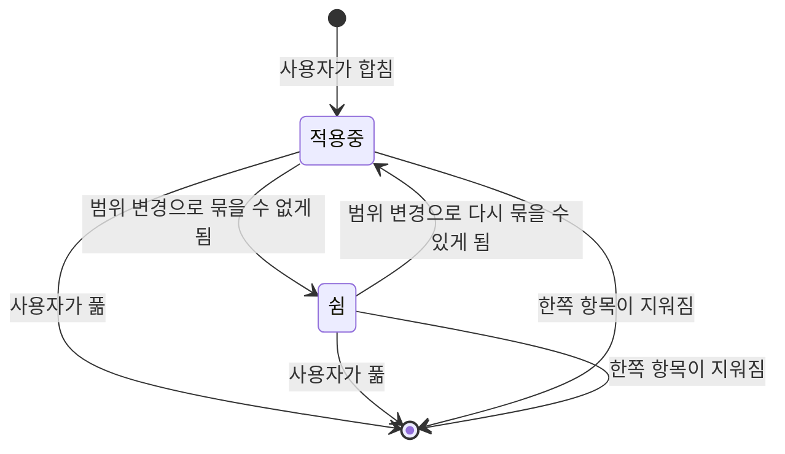
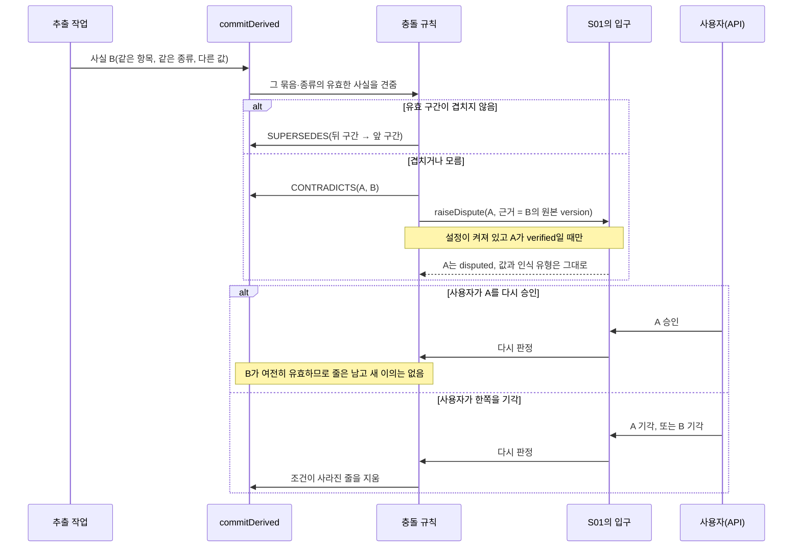
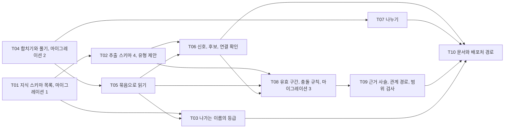

# 스펙: S02 개체 해소·시간 그래프·충돌 처리

- 날짜: 2026-11-22 / 상태: 확정(잠정 결정 포함)
- 관련: 이슈 #23(S02), 총괄 #1(설계 분석 5·7·8번), Phase 3 #5, 선행 #22(S01), 나란히 쓰는 #24(S03), 후속 #25(K01)·#26(K02)·#30(X01)·#31(X02). [원 설계 6.6절·7절](../design/original-design.md), [S01 spec](2026-11-22-S01-semantic-registry.md), [I04 spec](2026-11-21-I04-invalidation.md), [V02 spec](2026-11-21-V02-vertical-slice.md), [ARCHITECTURE.md](../ARCHITECTURE.md), [ADR 0002](../adr/0002-authority-in-product-records.md)·[0003](../adr/0003-phase1-without-engine.md)·[0014](../adr/0014-egress-policy-and-consent.md), [site-setup.md](../site-setup.md)

낯선 말은 [ARCHITECTURE 0절](../ARCHITECTURE.md#0-처음-나오는-말)과 [S01 spec의 첫 표](2026-11-22-S01-semantic-registry.md)에 풀이가 있다. 이 spec이 새로 쓰는 말은 아래와 같다.

| 말 | 뜻 |
|---|---|
| 지식 스키마 목록 | 제품이 아는 지식 유형 열여섯과 관계 유형 열하나를, 각각 "어디에 저장되는가"와 함께 적은 목록. 판 번호를 갖는다 |
| 주장 | 사실 한 행 또는 관계 한 행. "X의 목표일은 6월 30일이다" 같은 말 하나다 |
| 식별자 | 한 개체를 가리키는 글자열 가운데 이름보다 믿을 만한 것. 메일 주소, 사번, 프로젝트 코드, 티켓 번호 |
| 묶음 | 사용자가 "같은 것"이라고 합친 항목들. 행을 옮기지 않고 "이 항목은 저 항목과 같다"는 줄만 둔다 |
| 대표 항목, 구성원 | 묶음을 대신해 불리는 항목 하나와, 그 묶음에 든 나머지 항목 |
| 합치기, 풀기, 나누기 | 두 항목을 한 묶음으로 만들기, 그 줄을 없애 되돌리기, 한 항목의 행 일부를 새 항목으로 옮기기 |
| 구분 표시 | "이 둘은 이름이 같아도 다른 것"이라는 줄. 있는 동안 제품은 그 둘을 합치자고 제안하지 않는다 |
| 합치기 후보 | 제품이 "이 둘은 같은 것일 수 있다"고 적어 둔 줄. 사용자가 받아들여야 합쳐진다 |
| 유효 구간 | 그 주장이 **실제로 참인 기간**(`valid_at`부터 `valid_until` 전까지). 관측 시각(`observed_at`, 제품이 그것을 **처음 적은 때**)과 다른 값이다 |
| 주장 연결 | 두 사실 사이의 SUPERSEDES(뒤의 값이 앞의 값을 대신함)나 CONTRADICTS(둘이 함께 참일 수 없음) 한 줄 |
| 근거 사슬 | 파생된 것 하나에서 원본의 구간까지 거슬러 가는 길. Insight → 사실 → 근거 → 원본 version처럼 여러 단계다 |
| 관계 경로 | 항목에서 항목으로 관계를 따라가는 길. 깊이가 정해져 있다 |

## 배경

원 설계 7절은 지식 그래프의 필수 기능으로 개체 해소, 중복 개체 통합, 여러 단계 관계 탐색, 사실의 유효 기간 관리, 기존 사실의 변경과 대체, 상충되는 정보 관리를 든다. 6.6절은 "Embedding 유사도만으로 동일 개념이나 동일 인물을 결정하지 않는다. 이름, 조직, 프로젝트, 문맥, 시간, 식별자, 근거를 종합하여 판단한다"고 한다. 총괄 이슈 #1의 설계 분석 8번은 합치기의 되돌리기·나누기와 동명이인 시험을, 5번은 그래프 경로에도 원본의 접근 범위가 따라가야 한다는 것을 요구한다.

**지금 있는 것**(origin/main `10b508d`의 코드를 읽어 확인했다. 실행해 본 것은 아니다).

- 항목은 이름 하나와 유형 하나를 갖고, 같은 이름의 항목이 여럿 생기는 것을 막는 키가 없다(`storage/src/knowledge.ts`의 `insertItem`, `storage/src/migrations.ts`의 v5).
- 기존 항목과 잇는 길은 하나다. 추출 전에 이름이 원문에 글자 그대로 든 항목을 후보로 보내고(`knowledge-engine/src/linking.ts`의 `findCandidates`), LLM이 응답에서 그 후보의 ID를 고르면 그 항목에 사실과 관계가 붙는다(`knowledge-engine/src/extraction.ts`). **코드는 그 ID가 보낸 후보 가운데 하나인지만 보고, 그 항목이 정말 같은 것인지는 다시 확인하지 않는다.** 이름이 같은 다른 사람의 사실이 한 항목에 붙어도 막는 장치가 없고, 한번 붙으면 떼어 낼 길도 없다.
- 유형은 항목 유형 둘(`Project`, `System`), 사실 종류 둘, 관계 유형 하나(`DEPENDS_ON`)이고 지시문과 응답 스키마에 코드 상수로 박혀 있다(`providers/src/tasks.ts`).
- 유효 시각은 열 하나(`valid_at`)이고 추출은 언제나 비워 둔다(`extraction.ts`의 `validAt: null`). 관측 시각은 행을 쓴 때다.
- 값이 다른 두 사실은 서로 다른 행이고 그 사이에 아무 표시가 없다. 규칙 "의존 업무 지연"은 가장 이른 목표일과 가장 늦은 완료일을 고를 뿐이다(`knowledge-engine/src/dependency-delay.ts`).
- 관계를 읽는 질의는 규칙이 쓰는 깊이 1 조인뿐이고, 지식·그래프를 읽는 HTTP 경로는 없다(`packages/contracts/src/index.ts`).
- 파생물의 범위는 계보(그것이 기댄 원본 version들)에서 계산한다. 쓰기는 `commitDerived`의 "묶어도 되는가"(`combinable`)를, 읽기는 `visible`을 지난다(`storage/src/derivatives.ts`, I04-R11·R13·R14). 공용 기본 정책은 아무것도 거부하지 않는다(`storage/src/scope-policy.ts`).
- 연결 후보의 이름은 Provider로 나가고, 그 호출의 전송 등급은 항목의 계보로 매긴다. **계보가 빈 항목의 이름은 `general`로 매긴다**(`providers/src/broker.ts`).

**S01이 만들고 있는 것**(이 spec을 쓰는 지금 다른 세션이 구현 중이다. 이 spec은 S01 spec의 문장에 맞춰 썼고 그 코드를 읽지 않았다. 구현이 달라지면 다시 볼 곳은 "S01 구현이 끝나면 다시 볼 것"에 모았다). 상태와 인식 유형을 바꾸는 하나뿐인 입구와 이력, 사용자 조치, 사용자가 쓴 행, 표기와 정의, 유형 정의 테이블과 그 변경 검사(S01-R18~R21). S01은 세 가지를 S02에 넘겼다.

1. **근거를 든 자동 이의**(`raiseDispute`)의 입구는 있는데 부르는 곳이 없다(S01-R12의 3).
2. **자동 처리가 낸 유형 제안**의 입구는 있는데 내는 곳이 없다(S01-R20).
3. **유형 이름이 Provider로 나갈 때의 전송 등급.** `verified`인 유형 정의와 사용자가 만든 항목은 계보가 비어 있어, 원본에서 제안된 이름도 범위 검사와 등급 계산을 그냥 지난다(S01 후속 표의 #23 줄).

**없는 것.**

1. 원 설계의 유형 열여섯과 관계 유형 열하나를 담은 목록.
2. 이름 말고 개체를 가릴 근거(식별자)를 적을 자리와, 그것으로 "같은 것일 수 있다"·"다른 것이다"를 판단하는 코드.
3. 합치기, 풀기, 나누기.
4. 유효 기간의 끝(`valid_until`, S01-R1이 넘긴 것), 값이 어긋나는 사실 사이의 표시, 그것을 사용자가 정한 행에 알리는 길.
5. 여러 단계의 근거와 관계를 읽는 길, 그리고 그 길이 범위가 다른 원본을 지날 때의 검사.

**엔진 결정과의 관계.** ADR 0003의 범위 제한 3·4·5·6번과 ARCHITECTURE 3.2절의 표는 유사도로 개체를 합치는 일, 상충 해소, 깊이가 정해지지 않은 관계 탐색을 "엔진의 일"로 두었고, 그 선을 넘으면 ADR을 다시 쓰라고 했다. R07(엔진 결정)은 배포처 실행을 기다린다. 이 spec은 그 선을 **세 곳에서 넘는다**(잠정 결정 17). ① 4번(값이 다른 사실 사이의 일은 하지 않는다): 값이 다른 두 사실을 유효 구간으로 견주어 SUPERSEDES나 CONTRADICTS로 잇는다(R19). ② 5번(무엇이 무엇을 대체했는지 추론하지 않는다): 유효 구간의 앞뒤와, 같은 원본의 새 version이 같은 자리에 말한 값으로 대체를 적는다(R19). ③ 6번(깊이 1 조인까지): 깊이 3까지의 정해진 탐색을 한다(R22). 넘지 않는 것도 있다: 유사도 점수, 군집, 재귀 질의, 순위를 쓰지 않고, 합치는 것은 사용자뿐이며, 충돌은 풀지 않고 표시만 한다(3번이 금지한 것, 곧 유사도 점수와 군집과 색인 순위는 쓰지 않으므로 3번은 넘지 않는다. 3번은 연결 후보를 찾는 방식의 문장이고 그 방식은 그대로다. 식별자와 관계로 **합치기 후보**를 만드는 S02-T06은 그래서 새 ADR보다 먼저 합쳐져도 되고, 새 ADR은 후보를 만드는 방식도 함께 적는다). ADR 0003은 선을 넘으면 ADR을 다시 쓰라고 했으므로, 새 ADR을 선을 처음 넘는 작업(S02-T08)이 자기 PR에서 쓴다(R27). 항목·사실·관계 테이블이 엔진으로 넘어가면(가정 A09) R10~R21의 저장 자리를 다시 정한다. 사용자의 합치기·나누기·구분 표시는 교정이므로 어느 경우든 제품이 갖는다(ADR 0002).

## 목표

1. 원 설계의 지식 유형 열여섯과 관계 유형 열하나가 판 번호 있는 목록 하나에 있고, 목록의 모든 이름이 저장 자리를 가지며, 추출이 그 목록의 유형으로 항목과 관계를 쓴다.
2. 이름만 같은 두 항목은 합치기 후보가 되지 않는다. 후보는 식별자, 조직, 프로젝트, 이웃 항목, 시간이 뒷받침할 때만 생기고, 어긋나는 식별자가 있으면 생기지 않는다.
3. 합치기는 사용자만 하고, 언제든 풀 수 있으며, 잘못 붙은 행은 새 항목으로 나눌 수 있다. 합치기와 풀기는 두 항목의 사실·관계·근거의 행과 그 값·상태·인식 유형을 바꾸지 않는다. 다시 계산되는 것(Insight, 후보, 규칙이 만든 주장 연결, 구분 표시)은 R12에 적었다.
4. 유효 구간과 관측 시각이 서로 다른 열에 있고, 어느 값이 어느 값을 대신하는지는 유효 구간으로만 정한다.
5. 값이 어긋나는 사실 둘은 CONTRADICTS나 SUPERSEDES로 이어지고, 사용자가 검증한 값은 자동으로 바뀌지 않으며 근거를 든 이의까지만 받는다.
6. 파생된 것에서 원본 구간까지의 근거 사슬과, 항목 사이의 관계 경로를 읽을 수 있다. 사슬과 경로는 그것이 지나는 모든 원본을 함께 보여도 될 때만 나오고, 그렇지 않으면 흔적 없이 빠진다.

## 비목표 (배포처에서 후속 진행)

**공용 저장소의 뒤 작업으로 넘기는 것**

- 분석용 유형(Dataset, Grain, Measure, Metric, Join 등)과 그 승격 조건: S03(#24). 이름이 겹치는 곳은 "S03과 맞출 것"에 적었다.
- 여러 근거를 묶어 새 사실을 쓰는 추론, 새 관계의 발견, 반복 수정의 감지: K02(#26). S02의 DERIVED_FROM은 지금 있는 파생물(Insight)의 근거를 읽는 것까지다.
- Wiki 페이지와 그 backlink: K01(#25). 그래프를 그리는 화면, 합치기·나누기 화면: X02(#31). S02는 그 화면이 부를 API와 계약 테스트까지 만든다.
- 질문에 답할 때 경로를 문맥으로 쓰는 일과 그 직전의 재검사: X01(#30). X01은 R24의 검사를 그대로 쓴다.
- 어긋나는 값을 알림으로 보내는 일: P01(#27)·P02(#28).
- 백업과 복원에서 합치기·구분 표시 되살리기: H01(#32).
- 항목 이름 고치기. S01 spec의 비목표가 S02로 넘겼으나 이슈 #23의 기준에 없어 여기서 만들지 않는다. 이름이 틀린 항목은 지금도 길이 있다: 옳은 이름의 표기를 직접 추가하거나(S01-R7), 옳은 이름의 항목과 합친다(R11). 이름 자체를 고치는 조치는 Semantic 화면을 만드는 X02(#31)가 요구를 확인한 뒤 S01의 사용자 조치 입구에 더한다(후속 표).

**하지 않는 것**

- 유사도 점수(문자열 거리, embedding 거리), 군집, 순위로 개체를 합치거나 후보를 만드는 일. 엔진이나 embedding이 낸 유사도를 신호로 받는 자리도 만들지 않는다(잠정 결정 5).
- 자동 합치기. 식별자가 같아도 합치는 것은 사용자다(잠정 결정 4).
- 충돌의 자동 해소. 제품은 어느 값이 옳은지 고르지 않는다.
- 깊이가 정해지지 않은 탐색, 재귀 질의, 최단 경로·중심성 같은 그래프 알고리즘, 별도의 그래프 저장소(ADR 0002, ADR 0003).
- 경로를 저장하는 일. 경로는 읽을 때 계산한다(잠정 결정 12).
- 관계 사이의 충돌(같은 사람이 같은 때 두 조직에 속함). 관계 유형에 "하나만"이라는 규칙이 없다(S01-R18). 그 사실은 합치기 후보의 신호로만 쓴다.
- 사용자가 더한 유형의 이름을 Provider로 보내는 일(잠정 결정 2).

**배포처 후속 항목**(1개. [site-setup.md의 배포처 설정 체크리스트](../site-setup.md#배포처-설정-체크리스트)와 번호로 대응한다. **번호는 잠정이고 조정자가 합치는 순서에 맞춰 다시 배정한다.** S32는 S01이 잡았고 S03의 spec은 S34를 잡았다. 합칠 때 S33이 이미 쓰였으면 다음 번호를 쓴다)

| 번호 | 항목 | 왜 배포처인가 |
|---|---|---|
| S33 | 설치본과 실제 Provider로 넓힌 유형의 추출과 합치기 후보를 실행하고, 자동 이의를 켤지 정한다 | 후보가 실제 자료에서 얼마나 맞는지, LLM이 준 유효 기간이 얼마나 틀리는지는 실제 자료와 실제 Provider가 있어야 잰다. 틀린 유효 기간은 사용자가 검증한 값에 이의를 붙이므로 재기 전에는 꺼 둔다(R20) |

## 요구사항

요구사항 번호는 `S02-R<n>`이다. 다른 spec의 번호는 `S01-R12`, `I04-R13`처럼 작업 코드를 붙인다.

### 유형 목록

- **S02-R1 지식 스키마 목록.** `packages/contracts`에 목록 하나를 코드 상수로 둔다. 판 번호(지금 1)와, 이름마다 그 유형이 저장되는 자리를 갖는다. 목록이 바뀌면 판 번호가 오르고 마이그레이션이 따른다. **뒤의 spec이 유형을 더할 때도 이 목록에 더하고 판 번호를 올린다**(처음 쓰는 것은 S03의 분석용 유형이다). 목록 옆에 **제품의 seed 상수**를 둔다: 제품이 유형 정의로 넣는 모든 이름(S01의 것, 이 spec의 것, 뒤의 spec이 더하는 것)의 한 목록이고, 지시문·응답 스키마·`origin` 판정이 모두 이것을 본다.

  | 지식 유형(16) | 자리 |
  |---|---|
  | Person, Organization, Project, System, Concept, Decision, Task, Commitment, Event, Issue, Dependency, BusinessRule, OpenQuestion | 항목 유형(유형 정의의 `item-type`). 13개 |
  | Document | 원본(`sources`와 그 version). 항목으로 다시 만들지 않는다 |
  | Fact | 사실 행 |
  | Insight | Insight 행 |

  | 관계 유형(11) | 자리 | 누가 쓰는가 |
  |---|---|---|
  | BELONGS_TO, RESPONSIBLE_FOR, DEPENDS_ON, RELATED_TO, DECIDED, CAUSED_BY | 관계 행(유형 정의의 `relation-type`). 항목에서 항목으로 | 추출, 사용자 |
  | MENTIONS | 원본 version → 항목. 그 항목의 사실·관계의 근거가 놓인 version들(항목의 계보)에서 읽는다. 따로 저장하지 않는다 | 계산 |
  | SUPPORTS | 원본의 구간 → 주장. 근거 테이블의 한 줄이 곧 이것이다 | 계산 |
  | DERIVED_FROM | Insight → 주장. Insight의 근거 연결과 S01의 `insight_user_inputs`에서 읽는다 | 계산 |
  | SUPERSEDES, CONTRADICTS | 사실 → 사실. 새 테이블 `assertion_links`(R18) | 충돌 규칙, 전파, 사용자의 값 고치기 |

  Document·Fact·Insight를 항목 유형으로 만들지 않는 까닭: 이미 정본 테이블이 있는 것을 항목으로 한 번 더 만들면 같은 것이 두 곳에 있게 된다(원 설계 15절).
- **S02-R2 등록부에 싣기.** 마이그레이션이 목록의 항목 유형 가운데 없는 것(열)과 관계 유형 가운데 없는 것(다섯)을 유형 정의 테이블에 `verified`로 더하고, 아래 사실 종류를 더하며, 값의 종류의 닫힌 목록에 `identifier`를 더한다.
  - 사실 종류: `identifier.email`(값의 종류 `identifier`, 값의 수 `many`, Person·Organization), `identifier.key`(값의 종류 `identifier`, 값의 수 `one`, 항목 유형 13 모두. 사번, 프로젝트 코드, 티켓 번호처럼 한 체계 안에서 하나인 것), `statement`(값의 종류 `text`, 값의 수 `many`, Decision·Task·Commitment·Event·Issue·Dependency·BusinessRule·OpenQuestion. 그 결정이나 규칙을 말한 원문 구간 그대로이고 S01-R3의 `definition`과 같은 규칙을 따른다: 값이 인용문과 같고 코드 포인트 500 이하).
  - `target_date`와 `completion_date`가 붙을 수 있는 항목 유형에 Task와 Commitment를 더하고, `DEPENDS_ON`의 주체와 대상에 Task, Commitment, Dependency를 더한다(넓히는 변경). **이 셋은 이미 있는 이름의 규칙을 바꾸는 것이므로, 그 요소의 지금 규칙이 S01의 seed 규칙과 글자 그대로 같고 상태가 `verified`일 때만 넓힌다.** 사용자가 S01-R19로 규칙을 바꿔 두었거나 물렸으면 건드리지 않는다. 넓히면 그 요소의 판 번호가 1 오른다. 이력 줄은 남기지 않는다(마이그레이션은 이력의 주체가 아니고 seed를 넣는 것과 같은 일이다). 넓히지 못한 요소는 목록 API(R25)가 이름마다 답하는 "목록의 규칙과 같은가"에서 아니라고 나온다.
  - 새 관계 유형의 방향(주체 유형 → 대상 유형)은 "인터페이스 / 설계 개요"의 표에 있다. `RELATED_TO`만 대칭이다.
  - **더하는 것 하나하나가 S01-R19의 세 검사(중복, 모양, 기존 데이터 영향)를 통과해야 한다.** 마이그레이션은 그 검사 함수를 부르지 않고 줄을 직접 넣으므로(마이그레이션은 그때의 코드에 매이면 안 된다), 시험이 S01 수준의 데이터베이스에서 같은 변경을 검사 함수에 넣어 모두 `applicable`임을 보인다.
  - **새로 더하는 이름과 같은 이름의 유형 정의가 이미 있으면 건드리지 않는다**(상태가 무엇이든, S01-R19의 중복 기준으로. 위의 넓히는 셋은 따로 적은 조건을 따른다). 사용자가 기각한 이름은 기각된 채로 남고, 그 유형의 추출 결과는 S01-R21대로 버려진다. 목록을 읽는 API(R25)는 이름마다 지금 쓸 수 있는지(`verified`인 유형 정의가 있는지)를 함께 답한다.
- **S02-R3 유형 정의가 어디서 왔는지와 쓰지 못하는 이름.** 유형 정의에 `origin` 열을 더한다: `seed`(제품이 넣은 것), `user`(사용자가 API로 더한 것), `source-proposed`(자동 처리가 원본을 근거로 낸 것). 만들 때 한 번 적고 바꾸지 않는다. 승인해도, 제안한 원본이 지워져도 그대로다(계보 줄은 원본과 함께 사라지지만 이 표시는 글이 아니라 닫힌 값이라 남는다). 마이그레이션은 **이 마이그레이션이 줄을 더하기 전에** 기존 줄을 채운다: 차례로 본다. ① 계보 줄(`ontology_basis`)이 있으면 `source-proposed` ② 그 줄의 생성 이력의 주체가 `user`이면 `user`(그래서 사용자가 미리 더해 둔 `Person`은 `user`로 남는다) ③ 이름이 **제품의 seed 상수**(R1. 이 spec의 열여섯만이 아니라 S01의 seed와 뒤의 spec이 더한 seed까지 든 전체)에 있으면 `seed` ④ 나머지는 `user`. 그 뒤 이 마이그레이션이 더하는 줄이 `seed`다. **합쳐지는 순서에 매이지 않는다**: 다른 spec의 seed를 넣는 마이그레이션이 이 마이그레이션보다 먼저 돌았어도 ③이 그 줄을 `seed`로 채우고, 나중에 도는 마이그레이션은 자기 줄에 `origin = seed`를 직접 적는다. 마이그레이션은 그때의 상수를 베껴 갖는다(나중에 상수가 바뀌어도 지난 마이그레이션은 그대로다).
  - 계산으로만 읽는 관계 이름 다섯(MENTIONS, SUPPORTS, DERIVED_FROM, SUPERSEDES, CONTRADICTS)과 항목 유형이 아닌 지식 유형 이름 셋(Document, Fact, Insight)은 유형 정의로 더할 수 없다. S01-R19의 모양 검사가 오류 코드 `reserved-name`으로 거부한다(비교는 중복 검사와 같은 가공을 거친다).
- **S02-R4 추출 응답 스키마(다음 version).** `extract` 작업의 스키마 version을 하나 올린다. S01이 3으로 올리므로 그대로면 4다(잠정. 합칠 때 그 수가 이미 쓰였으면 다음 수를 쓴다. 이 문서의 "스키마 4"와 시험 이름 `extract.v4`는 그때 함께 고친다). Provider 호출은 여전히 원본 version 하나에 1회, 형식 오류 재시도 1회다.
  - 항목 유형은 목록의 13, 관계 유형은 추출이 쓰는 6, 사실 종류에 `identifier.email`·`identifier.key`.
  - S01의 `definitions`에 종류(`definition`이나 `statement`)를 더한다. 쓰는 코드는 같다.
  - 사실과 관계에 선택 항목 `validFrom`, `validUntil`(`YYYY-MM-DD`). `identifier.key`에 선택 항목 `context`(그 번호가 어느 체계의 것인지의 짧은 꼬리표. S01-R3의 `context` 열에 적는다).
  - `proposedTypes`: 목록에 맞는 유형이 없을 때 LLM이 내는 제안. 종류(`item-type`이나 `relation-type`), 이름, 관계 유형이면 주체·대상 항목 유형, 그렇게 본 원문의 인용문. 한 응답에 다섯까지이고 넘는 것은 버린다.
  - **지시문과 응답 스키마의 유형 이름은 `origin`이 `seed`인 것뿐이고 지금처럼 고정된 코드 상수다**(V01-R8). 시험이 지시문의 이름 목록, 응답 스키마의 닫힌 목록, 지식 스키마 목록, seed가 서로 같음을 대조한다(S01-R18의 대조를 넓힌다).
  - 쓰기 전의 검사는 S01-R21 그대로다. `verified`가 아닌 유형, 방향에 맞지 않는 관계, 값의 종류에 맞지 않는 값은 그것만 버리고 버린 수에 센다.
- **S02-R5 유형 제안을 내는 곳.** 추출은 `proposedTypes`의 줄마다 S01-R20의 입구로 후보 유형 정의를 낸다. 근거로 넘기는 원본 version은 그 추출의 것이고 `origin`은 `source-proposed`다.
  - 내기 전에 코드가 확인한다: 인용문이 본문에 있다(없으면 버림), 이름이 식별자 모양이다, 관계 유형이면 주체·대상이 `verified`인 항목 유형이다. 인용문은 확인에만 쓰고 저장하지 않는다(유형 정의에는 글을 둘 자리가 없다).
  - 후보는 사용자가 승인하기 전에는 어디에도 쓰이지 않고(S01-R20), 같은 이름의 재제안은 중복 검사가 흡수한다.
  - 제안의 쓰기도 `commitDerived`를 지난다(종류 `ontology`, 계보는 그 version).
- **S02-R6 Provider로 나가는 이름의 등급.** S01이 넘긴 물음의 답이다.
  1. **유형 이름.** Provider로 나가는 유형 이름은 `origin`이 `seed`인 것뿐이다. 이것은 지시문의 일부이고 어느 원본의 글도 아니므로 등급에 더하지 않는다. `user`와 `source-proposed`인 유형 정의의 이름은 `verified`여도 **보내지 않는다**(잠정 결정 2). 그 유형의 행은 사용자의 직접 추가와 엔진의 제안(`proposeKnowledge`. 엔진은 이 PC 안의 어댑터다)으로만 생긴다.
  2. **계보가 빈 이름.** 연결 후보로 나가는 항목 이름 가운데 계보가 빈 것(사용자가 만든 항목, S01-R22)은 지금 코드가 `general`로 매긴다. 이것을 **등급 매핑이 아는 가장 엄격한 등급**(`grading.strictest([])`)으로 바꾼다. 공용 저장소에서는 값이 같고(`general` 하나뿐이다), 등급을 더한 포크에서는 사용자가 친 글이 가장 느슨한 등급으로 나가지 않는다.
  3. **묶음의 이름.** 대표 항목이 연결 후보로 나갈 때 그 호출의 등급과 "묶어도 되는가" 판정에는 **지금 적용 중인 묶음 전체의 계보**를 쓴다(R13). 구성원의 이름이 원문과 맞아 대표가 후보로 간 것이므로, 대표의 계보만 보면 구성원의 원본이 판정에서 빠진다.

### 개체 해소

- **S02-R7 식별자.** 식별자는 그 항목의 사실이다(종류 `identifier.*`). 값은 원문에 글자 그대로 있어야 하고 그 자리가 근거다(S01-R2의 표기와 같은 확인). 같은지는 V02-R7의 가공(유니코드 정규화, 대소문자 통일, 공백 정리)을 거친 값으로 본다. `identifier.key`는 꼬리표(`context`)가 같은 것끼리만 견준다(꼬리표가 없는 것은 없는 것끼리).
- **S02-R8 연결을 다시 확인한다(동명이인).** 추출 응답이 기존 항목 X에 붙이겠다고 한 것을 쓰기 전에 코드가 확인한다. 아래 가운데 하나라도 참이면 **X에 붙이지 않고 새 항목을 만들며**, X와 새 항목 사이에 구분 표시(R16)를 남기고 `links_refused`에 센다.
  1. 응답이 준 항목 유형이 X의 유형과 다르다. **(구현하지 않았다. 잠정 결정 29의 ①)**
  2. 응답이 그 항목에 준 `identifier.key`가 있고, X의 묶음(R13. X가 대표이면 구성원의 것도 본다)에 같은 꼬리표의 유효한(S01-R15) `identifier.key`가 있는데 값이 다르다.

  이 확인은 후보를 Provider로 보낸 뒤, 응답을 쓰기 전에 한다. 이름이 같다는 것만으로 붙는 일을 막는 것은 여기까지이고, 식별자가 없는 문서에서 LLM이 틀리게 붙인 것은 사용자가 나누기(R15)로 고친다.
- **S02-R9 신호.** 두 항목이 같은 것인지 볼 때 쓰는 신호는 닫힌 목록이다. 모두 정본의 행에서 결정론으로 계산하고 LLM을 부르지 않는다. 계산에는 유효한(S01-R15) 행만 쓴다.

  | 신호 | 뜻 | 방향 |
  |---|---|---|
  | `same-type` | 항목 유형이 같다 | 전제(아니면 견주지 않는다) |
  | `name-match` | 가공한 이름이 같거나, 한쪽의 이름이 다른 쪽의 `verified` 표기(S01-R16)와 같다 | 약한 긍정. **이것만으로는 후보가 되지 않는다** |
  | `identifier-match` | 같은 종류(와 같은 꼬리표)의 식별자 값이 하나 이상 같다 | 강한 긍정 |
  | `identifier-mismatch` | 둘 다 같은 꼬리표의 `identifier.key`가 있고 값이 다르다 | 강한 부정 |
  | `organization-match` | 둘이 같은 Organization 항목에 `BELONGS_TO`로 이어져 있고 그 유효 구간이 겹치거나 한쪽이 비어 있다 | 뒷받침 |
  | `organization-mismatch` | 둘이 서로 다른 Organization에 `BELONGS_TO`로 이어져 있고 그 유효 구간이 **겹친다**(둘 다 알려져 있을 때만) | 부정 |
  | `project-match` | 둘이 같은 Project 항목에 어떤 관계로든 이어져 있다 | 뒷받침 |
  | `shared-neighbor` | 조직·프로젝트 말고 같은 항목에 관계로 이어져 있다(깊이 1) | 뒷받침(문맥) |

  시간은 따로 선 신호가 아니라 조직 신호를 가르는 데 쓴다: 다른 조직이어도 기간이 겹치지 않으면 "옮겼다"일 수 있으므로 부정이 아니다. 조직·프로젝트·이웃을 볼 때 상대 항목은 묶음의 대표로 본다(R13).
- **S02-R10 합치기 후보.** 아래가 모두 참인 두 항목에 후보 한 줄이 생긴다.
  1. `same-type`이다.
  2. 부정 신호(`identifier-mismatch`, `organization-mismatch`)가 없다.
  3. `identifier-match`가 있거나, `name-match`와 뒷받침 신호(`organization-match`, `project-match`, `shared-neighbor`) 하나 이상이 함께 있다.
  4. 둘 사이에 구분 표시가 없고, 이미 같은 묶음이 아니다.

  - 후보를 찾는 범위: 추출이나 전파가 건드린 항목마다, 가공한 이름이나 `verified` 표기가 같은 항목과 식별자 값이 같은 항목만 견준다. 모든 쌍을 견주지 않는다.
  - 후보의 줄은 두 항목의 번호(작은 쪽이 앞), 신호 코드의 목록, 만든 때만 갖는다. 글이 없다.
  - 후보는 `commitDerived`를 지나는 파생물이다(종류 `merge-candidate`). 계보는 두 항목의 계보를 합친 것이다. 그 원본들을 묶을 수 없다는 범위 정책에서는 후보가 생기지 않고 `scope_policy_drops`에 내용 없는 기록만 남는다(I04-R11).
  - 후보는 다시 계산된다. 건드린 항목의 후보 가운데 조건을 잃은 것(부정 신호가 생김, 뒷받침이 사라짐, 한쪽이 지워짐)은 지운다. 판정은 추출이 쓴 뒤와 전파가 지난 뒤 같은 트랜잭션에서 한다.
  - 사용자가 후보를 받아들이면 합치기(R11)이고, 물리치면 그 줄을 지우고 구분 표시(R16)를 남긴다.
- **S02-R11 합치기.** 합치기는 **사용자만** 한다. 후보를 받아들이거나, 후보가 없는 두 항목을 직접 고른다. 합치기를 만드는 함수는 S01의 사용자 조치 입구와 같은 자리에 두어 API 층만 부를 수 있다(S01-R7).
  - 합치기는 **행을 옮기지 않는다.** "구성원 A는 대표 B와 같다"는 줄 하나(`item_merges`)를 쓴다. A와 B의 사실, 관계, 근거, 상태, 인식 유형, 이력, 계보는 그대로다. 그래서 A의 원본을 지우면 A와 그 줄만 사라지고 B는 남는다.
  - 조건: 두 항목이 있고 유형이 같으며 이미 같은 묶음이 아니다. 두 묶음의 계보를 합친 것이 `combinable`이다. 아니면 각각 `not-found`, `type-mismatch`, `already-merged`, `scope-refused`로 거부한다.
  - **어느 쪽이든 구성원을 가리켜도 된다.** 입구가 두 항목을 각자의 대표로 바꿔 읽고(쉬는 줄도 따라간다), 합쳐지는 쪽의 **대표**가 받는 쪽의 **대표**를 가리키는 줄 하나를 쓴다. 그래서 구성원이 낀 후보도 받아들일 수 있고, 따로 거부 코드가 없다.
  - **부정 신호는 사용자의 합치기를 막지 않는다.** 신호는 제품이 제안할지 말지를 정할 뿐이다. 합치려는 둘 사이에 구분 표시가 있으면 그 표시를 지우고 합친다(나중의 사용자 판단이 앞선다).
  - 이미 구성원이 있는 항목을 다른 항목에 합치면 그 묶음째로 들어간다(줄이 사슬이 된다). 순환은 생기지 않는다(줄은 언제나 한 묶음의 대표에서 다른 묶음의 대표로 향한다).
  - 합치기와 풀기는 두 항목의 이력(S01-R6)에 한 줄씩 남는다(주체 `user`, 조치 `merge`·`unmerge`, 앞뒤 상태는 같음, 묶는 번호).
  - **이 줄들은 상태를 바꾸지 않는 줄이다.** S02가 이력에 더하는 조치 넷(`merge`, `unmerge`, `split`, `set-validity`)은 S01의 취소(S01-R8)가 되돌리는 대상이 아니고, S01이 "마지막 사용자 조치"를 찾을 때(취소할 조치, S01-R12의 1과 S01-R15가 보는 현재 근거 없는 승인의 보호) **없는 줄로 건너뛴다.** 그래서 승인한 행을 합치거나 구간을 고친 뒤에도 그 승인을 취소할 수 있고, 현재 근거 없이 승인한 행의 보호가 이 줄들 때문에 끝나지 않는다. 이 줄 자체를 취소하라는 요청은 없다(취소는 행을 받고, 그 행의 건너뛰지 않는 마지막 줄을 본다). **그렇게 드러난 줄이 항목의 "직접 추가"이면**(나누기가 만든 새 항목, 사용자가 만들어 합친 항목), 그 항목에 딸린 것이 있는 동안 그 취소를 `existing-data-violation`으로 거부하고 아무것도 바꾸지 않는다(수만 알린다. S01-R20이 쓰이고 있는 유형 정의의 취소를 거부하는 것과 같은 코드다). 딸린 것은 그 항목의 사실·관계(옮겨 온 것 포함), 합치기 줄, 구분 표시, 나누기 기록이다. 항목을 지우면 옮겨 온 원본의 행이 갈 곳을 잃고, 합치기 줄이 R14의 잇기 없이 사라진다. 지우려면 먼저 행을 다른 항목으로 나누거나(R15) 합치기를 푼다. 되돌리는 길은 조치마다 따로다: 합치기는 풀기, 나누기는 다시 합치기, 구간은 다시 고치기(잠정 결정 18).
- **S02-R12 풀기(합치기의 취소).** 사용자는 합치기 줄 하나를 언제든 푼다. 그 줄 뒤에 다른 합치기가 쌓였어도 그 줄만 없어지고, 그 구성원(과 그 아래 딸린 것)이 떨어져 나온다. 풀기는 S01의 "취소"(마지막 이력만 되돌림)와 다른 조치다. 푼 뒤 그 둘 사이에 구분 표시를 남길지는 사용자가 고른다(기본은 남긴다. 남기지 않으면 같은 후보가 다시 생긴다).
  - **그대로인 것(정본의 행).** 합치기와 풀기는 두 항목과 그 사실·관계·근거의 행, 그 값·상태·인식 유형·유효 구간·관측 시각을 바꾸지 않는다. 이력은 조치마다 두 항목에 한 줄씩만 늘어난다. 자동 이의는 묶음을 건너는 어긋남에 일어나지 않고 자동 승격의 조건 5는 같은 항목 안의 값만 보므로(R20) 합치기가 어느 행의 상태도 바꾸지 않는다.
  - **달라질 수 있는 것(다시 계산되는 것).** ① Insight: 합친 동안 대표의 키로 생긴 Insight는 풀면 해소되지만 해소된 줄은 남는다(지금의 규칙이 해소된 줄을 지우지 않는다). ② 합치기 후보: 받아들인 후보의 줄은 사라지고, 풀 때 구분 표시를 남기지 않으면 다음 판정에서 다시 생길 수 있다. ③ 규칙이 만든 주장 연결: 묶음을 건너던 줄은 풀면 사라진다. ④ 구분 표시: 합치면서 지운 표시는 풀어도 돌아오지 않는다(풀 때 남기기를 고르면 새 표시가 생긴다).
  - **그 사이에 붙은 행은 대표에 남는다.** 합친 뒤 푼 사이에 추출이 대표에 붙인 사실·관계는 풀어도 대표의 것이다(구성원의 이름이 맞아 대표가 후보로 간 것도 같다). 떨어져 나온 구성원으로 옮기려면 나누기(R15)를 쓴다(알려진 한계).
- **S02-R13 묶음을 한 항목으로 읽는다.** 합친 효과는 읽는 쪽이 낸다. 아래는 구성원의 번호를 받으면 그 묶음 전체를 한 항목으로 본다.
  - 규칙 "의존 업무 지연": 묶음의 어느 구성원에 붙은 날짜와 관계든 함께 본다. Insight의 키는 대표 항목이다. 합치거나 푼 뒤 같은 트랜잭션에서 그 묶음의 규칙을 다시 계산하고, 구성원 키로 있던 Insight는 해소된다.
  - **전파가 묶음의 Insight를 찾는다.** 지금의 종류 `insight`는 바뀐 원본의 근거가 닿는 항목을 키로 가진 Insight만 모은다(`canonical-kinds.ts`의 `INSIGHT.affected`). 구성원의 원본이 지워지면 대표의 키로 있는 Insight가 모이지 않아, 지운 원본의 값이 그 설명 글에 남는다. 그래서 종류 `insight`의 모으기와 다시 계산은 **근거가 닿는 항목마다 그 항목의 묶음의 대표와 구성원 모두**를 대상으로 삼는다(모으기는 아무것도 바뀌기 전의 묶음으로, 다시 계산은 남은 항목의 지금 묶음으로). 삭제, 권한 상실, 이전 version 정리, 범위 변경, 새 version 모두 같다. 합치기가 쉬게 되거나 되살아나면(범위 변경에서든, 삭제·권한 상실·정리로 구성원이 빠져서든) 그 묶음의 Insight를 같은 전파에서 다시 계산해 키를 옮긴다.
  - 연결 후보(V02-R7, S01-R16): 어느 구성원의 이름이나 `verified` 표기가 원문에 있으면 **대표**가 후보로 간다. 등급과 묶기 판정은 R6의 3대로다.
  - 충돌 규칙(R19)과 신호(R9).
  - **뒤의 spec이 더하는 읽기.** 항목에 딸린 것을 읽는 새 코드는 묶음을 한 항목으로 볼지 구성원마다 따로 볼지를 자기 spec에 적는다. 한 항목으로 본다면 `EntityGroups`(묶음을 읽는 하나뿐인 곳)를 쓴다. 처음 정하는 것은 S03이다(분석용 행의 검사가 Dataset 항목의 묶음을 볼지).
  - **소속이 바뀌면 알린다.** 어느 사실·관계가 어느 항목(묶음)의 것인지가 바뀌는 조치는 넷이다: 합치기, 풀기, 합치기가 쉬거나 되살아남, 나누기(행의 항목 번호가 바뀜). 넷 모두 같은 트랜잭션 안에서 **소속 변경 알림**(`membershipChanged`: 닿은 항목의 번호들, 나누기면 옮긴 행의 번호들)을 낸다. 이 spec의 다시 계산(규칙, 충돌, 후보)이 이 알림을 받아 돌고, 뒤의 spec은 항목에 기대어 저장해 둔 것(S03의 검사 줄과 Dataset 연결 같은 것)을 같은 알림을 받아 지우거나 다시 계산한다. 알림을 받는 쪽의 목록은 구성 지점이 정하는 고정된 목록이다. 받는 쪽이 던지면 그 트랜잭션이 되돌아간다: 사용자 조치에서는 그 조치가, 전파 안에서는 그 전파가. 전파를 되돌리는 것은 등록된 종류의 `invalidate`가 던질 때와 같은 일이므로(I04의 지금 동작), **받는 쪽은 파생물 종류와 같은 수준으로 다룬다**: 지우거나 다시 계산하는 일만 하고, 등록할 때 검토하며, 삭제 전파 안에서 불려도 던지지 않음을 그 spec의 시험이 보인다. 처음 쓰는 바깥 쪽은 S03이다.
  - S01의 등록 행 목록(`GET /api/semantic`): 구성원은 대표 아래에 묶여 나온다.
  - **적용 중인 합치기만 센다.** 묶음 전체의 계보가 `combinable`이 아닌 합치기는 **쉬는 상태**다: 줄은 남지만 어느 읽기도 그 둘을 한 항목으로 보지 않는다. **판정의 단위는 줄이 아니라 묶음이다**: 줄로 이어진 항목 전체(쉬는 줄도 따라가 모은 것)의 계보를 합쳐 한 번 묻고, 아니면 그 묶음의 **모든 줄**이 쉰다. 일부만 쉬게 해서 묶을 수 있는 부분을 찾지 않는다(잠정 결정 22). 쉬게 된 묶음을 건너던 규칙의 주장 연결은 풀었을 때처럼 지운다(R19). 범위 변경(`scope-changed`)의 전파가 영향받는 합치기를 다시 판정해 쉬게 하거나 되살리고, 규칙을 다시 계산한다. **삭제, 권한 상실, 이전 version 정리의 전파도 다시 판정한다**: 묶을 수 없던 구성원이나 그 근거가 사라지면 남은 묶음은 묶을 수 있게 되므로, R14의 잇기가 끝난 뒤 같은 전파에서 그 묶음을 다시 물어 되살리고(또는 쉬게 하고) 소속 변경 알림을 낸다. 다시 묻지 않으면 사용자의 합치기가 상관없는 범위 변경이 올 때까지 효과 없이 남는다(I04 spec이 "범위가 좁아진 뒤 이미 합쳐진 항목을 다시 나누는 일"로 S02에 넘긴 것이다. 행을 옮기지 않았으므로 나눌 것이 없고 줄을 쉬게 하면 된다).
- **S02-R14 합치기 줄의 삭제와 등록.** 합치기 줄과 구분 표시는 어느 한쪽 항목이 지워지면 함께 지워진다(외래 키). **사슬의 가운데가 지워져도 나머지는 한 묶음으로 남는다**: 항목이 지워지기 전에 종류 `entity-merge`가 그 항목을 가리키던 줄을 그 항목이 가리키던 대표로 옮겨 잇고(A→B, B→C에서 B가 지워지면 A→C), 지워지는 항목이 대표였으면 그것을 가리키던 구성원 가운데 번호가 가장 작은 것이 대표가 되어 나머지가 그것을 가리킨다. 쉬는 줄도 같은 방식으로 잇는다. 이은 수는 무효화 기록의 다시 계산한 수에 든다. 이은 뒤 남은 묶음이 쉴지를 같은 전파에서 다시 판정한다(R13). 새 종류 `entity-merge`를 파생물 등록부에 등록해 그 수를 무효화 기록에 싣고 범위 변경 때의 재판정(R13)을 맡긴다. 계보는 두 항목의 계보를 합친 것이고, 사용자가 만든 항목끼리의 합치기는 계보가 비므로 이 종류는 계보 없는 행이 있다고 밝힌다(`has.withoutLineage`). 종류 `merge-candidate`도 등록한다. 둘 다 무효화 계약 묶음 ①~⑥을 통과한다. 이전 version 정리(`old-versions-pruned`)는 삭제와 같은 규칙이다.
- **S02-R15 나누기.** 한 항목에 서로 다른 것의 행이 섞여 붙었을 때 사용자가 일부를 새 항목으로 옮긴다.
  - 입력: 원래 항목, 옮길 사실과 관계의 번호 목록, 새 항목의 이름(사용자가 친 글).
  - 새 항목은 S01의 "직접 추가"로 만든 항목이다(`user_authored`, `verified`, `user-approved`, 유형은 원래 항목과 같음). 그 계보는 언제나 비어 있고(S01-R22), 옮겨 온 행은 저마다 자기 근거의 원본을 따른다.
  - 고른 행의 항목 번호만 바꾼다(관계는 원래 항목을 가리키던 쪽). 행의 번호, 값, 상태, 인식 유형, 근거, 이력은 그대로다. 새 항목이 비어 있으므로 같은 행 규칙(V02-R8)과 부딪히지 않는다.
  - 원래 항목과 새 항목 사이에 구분 표시를 남기고, 소속 변경 알림(R13)을 내어 두 항목의 규칙·충돌·후보와, 뒤의 spec이 그 알림에 건 다시 계산(처음은 S03의 검사 줄 무효화)을 같은 트랜잭션에서 돌린다. 두 항목의 이력에 한 줄씩 남는다(조치 `split`).
  - 거부: 고른 행이 그 항목의 것이 아니면 `row-not-on-item`, 하나도 고르지 않았으면 `nothing-selected`, 원래 항목의 사실과 관계를 **모두** 골랐으면 `nothing-left`(그러면 원래 항목이 빈 채로 남는다. 통째로 다른 것이었다면 나누지 않고 옳은 항목과 합친다). 아무것도 바꾸지 않는다.
  - **같은 원본을 다시 추출해도 옮긴 행은 새 항목에 남는다.** 나누기는 옮긴 행마다 번호뿐인 기록 한 줄을 남긴다(`item_split_moves`: 원래 항목, 새 항목, 사실이나 관계 가운데 하나. 셋 모두 외래 키로 함께 지워진다). 추출이 원래 항목에(원래 항목이 그 뒤 다른 묶음에 들어갔으면 그 묶음의 어느 항목에든. 추출은 대표에 쓴다) 사실이나 관계를 쓰려 할 때, **같은 키(사실은 종류와 값, 관계는 유형과 상대 항목)의 옮긴 행이 있고 그 행의 근거에 지금 추출하는 원본의 version이 하나라도 있으면** 원래 항목에 새 행을 만들지 않고 옮긴 행에 근거를 붙인다. 그래서 그 원본의 새 version이 같은 말을 되풀이해도 옮긴 행이 물리지 않고 원래 항목에 같은 행이 다시 생기지 않는다. **한계**(잠정 결정 19): 새 version이 **다른 값**을 말하면(날짜가 바뀜) 그 값은 LLM이 고른 대로 원래 항목에 붙을 수 있고 옮긴 행은 현재 근거를 잃어 물린다. 다른 원본이 같은 값을 말하는 것도 이 기록이 옮기지 않는다(그 원본이 정말 원래 항목의 것일 수 있다). 이 둘은 사용자가 다시 나눠야 한다.
  - **나누기를 되돌리는 조치는 따로 없다.** 두 항목을 다시 합치면(R11) 한 묶음으로 읽힌다(잠정 결정 7).
  - 고르기를 돕는 읽기: 원래 항목의 행마다 근거의 원본 목록을 주는 것은 S01의 목록 API가 이미 준다(근거 수). 원본별로 묶어 보여 주는 것은 X02의 일이다.
- **S02-R16 구분 표시.** 두 항목의 번호(작은 쪽이 앞), 누가 남겼는지(`user`, 또는 R8의 확인), 때만 갖는다. 있는 동안 그 둘의 후보는 생기지 않는다. 사용자가 지울 수 있고, 지우면 다음 판정에서 후보가 다시 생길 수 있다. 종류 `entity-merge`에 속한다.

### 시간과 충돌

- **S02-R17 유효 구간과 관측 시각.** 사실과 관계에 `valid_until` 열을 더한다. 유효 구간은 `valid_at`부터 `valid_until` **전까지**이고, 값은 `YYYY-MM-DD`이거나 비어 있다(모름, 또는 끝나지 않음). 항목에는 더하지 않는다.
  - 추출이 준 `validFrom`·`validUntil`은 실재하는 날짜이고 시작이 끝보다 앞일 때만 적는다. 아니면 그 행은 쓰되 구간을 비우고 `dropped_validity`에 센다.
  - 구간은 행이 처음 생길 때 적는다. 이미 있는 행에 다시 추출이 오면, **구간의 두 끝이 모두 비어 있고 사용자가 정한 행이 아닐 때만** 채운다. 그 밖에는 바꾸지 않는다(같은 행에 다른 구간을 말하는 근거가 와도 처음 것이 남는다. 알려진 한계, 잠정 결정 9).
  - 사용자는 API로 한 행의 구간을 고친다. 그 행은 사용자가 정한 행이 되고 이력에 한 줄이 남는다(조치 `set-validity`, 글 없음. 날짜도 적지 않는다). **구간 고치기는 취소하지 않는다**: S01의 이력은 앞뒤 상태와 인식 유형만 갖고 앞 구간을 둘 자리가 없다(날짜를 이력에 두면 원본에서 온 값이 이력에 남는다). 되돌리려면 앞 구간으로 다시 고친다. 응답이 고치기 전의 구간을 돌려주므로 부른 쪽이 그것을 들고 있을 수 있다. 이 줄은 R11에 적은 "상태를 바꾸지 않는 줄"이라 그 행의 앞선 승인의 취소와 보호를 막지 않는다(잠정 결정 18). 영향: 구간을 한 번 고친 행은 계속 사용자가 정한 행이어서 자동 승격의 대상이 아니다.
  - **관측 시각(`observed_at`)은 어느 경로도 바꾸지 않는다.** 구간을 고쳐도, 합쳐도, 나눠도 그대로다. 어느 코드도 관측 시각에서 유효 구간을 계산하지 않고, 유효 구간이 비었을 때 관측 시각을 대신 쓰지 않는다.
- **S02-R18 주장 연결.** 테이블 `assertion_links`는 사실 둘을 잇는 줄이다: 유형(`SUPERSEDES`, `CONTRADICTS`), 앞 사실, 뒤 사실, 누가 만들었는지(`rule`, `propagation`, `user`), 근거로 삼은 원본 version(있으면), 때. 글이 없다. `SUPERSEDES`는 "앞 사실이 뒤 사실을 대신한다"이고, `CONTRADICTS`는 방향이 없어 번호가 작은 쪽을 앞에 둔다. 어느 한쪽 사실이 지워지면 함께 지워진다. 새 종류 `assertion-link`(층 knowledge, 사실 종류를 가리킴)로 등록하고, 계보는 두 사실의 계보를 합친 것이다.
- **S02-R19 충돌 규칙.** 값이 하나여야 하는 종류(유형 정의의 값의 수가 `one`)에서, 같은 묶음·같은 종류·같은 꼬리표에 값이 다른 유효한(S01-R15) 사실이 둘 이상이면 쌍마다 판정한다. LLM을 부르지 않는다.

  | 두 사실의 유효 구간 | 결과 |
  |---|---|
  | 둘 다 시작을 알고, 한쪽의 끝이 다른 쪽의 시작보다 늦지 않다(겹치지 않음) | `SUPERSEDES`: 뒤 구간의 사실이 앞 구간의 사실을 대신한다 |
  | 한쪽은 끝이 비었고 다른 쪽의 시작이 그 시작보다 늦다(둘 다 시작을 앎) | `SUPERSEDES`: 늦게 시작한 쪽이 대신한다 |
  | 그 밖(겹침, 어느 한쪽의 시작을 모름) | `CONTRADICTS` |

  - **어느 것이 대신하는지는 유효 구간으로만 정한다.** 관측 시각이 더 늦다는 것은 대신하는 이유가 아니다.
  - 규칙이 만든 줄(`rule`)은 다시 계산된다. 조건이 사라지면(한쪽이 기각됨·물림·지워짐, 구간이 고쳐짐, 묶음이 풀리거나 쉼) 그 줄을 지운다. 한쪽을 승인하는 것만으로는 조건이 사라지지 않는다(다른 쪽이 여전히 유효하고 값이 다르다). 판정은 추출이 쓴 뒤, 전파가 지난 뒤, 사용자 조치(승인·기각·값 고치기·구간 고치기·합치기·풀기·나누기) 뒤 같은 트랜잭션에서 한다.
  - 규칙은 **어느 행의 상태도 값도 구간도 바꾸지 않는다.** 대신 읽는 쪽에 "실제 끝"을 준다: 한 사실의 실제 끝은 자기 `valid_until`과, 자기를 대신하는 사실들의 시작 가운데 가장 이른 것이다. 시작이 빈 사실이 대신하는 경우(전파나 사용자가 만든 줄)는 그 줄이 실제 끝을 정하지 않는다(대신해졌다는 것만 알린다). **실제 끝은 저장하지 않고 읽을 때 계산하며, 그 읽기에서 보이는 줄과 사실만 쓴다**(R24의 1).
  - 전파와 사용자가 만드는 `SUPERSEDES`가 둘 더 있다. ① 원본의 새 version이 와서 전파가 한 사실을 물릴 때(S01-R5), 같은 묶음·같은 종류(값의 수 `one`)에 그 원본의 새 version을 현재 근거로 가진 유효한 사실이 있으면 그 사실이 물린 사실을 대신한다(`propagation`, 근거는 그 원본의 새 version). 값을 견주어 추론하는 것이 아니라 "같은 원본이 같은 자리에 다른 값을 말했다"는 키의 일치다. ② 사용자의 값 고치기(S01-R7)는 새 행이 옛 행을 대신한다(`user`). 이 둘은 다시 계산되지 않고 두 사실이 있는 동안 남는다.
  - 쓰기는 `commitDerived`를 지난다. 두 사실의 원본을 묶을 수 없다는 범위 정책에서는 그 줄이 생기지 않는다.
  - 규칙 "의존 업무 지연"은 바꾸지 않는다(가장 이른 목표일, 가장 늦은 완료일). 다만 **대신해진 사실**(어느 `SUPERSEDES` 줄의 뒤 사실)은 유효에서 뺀다(잠정 결정 10). 오늘 날짜와 견주지 않는다: 규칙의 결과가 시계에 달리면 날이 바뀔 때 다시 계산할 계기가 없다.
  - **뺀 까닭도 Insight의 계보다.** 규칙이 사실 하나를 대신해졌다는 이유로 빼고 Insight를 만들면, 그 Insight는 뺀 근거가 된 `SUPERSEDES` 줄에 기대고 있다. 그 줄을 테이블 `insight_link_inputs`(Insight, 주장 연결. 둘 다 외래 키로 함께 지워진다. 종류 `insight`)에 적고, 그 줄의 계보(두 사실의 계보)를 Insight의 계보와 "묶어도 되는가" 판정에 더한다(S01-R15가 `insight_user_inputs`로 한 것과 같다). 묶을 수 없으면 그 Insight는 만들어지지 않는다. 그 줄이 사라지면(대신하던 사실의 원본이 지워짐) 종류 `insight`가 그 Insight를 다시 계산한다(R13의 모으기가 그 사실의 항목을 거쳐 찾는다).
  - 위 표의 둘째 줄(끝이 빈 사실도 늦게 시작한 값이 대신한다)과 넷째 줄 아래의 선택들은 잠정 결정 20에 적었다.
- **S02-R20 자동 이의를 내는 곳.** 충돌 규칙이 `CONTRADICTS`를 **새로** 만들 때, 그 한쪽이 `verified`이면 S01의 `raiseDispute`를 부른다(S01-R12의 3). 근거로 넘기는 것은 **다른 쪽 사실의 현재 근거가 놓인 원본 version**이다(여럿이면 원본 번호가 가장 작은 것. 잠정 결정 20). 다른 쪽에 현재 근거가 없으면(사용자가 쓴 행) 부르지 않는다. **두 사실이 서로 다른 항목에 붙어 있으면(한 묶음의 두 구성원) 부르지 않는다**: 그 어긋남은 사용자의 합치기가 만든 것이고, 이의로 바뀐 상태는 풀어도 돌아오지 않으므로 합치기가 행의 상태를 바꾸게 된다(잠정 결정 21). 줄과 충돌 목록에는 나온다. 이의는 `verified`를 `disputed`로 바꿀 뿐 값도 인식 유형도 그대로이고, 푸는 것은 사용자다.
  - 설정 `semantic.autoDispute`가 켜져 있을 때만 부른다. **기본값은 꺼짐이다**(잠정 결정 8). 꺼져 있어도 `CONTRADICTS` 줄과 충돌 목록(R25)은 생긴다.
  - 이력의 주체는 `policy`, 이유 코드는 `contradiction`이다. S01의 주체 목록에 새 주체를 더하지 않는다.
  - 입구가 `unchanged`나 `invalid-transition`(이미 `disputed`, 또는 `verified`가 아님)을 답하면 그대로 넘어간다. 오류가 아니다.
  - 충돌이 사라져도 `disputed`를 자동으로 되돌리지 않는다. S01-R5에 그 복원이 없다(알려진 한계, 미해결 질문 3).
  - S01-R9의 5(값이 하나여야 하는 종류에 다른 값의 유효한 행이 있으면 자동 승격하지 않음)는 그대로다. 다만 "다른 값의 유효한 행"에서 `SUPERSEDES`로 대신해진 사실은 뺀다(S01-T05가 합쳐진 뒤 이 줄을 그 조건에 더한다). **이 판정은 함수 하나다**(`otherValidValues`: 같은 종류·같은 꼬리표의 값이 다른 유효한 사실, 대신해진 것은 뺌. 어디까지 볼지를 인자로 받는다: 같은 항목, 또는 묶음 전체). 충돌 규칙(R19)은 **묶음 전체**로 부르고, 자동 승격 조건 5는 **같은 항목**으로 부른다: 조건 5를 묶음 전체로 보면, 합치는 순간 다른 구성원의 값 때문에 자동 승격된 행이 조건을 잃어 정책이 `candidate`로 되돌리고(S01-R9), 풀어도 다음 판정까지 돌아오지 않는다. 합치기가 행의 상태를 바꾸게 된다(잠정 결정 21). 묶음을 건너는 어긋남은 충돌 목록에 나온다. 두 곳이 이 함수를 부르고, 뒤의 spec이 "값이 어긋난다"를 판정할 때도 같은 함수를 부른다(처음은 S03의 분석용 승격 조건). 판정이 둘로 갈리면 한쪽에서는 통과하고 다른 쪽에서는 막히는 값이 생긴다.

### 근거 사슬과 관계 경로

- **S02-R21 근거 사슬.** 파생된 것 하나에서 원본 구간까지를 단계별로 읽는다. 따라가는 선은 정해져 있다.
  - Insight → (DERIVED_FROM) → 그것이 쓴 사실·관계(근거 연결과 `insight_user_inputs`) → (SUPPORTS) → 근거 줄 → 원본 version. 규칙이 대신해진 사실을 빼고 만든 Insight는 그 `SUPERSEDES` 줄(`insight_link_inputs`, R19)과 그 두 사실로도 이어진다.
  - 사실 → (SUPERSEDES, CONTRADICTS) → 상대 사실 → (SUPPORTS) → 근거 줄 → 원본 version.
  - 항목 → 묶음의 구성원 → 각자의 사실·관계 → 근거 줄 → 원본 version(MENTIONS).
  - 사용자가 쓴 행은 원본 구간 대신 "사용자 입력" 표시로 끝난다(S01-R15).

  단계 수는 구조가 정한다(가장 긴 것이 넷). 항목 사이의 관계는 여기서 따라가지 않는다(R22의 일이다).
- **S02-R22 관계 경로.** 한 항목에서 관계를 따라 닿는 항목들, 또는 두 항목 사이의 길을 읽는다.
  - **깊이는 3까지다.** 요청이 더 큰 수를 주면 `depth-exceeded`로 거부한다. 한 번의 읽기가 펼치는 항목은 200까지이고, 넘으면 거기까지의 결과와 `truncated`를 답한다(두 수는 잠정).
  - 유효한(S01-R15) 관계만 따라가고, 방향을 가리지 않는다(결과의 선마다 방향을 적는다). 항목은 묶음의 대표로 본다.
  - 구현은 깊이 1 질의를 정해진 횟수만큼 되풀이하는 코드다. 재귀 질의, 순위, 최단 경로 계산을 쓰지 않는다. 결과의 순서는 길이, 그다음 항목 번호다.
  - 경로를 저장하지 않는다. I04 등록표의 "그래프 경로·여러 단계 근거" 줄의 답은 "저장하는 것이 없으므로 등록할 종류가 없다"이고, 새로 저장하는 것(합치기, 후보, 주장 연결)은 R14·R18의 종류다.
- **S02-R23 Provider로 나가는 경로는 없다.** S02는 사슬과 경로를 Provider 호출의 입력으로 쓰지 않는다. 그것을 문맥으로 쓰는 작업(X01, K01)은 R24를 지나고 I04-R16의 등급 계산에 경로 전체의 계보를 넘긴다.
- **S02-R24 범위가 엇갈리는 길은 나오지 않는다.** 사슬 하나, 경로 하나는 읽는 순간 만들어지는 파생물이다. 내보내기 전에 아래를 차례로 본다.
  1. **선마다.** 그 선의 행(관계, 사실, 근거, 주장 연결, 합치기)이 `visible(purpose)`를 지나야 한다(I04-R13). 계보의 원본이 하나라도 지워졌거나 tombstone에 덮였거나 정책이 그 용도를 허용하지 않으면 그 선은 **없는 것**이다. **선에서 계산한 값도 같다**: 충돌 목록과 사슬이 싣는 "실제 끝"은 그 읽기에서 보이는 `SUPERSEDES` 줄과 보이는 사실만으로 계산한다. 보이지 않는 사실이 더 이른 때에 대신했더라도 그 날짜는 답에 실리지 않는다.
  2. **없는 선은 건너가지 않는다.** A—B—C에서 A—B가 보이지 않으면, A와 C가 둘 다 보여도 A에서 C로 가는 그 길은 없다. 보이지 않는 지식을 거쳐 "이어져 있다"는 사실이 새지 않게 한다.
  3. **길 전체.** 길을 이루는 모든 선의 계보를 합친 것이 `combinable`이어야 한다(I04-R14). 선 하나하나는 보여도 함께 묶을 수 없는 원본을 지나는 길은 통째로 뺀다.
  4. **묶음.** 보이지 않는 구성원은 그 읽기에서 묶음에 없는 것이고, 쉬는 합치기(R13)는 길이 아니다. 범위가 다른 두 원본의 항목이 "같은 것"이라는 이유로 이어지는 길은, 그 합치기가 적용 중이고 보일 때만 있다.
  5. **빠진 것은 흔적이 없다.** 빠진 길의 수, 빠진 선의 자리, 가려진 항목의 이름이나 번호, "더 있음" 표시, 다른 오류 코드가 응답에 없다. 길이 하나도 남지 않으면 처음부터 길이 없는 것과 같은 답이다. `truncated`는 펼친 항목 수만 보고 정하며, 빠진 길 때문에 달라지지 않게 **빼기 전의 펼친 수가 아니라 보이는 선만으로 센다.**
  6. 정책이 판정하지 못하면(던지거나 `true`가 아닌 답) 그 길은 없다(닫힘 원칙, I04-R14).

  충돌 목록, 후보 목록, 묶음 보기도 같은 검사를 지난다: 후보와 주장 연결은 두 끝이 모두 보이고 합친 계보가 `combinable`일 때만 나온다.

### API, 기존 장치, 문서

- **S02-R25 API.** `packages/contracts`에 경로와 스키마를 더한다. 이름은 잠정이고 작업이 굳힌다. 모든 읽기는 R24를 지난다.

  | 경로 | 하는 일 |
  |---|---|
  | `GET /api/knowledge-schema` | 지식 스키마 목록: 판 번호, 이름, 자리, 지금 쓸 수 있는지, 유형 정의의 규칙이 목록의 규칙과 같은지 |
  | `GET /api/entities/candidates` | 합치기 후보: 두 항목, 신호 코드 |
  | `POST /api/entities/merge` | 합치기(후보를 받아들이거나 두 항목을 고름) |
  | `POST /api/entities/unmerge` | 풀기 |
  | `POST /api/entities/split` | 나누기 |
  | `POST /api/entities/distinct` | 구분 표시를 남기거나 지움, 후보를 물리침 |
  | `POST /api/semantic/validity` | 한 행의 유효 구간 고치기 |
  | `GET /api/conflicts` | 주장 연결 목록: 유형, 두 사실, 만든 쪽, 실제 끝 |
  | `POST /api/graph/trace` | 근거 사슬 |
  | `POST /api/graph/paths` | 관계 경로 |

  거부는 코드로 답한다(`not-found`, `type-mismatch`, `already-merged`, `scope-refused`, `row-not-on-item`, `nothing-selected`, `nothing-left`, `depth-exceeded`, 그리고 S01의 코드). 오류 응답에 이름·값·인용문을 싣지 않는다. 보이지 않는 항목을 가리키는 요청은 없는 항목과 같은 `not-found`다.
- **S02-R26 기존 장치 위에 얹기.**
  - 자동 처리의 쓰기는 모두 `commitDerived`를 지난다. fence, 계보, 범위 정책을 새로 만들지 않는다.
  - 새 테이블 여섯은 모두 `TABLE_CLASSIFICATION`에 분류한다. `item_merges`·`item_distinct`·`item_split_moves`는 종류 `entity-merge`, `merge_candidates`는 `merge-candidate`, `assertion_links`는 `assertion-link`, `insight_link_inputs`는 `insight`다.
  - 상태와 인식 유형은 S01의 입구로만 바뀐다. S02의 코드가 직접 고치는 것은 사실·관계의 항목 번호(나누기)와 유효 구간뿐이고, 둘 다 S01이 막는 열이 아니다(다시 볼 것 2).
  - 식별자 값, `statement`의 글, 꼬리표는 원본을 지운 뒤 파일에 남지 않는다(I04의 카나리 검사에 더한다). 합치기·구분 표시·후보·주장 연결·이력에는 글이 없다.
  - 스키마 변경은 마이그레이션 셋이다("스키마 변경").
- **S02-R27 문서.** 아래를 구현 작업이 자기 PR에서 고친다(이 spec의 커밋은 고치지 않는다).
  - 새 ADR: "개체 해소는 결정론 신호와 사용자의 합치기이고, 합치기는 줄 하나이며, 충돌은 표시만 한다. 관계 탐색은 깊이 3까지다." ADR 0003의 범위 제한 3·4·5·6번 가운데 달라지는 문장을 대체한다고 적고, ADR 0003의 맨 위에 그 줄을 더한다(본문은 고치지 않는다). **6번(깊이 1 조인)을 대체하는 것은 이 ADR 하나다**: 정해진 횟수의 깊이 1 질의를 쓰는 뒤의 spec(처음은 S03의 두 단계 질의)은 이 ADR을 가리키고 ADR 0003에 줄을 따로 더하지 않는다. **선을 처음 넘는 작업인 S02-T08이 자기 PR에서 쓴다**(4번과 5번을 넘는 코드가 그 PR에 있다. 6번을 넘는 S02-T09는 그 뒤에 온다). 엔진 결정(R07) 전에 제품이 이 일을 한다는 것과 R07 뒤에 무엇을 엔진에 넘길 수 있는지도 적는다(잠정 결정 17). 뒤의 작업이 그 ADR에 적힌 결정을 바꿨으면 S02-T10이 고친다. 번호는 합쳐지는 때의 다음 번호다(S01이 0021을 잡아 두었으므로 그대로면 0022. 잠정이고, 합칠 때 그 번호가 이미 쓰였으면 다음 번호를 쓴다).
  - ARCHITECTURE: 3.2절 표(후보를 찾는 방식, 같은 행 판정 옆의 주장 연결, 깊이 1 조인 줄), 4절 표(합치기·구분 표시·주장 연결), 5.6절 등록표(새 종류 셋과 "그래프 경로" 줄의 답).
  - site-setup.md: `## 배포처 설정 체크리스트` 아래에 S33. 무엇을 실행하고 무엇을 기록하는지(유형별 추출 수, 후보 수와 그 가운데 사용자가 받아들인 수·물리친 수, `links_refused` 수, 유효 구간이 붙은 사실의 수와 사용자가 틀렸다고 본 수, 자동 이의를 켰을 때의 이의 수. 글은 기록하지 않는다).
  - docs/README.md: 이 spec의 상태 칸.
- **S02-R28 배포처 경로.** S33의 실행 경로(V02 배포처 검증 실행기의 개체 해소 시나리오)를 Windows 설치본과 실제 Provider가 아닌 환경에서 실행하면 `배포처 후속`으로 시작하는 알림을 내고 0이 아닌 값으로 끝난다.

## 인터페이스 / 설계 개요

### 두 항목이 후보가 되는 길



### 합치기 줄 하나의 상태

합치기는 행을 옮기지 않으므로 되돌릴 것이 줄 하나다. "쉼"은 줄이 남아 있으나 어느 읽기도 그 둘을 한 항목으로 보지 않는 상태다.



### 어긋나는 값이 들어왔을 때

사용자가 검증한 목표일이 있는 항목에, 다른 원본이 다른 날짜를 말하는 경우다. 무엇이 바뀌고 무엇이 그대로인지가 이 spec의 핵심이라 순서로 그렸다.



### 함수의 모양

이름과 모양은 잠정이다. 작업이 코드 타입으로 굳힌다.

```typescript
type ItemId = number
type AssertionRef = { kind: 'fact' | 'relation'; id: number }
type Signal =
  | 'same-type' | 'name-match' | 'identifier-match' | 'identifier-mismatch'
  | 'organization-match' | 'organization-mismatch' | 'project-match' | 'shared-neighbor'

// 묶음을 읽는 하나뿐인 곳. 적용 중인 합치기만 센다(R13).
interface EntityGroups {
  representativeOf(db: SqlDriver, item: ItemId): ItemId
  membersOf(db: SqlDriver, item: ItemId): readonly ItemId[]          // 대표 포함
  lineageOf(db: SqlDriver, item: ItemId): readonly SourceVersionRef[] // 묶음 전체
}

// 사용자만 부른다(S01의 UserDecisions와 같은 자리).
type MergeRefusal = 'not-found' | 'type-mismatch' | 'already-merged' | 'scope-refused'
interface EntityDecisions {
  merge(tx: SqlDriver, member: ItemId, into: ItemId): { mergeId: number } | { refused: MergeRefusal } // 둘 다 대표로 바꿔 읽는다
  unmerge(tx: SqlDriver, mergeId: number, keepDistinct: boolean): { status: 'applied' } | { refused: 'not-found' }
  split(tx: SqlDriver, item: ItemId, rows: readonly AssertionRef[], name: string):
    { created: ItemId } | { refused: 'not-found' | 'row-not-on-item' | 'nothing-selected' | 'nothing-left' }
  setDistinct(tx: SqlDriver, a: ItemId, b: ItemId, on: boolean): void
  setValidity(tx: SqlDriver, row: AssertionRef, from: string | null, until: string | null):          // 취소 없음. 앞 구간을 돌려준다
    { status: 'applied'; seq: number; previous: { from: string | null; until: string | null } } | { status: 'refused'; reason: 'not-found' }
}

// 자동 처리가 쓰는 것. 부르는 쪽(commitDerived의 write, 전파)이 트랜잭션을 연다.
function refreshCandidates(
  tx: SqlDriver,
  touched: readonly ItemId[],
  scope: Pick<MembershipScope, "combinable">, // 두 계보를 묶어도 되는지 묻는다(결정 29 ④)
  options?: { onRefused?: (a: ItemId, b: ItemId) => void; exclude?: ReadonlySet<ItemId> },
): { created: number; removed: number; updated: number }
function refreshConflicts(tx: SqlDriver, touched: readonly ItemId[]): { links: number; disputesRaised: number }

// 소속 변경 알림(R13). 합치기·풀기·쉼과 되살아남·나누기가 같은 트랜잭션에서 부른다. 받는 쪽은 구성 지점의 고정된 목록.
type MembershipChange = { items: readonly ItemId[]; movedRows: readonly AssertionRef[] }
// 받는 쪽은 행동하는 쪽의 범위 정책을 세 번째 인자로 받는다(결정 27 ②).
interface MembershipScope { combinable(lineage: readonly SourceVersionRef[]): boolean; recomputed?(kind: string, count: number): void }
type MembershipListener = (tx: SqlDriver, change: MembershipChange, scope: MembershipScope) => void

// 값이 하나여야 하는 종류에서 "다른 값의 유효한 사실"(R20). 자동 승격 조건 5, 충돌 규칙, S03의 조건이 함께 쓰는 하나뿐인 함수.
function otherValidValues(db: SqlDriver, fact: number, within: 'item' | 'group'): readonly number[]  // 같은 종류·꼬리표, 대신해진 사실은 뺌. 조건 5는 'item', 충돌 규칙은 'group'

// 읽기. 모든 결과가 R24를 지난다.
type Hop =
  | { edge: 'DERIVED_FROM' | 'SUPPORTS' | 'SUPERSEDES' | 'CONTRADICTS' | 'MENTIONS' | 'SAME_AS'; from: DerivedRef; to: DerivedRef }
  | { edge: string; from: DerivedRef; to: DerivedRef; direction: 'forward' | 'backward' } // 관계 유형의 이름
interface GraphRead {
  trace(ref: DerivedRef, purpose: ScopePurpose): readonly Hop[][]
  paths(from: ItemId, to: ItemId | null, depth: 1 | 2 | 3, purpose: ScopePurpose):
    { paths: readonly Hop[][]; truncated: boolean } | { refused: 'not-found' | 'depth-exceeded' }
}
```

### 새 관계 유형의 방향

주체 유형에서 대상 유형으로다(S01-R18). 값은 잠정이고 S02-T01이 굳힌다. 넓히는 것은 S01-R19를 지나는 사용자 변경으로 언제든 할 수 있다.

| 관계 유형 | 주체 | 대상 | 대칭 |
|---|---|---|---|
| BELONGS_TO | Person, Organization, Project, System, Task | Organization, Project | 아니오 |
| RESPONSIBLE_FOR | Person, Organization | Project, System, Task, Commitment, Issue, Decision | 아니오 |
| DEPENDS_ON(넓힘) | Project, System, Task, Commitment | Project, System, Task, Commitment, Dependency | 아니오 |
| RELATED_TO | 항목 유형 13 모두 | 항목 유형 13 모두 | 예 |
| DECIDED | Person, Organization | Decision | 아니오 |
| CAUSED_BY | Issue, Event, Decision, Task | Issue, Event, Decision, Dependency, BusinessRule | 아니오 |

### 스키마 변경

정본 스키마는 지금 v19이고 S01이 둘을 더한다. S02는 **셋**을 더한다. 번호는 합쳐지는 때의 다음 번호다. S01, I02-B, S03의 작업도 마이그레이션을 더하므로 **늦게 합쳐지는 쪽이 번호를 다시 매긴다**(`migrations` 배열의 자리와 `migrations.test.ts`의 기대 version).

| 마이그레이션 | 작업 | 내용 |
|---|---|---|
| 첫째 | S02-T01 | 유형 정의에 `origin`. 값의 종류에 `identifier`. 목록의 유형 정의 seed(항목 유형 열, 관계 유형 다섯, 사실 종류 셋, 넓히는 변경 셋). 이미 있는 이름은 건드리지 않음 |
| 둘째(v24) | S02-T04 | `item_merges`(구성원, 대표, 적용 중인지, 때. 구성원 하나에 줄 하나), `item_distinct`(두 항목, 누가, 때), `merge_candidates`(두 항목, 신호 코드, 때), `item_split_moves`(원래 항목, 새 항목, 사실이나 관계. S02-T07이 쓰기 시작할 때까지 비어 있다). 모두 가리키는 행에 외래 키(함께 지워짐). 새 테이블 넷 |
| 셋째 | S02-T08 | 사실·관계에 `valid_until`. `assertion_links`(유형, 앞 사실, 뒤 사실, 만든 쪽, 근거 원본 version, 때. 두 사실에 외래 키), `insight_link_inputs`(Insight, 주장 연결. 둘에 외래 키). 새 테이블 둘, 합쳐 여섯 |

기존 행은 `valid_until` 빈 값으로 옮겨지고 그 밖의 값은 바뀌지 않는다.

### 원 설계 7절과 6.6절을 누가 맡는가

| 항목 | S02 | 다른 작업 |
|---|---|---|
| 7절 초기 Knowledge Type 16, 대표 관계 11 | R1~R4 | 분석용 유형: S03 |
| 신규 Entity 생성, 기존 Entity 연결 | V02의 것 그대로. R8이 연결을 다시 확인 | — |
| Entity Resolution, 중복 Entity 통합 | R7~R16 | 유사도·군집: 엔진(R07 뒤) |
| 관계 추출 및 증분 갱신 | R4, V02-R8·R11 그대로 | — |
| Multi-hop 관계 탐색 | R22(깊이 3) | 깊이가 정해지지 않은 탐색: 엔진 |
| 사실의 시간 및 유효 기간 관리 | R17 | — |
| 관계별 근거 추적 | R21 | — |
| 기존 사실의 변경 및 대체, 상충되는 정보 관리 | R18~R20 | 알림: P01·P02 |
| 원본 삭제 시 파생 지식 갱신 | R14, R18, R26(새 종류의 등록) | 장치 자체: I04 |
| 6.6절 Entity Extraction, Search Existing Knowledge, Entity Resolution, Relationship Extraction | R4, R8~R10, R13 | Vocabulary·Concept·Validation·Registry Update: S01 |

## 완료 기준 (테스트 가능한 형태)

C1~C3은 이슈 #23의 문장 그대로다. H1·H2는 배포처로 넘어가는 프로젝트의 spec 양식이 요구하는 두 기준이다. 모든 기준은 저장소 안의 자동 테스트로 판정한다. 손으로 돌린 명령의 출력은 기준을 채운 것으로 치지 않는다.

- [ ] **S02-C1** (R1, R2, R3, R4, R5, R6, R25): Person/Organization/Project/System/Concept/Document/Fact/Decision/Task/Commitment/Event/Issue/Dependency/BusinessRule/OpenQuestion/Insight 및 요청 관계 유형을 versioned schema로 제공한다.
- [ ] **S02-C2** (R7, R8, R9, R10, R11, R12, R13, R14, R15, R16, R17, R26): 유사도 외 식별자·조직·프로젝트·문맥·시간을 사용하여 merge 후보를 만들고 동명이인 negative·merge undo/split을 시험한다.
- [ ] **S02-C3** (R17, R18, R19, R20, R21, R22, R23, R24, R26): valid time와 observed time을 구분하며 SUPERSEDES/CONTRADICTS/SUPPORTS/DERIVED_FROM와 multi-hop 근거를 추적한다. 권한이 교차하는 path는 유출되지 않는다.
- [ ] **S02-H1** (R27): 이 spec의 "배포처 후속 항목" 1개에 대해 site-setup.md의 `## 배포처 설정 체크리스트` 아래에 같은 번호의 항목이 있으면 통과하고, 없거나 수가 다르면 문서 대응 테스트가 실패한다.
- [ ] **S02-H2** (R28): 개체 해소 시나리오 실행 경로를 Windows 설치본과 실제 Provider가 아닌 환경에서 실행하면 `배포처 후속`으로 시작하는 알림을 출력하고 0이 아닌 값으로 끝난다(경로 1건).

**기준을 읽는 법**

- **C1의 "versioned schema"**는 판 번호 있는 지식 스키마 목록(R1)과, 그 이름마다 있는 저장 자리, 그리고 유형 정의마다 있는 S01의 판 번호다. 열여섯과 열하나 가운데 하나라도 목록에 없거나 자리가 없으면 실패다.
- **C2의 "유사도 외"**는 이름이 같다는 것만으로는 후보가 생기지 않는다는 것이다. 다섯 근거(식별자, 조직, 프로젝트, 문맥 = 이웃, 시간 = 조직 신호를 가르는 구간)마다 그것이 결과를 바꾸는 경우를 하나씩 시험한다. 시간의 경우는 유효 구간의 끝(R17)이 있어야 하므로 S02-T08에서 채운다.
- **C2의 "동명이인 negative"**는 둘이다: 후보가 생기지 않는 것(R10)과, LLM이 붙이겠다고 해도 붙지 않는 것(R8).
- **C2의 "merge undo"**는 풀기(R12)다. 푼 뒤 **정본의 행**(항목, 사실, 관계, 근거와 그 값·상태·인식 유형·구간)이 합치기 전과 같아야 하고, 이력은 조치마다 두 줄만 늘어야 한다. 다시 계산되는 것(Insight, 후보, 규칙의 주장 연결, 구분 표시)은 R12에 적은 넷만 다를 수 있다.
- **C3의 "구분"**은 열이 둘이고, 한쪽을 고쳐도 다른 쪽이 그대로이며, 대신하는 순서를 유효 구간으로만 정한다는 것이다.
- **C3의 "유출되지 않는다"**는 R24의 여섯 줄이다. 길이 빠질 때 응답의 수·모양·오류에 차이가 없다는 것까지다.

### 기준별 증명 테스트

테스트 수준의 뜻은 [V01 spec](2026-11-21-V01-vertical-skeleton.md#기준별-증명-테스트)과 같다. "빨간 경우"는 그 테스트가 지키는 장치를 빼면 실패한다는 것을 테스트 안에서 보이는 경우다. 파일 자리는 예상이며 작업이 굳힌다. LLM을 부르는 테스트는 없다. Provider는 기존 대역(`packages/testkit`의 fixture 추출)을 쓰고 자료는 모두 합성이다. "시험용 범위 정책"은 I04·S01의 시험이 쓰는 것처럼 특정 원본들을 묶거나 보이지 못하게 하는 정책이다.

| 기준 | 테스트 | 수준 | 확인하는 것 |
|---|---|---|---|
| C1 | `schema.catalogue` | 단위 | 목록의 판 번호가 1이고 지식 유형이 정확히 열여섯, 관계 유형이 정확히 열하나이며 이름마다 자리가 있음. 지식 유형 열여섯은 이슈 #23의 S02-C1에 적힌 이름과, 관계 유형 열하나는 원 설계 7절의 "대표 관계"와 글자 그대로 같음. 목록에서 이름 하나를 빼거나 자리를 비우면 실패(빨간 경우) |
| C1 | `schema.catalogue-migration` | 단위·통합 | S01 수준의 데이터베이스(행이 있는)를 올리면 항목 유형 13, 관계 유형 6, 사실 종류가 모두 `verified`·`origin = seed`. 기존 행이 그대로. **더한 변경 하나하나를 S01의 검사 함수에 넣으면 `applicable`.** 올리기 전에 사용자가 같은 이름을 더했거나 기각해 둔 데이터베이스에서는 그 줄이 그대로이고 목록 API가 그 이름을 "쓸 수 없음"(기각) 또는 "쓸 수 있음"(사용자의 것)으로 답하고 그 줄의 `origin`이 `user`. `origin` 채우기: S01의 seed 이름은 `seed`, 계보 줄이 있는 기존 요소는 `source-proposed`, **제품의 seed 상수에 있는 다른 spec의 이름이 이 마이그레이션 전에 이미 들어와 있으면(사용자가 만든 것이 아닌 줄) `seed`.** **넓히는 셋: 규칙이 S01의 seed 그대로이면 넓혀지고 판 번호가 1 오르며 이력 줄이 늘지 않음. 사용자가 `DEPENDS_ON`의 규칙을 바꿔 둔 데이터베이스에서는 그 규칙과 판 번호가 그대로이고 목록 API가 "목록의 규칙과 다름"으로 답함** |
| C1 | `schema.reserved-names` | 단위 | MENTIONS·SUPPORTS·DERIVED_FROM·SUPERSEDES·CONTRADICTS를 관계 유형으로, Document·Fact·Insight를 항목 유형으로 더하려 하면 `reserved-name`(대소문자·구분자만 다른 이름도). 검사만 하는 호출도 같음 |
| C1 | `extract.v4` | 단위·통합 | 스키마 4의 응답이 읽히고 Provider 호출이 1회. 13 유형의 항목, 6 유형의 관계, `statement`, 식별자가 쓰임. 방향에 맞지 않는 관계와 인용문에 없는 식별자는 그것만 버려짐. **지시문의 이름 목록 = 응답 스키마의 닫힌 목록 = 지식 스키마 목록 = seed**(어긋나면 실패) |
| C1 | `ontology.proposals` | 통합 | `proposedTypes`의 줄이 `candidate` 유형 정의가 되고 `origin`이 `source-proposed`, 계보가 그 version. 인용문이 본문에 없는 제안, 식별자 모양이 아닌 이름, `verified`가 아닌 항목 유형을 가리키는 관계 제안, 여섯째부터의 제안은 버려짐. 후보인 동안 그 유형의 행이 쓰이지 않음. 원본을 지우면 후보가 사라짐. 사용자가 기각한 이름의 재제안은 새 줄을 만들지 않음 |
| C1 | `egress.type-names` | 통합 | Provider 대역이 받은 요청의 글에 `origin`이 `user`·`source-proposed`인 `verified` 유형 정의의 이름이 없음(승인한 뒤에도). seed 이름은 있음. **계보가 빈 항목(사용자가 만든 항목)이 후보로 가면 Broker가 등급 매핑의 `strictest([])`를 그 후보의 몫으로 부르고, 그 후보에 매겨진 등급이 대역이 답한 가장 엄격한 등급과 같음.** 호출 전체의 등급은 지금 `synthetic`과 `general` 둘로 줄어 나오므로 그것으로는 볼 수 없다. 그래서 `providers/src/broker.scope-classes.test.ts`가 하는 대로 `SCOPE_CLASSES`를 등급이 둘인 대역으로 바꾸고 `grading.strictest`를 지켜본다(빨간 경우: 지금의 `general` 고정으로 되돌리면 `strictest([])`가 불리지 않아 실패). 구성원의 이름이 맞아 대표가 후보로 갈 때 등급에 구성원의 원본이 들어가고, 구성원의 원본을 이 version과 묶을 수 없다는 시험용 범위 정책에서는 대표가 후보로 가지 않음 |
| C1 | `graph.api`(목록) | 통합 | `GET /api/knowledge-schema`의 응답이 계약 스키마에 맞음. `api.contract` |
| C2 | `resolution.signals` | 단위 | 신호 여덟 각각이 켜지는 경우와 꺼지는 경우. **다른 조직이어도 구간이 겹치지 않으면 `organization-mismatch`가 아니고, 겹치면 맞음. 한쪽 구간이 비어 있으면 아님.** `identifier.key`는 꼬리표가 다르면 견주지 않음. 기각된·물린 행은 신호에 쓰이지 않음 |
| C2 | `resolution.candidates` | 통합 | ① 이름만 같은 두 Person: **후보 없음** ② 이름이 같고 같은 조직: 후보 ③ 이름이 같고 같은 프로젝트: 후보 ④ 이름이 같고 같은 이웃: 후보 ⑤ 이름이 달라도 같은 메일 주소: 후보 ⑥ 이름·조직이 같아도 같은 꼬리표의 사번이 다름: 후보 없음 ⑦ 이름이 같고 같은 때 다른 조직: 후보 없음, 때가 겹치지 않으면 ②~④의 뒷받침이 있을 때 후보(**이 경우는 유효 구간의 끝이 있어야 하므로 S02-T08에서 채운다**) ⑧ 유형이 다름: 후보 없음 ⑨ 구분 표시가 있음: 후보 없음. 후보의 줄에 fixture의 글이 없음. 뒷받침하던 관계가 기각되면 후보가 사라짐. 빨간 경우: 조건 3에서 뒷받침 신호를 빼면 ①이 실패 |
| C2 | `resolution.link-guard` | 통합 | 기존 Person X(사번 A)가 후보로 간 추출에서 응답이 같은 이름·사번 B의 사실을 X에 붙이겠다고 하면 **새 항목이 생기고 X의 행 수가 그대로이며 구분 표시와 `links_refused` 1**. ~~유형이 다른 연결도 같음.~~ (구현하지 않음, 잠정 결정 29의 ①) 사번이 같거나 응답에 식별자가 없으면 X에 붙음(V02의 `linking` 그대로). 빨간 경우: 확인을 빼면 X에 B가 붙음 |
| C2 | `resolution.merge-unmerge` | 통합 | 합친 뒤 두 항목의 사실·관계·근거·상태·이력 행이 그대로(행 수와 값). 풀면 **항목·사실·관계·근거 테이블의 내용이 합치기 전과 행 단위로 같고**(값, 상태, 인식 유형, 구간, 관측 시각) 이력은 두 항목에 `merge`·`unmerge` 두 줄씩만 늘어남. **자동 이의를 켠 채, `verified` 사실과 어긋나는 값을 가진 항목을 합쳐도 그 사실의 상태가 `verified` 그대로**(빨간 경우: 묶음을 건너는 어긋남에 이의를 내면 실패). **자동 승격을 켠 채(`semantic.autoVerify`), 자동 승격된 사실이 있는 항목을 같은 종류의 다른 값을 가진 항목과 합치고 판정이 다시 돌아도 그 사실이 `verified` 그대로이고 이력이 늘지 않음**(빨간 경우: 조건 5를 묶음 전체로 보면 `candidate`로 되돌아가 실패). 같은 항목 안에 다른 값이 생기면 지금처럼 되돌아감. 다를 수 있는 것은 R12의 넷뿐: 해소된 Insight 줄, 사라진 후보, 사라진 규칙 연결, 구분 표시. A→B, B→C로 쌓은 뒤 A→B만 풀면 A가 떨어지고 B는 C의 묶음에 남음. 유형이 다르면 `type-mismatch`, 이미 한 묶음이면 `already-merged`. 부정 신호가 있어도 사용자의 합치기는 됨. 구분 표시가 있던 쌍을 합치면 표시가 사라지고 풀어도 돌아오지 않음. **구성원을 가리켜 합쳐도 두 대표 사이의 줄이 생김. A→B, B→C에서 B의 원본을 지우면 A→C가 되어 A가 C의 묶음에 남고, 대표 C의 원본을 지우면 남은 구성원 가운데 번호가 작은 것이 대표가 됨. 승인한 항목을 합친 뒤 S01의 취소가 그 승인을 되돌리고(합치기 줄을 건너뜀) 합치기 줄은 그대로. 합친 사이에 대표에 붙은 행은 풀어도 대표에 남음. 사용자가 만든 항목을 합친 뒤 그 항목의 "직접 추가"를 취소하면 `existing-data-violation`이고 합치기 줄이 그대로이며, 풀고 구분 표시도 지운 뒤에는(딸린 것이 없으면) 취소가 됨. 합치기·풀기·쉼·되살아남이 저마다 시험용 받는 쪽에 소속 변경 알림을 한 번씩 내고(닿은 항목의 번호), 받는 쪽이 던지면 그 조치 전체가 되돌아감.** 작업 실행기와 추출 코드가 합치기 함수를 가져오면 lint 실패(S01의 `lifecycle.actor-boundary`를 넓힘) |
| C2 | `resolution.group-reads` | 통합 | 원본 1의 "X는 Y에 의존", 원본 2의 "Y′의 완료일"(Y′는 Y와 같은 것의 다른 항목)에서: 합치기 전에는 Insight 없음, **Y′를 Y에 합치면 Insight가 대표의 키로 생김, 풀면 해소됨.** **합친 채로 원본 2(구성원 Y′의 완료일이 온 곳)를 지우면 대표 키의 Insight가 같은 전파에서 해소되고, 완료일에 넣은 카나리가 데이터 디렉터리의 파일 어디에도 없음**(빨간 경우: 모으기가 묶음을 보지 않으면 Insight의 설명 글에 그 날짜가 남아 실패). 권한 상실과 이전 version 정리도 같음. 구성원의 이름이 든 문서의 추출에서 대표가 후보로 감. 등록 행 목록에서 구성원이 대표 아래에 나옴 |
| C2 | `resolution.split` | 통합 | 한 항목의 행 일부를 고르면 새 항목(`user_authored`)이 생기고 고른 행의 항목 번호만 바뀜(번호·값·상태·근거·이력 그대로). 구분 표시가 남고 둘은 후보가 되지 않음. 나눈 뒤 규칙이 다시 계산됨(나누기 전의 Insight가 틀린 붙임에 기댔으면 해소됨). `row-not-on-item`, `nothing-selected`, `nothing-left`(모두 고름)는 아무것도 바꾸지 않음. 나눠도 옮긴 행의 관측 시각이 그대로. 나누기가 소속 변경 알림을 내고 거기에 옮긴 행의 번호가 있음. **나눈 뒤 같은 원본의 새 version이 같은 값을 다시 말하고 LLM이 원래 항목을 고르면: 원래 항목에 그 행이 생기지 않고, 옮긴 행에 근거가 붙어 물리지 않음**(빨간 경우: 옮긴 기록을 보지 않으면 원래 항목에 행이 생기고 옮긴 행이 `superseded`). **한계의 고정: 새 version이 다른 값을 말하면 그 값은 원래 항목에 붙고 옮긴 행은 물림. 다른 원본이 같은 값을 말하면 원래 항목에 붙음.** 나누기 줄이 있는 행의 앞선 승인을 S01의 취소가 되돌림. **나누기가 만든 새 항목에 S01의 취소를 부르면 `existing-data-violation`이고 새 항목과 옮긴 행이 그대로**(빨간 경우: 거부하지 않으면 항목 삭제가 외래 키에 걸리거나 옮긴 행이 사라짐). 옮긴 행의 원본을 지우면 그 행이 사라지고 새 항목은 남음(사용자가 만든 항목). 둘을 다시 합치면 한 묶음으로 읽힘 |
| C2 | `resolution.scope` | 통합 | 두 원본을 묶을 수 없다는 시험용 범위 정책에서: 후보가 생기지 않고 `scope_policy_drops`에 기록, 사용자의 합치기는 `scope-refused`. 합친 뒤 범위 변경으로 묶을 수 없게 되면 **합치기가 쉬고 Insight가 해소되며, 다시 넓히면 적용되고 Insight가 돌아옴.** 행은 한 번도 옮겨지지 않음. **세 항목의 묶음에서 한 원본만 묶을 수 없게 되어도 그 묶음의 줄이 모두 쉼. 쉬는 동안 묶음을 건너던 규칙의 주장 연결이 없음. A, B, C의 묶음이 C의 원본 때문에 쉬는 동안 C의 원본을 지우면(권한 상실, 이전 version 정리도) 같은 전파에서 A와 B의 합치기가 되살아나고 Insight가 돌아오며 시험용 받는 쪽에 소속 변경 알림이 옴**(빨간 경우: 삭제 전파가 다시 판정하지 않으면 쉬는 채로 남아 실패) |
| C2 | `derivatives.contract`(종류 `entity-merge`, `merge-candidate`) | 단위·통합 | 두 종류의 실제 구현이 무효화 계약 묶음 ①~⑥을 통과. 한쪽 항목의 원본을 지우면 합치기 줄·구분 표시·후보가 사라지고 그 수가 무효화 기록에 있음. 계보 없는 행(③)은 사용자가 만든 항목끼리의 합치기 |
| C2, C3 | `derivatives.schema-coverage` | 단위 | 새 테이블이 모두 분류되어(S02-T04 뒤에는 넷, S02-T08 뒤에는 여섯) 기존 검사가 통과. `backend/src/derivative-coverage.test.ts` |
| C3 | `time.valid-observed` | 단위·통합 | 유효 구간의 두 끝과 관측 시각이 서로 다른 열. 구간을 고쳐도, 합쳐도 관측 시각이 그대로(나누기는 `resolution.split`이 본다). 실재하지 않는 날짜와 시작이 끝보다 늦은 구간은 구간만 비우고 행은 쓰며 `dropped_validity`에 셈. 구간이 빈 기존 행은 다음 추출이 채우고, 구간이 있는 행과 사용자가 정한 행은 그대로. 구간 고치기가 이력 한 줄(날짜 없음)을 남기고 응답이 앞 구간을 돌려줌. **구간 고치기는 취소되지 않음: 승인한 행의 구간을 고친 뒤 S01의 취소는 구간 줄을 건너뛰어 그 승인을 되돌리고 구간은 고친 그대로.** **현재 근거 없이 승인한 행(`accepted-without-current-evidence`)의 구간을 고친 뒤에도 다음 전파가 그 행을 물리지 않고 규칙이 유효로 봄**(빨간 경우: 구간 줄을 마지막 사용자 조치로 세면 물려서 실패) |
| C3 | `conflict.rule` | 통합 | 값의 수가 `one`인 종류에서: ① 구간이 겹치지 않는 두 값 → `SUPERSEDES`(뒤 구간 → 앞 구간) ② **나중에 관측됐지만 유효 구간이 앞선 값은 대신하지 않고 대신해짐**(빨간 경우: 순서를 관측 시각으로 정하면 실패) ③ 겹치는 두 값, 구간을 모르는 두 값 → `CONTRADICTS` ④ 값의 수가 `many`인 종류는 줄 없음 ⑤ 꼬리표가 다르면 줄 없음 ⑥ 한쪽을 기각하면 줄이 사라짐 ⑦ 묶음의 두 구성원에 나뉘어 있어도 판정되고 풀면 사라짐 ⑧ 규칙이 어느 행의 상태·값·구간도 바꾸지 않음. 대신해진 사실의 "실제 끝"이 대신하는 사실의 시작이고, 시작이 빈 사실이 대신하면 실제 끝은 자기 `valid_until` 그대로. ⑨ **규칙 "의존 업무 지연"이 대신해진 목표일을 빼고 계산하며, 시험의 시계를 하루 넘겨도 결과가 같음. 그 Insight가 `insight_link_inputs`에 그 줄을 갖고, 대신하는 사실의 원본을 Insight의 다른 원본과 묶을 수 없다는 시험용 범위 정책에서는 Insight가 생기지 않음. 대신하는 사실의 원본을 지우면 Insight가 대신해졌던 목표일로 다시 계산됨.** 한쪽을 승인만 하면 `CONTRADICTS`가 남음. 줄에 fixture의 글이 없음 |
| C3 | `conflict.supersede-links` | 통합 | 같은 원본의 새 version이 목표일을 바꾸면 옛 사실이 물리고(V02 그대로) 새 사실 → 옛 사실의 `SUPERSEDES`(만든 쪽 `propagation`, 근거 = 새 version). 다른 원본의 값에는 이 줄이 생기지 않음. 사용자의 값 고치기는 새 행 → 옛 행의 `SUPERSEDES`(`user`). 값 고치기를 취소하면 줄도 사라짐 |
| C3 | `conflict.auto-dispute` | 통합 | 설정이 꺼져 있으면(기본) `CONTRADICTS`만 생기고 상태가 그대로. 켜면: `verified` 사실과 어긋나는 값이 오면 그 사실이 `disputed`(주체 `policy`, 이유 `contradiction`, 근거 = 상대의 원본 version), 값과 인식 유형은 그대로. **사용자가 승인한 사실도 `disputed`까지만 가고 기각되거나 값이 바뀌지 않음.** 자동 승격 조건 5(같은 항목)와 충돌 규칙(묶음 전체)이 같은 함수(`otherValidValues`)를 부름: 대신해진 값만 있는 사실은 조건 5를 지나고 `CONTRADICTS`도 없으며, 꼬리표가 다른 값은 둘 다에서 세지 않음. 상대가 사용자가 쓴 행(현재 근거 없음)이면 이의가 일어나지 않음. 같은 충돌이 다시 판정되어도 이력이 늘지 않음. `candidate` 사실에는 이의가 없음. **두 사실이 한 묶음의 서로 다른 항목에 있으면 이의가 일어나지 않고 줄만 생김.** 근거가 여럿이면 원본 번호가 가장 작은 것이 이력에 적힘 |
| C3 | `graph.trace` | 통합 | Insight에서 시작한 사슬이 DERIVED_FROM → 사실·관계 → SUPPORTS → 근거 → 원본 version으로 이어지고 구간이 근거 줄과 같음. `CONTRADICTS`가 있는 사실의 사슬이 상대 사실과 그 근거까지 감. 묶음의 대표에서 시작하면 구성원의 근거가 나옴. 사용자가 쓴 행은 "사용자 입력"으로 끝남 |
| C3 | `graph.paths` | 통합 | A—B—C—D에서 깊이 1·2·3의 결과가 각각 맞고 깊이 4는 `depth-exceeded`. 기각된 관계는 따라가지 않음. 구성원을 거치는 길이 대표로 나옴. 펼친 항목이 한도를 넘으면 `truncated`. 순서가 정해져 있음(두 번 불러 같음) |
| C3 | `graph.scope-crossing` | 통합 | 원본 1(A—B), 원본 2(B—C)에서: ① 기본 정책: A에서 C로 가는 길이 나옴 ② **두 원본을 묶을 수 없다는 시험용 범위 정책: 그 길이 없고, A—B와 B—C는 각각 나옴** ③ 원본 2를 표시하지 못하게 하는 정책: B—C가 없고 A→C도 없으며, **응답이 "C가 처음부터 없는 데이터베이스"의 응답과 같음**(수, 모양, `truncated`, 오류 코드) ④ 원본 2에 tombstone만 쓰고 소거하지 않은 상태에서도 ③과 같음 ⑤ 범위가 다른 두 원본의 항목을 합친 묶음을 지나는 길은 합치기가 쉬는 동안 없음 ⑥ 정책이 던지면 길이 없음 ⑦ 사슬·충돌 목록·후보 목록에서도 보이지 않는 쪽이 낀 줄이 없음 ⑧ **사실 A를 보이는 B(시작 9월)와 보이지 않는 C(시작 7월)가 함께 대신할 때 충돌 목록과 사슬의 A의 "실제 끝"이 9월이고, 응답 어디에도 7월의 날짜가 없음**(빨간 경우: 실제 끝을 보이지 않는 줄까지 넣어 계산하면 실패). 빨간 경우: 길 전체의 `combinable`을 빼면 ②가, 선마다의 `visible`을 빼면 ③이 실패 |
| C3 | `derivatives.contract`(종류 `assertion-link`) | 단위·통합 | 실제 구현이 계약 묶음 ①~⑥을 통과. 한쪽 사실의 원본을 지우면 줄이 사라짐 |
| C2, C3 | `graph.api` | 통합 | R25의 경로들이 계약 스키마에 맞고 거부가 코드로 옴. 오류 응답에 fixture의 글이 없음. 보이지 않는 항목을 가리킨 요청은 `not-found` |
| C2, C3 | `purge.canary-files`(더함) | 통합 | 카나리에 식별자 값, `statement`의 글, 식별자의 꼬리표를 더해도 삭제 뒤 파일에 없음 |
| H1 | `docs.site-setup` | 단위 | 비목표 표의 번호 1개가 체크리스트에 있음. `tooling/docs/site-setup-s02.test.ts` |
| H2 | `site-paths.refuse`(개체 해소) | 통합 | 그 경로에서 알림 문자열과 0이 아닌 종료 값 |

### 사외에서 충족할 수 있는 것, 배포처 실행을 기다리는 것

| 기준 | 사외 | 남는 것 |
|---|---|---|
| C1 | **충족 가능**(개발 OS, 대역 Provider) | 실제 Provider가 13 유형과 6 관계를 한 번의 호출로 가려 내는 품질, 지시문이 길어진 영향(S33) |
| C2 | **충족 가능** | 실제 자료에서 후보가 맞는 비율과 놓치는 비율(S33). 화면에서의 합치기·나누기(X02) |
| C3 | **부분.** 저장, 규칙, 검사는 충족 가능 | 실제 Provider가 주는 유효 기간의 정확도(S33). 배포처 범위 정책의 실제 값에서의 경로 검사(S21). 경로를 Provider 문맥으로 쓸 때의 검사(X01) |
| H1, H2 | **충족 가능** | — |

## 작업 분해

한 작업이 PR 하나다. 모든 작업은 **S01의 작업이 main에 합쳐진 뒤**에 시작하고(작업마다 필요한 S01 작업을 선행 칸에 적었다), 테스트는 작업마다 먼저 실패하는 것으로 쓰고 구현을 붙인다. 이슈 #23에는 아직 `blocked` 표시가 있다. 이 목록은 잠정이고, spec이 확정된 뒤 조정자가 S01의 실제 머지 상태와 맞춰 본 다음 작업을 낸다.

**함께 갈 수 있는 것.** T01 → T02와 T04 → T05가 두 줄기다. 그 뒤 T03, T06, T07이 함께 가고, T08은 T06 뒤, T09는 T08 뒤, T10이 마지막이다.

**가장 짧은 끝에서 끝까지의 길은 T04 → T05다.** 이 둘이 끝나면 "두 원본에 따로 생긴 같은 것 → API로 합침 → Insight가 생김 → 풀면 사라짐"이 실제 HTTP 경로로 돈다. T01은 유형을 넓히는 줄기의 시작이고 T04와 함께 갈 수 있다.



| ID | 내용 | 요구사항 | 기준 | 선행 | 예상 파일·패키지 | 테스트 |
|---|---|---|---|---|---|---|
| S02-T01 | 지식 스키마 목록(판 1)과 그 API. **마이그레이션 1**(`origin`, 값의 종류 `identifier`, seed). 쓰지 못하는 이름의 모양 검사 | R1, R2, R3, R25(목록) | C1 | S01-T06, S01-T07 | `packages/contracts/src/`(목록, 경로), `storage/src/migrations.ts`, `storage/src/ontology.ts`, `backend/src/server.ts` | `schema.catalogue`, `schema.catalogue-migration`, `schema.reserved-names`, `graph.api`(목록) |
| S02-T02 | 추출 스키마 4(13 유형, 6 관계, 식별자, `statement`, 유효 구간 입력 칸, `proposedTypes`), 식별자의 쓰기(인용문 대조, 꼬리표), 유형 제안을 S01-R20의 입구로 냄, 합성 fixture와 합성 목록 갱신 | R4, R5, R7 | C1, C2 | S02-T01, S01-T08 | `providers/src/tasks.ts`, `knowledge-engine/src/extraction.ts`, `packages/testkit/src/fixture-extraction.ts`, `fixtures/` | `extract.v4`, `ontology.proposals`, `purge.canary-files`(더함) |
| S02-T03 | 나가는 이름의 등급: seed가 아닌 유형 이름이 요청에 없음을 고정, 계보가 빈 후보 이름을 가장 엄격한 등급으로, 대표가 후보로 갈 때 묶음 전체의 계보 | R6 | C1 | S02-T01, S02-T05, S01-T09 | `providers/src/broker.ts`, `knowledge-engine/src/linking.ts`, `knowledge-engine/src/extraction.ts`(T05가 묶음 전체의 계보 읽기를 먼저 넣었다: 결정 27 ⑤. T03에는 계보가 빈 이름의 가장 엄격한 등급과 유형 이름 고정이 남는다) | `egress.type-names`, I04의 `egress.derived-grade` 유지 |
| S02-T04 | **마이그레이션 2**(합치기, 구분 표시, 후보, 나누기 기록의 테이블). 묶음을 읽는 곳(`EntityGroups`), 사용자의 합치기·풀기·구분 표시와 그 API(두 끝을 대표로 바꿔 읽기), 이력 줄과 S01의 취소·보호가 그 줄을 건너뛰게 하기, 딸린 것이 있는 항목의 "직접 추가" 취소를 거부하기, 사용자 입구의 경계 lint, 종류 `entity-merge`의 등록과 분류, 사슬의 가운데가 지워질 때 잇기, 범위 변경과 삭제·권한 상실·정리 때 묶음 단위로 쉬게 하기·되살리기, 소속 변경 알림과 그 받는 쪽의 목록 | R11, R12, R14, R16, R25, R26 | C2 | S01-T02, S01-T04 | `storage/src/migrations.ts`, `storage/src/entity-groups.ts`(새 파일), `storage/src/semantic-user.ts`, `knowledge-engine/src/canonical-kinds.ts`, `backend/src/derivative-coverage.ts`, `backend/src/server.ts`, `packages/contracts/src/index.ts`, `tooling/eslint/module-boundary.js`, `packages/testkit` | `resolution.merge-unmerge`, `resolution.scope`(합치기 부분), `derivatives.contract`(종류 `entity-merge`), `derivatives.schema-coverage` |
| S02-T05 | 묶음으로 읽기: 규칙 "의존 업무 지연"(대표의 키, 합치기·풀기 뒤 다시 계산), **종류 `insight`의 모으기와 다시 계산이 묶음을 봄**(구성원의 원본이 지워질 때 대표 키의 Insight), 연결 후보(구성원의 이름 → 대표), 등록 행 목록 | R13 | C2 | S02-T04, S01-T09 | `knowledge-engine/src/dependency-delay.ts`, `knowledge-engine/src/canonical-kinds.ts`, `knowledge-engine/src/linking.ts`, `knowledge-engine/src/extraction.ts`(한 줄), `storage/src/insights.ts`, `storage/src/entity-groups.ts`, `storage/src/entity-decisions.ts`, `storage/src/semantic-view.ts`, `backend/src/read-gate.ts`, `backend/src/composition.ts`, `backend/src/server.ts`, `packages/contracts/src/index.ts`(실제 구현 파일. `storage/src/candidates.ts`는 바꾸지 않았다: 결정 27 ⑤) | `resolution.group-reads`(삭제와 카나리 포함), `resolution.scope`(Insight 부분), V02의 `linking`·`update.recompute`와 I04의 `purge.canary-files` 유지 |
| S02-T06 | 신호 여덟, 후보의 계산과 다시 계산(종류 `merge-candidate`), 추출이 쓴 뒤와 전파 뒤의 호출, 후보를 받아들이기·물리치기, 연결을 다시 확인하는 코드(식별자만, 결정 29 ①)와 `links_refused`, **후보 목록 `GET /api/entities/candidates`**(보이는 항목만 거르는 보통의 `display` 검사. R24의 경로 검사는 T09, 결정 29 ⑨) | R8(2), R9, R10, R14(후보), R25(목록) | C2 | S02-T02, S02-T05 | `knowledge-engine/src/entity-resolution.ts`(새 파일), `knowledge-engine/src/extraction.ts`, `knowledge-engine/src/canonical-kinds.ts`, `backend/src/server.ts`, `backend/src/read-gate.ts`, `backend/src/composition.ts`, `packages/contracts/src/index.ts` | `resolution.signals`와 `resolution.candidates`(둘 다 조직의 유효 구간이 드는 경우는 T08이 채움), `resolution.link-guard`, `resolution.scope`(후보 부분), `derivatives.contract`(종류 `merge-candidate`) |
| S02-T07 | 나누기와 그 API, 옮긴 행의 기록(`item_split_moves`)과 같은 원본의 다시 추출에서 옮긴 행에 근거를 붙이는 코드 | R15 | C2 | S02-T04 | `storage/src/semantic-user.ts`, `knowledge-engine/src/extraction.ts`(옮긴 행에 근거 붙이기), `backend/src/server.ts`, `packages/contracts/src/index.ts` | `resolution.split` |
| S02-T08 | **마이그레이션 3**(`valid_until`, `assertion_links`, `insight_link_inputs`). 유효 구간의 쓰기와 고치기(취소 없음), 충돌 규칙, 전파와 값 고치기의 `SUPERSEDES`, 종류 `assertion-link`, 설정 `semantic.autoDispute`(기본 꺼짐)와 자동 이의, 충돌 목록 API, 규칙 "의존 업무 지연"과 자동 승격 조건에서 대신해진 사실 빼기(함수 `otherValidValues` 하나로. 조건 5는 같은 항목, 충돌 규칙은 묶음 전체)와 뺀 줄을 Insight의 계보에 더하기, 조직 신호의 유효 구간. **새 ADR과 ADR 0003의 머리 줄**(이 작업이 ADR 0003의 4·5번을 처음 넘는다) | R9(구간), R17, R18, R19, R20, R25(충돌), R27(ADR) | C3, C2(시간) | S02-T02, S02-T05, S02-T06, S01-T05 | `storage/src/migrations.ts`, `storage/src/knowledge.ts`, `knowledge-engine/src/conflicts.ts`(새 파일), `knowledge-engine/src/canonical-kinds.ts`, `knowledge-engine/src/dependency-delay.ts`, `knowledge-engine/src/auto-verify.ts`, `knowledge-engine/src/entity-resolution.ts`, `backend/src/derivative-coverage.ts`, `backend/src/server.ts`, `docs/adr/`(새 ADR, 0003의 머리, `README.md` 색인) | `time.valid-observed`, `conflict.rule`, `conflict.supersede-links`, `conflict.auto-dispute`, `derivatives.contract`(종류 `assertion-link`), `derivatives.schema-coverage`(여섯), `resolution.signals`와 `resolution.candidates`의 조직 구간 경우 |
| S02-T09 | 근거 사슬, 관계 경로(깊이 3, 한도), 길의 범위 검사, 후보·충돌 목록의 같은 검사, 그 API | R21, R22, R23, R24, R25(그래프) | C3 | S02-T05, S02-T08 | `knowledge-engine/src/graph-read.ts`(새 파일), `backend/src/read-gate.ts`, `backend/src/server.ts`, `packages/contracts/src/index.ts` | `graph.trace`, `graph.paths`, `graph.scope-crossing`, `graph.api` |
| S02-T10 | ARCHITECTURE 3.2·4·5.6절, site-setup S33, 문서 색인, T08의 ADR이 뒤의 구현과 어긋난 곳 고치기, 문서 대응 테스트, 배포처 실행기의 개체 해소 시나리오와 거부 | R27(ADR 제외), R28 | H1, H2 | S02-T03, S02-T06, S02-T07, S02-T09 | `docs/`, `tooling/docs/site-setup-s02.test.ts`(새 파일), `verification/v02-site-flow/` | `docs.site-setup`, `site-paths.refuse`(개체 해소) |

**같은 파일을 만지는 자리**

- `storage/src/migrations.ts`와 `migrations.test.ts`: T01, T04, T08. 서로 다른 줄기라 겹칠 수 있다. **늦게 합쳐지는 쪽이 번호를 다시 매긴다**(S01, I02-B, S03의 마이그레이션과도 같다).
- `providers/src/tasks.ts`와 `knowledge-engine/src/extraction.ts`: T02, T03, T06, 그리고 S03의 작업(추출을 넓히면). 추출 스키마의 version은 한 번에 하나만 오르므로, S03이 스키마를 바꾸면 늦게 합쳐지는 쪽이 다음 수를 쓴다.
- `knowledge-engine/src/canonical-kinds.ts`와 `backend/src/derivative-coverage.ts`: T04, T06, T08(종류와 테이블을 더하는 줄).
- `packages/contracts/src/index.ts`와 `backend/src/server.ts`: T01, T04, T06, T07, T08, T09(경로를 더하는 줄).
- `knowledge-engine/src/dependency-delay.ts`: T05, T08. `knowledge-engine/src/entity-resolution.ts`: T06, T08.
- `storage/src/semantic-user.ts`(S01-T02가 만든다): T04, T07.
- `docs/README.md`의 spec 표, ADR 번호, S 번호: 다른 작업도 줄을 더한다. S03의 spec도 같은 두 자리(spec 표의 줄, "앞으로 쓸 spec"의 S01~S03 줄)를 고친다. 이 spec이 먼저 합쳐지고, S03이 그 위로 리베이스하면서 S01~S03 줄을 두 초안을 함께 말하는 문장으로 고친다.

### S01 구현이 끝나면 다시 볼 것

이 spec은 S01 spec의 문장에 기대어 썼다. 아래는 S01의 코드가 spec과 다르게 굳으면 이 spec을 고쳐야 하는 자리다. 조정자가 S01-T01~T10이 합쳐진 뒤 하나씩 확인한다.

1. **이력의 조치 이름과 취소·보호가 줄을 고르는 코드**(S01-R6, R8, R12, R15). S02는 `merge`, `unmerge`, `split`, `set-validity`, 이유 코드 `contradiction`을 더한다. S01-T01이 조치 이름이나 이유 코드를 닫힌 목록으로 스키마에 박았으면 S02-T04·T08의 마이그레이션이 그 목록을 넓힌다. S01-T02의 취소와 "취소되지 않은 마지막 사용자 조치"를 찾는 코드가 이 넷을 건너뛰게 고칠 자리(R11)도 확인한다.
2. **입구를 지나지 않은 변경을 막는 장치**(S01-R5). S01은 상태·인식 유형·`user_authored`만 막는다고 했다. 그 장치가 사실·관계의 다른 열(`item_id`, `subject_id`, `object_id`, `valid_at`)의 변경까지 막게 굳었으면 R15·R17이 그 장치를 지나는 길을 S01의 입구에 더해야 한다.
3. **유형 정의 테이블의 모양**(S01-R18). `origin` 열을 더할 수 있는지, 값의 종류의 닫힌 목록이 스키마의 CHECK인지 코드인지, seed를 넣는 방식.
4. **`raiseDispute`의 모양**(S01-R12의 3). 이유 코드를 받는지, 근거의 모양이 `{ sourceId, version }`인지.
5. **S01-R15의 "유효"를 읽는 함수.** R9·R19·R22가 같은 함수를 쓴다. 그 함수가 내보내지지 않았으면 T05가 내보낸다.
6. **`insight_user_inputs`**(S01-R15). R21의 DERIVED_FROM이 읽는다.
7. **사용자 입구의 자리와 lint**(S01-R7). 합치기·나누기를 같은 자리에 둔다.
8. **S01-R9의 5를 판정하는 코드.** R20의 마지막 줄(대신해진 사실 빼기)을 더할 자리.
9. **사용자가 만든 항목의 계보가 빈다는 것**(S01-R22). R6의 2와 R15가 기댄다.
10. **추출 스키마 3의 `definitions`·`terms`의 모양**(S01-R17). R4가 그 위에 종류와 식별자를 얹는다.
11. **S01의 seed 규칙**(S01-R18). R2의 넓히는 셋이 "지금 규칙이 seed 규칙과 같은가"를 견주고, R3이 seed 이름 목록으로 `origin`을 채운다. S01-T06이 굳힌 seed의 이름과 규칙을 그대로 옮긴다.
12. **종류 `insight`의 모으기**(`canonical-kinds.ts`). S01-T04가 이 종류를 고친다(`insight_user_inputs`). R13이 그 위에서 묶음을 보게 고친다.

**S02-T04가 코드에서 확인한 결과**(1~3번. 나머지 9개는 이 작업이 건드린 자리만 적었다)

1. 이력의 `action`은 스키마의 닫힌 목록이 아니라 자유 글자다(`item_history` 등에 CHECK가 없다). 그래서 `merge`·`unmerge`는 마이그레이션 없이 쓰이고, `split`·`set-validity`도 같다. 이력의 `batch` 칸은 사실 이력의 값 고치기 묶음 번호였는데, 합치기 줄에서는 **합치기 줄의 번호**를 담는다("묶는 번호", R11). 취소가 줄을 고르는 곳은 `semantic-user.ts`의 `undo`와 `undoBatch`, 복원이 상태를 만든 줄을 찾는 `stateMaker`였고, 세 곳 모두 **상태를 바꾸지 않는 줄을 건너뛰게** 고쳤다(`semantic-lifecycle.ts`의 `STATE_NEUTRAL_ACTIONS`와 `stateLinesOf`). `stateMaker`의 "취소한 줄의 바로 앞 줄"은 번호에서 1을 빼는 조회였으므로 "그보다 앞선 상태 줄 가운데 가장 늦은 것"으로 바꿨다(사이에 상태 없는 줄이 끼어도 맞는다). 현재 근거 없는 승인의 보호(`acceptedWithoutEvidence`)는 처음부터 `USER_ACTIONS`에 없는 조치를 세지 않았으므로 코드를 고치지 않았고 시험으로 고정했다.
2. 생명주기 관문(스키마 v20의 트리거)은 `status`, `epistemic`, `user_authored`만 막는다. `facts.item_id`, `relations.subject_id`·`object_id`, `valid_at`은 맨 UPDATE가 지나간다. 그래서 R15·R17(나누기, 유효 구간)은 S01의 입구에 길을 더할 필요가 없고 `storage/src/semantic-user.ts` 옆에서 직접 고친다. 시험(`entity-merge.test.ts`)이 이 계약을 고정한다. S01이 그 열까지 막게 굳으면 그 시험이 빨개진다.
3. T01이 기록했다(잠정 결정 23).
7. 사용자 입구는 `userDecisions`(S01), 그 안의 `ontology`(S01-T07)와 나란히 `entities`(T04)로 두었다. 입구의 이름과 형식은 lint가 지키는 이름 목록에 `createUserDecisions`, `EntityDecisions`를 더했고, 합치기 줄의 INSERT는 `storage/src/entity-decisions.ts`만 한다(UPDATE·DELETE는 종류 `entity-merge`의 잇기와 쉼이 쓰므로 막지 않는다).
9. 사용자가 만든 항목의 계보는 빈다(`rowLineage`). 합치기 줄의 계보 시험이 이 값에 기댄다.

### S03과 맞출 것

S03(#24)의 spec은 이 spec과 나란히 쓰이고 있다. **조정자가 정한 순서는 이 spec의 작업이 먼저 합쳐지는 것이다.** 겹치는 자리다.

1. **이름.** 이 spec은 `Fact`를 쓰지 못하는 이름으로 두고(R3) `BusinessRule`을 항목 유형으로 넣는다(R2). 원 설계 6.5절의 분석용 목록에도 Fact와 Business Rule이 있다. S03은 `BusinessRule`을 다시 더하지 않고 이것을 쓰며, 분석용 Fact는 다른 이름(예: 앞에 구분을 붙인 이름)을 쓴다.
2. **지식 스키마 목록과 seed 상수**(R1, R3). S03이 유형을 더하면 목록의 판 번호를 올리고 `schema.catalogue`의 "정확히 열여섯"을 그 판의 수로 고치며, 자기 seed를 제품의 seed 상수에 더하고 마이그레이션에서 `origin = seed`를 적는다.
3. **값의 종류의 닫힌 목록**(S02가 `identifier`를 더한다), **`origin` 열**, **추출 스키마의 version**, **마이그레이션 번호**, **S 번호와 ADR 번호**: 늦게 합쳐지는 쪽이 맞춘다.
4. **나가는 유형 이름**(R6의 1). S03이 넣는 seed 이름도 고정된 지시문에만 실린다.
5. **자동 승격 조건**(S01-R9). S03은 조건을 더하고 S02는 조건 5의 "유효"를 좁힌다(R20). S03은 값이 어긋나는지를 `otherValidValues`로 판정한다(같은 함수. 같은 항목으로 볼지 묶음 전체로 볼지는 S03이 자기 조건마다 고른다. 상태를 바꾸는 판정이면 같은 항목이어야 잠정 결정 21과 맞는다).
6. **소속 변경 알림과 묶음 읽기**(R13, R15). S03은 합치기·풀기·쉼·나누기 때 자기 검사 줄을 무효화하는 받는 쪽을 등록하고, 분석용 읽기가 묶음을 볼지 자기 spec에 적는다.
7. **ADR 0003의 6번**(R27). S02의 ADR이 대체한다. S03은 그 ADR을 가리킨다.

## 잠정 결정

사용자에게 묻지 않고 정한 것이다. 모두 되돌릴 수 있고, 바꾸는 방법을 함께 적었다.

1. **Document·Fact·Insight는 항목 유형으로 만들지 않고 이미 있는 테이블을 그 자리로 삼는다. 관계 유형 다섯(MENTIONS, SUPPORTS, DERIVED_FROM, SUPERSEDES, CONTRADICTS)은 항목 사이의 관계 행이 아니라 계산하거나 주장 사이에 둔다.** 이유: 같은 것을 두 곳에 두지 않는다. 근거 테이블이 곧 SUPPORTS이고, 어긋남은 항목이 아니라 주장 사이의 일이다. 영향: 추출은 이 다섯을 내지 못하고 사용자가 유형 정의로 더할 수도 없다. 바꾸려면: R3의 쓰지 못하는 이름에서 빼고 R2의 seed에 관계 유형으로 넣는다.
2. **사용자가 더했거나 원본에서 제안된 유형의 이름은 Provider로 보내지 않는다.** 이유: `verified`인 유형 정의는 계보가 비어, 제한된 원본에서 나온 이름이 모든 추출 호출에 실려 나갈 수 있다. 그 이름을 실으면 지시문이 고정된 코드 상수라는 V01-R8의 전제도 깨진다. 영향: 사용자가 승인한 새 유형을 LLM 추출이 쓰지 못한다(직접 추가와 엔진 제안으로만 그 유형의 행이 생긴다). 이것은 원 설계 6.3절의 "사용자 데이터에서 유형을 확장"을 절반만 채운다. 바꾸려면: 설정 하나(기본 꺼짐)로 그 이름들을 지시문 밖의 자료 구획에 싣고, 그 호출의 등급에 등급 매핑의 가장 엄격한 등급을 더한다. 켜는 것은 배포처가 등급과 Provider를 정한 뒤다.
3. **식별자 종류는 둘(`identifier.email`, `identifier.key`)이고 `key`의 구분은 꼬리표다.** 이유: 체계마다 종류를 두면 유형 정의가 배포처의 체계 이름을 닮아 간다. 바꾸려면: 사용자가 S01-R19로 종류를 더한다(신호는 `identifier.`로 시작하는 종류를 모두 본다).
4. **합치기는 사용자만 한다. 자동 합치기는 없다.** 이유: 틀린 합치기는 두 개체의 지식을 섞어 규칙의 결과를 바꾼다. 식별자가 같다는 것도 LLM이 읽어 준 값이다. 바꾸려면: `identifier-match`인 후보를 정책이 받아들이는 설정(기본 꺼짐)을 R10에 더한다.
5. **유사도 신호는 쓰지 않고, 받는 자리도 만들지 않는다.** 이유: ADR 0003의 3번과 ARCHITECTURE 3.2절이 유사도 점수와 군집을 엔진의 일로 두었고 R07이 아직이다. 쓰는 곳이 없는 어댑터는 모양을 맞힐 수 없다. 영향: 이름이 조금 다른 같은 개체(오타, 줄임)는 식별자나 사용자가 승인한 표기가 없으면 후보가 되지 않는다. 바꾸려면: 신호 목록에 코드 하나를 더한다. 그 신호도 R10의 3에서 `name-match`와 같은 자리(혼자서는 후보가 되지 않음)에 둔다.
6. **합치기는 행을 옮기지 않는 줄 하나다.** 이유: 행을 옮기면 같은 행 규칙의 충돌을 풀어야 하고, 되돌리려면 무엇을 옮겼는지를 모두 적어 두어야 하며, 한쪽 원본을 지울 때 섞인 행을 가려야 한다. 줄 하나면 풀기가 줄을 지우는 것이고, 삭제와 범위는 항목마다 그대로 돈다. 값: 읽는 곳마다 묶음을 풀어 읽어야 한다(R13의 네 곳). 바꾸려면: 합칠 때 행을 대표로 옮기고 옮긴 기록을 둔다.
7. **나누기는 고른 행을 새 항목으로 옮기고, 되돌리는 조치는 다시 합치기다(옮긴 행의 기록은 잠정 결정 19).** 이유: 나누기는 틀린 붙임을 고치는 것이라 행이 실제로 다른 항목에 있어야 한다(묶음 표시로는 한 항목 안의 행을 가를 수 없다). 정확한 원복을 만들려면 옮긴 행의 기록과 "그 사이 바뀐 것이 없다"는 판정이 필요한데, 다시 합치면 읽는 결과가 같다. 바꾸려면: 옮긴 행의 기록(`item_split_moves`)으로 행을 되돌리는 조치를 더하고 "그 사이 바뀐 것이 없다"를 판정한다.
8. **자동 이의는 기본값이 꺼짐이다.** 이유: 어긋남을 가르는 유효 구간은 LLM이 준 값이고 코드가 원문과 대조할 수 없다. 틀린 구간이 사용자가 검증한 값을 `disputed`로 바꾼다. 줄과 목록은 언제나 만들고, 상태를 바꾸는 것만 S33의 측정 뒤로 둔다. 바꾸려면: 설정의 기본값 한 줄.
9. **유효 구간은 행에 하나이고 처음 것이 남는다.** 이유: 같은 값이 두 기간에 참인 경우(맡았다가 그만두고 다시 맡음)는 같은 행 규칙 때문에 한 행이고, 구간을 근거마다 두려면 근거 테이블을 고쳐야 한다. 바꾸려면: 근거 줄마다 구간을 두는 테이블을 더하고 행의 구간을 거기서 계산한다.
10. **대신해진 사실은 규칙 "의존 업무 지연"과 자동 승격 조건에서 뺀다(오늘 날짜와 견주지 않는다).** 영향: 아직 시작하지 않은 값(다음 달부터의 새 목표일)도 알려진 순간부터 지금 값을 밀어낸다. 일정 위험을 보는 규칙에는 맞는 쪽이지만 "오늘 참인 값"을 묻는 읽기에는 맞지 않으므로, 그런 읽기는 실제 끝과 오늘을 직접 견준다. 이유: 6월 30일이 7월 15일로 바뀐 것을 알면서 가장 이른 목표일로 6월 30일을 쓰면 틀린 Insight가 난다. 겹치거나 모르는 경우(`CONTRADICTS`)는 지금처럼 가장 이른 목표일·가장 늦은 완료일이다. 바꾸려면: R19의 마지막 줄을 뺀다.
11. **관계 경로의 깊이는 3, 한 번에 펼치는 항목은 200이다.** 이유: ADR 0003의 6번(깊이 1)을 넓히되 "깊이가 정해지지 않은 탐색"은 엔진의 일로 남긴다. 수는 재 본 것이 아니라 출발값이다. 바꾸려면: 상수 둘.
12. **경로와 사슬은 저장하지 않고 읽을 때 계산한다.** 이유: 저장하면 원본이 바뀔 때마다 무효화해야 하는 파생물이 하나 더 생긴다. 읽을 때 계산하면 지워진 행은 이미 없고 범위는 그 순간의 정책으로 본다. 값: 읽기마다 계산한다. 바꾸려면: 종류를 등록하고 I04의 계약 묶음을 지나게 한다.
13. **보이지 않는 선은 건너가지 않는다.** 이유: A와 C가 보이더라도 그 둘이 이어져 있다는 사실이 보이지 않는 B에서 나온 것이면 그것이 유출이다. 영향: 범위 정책이 좁은 곳에서는 그래프가 끊어져 보인다. 바꾸려면: R24의 2.
14. **부정 신호는 제품의 제안만 막고 사용자의 합치기는 막지 않는다.** 이유: 신호는 LLM이 읽은 값에서 나온다. 사용자가 "그래도 같은 사람"이라고 하면 그것이 교정이다. 바꾸려면: R11의 조건에 부정 신호를 더하고 거부 코드를 하나 둔다.
15. **`organization-mismatch`는 두 구간을 모두 알 때만 선다.** 이유: 구간을 모르는 채 "다른 조직"을 부정으로 보면 조직을 옮긴 사람이 영영 후보가 되지 않는다. 값: 구간이 없는 자료에서는 조직이 달라도 다른 뒷받침이 있으면 후보가 된다(사용자가 물리치면 구분 표시가 남는다). 바꾸려면: R9의 표.
16. **S 번호 S33, ADR 번호 0022, 추출 스키마 4, 마이그레이션 셋의 번호는 모두 잠정이다.** 조정자가 정한 순서는 S02가 S03보다 먼저 합쳐지는 것이고, 그대로면 이 수들이 쓰인다. 합칠 때 어느 수가 이미 쓰였으면 다음 수로 다시 매긴다. 바꾸려면: 이 문서의 번호와 그 번호를 이름에 가진 시험(`extract.v4`, `site-setup-s02`의 S 번호)을 함께 고친다.
17. **엔진 결정(R07) 전에 제품이 결정론 개체 해소, 유효 구간에 따른 대체·어긋남 표시, 깊이 3의 탐색을 한다. ADR 0003의 4·5·6번을 넘는 일이고 새 ADR로 적는다.** 이유: 이슈 #23의 C2·C3은 이 셋 없이는 채울 수 없고, R07은 배포처 실행을 기다린다. 넘는 폭을 좁게 잡았다: 값이 다른 사실을 **고르지 않고 잇기만** 하고, 대체는 구간의 앞뒤와 키의 일치로만 적으며, 탐색은 정해진 깊이의 깊이 1 질의다. 영향: ARCHITECTURE 3.2절의 오른쪽 칸(엔진의 일) 가운데 "값이 다른 사실 사이의 상충 해소"의 **표시** 부분과 "깊이가 정해지지 않은 관계 탐색"의 깊이 3까지가 왼쪽으로 온다. 바꾸려면: R07이 엔진을 정하면 후보 만들기(R9·R10)와 경로 읽기(R22)를 KnowledgeEngine 어댑터 뒤로 넘기고, 제품에는 사용자의 합치기·구분 표시·유효 구간·주장 연결의 기록과 R24의 검사만 남긴다. 엔진이 낸 결과도 R24를 지난다.
18. **S02가 이력에 더하는 조치 넷(`merge`, `unmerge`, `split`, `set-validity`)은 S01의 취소 대상이 아니고, S01이 "마지막 사용자 조치"를 찾을 때 건너뛴다. 구간 고치기에는 취소가 없다.** 이유: 이 넷은 상태도 인식 유형도 바꾸지 않아 S01의 취소가 되돌릴 "앞 값"이 이력에 없다. 건너뛰지 않으면 합치기나 구간 고치기 한 번이 그 행의 앞선 승인을 취소할 수 없게 만들고, 현재 근거 없이 승인한 행의 보호(S01 잠정 결정 19)를 조용히 끝낸다. 구간의 앞 값을 이력에 두지 않는 것은 S01이 이력에 글을 두지 않는 것과 같은 이유다(날짜는 원본에서 온 값이다). 바꾸려면: 사실·관계마다 구간의 앞 값을 적는 테이블(날짜뿐, 그 행과 함께 지워짐)을 더하고 구간 고치기를 S01의 취소에 잇는다.
19. **나누기는 옮긴 행의 번호를 적어 두고, 같은 원본이 같은 값을 다시 말하면 옮긴 행에 근거를 붙인다. 값이 바뀐 경우와 다른 원본은 따라가지 않는다.** 이유: 적어 두지 않으면 그 원본의 다음 version에서 LLM이 원래 항목을 다시 골라 같은 행이 원래 항목에 생기고 옮긴 행은 물린다. 사용자의 교정이 알림 없이 되돌아간다(S01-R13의 "다시 추출해도 그대로다"에 어긋난다). 키가 같은 행만 따라가는 것은 그것이 코드가 확인할 수 있는 전부이기 때문이다: "이 원본의 이 항목에 대한 말은 모두 새 항목의 것"이라고 넓히면, 한 문서가 두 사람을 함께 말하는 경우에 옳은 행까지 옮긴다. 영향: 날짜처럼 값이 바뀌는 사실은 다음 version에서 다시 원래 항목에 붙을 수 있다(시험이 이 한계를 고정한다). 바꾸려면: 기록에 "이 원본에서 이 항목으로 가려던 것은 새 항목으로"라는 줄(원본, 원래 항목, 새 항목)을 더해 연결 단계에서 바꿔 읽는다.
20. **끝이 빈 사실도 늦게 시작한 다른 값이 대신한다고 본다. 자동 이의의 근거가 여럿이면 원본 번호가 가장 작은 것을 넘긴다.** 이유: 끝이 비었다는 것은 "끝나지 않음"과 "끝을 모름"을 가르지 못하는데, 값이 하나여야 하는 종류에서 더 늦게 시작한 값이 있으면 앞의 값이 끝났다고 읽는 것이 자연스럽다. 근거는 이력에 번호 하나로 적히므로 고르는 규칙이 정해져 있어야 다시 판정해도 같다. 바꾸려면: R19의 표 둘째 줄을 `CONTRADICTS`로 옮긴다. 근거는 R20의 한 문장.
21. **한 묶음의 서로 다른 항목에 있는 두 사실의 어긋남은 어느 행의 상태도 바꾸지 않는다: 자동 이의를 내지 않고, 자동 승격의 조건 5도 같은 항목 안의 값만 본다.** 이유: 두 사실이 견주어지는 것은 사용자가 두 항목을 합쳤기 때문이다(합친 뒤에 들어온 값도 같다. 합치지 않았다면 견주어지지 않았다). 그 어긋남으로 상태를 바꾸면 합치기와 풀기가 정본의 행을 바꾸지 않는다는 약속(R12)이 깨지고, 이의로 바뀐 상태는 풀어도 돌아오지 않는다(S01-R5에 그 복원이 없다). 영향: 합친 묶음 안에서 구성원끼리 어긋나는 값은 충돌 목록에만 나오고, 합친 뒤 대표에 들어온 값이 다른 구성원의 검증된 값과 어긋나도 이의가 없으며, 구성원끼리 값이 다른 행이 둘 다 자동 승격될 수 있다. 바꾸려면: R20의 두 문장을 빼고(이의는 묶음 전체, 조건 5도 묶음 전체) S01-R5에 "이의의 근거 상실" 복원을 더한다(미해결 질문 3).
22. **쉬는 것은 묶음 단위이고, 사슬의 가운데가 지워지면 줄을 이어 나머지를 한 묶음으로 둔다.** 이유: 일부만 쉬게 하려면 "묶을 수 있는 가장 큰 부분"을 골라야 하는데 그것이 하나로 정해지지 않는다. 가운데가 지워질 때 잇지 않으면 사용자가 합친 것이 원본 삭제로 조용히 풀린다(S01 잠정 결정 4가 세는 손실이 하나 는다). 영향: 한 구성원의 범위가 좁아지면 그 묶음 전체가 따로 읽힌다. 바꾸려면: R13의 판정 단위와 R14의 잇기.
23. **S02-T01을 구현하며 코드에 맞춘 여섯 가지(R1~R3, R25).** ① **마이그레이션 번호는 23**다(이 작업이 합쳐질 때 main의 다음 빈 번호. 먼저 합쳐지는 다른 마이그레이션이 있으면 `migrations` 배열의 자리와 `migrations.test.ts`의 기대 version을 다시 매긴다). ② **`origin`은 표를 다시 만들지 않고 더한다**(`ALTER TABLE ADD COLUMN`, 상수 기본값 `user`와 `CHECK`). 값의 종류의 닫힌 목록은 스키마의 CHECK가 아니라 코드(`VALUE_TYPES`)와 계약 스키마이고 규칙이 JSON이므로 `identifier`를 더하는 데 스키마 변경이 없다. 새 줄은 항상 `origin`을 적어 넣고(사용자의 추가 `user`, 자동 처리의 제안 `source-proposed`, 마이그레이션의 seed `seed`), 한 번 적은 값은 트리거가 고치지 못하게 한다(채운 뒤에 만든다). ③ **"사용자가 만들었는가"는 생성 이력 줄(`seq` 1, 동작 `created`)의 주체로 읽는다.** seed 줄은 이력 줄이 없다. **계보 줄이 원본과 함께 사라져도 생성 이력 줄은 남으므로, 계보 줄이 없어도 생성 주체가 자동 처리면 `source-proposed`로 채운다**(R3의 ①을 계보 줄 또는 자동 처리의 생성 줄로 넓힌다. 그러지 않으면 원본이 지워진 제안이 ③의 이름 대조에서 `seed`나 ④의 `user`로 잘못 채워진다). ④ **제품의 seed 상수는 종류까지 붙여서 대조한다**(`item-type:Concept`과 `fact-kind:Concept`는 다르다). 목록(R1)의 규칙이 있는 이름이 곧 seed 상수이고 판 번호가 오르면 함께 늘어난다. 마이그레이션은 그 이름을 베껴 가진다. ⑤ **쓰지 못하는 이름은 유형 정의의 종류와 관계없이 모두 거부한다**(관계 유형 이름을 항목 유형으로 더하는 것도 `reserved-name`). 비교는 중복 검사와 같은 가공(대소문자, `_`, `.`, `-` 무시)을 거치고, 이미 있는 줄은 건드리지 않는다. **이 규칙이 생기기 전에 만들어진 줄(예: 사용자가 만든 `Insight`)은 은퇴를 되돌릴 때 `reserved-name` 검사를 받지 않는다**(되돌리기는 새 이름을 더하는 것이 아니라 있는 줄을 되살리는 일이다. 새로 더하는 것과 후보 승인은 그대로 검사한다). ⑥ **목록 API는 지식 유형 열여섯, 관계 유형 열하나에 더해 사실 종류 아홉도 답한다**(넓히는 `target_date`·`completion_date`가 사실 종류라 "목록의 규칙과 같은가"를 물을 곳이 필요하다). 유형 정의가 아닌 자리(원본, 사실 행, Insight, 계산, 주장 연결)의 이름은 `usable`·`ruleMatches`가 `null`이고, **목록은 이름을 마이그레이션과 같은 기준(종류와 R19의 가공)으로 찾는다**: 올리기 전에 사용자가 `organization`을 더해 두었으면 마이그레이션이 `Organization`을 더하지 않았으므로(같은 이름), 목록도 그 줄을 `Organization`의 정의로 읽어 쓸 수 있음(사용자의 것)으로 답한다. 반대로 **추출의 쓰기 전 검사(S01-R21)는 이름을 정확히 대조하는 그대로**이므로 그 줄의 이름과 다른 `Organization` 추출 결과는 버려진다(목록의 "쓸 수 있음"은 이름 변형까지 같은 이름으로 본 답이고 추출이 쓰는 이름과 다를 수 있다). 유형 정의가 없는 이름은 둘 다 `false`이고, 기각·물린 이름은 `usable`이 `false`이며 `ruleMatches`는 저장된 규칙을 견준 값이다. 이유: 코드의 계약(생성 이력과 계보 줄의 수명, 규칙이 JSON, 판 번호를 올리는 상수)이 정해 주는 대로 따랐다. 영향: 추가 마이그레이션이 이 상수와 `origin` 채우기를 베끼는 방식이다. 바꾸려면: 이 결정의 해당 항목과 `schema.catalogue-migration`, `schema.reserved-names`의 시험. 마이그레이션은 이력 줄을 쓰지 않으므로 생명주기 관문 트리거를 지웠다가 같은 문장으로 다시 만든다(그 사이 규칙만 넓힌다). 지식 판 번호(리비전)는 올리지 않는다(v21의 seed와 같다).

24. **S02-T04를 구현하며 코드에 맞춘 열 가지(R11~R14, R16, R25, R26).** ① **마이그레이션 번호는 24**다(v23이 T01이다. 먼저 합쳐지는 다른 마이그레이션이 있으면 늦게 합쳐지는 쪽이 `migrations` 배열의 자리와 `migrations.test.ts`의 기대 version을 다시 매긴다). 테이블 넷(`item_merges`, `item_distinct`, `merge_candidates`, `item_split_moves`)을 모두 만들고, 쓰는 코드는 앞의 둘(T04)과 `item_split_moves`·`merge_candidates`(T07·T06)가 나뉜다. ② **사용자 입구는 `UserDecisions.entities`이고 정책과 받는 쪽 목록은 입구를 만들 때 받는다**(`createUserDecisions({ combinable, listeners })`. 구성 지점이 레지스트리의 `combinable`과 고정된 목록 `MEMBERSHIP_LISTENERS`를 넘긴다. 목록은 T04에서 비어 있고 T05·T06·T08·S03이 자기 받는 쪽을 검토를 거쳐 더한다). 정책이 호출마다 인자가 아닌 것은 인자를 빼먹으면 검사가 조용히 빠지기 때문이다. ③ **합치기의 이력 줄은 줄의 두 끝(두 묶음의 대표)에 쓴다**: 사용자가 구성원을 가리켜 합쳤으면 구성원에는 줄이 남지 않는다. 이력의 `batch`에 합치기 줄의 번호를 적는다. ④ **구분 표시를 지우는 범위는 사용자가 가리킨 두 항목 사이와 두 대표 사이**이고(둘이 다르면 둘 다), 두 묶음의 모든 쌍으로 넓히지 않는다. 합치기는 두 묶음 사이의 **후보 줄은 모두** 지운다(받아들인 후보와 같은 묶음 쌍이 된 것이다). 구분 표시를 켜는 것은 그 쌍의 후보 줄을 함께 지운다(후보를 물리치는 길이 이것이다). ⑤ **딸린 것이 있는 항목의 "직접 추가" 취소는 사실·관계에 대해서도 `existing-data-violation`이다**(S01의 코드는 `not-latest`였다. R11의 문장대로 하나로 합쳤고 S01의 시험 한 줄을 고쳤다). 응답은 코드와 함께 `held`(사실, 관계, 합치기 줄, 구분 표시, 나누기 기록의 수)를 싣는다. 이력의 합치기·풀기·나누기·구간 줄은 딸린 것으로 세지 않는다. ⑥ **종류 `entity-merge`와 `merge-candidate`는 층 `item`에 두고 항목 종류를 가리킨다**(`references: ["item"]`이라 항목 종류보다 먼저 돈다. 항목이 지워지기 전에 사슬을 이어야 하고, 외래 키가 줄을 먼저 지우기 때문이다). **한 종류만 가리키면 다른 종류가 순서를 받쳐 주므로 둘 다 가리키게 했고 시험이 순서를 고정한다.** 행의 번호는 한 테이블이 아니라 `merge:<번호>`, `distinct:<앞>:<뒤>`, `split:<번호>`(종류 `entity-merge`), `candidate:<앞>:<뒤>`(종류 `merge-candidate`)다. ⑦ **세는 법**: 종류 `entity-merge`의 `removed`는 모은 행 가운데 끝났을 때 저장되어 있지 않은 것의 수(지워진 항목의 줄, 지워진 사실의 나누기 기록의 연쇄 포함), `recomputed`는 새 끝으로 이은 줄과 쉬거나 되살아난 줄의 수다. 새 version은 아무것도 하지 않는다. `merge-candidate`는 T04에서 항목이 지워질 때 지우기만 하고 다시 계산은 T06이 한다(테이블 분류가 등록된 종류를 요구해 이 작업이 등록했다). ⑧ **소속 변경 알림은 조치 하나, 전파 하나에 한 번이다**(합치기와 풀기는 닿은 묶음 전체의 항목, 쉼과 되살아남은 상태가 바뀐 묶음의 항목. 줄을 잇기만 한 것은 소속을 바꾸지 않으므로 알리지 않는다). ⑨ **API**: 합치기 `{ member, into }`, 풀기 `{ mergeId, keepDistinct? }`(생략하면 남김), 구분 표시 `{ a, b, on }`. 보이지 않거나 없는 항목, 그 묶음의 보이지 않는 대표는 404 `not-found`, 거부는 200 몸체의 코드(`type-mismatch`, `already-merged`, `scope-refused`)다. **풀기가 쓰는 줄의 번호를 알아낼 읽기는 T04에 없다**(합치기의 응답과 T05의 묶음 목록이 준다). ⑩ **`EntityGroups`의 읽기는 적용 중인 줄만 따르고**(대표, 구성원, 계보), 합치기의 두 끝을 읽는 길과 쉬는 줄을 따라 묶음을 모으는 길은 따로 둔다(`rootOf`, `componentOf`). 이유: 코드의 계약(이력의 자유 글자 `action`, 관문이 막는 열, 외래 키의 연쇄)과 R11~R14의 문장이 맞닿는 자리들이 정해 준 대로 따랐다. ⑪ **수만 알리는 존재 신호를 받아들인다**: `held`의 수와 묶음 전체의 계보가 묶을 수 없어 `scope-refused`가 되는 답은 존재를 수나 코드로만 알린다(이름·값·인용문은 없다). S01 잠정 결정 9와 같은 판단으로 받아들였다. 바꾸려면: 이 결정의 해당 항목과 `entity-merge.test.ts`, `entity-merge-kind.test.ts`, `entity-api.test.ts`.


## 대안과 기각 사유

| 대안 | 기각 사유 |
|---|---|
| 지식 엔진(KnowledgeEngine 어댑터 뒤)에 개체 해소와 그래프 탐색을 맡김 | 고를 엔진이 없다(R07 대기). 어댑터 규격에 합치기도 경로도 없어 모양을 지어내야 한다. 사용자의 합치기는 교정이라 어느 경우든 제품이 갖는다(ADR 0002) |
| 이름의 문자열 거리나 embedding 거리로 후보를 만듦 | 원 설계 6.6절과 설계 분석 8번이 유사도만으로 정하지 말라고 했고, ADR 0003의 3번이 유사도 점수를 금지한다. 문턱 값을 잴 자료가 없다 |
| 합칠 때 행을 대표 항목으로 옮김 | 잠정 결정 6의 이유. 풀기와 삭제와 범위가 모두 어려워진다 |
| 식별자가 같으면 자동으로 합침 | 잠정 결정 4의 이유 |
| 어긋나는 값 가운데 근거가 많은 쪽이나 나중에 관측된 쪽을 자동으로 고름 | 관측 시각은 참인 때가 아니다(설계 분석 7번). 제품이 고르면 사용자가 모르는 사이 지식이 바뀐다 |
| 유효 구간을 비우면 관측 시각으로 대신함 | 두 값을 구분하라는 것이 C3이다. 늦게 가져온 옛 문서가 새 값을 대신하게 된다 |
| 관계 경로를 재귀 질의(`WITH RECURSIVE`)로 | ADR 0003의 6번. 깊이 3은 정해진 횟수의 깊이 1 질의로 된다 |
| 경로를 미리 계산해 저장 | 잠정 결정 12의 이유 |
| 길이 빠졌다는 것을 수로만 알림("가려진 경로 2개") | 가려진 지식이 있다는 것 자체가 정보다. I04의 읽기 검사도 수를 남기지 않는다 |
| 모든 `verified` 유형 이름을 지시문에 실음 | 잠정 결정 2의 이유 |
| 열여섯 유형을 모두 항목 유형으로 | 잠정 결정 1의 이유 |

## 미검증 범위

- **기존 동작에 대한 서술은 origin/main `10b508d`의 코드를 읽은 것이다.** 테스트를 돌려 확인하지 않았다.
- **S01에 대한 서술은 S01 spec의 문장이다.** S01의 코드는 이 spec을 쓰는 동안 만들어지고 있었고 읽지 않았다("S01 구현이 끝나면 다시 볼 것").
- **묶음을 풀어 읽는 비용.** 규칙, 연결 후보, 목록, 경로가 읽을 때마다 묶음을 푼다. 항목 수에 따른 비용을 재지 않았다.
- **후보를 찾는 범위**(이름·표기·식별자가 같은 항목만)가 실제 자료에서 충분한지, 신호의 조합(R10의 3)이 얼마나 맞고 얼마나 놓치는지는 모른다(S33).
- **LLM이 주는 유효 기간의 정확도**는 모른다. 코드는 날짜의 모양만 확인한다.
- **13 유형과 6 관계를 한 번의 호출에 넣었을 때의 추출 품질**, 지시문 길이의 영향은 대역 Provider로 알 수 없다.
- **깊이 3, 항목 200**은 잰 값이 아니다.
- **빠진 길의 흔적**: 응답의 수·모양·오류가 같다는 것은 시험한다. 응답 시간의 차이는 시험하지 않는다.
- **종류 셋의 층과 순서**(같은 층의 실행 순서, 범위 변경 때 합치기를 다시 판정한 뒤 Insight를 다시 계산하는 순서, 항목이 지워지기 전에 합치기 줄을 잇는 순서)는 권장만 적었고 등록부 코드에서 돌려 보지 않았다. T04·T05·T08이 정한다.
- **S01의 취소와 보호가 S02의 줄을 건너뛰게 하는 것**(R11)은 S01의 코드를 고치는 일이고 그 코드를 읽지 않았다.
- **Windows**: 이 spec의 어느 것도 Windows에서 돌려 보지 않았다.

## 미해결 질문

**작업을 막는 것**

1. **S01의 작업이 main에 합쳐졌는지와 "다시 볼 것" 열두 가지.** 이슈 #23은 `blocked`이고 선행 #22가 열려 있다. 어긋난 것이 있으면 이 spec을 먼저 고친다.

**막지 않는 것**(잠정 결정으로 진행한다)

2. 승인된 사용자 유형을 LLM 추출이 쓰게 할 것인가(잠정 결정 2). 배포처가 등급과 Provider를 정한 뒤 다시 본다.
3. 충돌이 사라졌을 때 자동 이의로 `disputed`가 된 행을 되돌릴 것인가. S01-R5에 복원 한 줄을 더해야 한다.
4. `identifier.key`의 꼬리표를 글자열로 둘지 System 항목을 가리키게 할지(S01의 미해결 질문 3과 같은 물음이다).
5. 관계에도 "하나만"이라는 규칙을 둘 것인가(관계 사이의 충돌). 유형 정의의 규칙 모양을 바꿔야 한다.
6. S01-R9의 5는 꼬리표를 보지 않는다. 꼬리표가 다른 `identifier.key` 둘이 있으면 그 조건이 자동 승격을 막는다. S01-T05가 합쳐진 뒤 꼬리표를 보게 할지 정한다.
7. 풀기의 기본값(구분 표시를 남김)이 맞는가. X02가 화면을 만들 때 다시 본다.

## 후속 — 다른 문서와 다른 작업에 넘기는 변경

이 spec의 커밋은 아래 문서를 고치지 않는다. 표의 작업이 자기 PR에서 고친다.

| 대상 | 고칠 곳 | 담당 |
|---|---|---|
| 새 ADR | 개체 해소의 방식, 합치기의 저장, 충돌은 표시만, 관계 탐색의 깊이, 나가는 유형 이름, R07 뒤에 엔진으로 넘길 수 있는 것. ADR 0003의 3·4·5·6번 가운데 달라지는 문장을 대체 | S02-T08(뒤의 구현과 어긋난 곳은 S02-T10) |
| ADR 0003 | 맨 위에 "3·4·5·6번의 일부는 새 ADR로 대체" 한 줄. 본문은 고치지 않는다 | S02-T08 |
| ARCHITECTURE.md | 3.2절 표, 4절 표, 5.6절 등록표("그래프 경로·여러 단계 근거" 줄의 답: 저장하지 않음. 새 종류 셋) | S02-T10 |
| site-setup.md | S33 | S02-T10 |
| S01 spec | 후속 표의 #23 줄(전송 등급, 자동 이의와 유형 제안을 내는 곳)이 이 spec의 R5·R6·R20으로 굳었다는 줄. 잠정 결정 11과 14가 내다본 "S02가 주체를 더한다"를 하지 않고 `policy`를 쓴다는 것. 비목표가 S02로 넘긴 둘이 달라졌다는 것: "추출 지시문의 유형 목록을 등록부에서 만드는 일"은 하지 않고 seed 이름만 고정된 지시문에 싣는다(이 spec의 잠정 결정 2), "항목 이름 고치기"는 X02로 넘긴다(이 spec의 비목표). R8·R12·R15의 "마지막 사용자 조치"가 S02의 조치 넷을 건너뛴다는 것. R1의 `valid_until` 칸 | S02-T08(취소·보호의 문장은 S02-T04) |
| I04 spec | 등록표의 "그래프 경로·여러 단계 근거" 줄과 비목표의 "합쳐진 항목을 다시 나누는 일"이 이 spec의 R22·R13으로 굳었다는 줄 | S02-T09 |
| V02 spec | 미해결 질문 6(항목의 이름 하나)과 R7(연결 후보)이 R8·R13으로 넓어졌다는 줄 | S02-T05 |
| 이슈 #24(S03) | "S03과 맞출 것" 일곱 가지 | 조정자 |
| 이슈 #30(X01), #25(K01) | 경로와 사슬을 Provider 문맥으로 쓸 때 R24를 지나고 경로 전체의 계보로 등급을 매긴다는 것(R23) | 조정자 |
| 이슈 #31(X02) | 합치기·풀기·나누기·구분 표시·유효 구간·충돌 목록의 API(R25). 항목 이름 고치기(S01이 S02로 넘겼고 이 spec이 다시 넘긴다) | 조정자 |

25. **S02-T02를 구현하며 코드에 맞춘 여덟 가지(R4, R5, R6의 1).** ① **스키마 4가 확정이다**(S01-T08이 3을 썼고 S03은 5를 예약했다). 스키마를 올린 구현 파일은 `providers/src/tasks.ts`이고, 스키마 번호를 하드코딩한 기존 시험(`broker.*`, 백엔드의 `cli-gate`, `claimed-scope.*`, `redaction.failure-paths`)은 4로 고쳤다. ② **식별자는 따로 둔 배열이 아니라 `facts`의 종류 `identifier.email`·`identifier.key`다.** 값은 원문에 적힌 그대로(앞뒤 공백만 뗀다. 대소문자 같은 정규화는 신호를 계산하는 T05가 비교할 때 한다) 인용문 안에 있어야 하고(없으면 그 줄만 버리고 인용문 버림으로 센다), 인용문은 `facts`의 다른 줄과 같이 본문에 정확히 한 번 있어야 한다. `context`는 `identifier.key`에서만 읽고(이메일의 `context`는 무시) 80 코드 포인트를 넘으면 꼬리표만 버리고 줄은 쓴다(정의의 꼬리표와 같은 한도, 기타로 센다). ③ **`definitions`의 `kind`는 선택**이고 없으면 `definition`이다(스키마 3의 응답이 그대로 읽힌다). `statement`는 같은 코드로 쓰고, 항목 유형이 규칙에 없으면 기타로 버린다. ④ **`proposedTypes`도 선택**이다(없는 응답이 그대로 읽힌다). 한도 다섯은 **앞의 다섯 줄**이고(잘못된 줄도 한 칸을 쓴다) 넘는 것은 기타로 센다. 인용문이 본문에 없으면 인용문 버림, 이름이 식별자 모양이 아니거나(`isElementName`, S01-R19의 모양 검사와 같은 정규식) 관계 유형의 끝(`subjectTypes`·`objectTypes`)이 비었거나 `verified`인 항목 유형이 아니면 기타로 센다. 인용문은 한 번이 아니라 한 번 이상 있으면 되고(확인에만 쓴다), 같은 응답의 같은 이름은 한 줄로 합친다. **이미 정의가 있는 이름(상태가 무엇이든)은 쓰는 쪽(S01-R20의 입구)이 중복으로 흡수하고 세지 않는다**(쓰기 전에는 알 수 없고, 흡수는 정상이다). ⑤ **유효 구간의 입력 칸(`validFrom`, `validUntil`)은 스키마와 지시문에 있고 T02는 읽기만 한다.** 쓰기와 날짜 검사는 T08이다. 그 전까지 응답의 구간은 버려지고 세지 않는다. ⑥ **지시문은 코드 상수 `EXTRACT_*`에서 만든 고정 글이다**(유형 이름은 `origin`이 `seed`인 것뿐, S03의 분석용 이름은 지시문에 없다). 시험 `egress.type-names`(추출 쪽)가 사용자의 유형·원본이 제안한 유형(승인한 뒤에도)의 이름이 대역이 받은 지시문, 응답 스키마, 후보에 없음을 고정한다(T03이 후보 이름의 등급을 다룬다). ⑦ **엔진의 `proposeKnowledge`는 유형 제안을 내지 못한다**(그 후보의 모양은 사실과 관계뿐이다). 엔진이 낸 후보의 항목 유형이 `verified`가 아니면 스키마가 버린다. ⑧ **`ontology-enforce.test.ts`의 `notYet`에서 S02의 이름이 모두 빠졌다**(S01-R18의 "seed = 지시문 + notYet" 대조는 그대로이고 정확히 같다). S03의 분석용 이름은 이 작업의 기준 커밋에서 아직 시드되지 않아 그 목록에 없다(S03의 마이그레이션이 시드와 함께 그 이름을 `notYet`에 더하고 S03-T07이 뺀다). 이유: 코드의 계약(S01-T08의 스키마 3, S01-T07의 쓰기 전 검사, S01-R20의 입구)이 정해 준 대로 따랐다. 바꾸려면: 이 결정의 해당 항목과 `extract.v4`, `ontology.proposals`, `egress.type-names`의 시험.
26. **S02-T07을 구현하며 코드에 맞춘 여섯 가지(R15, R25).** ① **옮긴 행을 다시 만들지 않는 자리는 추출의 쓰기 호출 바로 뒤 한 곳이다**(`extraction.ts`의 `followMovedRow` 호출 한 줄, 코드는 `storage/src/split-moves.ts`). 추출이 방금 새로 만든 행이 원래 항목의 묶음(`componentOf`, 쉬는 줄 포함)에서 옮겨 간 행과 같은 키이고 그 행의 근거에 이 원본(version 아무것이나)이 있으면, 방금 만든 행(아직 이력 줄도 근거도 없다)을 지우고 옮긴 행을 대신 돌려 근거가 거기에 붙는다. 사실의 키는 종류와 값, 관계는 유형과 양 끝이며 원래 항목 쪽의 끝은 새 항목으로 읽는다. 이미 있던 행(`created`가 아님)은 건드리지 않는다. **이 호출 한 곳이 사실의 모든 쓰기 길(일반 사실, 식별자 `identifier.*`, 표기, 정의·`statement`)의 뒤라서 식별자도 같은 규칙을 따른다**(키는 종류와 값이고 꼬리표는 키에 들지 않는다). 한계(결정 19)는 시험이 고정한다: 값이 바뀌면 원래 항목에 붙고 옮긴 행은 현재 근거를 잃어 물리며, 다른 원본의 같은 값도 원래 항목에 붙는다. ② **나누기 기록의 읽기 계약은 `listSplitMoves(db, { fromItemId?, toItemId?, factId?, relationId? })` 하나다**(S03-T05가 부르는 함수. 기록을 직접 읽지 않는다). ③ **새 항목은 원래 항목과 같은 이름이어도 된다**(항목에는 이름 키가 없고, 같은 이름이 나뉘는 것이 나누기의 전형이다. 직접 추가의 `value-exists` 검사를 거치지 않는다). ④ **고른 행이 없는 행(저장되지 않았거나 보이지 않는 것)은 `row-not-on-item`이다**(존재를 알리지 않는다). 같은 행을 두 번 고르면 한 번으로 센다. ⑤ **나누기의 이력 줄 `split`은 두 항목에 쓰고 `batch`는 비운다**(합치기 줄의 번호 같은 것이 없다). 구분 표시는 `user`가 남긴 것이다. ⑥ **API `POST /api/entities/split`**: `{ itemId, rows: [{kind, id}], name }` → `{ status: "applied", created }` 또는 코드. 항목이 없거나 보이지 않으면 404, 보이지 않는 행은 `row-not-on-item`. 나눈 뒤 규칙은 서버가 같은 트랜잭션에서 다시 계산한다(T05가 소속 변경 알림의 받는 쪽으로 옮긴다). ⑦ **`nothing-left`는 보이지 않는 행도 센다**(서버가 고른 행만 보임 검사를 하고, 항목에 딸린 행의 총수는 보이지 않는 것까지 센다). 그래서 이 거부는 "보이지 않는 행이 남아 있다"는 한 비트의 수만 알리는 존재 신호가 되고, S01 잠정 결정 9와 S02 잠정 결정 24의 ⑪과 같은 판단으로 받아들였다. ⑧ **서버의 `judgeAgain`(규칙을 같은 트랜잭션에서 다시 계산)은 임시 대역이다: S02-T05가 소속 변경 알림의 받는 쪽을 더할 때 `server.ts`의 그 호출을 함께 지운다**(받는 쪽이 같은 일을 하므로 두 번 돌지 않게). **(T05가 지웠다: 결정 27 ⑦.)** 바꾸려면: 이 결정의 해당 항목과 `entity-split.test.ts`, `split-reextract.test.ts`, `entity-api.test.ts`.
27. **S02-T05를 구현하며 코드에 맞춘 일곱 가지(R13, R6의 3).** ① **규칙은 `recomputeDependencyDelay` 안에서 묶음을 읽는다**(호출하는 네 곳이 호출 자리를 바꾸지 않고 묶음을 본다). 다시 계산할 항목은 `withGroups`(`storage/src/entity-groups.ts`, 목록의 항목과 그 묶음의 구성원을 한 번의 읽기로 찾는다. 목록이 4만 개여도 줄이 있는 항목만 묶음을 따라간다)로 넓히고, 키는 그 항목에 닿은 의존 관계의 두 끝을 대표로 바꾼 쌍과 **저장된 채의** Insight 키다. 끝이 자기 묶음의 대표가 아니거나 두 끝이 한 묶음이면 그 키는 해소다(구성원 키로 남은 Insight가 이렇게 해소된다). 날짜는 묶음의 모든 구성원에서 읽어 목표일은 가장 이른 것, 완료일은 가장 늦은 것이 정하고, 의존은 X 묶음의 어느 구성원에서 Y 묶음의 어느 구성원으로 가는 유효한 `DEPENDS_ON` 중 **번호가 가장 낮은 것**을 인용한다(하나만 인용해야 하고 같은 파일의 다른 동률 규칙과 결정적으로 같다). 요약 글은 두 대표의 이름을 쓴다(구성원이 바뀔 때마다 글이 바뀌지 않게). 줄이 하나도 없는 데이터베이스에서는 결과가 전과 같다(V02 `update.recompute` 시험이 그대로 통과). 새 읽기는 `listRelationsBetween`이고 쓰는 곳이 없어진 `findRelation`은 지웠다. 바꾸려면: 의존을 모두 인용하려면 `evaluate`의 `.find`를 모으기로 바꾸고 `evidenceIds` 비교 시험을 고친다. ② **받는 쪽이 범위를 알림에서 받는다**: `MembershipListener = (tx, change, scope) => void`이고 `scope`는 `MembershipScope`(`combinable(lineage)`, 선택 `recomputed(kind, count)`), `notifyMembership`의 네 번째 인자다. 이유: 규칙은 묶어도 되는가를 물어야 하는데 정책은 레지스트리가 있어야 알고, 행동하는 쪽(사용자 입구의 `options.combinable`, 종류 `entity-merge`의 `ctx.combinable`)이 이미 맞는 값을 갖고 있다. 목록은 그대로 고정된 상수고 `dependencyDelayReceiver`가 첫 항목이다(`MEMBERSHIP_LISTENERS`, `backend/src/composition.ts`). 인자 두 개짜리 받는 쪽은 그대로 형식에 맞는다. 받는 쪽은 `change.items`만 다시 계산한다: 옮긴 관계가 건드리는 쌍은 모두 원래 항목이나 새 항목을 한 끝으로 갖고 둘 다 `items`에 있어서 `movedRows`를 따로 읽을 필요가 없다. 바꾸려면: 목록을 레지스트리에서 만드는 함수(`membershipListeners(combinable)`)로 바꾸고 `notifyMembership` 호출 네 곳을 고친다. ③ **종류 `insight`의 모으기는 근거가 닿는 항목마다 그 묶음 전체를, 바뀌기 전의 묶음으로 본다**(`withGroups`), 다시 계산은 모은 Insight 중 **어느 쪽 끝도 닿은 항목에 없는 것**(묶음으로만 찾은 것)의 양 끝도 남은 항목의 지금 묶음으로 본다. 닿은 구성원이 지워져도 대표 키의 Insight가 설명 글에서 그 날짜를 잃고(카나리 시험이 이 문장을 붙잡는다), **지워진 대표가 자기 키의 Insight를 연쇄로 가져가므로, 전파 시작 때(바뀌기 전) 닿은 항목과 그 묶음 전체를 기억해 두었다가 그중 남은 구성원도 다시 계산한다**(대표 키가 새 대표로 옮겨 가 Insight가 살아남는다. 전파 실행이 있을 때만 기억한다), `report.remainingItemIds`의 뜻(모은 항목 중 남은 것)과 줄 없는 데이터베이스의 결과 목록은 그대로다. ④ **기록의 `recomputedByKind.insight`는 같은 전파에서 받는 쪽이 바꾼 Insight 줄도 센다**(묶음이 쉬거나 깨어날 때). 받는 쪽이 `scope.recomputed("insight", n)`로 알리고, 종류 `entity-merge`가 그 수를 전파 실행(`running`)에 쌓으면 종류 `insight`가 자기 수에 더한다. `entity-merge`(층 `item`)가 `insight`보다 먼저 돌고 전파 실행이 있을 때(`propagateCanonical`)만 센다. 바꾸려면: 받는 쪽의 바꾼 수를 세지 않고 `entity-merge.recomputed`만 보게 하려면 `scope.recomputed` 호출과 `byReceivers`를 지운다. ⑤ **연결 후보는 대표로 간다**: `findCandidates`가 찾은 항목을 `representativeOf`로 바꿔 한 번만 낸다(쉬는 묶음의 구성원은 자기 자신). 표기의 계보가 자기 항목의 계보 안에 있어야 한다는 검사는 그 표기가 붙은 **자기 항목**에 그대로 둔다(묶음의 계보는 그 상위 집합이라 새 길이 생기지 않는다). **범위의 이동(잠정)**: R6의 3(대표가 후보로 나갈 때 그 호출의 등급과 묶어도 되는가 선판정에 묶음 전체의 계보)은 작업 행으로는 T03의 것이지만 T05가 `groupLineage`로 구현했다. T03이 T05에 의존하고, T05가 대표를 자기 계보만으로 보내면 구성원의 원본이 등급과 선판정에서 빠진 길이 main에 남기 때문이다(S01-T09 검토가 표기에 고친 것과 같은 종류의 결함). T03에는 계보가 빈 후보 이름을 가장 엄격한 등급으로 보는 것, 유형 이름의 고정, `egress.*` 시험이 남는다. `storage/src/candidates.ts`는 바꾸지 않았다(묶음을 읽는 곳은 `EntityGroups` 하나). 바꾸려면: `groupLineage`를 `registry.lineage` 한 항목으로 되돌리는 것이 T03의 몫이 되게 한다. ⑥ **등록 행 목록(`GET /api/semantic`)**: 최상위는 **적용 중인 줄의 구성원이 아닌** 항목이고, 각 항목에 `members`(구성원 전체, 사슬도 평평하게, id 오름차순)가 붙으며 구성원마다 자기 줄의 `mergeId`(풀기가 쓰는 번호, 결정 24 ⑨의 읽기)와 `mergedInto`(그 줄이 가리키는 항목)가 있다. 구성원은 대표와 같은 보임 검사("display")를 지나고 **`mergedInto`는 그 줄이 가리키는 항목 가운데 호출자가 볼 수 있는 가장 가까운 항목이다**(사슬의 가운데가 보이지 않으면 그 id는 어디에도 나오지 않고 보이는 쪽 항목이 대신 적히며, 볼 수 있는 것이 하나도 없으면 그 구성원은 나오지 않는다), 한도는 대표를 센다(구성원은 목록을 잘리게 하지 않는다). **한계(시험이 고정)**: 대표가 보이지 않는 묶음의 구성원은 어디에도 나오지 않고(결정 24 ⑨가 이미 그 묶음을 닿을 수 없는 것으로 다룬다), 쉬는 줄의 번호는 목록에 없다(쉬는 두 항목은 최상위 둘이다). 지금 이 목록을 쓰는 화면은 없다(`apps/web/src` 확인). 바꾸려면: 대표가 숨은 경우는 모든 항목을 읽어 보임 판정 뒤에 묶는 식으로 바꾸고, 쉬는 줄은 항목에 `restingMerges`를 더한다. ⑦ **나누기 경로의 `judgeAgain` 호출을 지웠다**(결정 26의 ⑥·⑧을 마무리). 서버의 `judgeAgain`은 규칙 다시 계산과 S01-R9 자동 승격 판정을 함께 했는데, 나누기는 이제 규칙 쪽을 받는 쪽이 같은 트랜잭션에서 하고 **자동 승격 판정만 직접 부른다**(나누기가 한 항목의 값들을 갈라 조건 5를 바꾸므로 판정 자리다. 합치기는 상태를 바꾸지 않아 부르지 않는다). 함수 `judgeAgain`은 S01의 결정·취소, 직접 추가, 값 고치기 세 곳에 그대로 있다. 바꾸려면: 나누기가 판정 자리가 아니라고 정하면 그 직접 호출과 `semantic-auto-verify-api.test.ts`의 나누기 시험을 지운다.
28. **S02-T03을 구현하며 코드에 맞춘 두 가지(R6의 2, 보안 수정).** ① **이름에 출처가 없으면 `grading.strictest([])`로 등급을 매긴다**: 계보가 빈 후보의 이름은 이제 글자 그대로의 `general`이 아니라 매핑이 가장 엄격하다고 답하는 등급(공개 저장소에서는 `general`, 배포처의 매핑이 정한 등급)이고, 매핑이 던지거나 집합 밖을 답하면 호출은 `scope-unjudged`로 거부된다(결정 27 ⑤의 범위 이동 문장이 남긴 몫). 후보별 등급은 호출 전체의 등급으로 합쳐져 따로 보이는 자리가 없어서, 시험은 매핑이 그 질문을 받았다는 것과 그 답이 호출에 쓰인다는 것(집합 밖의 답이면 호출이 거부됨)으로 보인다. 바꾸려면: `gradeCandidate` 함수를 빼서 그 결과를 직접 검사한다. ② **사용자가 만든 대표는 묶음의 원본이 있어도 이름이 출처 없는 것이다**(T05 이후 열린 틈): 대표의 계보는 `user_authored` 항목에서 항상 비어 있는데 `groupLineage`가 구성원의 원본을 가져와 후보의 계보가 비지 않게 되어, 사용자가 직접 쓴 이름이 구성원의 합성 원본만으로 `synthetic` 호출에 실려 나갈 수 있었다. `CandidateItem.nameUnsourced`(대표 자신의 계보가 빔)가 서면 Broker가 `strictest([])` 몫을 더하고 구성원의 원본도 그대로 센다. 공개 저장소에서 이런 호출은 `general`이다. 바꾸려면: 플래그와 시험 `egress.type-names`(사용자 대표)를 지우고 더 느슨해진 등급을 받아들인 한계로 이 결정에 적는다.
29. **S02-T06을 구현하며 코드에 맞춘 열한 가지(R8~R10, R14, R25).** ① **R8의 1(응답의 유형이 X의 유형과 다르면 새 항목)은 구현하지 않았다. 식별자 쪽(R8의 2)만 한다.** 이유: 저장된 유형이 정한다는 S01의 규칙(`ontology-enforce.test.ts`)을 뒤집고, Provider는 후보의 유형을 받지 못하므로 모델의 유형이 흔들릴 때마다 중복 항목이 생긴다. 켜려면: 후보의 유형을 지시문에 실어 응답의 유형이 안정되는 것을 먼저 재고, `extraction.ts`의 확인(`linkRefused` 호출 자리)에 유형 비교를 더하고 그 S01 시험을 고친다. ② **`links_refused`는 열이 아니라 `item_distinct`에서 `by = 'link-check'`인 줄의 수다**(`countLinksRefused`, 마이그레이션 없음). 사용자가 표시를 지우거나 합치거나 항목이 지워지면 준다. 바꾸려면: T08의 마이그레이션에 `jobs.links_refused`를 더해 합산한다. ③ **후보의 줄은 두 묶음의 대표를 가리키고, 신호는 두 묶음 전체에서 읽는다**(R13). 한 쌍의 묶음에 줄 하나. ④ **`refreshCandidates`는 범위(`combinable`)를 받는다**(함수 블록을 고쳤다): 정책이 두 계보를 묶지 못하게 하면 줄이 없고, 추출에서만 내용 없는 기록(종류 `merge-candidate`, 쌍의 해시)을 남긴다(전파와 사용자 조치에서는 줄이 없을 뿐이다). 지워질 항목은 `exclude`로 뺀다. ⑤ **사용자 조치(`judgeAgain`)도 후보를 다시 계산한다.** 뒷받침하던 사실을 기각하면 같은 요청에서 줄이 사라진다. 바꾸려면: 호출 한 줄을 지우면 줄은 다음 추출·전파까지 남는다. ⑥ **`verified` 표기는 그 근거의 원본이 항목의 계보 안일 때만 `name-match`에 쓴다**(S01-T09의 규칙). `organization-mismatch`는 저장된 행에서는 서지 않는다(끝이 있는 구간이 없다, T08이 `intervalsOverlap`에 먹인다). 같은 꼬리표에 키가 여럿이면 응답의 값이 그 가운데 **하나도** 같지 않을 때만 연결을 거절한다. ⑦ **표시와 후보를 쓰는 파생 항목은 내용 없는 `unjudged` 항목이다**(종류 `extraction`, 키 `link-check`·`merge-candidates`, 계보는 이 version). 정책이 섞인 계보를 거절해도 이 항목이 빠지지 않고, 쌍마다의 범위 질문은 `refreshCandidates`가 한다. 추출의 항목 수가 둘 늘었다. ⑧ **종류 `merge-candidate`는 모든 변경에서 건드린 항목의 묶음 후보를 모으고 다시 계산한다**(새 version과 범위 변경 포함). 세는 법: 줄이 없어진 것은 `removed`, 만들어지거나 신호가 바뀐 것은 `recomputed`. 받는 쪽(`candidatesReceiver`)은 `MEMBERSHIP_LISTENERS`의 마지막이다. 계약 묶음의 후보 줄은 실제 신호를 갖는 후보(같은 이메일의 두 항목)가 되도록 시험의 씨앗을 바꿨다(한 묶음 안의 두 항목은 후보가 될 수 없다). ⑨ **`GET /api/entities/candidates`는 T06이 낸다**(두 항목 번호와 신호 코드만, 두 항목이 모두 `display`로 보일 때만, 목록 한도 `semanticLimit`). R24의 경로 검사는 T09. ⑩ **증명 표의 시험 범위는 줄였다**(시험 간략화): 신호마다 켜짐·꺼짐 한 건, 후보 ①~⑥·⑧·⑨ 각 한 건, 끝에서 끝까지 한 건. ⑦(때가 겹치지 않음)은 T08. 변이 검사는 범위 질문과 목록의 읽기 관문 둘뿐이다. ⑪ **주의**: 후보를 찾는 범위는 이름·표기·식별자 값을 한 번 훑어 만든 색인으로 정한다(저장소 크기에 비례, 측정하지 않았다).

## 변경 이력

| 날짜 | 변경 내용 | 대상 | 사유 |
|---|---|---|---|
| 2026-11-22 | 최초 작성(초안) | 이 문서 | 이슈 #23의 구현 spec. 원 설계 6.6절·7절과 이슈의 C1~C3, S01 spec이 넘긴 세 가지(전송 등급, 자동 이의와 유형 제안을 내는 곳) |
| 2026-11-23 | 독립 검토 반영. ① 풀기가 지키는 것을 정본의 행으로 다시 적고 다시 계산되는 넷을 열거, 묶음을 건너는 어긋남에는 자동 이의 없음 ② 종류 `insight`의 모으기가 묶음을 봄(구성원의 원본 삭제) ③ "실제 끝"은 보이는 줄만으로 계산, 대신해진 사실을 뺀 줄을 Insight의 계보에(`insight_link_inputs`) ④ 구간 고치기에 취소 없음, S02의 조치 넷은 S01의 취소와 보호가 건너뜀 ⑤ 나누기의 옮긴 행 기록(`item_split_moves`)과 같은 원본의 다시 추출 ⑥ 새 ADR을 선을 처음 넘는 T08로, 배경의 문장과 잠정 결정 17 ⑦ 합치기의 두 끝을 대표로 바꿔 읽기, 사슬의 가운데 삭제 때 잇기, 묶음 단위로 쉼 ⑧ T06 → T08, 시간의 시험과 테이블 분류를 T08에, 나누기의 관측 시각 시험을 T07에 ⑨ 넓히는 셋은 seed 규칙 그대로일 때만 ⑩ 등급 시험의 관측 방법, 규칙에서 오늘 날짜 빼기, 항목 이름 고치기의 담당, 순서 그림의 갈래, 그 밖의 문장 | 배경, 목표 3, 비목표, R2, R3, R8, R11~R15, R17, R19, R20, R24~R27, 그림, 함수 블록, 스키마 변경 표, 기준 C2, 증명 테스트 표, 작업 분해, 다시 볼 것, 잠정 결정 7·10·14·16~22, 미검증 범위, 후속 표 | 독립 검토(필수 5, 권고 9, 참고 7) |
| 2026-11-23 | S03 spec과의 조율 반영. ① `origin` 채우기를 제품의 seed 상수 전체로 판정하고, 뒤의 spec이 목록의 판 번호를 올려 seed를 더한다는 것 ② 소속 변경 알림(합치기·풀기·쉼·나누기)과 뒤의 spec이 묶음을 읽는 방식을 정할 자리 ③ "다른 값의 유효한 사실"을 함수 하나로 ④ ADR 0003의 6번은 이 spec의 ADR이 대체 ⑤ 번호(추출 스키마, ADR, S 번호)는 합칠 때 이미 쓰였으면 다시 매김, 문서 색인의 합치는 순서 | R1, R3, R4, R13, R15, R20, R27, 함수 블록, 증명 테스트 표, 작업 분해(T04, T08), S03과 맞출 것, 잠정 결정 16, 후속 표 | S03 spec 독립 검토의 교차 지적(M5, M6, S8, S9, S11, W1)과 조정자의 결정(S02가 먼저 합쳐짐) |
| 2026-11-23 | 델타 재검토 반영, 상태를 확정(잠정 결정 포함)으로. ① 자동 승격의 조건 5는 같은 항목 안의 값만 봄(합치기가 상태를 바꾸지 않게) ② 딸린 것이 있는 항목의 "직접 추가" 취소를 거부 ③ 삭제·권한 상실·정리의 전파도 묶음의 쉼을 다시 판정 ④ 받는 쪽이 던질 때, 대신해진 값의 영향, 나누기 기록을 묶음으로 찾기, 사슬의 `insight_link_inputs`, 3번은 넘지 않는다는 문장 | 상태, 배경, R11~R15, R20, R21, 함수 블록, 증명 테스트 표, S03과 맞출 것, 잠정 결정 10·21 | 델타 재검토(통과, 권고 3, 참고 6) |
| 2026-11-23 | S02-T01 구현 반영. 마이그레이션 번호 23(I02B-T02가 먼저 22를 씀), `origin` 채우기의 생성 이력 줄 해석과 종류까지 붙인 seed 대조, 쓰지 못하는 이름은 모든 유형 정의 종류에 적용, 목록 API가 사실 종류도 답함 | 잠정 결정 23(새) | S02-T01(#23) 구현이 S01-T06·T07의 코드(이력 줄과 계보 줄의 수명, 생명주기 관문 트리거)와 대조한 결과 |
| 2026-11-23 | S02-T01 검토 반영. 목록이 마이그레이션과 같은 이름 대조를 씀(추출의 쓰기 검사는 정확한 이름 그대로), 은퇴 되돌리기는 이전에 만들어진 줄의 예약 이름 검사를 건너뜀 | 잠정 결정 23의 ⑤·⑥ | S02-T01 독립 검토(F1, L1) |
| 2026-11-23 | S02-T04 구현 반영. 마이그레이션 번호 24, 사용자 입구의 자리와 정책·받는 쪽 목록을 입구를 만들 때 받는 방식, 합치기 이력 줄의 자리와 `batch`, 구분 표시와 후보를 지우는 범위, 딸린 것이 있는 항목의 취소가 사실·관계에도 `existing-data-violation`(S01의 `not-latest`를 고침), 종류 `entity-merge`·`merge-candidate`의 층·순서·행 번호·세는 법, 소속 변경 알림의 횟수, API의 모양. S01 "다시 볼 것" 1·2·7·9의 코드 확인 결과 | 잠정 결정 24(새), 스키마 변경 표, S01 구현이 끝나면 다시 볼 것 | S02-T04(#23) 구현이 S01의 코드(이력의 `action`이 자유 글자, 관문이 막는 열, 취소와 복원이 줄을 고르는 곳)와 대조한 결과 |
| 2026-11-23 | S02-T04 검토 반영: `held` 수와 묶음의 `scope-refused`를 수만 알리는 존재 신호로 받아들인다는 것(잠정 결정 24의 ⑪), 합치기 줄은 사용자 결정이 아니라는 시험 | 잠정 결정 24 | S02-T04 검토(L3, L2) |
| 2026-11-23 | S02-T02 구현 반영. 추출 스키마 4 확정, 식별자는 `facts`의 종류(값이 인용문 안에, `identifier.key`의 꼬리표), `definitions.kind`와 `proposedTypes`는 선택 칸, 제안의 확인(앞 다섯, 본문 인용, 이름 모양, 관계 끝)과 중복 흡수, 유효 구간 입력 칸은 T08 전까지 읽기만, 지시문은 고정 상수라 사용자·제안 유형의 이름이 나가지 않음, `notYet`에서 S02 이름 삭제 | 잠정 결정 25(새), R4, R5 | S02-T02(#23) 구현이 S01-T08의 스키마와 S01-R20의 입구 코드와 대조한 결과 |
| 2026-11-23 | S02-T07 구현 반영. 옮긴 행을 다시 만들지 않는 자리(추출의 쓰기 호출 뒤 한 줄)와 그 일치 규칙, 나누기 기록의 읽기 계약 함수, 새 항목의 이름, 보이지 않는 행의 거부, 이력 줄과 API의 모양 | 잠정 결정 26(새) | S02-T07(#23) 구현 |
| 2026-11-23 | S02-T07 검토 반영: `nothing-left`가 보이지 않는 행을 세는 것을 수만 알리는 신호로 받아들인다는 것과 `judgeAgain`을 T05가 지운다는 것(잠정 결정 26의 ⑦·⑧), 숨은 행·나눈 뒤 규칙·삭제·재병합·옮긴 관계 시험 | 잠정 결정 26 | S02-T07 검토(L3, L4) |
| 2026-11-23 | S02-T05 구현 반영. 규칙이 묶음을 읽음(대표 키, 가장 낮은 번호의 의존), 소속 변경 알림이 범위를 실어 보냄과 규칙의 받는 쪽, 종류 `insight`의 모으기·다시 계산이 묶음을 봄(카나리 포함)과 기록의 수에 받는 쪽의 몫, 연결 후보가 대표로 가고 묶음 전체의 계보로 등급(R6의 3을 T03에서 T05로 당김), 등록 행 목록의 `members`, 나누기 경로의 `judgeAgain` 호출 삭제와 자동 승격 판정만 직접 호출 | 잠정 결정 27(새), 결정 26의 ⑧, 함수 블록, 작업 분해(T03·T05) | S02-T05(#23) 구현이 S02-T04·T07의 코드와 대조한 결과 |
| 2026-11-23 | S02-T05 검토 반영: 지워진 대표의 구성원이 Insight를 잃지 않게 바뀌기 전 묶음의 남은 구성원도 다시 계산(결정 27 ③), 목록의 `mergedInto`는 볼 수 있는 가장 가까운 항목(결정 27 ⑥) | 잠정 결정 27 | S02-T05 독립 검토(M1, M2) |
| 2026-11-23 | S02-T03 구현 반영. 계보가 빈 후보 이름의 등급을 `strictest([])`로(던지거나 집합 밖이면 `scope-unjudged`), 사용자가 만든 대표의 이름이 구성원의 원본만으로 등급이 느슨해지던 틈을 `nameUnsourced`로 막음 | 잠정 결정 28(새) | S02-T03(#23) 구현이 T05의 `groupLineage`와 대조한 결과 |
| 2026-11-23 | S02-T06 구현 반영. R8의 유형 비교는 구현하지 않음(식별자만), `links_refused`는 `item_distinct`의 `link-check` 줄 수, 후보는 대표 둘을 가리키고 묶음 전체의 신호, `refreshCandidates`가 범위를 받음, 사용자 조치도 후보를 다시 계산, 후보 목록 API를 T06이 냄, 종류 `merge-candidate`가 다시 계산하고 받는 쪽이 목록의 마지막 | 잠정 결정 29(새), R8, 함수 블록, 작업 분해(T06), 증명 표 | S02-T06(#23) 구현이 S01의 `ontology-enforce` 시험과 계약 묶음의 씨앗과 대조한 결과 |
