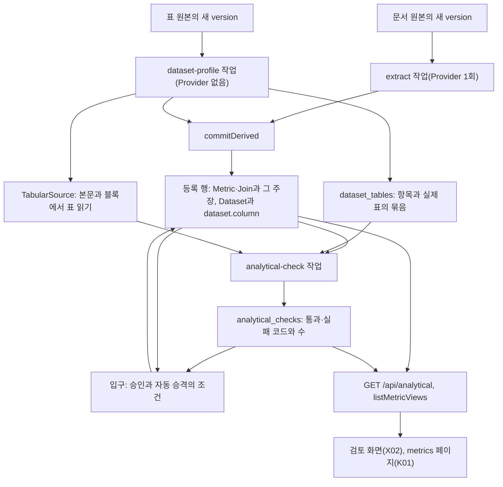
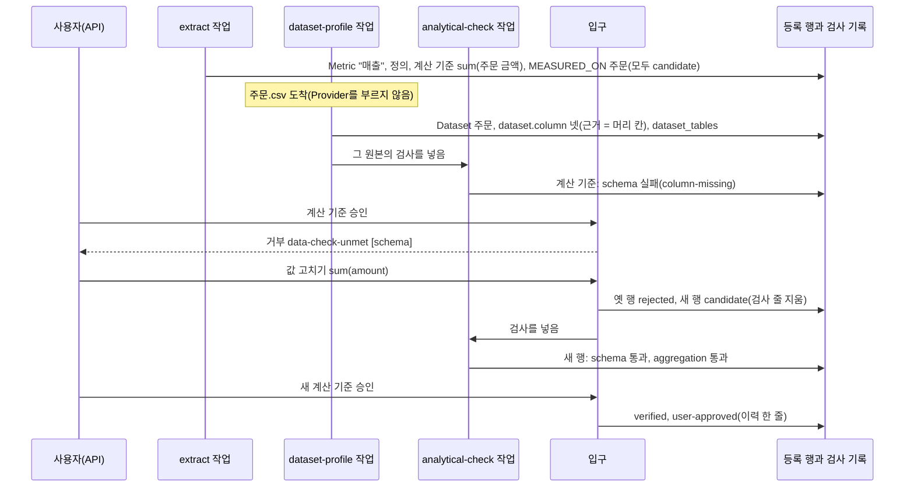
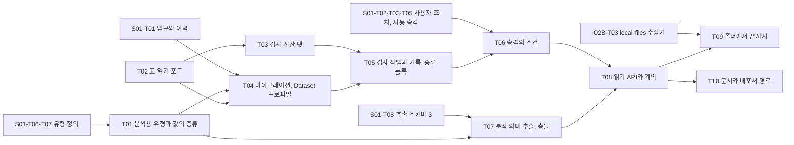

# 스펙: S03 분석 의미(Analytical Semantic) 후보와 데이터 근거 검증

- 날짜: 2026-11-22 / 상태: 초안
- 관련: 이슈 #24(S03), 총괄 #1(설계 분석 8번), Phase 3 #5, 선행 #22(S01)·#19(I02), 나란히 쓰이는 #23(S02), 후속 #25(K01, `metrics` 페이지가 이 spec의 Metric을 읽는다)·#31(X02, 검토 화면). [원 설계 6.5절](../design/original-design.md), [S01 spec](2026-11-22-S01-semantic-registry.md), [I02-A spec](2026-11-21-I02-document-normalization.md), [I02-B spec](2026-11-22-I02-local-file-import.md), [I04 spec](2026-11-21-I04-invalidation.md), [V02 spec](2026-11-21-V02-vertical-slice.md), [ARCHITECTURE.md](../ARCHITECTURE.md), [ADR 0002](../adr/0002-authority-in-product-records.md)·[0003](../adr/0003-phase1-without-engine.md), [site-setup.md](../site-setup.md)
- 기준 코드: `origin/main` `10b508d`. 이 문서가 코드에 대해 말하는 사실은 그 커밋을 읽어 확인했다(실행한 것은 아니다). S01의 구현은 아직 main에 없으므로 S01에 대한 것은 모두 S01 **spec의 문장**에 기댄다.

낯선 말은 [ARCHITECTURE 0절](../ARCHITECTURE.md#0-처음-나오는-말)과 [S01 spec의 머리 표](2026-11-22-S01-semantic-registry.md)에 풀이가 있다(등록 행, 입구, 상태, 인식 유형, 사용자가 정한 행, 유형 정의). 이 spec이 새로 쓰는 말은 아래와 같다.

| 말 | 뜻 |
|---|---|
| 분석 의미 | "매출은 주문 금액의 합계다", "주문 표는 주문 번호 하나가 한 줄이다" 같은, 숫자를 세고 더하는 데 쓰는 약속. 원 설계 6.5절의 Analytical Semantic |
| 표 원본 | 가져온 CSV 파일이나 XLSX 시트처럼 줄과 칸으로 된 원본. 이 spec에서 "실제 데이터"는 언제나 이것이다 |
| Dataset | 표 하나(CSV 파일 하나, 또는 XLSX의 시트 하나)를 가리키는 항목 |
| 실제 스키마 | 표 원본의 **현재 version**에서 읽은 머리 행의 열 이름들. 문서가 "이런 열이 있다"고 말한 것은 실제 스키마가 아니다 |
| Grain | 표의 한 줄이 무엇 하나를 뜻하는가. "주문 번호마다 한 줄"이면 Grain은 주문 번호 열이다. 그 열(들)의 값이 줄마다 달라야 한다 |
| Metric | 이름 붙은 지표(KPI) 하나. 정의(글)와 계산 기준(어느 표의 어느 열을 어떻게 모으는가)을 갖는다 |
| 계산 기준 | Metric의 사실 하나: 집계 방법 하나와 열 하나. `합계(금액)`, `줄 수`의 모양만 있다. 식이나 조건은 담지 못한다 |
| Join | 두 표를 어느 열끼리 맞대는가와, 맞댔을 때 한쪽 한 줄에 다른 쪽이 몇 줄 붙는가(cardinality) |
| 데이터 검사 | 주장(Grain, 계산 기준, Join)을 실제 표의 칸을 읽어 확인하는 정해진 계산 넷. 스키마, Grain, Join cardinality, 집계 |
| 분석 명세 | 한 Metric(또는 Dataset, Join)에 붙은, 값이 하나여야 하는 분석용 사실들을 모은 것. 같은 종류에 살아 있는 값이 둘이면 **충돌**이다 |
| 검사가 필요한 행 | 데이터 검사를 통과해야만 `verified`가 될 수 있는 등록 행. 목록은 S03-R13에 있다 |

비유로 말하면 문서는 "이 장부는 이렇게 읽는다"는 **설명서**이고 표 원본은 **장부 자체**다. 이 spec은 설명서의 말을 후보로 적어 두고, 장부를 펴서 맞는지 본 뒤에야 "확인됨"으로 올린다. 비유가 맞지 않는 곳: 제품은 장부의 합계를 **내지 않는다.** 설명서대로 셀 수 있는지만 본다.

## 배경

원 설계 6.5절은 문서나 정형 데이터에서 분석에 쓸 의미 정의가 발견되면 Dataset·Grain·Measure·Metric·Join 같은 것을 관리하되, **실제 데이터 스키마와 검증 근거가 없으면 Metric·Grain·Join을 확정하지 않으며**, 별도의 분석 플랫폼이나 SQL 생성 엔진은 만들지 않는다고 적었다. 총괄 이슈 #1의 설계 분석 8번도 같다: 분석용 Metric/Grain/Join은 실제 schema 근거 없이는 후보로 남기고 BI/SQL 엔진으로 넓히지 않는다. 이슈 #24는 이것을 세 기준(S03-C1~C3)으로 적었다.

**지금 있는 것**(origin/main `10b508d`의 코드를 읽어 확인했다).

- 항목·사실·관계 테이블과 근거 테이블이 있다(`storage/src/migrations.ts`의 v5, `storage/src/knowledge.ts`). 사실은 `(항목, 종류, 값)`이 같으면 같은 행이고, 다시 쓰면 근거만 더해진다(`saveUnique`의 `ON CONFLICT DO NOTHING`). 근거는 사실이나 관계만 가리킨다.
- 추출이 아는 유형은 항목 `Project`·`System`, 사실 `target_date`·`completion_date`, 관계 `DEPENDS_ON`뿐이고 코드 상수다(`providers/src/tasks.ts`, 추출 스키마 version 2).
- CSV와 XLSX를 글과 위치표로 바꾸는 모듈이 있다(`packages/document-normalize/src/formats/csv.ts`, `xlsx.ts`). 값이 있는 칸마다 블록 하나를 만들고 위치표가 CSV는 레코드·줄·칸 번호, XLSX는 시트 이름·칸 주소·행·열 번호를 갖는다. **머리 행을 따로 알아보지 않는다**(I02A-R13).
- 원본 version은 블록(JSON)과 부속 정보(`meta`)를 갖는다(`storage/src/migrations.ts`의 v16, `storage/src/sources.ts`). 블록의 모양은 계약에 있고(`packages/contracts/src/connector.ts`의 `NativeLocatorSchema`, `BlockSchema`), 근거를 읽으면 그 version의 블록에서 위치표를 계산해 준다(`storage/src/evidence-view.ts`의 `locatorAt`).
- 새 version이 저장되면 `extract` 작업 하나가 대기열에 들어간다(`backend/src/page-store.ts`). 추출은 본문이 2만 코드 포인트를 넘으면 Provider를 부르지 않고 보류한다(`knowledge-engine/src/extraction.ts`의 `MAX_EXTRACT_CODE_POINTS`).
- 파생물은 `commitDerived`로만 쓰고(fence, 계보, 범위 정책), 종류마다 파생물 등록부에 등록하며, 테이블마다 어느 종류의 것인지 분류한다(`storage/src/commit-derived.ts`, `knowledge-engine/src/canonical-kinds.ts`의 `CANONICAL_KINDS`, `backend/src/derivative-coverage.ts`의 `TABLE_CLASSIFICATION`).

**없는 것.**

1. **분석용 유형이 없다.** Dataset, Metric, Grain, Join을 적을 유형도, 그것을 추출하는 지시문도 없다.
2. **표 원본에서 스키마를 읽는 코드가 없다.** 정규화 모듈은 칸을 글로 바꿀 뿐 "이 줄이 머리 행이고 이 열의 이름은 무엇"이라고 답하지 않는다.
3. **정규화 모듈을 부르는 제품 코드가 없다.** `@pki/document-normalize`를 가져오는 곳은 그 패키지의 테스트와 도구 테스트뿐이다. 사용자의 CSV·XLSX 파일을 원본으로 들여오는 길(`local-files` 수집기)은 I02-B spec에 있고 구현(I02B-T02~T06)은 아직 main에 없다.
4. **주장을 실제 데이터로 확인하는 장치가 없다.** S01 spec의 승격 조건은 "서로 다른 원본 둘" 같은 근거의 수를 볼 뿐 표의 칸을 읽지 않는다. S01-R9는 "S03이 분석용 유형에 실제 스키마 검증을 더한다"고 자리를 비워 두었다.
5. **단위·통화·기간처럼 값이 하나여야 하는 것이 어긋날 때 그것을 보여 줄 곳이 없다.**

**선행 작업의 상태.** 이슈 #24의 선행은 #22(S01)와 #19(I02)다.

- **S01**: spec은 확정되었고 구현은 다른 세션이 진행 중이다. 이 spec은 S01 spec의 계약(입구, 이력, 사용자 조치, 유형 정의의 변경 경로, 자동 승격 조건 목록) 위에 쓴다. S01의 구현이 spec과 달라지면 고칠 자리를 "다시 확인할 것"에 모았다.
- **I02**: I02-A(정규화 모듈)는 main에 있다. I02-B(파일·폴더 가져오기)는 spec만 있다. 이 spec의 표 읽기는 **이미 main에 있는 계약**(원본 version의 본문과 블록)만 읽으므로, 블록을 가진 version을 넣을 수 있으면 I02-B 없이도 테스트가 돈다. I02-B가 필요한 것은 "사용자의 폴더에서 표 원본이 실제로 들어오는" 끝에서 끝까지의 확인 하나다(S03-T09). 작업 분해는 I02-B를 기다리지 않는 작업이 먼저 가도록 나눴다.

**엔진 결정과의 관계.** S01과 같다. 항목·사실·관계 테이블이 엔진으로 넘어가면(가정 A09) S03-R1·R2의 저장 자리를 다시 정한다. ADR 0002는 근거와 지식 행, 사용자 교정을 제품의 정본으로 두었다. 데이터 검사의 기록은 그 행에 붙는 파생물이고 표 원본에서 다시 계산할 수 있으므로, 행이 어디에 있든 제품이 다시 만든다.

## 목표

1. 문서가 말한 KPI의 정의와 계산 기준이 후보 등록 행으로 남고, 그 행이 근거 문서의 구간과 실제 표의 머리 칸을 함께 가리킨다.
2. Grain, 계산 기준, Join cardinality는 실제 표의 현재 version으로 한 데이터 검사가 모두 통과한 때에만 `verified`가 된다. 사용자의 승인도 자동 승격도 같다. 통과하지 못한 승인은 채우지 못한 조건의 이름과 함께 거부된다.
3. 표가 바뀌거나 지워져 검사가 더는 성립하지 않으면 `verified`였던 행이 그대로 남지 않는다.
4. 한 Metric의 단위·통화·기간·정의 판이 서로 어긋나면 제품이 하나를 고르지 않고 충돌로 보이며, 충돌이 풀릴 때까지 그 Metric의 계산 기준은 `verified`가 되지 못한다.
5. 제품은 지표의 값을 계산해 돌려주지 않고, 질의나 식을 받지 않으며, SQL을 만들지 않는다.
6. 검토 화면이 부를 읽기 API와 그 계약이 있고, K01의 `metrics` 페이지가 같은 읽기 함수를 쓴다.
7. 위 기록은 모두 I04의 삭제·범위·fence 장치와 S01의 상태·이력·사용자 조치 장치 위에 있다.

## 비목표 (배포처에서 후속 진행)

**공용 저장소의 다른 작업으로 넘기는 것**

- 검토 화면(Metric 카드, 충돌 표시, 승인 단추): X02(#31). S03은 그 화면이 부를 API와 계약 테스트까지 만든다(잠정 결정 9).
- `metrics` Wiki 페이지의 글과 모양: K01(#25). S03은 그 페이지가 읽을 함수 하나를 내놓는다(S03-R19).
- 문서가 말한 Dataset과 실제 표에서 만든 Dataset이 같은 것임을 찾아 합치기: S02(#23)의 개체 해소(S02-C2). S03에서 둘을 잇는 길은 기존 연결 후보(이름과 `verified` 표기)와 사용자의 직접 추가다(S03-R8).
- 서로 어긋나는 값을 **찾아서 이의를 거는** 일반 규칙, 판 사이의 선후(SUPERSEDES), 유효 시각의 구간: S02(#23)의 S02-C3. S03은 분석용 종류의 충돌을 **보이고 승격을 막는 것**까지, 그리고 데이터 검사가 깨졌을 때의 이의까지 한다(S03-R9, R16).
- 6.5절의 "Entity"와 "Business Rule": S02가 더하는 항목 유형이다. Dataset이 어떤 개체를 담는지, Metric이 어느 업무 규칙을 따르는지를 잇는 관계 유형은 S02의 유형이 생긴 뒤 유형 정의 변경 경로(S01-R19)로 하나씩 더한다.
- 폴더에서 CSV·XLSX를 들여오는 길 자체: I02-B(#19).
- 백업·복원 뒤의 검사 기록: H01(#32). 검사 기록은 다시 계산할 수 있어 복원 뒤 검사 작업이 다시 만든다.

**하지 않는 것**

- 지표 값의 계산, 차트, 대시보드, 질의 화면, SQL이나 다른 질의 언어의 생성과 실행. 데이터 검사는 "셀 수 있는가"를 볼 뿐 값을 내지 않는다(S03-R18).
- 식으로 된 지표(비율, 차이, 조건 붙은 합계). 계산 기준은 `집계(열 하나)` 모양뿐이다. 그 모양에 들지 않는 지표는 정의(글)만 가진 후보로 남는다(잠정 결정 4).
- 단위 환산과 환율(`천원`과 `원`을 같은 것으로 보기). 글자가 다르면 다른 값이다.
- 표의 열 이름이나 칸의 값을 Provider로 보내 LLM이 열을 맞추게 하는 일(잠정 결정 6).
- 한 시트 안의 표 여럿, 머리 행이 두 줄인 표, 피벗 모양의 표. 표로 보지 않는다(S03-R5).
- 데이터베이스, 웨어하우스, BI 도구에 접속해 스키마를 읽는 일. 실제 스키마는 가져온 파일에서만 온다.

**배포처 후속 항목**(1개. [site-setup.md의 배포처 설정 체크리스트](../site-setup.md#배포처-설정-체크리스트)와 번호로 대응한다. **번호는 잠정이고 조정자가 합치는 순서에 맞춰 다시 배정한다.** S32는 S01이 잡았고, S33은 같은 날 쓰이는 S02 spec의 몫으로 비워 두었다)

| 번호 | 항목 | 왜 배포처인가 |
|---|---|---|
| S34 | 설치본, 실제 Provider, 실제 표 자료로 분석 의미 추출·Dataset 프로파일·데이터 검사를 실행하고, 프로파일(`analytical.profile`)을 켤지와 한도(`analytical.maxCells`)의 값을 정한다 | 프로파일은 가져온 모든 표에서 머리 행을 짐작하는 규칙이다. 실제 스프레드시트에서 표가 아닌 것을 표로 잡는 비율과 큰 시트에서 걸리는 시간을 재기 전에는 꺼 둔다(S03-R6). 공용 저장소에는 실제 자료도 실제 Provider도 없다 |

## 요구사항

요구사항 번호는 `S03-R<n>`이다. 다른 spec의 번호는 `S01-R9`, `I04-R11`처럼 작업 코드를 붙인다.

### 등록 행과 유형

- **S03-R1 분석 의미는 등록 행이다.** 새 지식 테이블을 만들지 않는다. Dataset, Metric, Join은 항목이고 그 속성은 사실, 그 사이의 이음은 관계다. 그래서 상태, 이력, 사용자 조치, 취소, 근거, 삭제, 범위가 S01과 I04의 것 그대로 적용된다. 원 설계 6.5절의 목록은 아래처럼 대응한다.

  | 6.5절의 것 | 어디에 있는가 |
  |---|---|
  | Dataset | 항목 유형 `Dataset` |
  | Entity | S02의 항목 유형(비목표) |
  | Grain | `Dataset`의 사실 `dataset.grain`(열 묶음) |
  | Fact(사실 표) | `Dataset`의 사실 `dataset.role` = `fact`. 항목 유형 `Fact`를 만들지 않는다(S02의 지식 유형 `Fact`와 이름이 겹친다) |
  | Dimension | `Dataset`의 사실 `dataset.role` = `dimension`, 열 단위로는 `dataset.dimension` |
  | Measure | `Dataset`의 사실 `dataset.measure`(열) |
  | Metric | 항목 유형 `Metric` |
  | Aggregation Rule | `Metric`의 사실 `metric.calculation`(집계 방법과 열) |
  | Join Relationship | 항목 유형 `Join`과 그 사실 `join.keys`, `join.cardinality`, 관계 `JOIN_LEFT`, `JOIN_RIGHT` |
  | Time Dimension | `Dataset`의 사실 `dataset.time_dimension`(열), `Metric`의 사실 `metric.period` |
  | Business Rule | S02의 항목 유형(비목표). KPI의 계산 기준을 말한 글은 `Metric`의 `definition`(S01-R3) |
  | Dataset Mapping | 관계 `MEASURED_ON`(Metric → Dataset)과, Dataset 항목을 실제 표에 묶는 확장 테이블 `dataset_tables`(S03-R6) |

  확장 테이블은 둘뿐이다: `dataset_tables`(항목과 실제 표의 묶음)와 `analytical_checks`(데이터 검사의 기록, S03-R11). 둘 다 지식을 담지 않는다.

- **S03-R2 유형 정의.** 아래를 유형 정의(S01-R18)의 처음 값으로 더한다. 모두 `verified`이고, 마이그레이션이 S01-R19의 검사(중복, 모양)를 지난 것과 같은 모양으로 넣는다. 이름이 S02가 더하는 이름과 겹치면 늦게 합쳐지는 쪽이 바꾼다.

  | 종류 | 이름 | 규칙 |
  |---|---|---|
  | 항목 유형 | `Dataset`, `Metric`, `Join` | — |
  | 사실 종류 | `dataset.column` | `Dataset`, 값의 종류 `column`, 여럿. **프로파일만 쓴다**(S03-R6). 추출 지시문에 없다 |
  | 사실 종류 | `dataset.role` | `Dataset`, `dataset-role`, 하나 |
  | 사실 종류 | `dataset.grain` | `Dataset`, `column-set`, 하나 |
  | 사실 종류 | `dataset.measure`, `dataset.dimension`, `dataset.time_dimension` | `Dataset`, `column`, 여럿 |
  | 사실 종류 | `metric.calculation` | `Metric`, `calculation`, 하나 |
  | 사실 종류 | `metric.unit`, `metric.version` | `Metric`, `text`, 하나 |
  | 사실 종류 | `metric.currency` | `Metric`, `currency`, 하나 |
  | 사실 종류 | `metric.period` | `Metric`, `period`, 하나 |
  | 사실 종류 | `join.keys` | `Join`, `key-pairs`, 하나 |
  | 사실 종류 | `join.cardinality` | `Join`, `join-cardinality`, 하나 |
  | 관계 유형 | `MEASURED_ON` | `Metric` → `Dataset`, 대칭 아님 |
  | 관계 유형 | `JOIN_LEFT`, `JOIN_RIGHT` | `Join` → `Dataset`, 대칭 아님 |
  | 관계 유형 | `USES_JOIN` | `Metric` → `Join`, 대칭 아님 |

  S01의 사실 종류 `definition`과 `alias.*`가 붙을 수 있는 항목 유형에 `Metric`, `Dataset`을 더한다(넓히는 변경이라 S01-R19의 영향 검사에 걸리지 않는다).

- **S03-R3 값의 종류.** S01-R18의 값의 종류 목록(`date`, `text`, `surface-form`)에 아래 여덟을 더한다. 종류마다 코드에 정규화 함수 하나가 있고, 정규화되지 않는 값은 쓰기 전에 버려진다(S01-R21의 "값의 종류에 맞아야 한다"). 여러 조각으로 된 값은 **키를 정렬한 JSON 글**로 저장한다(같은 뜻이면 같은 글자열이 되어 같은 행 규칙이 그대로 선다).

  | 값의 종류 | 받아들이는 것 | 저장하는 모양 |
  |---|---|---|
  | `column` | 비어 있지 않은 열 이름 하나(코드 포인트 200 이하) | 앞뒤 공백을 뗀 글 그대로 |
  | `column-set` | 열 이름 하나 이상, 겹치지 않음 | 정렬한 JSON 배열 |
  | `calculation` | 집계 방법 하나(`sum`, `count`, `count_distinct`, `avg`, `min`, `max`)와 열 이름 하나. `count`는 열 없이도 된다(줄 수) | `{"aggregation":…,"column":…}` |
  | `key-pairs` | (왼쪽 열, 오른쪽 열) 쌍 하나 이상 | 정렬한 JSON 배열 |
  | `join-cardinality` | `one-to-one`, `many-to-one`, `one-to-many`, `many-to-many` | 그 글 |
  | `period` | `day`, `week`, `month`, `quarter`, `year` | 그 글 |
  | `currency` | ISO 4217의 세 글자 통화 코드(실행 환경이 아는 목록 `Intl.supportedValuesOf("currency")`) | 대문자 |
  | `dataset-role` | `fact`, `dimension` | 그 글 |

  **식은 값이 아니다.** `calculation`의 정규화는 위 모양이 아닌 것(두 열, 연산자, 조건, 중첩된 집계, 질의 문장)을 모두 거부한다. 열 이름을 실제 열과 맞춰 볼 때는 V02-R7의 가공(유니코드 정규화, 대소문자 통일, 공백 정리)을 거친 값으로 비교한다.

### 실제 스키마

- **S03-R4 표 읽기는 포트 하나다.** 원본 version 하나에서 표를 읽는 일은 `TabularSource`(아래 "표 읽기 포트") 하나를 지난다. 구현은 하나다: 정본에 저장된 그 version의 **본문과 블록**을 읽는 것. 블록의 위치표가 `csv`(레코드·칸 번호)이거나 `xlsx`(시트·행·열 번호)인 version만 표 원본이다. 이 포트는 파일을 열지 않고 `@pki/document-normalize`를 부르지 않는다. 표 원본을 정본에 넣는 일은 I02의 것이다.
  - 포트의 계약 테스트 묶음을 `packages/testkit`에 둔다. 실제 구현과 테스트용 대역(메모리의 표)이 같은 입력에 같은 모양의 결과를 낸다.
  - I02가 블록의 모양(위치표의 필드, 칸을 잇는 구분자)을 바꾸면 이 포트의 구현 하나만 고친다.
- **S03-R5 표로 보는 규칙.** CSV는 파일 하나가, XLSX는 시트 하나가 표의 후보다. 아래를 모두 채워야 표다. 못 채우면 표로 보지 않고 사유 코드를 돌려준다(`no-header`, `no-rows`, `too-large`).
  1. **머리 행**: 값이 있는 칸이 둘 이상인 첫 행으로서, 칸의 글이 가공 뒤 서로 다르고 어느 칸도 수나 날짜로 읽히지 않는 행. 그 위의 행(제목 한 칸 같은 것)은 버린다. 그런 행이 없으면 `no-header`.
  2. **자료 행**: 머리 행 아래에서, 머리 행의 열 범위 안에 값이 있는 칸이 하나라도 있는 행. 하나도 없으면 `no-rows`. 머리 행의 열 밖에 있는 칸은 읽지 않고 그 수를 센다.
  3. **크기**: 표의 칸 수가 설정 `analytical.maxCells`(기본 200,000) 이하. 넘으면 `too-large`.

  한 시트에 표는 하나다. 병합된 칸, 수식, 숨긴 시트는 I02-A가 단 한계 표시(`xlsx.merged-cells` 등) 그대로 결과에 싣고 표 판정을 바꾸지 않는다.
- **S03-R6 Dataset 프로파일.** 표 원본의 새 version마다 작업 `dataset-profile` 하나가 대기열에 들어간다(표 원본이 아닌 version에는 만들지 않는다). 이 작업은 **Provider를 부르지 않는다.** 추출의 2만 코드 포인트 한도와 무관하게 돈다.
  - 표마다 `Dataset` 항목 하나를 만든다. 이름은 CSV면 원본의 제목, XLSX면 표인 시트가 하나일 때 원본의 제목, 둘 이상일 때 `제목:시트 이름`이다.
  - 머리 칸마다 사실 `dataset.column`(값은 열 이름)을 쓰고, **근거는 그 머리 칸의 구간**이다. 그래서 근거 API가 그 열의 자리(시트와 칸 주소, 또는 레코드와 칸 번호)를 답한다.
  - `dataset_tables`에 (항목, 원본, 표의 열쇠, 자료 행 수)를 적는다. 표의 열쇠는 XLSX면 시트 이름, CSV면 빈 글이다. `(원본, 표의 열쇠)`는 하나뿐이다. 같은 원본의 다음 version에서 같은 열쇠의 표는 **같은 Dataset 항목**을 다시 쓴다.
  - 쓰기는 `commitDerived`를 지난다(I04-R11). 행은 `candidate`·`explicit`으로 생기고 이력의 주체는 `extraction`이며 confidence는 비운다. 쓰기 전에 유형 정의에 맞추는 검사(S01-R21)를 그대로 지난다.
  - 다음 version에서 사라진 열의 사실은 현재 근거를 잃어 기존 전파가 `superseded`로 바꾼다(V02-R11). 이 spec은 그 전파를 고치지 않는다.
  - **설정 `analytical.profile`이 켜져 있을 때만 돈다. 기본값은 꺼짐이다**(잠정 결정 5). 꺼져 있으면 작업을 만들지 않는다.
  - 프로파일이 끝나면 그 원본에 대한 검사 작업(S03-R12)을 넣는다.

### 추출과 연결

- **S03-R7 추출 응답 스키마.** `extract` 작업의 스키마 version을 하나 올린다(S01이 3으로 올리므로 그다음 번호다. S02도 올리면 늦게 합쳐지는 쪽이 번호를 다시 매긴다).
  - 항목 유형에 `Dataset`, `Metric`, `Join`을, 사실 종류에 S03-R2의 것 가운데 `dataset.column`을 뺀 전부를, 관계 유형에 S03-R2의 넷을 더한다. KPI의 정의 글은 S01의 `definitions`로 온다(항목이 `Metric`).
  - 사실마다 인용문이 있고 코드가 원문에서 그 자리를 찾는다(V02-R6 그대로). `metric.unit`과 `metric.version`의 값은 **인용문 안에 글자 그대로** 있어야 하고 없으면 버린다(코드 포인트 40 이하).
  - **열을 가리키는 값의 인식 유형.** `column`, `column-set`, `calculation`, `key-pairs` 값의 열 이름이 모두 인용문 안에 글자 그대로(가공 뒤 비교) 있을 때만 응답의 `explicit`을 받아들인다. 하나라도 없으면 코드가 `hypothesis`로 낮춘다. 문서의 "주문 금액"을 열 `amount`로 옮긴 것은 모델의 짐작이기 때문이다. `hypothesis`는 자동으로 승격되지 않는다(S01-R9의 2).
  - 원본 version 하나에 Provider 호출 1회라는 한계(ADR 0003의 1번)는 그대로다. 응답 안의 글은 자료일 뿐 지시가 아니다.
  - **표의 열 이름과 칸의 값은 요청에 싣지 않는다.** 연결 후보로 나가는 것은 지금처럼 항목의 이름과 `verified` 표기뿐이다(S01-R16). Dataset 항목의 이름도 그 길로 나간다.
- **S03-R8 근거와 실제 스키마의 연결.** 한 Metric에서 아래가 모두 읽힌다(S03-R19의 읽기가 한 번에 돌려준다).
  1. 정의와 계산 기준의 **근거 문서**: 그 사실들의 근거(원본 version과 구간). 기존 근거 테이블 그대로다.
  2. **Dataset**: 살아 있는 `MEASURED_ON` 관계의 대상.
  3. **실제 표**: 그 Dataset의 `dataset_tables` 줄. 없으면 "실제 표 없음"이다(문서가 이름만 말한 Dataset).
  4. **열의 대응**: 계산 기준이 가리키는 열 이름과 가공 뒤 같은 `dataset.column` 사실(현재 근거가 그 표의 현재 version에 있는 것). 있으면 그 사실의 ID를, 없으면 `column-missing`을 답한다.

  문서가 말한 Dataset과 프로파일이 만든 Dataset을 잇는 길은 둘이다: ① 문서가 그 이름이나 `verified` 표기를 글자 그대로 쓰면 추출이 기존 항목에 연결한다(V02-R7, S01-R16) ② 사용자가 실제 표의 Dataset으로 향하는 `MEASURED_ON` 관계를 직접 추가하고(S01-R7) 옛 관계를 기각한다. 두 항목을 합치는 일은 S02다.

### 충돌

- **S03-R9 분석 명세와 충돌.** 값이 하나여야 하는 분석용 종류(S03-R2의 "하나")에 대해, 한 항목에 그 종류의 **유효한 행**(S01-R15의 뜻: `superseded`·`rejected`가 아니고 현재 근거가 있거나 사용자 입력 행)이 값이 달라 둘 이상이면 **충돌**이다. `Metric`의 살아 있는 `MEASURED_ON` 대상이 둘 이상인 것, `Join`의 `JOIN_LEFT`나 `JOIN_RIGHT` 대상이 둘 이상인 것도 충돌이다.
  - 제품은 충돌하는 값 가운데 **하나를 고르지 않고, 합치지 않고, 어느 것도 스스로 기각하지 않는다.**
  - 읽기 API가 항목마다 충돌 목록(종류와 그 행들의 ID)을 답한다.
  - **충돌이 하나라도 있는 항목의 검사가 필요한 행은 `verified`가 될 수 없다**(S03-R14, R15의 `spec-conflict`). 단위가 `원`인지 `천원`인지 모르는 채로 계산 기준을 확정하지 않는다.
  - 푸는 것은 사용자다: 틀린 쪽을 기각하거나 값을 고친다(S01-R7). 유효한 값이 하나만 남으면 충돌이 사라진다.
  - 이슈가 이름 붙인 네 가지를 fixture로 고정한다: **단위**(`원`과 `천원`), **통화**(`KRW`와 `USD`), **기간**(`month`와 `quarter`), **version**. version은 둘을 다룬다: ㉮ 정의의 판(`metric.version`이 `v1`과 `v2`) ㉯ 표의 version(검사를 통과한 뒤 표 원본의 새 version에서 그 열이 사라지거나 Grain이 깨진 경우, S03-R16).
  - 이미 `verified`인 값과 어긋나는 새 후보가 왔을 때 `verified` 쪽에 이의를 거는 것은 이 spec이 하지 않는다. 종류를 가리지 않는 그 규칙은 S02의 것이다.

### 데이터 검사

- **S03-R10 검사 넷.** 모두 표 원본의 **현재 version**을 `TabularSource`로 읽어 하는 정해진 계산이고 Provider를 부르지 않는다. 결과는 통과나 실패(실패 코드)와 수 몇 개다.

  | 검사 | 대상 | 통과 조건 | 실패 코드 |
  |---|---|---|---|
  | `schema` | 열을 가리키는 사실 | 그 사실이 가리키는 Dataset이 실제 표에 묶여 있고, 가리키는 열이 모두 그 표의 머리 행에 있다. `metric.calculation`은 그 Metric의 하나뿐인 `MEASURED_ON` 대상, `join.keys`의 왼쪽 열은 `JOIN_LEFT` 대상, 오른쪽 열은 `JOIN_RIGHT` 대상에서 찾는다 | `no-table`, `column-missing` |
  | `grain` | `dataset.grain` | 자료 행마다 Grain 열에 빈 칸이 없고, Grain 열 값의 묶음이 행마다 다르다 | `grain-empty`, `grain-duplicate` |
  | `join-cardinality` | `join.cardinality` | 주장이 "하나"라고 한 쪽의 열쇠 값 묶음이 그 표에서 겹치지 않는다(`many-to-one`이면 오른쪽, `one-to-many`면 왼쪽, `one-to-one`이면 양쪽). 실제가 주장보다 더 엄격한 것은 통과다. `many-to-many`는 언제나 통과다. 열쇠가 빈 행은 빼고 그 수를 센다 | `join-not-unique` |
  | `aggregation` | `metric.calculation` | ① `sum`·`avg`·`min`·`max`면 그 열의 비어 있지 않은 칸이 모두 수다(I02-A가 적는 기본 수 표기. `1,000` 같은 글은 수가 아니다) ② 그 Dataset의 하나뿐인 유효한 `dataset.grain`의 `grain` 검사가 통과해 있다 ③ 그 Metric에 살아 있는 `USES_JOIN`이 있으면 Join마다 `join-cardinality` 검사가 통과해 있고, Metric의 Dataset이 그 Join의 한쪽이며, `sum`·`count`·`avg`일 때 **맞은편의 열쇠가 겹치지 않는다**(겹치면 한 줄이 여러 번 세어진다) | `non-numeric`, `grain-unverified`, `join-unverified`, `fan-out` |

  수는 본 행의 수, 어긴 행의 수, 건너뛴 행의 수다. **칸의 값, 겹친 열쇠의 값, 합계는 결과에 없다.**
- **S03-R11 검사의 기록.** 결과는 `analytical_checks`에 사실 하나와 검사 하나마다 한 줄로 남는다: 대상 사실, 검사 이름, 통과 여부, 실패 코드, 수 셋, 읽은 표 원본 version(하나, Join이면 둘), 시각. 글이 없다.
  - **현재성.** 한 줄은 그것이 읽은 version이 모두 그 원본의 최신이고 tombstone에 덮이지 않았을 때만 **현재**다. 현재가 아닌 줄은 없는 것과 같다.
  - **주장이 바뀌면 지운다.** 분석용 행이 생기거나, 상태가 바뀌거나, 근거를 얻거나 잃으면, 그 행에 기대는 검사 줄(S03-R13의 표에서 그 행을 읽는 검사)을 **같은 트랜잭션에서** 지운다. 낡은 결과로 승격되는 길을 없앤다.
  - 대상 사실이나 읽은 version이 지워지면 줄도 지워진다(외래 키).
- **S03-R12 검사 작업.** 작업 `analytical-check`는 표 원본 하나를 이름으로 갖고 그 원본의 현재 version이 fence다. 그 원본의 Dataset들과, 거기에 `MEASURED_ON`·`JOIN_LEFT`·`JOIN_RIGHT`·`USES_JOIN`으로 닿는 Metric과 Join의 검사가 필요한 행 전부를 다시 검사하고 결과를 `commitDerived`로 쓴다.
  - 넣는 때: ① 그 원본의 프로파일이 끝남 ② 추출이나 전파가 그 원본에 닿는 분석용 행을 바꿈 ③ 사용자 조치가 그런 행을 바꿈 ④ API 요청(S03-R19). 닿는 표 원본이 없으면 넣지 않는다.
  - 결과를 쓴 뒤 같은 트랜잭션에서 S03-R15와 R16의 판정을 한다.
  - **범위.** 검사 결과의 계보는 읽은 표 원본 version과 그 주장 행의 계보를 합친 것이다. 범위 정책이 그 묶음을 거부하면(`combinable`) 그 줄은 쓰지 않는다. 그 행은 "검사 없음"으로 남는다.
  - 표가 `too-large`면 그 표의 검사는 실패 코드 `too-large`로 남는다.
  - **따라가는 길은 정해진 둘뿐이다.** 검사와 읽기가 관계를 따라가는 모양은 `Metric → Dataset`(한 단계)과 `Metric → Join → Dataset`(두 단계) 둘이고 코드에 적힌 질의다. 재귀 질의와 일반 그래프 탐색을 만들지 않는다. ADR 0003의 6번 문장("관계 조회는 깊이 1 조인까지")을 이 한 질의에 한해 두 단계로 넓히는 것이므로, 그 문장을 조용히 고치지 않고 S03의 새 ADR이 대체한다고 ADR 0003의 맨 위에 적는다(S01-R16이 3번 문장에 한 것과 같은 방식. 잠정 결정 14).

### 승격의 조건

- **S03-R13 검사가 필요한 행.** 아래 종류의 사실은 표의 검사가 **모두 현재이고 통과**일 때만 `verified`가 될 수 있다. 이 표가 코드의 상수이고, 유형 정의의 처음 값과 어긋나면 테스트가 실패한다.

  | 사실 종류 | 필요한 검사 | 그 검사가 읽는 다른 행 |
  |---|---|---|
  | `dataset.grain` | `schema`, `grain` | — |
  | `dataset.measure`, `dataset.dimension`, `dataset.time_dimension` | `schema` | — |
  | `metric.calculation` | `schema`, `aggregation` | 그 Metric의 `MEASURED_ON`·`USES_JOIN`, 그 Dataset의 `dataset.grain`, 그 Join들의 `join.keys`·`join.cardinality`·`JOIN_LEFT`·`JOIN_RIGHT` |
  | `join.keys` | `schema` | 그 Join의 `JOIN_LEFT`·`JOIN_RIGHT` |
  | `join.cardinality` | `schema`(그 Join의 `join.keys`에 대한 것), `join-cardinality` | 그 Join의 `join.keys`·`JOIN_LEFT`·`JOIN_RIGHT` |

  이 밖의 분석용 행(`Dataset`·`Metric`·`Join` 항목, `dataset.column`, `dataset.role`, `metric.unit`, `metric.currency`, `metric.period`, `metric.version`, 정의, 네 관계)은 S01의 규칙만 따른다. **"Metric이 확정되었다"는 그 Metric의 `metric.calculation`이 `verified`라는 뜻이다**(잠정 결정 2). `Metric` 항목의 상태는 "그런 지표가 있다"까지만 말한다.
- **S03-R14 사용자의 승인도 검사를 지난다.** 검사가 필요한 행을 사용자가 승인하면(`candidate`·`disputed`·`superseded`·`rejected` 어디서든) 입구가 먼저 채우지 못한 조건을 센다. 하나라도 있으면 `data-check-unmet`으로 거부하고 그 목록을 돌려주며 아무것도 바꾸지 않는다.

  | 채우지 못한 조건 | 뜻 |
  |---|---|
  | `no-dataset` | 가리킬 Dataset이 없거나, 그 Dataset이 실제 표에 묶여 있지 않다 |
  | `spec-conflict` | 그 항목(과 `metric.calculation`이면 그 Dataset의 Grain)에 충돌이 있다(S03-R9) |
  | `check-missing` | 필요한 검사의 현재 줄이 없다(아직 돌지 않았거나 낡았거나 범위 정책이 막았다) |
  | `schema`, `grain`, `join-cardinality`, `aggregation` | 그 검사의 현재 줄이 실패다 |

  - **직접 추가는 후보로 생긴다.** 검사가 필요한 종류를 사용자가 직접 추가하면 그 행은 `verified`가 아니라 `candidate`·`hypothesis`·`user_authored`로 생긴다(S01-R7의 "직접 추가는 `verified`로 생긴다"를 이 종류에서만 바꾼다). 검사가 통과한 뒤 승인하면 `verified`·`user-approved`가 된다.
  - **값 고치기**도 같다: 새 값의 행은 후보로 생기고, 옛 행은 S01-R7대로 물린다.
  - 사용자가 정한 행의 보호(S01-R12), 취소(S01-R8), 다시 추출해도 그대로(S01-R13)는 바뀌지 않는다.
- **S03-R15 자동 승격의 여섯째 조건.** S01-R9의 조건 목록에 `data-checks`를 더한다: 검사가 필요한 행이면 S03-R14의 채우지 못한 조건이 하나도 없어야 한다. 검사가 필요하지 않은 행에는 언제나 참이다. 자동으로 승격된 행이 이 조건을 잃으면 정책이 승격 직전의 상태로 되돌린다(S01-R5의 복원). 자동 승격 자체는 S01의 설정 `semantic.autoVerify`(기본 꺼짐)를 따른다.
- **S03-R16 검사를 잃은 `verified` 행.** 검사 작업이 결과를 쓴 뒤, 또는 삭제 전파가 검사 줄을 지운 뒤, `verified`인 검사가 필요한 행에 채우지 못한 조건이 생겼으면:
  - **사용자가 정한 행**이면 근거를 든 자동 이의(S01-R12의 3)로 `disputed`가 된다. 근거 번호는 검사가 읽은 표 원본과 그 version(삭제면 tombstone이 덮은 version)이다. 값은 바꾸지 않는다. 결정은 사용자가 한다.
  - **자동으로 승격된 행**이면 S03-R15대로 `candidate`로 되돌아간다.
  - `check-missing`만으로는(다시 검사하면 될 뿐이면) 아무것도 하지 않는다. 표 원본이 지워져 다시 검사할 수 없게 된 것은 `no-dataset`이다.
  - 표가 바뀌었어도 새 version에서 검사가 모두 통과하면 상태는 그대로다.

### 기존 장치 위에 얹기

- **S03-R17 삭제, 범위, 읽기.**
  - 새 종류 `analytical-check`를 파생물 등록부에 등록한다(층은 knowledge, 종류 `fact`를 가리킨다). 표 원본이 지워지거나 이전 version이 정리되면(`old-versions-pruned`) 그 version을 읽은 검사 줄을 지우고, 영향을 받은 행에 S03-R16의 판정을 한다. 이 종류는 무효화 계약 묶음 ①~⑥을 통과한다.
  - `analytical_checks`는 종류 `analytical-check`에, `dataset_tables`는 종류 `item`에 분류한다(`TABLE_CLASSIFICATION`). `dataset_tables`의 줄은 그 Dataset 항목이 지워질 때 함께 지워진다.
  - 표 원본을 지우면: `dataset.column` 사실이 근거를 모두 잃어 지워지고(I04-R8), 원본에서 온 행이 남지 않은 Dataset 항목이 지워지며(S01-R14), 그 항목을 가리키던 관계도 지워진다. 이 spec은 그 규칙을 고치지 않는다.
  - 열 이름, 시트 이름, 표에서 만든 Dataset 이름은 원본을 지운 뒤 파일에 남지 않는다(I04의 카나리 검사에 더한다).
  - 새 읽기 API는 `visible`을 지난다(I04-R13). 검사 줄은 그 계보(S03-R12)가 모두 보일 때만 응답에 실린다.
- **S03-R18 값을 내지 않는다.** 어떤 코드도 지표의 값을 계산해 저장하거나 응답에 싣지 않는다. 어떤 API도 질의 문장, 식, 열 이름의 자유로운 조합을 받지 않는다. 데이터 검사가 표에서 읽은 것 가운데 밖으로 나가는 것은 S03-R10의 수와 코드뿐이다. 이 작업은 질의 엔진, SQL 생성기, 분석용 저장소를 의존성으로 더하지 않는다.

### API

- **S03-R19 읽기 API와 화면 계약.** `packages/contracts`에 경로와 스키마를 더한다. 이름은 잠정이고 S03-T08이 굳힌다.

  | 경로 | 하는 일 |
  |---|---|
  | `GET /api/analytical` | Dataset 목록(이름, 실제 표의 묶음과 자료 행 수, 열, 역할·Grain·Measure·Dimension·Time 사실), Metric 목록(정의, 계산 기준, 단위·통화·기간·판, Dataset, 열의 대응, 쓰는 Join), Join 목록(양쪽 Dataset, 열쇠, cardinality). 행마다 상태·인식 유형·근거 수·사용자가 정했는지(S01의 것), 검사가 필요한 행마다 검사 결과와 **채우지 못한 조건**, 항목마다 **충돌 목록** |
  | `POST /api/analytical/check` | 항목 하나에 닿는 표 원본의 검사 작업을 넣는다. 작업 ID를 답한다 |

  - 승인·기각·이의·직접 추가·값 고치기·취소는 S01의 경로(`/api/semantic/decide`, `/correct`, `/undo`)를 그대로 쓴다. 그 거부 코드에 `data-check-unmet`(목록과 함께)을 더한다. `/correct`는 값의 종류가 여러 조각인 것을 조각 그대로 받아 S03-R3으로 정규화한다.
  - 오류 응답에 이름·값·인용문을 싣지 않는다(S01-R23).
  - **Metric 목록을 만드는 함수는 하나다**(`listMetricViews`, 잠정 이름. `storage`에 둔다). API와 K01(#25)의 `metrics` 페이지가 같은 함수를 부른다. 한 Metric에 대해 이름, 표기, 정의들, 계산 기준과 그것이 확정되었는지, Dataset, Grain, 단위·통화·기간·판, 충돌, 근거의 ID를 답한다. 무엇을 페이지에 쓰고 후보를 어떻게 표시할지는 K01이 정한다.

### 문서와 배포처 경로

- **S03-R20 문서.** 아래를 구현 작업이 자기 PR에서 고친다(이 spec의 커밋은 고치지 않는다).
  - ARCHITECTURE: 3.2절 표에 "분석 의미와 데이터 검사" 줄을, 4절 표에 `dataset_tables`와 `analytical_checks`를, 5.6절 등록표에 종류 `analytical-check`와 두 테이블의 소속을, 작업 종류 목록에 `dataset-profile`과 `analytical-check`를 적는다.
  - ADR: "분석 의미는 등록 행과 데이터 검사이고, 제품은 값을 계산하지 않는다"를 새 ADR로 남긴다. 번호는 합쳐지는 때의 다음 번호다(잠정). **ADR 0003은 본문을 고치지 않는다.** 6번 문장이 분석 의미의 정해진 두 단계 질의에 한해 새 ADR로 대체되었다는 줄을 맨 위에 더한다(R12).
  - site-setup.md: `## 배포처 설정 체크리스트` 아래에 S34를 더한다. 무엇을 실행하고 무엇을 기록하는지(가져온 표 수, 표로 본 수와 사유별 수, 사용자가 표가 아니라고 본 수, 가장 큰 표의 프로파일·검사 시간, 추출된 분석용 후보의 종류별 수. 글은 기록하지 않는다)와 설정 키 `analytical.profile`, `analytical.maxCells`를 "실행 중 설정" 표에 적는다.
  - docs/README.md: 이 spec의 상태 칸.
- **S03-R21 배포처 경로.** S34의 실행 경로(V02 배포처 검증 실행기의 분석 의미 시나리오)를 Windows 설치본과 실제 Provider가 아닌 환경에서 실행하면 `배포처 후속`으로 시작하는 알림을 내고 0이 아닌 값으로 끝난다. 조용히 아무것도 하지 않는 일이 없다.

## 인터페이스 / 설계 개요

### 구성 요소와 흐름

문서에서 온 **주장**과 표에서 읽은 **실제**가 서로 다른 길로 들어와 등록 행에서 만나고, 검사 작업이 둘을 맞춰 본 결과를 입구가 읽는다. 값을 계산하는 상자는 없다.



### 후보에서 확정까지

문서가 KPI를 말하고, 뒤에 표가 들어오고, 사용자가 승인하려다 거부되고, 열을 고친 뒤 승인되는 경우다. 무엇이 Provider를 부르고 무엇이 부르지 않는지, 승인이 어디서 막히는지가 이 spec의 핵심이라 순서로 그렸다.



### 승인이 지나는 조건

검사가 필요한 행을 `verified`로 올리려는 모든 길(사용자의 승인, 자동 승격)이 같은 조건을 지난다.


그림은 처음 걸린 조건에서 끝나는 것처럼 보이지만 응답은 **채우지 못한 조건 전부**를 싣는다.

### 표 읽기 포트

이름과 모양은 잠정이다. S03-T02가 코드 타입으로 굳힌다.

```typescript
type TableKey = string                                  // XLSX의 시트 이름, CSV는 ""
type NotTabular = 'no-header' | 'no-rows' | 'too-large'
interface TableColumn { index: number; name: string; span: { start: number; end: number } }  // span = 머리 칸의 구간(근거가 된다)
interface Table {
  key: TableKey
  columns: readonly TableColumn[]
  rowCount: number
  cellsOutsideHeader: number
  rows(): Iterable<readonly (string | null)[]>          // 자료 행. 머리 행의 열 순서, 빈 칸은 null
}
type TableRead = { key: TableKey; table: Table } | { key: TableKey; reason: NotTabular }
interface TabularSource {
  // 표 원본이 아니면(csv·xlsx 위치표의 블록이 없으면) null
  read(db: SqlDriver, ref: { sourceId: number; version: number }, limits: { maxCells: number }): readonly TableRead[] | null
}
```

### 검사와 조건의 모양

```typescript
type DataCheck = 'schema' | 'grain' | 'join-cardinality' | 'aggregation'
type CheckFailure =
  | 'no-table' | 'column-missing' | 'grain-empty' | 'grain-duplicate' | 'join-not-unique'
  | 'non-numeric' | 'grain-unverified' | 'join-unverified' | 'fan-out' | 'too-large'
interface CheckResult {
  check: DataCheck
  passed: boolean
  failure: CheckFailure | null
  examined: number; violations: number; skipped: number // 수뿐이다
}
type DataCheckUnmet = 'no-dataset' | 'spec-conflict' | 'check-missing' | DataCheck

// storage: 입구가 승인과 자동 승격 전에 부른다. 저장된 검사 줄과 지금의 행만 읽는다(표를 읽지 않는다).
function dataChecksUnmet(tx: SqlDriver, fact: EntryRef): readonly DataCheckUnmet[]   // 검사가 필요하지 않은 행은 []

// S01의 타입에 더하는 것
// Refusal            += 'data-check-unmet' (unmet: readonly DataCheckUnmet[]와 함께)
// AutoVerifyCondition += 'data-checks'
```

계산(검사 작업, `knowledge-engine`)과 판정(입구, `storage`)을 나눈 까닭: 입구는 트랜잭션 안에서 짧게 끝나야 하고 `storage`는 `knowledge-engine`을 부를 수 없다. 표를 읽는 무거운 일은 작업이 하고, 입구는 그 결과가 현재인지만 본다.

### 스키마 변경

마이그레이션 **하나**를 더한다(S03-T04). 번호는 합쳐지는 때의 다음 번호다. S01이 둘, I02-B가 하나를 더하고 S02도 더할 수 있으므로 늦게 합쳐지는 가지가 번호를 다시 매긴다. **이 마이그레이션은 S01의 둘째 마이그레이션(유형 정의 테이블) 뒤에 와야 한다.**

| 내용 |
|---|
| `dataset_tables`(항목, 원본, 표의 열쇠, 자료 행 수. `(원본, 표의 열쇠)` 고유. 항목이 지워지면 함께 지워짐) |
| `analytical_checks`(대상 사실, 검사 이름, 통과 여부, 실패 코드, 수 셋, 읽은 version 하나나 둘, 시각. `(사실, 검사)` 고유. 사실이나 version이 지워지면 함께 지워짐) |
| 유형 정의의 처음 값(S03-R2)과 `definition`·`alias.*`의 넓힘 |

### 원 설계 6.5절의 문장을 누가 채우는가

| 문장 | 채우는 요구사항 |
|---|---|
| "KPI의 계산 기준이 발견되면 Business Metric 후보로 등록하고 관련 문서 및 데이터셋과 연결한다" | R7, R8 |
| "실제 데이터 스키마와 검증 근거가 없다면 Metric, Grain, Join 관계를 확정하지 않는다" | R10~R16 |
| "별도의 데이터 분석 플랫폼이나 SQL 생성 엔진을 초기 필수 기능으로 구축하지 않는다" | R3, R18 |
| "Analytical Semantic은 Knowledge Semantic의 확장 영역으로 관리한다" | R1, R2 |

## 완료 기준 (테스트 가능한 형태)

C1~C3은 이슈 #24의 문장 그대로다. H1·H2는 이 프로젝트가 배포처로 넘어가는 프로젝트라서 spec 양식이 요구하는 두 기준이다. 모든 기준은 저장소 안의 자동 테스트로 판정한다. 손으로 돌린 명령의 출력은 기준을 채운 것으로 치지 않는다.

- [ ] **S03-C1** (R1, R2, R4, R5, R6, R7, R8): 문서에서 KPI 정의를 후보로 추출하고 근거 문서/실제 dataset schema와 연결한다.
- [ ] **S03-C2** (R9, R10, R11, R12, R13, R14, R15, R16, R17): 실제 schema·grain·join cardinality·집계 검증이 없으면 verified로 승격할 수 없다. 단위·통화·기간·version 충돌 fixture를 처리한다.
- [ ] **S03-C3** (R1, R3, R18, R19): 독립 BI 플랫폼·SQL 생성기 구현 없이 Knowledge Semantic 확장과 사용자 검토 UI 계약으로 끝낸다.
- [ ] **S03-H1** (R20): 이 spec의 "배포처 후속 항목" 1개에 대해 site-setup.md의 `## 배포처 설정 체크리스트` 아래에 같은 번호의 항목이 있으면 통과하고, 없거나 수가 다르면 문서 대응 테스트가 실패한다.
- [ ] **S03-H2** (R21): 분석 의미 시나리오 실행 경로를 Windows 설치본과 실제 Provider가 아닌 환경에서 실행하면 `배포처 후속`으로 시작하는 알림을 출력하고 0이 아닌 값으로 끝난다(경로 1건).

**기준을 읽는 법**

- **C1의 "후보로"**는 추출된 분석용 행이 모두 `candidate`로 생긴다는 것이다. **"근거 문서와 연결"**은 정의와 계산 기준의 근거가 그 문서의 구간을 가리키는 것, **"실제 dataset schema와 연결"**은 R8의 넷(근거 문서, Dataset, 실제 표, 열의 대응)이 한 번의 읽기로 나오고 열의 근거가 표의 머리 칸을 가리키는 것이다.
- **C2의 "승격할 수 없다"**는 사용자의 승인과 자동 승격 **둘 다**에서, 조건을 하나씩만 거짓으로 만든 경우마다 거부되고 그 조건의 이름이 돌아오는 것까지다. 이미 `verified`였던 행이 검사를 잃었을 때 그대로 남지 않는 것(R16)도 여기에 든다.
- **C2의 "처리한다"**는 R9다: 네 fixture에서 두 값이 모두 남고, 충돌 목록에 나오고, 계산 기준의 승격이 `spec-conflict`로 막히고, 사용자가 하나를 기각하면 풀린다.
- **C3의 "구현 없이"**는 R18을 테스트로 고정한 것이다: 응답과 저장소 어디에도 집계한 값이 없고, 식이 값으로 받아들여지지 않는다.
- **C3의 "UI 계약"**은 화면이 아니라 R19의 경로와 스키마, 그리고 그 계약 테스트다.

### 기준별 증명 테스트

테스트 수준의 뜻은 [V01 spec](2026-11-21-V01-vertical-skeleton.md#기준별-증명-테스트)과 같다. "빨간 경우"는 그 테스트가 지키는 장치를 빼면 실패한다는 것을 테스트 안에서 보이는 경우다. 파일 자리는 예상이며 작업이 굳힌다. LLM을 부르는 테스트는 없다. Provider는 기존 대역(`packages/testkit`의 fixture 추출)을 쓰고 자료는 모두 합성이다. 표 fixture는 `fixtures/documents/`에 생성 스크립트로 더한다(I02A-R20의 규칙).

| 기준 | 테스트 | 수준 | 확인하는 것 |
|---|---|---|---|
| C1 | `ontology.analytical-seeds` | 단위 | R2의 처음 값이 모두 있고 `verified`. 코드의 "검사가 필요한 종류" 표(R13)와 값의 종류 표(R3)가 처음 값과 같음(어긋나면 실패). `definition`이 `Metric`에 붙음. `dataset.column`이 추출 지시문의 목록에 없음 |
| C1, C3 | `analytical.value-types` | 단위 | 값의 종류 여덟의 정규화: 받아들이는 것과 저장 모양, 같은 뜻의 두 입력이 같은 글자열이 됨(열 순서만 다른 `column-set`). 닫힌 목록 밖의 집계·기간·통화·cardinality는 거부. **`calculation`이 두 열, 연산자(`sum(a)/sum(b)`), 조건, 중첩, `select`로 시작하는 글을 거부함** |
| C1 | `tabular.contract` | 단위(계약) | 계약 묶음을 실제 구현과 메모리 대역이 모두 통과. `@pki/document-normalize`로 정규화한 CSV·XLSX fixture의 본문·블록에서: 머리 행과 열 이름, 머리 칸의 구간이 본문의 그 글과 같음, 빈 칸이 `null`로 제자리에 옴, 제목 한 칸 아래의 머리 행, 시트 둘이면 표 둘. `no-header`(수만 있는 첫 행, 같은 이름의 열), `no-rows`, `too-large`(한도를 한 칸 넘김). 한글·이모지 뒤의 구간이 코드 포인트로 맞음. PDF·Markdown version은 `null`. `knowledge-engine/src/tabular-source.test.ts` |
| C1 | `profile.dataset` | 통합 | 설정이 없으면(기본값) 작업이 생기지 않고 행도 없음. 켜면: 표마다 `Dataset` 항목 하나, 머리 칸마다 `dataset.column` 사실(`candidate`·`explicit`), **그 근거의 위치표가 머리 칸**(`A1`, 레코드 1의 칸 번호), `dataset_tables` 한 줄과 자료 행 수. Provider 호출 0회. 2만 코드 포인트를 넘는 표에서도 돎. 같은 원본의 새 version에서 항목이 늘지 않고 같은 항목을 씀. 열 하나가 사라진 version 뒤 그 사실이 `superseded`. 그사이 새 version이 온 작업의 결과는 하나도 쓰이지 않음(fence) |
| C1 | `extract.analytical` | 단위·통합 | 올린 스키마의 응답이 읽히고 Provider 호출이 1회. 분석용 행이 모두 `candidate`. 인용문에 없는 단위, 정규화되지 않는 값은 그것만 버려지고 버린 수에 셈. **인용문에 열 이름이 글자 그대로 있는 계산 기준은 `explicit`, 없는 것은 응답이 `explicit`이라 해도 `hypothesis`.** 요청 본문에 표의 열 이름·칸의 값 카나리가 없음. `providers`의 스키마 테스트와 `knowledge-engine/src/extraction.test.ts` |
| C1 | `analytical.link` | 통합 | 문서 fixture와 CSV fixture를 넣으면 한 번의 읽기에서: Metric의 정의와 계산 기준의 근거가 문서의 구간, `MEASURED_ON`의 대상이 실제 표에 묶인 Dataset, 계산 기준의 열이 `dataset.column` 사실의 ID로 대응되고 그 근거의 위치표가 머리 칸. 대소문자만 다른 열 이름은 대응됨. 없는 열은 `column-missing`. 문서가 이름만 말한 Dataset은 "실제 표 없음". 사용자가 실제 표의 Dataset으로 `MEASURED_ON`을 직접 추가하고 옛 관계를 기각하면 대응이 바뀜 |
| C2 | `checks.schema`, `checks.grain`, `checks.join`, `checks.aggregation` | 단위 | R10의 표를 그대로 돈다. 통과 한 경우와 실패 코드마다 한 경우. Grain: 겹치는 행이 하나 있는 표, 빈 칸이 하나 있는 표, 두 열을 묶어야 겹치지 않는 표. Join: 주장 `many-to-one`에 오른쪽 열쇠가 겹침(실패), 실제가 1:1(통과), `many-to-many`(언제나 통과), 빈 열쇠 행이 건너뛴 수에 셈. 집계: `1,000`이 든 열의 `sum`(`non-numeric`)과 같은 열의 `count`(통과), Grain 검사가 없는 Dataset(`grain-unverified`), 맞은편 열쇠가 겹치는 Join을 쓰는 `sum`(`fan-out`)과 같은 Join의 `max`(통과). 결과에 수와 코드뿐임. **빨간 경우: 검사마다 그 조건 한 줄을 빼면 해당 실패 경우가 통과로 바뀌어 테스트가 실패함.** `knowledge-engine/src/analytical-checks.test.ts` |
| C2 | `check.job` | 통합 | 프로파일 뒤, 분석용 행을 쓴 추출 뒤, 사용자 조치 뒤, API 요청 뒤에 그 표 원본의 검사 작업이 생김. 닿는 표 원본이 없는 Metric에는 생기지 않음. 결과가 `(사실, 검사)`마다 한 줄. 그사이 표의 새 version이 온 작업은 아무것도 쓰지 않음. Provider 호출 0회 |
| C2 | `check.staleness` | 통합 | 표의 새 version이 오면 옛 version을 읽은 줄은 현재가 아님(조건이 `check-missing`). 계산 기준이 읽는 다른 행(Grain, `MEASURED_ON`, Join의 열쇠)을 바꾸면 그 계산 기준의 검사 줄이 같은 트랜잭션에서 사라짐. **빨간 경우: 지우는 줄을 빼면 낡은 통과 줄로 승인이 통과해 테스트가 실패함** |
| C2 | `gate.user-approve` | 통합 | 검사가 필요한 다섯 종류 각각에서, 조건을 **하나씩만** 거짓으로 만든 경우(`no-dataset`, `spec-conflict`, `check-missing`, 실패한 검사)마다 승인이 `data-check-unmet`과 그 이름으로 거부되고 행·이력이 그대로. 둘이 거짓이면 둘 다 돌아옴. 모두 참이면 `verified`·`user-approved`와 이력 한 줄. `disputed`·`superseded`·`rejected`에서의 승인도 같은 조건. 검사가 필요하지 않은 종류(`metric.unit`)는 검사 없이 승인됨. **직접 추가한 계산 기준은 `candidate`·`hypothesis`·`user_authored`로 생기고**, 값 고치기의 새 행도 같음. 취소는 S01대로. **빨간 경우: 입구의 조건 호출을 빼면 검사 없는 승인이 통과해 실패함.** `storage/src/analytical-gate.test.ts`, `backend/src/analytical-api.test.ts` |
| C2 | `gate.auto-verify` | 통합 | S01의 다섯 조건이 참이고 `data-checks`만 거짓이면 승격되지 않고 그 이름이 돌아옴. 여섯이 모두 참이면 `verified`(주체 `policy`). 열 이름이 인용문에 없어 `hypothesis`가 된 계산 기준은 검사가 통과해도 승격되지 않음. 검사가 필요하지 않은 행의 판정은 S01의 시험과 같음 |
| C2 | `gate.lost` | 통합 | 사용자가 승인한 계산 기준: 표의 새 version에서 그 열이 사라지면 `disputed`(주체 `policy`, 근거 번호가 그 원본의 새 version), 값은 그대로. 자동으로 승격된 것은 `candidate`로. Grain이 깨진 version에서 `dataset.grain`과 그것에 기대는 계산 기준이 함께 같은 처리. 표 원본을 지우면 같은 처리이고 조건이 `no-dataset`. 새 version에서 검사가 모두 통과하면 `verified` 그대로이고 이력이 늘지 않음. 검사 줄이 없을 뿐인 동안(작업 전)에는 상태가 바뀌지 않음 |
| C2 | `conflict.fixtures` | 통합 | 단위(`원`·`천원`), 통화(`KRW`·`USD`), 기간(`month`·`quarter`), 정의의 판(`v1`·`v2`) 네 fixture 각각에서: 두 문서의 값이 **두 행으로 모두 남고**, 충돌 목록에 그 종류와 두 ID가 나오고, 그 Metric의 계산 기준 승인이 `spec-conflict`로 거부되며(다른 조건은 모두 참), 자동 승격 판정도 `data-checks`를 돌려줌. 어느 값도 상태가 바뀌지 않음. 사용자가 하나를 기각하면 충돌이 사라지고 승인이 통과. 표의 version 충돌은 `gate.lost`가 본다. `MEASURED_ON` 대상이 둘인 Metric도 충돌 |
| C2 | `check.scope` | 통합 | 표 원본을 주장의 원본과 묶을 수 없다는 시험용 범위 정책에서 검사 줄이 쓰이지 않고 조건이 `check-missing`. 표 원본의 표시를 막는 정책에서 그 검사 결과와 그 Dataset이 응답에 없음 |
| C2 | `derivatives.contract`(종류 `analytical-check`) | 단위·통합 | 종류 `analytical-check`의 실제 구현이 무효화 계약 묶음 ①~⑥을 통과. 표 원본을 지우면 그 version을 읽은 줄이 사라지고, 다른 표만 읽은 줄은 남음. 이전 version 정리도 같음 |
| C1, C2 | `derivatives.schema-coverage` | 단위 | 새 테이블 둘이 분류되어 기존 검사가 그대로 통과. `backend/src/derivative-coverage.test.ts` |
| C2 | `purge.canary-files`(더함) | 통합 | 카나리에 열 이름, 시트 이름, 표에서 만든 Dataset 이름을 더해도 삭제 뒤 파일에 없음. `dataset_tables`의 줄도 사라짐 |
| C3 | `analytical.api` | 통합(계약) | `GET /api/analytical`의 응답이 계약 스키마에 맞음: 행마다 상태·인식 유형·근거 수, 검사 결과, 채우지 못한 조건, 충돌 목록. `POST /api/analytical/check`가 작업 ID를 답함. S01의 `/api/semantic/decide`가 `data-check-unmet`과 목록을 계약대로 답함. `/api/semantic/correct`가 조각으로 된 값을 받아 정규화함. 오류 응답에 fixture의 글이 없음. `api.contract` |
| C3 | `analytical.no-query-surface` | 통합 | fixture의 Measure 열의 합계는 어느 칸에도 없는 수로 만들어 둔다. 프로파일·검사·읽기를 모두 돈 뒤 **그 수가 모든 API 응답과 정본의 모든 테이블에 없음.** 경로표에 질의·식을 받는 입력이 없음(분석 경로의 요청 스키마가 닫힌 필드뿐). `analytical_checks`의 열이 수와 코드뿐임 |
| C3 | `metrics.view` | 단위 | `listMetricViews`가 R19의 필드를 답하고 API의 Metric 목록이 그 함수의 결과와 같음. `visible`이 막은 원본에서 온 Metric과 검사 결과가 없음. 계산 기준이 `verified`일 때만 "확정"이 참 |
| C1 | `analytical.e2e-import` | 통합 | **I02B-T03이 합쳐진 뒤.** 승인한 폴더의 CSV 하나가 `local-files` 수집기로 들어와 Dataset과 열이 생기고, 같은 폴더의 Markdown이 말한 계산 기준이 그 Dataset에 대응되며 검사가 통과함. 파일을 지우면 Dataset과 검사 줄이 사라지고 승인했던 계산 기준이 `disputed` |
| H1 | `docs.site-setup` | 단위 | 비목표 표의 번호 1개가 체크리스트에 있음. `tooling/docs/site-setup-s03.test.ts` |
| H2 | `site-paths.refuse`(분석 의미) | 통합 | 그 경로에서 알림 문자열과 0이 아닌 종료 값 |

### 사외에서 충족할 수 있는 것, 배포처 실행을 기다리는 것

| 기준 | 사외 | 남는 것 |
|---|---|---|
| C1 | **부분.** 저장, 프로파일, 연결은 충족 가능(개발 OS, 대역 Provider). 폴더에서 들어오는 길은 I02B-T03 뒤 | 실제 Provider가 KPI의 계산 기준을 이 모양으로 돌려주는지와 그 품질, 실제 스프레드시트에서 머리 행 규칙이 맞는 비율(S34) |
| C2 | **충족 가능** | 큰 표에서의 검사 시간과 메모리(S34). 화면에서의 조작(X02) |
| C3 | **충족 가능** | 검토 화면 자체(X02), `metrics` 페이지(K01) |
| H1, H2 | **충족 가능** | — |

## 작업 분해

한 작업이 PR 하나다. 테스트는 작업마다 먼저 실패하는 것으로 쓰고 구현을 붙인다. 이 표는 잠정이다. 조정자가 확정된 spec과 대조한 뒤 발행한다.

**먼저 갈 수 있는 것.** T02(표 읽기 포트)와 T03(검사 계산)은 순수 함수이고 **지금의 main만으로** 시작할 수 있다. S01의 구현도 I02-B도 기다리지 않는다. T01은 S01-T06·T07(유형 정의와 쓰기 전 검사)을, T04부터는 S01-T01(입구와 이력)을 기다린다. I02-B(`local-files` 수집기)를 기다리는 것은 T09 하나다.

**가장 짧은 끝에서 끝까지의 길은 T02 → T03, T01 → T04 → T05 → T06이다.** 여기까지 끝나면 "표가 들어옴 → Dataset → 사용자가 Grain을 직접 추가 → 검사 → 승인"이 돈다. T07이 문서에서 오는 주장을, T08이 읽기 API를 붙인다.



| ID | 산출물 하나 | 요구사항 | 기준 | 선행 | 예상 파일·패키지 | 기대하는 검증 증거 |
|---|---|---|---|---|---|---|
| S03-T01 | 분석용 유형 정의의 처음 값(코드 상수와 대조 테스트), 값의 종류 여덟과 정규화, "검사가 필요한 종류" 표, 분석 명세와 충돌을 읽는 함수. **마이그레이션은 T04가 넣는다**(이 작업은 상수와 함수까지) | R1, R2, R3, R9(읽기), R13(표) | C1, C3 | S01-T06, S01-T07 | `storage/src/analytical-types.ts`(새 파일), `storage/src/ontology.ts`(값의 종류 목록), `storage/src/index.ts` | `analytical.value-types`, `ontology.analytical-seeds`(상수 부분), 충돌 읽기의 단위 테스트 |
| S03-T02 | `TabularSource` 포트, 블록을 읽는 구현, 계약 묶음과 메모리 대역, 표 fixture | R4, R5 | C1 | 없음(main의 I01·I02-A 계약) | `knowledge-engine/src/tabular-source.ts`(새 파일), `packages/testkit/src/tabular.contract.ts`, `fixtures/documents/`(생성 스크립트에 표 fixture) | `tabular.contract` |
| S03-T03 | 검사 넷의 계산(표 값을 받아 결과를 내는 순수 함수) | R10 | C2 | S03-T02 | `knowledge-engine/src/analytical-checks.ts`(새 파일) | `checks.schema`, `checks.grain`, `checks.join`, `checks.aggregation`(빨간 경우 포함) |
| S03-T04 | **마이그레이션**(테이블 둘, 처음 값), 작업 `dataset-profile`과 그 넣기, 설정 `analytical.profile`·`analytical.maxCells`, 테이블 분류, 카나리 | R2(넣기), R6, R17(분류, 카나리) | C1, C2 | S03-T01, S03-T02, S01-T01 | `storage/src/migrations.ts`⚠, `storage/src/job-kinds.ts`, `storage/src/analytical.ts`(새 파일), `knowledge-engine/src/dataset-profile.ts`(새 파일), `backend/src/page-store.ts`⚠, `backend/src/composition.ts`⚠, `backend/src/derivative-coverage.ts`⚠ | `profile.dataset`, `ontology.analytical-seeds`(마이그레이션 부분), `derivatives.schema-coverage`, `purge.canary-files`(더함) |
| S03-T05 | 작업 `analytical-check`, 결과 쓰기와 현재성, 주장이 바뀔 때 검사 줄 지우기, 종류 `analytical-check`의 등록과 계약 묶음, 범위 판정 | R11, R12, R17(종류) | C2 | S03-T03, S03-T04 | `knowledge-engine/src/analytical-check-job.ts`(새 파일), `knowledge-engine/src/canonical-kinds.ts`⚠, `storage/src/analytical.ts`, `storage/src/semantic-lifecycle.ts`⚠(지우기 호출), `packages/testkit`(계약 묶음에 종류 추가) | `check.job`, `check.staleness`, `check.scope`, `derivatives.contract`(종류 `analytical-check`) |
| S03-T06 | 승격의 조건: `dataChecksUnmet`, 사용자 승인의 거부, 직접 추가와 값 고치기가 후보로 생김, 자동 승격의 여섯째 조건, 검사를 잃은 행의 이의와 복원 | R13, R14, R15, R16 | C2 | S03-T05, S01-T02, S01-T03, S01-T05 | `storage/src/analytical-gate.ts`(새 파일), `storage/src/semantic-user.ts`⚠, `knowledge-engine/src/auto-verify.ts`⚠, `knowledge-engine/src/analytical-check-job.ts`, `packages/contracts/src/index.ts`⚠(거부 코드) | `gate.user-approve`, `gate.auto-verify`, `gate.lost` |
| S03-T07 | 추출 스키마 올리기(분석용 항목·사실·관계), 인용문 규칙과 인식 유형 낮추기, 합성 fixture와 합성 목록, 충돌 fixture 넷 | R7, R8(쓰기), R9 | C1, C2 | S03-T01, S01-T08. 충돌 fixture의 승격 부분은 S03-T06 | `providers/src/tasks.ts`⚠, `knowledge-engine/src/extraction.ts`⚠, `packages/testkit/src/fixture-extraction.ts`⚠, `fixtures/`, 합성 목록 | `extract.analytical`, `conflict.fixtures` |
| S03-T08 | 읽기 API와 계약, `listMetricViews`, 검사 요청 경로, `/correct`의 조각 값, 값을 내지 않음의 시험 | R8(읽기), R18, R19 | C1, C3 | S03-T06, S03-T07 | `storage/src/analytical-views.ts`(새 파일), `packages/contracts/src/index.ts`⚠, `backend/src/server.ts`⚠ | `analytical.api`, `analytical.link`, `analytical.no-query-surface`, `metrics.view` |
| S03-T09 | 폴더에서 들어온 표로 끝에서 끝까지의 시험. I02의 블록 계약이 구현에서 달라졌으면 T02의 구현을 맞춤 | R4, R6, R8 | C1 | S03-T08, **I02B-T03** | `backend/src/analytical.e2e-import.test.ts`(새 파일), 필요하면 `knowledge-engine/src/tabular-source.ts` | `analytical.e2e-import` |
| S03-T10 | 문서(ARCHITECTURE, 새 ADR과 ADR 0003의 머리 줄, site-setup S34, 문서 색인), 문서 대응 테스트, 배포처 실행기의 분석 의미 시나리오와 거부 | R20, R21 | H1, H2 | S03-T08 | `docs/`, `tooling/docs/site-setup-s03.test.ts`(새 파일), `verification/v02-site-flow/`⚠ | `docs.site-setup`, `site-paths.refuse`(분석 의미) |

**기준과 닫는 작업**

| 기준 | 닫는 작업 |
|---|---|
| C1 | T08(사외에서 충족하는 부분), T09(폴더에서 들어오는 길) |
| C2 | T06과 T07(충돌 fixture) |
| C3 | T08 |
| H1, H2 | T10 |

⚠는 S01·S02·I02-B의 작업과 함께 고치는 파일이다. 같은 ⚠ 파일을 고치는 작업은 동시에 발행하지 않는다.

- `storage/src/migrations.ts`: S01-T01·T06, I02B-T02, S02의 작업. 늦게 합쳐지는 쪽이 번호를 다시 매긴다. S03의 것은 S01-T06의 것 뒤여야 한다.
- `providers/src/tasks.ts`, `knowledge-engine/src/extraction.ts`, `packages/testkit/src/fixture-extraction.ts`: S01-T08과 S02의 유형 넓히기. 스키마 version은 합쳐지는 순서로 정한다. S02가 지시문의 유형 목록을 유형 정의에서 만들게 바꾸면 T07은 그 위에서 분석용 인용문 규칙만 더한다.
- `storage/src/semantic-lifecycle.ts`, `storage/src/semantic-user.ts`, `knowledge-engine/src/auto-verify.ts`: S01이 만드는 파일이다. T05·T06은 그 파일들이 main에 들어온 뒤 시작한다.
- `packages/contracts/src/index.ts`, `backend/src/server.ts`, `backend/src/composition.ts`, `backend/src/derivative-coverage.ts`, `knowledge-engine/src/canonical-kinds.ts`: 여러 작업이 줄을 더한다.

### 다시 확인할 것 (선행 작업의 구현이 들어온 뒤)

이 spec은 S01의 spec 문장과 I02의 계약에 기대어 썼다. 아래는 그 구현이 main에 들어왔을 때 작업이 착수 전에 대조할 자리다.

| 무엇 | 이 spec이 기댄 것 | 다르면 고칠 자리 |
|---|---|---|
| 사용자 승인에 조건을 끼울 자리 | S01의 `UserDecisions.decide`가 `storage`의 한 모듈에 있고 거부를 코드로 돌려준다(S01-R5, R7, "입구의 모양") | R14, T06 |
| 직접 추가가 언제나 `verified`로 생기는 것 | S01-R7 | R14의 "후보로 생긴다", T06 |
| 자동 승격의 조건 목록이 열려 있는 것 | S01-R9 마지막 문장 | R15, T06 |
| 사실에 대한 근거를 든 자동 이의 | S01-R12의 3, `raiseDispute` | R16, T06 |
| 값의 종류 목록과 쓰기 전 검사 | S01-R18, R21 | R3, T01 |
| 유형 정의의 처음 값을 마이그레이션이 넣는 방식 | S01-R18, S01-T06 | R2, T04 |
| "유효한 행"의 뜻 | S01-R15 | R9 |
| 블록의 구분자와 위치표의 필드 | I02A-R9·R12·R13, `NativeLocatorSchema` | R4, T02, T09 |
| 레코드의 `title`(Dataset 이름의 출처)과 `meta`의 한계 표시 | I02B-R26 | R5, R6 |
| 표 원본이 실제로 블록과 함께 저장되는 것 | I02B-T03 | T09 |

## 잠정 결정

사용자에게 묻지 않고 정한 것이다. 모두 되돌릴 수 있고, 바꾸는 방법을 함께 적었다.

1. **분석 의미를 새 테이블 묶음으로 만들지 않고 S01의 등록 행(항목·사실·관계)으로 적는다.** 이유: 이슈의 C3이 "Knowledge Semantic 확장"으로 끝내라고 했고, 상태·이력·사용자 조치·근거·삭제·범위가 그 행들에 맞춰져 있다. 같은 일을 하는 장치를 둘로 만들지 않는다. 영향: 값이 여러 조각인 것(계산 기준, 열쇠 쌍)이 JSON 글로 사실의 값에 들어간다. 바꾸려면: R1의 대응표에서 그 종류를 전용 테이블로 옮기고 종류를 파생물 등록부에 새로 등록한다. 검사와 조건(R10~R16)은 그대로다.
2. **검사가 필요한 것은 모두 사실이고, "Metric이 확정되었다"는 `metric.calculation` 사실이 `verified`라는 뜻이다.** 이유: S01의 전이 표는 사실과 관계에만 자동 이의·자동 승격·복원을 주고 항목에는 사용자의 줄만 준다(S01-R5, 잠정 결정 12). 조건을 사실에 걸면 S01의 전이 표를 한 줄도 고치지 않는다. 영향: `Metric` 항목은 계산 기준이 확정되지 않아도 사용자가 승인할 수 있다. 읽기가 "확정" 여부를 따로 답한다(R19). 바꾸려면: `Metric`·`Join` 항목의 승인에도 같은 조건을 걸고 S01-R5의 항목 줄에 자동 이의를 더한다.
3. **사용자의 승인도 데이터 검사를 지나야 하고, 검사가 필요한 종류의 직접 추가는 후보로 생긴다.** 이유: 이슈의 문장이 "검증이 없으면 verified로 승격할 수 없다"이고 누가 승격하는지를 가리지 않는다. 사용자가 손으로 쓴 계산 기준도 표에 없는 열을 가리킬 수 있다. 영향: 이 종류에서는 S01-R7의 "직접 추가는 `verified`"가 성립하지 않고, 표가 없는 환경에서는 사용자가 무엇을 해도 계산 기준이 후보로 남는다. 바꾸려면: R14에 "검사 없이 승인"을 허용하는 선택을 더하고 그 승인의 이력에 이유 코드를 남긴다(S01의 `accepted-without-current-evidence`와 같은 방식).
4. **계산 기준은 `집계(열 하나)` 모양뿐이다.** 이유: 식을 받으면 그것을 풀고 확인하는 것이 곧 질의 엔진이다(R18). 영향: 비율·차이·조건 붙은 지표는 정의(글)만 가진 후보로 남고 확정되지 않는다. 바꾸려면: Metric 사이의 관계 유형 둘(분자, 분모)을 더하고 "두 Metric의 계산 기준이 모두 `verified`이고 같은 Dataset이거나 통과한 Join으로 이어져 있다"를 검사로 더한다. 식의 문법은 여전히 만들지 않는다.
5. **Dataset 프로파일은 기본값이 꺼짐이다.** 이유: 머리 행을 짐작하는 규칙이 실제 스프레드시트에서 얼마나 틀리는지, 큰 시트에서 얼마나 걸리는지 재 본 적이 없다. 켜 두면 가져온 모든 표에서 돌아 표가 아닌 것을 Dataset으로 등록할 수 있다. 영향: 기본 설정에서는 Dataset이 생기지 않아 어떤 계산 기준도 확정되지 않는다. 바꾸려면: 설정의 기본값 한 줄(S34의 측정 뒤).
6. **표의 열 이름과 칸의 값을 Provider로 보내지 않는다.** 이유: 다른 문서의 추출 요청에 표의 내용을 실으면 두 원본을 묶어 밖으로 보내는 것이고, 그 전송 등급을 정하는 규칙이 아직 없다(S01의 후속 표가 같은 문제를 S02에 넘겼다). 영향: 문서가 열을 실제 이름과 다르게 부르면 `column-missing`이 되고 사용자가 값을 고쳐야 한다. 바꾸려면: 연결 후보에 Dataset의 열 이름을 싣고, 그 등급을 표 원본의 계보에서 계산하게 한다.
7. **충돌은 보이고 막을 뿐 제품이 풀지 않는다.** 이유: 단위가 다른 두 문서 가운데 어느 쪽이 맞는지 제품은 모른다. 영향: 충돌이 풀릴 때까지 그 Metric은 확정되지 않는다. `verified`인 값에 어긋나는 후보가 와도 이 spec은 이의를 걸지 않는다(S02의 일). 바꾸려면: R9에 "뒤에 관측된 쪽을 우선한다" 같은 규칙을 더한다(S02의 SUPERSEDES와 함께).
8. **Grain 검사가 통과해 있으면 그 Grain 사실이 `verified`가 아니어도 계산 기준의 집계 검사가 통과한다.** 이유: 근거는 데이터 검사이고 상태가 아니다. Grain을 먼저 승인하게 하면 같은 표의 지표마다 단계가 하나 는다. 바꾸려면: R10의 집계 ②를 "그 Grain 사실이 `verified`"로 바꾼다.
9. **화면은 만들지 않고 API와 계약 테스트까지 만든다.** S01의 잠정 결정 7과 같다. 검토 화면은 X02(#31)다.
10. **검사 결과에 어긴 행의 값이나 자리를 싣지 않고 수만 싣는다.** 이유: 검사 기록에 글이 없어야 삭제와 범위가 단순하다. 영향: 사용자는 "겹치는 행이 3개"까지만 보고 어느 행인지는 파일에서 찾아야 한다. 바꾸려면: 어긴 행의 자리(위치표) 몇 개를 요청할 때 계산해 돌려주는 읽기를 더한다(`visible`을 지난다. 저장하지 않는다).
11. **한 시트에 표 하나, 머리 행 한 줄.** 이유: 가장 흔한 모양만 확실히 읽는다. 틀리게 읽은 표로 통과한 검사는 검사가 없는 것보다 나쁘다. 바꾸려면: R5의 규칙.
12. **프로파일이 만든 행의 주체는 `extraction`이다.** S01의 주체 넷 가운데 "원본에서 읽어 쓴 것"에 해당한다. 검사에 따른 이의와 복원의 주체는 `policy`다. S02가 주체를 더하면 맞춘다.
13. **단위와 판은 글자 그대로 비교하고 환산하지 않는다.** `원`과 `KRW`도 다른 종류(단위와 통화)의 다른 값이다. 바꾸려면: `metric.unit`의 값의 종류를 닫힌 목록으로 바꾼다.
14. **Join을 쓰는 Metric의 검사는 관계를 두 단계 따라간다(`Metric → Join → Dataset`).** ADR 0003의 6번은 Phase 1의 관계 조회를 깊이 1로 묶었다. 이 질의는 모양이 정해져 있고 재귀가 아니지만 그 문장보다 넓으므로 새 ADR로 대체한다고 밝힌다. S02가 여러 단계 근거 추적(S02-C3)을 정하면서 6번을 먼저 대체하면 그 ADR을 따른다. 바꾸려면: `USES_JOIN`과 집계 검사의 ③을 빼고 Join을 쓰는 Metric을 확정하지 않는 것으로 둔다(그러면 깊이 1에 머문다).

## 대안과 기각 사유

| 대안 | 기각 사유 |
|---|---|
| 분석 의미 전용 테이블 묶음(metrics, measures, joins) | 상태·이력·사용자 조치·근거·삭제를 그 테이블마다 다시 만들어야 한다. 이슈 C3이 Knowledge Semantic의 확장으로 끝내라고 했다 |
| 열 하나하나를 항목으로(`Field`) | 표마다 `id`, `name` 같은 이름의 항목이 수십 개 생기고 연결 후보가 이름으로 찾으므로 서로 섞인다. 그것을 가르는 일이 곧 개체 해소다 |
| Join을 관계 한 줄로(Dataset → Dataset) | 관계는 속성을 갖지 못하고 같은 쌍은 한 행이라, 다른 문서가 다른 열쇠를 말하면 조용히 한 행에 합쳐진다. Join을 항목으로 두면 열쇠와 cardinality가 각자 상태와 근거를 갖는 사실이 된다 |
| 임베디드 분석 엔진(예: DuckDB)으로 검사 | 검사 넷은 "겹치는가, 비었는가, 수인가"를 세는 일이고 한 번 훑으면 된다. 엔진을 들이면 질의 표면이 생기고 설치본 의존성과 Windows 묶음이 는다(R18, 원 설계의 "구축하지 않는다") |
| 문서가 말한 합계와 표의 합계를 맞춰 보는 검사 | 기간과 조건으로 행을 고르는 일이 따라오고 그것이 질의 엔진이다. 값을 계산하지 않는다는 선을 넘는다 |
| 사용자의 승인은 검사 없이 통과 | 이슈의 문장과 어긋난다(잠정 결정 3) |
| `Metric` 항목의 승인에 조건 걸기 | S01의 항목 전이에 자동 이의와 복원을 더해야 한다(잠정 결정 2) |
| 검사를 승인 요청 안에서 바로 계산 | 큰 표를 쓰기 트랜잭션 안에서 읽게 되고, `storage`가 표 읽기를 알아야 한다. 작업이 계산하고 입구는 결과만 읽는다 |
| 표가 들어올 때마다 프로파일을 `extract` 작업 안에서 | `extract`는 Provider와 동의에 묶여 있고 2만 코드 포인트를 넘으면 보류된다. 프로파일은 Provider 없이 돌아야 한다(CLI가 없어도 탐색은 된다) |
| 프로파일 결과를 등록 행이 아닌 캐시로만 | 열이 근거를 가진 사실이어야 "실제 스키마와 연결"이 근거 API로 읽히고, 원본 삭제가 기존 전파로 처리된다 |

## 미검증 범위

- **기존 동작에 대한 서술은 origin/main `10b508d`의 코드를 읽은 것이다.** 테스트를 돌려 확인하지 않았다.
- **S01의 구현은 보지 못했다.** 이 spec이 기대는 S01의 것은 spec의 문장이고, "다시 확인할 것" 표의 열 줄이 그 목록이다. 특히 사용자 승인에 조건을 끼우는 자리와 직접 추가를 후보로 만드는 변경은 S01이 만든 모듈을 고친다.
- **S02의 spec은 같은 때에 쓰이고 있어 읽지 못했다.** 유형 이름의 충돌, 추출 스키마의 version, 충돌에 이의를 거는 규칙의 경계, ADR 0003의 6번 문장(관계 조회의 깊이)을 누가 대체하는지, 항목 합치기가 `dataset_tables`를 옮기는지는 두 spec을 나란히 놓고 대조해야 한다(미해결 질문 2).
- **I02-B의 구현은 main에 없다.** 표 원본이 블록과 함께 저장된다는 것은 I02-B spec(R26)과 이미 있는 저장 열(`source_versions.blocks`)에서 읽은 것이다. 실제 `local-files` 수집기로 들어온 version으로는 확인하지 않았다(T09).
- **머리 행 규칙의 정확도**는 재지 않았다. 실제 스프레드시트에서 표가 아닌 것을 표로 잡는 비율, 표를 놓치는 비율을 모른다(S34).
- **큰 표의 비용**: 블록이 칸마다 하나이므로 블록 JSON이 본문보다 크다. 20만 칸이라는 한도는 잰 값이 아니라 출발값이다. 프로파일과 검사의 시간·메모리를 재지 않았다.
- **실제 Provider가 계산 기준을 `집계와 열`로 돌려주는가**, 올린 스키마의 지시문이 한 번의 호출에 들어가는가는 모른다. S01이 표기·정의를, S02가 유형을 같은 호출에 더하므로 지시문이 함께 길어진다.
- **수의 표기**: CSV의 `1,000`이나 `₩1000`은 수로 읽지 않는다. 실제 자료에서 이 규칙으로 `non-numeric`이 되는 열이 얼마나 되는지 모른다.
- **`Intl.supportedValuesOf("currency")`**가 설치본의 실행 환경에서 같은 목록을 주는지 확인하지 않았다. 다르면 목록을 코드 상수로 옮긴다.
- **Windows**: 이 spec의 어느 것도 Windows에서 돌려 보지 않았다.

## 미해결 질문

**작업을 막는 것**

1. **S01의 어느 작업이 main에 있는지 착수 전에 확인한다.** T01은 S01-T06·T07, T04는 S01-T01, T06은 S01-T02·T03·T05, T07은 S01-T08 뒤다. T02와 T03은 막히지 않는다.
2. **S02 spec과의 대조.** 두 spec이 확정되기 전에 유형 이름(특히 `Fact`, `BusinessRule`, 관계 이름), 추출 스키마의 version과 지시문을 만드는 방식, 충돌에 이의를 거는 주체, 항목을 합치거나 나눌 때 `dataset_tables`와 검사 줄이 어떻게 따라가는지를 맞춘다. T07이 가장 크게 걸린다.

**막지 않는 것**(잠정 결정으로 진행한다)

3. 표 원본도 `extract` 작업을 받는다(지금 코드는 모든 새 version에 넣는다). 표의 칸을 Provider로 보내 추출하는 것이 쓸모 있는지, 표 원본에는 `extract`를 넣지 않을지는 I02-B의 구현 때 정한다. 이 spec은 그 동작을 바꾸지 않는다.
4. 정의의 판(`metric.version`)을 값 하나짜리 사실로 둔 것은, 판마다 단위와 계산 기준이 다를 때 그것들이 한 Metric 아래에서 섞인다는 뜻이다. 지금은 충돌로 보이고 사용자가 낡은 판의 값을 기각한다. S02가 유효 시각의 구간과 SUPERSEDES를 정하면 "판마다 유효 기간이 다른 값"으로 다시 본다.
5. 시트 이름이 바뀌면 새 Dataset 항목이 생기고 옛 항목에 붙은 주장은 `no-dataset`이 된다. 열 구성이 같으면 같은 표로 이어 볼지는 요구가 관측되면 정한다.
6. K01이 `metrics` 페이지에 후보를 실을지, 확정된 것만 실을지. 읽기 함수는 둘 다 답할 수 있게 상태를 싣는다.
7. S 번호(S34), ADR 번호, 마이그레이션 번호, 추출 스키마 version은 모두 합쳐지는 순서로 정한다.

## 후속 — 다른 문서와 다른 작업에 넘기는 변경

이 spec의 커밋은 아래 문서를 고치지 않는다. 표의 작업이 자기 PR에서 고친다.

| 대상 | 고칠 곳 | 담당 |
|---|---|---|
| ARCHITECTURE.md | 3.2절 표, 4절 표, 5.6절 등록표, 작업 종류 목록 | S03-T10 |
| 새 ADR | 분석 의미는 등록 행과 데이터 검사이고 제품은 값을 계산하지 않는다. 검사가 필요한 종류, 사용자의 승인도 검사를 지남, 프로파일을 꺼 둔 이유, 정해진 두 단계 질의(ADR 0003의 6번 문장을 대체) | S03-T10 |
| ADR 0003 | 맨 위에 "6번 문장은 분석 의미의 두 단계 질의에 한해 새 ADR로 대체" 한 줄. 본문은 고치지 않는다 | S03-T10 |
| site-setup.md | S34, 설정 키 둘 | S03-T10 |
| S01 spec | R7(직접 추가)과 R9(조건 목록)에 "검사가 필요한 종류는 S03-R14·R15를 따른다"는 줄, 값의 종류 목록에 여덟을 더했다는 줄 | S03-T06, S03-T01 |
| I02-A spec | "I02-B에서 다시 확인할 것" 옆에, 블록의 구분자와 CSV·XLSX 위치표를 읽는 쪽이 하나 더 생겼다는 줄(`TabularSource`) | S03-T02 |
| 이슈 #25(K01) | `metrics` 페이지가 `listMetricViews`를 읽는다는 것, "확정"의 뜻(R13) | 조정자 |
| 이슈 #23(S02) | 미해결 질문 2의 대조 항목, 그리고 표의 열 이름을 Provider로 보내려면 전송 등급이 필요하다는 것(잠정 결정 6) | 조정자 |
| 이슈 #31(X02) | 검토 화면이 `GET /api/analytical`과 S01의 조치 경로를 쓴다는 것, `data-check-unmet`의 목록을 사용자에게 보여야 한다는 것 | 조정자 |

## 변경 이력

| 날짜 | 변경 내용 | 대상 | 사유 |
|---|---|---|---|
| 2026-11-22 | 최초 작성(초안) | 이 문서 | 이슈 #24의 구현 spec. 원 설계 6.5절과 이슈의 C1~C3 |
