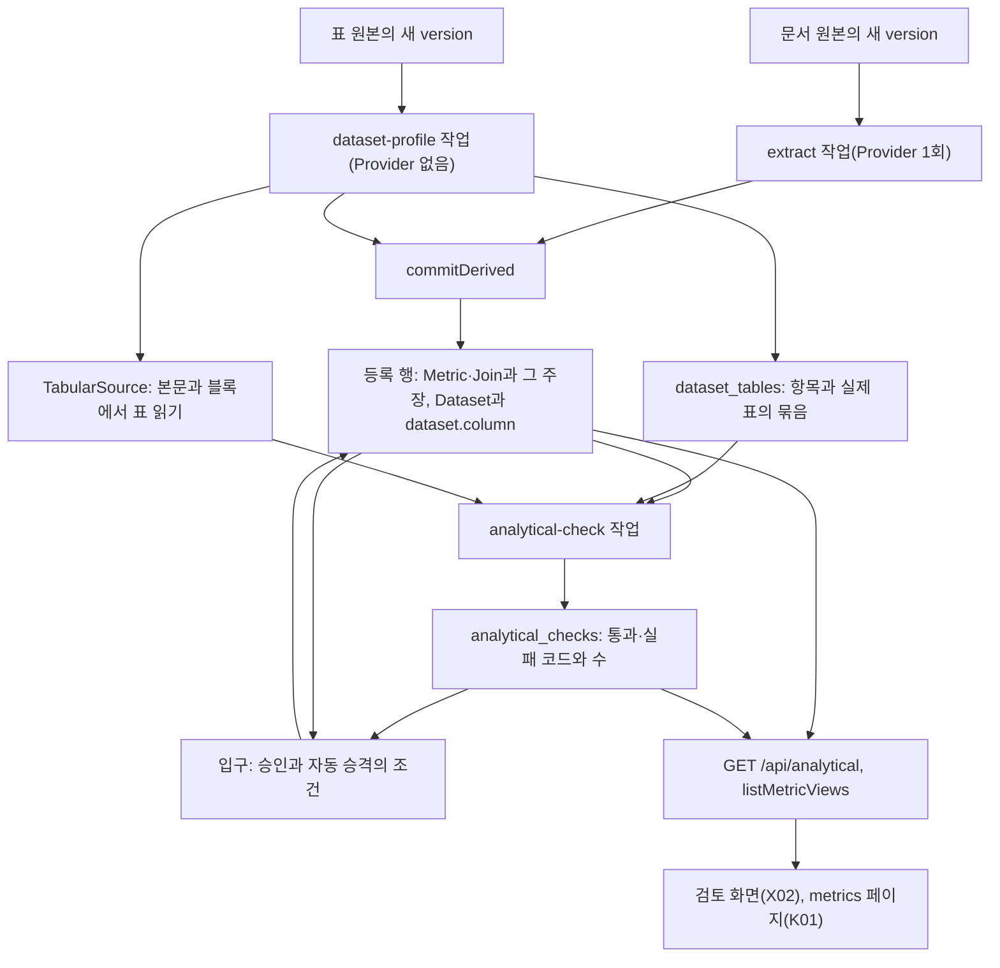
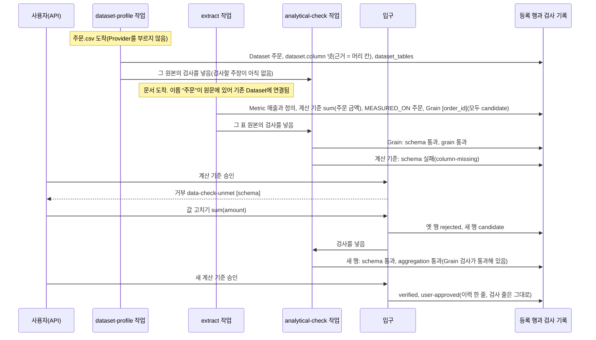
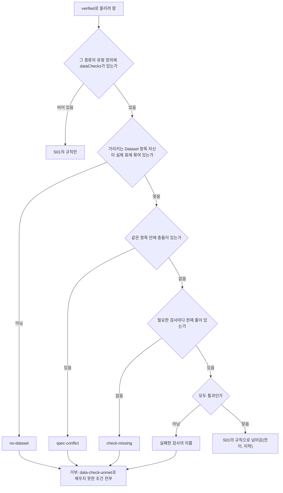
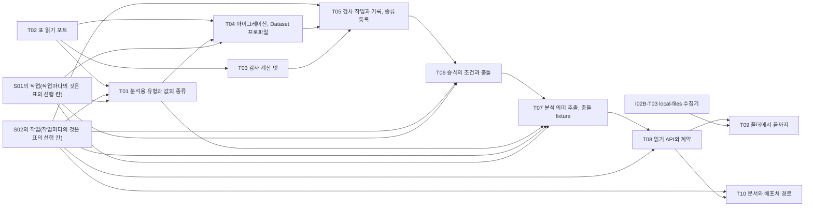

# 스펙: S03 분석 의미(Analytical Semantic) 후보와 데이터 근거 검증

- 날짜: 2026-11-22 / 상태: 확정(잠정 결정 포함)
- 관련: 이슈 #24(S03), 총괄 #1(설계 분석 8번), Phase 3 #5, 선행 #22(S01)·#19(I02)·#23(S02. 이슈의 선행 목록에는 없지만 S02의 spec이 먼저 확정되어 main에 있고 이 spec이 그 위에 선다), 후속 #25(K01, `metrics` 페이지가 이 spec의 Metric을 읽는다)·#31(X02, 검토 화면). [원 설계 6.5절](../design/original-design.md), [S01 spec](2026-11-22-S01-semantic-registry.md), [S02 spec](2026-11-22-S02-entity-resolution-temporal-graph.md), [I02-A spec](2026-11-21-I02-document-normalization.md), [I02-B spec](2026-11-22-I02-local-file-import.md), [I04 spec](2026-11-21-I04-invalidation.md), [V02 spec](2026-11-21-V02-vertical-slice.md), [ARCHITECTURE.md](../ARCHITECTURE.md), [ADR 0002](../adr/0002-authority-in-product-records.md)·[0003](../adr/0003-phase1-without-engine.md), [site-setup.md](../site-setup.md)
- 기준 코드: `origin/main` `10b508d`(코드). 그 뒤 main에 들어온 것 가운데 이 spec이 기대는 것은 S02의 spec 문서뿐이다(`7f594f3`). 이 문서가 코드에 대해 말하는 사실은 그 커밋을 읽어 확인했다(실행한 것은 아니다). S01의 구현은 아직 main에 없으므로 S01에 대한 것은 모두 S01 **spec의 문장**에 기댄다.

낯선 말은 [ARCHITECTURE 0절](../ARCHITECTURE.md#0-처음-나오는-말)과 [S01 spec의 머리 표](2026-11-22-S01-semantic-registry.md)에 풀이가 있다(등록 행, 입구, 상태, 인식 유형, 사용자가 정한 행, 유형 정의). 이 spec이 새로 쓰는 말은 아래와 같다.

| 말 | 뜻 |
|---|---|
| 분석 의미 | "매출은 주문 금액의 합계다", "주문 표는 주문 번호 하나가 한 줄이다" 같은, 숫자를 세고 더하는 데 쓰는 약속. 원 설계 6.5절의 Analytical Semantic |
| 표 원본 | 가져온 CSV 파일이나 XLSX 시트처럼 줄과 칸으로 된 원본. 이 spec에서 "실제 데이터"는 언제나 이것이다 |
| Dataset | 표 하나(CSV 파일 하나, 또는 XLSX의 시트 하나)를 가리키는 항목 |
| 실제 스키마 | 표 원본의 **현재 version**에서 읽은 머리 행의 열 이름들. 문서가 "이런 열이 있다"고 말한 것은 실제 스키마가 아니다 |
| Grain | 표의 한 줄이 무엇 하나를 뜻하는가. "주문 번호마다 한 줄"이면 Grain은 주문 번호 열이다. 그 열(들)의 값이 줄마다 달라야 한다 |
| Metric | 이름 붙은 지표(KPI) 하나. 정의(글)와 계산 기준(어느 표의 어느 열을 어떻게 모으는가)을 갖는다 |
| 계산 기준 | Metric의 사실 하나: 집계 방법 하나와 열 하나. `합계(금액)`, `줄 수`의 모양만 있다. 식이나 조건은 담지 못한다 |
| Join | 두 표를 어느 열끼리 맞대는가와, 맞댔을 때 한쪽 한 줄에 다른 쪽이 몇 줄 붙는가(cardinality) |
| 데이터 검사 | 주장(Grain, 계산 기준, Join)을 실제 표의 칸을 읽어 확인하는 정해진 계산 넷. 스키마, Grain, Join cardinality, 집계 |
| 분석 명세 | 한 Metric(또는 Dataset, Join)에 붙은, 값이 하나여야 하는 분석용 사실들을 모은 것. 같은 종류에 살아 있는 값이 둘이면 **충돌**이다 |
| 검사가 필요한 행 | 데이터 검사를 통과해야만 `verified`가 될 수 있는 등록 행. 그 종류의 유형 정의에 요구하는 검사가 적혀 있는 사실이다(S03-R13) |

비유로 말하면 문서는 "이 장부는 이렇게 읽는다"는 **설명서**이고 표 원본은 **장부 자체**다. 이 spec은 설명서의 말을 후보로 적어 두고, 장부를 펴서 맞는지 본 뒤에야 "확인됨"으로 올린다. 비유가 맞지 않는 곳: 제품은 장부의 합계를 **내지 않는다.** 설명서대로 셀 수 있는지만 본다.

## 배경

원 설계 6.5절은 문서나 정형 데이터에서 분석에 쓸 의미 정의가 발견되면 Dataset·Grain·Measure·Metric·Join 같은 것을 관리하되, **실제 데이터 스키마와 검증 근거가 없으면 Metric·Grain·Join을 확정하지 않으며**, 별도의 분석 플랫폼이나 SQL 생성 엔진은 만들지 않는다고 적었다. 총괄 이슈 #1의 설계 분석 8번도 같다: 분석용 Metric/Grain/Join은 실제 schema 근거 없이는 후보로 남기고 BI/SQL 엔진으로 넓히지 않는다. 이슈 #24는 이것을 세 기준(S03-C1~C3)으로 적었다.

**지금 있는 것**(origin/main `10b508d`의 코드를 읽어 확인했다).

- 항목·사실·관계 테이블과 근거 테이블이 있다(`storage/src/migrations.ts`의 v5, `storage/src/knowledge.ts`). 사실은 `(항목, 종류, 값)`이 같으면 같은 행이고, 다시 쓰면 근거만 더해진다(`saveUnique`의 `ON CONFLICT DO NOTHING`). 근거는 사실이나 관계만 가리킨다.
- 추출이 아는 유형은 항목 `Project`·`System`, 사실 `target_date`·`completion_date`, 관계 `DEPENDS_ON`뿐이고 코드 상수다(`providers/src/tasks.ts`, 추출 스키마 version 2).
- CSV와 XLSX를 글과 위치표로 바꾸는 모듈이 있다(`packages/document-normalize/src/formats/csv.ts`, `xlsx.ts`). 값이 있는 칸마다 블록 하나를 만들고 위치표가 CSV는 레코드·줄·칸 번호, XLSX는 시트 이름·칸 주소·행·열 번호를 갖는다. **머리 행을 따로 알아보지 않는다**(I02A-R13).
- 원본 version은 블록(JSON)과 부속 정보(`meta`)를 갖는다(`storage/src/migrations.ts`의 v16, `storage/src/sources.ts`). 블록의 모양은 계약에 있고(`packages/contracts/src/connector.ts`의 `NativeLocatorSchema`, `BlockSchema`), 근거를 읽으면 그 version의 블록에서 위치표를 계산해 준다(`storage/src/evidence-view.ts`의 `locatorAt`).
- 새 version이 저장되면 `extract` 작업 하나가 대기열에 들어간다(`backend/src/page-store.ts`). 추출은 본문이 2만 코드 포인트를 넘으면 Provider를 부르지 않고 보류한다(`knowledge-engine/src/extraction.ts`의 `MAX_EXTRACT_CODE_POINTS`).
- 파생물은 `commitDerived`로만 쓰고(fence, 계보, 범위 정책), 종류마다 파생물 등록부에 등록하며, 테이블마다 어느 종류의 것인지 분류한다(`storage/src/commit-derived.ts`, `knowledge-engine/src/canonical-kinds.ts`의 `CANONICAL_KINDS`, `backend/src/derivative-coverage.ts`의 `TABLE_CLASSIFICATION`).

**없는 것.**

1. **분석용 유형이 없다.** Dataset, Metric, Grain, Join을 적을 유형도, 그것을 추출하는 지시문도 없다.
2. **표 원본에서 스키마를 읽는 코드가 없다.** 정규화 모듈은 칸을 글로 바꿀 뿐 "이 줄이 머리 행이고 이 열의 이름은 무엇"이라고 답하지 않는다.
3. **정규화 모듈을 부르는 제품 코드가 없다.** `@pki/document-normalize`를 가져오는 곳은 그 패키지의 테스트와 도구 테스트뿐이다. 사용자의 CSV·XLSX 파일을 원본으로 들여오는 길(`local-files` 수집기)은 I02-B spec에 있고 구현(I02B-T02~T06)은 아직 main에 없다.
4. **주장을 실제 데이터로 확인하는 장치가 없다.** S01 spec의 승격 조건은 "서로 다른 원본 둘" 같은 근거의 수를 볼 뿐 표의 칸을 읽지 않는다. S01-R9는 "S03이 분석용 유형에 실제 스키마 검증을 더한다"고 자리를 비워 두었다.
5. **단위·통화·기간처럼 값이 하나여야 하는 것이 어긋날 때 그것을 보여 줄 곳이 없다.**

**선행 작업의 상태.** 이슈 #24의 선행은 #22(S01)와 #19(I02)다.

- **S01**: spec은 확정되었고 구현은 다른 세션이 진행 중이다. 이 spec은 S01 spec의 계약(입구, 이력, 사용자 조치, 유형 정의의 변경 경로, 자동 승격 조건 목록) 위에 쓴다. S01의 구현이 spec과 달라지면 고칠 자리를 "다시 확인할 것"에 모았다.
- **S02**: spec이 확정되어 main에 있고(구현은 아직 없다) **S02가 S03보다 먼저 합쳐진다.** 이 spec은 S02의 지식 스키마 목록과 `origin`(S02-R1, R3), 묶음을 읽는 곳 `EntityGroups`와 소속 변경 알림 `membershipChanged`(S02-R13), 나누기(S02-R15), 값이 어긋나는지를 판정하는 함수 `otherValidValues`(S02-R20), 합치기와 풀기가 어느 행의 상태도 바꾸지 않는다는 약속(S02-R12, 잠정 결정 21), ADR 0003의 4·5·6번 문장을 대체하는 S02의 ADR(S02-R27)에 기댄다.
- **I02**: I02-A(정규화 모듈)는 main에 있다. I02-B(파일·폴더 가져오기)는 spec만 있다. 이 spec의 표 읽기는 **이미 main에 있는 계약**(원본 version의 본문과 블록)만 읽으므로, 블록을 가진 version을 넣을 수 있으면 I02-B 없이도 테스트가 돈다. I02-B가 필요한 것은 "사용자의 폴더에서 표 원본이 실제로 들어오는" 끝에서 끝까지의 확인 하나다(S03-T09). 작업 분해는 I02-B를 기다리지 않는 작업이 먼저 가도록 나눴다.

**엔진 결정과의 관계.** S01과 같다. 항목·사실·관계 테이블이 엔진으로 넘어가면(가정 A09) S03-R1·R2의 저장 자리를 다시 정한다. ADR 0002는 근거와 지식 행, 사용자 교정을 제품의 정본으로 두었다. 데이터 검사의 기록은 그 행에 붙는 파생물이고 표 원본에서 다시 계산할 수 있으므로, 행이 어디에 있든 제품이 다시 만든다.

## 목표

1. 문서가 말한 KPI의 정의와 계산 기준이 후보 등록 행으로 남고, 그 행이 근거 문서의 구간과 실제 표의 머리 칸을 함께 가리킨다.
2. Grain, 계산 기준, Join cardinality는 실제 표의 현재 version으로 한 데이터 검사가 모두 통과한 때에만 `verified`가 된다. 사용자의 승인도 자동 승격도 같다. 통과하지 못한 승인은 채우지 못한 조건의 이름과 함께 거부된다.
3. 표가 바뀌거나 지워져 검사가 더는 성립하지 않으면 `verified`였던 행이 그대로 남지 않는다.
4. 한 Metric의 단위·통화·기간·정의 판이 서로 어긋나면 제품이 하나를 고르지 않고 충돌로 보이며, 충돌이 풀릴 때까지 그 Metric의 계산 기준은 `verified`가 되지 못한다.
5. 제품은 지표의 값을 계산해 돌려주지 않고, 질의나 식을 받지 않으며, SQL을 만들지 않는다.
6. 검토 화면이 부를 읽기 API와 그 계약이 있고, K01의 `metrics` 페이지가 같은 읽기 함수를 쓴다.
7. 위 기록은 모두 I04의 삭제·범위·fence 장치와 S01의 상태·이력·사용자 조치 장치 위에 있다.

## 비목표 (배포처에서 후속 진행)

**공용 저장소의 다른 작업으로 넘기는 것**

- 검토 화면(Metric 카드, 충돌 표시, 승인 단추): X02(#31). S03은 그 화면이 부를 API와 계약 테스트까지 만든다(잠정 결정 9).
- `metrics` Wiki 페이지의 글과 모양: K01(#25). S03은 그 페이지가 읽을 함수 하나를 내놓는다(S03-R19).
- 문서가 말한 Dataset과 실제 표에서 만든 Dataset이 같은 것임을 찾고 합치는 조치: S02(#23)의 개체 해소(S02-C2, S02-R11). S03은 합치는 조치를 만들지 않는다. 합쳐도 검사와 승격은 달라지지 않는다(S02가 합치기는 어느 행의 상태도 바꾸지 않는다고 정했다). 읽기가 "같은 묶음의 다른 항목에 실제 표가 있다"고 보여 줄 뿐이고, 주장을 그 표에 잇는 것은 사용자가 관계를 그 항목으로 고치는 일이다(S03-R8).
- 서로 어긋나는 값을 **찾아서 이의를 거는** 일반 규칙, 판 사이의 선후(SUPERSEDES), 유효 시각의 구간: S02(#23)의 S02-C3. S03은 분석용 종류의 충돌을 **보이고 승격을 막는 것**까지, 그리고 실제 표가 주장을 뒷받침하지 않게 되었을 때의 이의까지 한다(S03-R9, R16). 무엇이 충돌인지는 S02의 판정을 그대로 쓴다.
- 6.5절의 "Entity"와 "Business Rule": S02가 더하는 항목 유형이다. Dataset이 어떤 개체를 담는지, Metric이 어느 업무 규칙을 따르는지를 잇는 관계 유형은 S02의 유형이 생긴 뒤 유형 정의 변경 경로(S01-R19)로 하나씩 더한다.
- 폴더에서 CSV·XLSX를 들여오는 길 자체: I02-B(#19).
- 백업·복원 뒤의 검사 기록: H01(#32). 검사 기록은 다시 계산할 수 있어 복원 뒤 검사 작업이 다시 만든다.

**하지 않는 것**

- 지표 값의 계산, 차트, 대시보드, 질의 화면, SQL이나 다른 질의 언어의 생성과 실행. 데이터 검사는 "셀 수 있는가"를 볼 뿐 값을 내지 않는다(S03-R18).
- 식으로 된 지표(비율, 차이, 조건 붙은 합계). 계산 기준은 `집계(열 하나)` 모양뿐이다. 그 모양에 들지 않는 지표는 정의(글)만 가진 후보로 남는다(잠정 결정 4).
- 단위 환산과 환율(`천원`과 `원`을 같은 것으로 보기). 글자가 다르면 다른 값이다.
- 표의 열 이름이나 칸의 값을 **다른 원본의** 추출 요청에 실어 LLM이 열을 맞추게 하는 일(잠정 결정 6). 표 원본 자신의 `extract` 요청에는 지금도 그 본문이 실린다(S03-R7).
- 한 시트 안의 표 여럿, 머리 행이 두 줄인 표, 피벗 모양의 표. 표로 보지 않는다(S03-R5).
- 데이터베이스, 웨어하우스, BI 도구에 접속해 스키마를 읽는 일. 실제 스키마는 가져온 파일에서만 온다.

**배포처 후속 항목**(1개. [site-setup.md의 배포처 설정 체크리스트](../site-setup.md#배포처-설정-체크리스트)와 번호로 대응한다. **번호는 잠정이고 조정자가 합치는 순서에 맞춰 다시 배정한다.** S32는 S01이, S33은 S02가 잡았다. 그 번호가 이미 쓰였으면 합칠 때 다시 매긴다)

| 번호 | 항목 | 왜 배포처인가 |
|---|---|---|
| S34 | 설치본, 실제 Provider, 실제 표 자료로 분석 의미 추출·Dataset 프로파일·데이터 검사를 실행하고, 프로파일(`analytical.profile`)을 켤지와 한도(`analytical.maxCells`)의 값을 정한다 | 프로파일은 가져온 모든 표에서 머리 행을 짐작하는 규칙이다. 실제 스프레드시트에서 표가 아닌 것을 표로 잡는 비율과 큰 시트에서 걸리는 시간을 재기 전에는 꺼 둔다(S03-R6). 공용 저장소에는 실제 자료도 실제 Provider도 없다 |

## 요구사항

요구사항 번호는 `S03-R<n>`이다. 다른 spec의 번호는 `S01-R9`, `I04-R11`처럼 작업 코드를 붙인다.

### 등록 행과 유형

- **S03-R1 분석 의미는 등록 행이다.** 새 지식 테이블을 만들지 않는다. Dataset, Metric, Join은 항목이고 그 속성은 사실, 그 사이의 이음은 관계다. 그래서 상태, 이력, 사용자 조치, 취소, 근거, 삭제, 범위가 S01과 I04의 것 그대로 적용된다. 원 설계 6.5절의 목록은 아래처럼 대응한다.

  | 6.5절의 것 | 어디에 있는가 |
  |---|---|
  | Dataset | 항목 유형 `Dataset` |
  | Entity | S02의 항목 유형(비목표) |
  | Grain | `Dataset`의 사실 `dataset.grain`(열 묶음) |
  | Fact(사실 표) | `Dataset`의 사실 `dataset.role` = `fact`. 항목 유형 `Fact`를 만들지 않는다(S02의 지식 유형 `Fact`와 이름이 겹친다) |
  | Dimension | `Dataset`의 사실 `dataset.role` = `dimension`, 열 단위로는 `dataset.dimension` |
  | Measure | `Dataset`의 사실 `dataset.measure`(열) |
  | Metric | 항목 유형 `Metric` |
  | Aggregation Rule | `Metric`의 사실 `metric.calculation`(집계 방법과 열) |
  | Join Relationship | 항목 유형 `Join`과 그 사실 `join.keys`, `join.cardinality`, 관계 `JOIN_LEFT`, `JOIN_RIGHT` |
  | Time Dimension | `Dataset`의 사실 `dataset.time_dimension`(열), `Metric`의 사실 `metric.period` |
  | Business Rule | S02의 항목 유형(비목표). KPI의 계산 기준을 말한 글은 `Metric`의 `definition`(S01-R3) |
  | Dataset Mapping | 관계 `MEASURED_ON`(Metric → Dataset)과, Dataset 항목을 실제 표에 묶는 확장 테이블 `dataset_tables`(S03-R6) |
  | (표의 열) | `Dataset`의 사실 `dataset.column`. 프로파일이 머리 칸에서 읽어 쓴다 |

  확장 테이블은 둘뿐이다: `dataset_tables`(항목과 실제 표의 묶음)와 `analytical_checks`(데이터 검사의 기록, S03-R11). 둘 다 지식을 담지 않는다.
- **S03-R2 유형 정의.** 아래를 유형 정의(S01-R18)의 처음 값으로 더한다. 모두 `verified`이고 **`origin`은 `seed`다**(S02-R3).
  - **S02의 목록에 들어간다.** 이 이름들을 S02-R1의 지식 스키마 목록에 더하고 그 판 번호를 올리며, S02의 `schema.catalogue` 시험이 세는 수를 그 판의 수로 고친다. S02의 `origin` 채우기는 제품의 seed 상수 전체(이 이름들이 든 것)를 열쇠로 삼으므로 합치는 순서가 바뀌어도 이 이름들이 `user`로 채워지지 않는다. S03의 마이그레이션은 줄을 넣을 때 `origin`을 `seed`로 적는다.
  - 마이그레이션은 줄을 직접 넣는다(S02-R2와 같다). 시험이 S02 수준의 데이터베이스에서 같은 변경을 S01-R19의 검사 함수에 넣어 모두 `applicable`임을 보인다. 같은 이름의 유형 정의가 이미 있으면 건드리지 않는다.
  - **`dataset.column`은 추출하지 않는 seed다.** 목록의 그 이름에 "추출하지 않음" 표시를 둔다. 지시문·응답 스키마·목록·seed가 같은지 대조하는 시험(S01-R18, S02-R4)은 그 표시가 있는 이름을 지시문과 응답 스키마 쪽에서 빼고 견준다.

  | 종류 | 이름 | 규칙 | 요구하는 검사(`dataChecks`, S03-R13) |
  |---|---|---|---|
  | 항목 유형 | `Dataset`, `Metric`, `Join` | — | — |
  | 사실 종류 | `dataset.column` | `Dataset`, 값의 종류 `header`, 여럿. **프로파일만 쓴다**(S03-R6) | 없음 |
  | 사실 종류 | `dataset.role` | `Dataset`, `dataset-role`, 하나 | 없음 |
  | 사실 종류 | `dataset.grain` | `Dataset`, `column-set`, 하나 | `schema`, `grain` |
  | 사실 종류 | `dataset.measure`, `dataset.dimension`, `dataset.time_dimension` | `Dataset`, `column`, 여럿 | `schema` |
  | 사실 종류 | `metric.calculation` | `Metric`, `calculation`, 하나 | `schema`, `aggregation` |
  | 사실 종류 | `metric.unit`, `metric.version` | `Metric`, `text`, 하나 | 없음 |
  | 사실 종류 | `metric.currency` | `Metric`, `currency`, 하나 | 없음 |
  | 사실 종류 | `metric.period` | `Metric`, `period`, 하나 | 없음 |
  | 사실 종류 | `join.keys` | `Join`, `key-pairs`, 하나 | `schema` |
  | 사실 종류 | `join.cardinality` | `Join`, `join-cardinality`, 하나 | `join-cardinality` |
  | 관계 유형 | `MEASURED_ON` | `Metric` → `Dataset`, 대칭 아님 | — |
  | 관계 유형 | `JOIN_LEFT`, `JOIN_RIGHT` | `Join` → `Dataset`, 대칭 아님 | — |
  | 관계 유형 | `USES_JOIN` | `Metric` → `Join`, 대칭 아님 | — |

  S01의 사실 종류 `definition`과 `alias.*`가 붙을 수 있는 항목 유형에 `Metric`, `Dataset`을 더한다(넓히는 변경이라 S01-R19의 영향 검사에 걸리지 않는다).
- **S03-R3 값의 종류.** S01-R18의 값의 종류 목록에 아래 아홉을 더한다(S01의 `date`, `text`, `surface-form`, S02의 `identifier` 뒤에). 종류마다 코드에 정규화 함수 하나가 있고, 정규화되지 않는 값은 쓰기 전에 버려진다(S01-R21의 "값의 종류에 맞아야 한다"). 여러 조각으로 된 값은 **키를 정렬한 JSON 글**로 저장한다(같은 뜻이면 같은 글자열이 되어 같은 행 규칙이 그대로 선다).

  | 값의 종류 | 받아들이는 것 | 저장하는 모양 |
  |---|---|---|
  | `header` | 표의 머리 칸의 글 하나(코드 포인트 200 이하). 프로파일이 쓴다 | 가공한 열 이름 |
  | `column` | 비어 있지 않은 열 이름 하나(코드 포인트 200 이하) | 가공한 열 이름 |
  | `column-set` | 열 이름 하나 이상, 가공 뒤 겹치지 않음 | 가공한 이름을 정렬한 JSON 배열 |
  | `calculation` | 집계 방법 하나(`sum`, `count`, `count_distinct`, `avg`, `min`, `max`)와 열 이름 하나. `count`는 열 없이도 된다(줄 수) | `{"aggregation":…,"column":…}`(열은 가공한 이름) |
  | `key-pairs` | (왼쪽 열, 오른쪽 열) 쌍 하나 이상 | 가공한 이름의 쌍을 정렬한 JSON 배열 |
  | `join-cardinality` | `one-to-one`, `many-to-one`, `one-to-many`, `many-to-many` | 그 글 |
  | `period` | `day`, `week`, `month`, `quarter`, `year` | 그 글 |
  | `currency` | ISO 4217의 세 글자 통화 코드(실행 환경이 아는 목록 `Intl.supportedValuesOf("currency")`) | 대문자 |
  | `dataset-role` | `fact`, `dimension` | 그 글 |

  - **`header`를 `column`과 따로 둔 까닭.** `column`은 "이런 열이 있다"는 **주장**이라 `schema` 검사를 요구한다(S03-R13). `header`는 프로파일이 머리 칸에서 읽은 **실제**라서 검사할 것이 없다. 둘을 한 종류로 두면 열 사실마다 자기 자신을 확인하는 검사 줄이 생긴다. 사용자가 `header` 값의 종류로 새 종류를 더하거나 `dataset.column`을 직접 추가할 수는 있지만(S01의 일반 규칙), 스키마 검사는 **머리 칸에 현재 근거가 있는** 열 사실만 실제 열로 본다(S03-R8의 4).
  - **식은 값이 아니다.** `calculation`의 정규화는 위 모양이 아닌 것(두 열, 연산자, 조건, 중첩된 집계, 질의 문장)을 모두 거부한다.
  - **열 이름은 가공한 모양으로 저장한다.** 가공은 V02-R7의 것이다(유니코드 정규화, 대소문자 통일, 공백 정리). 그래서 `Amount`와 `amount`는 같은 값이고 같은 행이다. 사람이 읽을 원래 글자는 머리 칸의 근거(인용문)에 있다.
  - **수와 날짜의 문법**(S03-R5의 머리 행 판정과 S03-R10의 집계 검사가 같은 함수를 쓴다). 칸의 글에서 앞뒤 공백을 뗀 뒤 견준다.
    - 수: `^[+-]?(\d+(\.\d*)?|\.\d+)([eE][+-]?\d+)?$`. `1000.50`, ` 42`, `-3`, `1e3`, `1e+21`은 수다. `1,000`, `₩1000`, `10%`, `NaN`, `Infinity`, 빈 글은 수가 아니다.
    - 날짜: `^\d{4}-\d{2}-\d{2}([T ]\d{2}:\d{2}(:\d{2}(\.\d+)?)?(Z|[+-]\d{2}:\d{2})?)?$`이고 달력에 있는 날. `2024-01-31`, `2024-01-31T09:00:00.000Z`는 날짜다. `2024/01/31`, `2024-02-30`, `20240131`은 날짜가 아니다(마지막 것은 수다).
    - XLSX의 수와 날짜는 I02A-R12가 이 모양으로 적는다. CSV의 칸은 원문 그대로이므로(I02A-R13) 이 문법에 맞는 것만 수와 날짜다.

### 실제 스키마

- **S03-R4 표 읽기는 포트 하나다.** 원본 version 하나에서 표를 읽는 일은 `TabularSource`(아래 "표 읽기 포트") 하나를 지난다. 구현은 하나다: 정본에 저장된 그 version의 **본문과 블록**을 읽는 것. 블록의 위치표가 `csv`(레코드·칸 번호)이거나 `xlsx`(시트·행·열 번호)인 version만 표 원본이다. 이 포트는 파일을 열지 않고 `@pki/document-normalize`를 부르지 않는다. 표 원본을 정본에 넣는 일은 I02의 것이다.
  - 포트의 계약 테스트 묶음을 `packages/testkit`에 둔다. 실제 구현과 테스트용 대역(메모리의 표)이 같은 입력에 같은 모양의 결과를 낸다.
  - I02가 블록의 모양(위치표의 필드, 칸을 잇는 구분자)을 바꾸면 이 포트의 구현 하나만 고친다.
  - 결과는 그 version의 한계 표시(`meta`의 `limitations`)를 함께 싣는다. I02-A의 한계 표시는 **통합 문서 단위**라서(어느 시트가 숨겨졌는지, 어느 시트에 병합된 칸이 있는지 말하지 않는다) 그 문서의 표 모두에 같은 목록이 붙는다.
- **S03-R5 표로 보는 규칙.** CSV는 파일 하나가, XLSX는 시트 하나가 표의 후보다. 아래를 모두 채워야 표다. 못 채우면 표로 보지 않고 사유 코드를 돌려준다(`no-header`, `no-rows`, `too-large`).
  1. **머리 행**: 값이 있는 칸이 둘 이상인 첫 행이 **유일한 후보**다. 칸의 글이 가공 뒤 서로 다르고 어느 칸도 수나 날짜(S03-R3의 문법)가 아니면 머리 행이다. 그 위의 행(제목 한 칸 같은 것)은 버린다. 후보가 어긋나면 아래 행을 더 찾지 않고 `no-header`(잠정 결정 21).
  2. **자료 행**: 머리 행 아래에서, 머리 행의 열 범위 안에 값이 있는 칸이 하나라도 있는 행. 하나도 없으면 `no-rows`. 머리 행의 열 밖에 있는 칸은 읽지 않고 그 수를 센다.
  3. **크기**: 표의 칸 수가 설정 `analytical.maxCells`(기본 200,000) 이하. 넘으면 `too-large`. 이 한도는 프로파일과 검사가 하는 일의 양을 묶을 뿐이다. 판정하려면 그 version의 블록 JSON을 먼저 읽어야 하므로 **메모리의 최대치는 묶지 못한다**(미검증 범위).

  한 시트에 표는 하나다. 병합된 칸과 수식은 한계 표시 그대로 결과에 싣고 표 판정을 바꾸지 않는다. **숨긴 시트도 표가 될 수 있다**: I02-A는 숨긴 시트의 칸도 블록으로 내고 한계 표시는 어느 시트가 숨겨졌는지 말하지 않으므로 이 규칙은 가려낼 수 없다. 그 통합 문서의 Dataset마다 `xlsx.hidden-sheet` 표시가 읽기에 실린다(알려진 한계).
- **S03-R6 Dataset 프로파일.** 표 원본의 새 version마다 작업 `dataset-profile` 하나가 대기열에 들어간다(표 원본이 아닌 version에는 만들지 않는다). 이 작업은 **Provider를 부르지 않는다.** 추출의 2만 코드 포인트 한도와 무관하게 돈다.
  - 표마다 `Dataset` 항목 하나를 만든다. 이름은 CSV면 원본의 제목, XLSX면 **언제나** `제목:시트 이름`이다(그 version에 표인 시트가 몇인지에 따라 달라지지 않는다. 항목을 다시 쓸 때 이름이 흔들리지 않게 한다).
  - 머리 칸마다 사실 `dataset.column`(값은 가공한 열 이름)을 쓰고, **근거는 그 머리 칸의 구간**이다. 그래서 근거 API가 그 열의 자리(시트와 칸 주소, 또는 레코드와 칸 번호)와 원래 글자를 답한다.
  - `dataset_tables`에 (항목, 원본, 표의 열쇠, 자료 행 수)를 적는다. 표의 열쇠는 XLSX면 시트 이름, CSV면 빈 글이다. `(원본, 표의 열쇠)`는 하나뿐이다. 같은 원본의 다음 version에서 같은 열쇠의 표는 **같은 Dataset 항목**을 다시 쓴다.
  - **묶음은 원본을 따른다.** `dataset_tables`의 줄은 항목이 지워질 때뿐 아니라 **그 원본이 지워질 때**(tombstone) 지워진다(S03-R17). 항목이 다른 원본의 행에 붙들려 남아도 묶음은 남지 않는다.
  - 쓰기는 `commitDerived`를 지난다(I04-R11). 행은 `candidate`·`explicit`으로 생기고 이력의 주체는 `extraction`이며 confidence는 비운다. 쓰기 전에 유형 정의에 맞추는 검사(S01-R21)를 그대로 지난다.
  - 다음 version에서 사라진 열의 사실은 현재 근거를 잃어 기존 전파가 `superseded`로 바꾼다(V02-R11). 이 spec은 그 전파를 고치지 않는다. 그 전파는 version을 저장할 때 돌므로(`backend/src/page-store.ts`), 새 version마다 모든 열의 사실이 물렸다가 프로파일이 근거를 붙이면 돌아온다. 열마다 이력이 두 줄씩 는다(알려진 비용. 잠정 결정 15).
  - **설정 `analytical.profile`이 켜져 있을 때만 돈다. 기본값은 꺼짐이다**(잠정 결정 5). 꺼져 있으면 작업을 만들지 않는다. **꺼짐에서 켜짐으로 바꾸는 설정 변경은** 그때 있는 표 원본 모두의 현재 version에 프로파일 작업을 넣는다(그 version이 fence다). 켜기 전에 가져온 표가 파일이 바뀔 때까지 빠져 있지 않게 한다.
  - 프로파일이 끝나면 그 원본에 대한 검사 작업(S03-R12)을 넣는다.

### 추출과 연결

- **S03-R7 추출 응답 스키마 5.** `extract` 작업의 스키마 version을 5로 올린다(S01이 3, S02가 4. 잠정이고 그 번호가 이미 쓰였으면 합칠 때 다시 매긴다).
  - 항목 유형에 `Dataset`, `Metric`, `Join`을, 사실 종류에 S03-R2의 것 가운데 `dataset.column`을 뺀 전부를, 관계 유형에 S03-R2의 넷을 더한다. KPI의 정의 글은 S01의 `definitions`로 온다(항목이 `Metric`). 지시문과 응답 스키마의 이름은 S02-R4대로 고정된 코드 상수이고 `origin`이 `seed`인 것뿐이다.
  - 사실마다 인용문이 있고 코드가 원문에서 그 자리를 찾는다(V02-R6 그대로). `metric.unit`과 `metric.version`의 값은 **인용문 안에 글자 그대로** 있어야 하고 없으면 버린다(코드 포인트 40 이하).
  - **열을 가리키는 값의 인식 유형.** `column`, `column-set`, `calculation`, `key-pairs` 값의 열 이름이 모두 인용문 안에 글자 그대로(가공 뒤 비교) 있을 때만 응답의 `explicit`을 받아들인다. 하나라도 없으면 코드가 `hypothesis`로 낮춘다. 문서의 "주문 금액"을 열 `amount`로 옮긴 것은 모델의 짐작이기 때문이다. `hypothesis`는 자동으로 승격되지 않는다(S01-R9의 2).
  - 원본 version 하나에 Provider 호출 1회라는 한계(ADR 0003의 1번)는 그대로다. 응답 안의 글은 자료일 뿐 지시가 아니다.
  - **표의 열 이름과 칸의 값은 다른 원본의 요청에 싣지 않는다.** 연결 후보로 나가는 것은 지금처럼 항목의 이름과 `verified` 표기뿐이다(S01-R16). Dataset 항목의 이름도 그 길로 나간다.
  - **표 원본 자신의 추출에서는 분석용 결과를 쓰지 않는다.** 표 원본도 지금처럼 `extract` 작업을 받고, 2만 코드 포인트 이하이면 동의 아래 그 본문(머리 칸과 칸의 값)이 Provider로 나간다(지금 코드의 동작이고 이 spec은 바꾸지 않는다. 미해결 질문 3). 그 응답에 든 `Dataset`·`Metric`·`Join` 항목과 분석용 사실·관계는 쓰기 전에 버리고 버린 수(`dropped_other`)에 센다. **버린 항목을 가리키는 것도 함께 버린다**: 그 항목에 붙은 정의와 표기(S01의 `definitions`, `terms`), 그 항목이 한쪽 끝인 관계(S02의 관계 유형 포함)다. 가리킬 항목이 없는 행은 쓸 수 없다. 응답의 나머지(다른 유형의 항목과 그 사실·관계)는 그대로 쓴다. 표의 스키마는 프로파일이 읽고, LLM이 표를 보고 낸 Grain이나 계산 기준은 문서가 말한 것이 아니다. 같은 저장에서 두 작업이 함께 들어가므로, 버리지 않으면 순서에 따라 같은 표의 Dataset 항목이 둘 생긴다(잠정 결정 16).
- **S03-R8 근거와 실제 스키마의 연결.** 한 Metric에서 아래가 모두 읽힌다(S03-R19의 읽기가 한 번에 돌려준다).
  1. 정의와 계산 기준의 **근거 문서**: 그 사실들의 근거(원본 version과 구간). 기존 근거 테이블 그대로다.
  2. **Dataset**: 살아 있는 `MEASURED_ON` 관계의 대상 항목.
  3. **실제 표**: **그 Dataset 항목 자신의** `dataset_tables` 줄로서 그 원본에 tombstone이 덮지 않은 현재 version이 있는 것. 없으면 "실제 표 없음"이다(문서가 이름만 말한 Dataset, 또는 표 원본이 지워진 Dataset).
  4. **열의 대응**: 계산 기준이 가리키는 열 이름과 같은 값의 `dataset.column` 사실(현재 근거가 그 표의 현재 version의 머리 칸에 있는 것). 있으면 그 사실의 ID를, 없으면 `column-missing`을 답한다.

  **검사와 승격은 항목 하나를 본다. 묶음은 보여 줄 때만 본다.** S02-R13은 뒤의 spec이 묶음을 한 항목으로 볼지 구성원마다 볼지를 스스로 적으라고 했다. S03의 답: 데이터 검사(S03-R10), 검사의 기록(S03-R11), 승격의 조건(S03-R14, R15), 판정(S03-R16)은 **구성원마다 따로** 본다. `MEASURED_ON`의 대상, 그 항목의 실제 표와 열과 Grain, `Join`의 양쪽을 모두 그 항목 자신의 것으로만 센다. 합치기와 풀기는 어느 행의 상태도 바꾸지 않는다는 S02의 약속(S02-R12, 잠정 결정 21)을 지키려면, 상태를 바꾸는 판정이 묶음에 기대면 안 된다: 합친 표에 기대어 승격된 행은 풀 때 기댈 곳을 잃는다. 읽기 API만 `EntityGroups`로 묶음을 읽어, 그 Dataset에 실제 표가 없을 때 **같은 묶음의 다른 구성원에 실제 표가 있으면 그 항목을 함께 답한다**(S03-R19).

  문서가 말한 Dataset과 프로파일이 만든 Dataset을 잇는 길은 둘이다: ① 문서가 그 이름이나 `verified` 표기를 글자 그대로 쓰면 추출이 기존 항목에 연결한다(V02-R7, S01-R16) ② 사용자가 실제 표의 Dataset으로 향하는 `MEASURED_ON` 관계를 직접 추가하고(S01-R7) 옛 관계를 기각한다. 두 Dataset 항목을 합치는 것(S02-R11)은 ②에서 고를 항목을 읽기가 알려 주게 할 뿐 그 자체로 잇지 않는다(잠정 결정 19).

  **합칠 때는 실제 표가 있는 Dataset을 대표로 둔다.** S02에서 합친 뒤의 추출은 **대표**에 쓰고 연결 후보도 구성원의 이름을 대표로 보낸다(S02-R13, R15). 실제 표가 있는 항목이 대표이면 그 뒤의 문서가 말한 `MEASURED_ON`은 실제 표가 있는 항목을 가리켜 ①의 길이 그대로 산다. 반대로 문서의 Dataset이 대표이고 실제 표의 Dataset이 구성원이면, 그 뒤의 모든 문서의 주장이 실제 표가 없는 대표에 붙어 `no-dataset`이 되고 ①의 길이 조용히 끊긴다. 제품은 이것을 막지 않고(대표를 고르는 것은 S02의 사용자 조치다) 읽기가 알린다(S03-R19).

### 충돌

- **S03-R9 분석 명세와 충돌.** 값이 어긋나는지는 S02의 함수 하나(`otherValidValues`, S02-R20)로 판정한다. 같은 종류·같은 꼬리표의 값이 다른 유효한 사실을 답하고 `SUPERSEDES`로 대신해진 사실은 뺀다. 이 함수는 어디까지 볼지를 인자로 받고, S03은 쓰는 자리마다 아래처럼 고른다.

  | 쓰는 자리 | 어디까지 보는가 | 까닭 |
  |---|---|---|
  | **승격의 조건 `spec-conflict`**(S03-R14, R15)와 검사 작업이 입력의 충돌로 계산을 건너뛸 때(S03-R12) | **같은 항목**(`'item'`). 자동 승격의 조건 5와 같다 | 상태를 바꾸는 판정이다. 묶음 전체로 보면 합치는 순간 조건이 달라져 합치기가 상태를 바꾸게 된다(S02 잠정 결정 21) |
  | **읽기 API의 충돌 목록**(S03-R19) | **묶음 전체**(`'group'`). S02의 충돌 규칙과 같다 | 보여 줄 뿐이다 |

  값이 하나여야 하는 분석용 종류(S03-R2의 "하나")에서 그 함수가 하나라도 답하면 충돌이다. S03은 그 위에 관계의 경우를 더한다. 승격의 조건에서는 **그 항목 자신의** 살아 있는 `MEASURED_ON` 대상이 서로 다른 항목으로 둘 이상인 것, `Join` 항목 자신의 `JOIN_LEFT`나 `JOIN_RIGHT` 대상이 그런 것이다. 읽기의 충돌 목록에는 묶음으로 본 같은 경우와, 한 묶음의 구성원 둘 이상에 실제 표가 있는 것이 더 나온다(이것들은 승격을 막지 않는다).
  - 제품은 충돌하는 값 가운데 **하나를 고르지 않고, 합치지 않고, 어느 것도 스스로 기각하지 않는다.**
  - 읽기 API가 항목마다 충돌 목록(종류와 그 행들의 ID)을 답한다.
  - **같은 항목 안에 충돌이 하나라도 있으면 그 항목의 검사가 필요한 행은 `verified`로 올라갈 수 없다**(S03-R14, R15의 `spec-conflict`). 단위가 `원`인지 `천원`인지 모르는 채로 계산 기준을 확정하지 않는다.
  - **이미 `verified`인 행은 충돌이 생겨도 S03이 건드리지 않는다.** 충돌 목록에 나올 뿐이고 상태는 그대로다(S03-R16). `verified`인 값과 어긋나는 값이 왔을 때 그 값에 이의를 거는 것은 S02-R20의 일이고(설정 `semantic.autoDispute`), 한 사건에 두 spec이 따로 이의를 걸지 않는다.
  - 푸는 것은 사용자다: 틀린 쪽을 기각하거나 값을 고친다(S01-R7). 유효한 값이 하나만 남으면 충돌이 사라진다.
  - 이슈가 이름 붙인 네 가지를 fixture로 고정한다: **단위**(`원`과 `천원`), **통화**(`KRW`와 `USD`), **기간**(`month`와 `quarter`), **version**. version은 둘을 다룬다: ㉮ 정의의 판(`metric.version`이 `v1`과 `v2`이고 유효 구간이 겹치거나 없는 것. 유효 구간이 겹치지 않으면 S02-R19가 `SUPERSEDES`로 보아 충돌이 아니다) ㉯ 표의 version(검사를 통과한 뒤 표 원본의 새 version에서 그 열이 사라지거나 Grain이 깨진 경우, S03-R16).

### 데이터 검사

- **S03-R10 검사 넷.** 모두 표 원본의 **현재 version**을 `TabularSource`로 읽어 하는 정해진 계산이고 Provider를 부르지 않는다. 결과는 통과나 실패(실패 코드)와 수 몇 개다.

  | 검사 | 대상 | 통과 조건 | 실패 코드 |
  |---|---|---|---|
  | `schema` | 열을 가리키는 사실 | 그 사실이 가리키는 Dataset이 실제 표에 묶여 있고, 가리키는 열이 모두 그 표의 머리 행에 있다(가공한 이름이 같음). `Metric`의 사실은 그 Metric의 하나뿐인 `MEASURED_ON` 대상, `Join`의 사실의 왼쪽 열은 `JOIN_LEFT` 대상, 오른쪽 열은 `JOIN_RIGHT` 대상에서 찾는다 | `no-table`, `column-missing` |
  | `grain` | 열 묶음을 Grain이라고 한 사실 | 자료 행마다 그 열에 빈 칸이 없고, 그 열 값의 묶음이 행마다 다르다 | `grain-empty`, `grain-duplicate` |
  | `join-cardinality` | Join의 cardinality를 말한 사실 | 그 Join의 하나뿐인 유효한 열쇠 사실(`join.keys`)의 열이 양쪽 표에 있고, 주장이 "하나"라고 한 쪽의 열쇠 값 묶음이 그 표에서 겹치지 않는다(`many-to-one`이면 오른쪽, `one-to-many`면 왼쪽, `one-to-one`이면 양쪽). 실제가 주장보다 더 엄격한 것은 통과다. `many-to-many`는 열쇠의 열만 있으면 통과다. 열쇠가 빈 행은 빼고 그 수를 센다 | `no-table`, `column-missing`, `join-not-unique` |
  | `aggregation` | 계산 기준 | ① `sum`·`avg`·`min`·`max`면 그 열의 비어 있지 않은 칸이 모두 수다(S03-R3의 문법) ② 그 Dataset에 Grain 검사가 필요한 유효한 사실이 하나 있고 그 `grain` 검사의 현재 줄이 통과다 ③ 그 Metric에 살아 있는 `USES_JOIN`이 있으면 Join마다 `join-cardinality` 검사의 현재 줄이 통과이고, Metric의 Dataset이 그 Join의 한쪽이며, `sum`·`count`·`avg`일 때 **맞은편의 열쇠가 겹치지 않는다**(겹치면 한 줄이 여러 번 세어진다) | `non-numeric`, `grain-unverified`, `join-unverified`, `fan-out` |

  수는 본 행의 수, 어긴 행의 수, 건너뛴 행의 수다. **칸의 값, 겹친 열쇠의 값, 합계는 결과에 없다.**
- **S03-R11 검사의 기록.** 결과는 `analytical_checks`에 사실 하나와 검사 하나마다 한 줄로 남는다: 대상 사실, 검사 이름, 통과 여부, 실패 코드, 수 셋, 읽은 표 원본 version(하나, Join이면 둘), 시각. 글이 없다.
  - **현재성.** 한 줄은 그것이 읽은 version이 모두 그 원본의 최신이고 tombstone에 덮이지 않았을 때만 **현재**다. 현재가 아닌 줄은 없는 것과 같다.
  - **다른 행이 바뀌면 지운다.** 한 검사가 읽는 **다른** 행(S03-R13의 "읽는 다른 행")이 생기거나, 상태가 바뀌거나, 근거를 얻거나 잃거나, 지워지면 그 검사 줄을 **같은 트랜잭션에서** 지운다. 낡은 결과로 승격되는 길을 없앤다.
  - **행이 다른 항목으로 옮겨져도 지운다.** S02의 나누기(S02-R15)는 사실과 관계의 항목 번호를 바꾸고 행의 번호는 그대로 둔다. 이 규칙이 없으면 옛 항목을 보고 통과한 줄이 현재로 남는다. S03은 S02의 소속 변경 알림(`membershipChanged`. 닿은 항목의 번호들과, 나누기면 옮긴 행의 번호들)을 받는 쪽 하나를 **구성 지점의 고정된 목록에 등록한다**(S02-R13). 받는 쪽이 하는 일은 둘뿐이다: ① 옮긴 행이 대상이거나 옮긴 행을 읽는 검사 줄, 닿은 항목의 사실이 대상인 검사 줄을 지운다 ② 그 항목들이 옮기기 전과 뒤에 닿는 표 원본의 검사 작업을 넣는다(S03-R12).
  - **받는 쪽은 어느 행의 상태도 바꾸지 않고 던지지 않는다.** S02는 받는 쪽이 지우거나 다시 계산하는 일만 하고, 삭제 전파 안에서 불려도 던지지 않음을 그 spec의 시험이 보이라고 했다(S02-R13). 그래서 이 받는 쪽은 S03-R16의 판정을 하지 않는다. 합치기, 풀기, 쉬거나 되살아남의 알림에는 지울 것이 없다(검사와 승격이 묶음을 보지 않는다. S03-R8). 그래도 같은 두 가지를 그대로 한다: 닿은 항목의 검사 줄을 지우고 작업을 넣는다. 알림의 종류를 가려 달리 움직이지 않게 해 두면 S02가 알림을 내는 조치를 더해도 낡은 줄이 남지 않는다.
  - **대상 자신의 상태와 근거가 바뀌는 것은 지우지 않는다.** 대상 사실의 승인, 자동 승격, 이의, 기각, 근거 추가는 그 사실의 검사 줄을 건드리지 않는다. 한 행의 값은 바뀌지 않으므로(값이 다르면 다른 행이다) 그 줄은 여전히 같은 주장에 대한 것이다. 그래서 승인한 직후에도 그 행의 검사 줄이 그대로 읽힌다.
  - 사용자 조치, 추출, 삭제 전파가 검사 줄을 지운 뒤에는 S03-R16이 정한 때에 판정을 한다(같은 트랜잭션이거나, 새 version의 전파이면 그 version의 추출 뒤). 소속 변경 알림이 지운 뒤에는 하지 않는다.
  - 대상 사실이나 읽은 version이 지워지면 줄도 지워진다(외래 키).
- **S03-R12 검사 작업.** 작업 `analytical-check`는 표 원본 하나를 이름으로 갖고 그 원본의 현재 version이 fence다. 그 원본의 Dataset들과, 거기에 `MEASURED_ON`·`JOIN_LEFT`·`JOIN_RIGHT`·`USES_JOIN`으로 닿는 Metric과 Join의 검사가 필요한 행 전부를 다시 검사하고 결과를 `commitDerived`로 쓴다.
  - 넣는 때: ① 그 원본의 프로파일이 끝남(프로파일이 꺼져 있어도 이미 묶음이 있는 원본의 새 version이 저장되면 넣는다. 앞 version에 매여 밀린 작업을 이 작업이 대신한다) ② 추출이나 전파가 그 원본에 닿는 분석용 행을 바꿈 ③ 사용자 조치가 그런 행을 바꿈 ④ 소속 변경 알림(`membershipChanged`)이 그 원본에 닿는 항목을 알림(S03-R11) ⑤ API 요청(S03-R19). 닿는 표 원본이 없으면 넣지 않는다. 그 경우의 판정은 작업이 아니라 S03-R16이 정한 자리가 한다.
  - 결과를 쓴 뒤 같은 트랜잭션에서 S03-R15와 R16의 판정을 한다.
  - **나누기로 표에 닿지 않게 된 행도 이 작업이 찾는다.** 표에 닿지 않게 된 행은 위의 "그 원본에 닿는 행"에 들지 않으므로, 작업은 S02의 나누기 기록(`item_split_moves`: 원래 항목, 새 항목, 옮긴 사실이나 관계. S02-R15)을 **읽기만** 해서 찾는다. 보는 줄은 둘이다: ㉮ 옮긴 것이 관계이고 그 대상이 이 원본에 닿는 항목(이 원본에 묶인 Dataset, 또는 그런 Dataset을 양쪽에 둔 Join)인 줄 ㉯ 옮긴 것이 검사가 필요한 사실이고 그 원래 항목이 이 원본에 닿는 줄. 그 줄들의 원래 항목과 새 항목에 있는 `verified`인 검사가 필요한 사실 가운데 조건 `no-dataset`이 참인 것을 S03-R16의 "표를 잃음"으로 판정한다. **기다리는 행**(S03-R16: 길이 전파에 물려 있고 마지막 이력이 전파의 물리기인 것)은 뺀다. 그것은 그 원본의 추출이나 삭제가 판정한다. 판정된 행은 더는 `verified`가 아니므로 같은 줄을 다시 읽어도 두 번 판정되지 않는다. S02의 기록은 고치지 않는다. **질의는 행에서 시작한다**: 먼저 `verified`이고 `no-dataset`인 검사가 필요한 사실을 찾고(보통 없거나 몇 개다), 그 항목이 나누기 기록에 있는지를 본다. 기록 전체를 훑지 않으므로 나누기 이력이 쌓여도 작업의 비용이 그만큼 늘지 않는다.
  - **그 검사의 입력이 충돌일 때만 계산하지 않는다.** 한 검사가 읽을 행을 하나로 정할 수 없으면 그 검사는 계산하지 않고 줄을 쓰지 않는다: `schema`와 `aggregation`은 그 Metric 자신의 `MEASURED_ON` 대상이 둘 이상일 때, `aggregation`은 그 Dataset의 Grain 사실이 같은 항목 안에서 어긋날 때와 쓰는 Join의 입력이 그럴 때, `join-cardinality`는 그 Join의 열쇠 사실이 어긋나거나 `JOIN_LEFT`·`JOIN_RIGHT` 대상이 둘 이상일 때다. 이 행들은 모두 그 검사가 "읽는 다른 행"(S03-R13)이라서, 충돌을 만든 변경이 그 검사 줄을 이미 지웠다(S03-R11). **단위·통화·기간·판의 충돌은 어느 검사의 입력도 아니므로 계산을 막지 않는다.** 그 충돌이 있어도 열이 사라지면 `schema`가 실패로 적히고 S03-R16이 움직인다.
  - **범위.** 검사 결과의 계보는 읽은 표 원본 version과 그 주장 행의 계보를 합친 것이다. 범위 정책이 그 묶음을 거부하면(`combinable`) 그 줄은 쓰지 않는다. 그 행은 "검사 없음"으로 남는다.
  - 표가 `too-large`면 그 표의 검사는 실패 코드 `too-large`로 남는다.
  - **따라가는 길은 정해진 둘뿐이다.** 검사와 읽기가 관계를 따라가는 모양은 `Metric → Dataset`(한 단계)과 `Metric → Join → Dataset`(두 단계) 둘이고 코드에 적힌 질의다. 재귀 질의와 일반 그래프 탐색을 만들지 않는다. ADR 0003의 6번 문장("관계 조회는 깊이 1 조인까지")은 **S02의 ADR이 대체한다**(S02-R27: 관계 탐색은 깊이 3까지. 6번을 대체하는 것은 그 ADR 하나다). 이 두 단계 질의는 그 안에 든다. S03은 ADR 0003에 따로 줄을 더하지 않고 S02의 ADR을 가리킨다.

### 승격의 조건

- **S03-R13 검사가 필요한 행은 유형 정의가 정한다.** 사실 종류의 규칙(S01-R18)에 선택 항목 `dataChecks`(검사 이름의 목록. 없으면 빈 목록)를 더한다. 목록이 비어 있지 않은 종류의 사실이 **검사가 필요한 행**이고, 그 목록의 검사가 **모두 현재이고 통과**일 때만 `verified`가 될 수 있다.
  - **입구는 종류의 이름을 보지 않는다.** 입구가 읽는 것은 그 행의 종류의 유형 정의에 적힌 `dataChecks`뿐이다. S01-R4("입구, 이력, 사용자 조치, 삭제 규칙은 항목 유형이나 사실 종류의 이름을 보지 않는다")는 그대로 선다. 어느 Dataset을 볼지 찾아가는 일(관계 유형의 이름을 아는 일)은 입구 밖의 분석 모듈이 한다.
  - **값의 종류가 요구를 정한다(유형 정의의 모양 검사, S01-R19의 2).** 아래에 맞지 않는 규칙은 `schema-invalid`다. 사용자가 유형 정의 변경 경로로 계산 기준 모양의 새 종류를 더해도 검사 없이는 만들 수 없다.

    | 값의 종류 | `dataChecks`에 반드시 있어야 하는 것 | 더 넣을 수 있는 것 |
    |---|---|---|
    | `column`, `key-pairs` | `schema` | — |
    | `column-set` | `schema` | `grain` |
    | `calculation` | `schema`, `aggregation` | — |
    | `join-cardinality` | `join-cardinality` | — |
    | 그 밖 | (비어 있어야 한다) | — |

  - 처음 값의 `dataChecks`는 S03-R2의 표에 있다. 검사가 읽는 다른 행은 아래와 같다(S03-R11이 이 칸을 쓴다).

    | 검사 | 읽는 다른 행 |
    |---|---|
    | `schema` | 그 항목의 `MEASURED_ON`(Metric일 때), `JOIN_LEFT`·`JOIN_RIGHT`(Join일 때), 그 Dataset의 열 사실 |
    | `grain` | 그 Dataset의 열 사실 |
    | `join-cardinality` | 그 Join의 열쇠 사실, `JOIN_LEFT`·`JOIN_RIGHT`, 양쪽 Dataset의 열 사실 |
    | `aggregation` | 그 Metric의 `MEASURED_ON`·`USES_JOIN`, 그 Dataset의 Grain 사실과 열 사실, 그 Join들의 열쇠·cardinality 사실과 `JOIN_LEFT`·`JOIN_RIGHT` |

  `dataChecks`가 빈 분석용 행(`dataset.column`, `dataset.role`, `metric.unit`, `metric.currency`, `metric.period`, `metric.version`, 정의)과 항목(`Dataset`·`Metric`·`Join`), 네 관계는 S01의 규칙만 따른다. **"Metric이 확정되었다"는 그 Metric의 계산 기준 사실이 `verified`라는 뜻이다**(잠정 결정 2). `Metric` 항목의 상태는 "그런 지표가 있다"까지만 말한다.
- **S03-R14 사용자의 승인도 검사를 지난다.** 검사가 필요한 행을 사용자가 승인하면(`candidate`·`disputed`·`superseded`·`rejected` 어디서든) 입구가 먼저 채우지 못한 조건을 센다. 하나라도 있으면 `data-check-unmet`으로 거부하고 그 목록을 돌려주며 아무것도 바꾸지 않는다.

  | 채우지 못한 조건 | 뜻 |
  |---|---|
  | `no-dataset` | 가리킬 Dataset 항목이 없거나, **그 항목 자신에게** tombstone이 덮지 않은 현재 version이 있는 원본으로의 묶음(`dataset_tables`)이 없다. 같은 묶음(S02)의 다른 구성원에 실제 표가 있는 것은 치지 않는다 |
  | `spec-conflict` | 그 항목(과 계산 기준이면 그 Dataset 항목의 Grain) **안에** 충돌이 있다(S03-R9의 `'item'`) |
  | `check-missing` | 필요한 검사의 현재 줄이 없다(아직 돌지 않았거나 낡았거나 범위 정책이 막았다) |
  | `schema`, `grain`, `join-cardinality`, `aggregation` | 그 검사의 현재 줄이 실패다 |

  - **직접 추가는 후보로 생긴다.** 검사가 필요한 종류를 사용자가 직접 추가하면 그 행은 `verified`가 아니라 `candidate`·`hypothesis`·`user_authored`로 생긴다(S01-R7의 "직접 추가는 `verified`로 생긴다"와 S01의 상태 그림의 `[*] --> verified`를 `dataChecks`가 있는 종류에서만 바꾼다). 검사가 통과한 뒤 승인하면 `verified`·`user-approved`가 된다.
  - **값 고치기**도 같다: 새 값의 행은 후보로 생기고, 옛 행은 S01-R7대로 물린다.
  - 사용자가 정한 행의 보호(S01-R12), 취소(S01-R8), 다시 추출해도 그대로(S01-R13)는 바뀌지 않는다.
- **S03-R15 자동 승격의 여섯째 조건.** S01-R9의 조건 목록에 `data-checks`를 더한다: 검사가 필요한 행이면 S03-R14의 채우지 못한 조건이 하나도 없어야 한다. 검사가 필요하지 않은 행에는 언제나 참이다. 자동 승격 자체는 S01의 설정 `semantic.autoVerify`(기본 꺼짐)를 따른다.
  - **이 조건은 올릴 때만 본다.** S01-R9는 자동으로 승격된 행이 조건 3이나 5를 잃으면 승격 직전의 상태로 되돌린다. 조건 6에는 그 되돌리기를 그대로 붙이지 않는다. 자동으로 승격된 행이 되돌아가는 것은 **S03-R16의 두 원인(검사 실패, 표를 잃음)일 때뿐**이다. `spec-conflict`와 `check-missing`은 새 승격만 막는다. 표의 새 version이 올 때마다 검사 줄이 잠깐 낡으므로(`check-missing`), 그것으로 되돌리면 다시 검사가 돌기 전의 판정마다 `verified`가 풀린다.
- **S03-R16 실제 표의 뒷받침을 잃은 `verified` 행.** `verified`인 검사가 필요한 행에 대해 제품이 움직이는 원인은 **표에서 온 둘뿐**이다.

  | 원인 | 언제 판정하는가 | 근거 번호 | 이력의 이유 코드 |
  |---|---|---|---|
  | **검사 실패**: 필요한 검사의 현재 줄이 실패다 | 검사 작업이 결과를 쓴 같은 트랜잭션 | 그 검사가 읽은 표 원본과 version | `data-check-failed` |
  | **표를 잃음**: `verified`인데 조건 `no-dataset`이 참이다 | 아래 ①~④ | ① 그 원본과 tombstone이 덮은 version ②③ 그 행이 닿던 Dataset 항목(끊긴 관계의 대상)의 표 원본과 그 현재 version ④ 그 검사 작업의 표 원본과 그 현재 version(작업의 fence) | `data-basis-lost` |

  **"표를 잃음"은 상태에서 읽는다.** 승격의 조건이 `no-dataset`을 막으므로, `verified`이면서 `no-dataset`이 참인 행은 닿던 표를 잃고 **아직 판정되지 않은** 행이다. 판정된 행은 `disputed`나 `candidate`가 되어 이 모양에서 벗어난다. 그래서 따로 적어 둔 표시 없이, 아래의 때마다 이 모양의 행을 찾아 판정하면 같은 행이 두 번 판정되지 않고, 한 번 놓친 행도 다음 때에 잡힌다.

  **기다리는 행.** 그 가운데 길(그 항목 자신의 `MEASURED_ON`·`JOIN_*`·`USES_JOIN`)이 **새 version의 전파에 물려** 끊긴 행은 그 문서의 추출을 기다린다. 이것도 적어 두지 않고 S01의 이력에서 읽는다: 그 관계의 상태가 `superseded`이고 **마지막 이력이 전파의 물리기**이며 **그 이력 줄의 근거 번호에 적힌 원본이 tombstone에 덮여 있지 않으면** 기다리는 행이고, 그 원본이 **기다리는 원본**이다(S01-R6이 물릴 때 그 원본과 새 version을 적는다).

  **같은 모양의 이력 줄을 삭제와 정리의 전파도 쓴다.** 전파의 물리기는 새 version, 원본 삭제, 이전 version 정리 셋 모두에서 같은 주체와 조치로 적히고 근거 번호만 다르다(새 version, tombstone이 덮은 version, 남긴 version: `knowledge-engine/src/canonical-kinds.ts`의 `basisOf`). 뒤의 둘은 기다림이 아니라 **잃음**이다. 돌아올 추출이 없다. 둘을 이렇게 가른다: 삭제가 쓴 줄은 그 원본이 tombstone에 덮여 있으므로 위의 조건에서 빠진다. 정리가 쓴 줄은 이력만으로는 새 version의 줄과 가를 수 없으므로, **정리의 전파가 자기가 물리거나 지운 길을 그 자리에서 판정한다**(아래). 그래서 정리가 물린 길을 가진 행이 `verified`인 채 기다리는 행으로 남는 일이 없다.

  **표를 잃음을 판정하는 때.**
  - ① **표 원본의 삭제**: 종류 `analytical-check`의 무효화가 그 원본의 묶음을 지우는 같은 트랜잭션(S03-R17).
  - ② **사용자 조치나 추출**이 그 행이 Dataset에 닿는 길을 끊은 때(`MEASURED_ON`이나 `JOIN_*`의 기각, 값 고치기로 물림): 그 변경의 같은 트랜잭션.
  - **그 길을 말한 원본이 지워지거나 정리된 때**(문서의 삭제, 문서의 이전 version 정리): 그 전파의 같은 트랜잭션에서, **사실과 관계와 항목의 종류가 모두 돈 뒤에** 종류 `analytical-check`가 판정한다(S03-R17). 그 전파가 길 관계를 지웠든(그 원본의 근거뿐이던 관계) 물렸든(다른 원본의 지난 근거가 남은 관계) 같다: 지운 길은 없는 길이고, 삭제가 물린 길은 tombstone 때문에 기다림이 아니다. 정리는 자기가 물리거나 지운 길과, **그 원본을 기다리던 행 가운데 정리로 길 관계가 지워진 것**(지난 version에만 근거가 있던 관계)을 판정한다. 정리 뒤에도 길 관계가 물린 채 남아 있는 기다리던 행은 그대로 기다린다(최신 version의 추출이 아직 답하지 않았다).
  - ③ **새 version의 전파가 그 길을 물린 때는 그 자리에서 판정하지 않는다.** 전파는 version을 저장할 때 돌아, 그 문서에서 온 관계를 다시 추출하기 **전에** 모두 물린다(V02-R11, `backend/src/page-store.ts`). 문서를 한 글자만 고쳐도 그렇다. 그 행은 기다리는 행이 된다. 판정은 **원본 단위**로 한다: **그 원본의 어느 version이든 추출이 결과를 쓴 트랜잭션의 끝**에서, 그 원본을 기다리는 행을 모두 본다. 관계가 되살아났으면(같은 말이 그 version에도 있으면) 더는 기다리는 행이 아니고 아무 일도 없다. 여전히 물려 있으면 그때 표를 잃은 것으로 판정한다. "물린 그 version의 추출"에 매지 않는 까닭: 그 추출이 더 새로운 version에 밀려(fence) 아무것도 쓰지 못하고 끝날 수 있고, 새 version이 그 말을 뺐으면 새 version의 전파는 새로 물릴 것이 없다. version에 매면 그 행을 볼 추출이 없다.
  - **기다리는 원본이 지워지면**(tombstone, 추출이 보류된 채여도) 그 삭제의 전파 안에서 그 원본을 기다리던 행을 판정한다. 문서가 사라졌으므로 그 말이 돌아올 길이 없다(tombstone이 덮은 원본은 기다리는 원본이 아니다). 위와 같은 자리에서 종류 `analytical-check`가 한다(S03-R17).
  - **그 원본의 추출이 한 번도 끝나지 않고 지워지지도 않는 동안**(보류: 2만 코드 포인트를 넘음, 동의 없음, Provider 없음)에는 판정하지 않는다. 문서가 그 말을 뺐는지 모르기 때문이다. 그동안 그 행은 `verified`이고 읽기에 `no-dataset`과 "추출을 기다림"이 보인다(알려진 한계. 2만 코드 포인트를 넘게 된 문서는 지우거나 줄이기 전까지 이 상태다).
  - ④ **나누기가 그 길을 끊은 때**(계산 기준이나 그 `MEASURED_ON`, `JOIN_*`, `USES_JOIN`을 다른 항목으로 옮김): 나누기의 트랜잭션에서는 판정하지 않고, 알림이 넣은 **검사 작업의 트랜잭션**에서 판정한다. 작업이 S02의 나누기 기록을 읽어 그 행을 찾는다(S03-R12). 나누기 직후부터 그 작업이 돌 때까지 그 행은 `verified`이고 읽기에 `no-dataset`이 보인다. 작업이 돌기 전에 표 원본이 지워지면 ①이 같은 기록을 읽어 판정한다(S03-R17).
  - **소속 변경 알림을 받는 쪽은 판정하지 않는다**(S03-R11). 받는 쪽은 지우고 넣기만 하고, 판정은 언제나 그것이 넣은 작업이 자기 트랜잭션에서 한다: 나누기가 Grain 같은 입력을 옮겨 검사가 깨진 것은 작업이 실패를 적으면서 첫째 원인으로, 닿는 표가 없어진 것은 ④로 잡힌다. **합치기와 풀기는 어느 쪽으로도 잡히지 않는다**: 검사와 승격이 항목 하나만 보므로 합치거나 풀어도 닿는 표가 달라지지 않고, 나누기 기록에도 줄이 생기지 않는다. 그래서 S02-R12(합치기와 풀기는 어느 행의 상태도 바꾸지 않는다)가 그대로 선다. 나누기는 사용자가 행을 실제로 다른 항목으로 옮기는 조치라서 그 약속의 대상이 아니다(잠정 결정 20).

  **어떻게 움직이는가.**
  - **사용자가 정한 행**이면 근거를 든 자동 이의(S01-R12의 3, `raiseDispute`)로 `disputed`가 된다. 값은 바꾸지 않는다. 결정은 사용자가 한다. 이력의 주체는 `policy`다.
  - **자동으로 승격된 행**이면 승격 직전의 상태(`candidate`)로 되돌아간다(S01-R5의 복원. 같은 이유 코드, 주체 `policy`).
  - **`spec-conflict`와 `check-missing`에는 움직이지 않는다.** 충돌은 보일 뿐이고(S03-R9. 어긋나는 값에 이의를 거는 것은 S02-R20이다), 검사 줄이 없을 뿐인 것은 다시 검사하면 된다. 그래서 결과가 작업이 언제 도는지에 달려 있지 않다.
  - **삭제와 정리의 판정은 전파가 지식 행을 다 고친 뒤의 상태를 본다.** 종류 `analytical-check`는 사실·관계의 종류(knowledge 층)와 항목의 종류(item 층) 뒤에 돈다(S03-R17). 그래서 판정하는 순간에는 길 관계가 이미 지워졌거나 물렸고, 표 원본의 삭제에서는 이 종류가 그 원본의 묶음을 스스로 지우므로, "`verified`인데 `no-dataset`이고 기다리는 행이 아님"을 그대로 읽으면 된다. 결과를 미리 셈하지 않는다.
  - 표가 바뀌었어도 새 version에서 검사가 모두 통과하면 상태는 그대로이고 이력이 늘지 않는다.

### 기존 장치 위에 얹기

- **S03-R17 삭제, 범위, 읽기.**
  - 새 종류 `analytical-check`를 파생물 등록부에 등록한다. **층은 `insight`다**: 전파는 층의 순서대로 돌고(`storage/src/derivatives.ts`의 `LAYERS`: source, evidence, knowledge, item, insight, …) 같은 층 안에서는 가리키는 종류보다 먼저 돈다(같은 파일의 `phaseOrder`). 이 종류를 knowledge 층에 두고 `fact`를 가리키게 하면 사실과 관계의 종류보다 **먼저** 돌아, 문서의 삭제가 길 관계를 지우거나 물리기 전의 상태를 보게 된다. item 층 다음 층에 두면 판정이 고쳐진 뒤의 상태를 본다. 검사 기록은 지식 행과 자료에서 계산한 것이라 층의 뜻에도 맞는다. 순서를 위한 새 장치는 만들지 않는다. **`analytical_checks`와 `dataset_tables` 둘 다 이 종류의 것**으로 분류한다(`TABLE_CLASSIFICATION`). 이 종류는 무효화 계약 묶음 ①~⑥을 통과한다.
  - **두 단계를 이렇게 쓴다.** 첫 단계(`affected`, 아무것도 지워지기 전)에 판정할 **후보**를 모으고, 그 후보가 그때 닿던 Dataset 항목의 표 원본과 현재 version을 함께 적어 둔다(뒤에 근거 번호로 쓴다). 둘째 단계(`invalidate`, knowledge 층과 item 층이 돈 뒤)에 후보 가운데 아직 있고 `verified`이며 `no-dataset`이고 기다리는 행이 아닌 것을 S03-R16대로 판정한다. 후보는 아래 줄들이 정한다. 새 version의 전파에서는 후보를 모으지 않는다(S03-R16의 ③).
  - **표 원본이 지워지면**(tombstone) 이 종류의 무효화가 ① 그 원본의 `dataset_tables` 줄을 모두 지우고 ② 그 원본의 version을 읽은 검사 줄을 지우며 ③ 영향을 받은 행에 S03-R16의 판정을 한다. **영향을 받은 행은 검사 줄에서 찾지 않는다**(새 version 뒤 다시 검사하기 전에는 줄이 낡았거나 없다). 지우기 전(종류의 첫 단계 `affected`)에 **관계를 따라** 모은다: 그 원본에 묶인 Dataset 항목의 검사가 필요한 사실, 그 항목을 `MEASURED_ON`·`JOIN_LEFT`·`JOIN_RIGHT`로 가리키는 Metric과 Join의 검사가 필요한 사실, 그 Join을 `USES_JOIN`으로 쓰는 Metric의 것. **따라가는 관계는 살아 있는 것과, 전파에 물려 기다리는 것**(S03-R16)이다: 기다리는 행도 닿던 표가 지워지면 여기서 판정된다. 사용자가 기각한 관계는 따라가지 않는다(그때 이미 판정되었다). **나누기 기록도 읽는다**: 옮긴 관계의 대상이 그 원본에 닿거나 옮긴 사실의 원래 항목이 그 원본에 닿는 `item_split_moves`의 줄에서, 그 원래 항목과 새 항목의 `verified`이고 `no-dataset`인 검사가 필요한 사실을 함께 모은다(S03-R12의 작업과 같은 질의. 읽기만). 나누기가 넣은 검사 작업이 돌기 전에 표가 지워지면 그 작업은 할 일이 없어지므로, 그 행을 볼 곳이 여기뿐이다. 지운 묶음과 검사 줄의 수는 무효화 기록(I04-R4)의 종류별 수에 들어간다. `dataset_tables`의 줄은 그 Dataset 항목이 지워질 때도 함께 지워진다.
  - **표가 아닌 원본이 지워져도 이 종류가 돈다.** 후보는 둘이다: ㉮ 길 관계(살아 있는 것과 물린 것)의 근거가 그 원본의 version에 있는 항목의 검사가 필요한 사실 ㉯ 그 원본을 기다리는 행(S03-R16). 근거 번호는 첫 단계에 적어 둔 표 원본과 그 현재 version이다.
  - **이전 version이 정리되면**(`old-versions-pruned`) 그 version을 읽은 검사 줄을 지운다. 원본에 현재 version이 남아 있으므로 묶음은 그대로다. **정리도 판정하는 때다.** 후보는 위의 ㉮(근거가 정리되는 version, 곧 남긴 version보다 낮은 것에 있는 길 관계)와 ㉯다. 둘째 단계에서 길 관계가 **지워진** 후보와 **이 정리가 물린** 후보를 판정한다. 길 관계가 정리 전부터 물려 있었고 정리 뒤에도 남아 있는 후보는 여전히 기다리는 행이다.
  - **Dataset 항목 자체는 기존 규칙대로다.** `dataset.column` 사실은 근거를 모두 잃어 지워진다(I04-R8). Dataset 항목은 **다른 원본에서 온 사실이나 관계가 그 항목을 가리키고 있으면 남는다**(지금 코드의 항목 삭제가 그렇다: `knowledge-engine/src/canonical-kinds.ts`의 항목 종류. S01-R14도 같다). 문서가 그 Dataset을 이름으로 가리켜 만든 `MEASURED_ON`이 그런 행이다. 남은 항목은 "실제 표 없음"이 되고, 가리키는 것이 하나도 없으면 지워진다. 이 spec은 그 규칙을 고치지 않는다(잠정 결정 17).
  - **지운 뒤 남지 않는 것과 남는 것.** 열 이름과 `dataset_tables`의 표의 열쇠(시트 이름)는 표 원본을 지우면 정본과 파일에 남지 않는다(I04의 카나리 검사에 더한다). **Dataset 항목의 이름**(원본의 제목, XLSX면 시트 이름이 든 것)은 그 항목이 위의 이유로 남는 동안 함께 남는다. 다른 항목의 이름이 그것을 말한 다른 원본이 있는 동안 남는 것과 같은 규칙이다.
  - 새 읽기 API는 `visible`을 지난다(I04-R13). 검사 줄은 그 계보(S03-R12)가 모두 보일 때만 응답에 실린다.
- **S03-R18 값을 내지 않는다.** 어떤 코드도 지표의 값을 계산해 저장하거나 응답에 싣지 않는다. 어떤 API도 질의 문장, 식, 열 이름의 자유로운 조합을 받지 않는다. 데이터 검사가 표에서 읽은 것 가운데 밖으로 나가는 것은 S03-R10의 수와 코드뿐이다. 이 작업은 질의 엔진, SQL 생성기, 분석용 저장소를 의존성으로 더하지 않는다.

### API

- **S03-R19 읽기 API와 화면 계약.** `packages/contracts`에 경로와 스키마를 더한다. 이름은 잠정이고 S03-T08이 굳힌다.

  | 경로 | 하는 일 |
  |---|---|
  | `GET /api/analytical` | Dataset 목록(이름, 실제 표의 묶음과 자료 행 수, 한계 표시, 열, 역할·Grain·Measure·Dimension·Time 사실), Metric 목록(아래 `listMetricViews`의 결과 그대로), Join 목록(양쪽 Dataset, 열쇠, cardinality). 행마다 상태·인식 유형·근거 수·사용자가 정했는지(S01의 것), 검사가 필요한 행마다 검사 결과와 **채우지 못한 조건**, 항목마다 **충돌 목록**. 묶음(S02)의 구성원은 대표 아래에 묶여 나오고, 실제 표가 없는 Dataset에는 **같은 묶음의 구성원 가운데 실제 표가 있는 항목**이 함께 나온다(S03-R8. 승격의 조건에는 치지 않는다는 표시와 함께). **그 Dataset이 묶음의 대표이면 같은 자리에 "대표에 실제 표가 없음"이 함께 나온다**: 새 주장이 계속 이 항목에 붙으므로 실제 표가 있는 항목을 대표로 다시 합치거나 관계를 그 항목으로 고치라는 뜻이다. 검사가 필요한 행이 기다리는 행이면(S03-R16) "추출을 기다림"과 기다리는 원본의 ID가 나온다 |
  | `POST /api/analytical/check` | 항목 하나에 닿는 표 원본의 검사 작업을 넣는다. 작업 ID를 답한다 |

  - 승인·기각·이의·직접 추가·값 고치기·취소는 S01의 경로(`/api/semantic/decide`, `/correct`, `/undo`)를 그대로 쓴다. 그 거부 코드에 `data-check-unmet`(목록과 함께)을 더한다. `/correct`는 값의 종류가 여러 조각인 것을 조각 그대로 받아 S03-R3으로 정규화한다.
  - 오류 응답에 이름·값·인용문을 싣지 않는다(S01-R23).
  - **Metric 목록을 만드는 함수는 하나다**(`listMetricViews`, 잠정 이름. `storage`에 둔다). API와 K01(#25)의 `metrics` 페이지가 같은 함수를 부르고, **API의 Metric 목록은 이 함수의 결과 그대로다.** 한 Metric에 대해 답하는 것(이것이 필드의 전부다): 이름, 표기, 정의들, 계산 기준과 그것이 확정되었는지, Dataset과 실제 표가 있는지, 열의 대응, Grain, 쓰는 Join, 단위·통화·기간·판, 충돌 목록, 검사가 필요한 행마다 검사 결과와 채우지 못한 조건, 행마다 상태·인식 유형·근거의 ID. 무엇을 페이지에 쓰고 후보를 어떻게 표시할지는 K01이 정한다.
  - **검사 줄을 쓰는 것은 knowledge revision을 올리지 않는다**(revision의 트리거는 항목·사실·관계 테이블에만 있다: `storage/src/migrations.ts`). 그래서 같은 revision에서 검사 결과와 채우지 못한 조건은 달라질 수 있다. 상태(확정 여부를 포함한다)는 행이 바뀔 때만 바뀌므로 revision을 따른다. K01이 "같은 knowledge revision이면 같은 페이지"(K01-C3)를 지키려면 페이지에 상태를 쓰고 검사 결과는 쓰지 않는다.

### 문서와 배포처 경로

- **S03-R20 문서.** 아래를 구현 작업이 자기 PR에서 고친다(이 spec의 커밋은 고치지 않는다).
  - ARCHITECTURE: 3.2절 표에 "분석 의미와 데이터 검사" 줄을, 4절 표에 `dataset_tables`와 `analytical_checks`를, 5.6절 등록표에 종류 `analytical-check`와 두 테이블의 소속을, 작업 종류 목록에 `dataset-profile`과 `analytical-check`를 적는다.
  - ADR: "분석 의미는 등록 행과 데이터 검사이고, 제품은 값을 계산하지 않는다"를 새 ADR로 남긴다. 번호는 0023이다(S01이 0021, S02가 0022. 잠정이고 그 번호가 이미 쓰였으면 합칠 때 다시 매긴다). 이 ADR은 ADR 0003을 대체하지 않는다. 두 단계 질의는 6번 문장을 대체한 S02의 ADR을 가리킨다(R12). 유형 정의의 규칙에 `dataChecks`를 더한 것과 그것이 S01-R4를 지키는 방식도 이 ADR에 적는다.
  - site-setup.md: `## 배포처 설정 체크리스트` 아래에 S34를 더한다. 무엇을 실행하고 무엇을 기록하는지(가져온 표 수, 표로 본 수와 사유별 수, 사용자가 표가 아니라고 본 수, 가장 큰 표의 프로파일·검사 시간, 추출된 분석용 후보의 종류별 수. 글은 기록하지 않는다)와 설정 키 `analytical.profile`, `analytical.maxCells`를 "실행 중 설정" 표에 적는다.
  - docs/README.md: 이 spec의 상태 칸.
- **S03-R21 배포처 경로.** S34의 실행 경로(V02 배포처 검증 실행기의 분석 의미 시나리오)를 Windows 설치본과 실제 Provider가 아닌 환경에서 실행하면 `배포처 후속`으로 시작하는 알림을 내고 0이 아닌 값으로 끝난다. 조용히 아무것도 하지 않는 일이 없다.

## 인터페이스 / 설계 개요

### 구성 요소와 흐름

문서에서 온 **주장**과 표에서 읽은 **실제**가 서로 다른 길로 들어와 등록 행에서 만나고, 검사 작업이 둘을 맞춰 본 결과를 입구가 읽는다. 값을 계산하는 상자는 없다.



### 후보에서 확정까지

표가 먼저 들어오고, 문서가 그 표의 KPI와 Grain을 말하고, 사용자가 승인하려다 거부되고, 열을 고친 뒤 승인되는 경우다. 무엇이 Provider를 부르고 무엇이 부르지 않는지, 승인이 어디서 막히는지가 이 spec의 핵심이라 순서로 그렸다.



### 승인이 지나는 조건

검사가 필요한 행을 `verified`로 올리려는 모든 길(사용자의 승인, 자동 승격)이 같은 조건을 지난다.



그림은 처음 걸린 조건에서 끝나는 것처럼 보이지만 응답은 **채우지 못한 조건 전부**를 싣는다.

### 표 읽기 포트

이름과 모양은 잠정이다. S03-T02가 코드 타입으로 굳힌다.

```typescript
type TableKey = string                                  // XLSX의 시트 이름, CSV는 ""
type NotTabular = 'no-header' | 'no-rows' | 'too-large'
interface TableColumn { index: number; name: string; span: { start: number; end: number } }  // span = 머리 칸의 구간(근거가 된다)
interface Table {
  key: TableKey
  columns: readonly TableColumn[]
  rowCount: number
  cellsOutsideHeader: number
  rows(): Iterable<readonly (string | null)[]>          // 자료 행. 머리 행의 열 순서, 빈 칸은 null
}
type TableRead = { key: TableKey; table: Table } | { key: TableKey; reason: NotTabular }
interface TabularRead {
  tables: readonly TableRead[]
  limitations: readonly string[]                        // 그 version의 한계 표시 코드. 통합 문서 단위다(R4)
}
interface TabularSource {
  // 표 원본이 아니면(csv·xlsx 위치표의 블록이 없으면) null
  read(db: SqlDriver, ref: { sourceId: number; version: number }, limits: { maxCells: number }): TabularRead | null
}
```

### 검사와 조건의 모양

```typescript
type DataCheck = 'schema' | 'grain' | 'join-cardinality' | 'aggregation'
type CheckFailure =
  | 'no-table' | 'column-missing' | 'grain-empty' | 'grain-duplicate' | 'join-not-unique'
  | 'non-numeric' | 'grain-unverified' | 'join-unverified' | 'fan-out' | 'too-large'
interface CheckResult {
  check: DataCheck
  passed: boolean
  failure: CheckFailure | null
  examined: number; violations: number; skipped: number // 수뿐이다
}
type DataCheckUnmet = 'no-dataset' | 'spec-conflict' | 'check-missing' | DataCheck
type DataCheckReason = 'data-check-failed' | 'data-basis-lost'   // R16이 이력에 적는 이유 코드

// storage: 입구가 승인과 자동 승격 전에 부른다. 저장된 검사 줄과 지금의 행만 읽는다(표를 읽지 않는다).
function dataChecksUnmet(tx: SqlDriver, fact: EntryRef): readonly DataCheckUnmet[]   // 그 종류의 dataChecks가 비었으면 []. 항목 하나만 본다: otherValidValues(…, 'item'), 그 항목 자신의 관계와 묶음

// S02의 소속 변경 알림을 받는 쪽. 구성 지점의 고정된 목록에 등록한다. 지우고 넣기만 하며 상태를 바꾸지 않고 던지지 않는다.
const onMembershipChanged: MembershipListener   // (tx, { items: readonly ItemId[]; movedRows: readonly { kind: 'fact' | 'relation'; id: number }[] }) => void. 실제 타입은 `storage/src/entity-groups.ts`의 것이다(S02-T04)

// S01의 타입에 더하는 것
// ElementRule(fact-kind) += dataChecks?: readonly DataCheck[]   // 입구가 읽는 것은 이것뿐이다(종류의 이름이 아니다)
// valueType           += 'header' | 'column' | 'column-set' | 'calculation' | 'key-pairs' | 'join-cardinality' | 'period' | 'currency' | 'dataset-role'
// Refusal            += 'data-check-unmet' (unmet: readonly DataCheckUnmet[]와 함께)
// AutoVerifyCondition += 'data-checks'
```

계산(검사 작업, `knowledge-engine`)과 판정(입구, `storage`)을 나눈 까닭: 입구는 트랜잭션 안에서 짧게 끝나야 하고 `storage`는 `knowledge-engine`을 부를 수 없다. 표를 읽는 무거운 일은 작업이 하고, 입구는 그 결과가 현재인지만 본다.

### 스키마 변경

마이그레이션 **하나**를 더한다(S03-T04). 번호는 합쳐지는 때의 다음 번호다. S01이 둘, S02가 셋, I02-B가 하나를 더하므로 늦게 합쳐지는 가지가 번호를 다시 매긴다. **이 마이그레이션은 S01의 둘째 마이그레이션(유형 정의 테이블)과 S02의 첫째 마이그레이션(`origin` 열) 뒤에 와야 한다.**

| 내용 |
|---|
| `dataset_tables`(항목, 원본, 표의 열쇠, 자료 행 수. `(원본, 표의 열쇠)` 고유. 항목이 지워지면 함께 지워지고, 원본이 지워지면 종류 `analytical-check`의 무효화가 지움) |
| `analytical_checks`(대상 사실, 검사 이름, 통과 여부, 실패 코드, 수 셋, 읽은 version 하나나 둘, 시각. `(사실, 검사)` 고유. 사실이나 version이 지워지면 함께 지워짐) |
| 유형 정의의 처음 값(S03-R2. `origin`은 `seed`, 사실 종류의 규칙에 `dataChecks`)과 `definition`·`alias.*`의 넓힘 |

### 원 설계 6.5절의 문장을 누가 채우는가

| 문장 | 채우는 요구사항 |
|---|---|
| "KPI의 계산 기준이 발견되면 Business Metric 후보로 등록하고 관련 문서 및 데이터셋과 연결한다" | R7, R8 |
| "실제 데이터 스키마와 검증 근거가 없다면 Metric, Grain, Join 관계를 확정하지 않는다" | R10~R16 |
| "별도의 데이터 분석 플랫폼이나 SQL 생성 엔진을 초기 필수 기능으로 구축하지 않는다" | R3, R18 |
| "Analytical Semantic은 Knowledge Semantic의 확장 영역으로 관리한다" | R1, R2 |

## 완료 기준 (테스트 가능한 형태)

C1~C3은 이슈 #24의 문장 그대로다. H1·H2는 이 프로젝트가 배포처로 넘어가는 프로젝트라서 spec 양식이 요구하는 두 기준이다. 모든 기준은 저장소 안의 자동 테스트로 판정한다. 손으로 돌린 명령의 출력은 기준을 채운 것으로 치지 않는다.

- [ ] **S03-C1** (R1, R2, R4, R5, R6, R7, R8): 문서에서 KPI 정의를 후보로 추출하고 근거 문서/실제 dataset schema와 연결한다.
- [ ] **S03-C2** (R9, R10, R11, R12, R13, R14, R15, R16, R17): 실제 schema·grain·join cardinality·집계 검증이 없으면 verified로 승격할 수 없다. 단위·통화·기간·version 충돌 fixture를 처리한다.
- [ ] **S03-C3** (R1, R3, R18, R19): 독립 BI 플랫폼·SQL 생성기 구현 없이 Knowledge Semantic 확장과 사용자 검토 UI 계약으로 끝낸다.
- [ ] **S03-H1** (R20): 이 spec의 "배포처 후속 항목" 1개에 대해 site-setup.md의 `## 배포처 설정 체크리스트` 아래에 같은 번호의 항목이 있으면 통과하고, 없거나 수가 다르면 문서 대응 테스트가 실패한다.
- [ ] **S03-H2** (R21): 분석 의미 시나리오 실행 경로를 Windows 설치본과 실제 Provider가 아닌 환경에서 실행하면 `배포처 후속`으로 시작하는 알림을 출력하고 0이 아닌 값으로 끝난다(경로 1건).

**기준을 읽는 법**

- **C1의 "후보로"**는 추출된 분석용 행이 모두 `candidate`로 생긴다는 것이다. **"근거 문서와 연결"**은 정의와 계산 기준의 근거가 그 문서의 구간을 가리키는 것, **"실제 dataset schema와 연결"**은 R8의 넷(근거 문서, Dataset, 실제 표, 열의 대응)이 한 번의 읽기로 나오고 열의 근거가 표의 머리 칸을 가리키는 것이다.
- **C2의 "승격할 수 없다"**는 사용자의 승인과 자동 승격 **둘 다**에서, 조건을 하나씩만 거짓으로 만든 경우마다 거부되고 그 조건의 이름이 돌아오는 것까지다. 이미 `verified`였던 행이 검사에 실패하거나 실제 표를 잃었을 때 그대로 남지 않는 것(R16)도 여기에 든다.
- **C2의 "처리한다"**는 R9다: 네 fixture에서 두 값이 모두 남고, 충돌 목록에 나오고, 계산 기준의 승격이 `spec-conflict`로 막히고, 사용자가 하나를 기각하면 풀린다. 이미 `verified`인 계산 기준은 충돌이 생겨도 상태가 바뀌지 않는다. 승격을 막는 충돌은 같은 항목 안의 것이고, 묶음을 건너는 어긋남은 목록에만 나온다.
- **C3의 "구현 없이"**는 R18을 테스트로 고정한 것이다: 응답과 저장소 어디에도 집계한 값이 없고, 식이 값으로 받아들여지지 않는다.
- **C3의 "UI 계약"**은 화면이 아니라 R19의 경로와 스키마, 그리고 그 계약 테스트다.

### 기준별 증명 테스트

테스트 수준의 뜻은 [V01 spec](2026-11-21-V01-vertical-skeleton.md#기준별-증명-테스트)과 같다. "빨간 경우"는 그 테스트가 지키는 장치를 빼면 실패한다는 것을 테스트 안에서 보이는 경우다. 파일 자리는 예상이며 작업이 굳힌다. LLM을 부르는 테스트는 없다. Provider는 기존 대역(`packages/testkit`의 fixture 추출)을 쓰고 자료는 모두 합성이다. 표 fixture는 `fixtures/documents/`에 생성 스크립트로 더한다(I02A-R20의 규칙).

| 기준 | 테스트 | 수준 | 확인하는 것 |
|---|---|---|---|
| C1 | `ontology.analytical-seeds` | 단위 | R2의 처음 값이 모두 있고 `verified`이며 `origin`이 `seed`. 처음 값의 `dataChecks`가 R2의 표와 같음. **S02 수준의 데이터베이스에서 같은 변경을 S01-R19의 검사 함수에 넣으면 모두 `applicable`.** 이 이름들이 S02의 지식 스키마 목록에 있고 판 번호가 올랐음. `definition`이 `Metric`에 붙음. `dataset.column`에 "추출하지 않음" 표시가 있고 지시문과 응답 스키마에 없으며, 그 표시를 뺀 대조(지시문 = 응답 스키마 = 목록 = seed)가 통과. **모양 검사: 값의 종류가 `calculation`인데 `dataChecks`에 `aggregation`이 없는 새 종류, 값의 종류가 `text`인데 `dataChecks`가 있는 새 종류는 `schema-invalid`** |
| C1, C3 | `analytical.value-types` | 단위 | 값의 종류 아홉의 정규화: 받아들이는 것과 저장 모양, 같은 뜻의 두 입력이 같은 글자열이 됨(열 순서만 다른 `column-set`, **대소문자·공백만 다른 열 이름**). 닫힌 목록 밖의 집계·기간·통화·cardinality는 거부. **`calculation`이 두 열, 연산자(`sum(a)/sum(b)`), 조건, 중첩, `select`로 시작하는 글을 거부함.** 수와 날짜의 문법: R3에 적은 경계 예(`1000.50`, ` 42`, `-3`, `1e3`, `1,000`, `₩1000`, `NaN`, `2024-01-31`, `2024/01/31`, `2024-02-30`, `20240131`)가 적힌 대로 갈림 |
| C1 | `tabular.contract` | 단위(계약) | 계약 묶음을 실제 구현과 메모리 대역이 모두 통과. `@pki/document-normalize`로 정규화한 CSV·XLSX fixture의 본문·블록에서: 머리 행과 열 이름, 머리 칸의 구간이 본문의 그 글과 같음, 빈 칸이 `null`로 제자리에 옴, 제목 한 칸 아래의 머리 행, 시트 둘이면 표 둘. `no-header`(수만 있는 첫 행, **CSV에서 ` 42`나 `2024-01-31`이 든 첫 행**, 가공 뒤 같은 이름의 열), `no-rows`, `too-large`(한도를 한 칸 넘김). 한글·이모지 뒤의 구간이 코드 포인트로 맞음. PDF·Markdown version은 `null`. **결과에 그 version의 한계 표시가 실림(숨긴 시트가 있는 통합 문서의 모든 표에 `xlsx.hidden-sheet`, 숨긴 시트도 표로 옴).** `knowledge-engine/src/tabular-source.test.ts` |
| C1 | `profile.dataset` | 통합 | 설정이 없으면(기본값) 작업이 생기지 않고 행도 없음. 켜면: 표마다 `Dataset` 항목 하나(XLSX는 시트가 하나여도 이름이 `제목:시트 이름`), 머리 칸마다 `dataset.column` 사실(`candidate`·`explicit`, 값은 가공한 이름), **그 근거의 위치표가 머리 칸**(`A1`, 레코드 1의 칸 번호)이고 인용문이 원래 글자, `dataset_tables` 한 줄과 자료 행 수. Provider 호출 0회. 2만 코드 포인트를 넘는 표에서도 돎. 같은 원본의 새 version에서 항목이 늘지 않고 같은 항목을 쓰며 이름이 그대로. 열 하나가 사라진 version 뒤 그 사실이 `superseded`. 그사이 새 version이 온 작업의 결과는 하나도 쓰이지 않음(fence). **꺼진 채 가져온 표 원본 둘이 있을 때 설정을 켜면 그 둘의 현재 version에 작업이 하나씩 생기고 Dataset이 생김. 켜진 채 다시 켜면 생기지 않음** |
| C1 | `extract.analytical` | 단위·통합 | 스키마 5의 응답이 읽히고 Provider 호출이 1회. 분석용 행이 모두 `candidate`. 인용문에 없는 단위, 정규화되지 않는 값은 그것만 버려지고 버린 수에 셈. **인용문에 열 이름이 글자 그대로 있는 계산 기준은 `explicit`, 없는 것은 응답이 `explicit`이라 해도 `hypothesis`.** **다른 원본(문서)의 요청 본문에 표의 열 이름·칸의 값 카나리가 없음.** **표 원본 자신의 추출 응답이 `Dataset`과 Grain을 내도 그것들은 쓰이지 않고 버린 수에 세며, 프로파일과 추출의 순서를 바꿔 돌려도 그 표의 Dataset 항목이 하나임. 그 응답이 버려진 `Metric`에 붙인 정의와 버려진 `Dataset`을 한쪽 끝으로 한 관계도 쓰이지 않고 버린 수에 세며, 같은 응답의 `Project` 항목과 그 사실은 쓰임.** `providers`의 스키마 테스트와 `knowledge-engine/src/extraction.test.ts` |
| C1 | `analytical.link` | 통합 | 문서 fixture와 CSV fixture를 넣으면 한 번의 읽기에서: Metric의 정의와 계산 기준의 근거가 문서의 구간, `MEASURED_ON`의 대상이 실제 표에 묶인 Dataset, 계산 기준의 열이 `dataset.column` 사실의 ID로 대응되고 그 근거의 위치표가 머리 칸. 대소문자만 다른 열 이름은 대응됨. 없는 열은 `column-missing`. 문서가 이름만 말한 Dataset은 "실제 표 없음". 사용자가 실제 표의 Dataset으로 `MEASURED_ON`을 직접 추가하고 옛 관계를 기각하면 대응이 바뀜. **문서의 Dataset과 프로파일의 Dataset을 합치면(S02) 읽기가 "같은 묶음의 그 항목에 실제 표가 있다"고 답하지만 대응과 조건(`no-dataset`)은 그대로이고, 풀면 그 답이 사라짐. 합치기 전과 푼 뒤의 등록 행(상태·인식 유형·이력)이 줄마다 같고, 알림이 지운 검사 줄은 넣어진 검사 작업이 돈 뒤 같은 결과로 다시 생김. 실제 표 둘을 합친 묶음은 충돌 목록에 나오고 승격의 조건에는 영향이 없음. 실제 표의 Dataset을 대표로 합치면 그 뒤의 문서가 말한 `MEASURED_ON`이 실제 표가 있는 항목에 붙어 대응이 생기고, 문서의 Dataset을 대표로 합치면 그 주장이 `no-dataset`이며 읽기에 "대표에 실제 표가 없음"이 나옴** |
| C2 | `checks.schema`, `checks.grain`, `checks.join`, `checks.aggregation` | 단위 | R10의 표를 그대로 돈다. 통과 한 경우와 실패 코드마다 한 경우. Grain: 겹치는 행이 하나 있는 표, 빈 칸이 하나 있는 표, 두 열을 묶어야 겹치지 않는 표. Join: 주장 `many-to-one`에 오른쪽 열쇠가 겹침(실패), 실제가 1:1(통과), `many-to-many`(열쇠의 열이 있으면 통과, 없으면 `column-missing`), 빈 열쇠 행이 건너뛴 수에 셈. 집계: `1,000`이 든 CSV 열의 `sum`(`non-numeric`)과 같은 열의 `count`(통과), **` 42`·`-3`·`1e3`·`1000.50`만 든 CSV 열의 `sum`(통과)**, Grain 검사가 없는 Dataset(`grain-unverified`), 맞은편 열쇠가 겹치는 Join을 쓰는 `sum`(`fan-out`)과 같은 Join의 `max`(통과). 결과에 수와 코드뿐임. **빨간 경우: 검사마다 그 조건 한 줄을 빼면 해당 실패 경우가 통과로 바뀌어 테스트가 실패함.** `knowledge-engine/src/analytical-checks.test.ts` |
| C2 | `check.job` | 통합 | 프로파일 뒤(**프로파일 작업이 끝나는 트랜잭션에서 그 원본의 검사 작업이 생김**), 분석용 행을 쓴 추출 뒤, 사용자 조치 뒤, 소속 변경 알림(합치기·풀기·나누기) 뒤, API 요청 뒤에 그 표 원본의 검사 작업이 생김. 닿는 표 원본이 없는 Metric에는 생기지 않음. 결과가 `(사실, 검사)`마다 한 줄. 그사이 표의 새 version이 온 작업은 아무것도 쓰지 않음. Provider 호출 0회. 프로파일을 끈 뒤에도 묶음이 있는 표 원본의 새 version이 저장되면 작업이 생김. 나누기 뒤의 작업이 `item_split_moves`를 읽기만 하고 그 테이블의 줄이 작업 앞뒤로 같음. **입력이 충돌인 검사만 줄을 쓰지 않음**: 같은 Dataset 항목에 Grain 사실이 둘이면 그 계산 기준의 `aggregation` 줄이 없고(`spec-conflict`와 `check-missing`) `schema` 줄은 있음. **단위가 둘인 Metric의 검사는 모두 계산되어 줄이 있음**(조건은 `spec-conflict`뿐) |
| C2 | `check.staleness` | 통합 | 표의 새 version이 오면 옛 version을 읽은 줄은 현재가 아님(조건이 `check-missing`). 계산 기준이 읽는 다른 행(Grain, `MEASURED_ON`, Join의 열쇠)을 바꾸면 그 계산 기준의 검사 줄이 같은 트랜잭션에서 사라짐. **Dataset D의 Grain으로 집계 검사가 통과한 뒤 그 Grain 사실을 새 항목으로 나누면(S02-R15) 알림을 받는 쪽이 계산 기준의 `aggregation` 줄을 지우고 검사 작업을 넣으며 승인이 거부됨. 계산 기준 사실 자신을 다른 항목으로 나눠도 그 줄이 사라짐.** **대상 사실 자신을 승인하거나 그 사실에 근거가 더해져도 그 사실의 검사 줄은 그대로임.** **받는 쪽: 구성 지점의 고정된 목록에 등록되어 있음. 합치기·풀기·나누기 알림 뒤 어느 등록 행의 상태·인식 유형·이력도 그대로임(지우고 넣기만 함). 삭제 전파 안에서 불려도(구성원의 원본이 지워져 묶음이 달라질 때), 대상 행이 이미 없어도, 닿는 표 원본이 없어도 던지지 않고 그 전파가 끝까지 감**(S02-R13이 요구한 시험). 빨간 경우: 다른 행의 변경에서 지우는 줄을 빼면 낡은 통과 줄로 승인이 통과해 실패하고, 받는 쪽의 지우기를 빼도 같음 |
| C2 | `gate.user-approve` | 통합 | `dataChecks`가 있는 처음 값의 종류 각각에서, 조건을 **하나씩만** 거짓으로 만든 경우(`no-dataset`, `spec-conflict`, `check-missing`, 실패한 검사)마다 승인이 `data-check-unmet`과 그 이름으로 거부되고 행·이력이 그대로. 둘이 거짓이면 둘 다 돌아옴. **조건은 항목 하나만 봄: 가리키는 Dataset 항목에 실제 표가 없고 같은 묶음의 다른 구성원에만 있으면 `no-dataset`. 단위가 다른 두 Metric을 합쳐도 각자의 계산 기준 승인은 `spec-conflict` 없이 통과하고, 그 어긋남은 충돌 목록에만 나옴.** 모두 참이면 `verified`·`user-approved`와 이력 한 줄이고, **승인한 직후의 읽기에 그 행의 검사 줄이 통과로 그대로 있음**(`check-missing`이 아님). `disputed`·`superseded`·`rejected`에서의 승인도 같은 조건. `dataChecks`가 빈 종류(`metric.unit`)는 검사 없이 승인됨. **직접 추가한 계산 기준은 `candidate`·`hypothesis`·`user_authored`로 생기고**, 값 고치기의 새 행도 같음. **사용자가 유형 정의 변경 경로로 더한 값의 종류 `calculation`의 새 종류도 같은 조건을 지남(입구가 이름이 아니라 규칙을 읽음).** 취소는 S01대로. **빨간 경우: 입구의 조건 호출을 빼면 검사 없는 승인이 통과해 실패함.** `storage/src/analytical-gate.test.ts`, `backend/src/analytical-api.test.ts` |
| C2 | `gate.auto-verify` | 통합 | S01의 다섯 조건이 참이고 `data-checks`만 거짓이면 승격되지 않고 그 이름이 돌아옴. 여섯이 모두 참이면 `verified`(주체 `policy`). 열 이름이 인용문에 없어 `hypothesis`가 된 계산 기준은 검사가 통과해도 승격되지 않음. `dataChecks`가 빈 행의 판정은 S01의 시험과 같음. **조건 5가 참이면 값의 `spec-conflict`도 없음**(둘 다 `otherValidValues`를 `'item'`으로 부름: 유효 구간이 겹치지 않아 `SUPERSEDES`가 된 두 단위는 둘 다 통과하고, 묶음의 다른 구성원에만 있는 다른 값도 둘 다 통과). **자동으로 승격된 계산 기준은 표의 새 version이 와서 검사 줄이 낡은 동안(다시 검사하기 전) 판정을 다시 불러도 `verified` 그대로이고, 어긋나는 단위가 와서 `spec-conflict`가 생겨도 그대로임. 빨간 경우: 조건 6을 조건 3·5처럼 "잃으면 되돌림"에 넣으면 이 두 경우가 `candidate`가 되어 실패함** |
| C2 | `gate.lost` | 통합 | **검사 실패**: 사용자가 승인한 계산 기준이 표의 새 version에서 그 열을 잃으면 `disputed`(주체 `policy`, 이유 코드 `data-check-failed`, 근거 번호가 그 원본의 새 version), 값은 그대로. 자동으로 승격된 것은 `candidate`로. Grain이 깨진 version에서 Grain 사실과 그것에 기대는 계산 기준이 함께 같은 처리. **그 Metric에 단위 충돌이 있어도 열이 사라지면 같은 처리(`data-check-failed`).** 나누기로 Grain 사실이 다른 항목으로 간 뒤 알림이 넣은 검사 작업이 돌면 같은 처리(`grain-unverified`). **표를 잃음**: ① 표 원본을 지우면 `disputed`(이유 코드 `data-basis-lost`, 근거 번호가 그 원본과 tombstone이 덮은 version), 조건이 `no-dataset`. **문서가 이름으로 연결한 Dataset(문서에서 온 `MEASURED_ON`이 그 항목을 붙들고 있음)의 표 원본을 지워도 같음: 항목은 남고 묶음은 사라지며 계산 기준은 `disputed`. 표의 새 version이 온 뒤 다시 검사하기 전에(검사 줄이 낡은 채) 지워도 같음**(영향을 받은 행을 관계에서 모음) ② **사용자가 그 Metric의 하나뿐인 `MEASURED_ON`을 기각하면 같은 트랜잭션에서 `disputed`(이유 코드 `data-basis-lost`, 근거 번호가 그 Dataset의 표 원본의 현재 version), 검사 작업은 생기지 않음.** **그 관계를 말한 문서를 지우면 그 삭제의 전파에서 `disputed`**(근거 번호가 그 행이 닿던 표 원본의 현재 version): 그 문서의 근거뿐이던 관계(전파가 지움)와, 다른 원본의 지난 근거도 있던 관계(전파가 물림. 근거 번호가 지운 원본이라 기다리는 행이 아님) 둘 다 ③ **문서의 새 version**: 글이 같은(그 관계를 여전히 말하는) 새 version을 저장하면 저장 직후와 추출 뒤 모두 `verified` 그대로이고 이의의 이력이 없음. 사용자가 고쳐 쓴(사용자가 쓴) 계산 기준도 같음. 그 관계를 뺀 새 version이면 저장 직후에는 `verified`이고 **추출이 끝난 트랜잭션에서** `disputed`. 추출이 보류된 동안은 `verified`이고 읽기에 `no-dataset`과 "추출을 기다림". **v2와 v3**: 그 관계를 말한 v1 뒤에 v2를 저장하고(관계가 물림) v2의 추출이 끝나기 전에 그 관계를 뺀 v3을 저장하면, v2의 추출은 밀려 아무것도 쓰지 않고 **v3의 추출이 끝난 트랜잭션에서 `disputed`**. v3이 그 관계를 다시 말하면 `verified` 그대로. **정리**: 길 관계의 근거가 v1에만 있고 v2의 추출이 보류된 채(기다리는 행) v2를 남기는 정리를 하면 관계가 지워지고 그 정리의 전파에서 `disputed`. 그 관계에 다른 원본의 지난 근거가 있어 정리 뒤에도 물린 채 남으면 `verified` 그대로이고 여전히 기다리는 행. **보류 중 삭제**: 추출이 보류된 채(기다리는 행) 그 문서를 지우면 그 삭제의 전파에서 `disputed`. 기다리는 행의 표 원본을 지우면 ①로 `disputed`(근거 번호가 tombstone이 덮은 version). **움직이지 않는 경우**: 새 version에서 검사가 모두 통과하면 `verified` 그대로이고 이력이 늘지 않음. 검사 줄이 없을 뿐인 동안(작업 전)에는 상태가 바뀌지 않음. **합치기를 해도 풀어도 상태가 바뀌지 않고, 그 뒤 검사 작업이 돌아도 같음.** ④ **나누기**: 사용자가 승인한 계산 기준의 `MEASURED_ON`을 새 항목으로 나누면, 나누기의 트랜잭션이 끝난 직후에는 `verified` 그대로이고(받는 쪽은 상태를 바꾸지 않음) 읽기에 `no-dataset`, **알림이 넣은 검사 작업이 돈 뒤 `disputed`**(주체 `policy`, 이유 코드 `data-basis-lost`, 근거 번호가 그 표 원본의 현재 version). 계산 기준 사실 자신을 새 항목으로 나눠도 같음(새 항목에서). 자동으로 승격된 것은 `candidate`로. 작업을 한 번 더 돌려도 이력이 늘지 않음. **나누기 뒤 그 작업이 돌기 전에 표 원본을 지우면 그 삭제의 전파에서 `disputed`**(①이 나누기 기록을 읽음). 나누기 기록에 줄이 있어도 그 항목의 행이 여전히 표에 닿으면(관계가 아닌 다른 사실만 옮김) 움직이지 않음. 충돌만 생긴 경우는 `conflict.fixtures`가 본다. **빨간 경우: ②의 판정 호출을 빼면 기각 뒤에도 `verified`로 남아 실패함. 무효화가 묶음을 지우는 줄을 빼면 ①의 둘째 경우가, 영향을 받은 행을 검사 줄에서 찾게 바꾸면 ①의 셋째 경우가 `verified`로 남아 실패함. ③을 저장 때 판정하게 바꾸면 글이 같은 새 version에서 `disputed`가 되어 실패함. 판정을 "물린 그 version의 추출"에만 매면 v2와 v3의 경우가, 삭제 때 기다리는 행을 모으지 않으면 보류 중 삭제의 경우가 `verified`로 남아 실패함. **종류 `analytical-check`를 knowledge 층에 두면(사실·관계의 종류보다 먼저 돎) 문서 삭제의 두 경우가 `verified`로 남아 실패함. 기다리는 행의 조건에서 "tombstone에 덮이지 않음"을 빼면 문서 삭제의 둘째 경우가 기다리는 행으로 남아 실패함. 정리를 판정하는 때에서 빼면 정리의 첫 경우가 `verified`로 남아 실패함.** 무효화가 나누기 기록을 읽지 않으면 "작업 전에 표를 지움"이 `verified`로 남아 실패함. 작업이 나누기 기록을 읽는 줄을 빼면 ④가 `verified`로 남아 실패하고, ④의 판정을 받는 쪽으로 옮기면 "나누기 직후에는 그대로"가 실패함** |
| C2 | `conflict.fixtures` | 통합 | 단위(`원`·`천원`), 통화(`KRW`·`USD`), 기간(`month`·`quarter`), 정의의 판(`v1`·`v2`) 네 fixture 각각에서: 두 문서의 값이 **두 행으로 모두 남고**, 충돌 목록에 그 종류와 두 ID가 나오고, 그 Metric의 계산 기준 승인이 `spec-conflict`로 거부되며(다른 조건은 모두 참), 자동 승격 판정도 `data-checks`를 돌려줌. 어느 값도 S03 때문에 상태가 바뀌지 않음. 사용자가 하나를 기각하면 충돌이 사라지고 승인이 통과. **이미 `verified`인 계산 기준이 있을 때 어긋나는 단위가 새로 와도 그 계산 기준은 `verified` 그대로이고 S03이 쓴 이력 줄이 없으며 충돌 목록에만 나옴. 검사 작업을 돌린 뒤에도 같음**(작업이 도는 때에 달려 있지 않음). **유효 구간이 겹치지 않는 `v1`·`v2`는 충돌이 아님.** 표의 version 충돌은 `gate.lost`가 본다. `MEASURED_ON` 대상이 둘인 Metric도 충돌. 묶음을 건너는 어긋남(합친 두 Metric의 서로 다른 단위)은 목록에 나오되 승격을 막지 않음 |
| C2 | `check.scope` | 통합 | 표 원본을 주장의 원본과 묶을 수 없다는 시험용 범위 정책에서 검사 줄이 쓰이지 않고 조건이 `check-missing`(저장 수준). 응답에서 가려지는 것은 `analytical.api`가 본다 |
| C2 | `derivatives.contract`(종류 `analytical-check`) | 단위·통합 | 종류 `analytical-check`의 실제 구현이 무효화 계약 묶음 ①~⑥을 통과. 표 원본을 지우면 그 원본의 `dataset_tables` 줄과 그 version을 읽은 검사 줄이 사라지고 그 수가 무효화 기록에 있으며, 다른 표만 읽은 줄과 다른 원본의 묶음은 남음. 이전 version 정리에서는 그 version을 읽은 검사 줄만 사라지고 묶음은 남음. 등록된 순서에서 이 종류가 `fact`·`relation`·`item` 종류 뒤에 옴 |
| C1, C2 | `derivatives.schema-coverage` | 단위 | 새 테이블 둘이 종류 `analytical-check`로 분류되어 기존 검사가 그대로 통과. `backend/src/derivative-coverage.test.ts` |
| C2 | `purge.canary-files`(더함) | 통합 | 카나리에 열 이름과 시트 이름을 더해도, 표 원본만 지운 뒤 **다른 원본의 행이 그 Dataset을 붙들고 있지 않으면** 파일과 정본 어디에도 없고 Dataset 항목도 없음. **문서의 `MEASURED_ON`이 붙들고 있으면: 열 이름과 `dataset_tables`의 줄(시트 이름)은 없고, Dataset 항목의 이름만 `items`에 남음(R17이 적은 그대로). 그 문서까지 지우면 그것도 없음** |
| C3 | `analytical.api` | 통합(계약) | `GET /api/analytical`의 응답이 계약 스키마에 맞음: 행마다 상태·인식 유형·근거 수, 검사 결과, 채우지 못한 조건, 충돌 목록, Dataset의 한계 표시. `POST /api/analytical/check`가 작업 ID를 답함. S01의 `/api/semantic/decide`가 `data-check-unmet`과 목록을 계약대로 답함. `/api/semantic/correct`가 조각으로 된 값을 받아 정규화함. 오류 응답에 fixture의 글이 없음. **표 원본의 표시를 막는 시험용 범위 정책에서 그 검사 결과와 그 Dataset이 응답에 없음.** `api.contract` |
| C3 | `analytical.no-query-surface` | 통합 | fixture의 Measure 열의 합계는 어느 칸에도 없는 수로 만들어 둔다. 프로파일·검사·읽기를 모두 돈 뒤 **그 수가 모든 API 응답과 정본의 모든 테이블에 없음.** 경로표에 질의·식을 받는 입력이 없음(분석 경로의 요청 스키마가 닫힌 필드뿐). `analytical_checks`의 열이 수와 코드뿐임 |
| C3 | `metrics.view` | 단위 | `listMetricViews`가 R19에 적은 필드를 **빠짐없이, 그것만** 답하고 API의 Metric 목록이 그 함수의 결과와 같음. `visible`이 막은 원본에서 온 Metric과 검사 결과가 없음. 계산 기준이 `verified`일 때만 "확정"이 참. 검사 줄을 다시 써도 knowledge revision이 오르지 않고, 상태가 바뀌면 오름 |
| C1 | `analytical.e2e-import` | 통합 | **I02B-T03이 합쳐진 뒤.** 승인한 폴더의 CSV 하나가 `local-files` 수집기로 들어와 Dataset과 열이 생기고, 같은 폴더의 Markdown이 말한 Grain과 계산 기준이 그 Dataset에 대응되며 검사가 통과함. 파일을 지우면 묶음과 열과 검사 줄이 사라지고 승인했던 계산 기준이 `disputed`(그 Markdown이 붙든 Dataset 항목은 "실제 표 없음"으로 남음) |
| H1 | `docs.site-setup` | 단위 | 비목표 표의 번호 1개가 체크리스트에 있음. `tooling/docs/site-setup-s03.test.ts` |
| H2 | `site-paths.refuse`(분석 의미) | 통합 | 그 경로에서 알림 문자열과 0이 아닌 종료 값 |

### 사외에서 충족할 수 있는 것, 배포처 실행을 기다리는 것

| 기준 | 사외 | 남는 것 |
|---|---|---|
| C1 | **부분.** 저장, 프로파일, 연결은 충족 가능(개발 OS, 대역 Provider). 폴더에서 들어오는 길은 I02B-T03 뒤 | 실제 Provider가 KPI의 계산 기준을 이 모양으로 돌려주는지와 그 품질, 실제 스프레드시트에서 머리 행 규칙이 맞는 비율(S34) |
| C2 | **충족 가능** | 큰 표에서의 검사 시간과 메모리(S34). 화면에서의 조작(X02) |
| C3 | **충족 가능** | 검토 화면 자체(X02), `metrics` 페이지(K01) |
| H1, H2 | **충족 가능** | — |

## 작업 분해

한 작업이 PR 하나다. 테스트는 작업마다 먼저 실패하는 것으로 쓰고 구현을 붙인다. 이 표는 잠정이다. 조정자가 확정된 spec과 대조한 뒤 발행한다.

**먼저 갈 수 있는 것.** T02(표 읽기 포트)와 T03(검사 계산)은 순수 함수이고 **지금의 main만으로** 시작할 수 있다. S01의 구현도 S02도 I02-B도 기다리지 않는다. 나머지는 S01과 **S02의 구현이 main에 들어온 뒤**다(S02의 spec은 이미 main에 있다). T01은 S02-T01(지식 스키마 목록과 `origin`)과 T02(수와 날짜의 문법 함수)를, T05는 S02-T04·T07(소속 변경 알림과 그 받는 쪽의 목록, 나누기)을, T06은 S02-T07(나누기)과 S02-T08(`otherValidValues`)을, T07은 S02-T02(추출 스키마 4)를, T08은 S02-T04·T05(`EntityGroups`와 묶음으로 읽기)를, T10은 S02-T08(S02의 ADR을 쓰는 작업)을 기다린다. I02-B(`local-files` 수집기)를 기다리는 것은 T09 하나다. S02의 작업 번호는 확정된 S02 spec의 것이다.

**가장 짧은 끝에서 끝까지의 길은 T02 → T03, T01 → T04 → T05 → T06이다.** 여기까지 끝나면 "표가 들어옴 → Dataset → 사용자가 Grain을 직접 추가 → 검사 → 승인"이 돈다. T07이 문서에서 오는 주장을, T08이 읽기 API를 붙인다.



| ID | 산출물 하나 | 요구사항 | 기준 | 선행 | 예상 파일·패키지 | 기대하는 검증 증거 |
|---|---|---|---|---|---|---|
| S03-T01 | 분석용 유형 정의의 처음 값(코드 상수와 대조 테스트), S02의 지식 스키마 목록에 더하기(판 번호, "추출하지 않음" 표시), 값의 종류 아홉과 정규화(수와 날짜의 문법은 T02가 만든 함수를 쓴다), 유형 정의 규칙의 `dataChecks`와 그 모양 검사. **마이그레이션은 T04가 넣는다**(이 작업은 상수와 함수까지) | R1, R2, R3, R13(규칙과 모양 검사) | C1, C3 | S01-T06, S01-T07, S02-T01, S03-T02 | `storage/src/analytical-types.ts`(새 파일), `storage/src/ontology.ts`⚠(값의 종류 목록, 규칙의 모양), `packages/contracts/src/`⚠(S02의 목록), `storage/src/index.ts` | `analytical.value-types`, `ontology.analytical-seeds`(상수·목록·모양 검사 부분) |
| S03-T02 | `TabularSource` 포트(한계 표시 포함), 블록을 읽는 구현, 계약 묶음과 메모리 대역, 표 fixture(숨긴 시트 포함), **수와 날짜의 문법 함수**(R3. 머리 행 판정이 쓰고, T01과 T03이 같은 함수를 쓴다. `storage`가 쓸 수 있는 패키지에 둔다) | R3(문법), R4, R5 | C1 | 없음(main의 I01·I02-A 계약) | `knowledge-engine/src/tabular-source.ts`(새 파일), 문법 함수의 자리(`packages/contracts/src/` 또는 `storage/src/`. 이 작업이 정한다), `packages/testkit/src/tabular.contract.ts`, `fixtures/documents/`(생성 스크립트에 표 fixture) | `tabular.contract`, `analytical.value-types`(문법의 경계 예) |
| S03-T03 | 검사 넷의 계산(표 값을 받아 결과를 내는 순수 함수) | R10 | C2 | S03-T02 | `knowledge-engine/src/analytical-checks.ts`(새 파일) | `checks.schema`, `checks.grain`, `checks.join`, `checks.aggregation`(빨간 경우 포함) |
| S03-T04 | **마이그레이션**(테이블 둘, 처음 값: `origin`은 `seed`, 규칙에 `dataChecks`), 작업 `dataset-profile`과 그 넣기(새 version, 설정을 켤 때), 설정 `analytical.profile`·`analytical.maxCells`, 테이블 분류, 카나리 | R2(넣기), R6, R17(분류, 카나리) | C1, C2 | S03-T01, S03-T02, S01-T01, S02-T01 | `storage/src/migrations.ts`⚠, `storage/src/job-kinds.ts`, `storage/src/analytical.ts`(새 파일), `knowledge-engine/src/dataset-profile.ts`(새 파일), `backend/src/page-store.ts`⚠, `backend/src/server.ts`⚠(설정을 켤 때), `backend/src/composition.ts`⚠, `backend/src/derivative-coverage.ts`⚠ | `profile.dataset`, `ontology.analytical-seeds`(마이그레이션 부분), `derivatives.schema-coverage`, `purge.canary-files`(더함. 다른 원본이 붙든 경우는 T05) |
| S03-T05 | **프로파일이 끝나면 그 원본의 검사 작업을 넣기(R6의 마지막 줄. T04가 넘김)**, 작업 `analytical-check`, 결과 쓰기와 현재성, 다른 행이 바뀔 때 검사 줄 지우기, **소속 변경 알림을 받는 쪽**(지우고 넣기만 함)과 그것을 구성 지점의 고정된 목록에 등록하기, 종류 `analytical-check`의 등록(층 `insight`: 사실·관계·항목의 종류 뒤에 돎. 첫 단계에 후보를 모으고 둘째 단계에 넘김. 삭제와 정리에서. 검사 줄과 묶음을 원본 삭제 때 지움, 영향을 받은 행을 살아 있는 관계·기다리는 관계·나누기 기록에서 모음, 표가 아닌 원본의 삭제에서는 그 원본을 기다리는 행을 모음)과 계약 묶음, 범위 판정, 입력이 충돌인 검사만 계산하지 않음, **나누기 기록(`item_split_moves`)을 읽어 표에 닿지 않게 된 행을 모으기**(읽기만. 판정은 T06) | R11, R12, R17(종류) | C2 | S03-T03, S03-T04, S02-T04, S02-T07(나누기와 그 기록) | `knowledge-engine/src/analytical-check-job.ts`(새 파일), `knowledge-engine/src/canonical-kinds.ts`⚠, `knowledge-engine/src/dataset-profile.ts`(프로파일이 끝나면 검사 작업을 넣음), `storage/src/analytical-check-lines.ts`(새 파일: 검사 줄, 지우기, 받는 쪽, 모으기), `storage/src/analytical.ts`(작업 등록), `storage/src/job-kinds.ts`, `storage/src/knowledge.ts`(근거 추가 호출), `storage/src/semantic-lifecycle.ts`⚠(지우기 호출), `storage/src/semantic-user.ts`⚠(되돌려 지워지는 행), `backend/src/composition.ts`⚠(받는 쪽과 처리기의 등록), `apps/web/src/job-text.ts`(작업 이름). `packages/testkit`은 바꾸지 않았다(계약 묶음이 일반이어서 종류가 그 픽스처로 들어간다) | `check.job`, `check.staleness`(받는 쪽이 던지지 않고 상태를 바꾸지 않음 포함), `check.scope`, `derivatives.contract`(종류 `analytical-check`), `purge.canary-files`(다른 원본이 붙든 경우) |
| S03-T06 | 승격의 조건: 충돌 읽기(`otherValidValues`를 조건에는 `'item'`으로, 그 위에 그 항목 자신의 관계의 경우), `dataChecksUnmet`(항목 하나만 봄), 사용자 승인의 거부, 직접 추가와 값 고치기가 후보로 생김, 자동 승격의 여섯째 조건(올릴 때만 봄), 검사 실패와 표를 잃음의 판정(이의와 복원, 이유 코드 둘)과 그 판정을 부르는 자리(검사 작업, 삭제의 무효화, 길을 끊는 사용자 조치·추출·삭제 전파의 트랜잭션, 새 version의 전파이면 그 원본의 어느 추출이든 끝난 때와 그 원본의 삭제·정리(T05가 넘긴 후보를 둘째 단계에서), 기다리는 행을 S01의 이력에서 읽기, **나누기면 T05가 모은 행을 검사 작업의 트랜잭션에서**) | R9(조건), R13(입구), R14, R15, R16 | C2 | S03-T05, S01-T02, S01-T03, S01-T05, S02-T07(나누기 뒤의 판정을 시험하려면 나누기가 있어야 한다), S02-T08 | `storage/src/analytical-gate.ts`(새 파일), `storage/src/semantic-user.ts`⚠, `storage/src/semantic-lifecycle.ts`⚠, `knowledge-engine/src/auto-verify.ts`⚠, `knowledge-engine/src/analytical-check-job.ts`, `knowledge-engine/src/extraction.ts`⚠(추출의 끝에서 판정), `knowledge-engine/src/canonical-kinds.ts`⚠, `packages/contracts/src/index.ts`⚠(거부 코드) | `gate.user-approve`, `gate.auto-verify`, `gate.lost` |
| S03-T07 | 추출 스키마 5(분석용 항목·사실·관계), 인용문 규칙과 인식 유형 낮추기, 표 원본 자신의 추출에서 분석용 결과 버리기, 합성 fixture와 합성 목록, 충돌 fixture 넷 | R7, R8(쓰기), R9 | C1, C2 | S03-T01, S03-T06, S01-T08, S02-T02 | `providers/src/tasks.ts`⚠, `knowledge-engine/src/extraction.ts`⚠, `packages/testkit/src/fixture-extraction.ts`⚠, `fixtures/`, 합성 목록 | `extract.analytical`, `conflict.fixtures` |
| S03-T08 | 읽기 API와 계약(충돌 목록은 `otherValidValues`의 `'group'`, 같은 묶음의 실제 표가 있는 구성원은 `EntityGroups`로), `listMetricViews`, 검사 요청 경로, `/correct`의 조각 값, 값을 내지 않음의 시험 | R8(읽기), R9(목록), R18, R19 | C1, C3 | S03-T07, S02-T04, S02-T05 | `storage/src/analytical-views.ts`(새 파일), `packages/contracts/src/index.ts`⚠, `backend/src/server.ts`⚠ | `analytical.api`(범위 정책으로 가려지는 것 포함), `analytical.link`, `analytical.no-query-surface`, `metrics.view` |
| S03-T09 | 폴더에서 들어온 표로 끝에서 끝까지의 시험. I02의 블록 계약이 구현에서 달라졌으면 T02의 구현을 맞춤 | R4, R6, R8 | C1 | S03-T08, **I02B-T03** | `backend/src/analytical.e2e-import.test.ts`(새 파일), 필요하면 `knowledge-engine/src/tabular-source.ts` | `analytical.e2e-import` |
| S03-T10 | 문서(ARCHITECTURE, 새 ADR 0023, site-setup S34, 문서 색인, S01 spec에 더하는 줄), 문서 대응 테스트, 배포처 실행기의 분석 의미 시나리오와 거부 | R20, R21 | H1, H2 | S03-T08, S02-T08(S02의 ADR 0022가 있어야 가리킬 수 있다) | `docs/`, `tooling/docs/site-setup-s03.test.ts`(새 파일), `verification/v02-site-flow/`⚠ | `docs.site-setup`, `site-paths.refuse`(분석 의미) |

**기준과 닫는 작업**

| 기준 | 닫는 작업 |
|---|---|
| C1 | T08(사외에서 충족하는 부분), T09(폴더에서 들어오는 길) |
| C2 | T07(T06의 조건 위에서 충돌 fixture까지 닫는다) |
| C3 | T08 |
| H1, H2 | T10 |

⚠는 S01·S02·I02-B의 작업과 함께 고치는 파일이다. 같은 ⚠ 파일을 고치는 작업은 동시에 발행하지 않는다.

- `storage/src/migrations.ts`: S01-T01·T06, S02-T01·T04·T08, I02B-T02. 늦게 합쳐지는 쪽이 번호를 다시 매긴다. S03의 것은 S01-T06과 S02-T01의 것 뒤여야 한다.
- `providers/src/tasks.ts`, `knowledge-engine/src/extraction.ts`, `packages/testkit/src/fixture-extraction.ts`: S01-T08(스키마 3)과 S02-T02(스키마 4) 뒤에 T07이 5로 올린다. 지시문의 이름은 고정된 코드 상수다(S02-R4).
- `packages/contracts/src/`의 지식 스키마 목록과 `storage/src/ontology.ts`: S02-T01이 만든 것을 T01이 넓힌다.
- S02가 만드는 합치기·나누기 모듈은 **고치지 않는다.** S03은 S02가 정한 소속 변경 알림의 받는 쪽을 구성 지점(`backend/src/composition.ts`)의 고정된 목록에 등록할 뿐이다(T05). S02 spec은 그 알림을 처음 받는 바깥 쪽이 S03이라고 이미 적어 두었다(S02-R13).
- `storage/src/semantic-lifecycle.ts`, `storage/src/semantic-user.ts`, `knowledge-engine/src/auto-verify.ts`: S01이 만드는 파일이다. T05·T06은 그 파일들이 main에 들어온 뒤 시작한다.
- `packages/contracts/src/index.ts`, `backend/src/server.ts`, `backend/src/composition.ts`, `backend/src/derivative-coverage.ts`, `knowledge-engine/src/canonical-kinds.ts`: 여러 작업이 줄을 더한다.
- `docs/README.md`: S02가 합쳐진 main 위로 리베이스했다. 구조 표에는 S02의 줄 아래에 S03의 줄이 있고(둘 다 확정), "앞으로 쓸 spec"의 S01~S03 줄은 세 spec이 모두 확정되었다고 적는다.

### 다시 확인할 것 (선행 작업의 구현이 들어온 뒤)

이 spec은 S01의 spec 문장과 I02의 계약에 기대어 썼다. 아래는 그 구현이 main에 들어왔을 때 작업이 착수 전에 대조할 자리다.

| 무엇 | 이 spec이 기댄 것 | 다르면 고칠 자리 |
|---|---|---|
| 사용자 승인에 조건을 끼울 자리 | S01의 `UserDecisions.decide`가 `storage`의 한 모듈에 있고 거부를 코드로 돌려준다(S01-R5, R7, "입구의 모양") | R14, T06 |
| 입구가 유형 정의의 규칙을 읽을 수 있는 것 | S01-R4(이름을 보지 않음), S01-R18(규칙의 모양), S01-R21(쓰기 전에 규칙에 맞춤) | R13, T01, T06 |
| 유형 정의의 모양 검사에 규칙을 더할 자리 | S01-R19의 2 | R13, T01 |
| 직접 추가가 언제나 `verified`로 생기는 것 | S01-R7 | R14의 "후보로 생긴다", T06 |
| 자동 승격의 조건 목록이 열려 있는 것 | S01-R9 마지막 문장 | R15, T06 |
| 사실에 대한 근거를 든 자동 이의 | S01-R12의 3, `raiseDispute` | R16, T06 |
| 값의 종류 목록과 쓰기 전 검사 | S01-R18, R21 | R3, T01 |
| 유형 정의의 처음 값을 마이그레이션이 넣는 방식 | S01-R18, S01-T06 | R2, T04 |
| "유효한 행"의 뜻 | S01-R15 | R9 |
| 블록의 구분자와 위치표의 필드 | I02A-R9·R12·R13, `NativeLocatorSchema` | R4, T02, T09 |
| 레코드의 `title`(Dataset 이름의 출처)과 `meta`의 한계 표시 | I02B-R26 | R5, R6 |
| 표 원본이 실제로 블록과 함께 저장되는 것 | I02B-T03 | T09 |
| 지식 스키마 목록의 모양과 `origin` 열, 채우기가 제품 seed 상수 전체를 열쇠로 삼는 것 | S02-R1, R3 | R2, T01, T04 |
| 지시문과 응답 스키마의 이름이 고정 상수이고 넷이 같은지 대조하는 시험 | S02-R4, S01-R18 | R2("추출하지 않음" 표시), R7, T01, T07 |
| `EntityGroups`, 소속 변경 알림 `membershipChanged`의 내용(닿은 항목, 옮긴 행)과 받는 쪽의 고정된 목록, 받는 쪽이 지켜야 하는 것 | S02-R13, R15 | R8, R11, R12, T05, T08 |
| 합치기와 풀기가 어느 행의 상태도 바꾸지 않는다는 것 | S02-R12, S02 잠정 결정 21 | R8, R9, R14, R16 |
| 나누기 기록 `item_split_moves`의 모양(원래 항목, 새 항목, 사실이나 관계)과, 옮긴 행이 지워지면 그 줄도 지워지는 것 | S02-R15, S02-T04(테이블)·T07(쓰기) | R12, R16의 ④, T05, T06 |
| `otherValidValues(db, fact, within)`와 조건 5가 `'item'`으로 부르는 것 | S01-T05, S02-R20 | R9, T06, T08 |
| ADR 0003의 6번 문장을 대체하는 ADR | S02-R27(깊이 3. S02-T08이 쓴다) | R12, R20, T10 |
| 자동 이의의 이력에 이유 코드를 적는 자리 | S01-R6, S01-R12의 3, S02-R20(`contradiction`) | R16, T06 |
| 전파가 관계를 물릴 때 이력에 주체(`propagation`)와 근거 번호(그 원본과 새 version)가 남는 것. S01-T01은 main에 있다(`storage/src/semantic-lifecycle.ts`). 이 spec은 그 구현을 대조하지 않았다 | S01-R5, R6 | R16(기다리는 행), T05, T06 |

## 잠정 결정

사용자에게 묻지 않고 정한 것이다. 모두 되돌릴 수 있고, 바꾸는 방법을 함께 적었다.

1. **분석 의미를 새 테이블 묶음으로 만들지 않고 S01의 등록 행(항목·사실·관계)으로 적는다.** 이유: 이슈의 C3이 "Knowledge Semantic 확장"으로 끝내라고 했고, 상태·이력·사용자 조치·근거·삭제·범위가 그 행들에 맞춰져 있다. 같은 일을 하는 장치를 둘로 만들지 않는다. 영향: 값이 여러 조각인 것(계산 기준, 열쇠 쌍)이 JSON 글로 사실의 값에 들어간다. 바꾸려면: R1의 대응표에서 그 종류를 전용 테이블로 옮기고 종류를 파생물 등록부에 새로 등록한다. 검사와 조건(R10~R16)은 그대로다.
2. **검사가 필요한 것은 모두 사실이고, 어느 종류가 그런지는 유형 정의의 규칙(`dataChecks`)이 정하며, "Metric이 확정되었다"는 계산 기준 사실이 `verified`라는 뜻이다.** 입구는 종류의 이름이 아니라 그 규칙을 읽는다. 그래야 S01-R4가 그대로 서고, 사용자가 더한 같은 모양의 종류도 같은 조건을 지난다. 이유: S01의 전이 표는 사실과 관계에만 자동 이의·자동 승격·복원을 주고 항목에는 사용자의 줄만 준다(S01-R5, 잠정 결정 12). 조건을 사실에 걸면 S01의 전이 표를 한 줄도 고치지 않는다. 영향: `Metric` 항목은 계산 기준이 확정되지 않아도 사용자가 승인할 수 있다. 읽기가 "확정" 여부를 따로 답한다(R19). 바꾸려면: `Metric`·`Join` 항목의 승인에도 같은 조건을 걸고 S01-R5의 항목 줄에 자동 이의를 더한다.
3. **사용자의 승인도 데이터 검사를 지나야 하고, 검사가 필요한 종류의 직접 추가는 후보로 생긴다.** 이유: 이슈의 문장이 "검증이 없으면 verified로 승격할 수 없다"이고 누가 승격하는지를 가리지 않는다. 사용자가 손으로 쓴 계산 기준도 표에 없는 열을 가리킬 수 있다. 영향: `dataChecks`가 있는 종류에서는 S01-R7의 "직접 추가는 `verified`"와 S01의 상태 그림의 그 화살표가 성립하지 않고, 표가 없는 환경에서는 사용자가 무엇을 해도 계산 기준이 후보로 남는다. 바꾸려면: R14에 "검사 없이 승인"을 허용하는 선택을 더하고 그 승인의 이력에 이유 코드를 남긴다(S01의 `accepted-without-current-evidence`와 같은 방식).
4. **계산 기준은 `집계(열 하나)` 모양뿐이다.** 이유: 식을 받으면 그것을 풀고 확인하는 것이 곧 질의 엔진이다(R18). 영향: 비율·차이·조건 붙은 지표는 정의(글)만 가진 후보로 남고 확정되지 않는다. 바꾸려면: Metric 사이의 관계 유형 둘(분자, 분모)을 더하고 "두 Metric의 계산 기준이 모두 `verified`이고 같은 Dataset이거나 통과한 Join으로 이어져 있다"를 검사로 더한다. 식의 문법은 여전히 만들지 않는다.
5. **Dataset 프로파일은 기본값이 꺼짐이다.** 이유: 머리 행을 짐작하는 규칙이 실제 스프레드시트에서 얼마나 틀리는지, 큰 시트에서 얼마나 걸리는지 재 본 적이 없다. 켜 두면 가져온 모든 표에서 돌아 표가 아닌 것을 Dataset으로 등록할 수 있다. 영향: 기본 설정에서는 Dataset이 생기지 않아 어떤 계산 기준도 확정되지 않는다. 바꾸려면: 설정의 기본값 한 줄(S34의 측정 뒤).
6. **표의 열 이름과 칸의 값을 다른 원본의 추출 요청에 싣지 않는다.** 이유: 다른 문서의 추출 요청에 표의 내용을 실으면 두 원본을 묶어 밖으로 보내는 것이고, 그 전송 등급을 정하는 규칙이 아직 없다(S01의 후속 표가 같은 문제를 S02에 넘겼다). 영향: 문서가 열을 실제 이름과 다르게 부르면 `column-missing`이 되고 사용자가 값을 고쳐야 한다. 바꾸려면: 연결 후보에 Dataset의 열 이름을 싣고, 그 등급을 표 원본의 계보에서 계산하게 한다.
7. **충돌은 보이고 승격을 막을 뿐 제품이 풀지 않고, 이미 `verified`인 행은 충돌만으로 건드리지 않는다.** 이유: 단위가 다른 두 문서 가운데 어느 쪽이 맞는지 제품은 모른다. 어긋나는 값에 이의를 거는 것은 S02-R20이 종류를 가리지 않고 하므로, S03이 같은 사건에 계산 기준까지 이의를 걸면 한 사건에 이의가 둘이 된다. 무엇이 어긋나는 값인지는 S02의 함수(`otherValidValues`)를 그대로 쓰고, 승격을 막는 판정은 같은 항목 안만 본다(묶음을 건너는 어긋남은 목록에만 나온다). 영향: 충돌이 풀릴 때까지 그 Metric은 새로 확정되지 않고, 이미 확정된 계산 기준은 단위가 어긋나게 되어도 `verified`로 남는다(충돌 목록에는 나온다). 바꾸려면: R16의 원인 표에 `spec-conflict`를 더하고 근거 번호를 어긋나는 값의 원본 version으로 정한다.
8. **Grain 검사가 통과해 있으면 그 Grain 사실이 `verified`가 아니어도 계산 기준의 집계 검사가 통과한다.** 이유: 근거는 데이터 검사이고 상태가 아니다. Grain을 먼저 승인하게 하면 같은 표의 지표마다 단계가 하나 는다. 바꾸려면: R10의 집계 ②를 "그 Grain 사실이 `verified`"로 바꾼다.
9. **화면은 만들지 않고 API와 계약 테스트까지 만든다.** S01의 잠정 결정 7과 같다. 검토 화면은 X02(#31)다.
10. **검사 결과에 어긴 행의 값이나 자리를 싣지 않고 수만 싣는다.** 이유: 검사 기록에 글이 없어야 삭제와 범위가 단순하다. 영향: 사용자는 "겹치는 행이 3개"까지만 보고 어느 행인지는 파일에서 찾아야 한다. 바꾸려면: 어긴 행의 자리(위치표) 몇 개를 요청할 때 계산해 돌려주는 읽기를 더한다(`visible`을 지난다. 저장하지 않는다).
11. **한 시트에 표 하나, 머리 행 한 줄.** 이유: 가장 흔한 모양만 확실히 읽는다. 틀리게 읽은 표로 통과한 검사는 검사가 없는 것보다 나쁘다. 바꾸려면: R5의 규칙.
12. **프로파일이 만든 행의 주체는 `extraction`이다.** S01의 주체 넷 가운데 "원본에서 읽어 쓴 것"에 해당한다. 검사에 따른 이의와 복원의 주체는 `policy`다. S02가 주체를 더하면 맞춘다.
13. **단위와 판은 글자 그대로 비교하고 환산하지 않는다.** `원`과 `KRW`도 다른 종류(단위와 통화)의 다른 값이다. 바꾸려면: `metric.unit`의 값의 종류를 닫힌 목록으로 바꾼다.
14. **Join을 쓰는 Metric의 검사는 관계를 두 단계 따라간다(`Metric → Join → Dataset`).** ADR 0003의 6번은 Phase 1의 관계 조회를 깊이 1로 묶었다. 그 문장은 S02의 ADR이 대체하고(깊이 3), 이 질의는 그 안에 든다. S03은 ADR 0003에 따로 줄을 더하지 않는다. 바꾸려면: `USES_JOIN`과 집계 검사의 ③을 빼고 Join을 쓰는 Metric을 확정하지 않는 것으로 둔다(그러면 깊이 1에 머문다).
15. **새 version마다 열의 사실이 물렸다가 돌아오는 것을 그대로 둔다.** 이유: 전파는 version을 저장할 때 돌고 프로파일은 그 뒤의 작업이다. 이것을 없애려면 저장의 순서나 전파의 규칙(V02-R11)을 표 원본에서만 다르게 해야 하는데, 그것은 이 작업의 범위 밖의 장치를 고치는 일이다. 영향: 열마다 version마다 이력이 두 줄 늘고, 그 사이의 짧은 동안 그 열에 기대는 검사는 현재가 아니다(새 version이라 어차피 다시 돈다). 바꾸려면: 프로파일을 저장의 트랜잭션 안으로 옮긴다(큰 표에서 저장이 느려진다).
16. **표 원본 자신의 추출 응답에서 분석용 결과는 버린다.** 이유: 표의 스키마는 프로파일이 읽고, LLM이 표를 보고 짐작한 Grain이나 계산 기준은 문서의 주장이 아닌데 인용문이 머리 칸이라 `explicit`으로 들어온다. 두 작업의 순서에 따라 같은 표의 Dataset 항목이 둘 생기기도 한다. 지시문은 고정 상수라 원본의 종류에 따라 바꾸지 않고, 쓰기 전에 버린다. 영향: 표 안에 글로 적힌 지표 설명(메모 칸 같은 것)은 분석용 후보가 되지 못한다. 바꾸려면: R7의 그 줄을 빼고, 추출이 Dataset을 쓸 때 그 원본의 `dataset_tables` 항목을 찾아 쓰게 한다.
17. **표 원본이 지워져도 다른 원본의 행이 붙든 Dataset 항목은 이름과 함께 남는다. 묶음과 열은 남지 않는다.** 이유: 항목은 그것을 가리키는 행이 있는 동안 남는다는 것이 지금 코드와 S01-R14의 규칙이고, 그 행은 지우지 않은 다른 원본의 지식이다. 표 원본의 삭제로 그 지식까지 지우면 지우지 않은 문서에서 온 것을 잃는다. 영향: 지운 파일의 제목(XLSX면 시트 이름까지)이 Dataset 항목의 이름으로 남을 수 있다. 문서가 그 이름을 글자 그대로 썼을 때는 그 문서에도 있는 글이고, `verified` 표기로 연결되었을 때는 그렇지 않다. 바꾸려면: 프로파일이 만든 Dataset 항목은 그 원본과 함께 지우고 그것을 가리키던 관계도 지운다(종류 `analytical-check`의 무효화가 한다). 그러면 문서가 말한 `MEASURED_ON`이 사라지고 그 수가 무효화 기록에 남는다.
18. **제품이 `verified`인 행을 움직이는 원인은 검사 실패와 표를 잃음 둘뿐이다. 자동으로 승격된 행도 같다.** 이유: 둘 다 가리킬 원본 version이 있다(S01의 자동 이의는 근거를 요구한다). 충돌과 "검사 줄 없음"에는 그런 근거가 없고, 거기에 움직이면 결과가 작업이 도는 때에 달려 있게 된다. 그래서 여섯째 조건은 올릴 때만 보고, S01의 "조건을 잃으면 되돌림"에 넣지 않는다. 새 version의 전파가 관계를 잠깐 물리는 것도 표를 잃은 것으로 치지 않고, 그 원본의 추출이 (어느 version이든) 결과를 쓴 뒤나 그 원본이 지워질 때 본다. 기다리는 행은 따로 적어 두지 않고 상태와 S01의 이력에서 읽는다: 적어 둔 표시는 지우는 것을 한 번 놓치면 영영 틀리지만, 읽어 낸 것은 다음에 볼 때 맞다. 바꾸려면: R16의 표에 원인과 근거 번호를 한 줄 더한다.
19. **검사와 승격은 항목 하나만 보고, 합친 묶음은 읽기에서만 본다.** 이유: S02는 합치기와 풀기가 어느 행의 상태도 바꾸지 않는다고 약속했다(S02-R12, 잠정 결정 21). 합친 표에 기대어 승격을 허락하면 풀 때 그 행이 기댈 곳을 잃고, 그것을 따라 이의를 걸면 풀기가 상태를 바꾼다. 영향: 문서의 Dataset과 실제 표의 Dataset을 합쳐도 계산 기준은 확정되지 않는다. 사용자가 `MEASURED_ON`을 실제 표의 항목으로 한 번 더 고쳐야 한다(읽기가 그 항목을 알려 준다). **합칠 때는 실제 표가 있는(프로파일이 만든) Dataset을 대표로 두기를 권한다**: S02의 추출과 연결 후보는 대표에 쓰므로, 실제 표가 없는 쪽이 대표이면 그 뒤의 문서의 주장이 모두 실제 표가 없는 항목에 붙는다(S03-R8). 읽기가 "대표에 실제 표가 없음"으로 알리고, 합치는 화면이 그 대표를 기본값으로 고르는 것은 X02에 넘겼다. S02는 고치지 않는다. 바꾸려면: S02가 R12와 잠정 결정 21에 "묶음에 기댄 승격은 풀 때 이의가 걸린다"는 예외를 먼저 두어야 한다. 두 spec을 함께 고칠 일이라 조정자에게 올린다.
20. **나누기로 표에 닿지 않게 된 `verified` 행은, 알림이 넣은 검사 작업이 S02의 나누기 기록을 읽어 찾고 자기 트랜잭션에서 판정한다**(조정자 결정). 이유: 소속 변경 알림을 받는 쪽은 지우고 넣기만 할 수 있고(S02-R13), 그 약속과 "합치기와 풀기는 어느 행의 상태도 바꾸지 않는다"(S02-R12)를 그대로 두어야 한다. 판정을 작업으로 옮기면 받는 쪽은 여전히 상태를 바꾸지 않는다. 나누기는 사용자가 행을 실제로 다른 항목으로 옮기는 조치이므로, 그 때문에 근거를 잃는 것은 합치기가 상태를 바꾸는 것과 다르다. S02의 기록은 읽기만 하고 S02 spec은 고치지 않는다. 영향: 나누기 직후부터 작업이 돌 때까지 그 행은 `verified`로 보인다(읽기에 `no-dataset`이 함께 보인다). 작업이 실패하거나 밀리면 그 동안이 길어진다. S03이 S02의 테이블 하나를 읽게 되어, 그 모양이 바뀌면 이 질의를 함께 고친다. 바꾸려면: S02가 나누기의 트랜잭션에서 받는 쪽이 이의를 걸어도 된다고 정하면 판정을 그 자리로 옮기고 이 읽기를 뺀다.
21. **표 읽기 포트의 모양을 정하는 세 결정(S03-T02).** ① 머리 행의 후보는 **값이 있는 칸이 둘 이상인 첫 행 하나뿐**이다. 그 위의 칸이 하나 이하인 행(제목)은 버리고, 후보가 가공 뒤 같은 이름을 갖거나 수·날짜인 칸을 가지면 그 아래 행을 더 찾지 않고 `no-header`다. 아래 행의 자료가 머리로 읽혀 표의 열이 어긋나는 것을 막는다. ② `too-large`의 칸 수는 `열 수 × (자료 행 수 + 1)`이다(머리 행 포함). 정확히 `analytical.maxCells`면 표다. ③ 머리 행의 열은 머리에 값이 있는 칸의 열뿐이다. 값이 없는 머리 칸 아래의 칸은 읽지 않고 `cellsOutsideHeader`에 센다. 이 수는 머리 행 아래에서 읽지 않은 칸 전부이며, 머리 행의 열 안에 칸이 없어 자료 행이 되지 못한 행의 칸도 센다. 이유: 셋 다 포트가 돌려주는 값(`no-header`, `too-large`, `cellsOutsideHeader`)을 정하고 T03·T04가 그 값에 기댄다. 바꾸는 법: `knowledge-engine/src/tabular-source.ts`와 `packages/testkit/src/memory-tabular-source.ts`의 `tableOf`/`#table`, 그리고 계약 묶음의 해당 사례.
22. **검사 넷의 순수 계산이 spec이 말하지 않은 곳에서 정한 것(S03-T03, `knowledge-engine/src/analytical-checks.ts`).** ① 수의 뜻: `examined`는 본 행(빈 칸으로 건너뛴 행은 뺀다), `violations`는 어긴 행, `skipped`는 빈 칸이라 건너뛴 행이다. `schema`는 행이 아니라 열이어서 `examined`가 물은 열의 수, `violations`가 없는 열의 수이고, `fan-out`은 `examined`가 본 Join의 수, `violations`가 겹치는 Join의 수다. `grain`은 빈 칸을 건너뛰지 않고 어긴 행으로 센다(`skipped`는 0). `grain-unverified`와 `join-unverified`는 표 값을 보지 않아 수가 0이다. ② 표가 없거나 표가 아닌 읽기(`no-header`, `no-rows`)는 `no-table`, `too-large`는 `too-large`(R12)다. 이는 네 검사 모두 같다. ③ `grain`에 묻는 열이 없거나 표에 없으면 `column-missing`이다(R10의 실패 코드 줄에는 없지만 코드 목록에 있다). `aggregation`도 표가 없으면 `no-table`, 이름 있는 열이 없으면 `column-missing`을 낸다(`schema`가 같은 사실을 따로 적더라도 계산이 빈 열을 읽지 않게 한다). ④ `aggregation`은 R10의 ①②③ 차례로 보고 처음 어긴 것이 결과다. `count`·`count_distinct`는 수 검사를 하지 않는다. ⑤ ③의 `join-unverified`는 그 Join의 검사가 현재 통과가 아닐 때뿐 아니라 Metric의 Dataset이 그 Join의 한쪽이 아닐 때, 맞은편 표가 표가 아니거나 `too-large`일 때, 맞은편에 열쇠의 열이 없을 때도 낸다(맞은편을 읽을 수 없으면 겹침을 알 수 없다). `fan-out`은 `sum`·`count`·`avg`만 보고 `count_distinct`·`min`·`max`는 보지 않는다. ⑥ 열쇠가 빈 행은 `join-cardinality`와 `fan-out`의 겹침 판정에서 뺀다. 여러 열의 열쇠는 값 묶음 전체를 비교한다. 이유: 셋 다 계산이 돌려줄 값을 정하고 T04·T05가 그 값에 기댄다. 바꾸는 법: 그 파일의 해당 함수와 `analytical-checks.test.ts`의 해당 사례.

23. **분석용 유형 정의의 상수와 값의 종류가 spec이 말하지 않은 곳에서 정한 것(S03-T01, `storage/src/analytical-types.ts`, `packages/contracts/src/knowledge-schema.ts`).** ① **`calculation`은 `{"aggregation":…,"column":…}` 객체나 그 JSON 글만 받는다.** `sum(amount)` 같은 식 모양의 글도 거부한다(식은 값이 아니다. 두 열, 연산자, 조건, 중첩, `select`로 시작하는 글이 모두 이 한 규칙으로 걸린다). 키가 이 둘 말고 있으면 거부한다. ② `column-set`과 `key-pairs`는 JSON 배열이나 그 글을 받는다. **`key-pairs`에서 가공 뒤 같은 쌍이 둘이면 거부한다**(`column-set`의 "겹치지 않음"과 같은 취급). ③ 닫힌 목록(집계, `join-cardinality`, `period`, `dataset-role`)은 **글자 그대로** 견준다(대소문자를 접지 않는다). `currency`만 앞뒤 공백을 떼고 대문자로 바꾼 뒤 `Intl.supportedValuesOf("currency")`와 견준다. ④ `header`와 `column`의 200 코드 포인트 제한은 **가공 뒤의 글**로 센다. ⑤ **`dataChecks`는 규칙에 정렬하고 중복 없이 저장하고, 빈 목록은 적지 않는다**(S01·S02가 저장한 규칙의 글이 그대로이고 `ruleMatches`의 비교가 빈 목록과 없는 것을 같게 본다). 모양 검사의 코드는 `data-checks-invalid`(목록이 아니거나 모르는 이름이나 중복), `data-checks-missing`(값의 종류가 요구하는 검사가 빠짐), `data-checks-not-allowed`(요구도 허용도 아닌 검사)이고 R13의 표(`REQUIRED_DATA_CHECKS`)가 값의 종류마다 정한다. ⑥ **목록(S02-R1)에는 이름마다 `since`(더한 판), 규칙을 넓힌 이름에 `widenedAt`, `dataset.column`에 `notExtracted` 표시가 있고, 판은 2다**: 지식 유형 19(+`Dataset`, `Metric`, `Join`), 관계 유형 15(+넷), 사실 종류 22(+열셋). 제품의 seed 상수는 `since`를 함께 든다. S02의 마이그레이션 시험은 판 1의 이름과 규칙만 견준다. ⑦ **T04의 마이그레이션이 이 이름들을 쓰는 방법.** `ANALYTICAL_SEED`의 값을 그 마이그레이션 안에 **베껴** 갖고(상수를 가져오지 않는다), S02의 마이그레이션(23번)과 같은 순서로 한다: 이미 있는 이름(종류가 같고 R19의 중복 기준으로 같은 것)은 상태와 관계없이 건드리지 않고, 없는 것은 `verified`, 판 1, **`origin = 'seed'`를 직접 적어** 넣고 이력 줄은 쓰지 않는다. `definition`과 `alias.*`의 넓힘은 저장된 규칙이 S02가 넣은 규칙과 글자 그대로 같고 `verified`일 때만 하고 판을 1 올린다(관문 트리거를 지웠다 같은 문장으로 다시 만든다). 그 마이그레이션 앞에서 같은 이름이 이미 있어도(다른 줄기가 먼저 넣었든 사용자가 만들었든) S02의 `origin` 채우기가 이미 정했으므로 다시 적지 않는다. ⑧ **`ontology-enforce`의 seed·지시문 대조(S01-R18)와의 관계.** 이 작업은 마이그레이션된 데이터베이스에 줄을 더하지 않으므로 그 시험을 건드리지 않는다. T04가 줄을 넣는 순간 그 대조가 `seed` 집합 = 지시문 + `notYet`를 요구하므로, **T04가 `notYet`에 `dataset.column`을 뺀 열아홉 이름을 더하고, `dataset.column`은 목록의 `NOT_EXTRACTED_NAMES`로 대조에서 따로 뺀다**(대조는 정확히 유지된다: 표시가 있는 이름만 빠지고 다른 이름이 지시문에 없으면 `notYet`에 적혀야 한다). T07이 추출 스키마에 분석용 이름을 넣을 때 `notYet`을 비운다. ⑨ 목록 API(S02-R25)는 그대로이고, 마이그레이션 전의 데이터베이스에서 이 이름들은 `usable: false`, 넓힌 네 규칙은 `ruleMatches: false`로 답한다. 이유: spec이 정하지 않은 입력 모양과 거부 범위를 코드에서 한 곳으로 모으고, 상수가 마이그레이션이 베끼는 원본이라는 것을 시험이 지키게 한다. 바꾸려면: 해당 항목과 `analytical.value-types`, `ontology.analytical-seeds`의 시험. ⑩ **기존 데이터 영향 검사(S01-R19의 3)는 모든 값의 종류의 정규화 함수(`valueFits`)로 살아 있는 행의 값을 본다**(전에는 `date`만 봤다). 정규화된 모양이 아닌 값을 세지는 않는다: 이전 규칙으로 저장된 값은 그때 유효했고 읽는 쪽이 정규화한다.
24. **마이그레이션과 프로파일 작업이 spec이 말하지 않은 곳에서 정한 것(S03-T04, `storage/src/migrations.ts`, `storage/src/analytical.ts`, `knowledge-engine/src/dataset-profile.ts`).** ① **마이그레이션 번호는 25다**(S02-T04가 합쳐져 24번을 쓴다. 처음에 이 가지에서 24로 적었다가 합칠 때 25로 다시 매겼다). 처음 값은 스무 줄이다(항목 유형 셋, 사실 종류 열셋, 관계 유형 넷). 열아홉은 추출하는 이름이고 `dataset.column`이 스무째다. ② **종류 `analytical-check`를 T04가 최소한으로 등록한다**(층 `insight`). 테이블 분류가 등록된 종류를 요구하고(`checkTableCoverage`) 카나리 시험이 원본을 지운 뒤 표의 열쇠(시트 이름)가 남지 않기를 요구하는데, 원본 행은 지워지지 않아 아무것도 연쇄로 지우지 않기 때문이다. 이 종류는 원본이 지워질 때(tombstone) 그 원본의 `dataset_tables` 줄만 지우고 센다. 새 version, 범위 변경, 이전 version 정리에는 아무것도 하지 않는다. **검사 줄을 지우는 일, 영향을 받은 행을 모으는 일, S03-R16의 판정, 정리에서의 판정은 모두 T05가 이 종류에 더한다.** 검사 줄은 그 사실과 version이 지워질 때 연쇄로 지워진다(`analytical_checks`의 외래 키). ③ **설정은 `settings` 테이블의 `analytical.profile`(`on`이면 켜짐, 그 밖의 값과 없음은 꺼짐)과 `analytical.maxCells`(1 이상의 정수 글, 아니면 기본값 200,000)이고, 쓰는 길은 `GET`·`POST /api/settings/analytical`(`{profile, maxCells}`)이다.** `maxCells`는 1 이상 10,000,000 이하(잠정)이고 둘이 한 요청으로 한 트랜잭션에 쓰인다. ④ **"켜기" 전환의 정의**: 저장된 값이 `on`이 아니었다가 `on`이 되는 것. 그때 원본마다 가장 높은 version을 보고, tombstone이 덮은 것은 뺀 뒤, 그 version의 블록에 `csv`나 `xlsx` 위치표가 하나라도 있는 것(표 원본)에 작업을 넣는다. 켜진 채 다시 켜면(작업 줄이 정리에서 지워진 뒤에도) 아무것도 넣지 않는다. 같은 version의 작업이 이미 있으면 새로 만들지 않는다. ⑤ **새 version의 넣기**는 원본의 version을 저장하는 같은 트랜잭션 안에서 추출 작업 바로 뒤에 한다(`backend/src/page-store.ts`). ⑥ **프로파일의 쓰기**: 열 사실의 값은 포트가 준 가공한 이름이고 가공 뒤 200 코드 포인트를 넘으면 그 칸만 버린다(`valueFits`). 근거의 인용문은 그 칸의 구간에 있는 글 그대로다. Dataset 항목의 이름은 **항목을 처음 만들 때 한 번** 정해지고 다음 version에서 제목이 바뀌어도 바뀌지 않는다. `Dataset` 유형이나 `dataset.column` 종류가 `verified`가 아니면 아무것도 쓰지 않는다(버린 수는 세지 않는다). 새 version에서 표가 아니게 된 시트(`no-header` 등)는 아무것도 쓰지 않고, 이미 있는 Dataset과 `dataset_tables` 줄은 그대로 남으며 그 열 사실은 현재 근거를 잃어 기존 전파가 `superseded`로 바꾼다(R8의 "열의 대응"이 `column-missing`을 답한다). ⑦ **프로파일 작업은 도는 때에 설정을 다시 읽는다.** 꺼져 있으면 아무것도 쓰지 않고 `succeeded`로 끝난다(켜 둔 채 넣은 작업이 끈 뒤에 도는 경우와 `retryJob`). 이유: 넣을 때만 보면 기본 꺼짐(잠정 결정 5)이 이미 대기열에 있는 작업에는 서지 않는다. 바꾸려면: `dataset-profile.ts`의 그 줄과 `profile.dataset`의 "switch is read" 시험. ⑧ **프로파일은 검사 작업을 넣지 않는다**(R6의 마지막 줄은 T05가 `analytical-check` 작업과 함께 한다). 이유: 작업 종류가 T05에 있다. 바꾸려면: 해당 항목과 `profile.dataset`, `derivatives.schema-coverage`의 시험.
25. **검사 작업과 종류가 spec이 말하지 않은 곳에서 정한 것(S03-T05, `storage/src/analytical-check-lines.ts`, `knowledge-engine/src/analytical-check-job.ts`, `knowledge-engine/src/canonical-kinds.ts`).** ① **검사 줄·지우기·받는 쪽·모으기는 새 파일 `analytical-check-lines.ts`에 둔다**(작업 등록은 `analytical.ts`). `analytical.ts`가 프로파일의 일과 섞여 세 배가 되는 것을 막고, 생애 주기의 문이 작은 모듈 하나만 부르게 한다. 바꾸려면 파일을 합치면 된다(동작은 같다). ② **"프로파일이 꺼져 있어도 묶음이 있는 원본의 새 version이면 검사 작업을 넣는다"는 `registerDatasetProfileJob` 안에서 한다**(프로파일 작업을 만들지 않는 경우에 `registerAnalyticalCheckJob`을 부름). `page-store.ts`는 다른 세션이 손대는 ⚠ 파일이고 그 호출 자리가 이미 새 version의 트랜잭션 안이다. 효과: 꺼짐에서 켜짐으로 바꿀 때 원본마다 부르므로 표가 아니게 된 원본에도 검사 작업이 하나 생길 수 있다(해가 없다). ③ **같은 표 version에 다시 검사하는 일은 `run:<n>` 이름의 새 작업이다.** 작업의 유일 키가 (종류, 이름, 원본, fence)여서 같은 이름은 두 번 못 만든다. 시작하지 않은 작업(`queued`·`retry`·`held`)은 다시 쓰고, 도는 작업은 옛 상태를 읽었을 수 있어 새로 만든다. ④ **저장된 값이 쓸 수 없는 모양이면(읽을 수 없음, 필요한 곳의 빈 열 목록, 열 없는 `sum`·`avg`·`min`·`max`) 순수 계산을 부르지 않고 `column-missing`으로 적는다.** `checkSchema`는 빈 열 목록에 통과하고 `checkAggregation`은 열이 없으면 수 검사를 건너뛰어 통과하기 때문이다(T03의 파일). 쓰기 때의 검사(`normalizeValue`)가 막지만 작업은 저장된 글을 읽는다. T03의 두 함수를 고치는 한 줄 변경을 따로 권한다. ⑤ **작업은 표를 읽은 뒤 쓰기 전에 지식 개정 번호가 움직였으면 아무것도 쓰지 않고 자신을 다시 넣는다.** 표는 트랜잭션 밖에서 읽으므로(포트를 안에서 읽지 않는다) 그 사이 행이 바뀌면 이미 그 줄을 지웠을 것이고, 앞서 계산한 결과를 쓰면 낡은 통과가 되살아난다. 효과: 지식이 계속 쓰이는 동안은 작업이 되풀이될 수 있다. ⑥ **"살아 있는" 행은 상태가 `superseded`도 `rejected`도 아닌 것이다**(도달과 읽기와 모으기에서). S01의 "유효"(`isValidRow`)는 현재 근거나 사용자 입력도 묻지만 `knowledge-engine`에 있어 `storage`가 못 부른다. 근거를 모두 잃은 행은 전파가 `superseded`로 하므로 둘은 사용자 승인이 지키는 행을 빼면 같다. ⑦ **줄의 `other_version_id`는 읽은 다른 version이 정확히 하나일 때만 채우고, 둘 이상이면 비운다. 종류는 표의 새 version과 삭제 때 그 표에 Join을 쓰는 Metric의 `aggregation` 줄을 지운다.** (spec과 스키마의 충돌: R11은 "읽은 version 하나, Join이면 둘"인데 R10 ③은 Metric이 Join을 여럿 쓰게 해서 `aggregation` 검사가 세 표 이상을 읽을 수 있다.) 줄을 안 쓰면 별 모양 Metric이 모두 확정 못 되므로 기각했다. 바꾸려면 줄마다 version 목록을 두는 마이그레이션(T04의 파일, 별도 작업)을 하고 이 지우기를 뺀다. ⑧ **`aggregation`의 입력(Grain 검사, Join의 cardinality 검사)은 저장된 줄이 아니라 같은 작업에서 계산한 결과를 쓴다.** 입력의 줄이 다른 원본의 작업 몫이라 그때 없거나 낡았을 수 있다. 효과: 범위 정책이 입력의 줄을 거부해도 `aggregation`은 그 입력의 결과를 쓴다. ⑨ **나누기 기록을 읽는 함수는 `verified`인 검사가 필요한 사실만 돌려주고 `no-dataset`도 기다리는 행의 제외도 하지 않는다. 종류의 첫 단계 후보는 상태를 가리지 않는다.** 두 조건은 T06의 것이어서 여기서 `no-dataset`을 또 정의하면 둘이 어긋난다. T06이 자기 조건을 앞에 붙인다. ⑩ **열쇠 사실의 `schema` 검사는 그 Join의 `JOIN_LEFT`나 `JOIN_RIGHT` 대상이 둘 이상이면 계산하지 않는다**(spec은 `join-cardinality`만 적었다). 읽을 표를 고를 수 없다. ⑪ **받는 쪽과 생애 주기 호출은 `dataset_tables`가 비어 있는 동안 아무것도 읽지 않는다**(루트 13-5). 줄도 작업도 있을 수 없다. 표가 많은 저장소에서 분석용 행을 쓸 때마다 드는 비용(종류 규칙 조회와 조인 둘)은 재지 않았다. ⑫ **행이 바뀌면 그 행이 닿는 원본의 작업을 넣고, 대상 자신의 바뀜도 그렇다.** R12 ②③이 대상을 빼지 않았고 규칙 하나가 단순하다. T06이 작업 안에서 이의를 올리면 같은 줄을 다시 쓰는 작업이 하나 더 도는 것으로 끝난다. ⑬ **종류의 첫 단계는 삭제와 정리에서 `table:`(삭제만), `check:`, `claim:` 세 접두사의 참조를 모으고, 새 version에서는 ⑦의 줄만, 범위 변경에서는 아무것도 모으지 않는다.** 개수는 삭제 뒤에 더는 저장되지 않은 `table:`과 `check:` 참조다(버전 삭제의 연쇄가 이 종류보다 먼저 줄을 가져간다). `claim:` 참조는 저장된 행이 아니라 세지 않고, 그 스냅숏의 계보는 닿던 표 원본과 현재 version이다. 정리에서는 ⑦의 줄을 모으지 않는다(정리는 표의 내용을 바꾸지 않는다). 정리에서 인용된 행을 모을 때도 남기는 version보다 낮은 version의 근거만 본다. 종류가 지운 줄은 그 줄의 사실이 닿는 원본의 검사 작업을 다시 넣는다(R12 ②). ⑭ **계약 묶음의 둘째 실행(검사 줄을 대상으로 한 `onlyA`/`shared`)은 만들지 않았다.** 줄의 계보는 `analytical-check-kind.test.ts`가 직접 보인다. 바꾸려면 `canonical-kinds.test.ts`의 픽스처에 줄 행을 더한다.

## 대안과 기각 사유

| 대안 | 기각 사유 |
|---|---|
| 분석 의미 전용 테이블 묶음(metrics, measures, joins) | 상태·이력·사용자 조치·근거·삭제를 그 테이블마다 다시 만들어야 한다. 이슈 C3이 Knowledge Semantic의 확장으로 끝내라고 했다 |
| 열 하나하나를 항목으로(`Field`) | 표마다 `id`, `name` 같은 이름의 항목이 수십 개 생기고 연결 후보가 이름으로 찾으므로 서로 섞인다. 그것을 가르는 일이 곧 개체 해소다 |
| Join을 관계 한 줄로(Dataset → Dataset) | 관계는 속성을 갖지 못하고 같은 쌍은 한 행이라, 다른 문서가 다른 열쇠를 말하면 조용히 한 행에 합쳐진다. Join을 항목으로 두면 열쇠와 cardinality가 각자 상태와 근거를 갖는 사실이 된다 |
| 임베디드 분석 엔진(예: DuckDB)으로 검사 | 검사 넷은 "겹치는가, 비었는가, 수인가"를 세는 일이고 한 번 훑으면 된다. 엔진을 들이면 질의 표면이 생기고 설치본 의존성과 Windows 묶음이 는다(R18, 원 설계의 "구축하지 않는다") |
| 문서가 말한 합계와 표의 합계를 맞춰 보는 검사 | 기간과 조건으로 행을 고르는 일이 따라오고 그것이 질의 엔진이다. 값을 계산하지 않는다는 선을 넘는다 |
| 사용자의 승인은 검사 없이 통과 | 이슈의 문장과 어긋난다(잠정 결정 3) |
| 검사가 필요한 종류를 코드의 이름 표로 | 입구가 종류의 이름을 보게 되어 S01-R4와 어긋나고, 사용자가 유형 정의 변경 경로로 더한 계산 기준 모양의 종류가 검사를 비켜 간다 |
| 묶음(`dataset_tables`)을 항목에만 매어 둠 | 다른 원본의 행이 항목을 붙들면 지운 표의 묶음과 시트 이름이 남고, 표를 잃었다는 것을 알 길이 없다 |
| `Metric` 항목의 승인에 조건 걸기 | S01의 항목 전이에 자동 이의와 복원을 더해야 한다(잠정 결정 2) |
| 검사를 승인 요청 안에서 바로 계산 | 큰 표를 쓰기 트랜잭션 안에서 읽게 되고, `storage`가 표 읽기를 알아야 한다. 작업이 계산하고 입구는 결과만 읽는다 |
| 표가 들어올 때마다 프로파일을 `extract` 작업 안에서 | `extract`는 Provider와 동의에 묶여 있고 2만 코드 포인트를 넘으면 보류된다. 프로파일은 Provider 없이 돌아야 한다(CLI가 없어도 탐색은 된다) |
| 프로파일 결과를 등록 행이 아닌 캐시로만 | 열이 근거를 가진 사실이어야 "실제 스키마와 연결"이 근거 API로 읽히고, 원본 삭제가 기존 전파로 처리된다 |

## 미검증 범위

- **기존 동작에 대한 서술은 origin/main `10b508d`의 코드를 읽은 것이다.** 테스트를 돌려 확인하지 않았다.
- **S01의 구현은 보지 못했다.** 이 spec이 기대는 S01의 것은 spec의 문장이고, "다시 확인할 것" 표의 열 줄이 그 목록이다. 특히 사용자 승인에 조건을 끼우는 자리와 직접 추가를 후보로 만드는 변경은 S01이 만든 모듈을 고친다.
- **S02는 spec만 main에 있고 구현은 없다.** 확정된 S02 spec에서 이 spec이 기대는 요구사항(R1~R4, R11~R13, R15, R19, R20, R27, "S03과 맞출 것", S02 잠정 결정 21, 작업 표)을 읽었다. `EntityGroups`, `membershipChanged`, `otherValidValues`의 모양은 그 spec의 잠정 타입이고 S02의 작업이 굳힌다. S02 spec의 지식 스키마 목록에는 아직 "추출하지 않음" 표시가 없다(S03-T01이 더한다).
- **I02-B의 구현은 main에 없다.** 표 원본이 블록과 함께 저장된다는 것은 I02-B spec(R26)과 이미 있는 저장 열(`source_versions.blocks`)에서 읽은 것이다. 실제 `local-files` 수집기로 들어온 version으로는 확인하지 않았다(T09).
- **머리 행 규칙의 정확도**는 재지 않았다. 실제 스프레드시트에서 표가 아닌 것을 표로 잡는 비율, 표를 놓치는 비율을 모른다(S34).
- **큰 표의 비용**: 블록이 칸마다 하나이므로 블록 JSON이 본문보다 크다. 20만 칸이라는 한도는 잰 값이 아니라 출발값이고, 한도를 넘는지 알려면 그 JSON을 먼저 읽어야 하므로 메모리의 최대치를 묶지 못한다. 프로파일과 검사의 시간·메모리를 재지 않았다. 새 version마다 열의 사실이 물렸다 돌아오며 느는 이력의 양도 재지 않았다(잠정 결정 15).
- **실제 Provider가 계산 기준을 `집계와 열`로 돌려주는가**, 올린 스키마의 지시문이 한 번의 호출에 들어가는가는 모른다. S01이 표기·정의를, S02가 유형을 같은 호출에 더하므로 지시문이 함께 길어진다.
- **수와 날짜의 문법**(R3): CSV의 `1,000`이나 `₩1000`, `2024/01/31`은 수나 날짜로 읽지 않는다. 실제 자료에서 이 규칙으로 `non-numeric`이 되는 열, 머리 행으로 잘못 잡히는 자료 행이 얼마나 되는지 모른다.
- **추출이 끝나지 않는 문서를 기다리는 행**은 판정되지 않는다(R16). 2만 코드 포인트를 넘게 된 문서, 동의나 Provider가 없는 설치에서는 그 문서를 지울 때까지 `verified`로 남고 읽기에만 표시된다.
- **숨긴 시트**가 Dataset이 되는 것을 가려내지 못한다(R5). I02-A의 한계 표시가 시트를 가리키지 않기 때문이다.
- **`Intl.supportedValuesOf("currency")`**가 설치본의 실행 환경에서 같은 목록을 주는지 확인하지 않았다. 다르면 목록을 코드 상수로 옮긴다.
- **Windows**: 이 spec의 어느 것도 Windows에서 돌려 보지 않았다.

## 미해결 질문

**작업을 막는 것**

1. **S01과 S02의 어느 작업이 main에 있는지 착수 전에 확인한다.** 작업마다의 선행은 작업 표에 있다. T02와 T03은 막히지 않는다.
2. **S02의 구현이 들어온 뒤의 대조.** S02의 spec은 확정되었다. "다시 확인할 것" 표의 S02 줄은 이제 그 구현(S02-T01, T02, T04, T05, T07, T08)이 main에 들어왔을 때 대조할 자리다.

**막지 않는 것**(잠정 결정으로 진행한다)

3. 표 원본도 `extract` 작업을 받는다(지금 코드는 모든 새 version에 넣는다). 표의 칸을 Provider로 보내 추출하는 것이 쓸모 있는지, 표 원본에는 `extract`를 넣지 않을지는 I02-B의 구현 때 정한다. 이 spec은 그 동작을 바꾸지 않는다.
4. 정의의 판(`metric.version`)을 값 하나짜리 사실로 둔 것은, 판마다 단위와 계산 기준이 다를 때 그것들이 한 Metric 아래에서 섞인다는 뜻이다. 유효 구간이 적혀 있고 겹치지 않으면 S02-R19가 뒤 판이 앞 판을 대신한다고 보아 충돌이 아니다(R9가 같은 판정을 쓴다). 구간이 없으면 충돌로 보이고 사용자가 낡은 판의 값을 기각한다. 판과 단위·계산 기준을 한 묶음으로 잇는 장치는 두지 않았다.
5. 시트 이름이 바뀌면 새 Dataset 항목이 생기고 옛 항목에 붙은 주장은 `no-dataset`이 된다. 열 구성이 같으면 같은 표로 이어 볼지는 요구가 관측되면 정한다.
6. K01이 `metrics` 페이지에 후보를 실을지, 확정된 것만 실을지. 읽기 함수는 둘 다 답할 수 있게 상태를 싣는다.
7. S 번호(S34), ADR 번호(0023), 추출 스키마 version(5)은 조정자가 정한 잠정 번호이고 이미 쓰였으면 합칠 때 다시 매긴다. 마이그레이션 번호는 합쳐지는 순서로 정한다.
8. 합친 묶음에 기댄 승격(잠정 결정 19)은 S02의 약속(S02-R12, 잠정 결정 21)을 고쳐야 달라진다. 지금의 답은 "하지 않는다"이다. 나누기로 표에 닿지 않게 된 행은 조정자 결정으로 닫았다(잠정 결정 20).

## 후속 — 다른 문서와 다른 작업에 넘기는 변경

이 spec의 커밋은 아래 문서를 고치지 않는다. 표의 작업이 자기 PR에서 고친다.

| 대상 | 고칠 곳 | 담당 |
|---|---|---|
| ARCHITECTURE.md | 3.2절 표, 4절 표, 5.6절 등록표, 작업 종류 목록 | S03-T10 |
| 새 ADR(0023, 잠정) | 분석 의미는 등록 행과 데이터 검사이고 제품은 값을 계산하지 않는다. 검사가 필요한 종류를 유형 정의의 규칙이 정함(S01-R4를 지키는 방식), 사용자의 승인도 검사를 지남, 제품이 `verified` 행을 움직이는 두 원인, 프로파일을 꺼 둔 이유. 두 단계 질의는 S02의 ADR을 가리킨다. ADR 0003에는 줄을 더하지 않는다 | S03-T10 |
| site-setup.md | S34, 설정 키 둘 | S03-T10 |
| S01 spec | ① R4: 입구는 여전히 이름을 보지 않고 유형 정의의 규칙(`dataChecks`)을 읽는다는 줄 ② R5의 상태 그림과 R7: `dataChecks`가 있는 종류의 직접 추가와 값 고치기는 후보로 생기고 승인은 S03-R14를 지난다는 줄 ③ R9: 여섯째 조건 `data-checks`(S03-R15) ④ R18: 사실 종류의 규칙에 `dataChecks`가 더해졌고 값의 종류에 아홉이 더해졌다는 줄, seed와 지시문의 대조가 "추출하지 않음" 표시를 뺀다는 줄 ⑤ R19의 2: 값의 종류에 따른 `dataChecks`의 모양 검사 ⑥ R6·R12의 3: 자동 이의의 이유 코드 `data-check-failed`, `data-basis-lost` | S03-T01(④⑤), S03-T06(①②③⑥) |
| S02 spec | 지식 스키마 목록의 판과 `schema.catalogue`의 수, 넷이 같은지 대조하는 시험이 "추출하지 않음" 표시를 뺀다는 줄(S02-R4). S02-R13의 "뒤의 spec이 더하는 읽기"에 S03의 답(검사와 승격은 구성원마다, 읽기만 묶음으로)을 적는 줄. S02-R15의 나누기 기록을 S03의 검사 작업과 삭제의 무효화가 읽는다는 줄(읽기만) | S03-T01, S03-T05, S03-T08 |
| S02의 구현(S02-T07) | `item_split_moves`를 S03이 읽는 **읽기 계약**으로 내놓는다: `storage`의 읽기 함수 하나(옮긴 행, 원래 항목, 새 항목)로 내보내고 S03은 테이블을 직접 읽지 않고 그것을 부른다. S02 spec은 묶음에는 `EntityGroups`를 읽는 곳으로 정해 두었지만 이 기록에는 그런 줄이 없다 | S02-T07(S03-T05가 그 함수가 있는지 착수 전에 확인하고, 없으면 그 함수를 더하는 변경을 S02의 모듈에 한 줄로 낸다) |
| I02-A spec | "I02-B에서 다시 확인할 것" 옆에, 블록의 구분자와 CSV·XLSX 위치표를 읽는 쪽이 하나 더 생겼다는 줄(`TabularSource`) | S03-T02 |
| 이슈 #25(K01) | `metrics` 페이지가 `listMetricViews`를 읽는다는 것, "확정"의 뜻(R13), 검사 줄의 쓰기가 knowledge revision을 올리지 않으므로 페이지에는 상태를 쓰고 검사 결과는 쓰지 않는다는 것(R19) | 조정자 |
| 이슈 #23(S02) | 미해결 질문 2의 대조 항목, 그리고 표의 열 이름을 다른 원본의 요청에 실으려면 전송 등급이 필요하다는 것(잠정 결정 6) | 조정자 |
| 이슈 #31(X02) | 검토 화면이 `GET /api/analytical`과 S01의 조치 경로를 쓴다는 것, `data-check-unmet`의 목록을 사용자에게 보여야 한다는 것. **Dataset 둘을 합치는 화면은 실제 표가 있는 쪽을 대표의 기본값으로 고르고**, 읽기의 "대표에 실제 표가 없음"과 "추출을 기다림"을 보인다는 것(잠정 결정 19, R16) | 조정자 |

## 변경 이력

| 날짜 | 변경 내용 | 대상 | 사유 |
|---|---|---|---|
| 2026-11-22 | 최초 작성(초안) | 이 문서 | 이슈 #24의 구현 spec. 원 설계 6.5절과 이슈의 C1~C3 |
| 2026-11-23 | 독립 검토 반영. ① 묶음(`dataset_tables`)이 원본을 따라 지워지고 `no-dataset`을 "현재 version이 있는 원본으로의 묶음이 없음"으로 정의. 다른 원본이 붙든 Dataset 항목과 그 이름은 남는다고 고침 ② 제품이 `verified` 행을 움직이는 원인을 검사 실패와 표를 잃음 둘로 한정하고, 원인마다 판정하는 때·근거 번호·이유 코드를 정함. 충돌과 "검사 줄 없음"에는 움직이지 않음 ③ 검사가 필요한 종류를 이름 표가 아니라 유형 정의의 규칙(`dataChecks`)과 그 모양 검사로 정함(S01-R4 유지) ④ S02의 목록에 seed로 들어가고 `origin`을 적음, `dataset.column`의 "추출하지 않음" 표시 ⑤ 읽기와 검사가 S02의 묶음을 지나고, 나누기·합치기·풀기가 검사 줄을 지우고 검사 작업을 넣음 ⑥ 충돌을 조건 5의 판정 함수로 정의 ⑦ 대상 자신의 변화는 검사 줄을 지우지 않음 ⑧ 수와 날짜의 문법, 열 이름을 가공한 모양으로 저장, 값의 종류 `header` ⑨ 표 원본 자신의 추출에서 분석용 결과를 버림, "요청에 싣지 않는다"를 다른 원본의 요청으로 한정 ⑩ 설정을 켤 때 이미 있는 표의 프로파일 ⑪ ADR 0003의 6번은 S02의 ADR이 대체(이 spec의 줄을 뺌), 번호를 ADR 0023·스키마 5·S34로 ⑫ `listMetricViews`의 필드를 하나로, revision 주의 ⑬ 순서 그림에 Grain, 작업 그래프에 T06→T07과 S02의 선행, XLSX의 Dataset 이름을 언제나 `제목:시트 이름`으로, 한계 표시를 읽기 결과에 | 머리, 배경, 비목표, R2~R14, R16, R17, R19, R20, 그림 셋, 타입 블록, 스키마 변경, 증명 테스트 표, 작업 분해, 다시 확인할 것, 잠정 결정 2·3·6·7·14~18, 대안, 미검증 범위, 미해결 질문, 후속 표 | 독립 검토(필수 6, 권고 11, 참고 6)와 S02와 겹치는 자리에 대한 조정자 결정 일곱 |
| 2026-11-23 | 델타 재검토 반영과 S02가 합쳐진 main으로의 리베이스. ① 승격의 조건과 검사를 항목 하나로 좁힘: 값의 충돌은 `otherValidValues`의 `'item'`, 관계와 실제 표도 그 항목 자신의 것만. 묶음은 읽기 API에서만 봄(충돌 목록은 `'group'`) ② 자동으로 승격된 행도 검사 실패와 표를 잃음에만 되돌아감(여섯째 조건은 올릴 때만 봄) ③ 합치기·풀기·나누기의 알림(`membershipChanged`)을 받는 쪽은 지우고 넣기만 하고 판정하지 않음. 구성 지점의 목록에 등록하고 던지지 않음을 시험. 나누기가 닿는 표를 없앤 경우는 알려진 한계로 ④ 새 version의 전파가 관계를 물린 것은 그 version의 추출 뒤에 판정(문서를 고칠 때마다 이의가 걸리지 않게) ⑤ 입력이 충돌인 검사만 계산하지 않음(단위·통화·기간·판의 충돌은 막지 않음) ⑥ 삭제 때 영향을 받은 행을 관계에서 모음 ⑦ S02의 확정 spec으로 가리킴, T10의 선행을 S02-T08로, T02→T01 ⑧ `header`를 따로 둔 까닭, 표 원본의 추출에서 버린 항목을 가리키는 정의·관계도 버림 | 머리, 배경, 비목표, 목표 3, R3, R7~R9, R11, R12, R14~R17, R19, 타입 블록, 승인 그림, 증명 테스트 표, 작업 분해, 다시 확인할 것, 잠정 결정 7·18~20, 미검증 범위, 미해결 질문 2·8, 후속 표 | 델타 재검토(필수 5, 권고 4, 참고 3). S02 확정(PR #135) |
| 2026-11-23 | 나누기로 표에 닿지 않게 된 `verified` 행의 판정을 정함: 알림이 넣은 검사 작업이 S02의 나누기 기록(`item_split_moves`)을 읽기만 해서 그 행을 찾고 자기 트랜잭션에서 `data-basis-lost`로 판정. "알려진 한계"였던 것을 대체 | 목표 3, R12, R16(④), 증명 테스트 표(`gate.lost`, `check.job`), 작업 분해(T05, T06과 그 선행 S02-T07), 다시 확인할 것, 잠정 결정 20, 미해결 질문 8, 후속 표 | 조정자 결정(델타 재검토 D3의 남은 경우) |
| 2026-11-23 | 3차 재검토 반영, 상태를 확정(잠정 결정 포함)으로. ① 기다리는 행을 상태와 S01의 이력에서 읽고, 판정을 원본 단위로: 그 원본의 어느 version이든 추출이 결과를 쓴 때와 그 원본이 지워질 때. "표를 잃음"을 "`verified`인데 `no-dataset`"으로 정의해 놓친 행이 다음 때에 잡히게 함. 삭제 때 따라가는 관계에 기다리는 것을 포함 ② 표 원본의 삭제가 나누기 기록도 읽음(작업이 돌기 전에 지워진 경우). 프로파일이 꺼져 있어도 묶음이 있는 원본의 새 version에 검사 작업 ③ 합칠 때 실제 표가 있는 Dataset을 대표로 두라는 권고와 읽기의 "대표에 실제 표가 없음", X02에 넘김 ④ 나누기 기록을 읽는 질의를 행에서 시작(비용이 이력에 비례하지 않음), 그 기록을 S02의 구현이 읽기 계약으로 내놓는다는 후속 | 머리(상태), R8, R12, R16, R17, R19, 증명 테스트 표(`gate.lost`, `analytical.link`, `check.job`), 작업 분해(T05, T06), 다시 확인할 것, 잠정 결정 18·19, 미검증 범위, 후속 표 | 3차 재검토(필수 1, 권고 2, 참고 2)와 조정자 결정 |
| 2026-11-23 | 4차 재검토 반영. ① 종류 `analytical-check`의 층을 knowledge에서 `insight`로: 삭제와 정리의 판정이 사실·관계·항목의 종류가 돈 뒤의 상태를 봄. 첫 단계에 후보를 모으고 둘째 단계에 판정 ② 기다리는 행의 조건에 "근거 번호의 원본이 tombstone에 덮이지 않음"을 더하고, 삭제와 정리의 전파가 쓰는 같은 모양의 이력 줄을 어떻게 가르는지 적음 ③ 이전 version 정리를 판정하는 때로 | R16, R17, 증명 테스트 표(`gate.lost`, `derivatives.contract`), 작업 분해(T05, T06) | 4차 재검토(필수 1, 권고 1) |
| 2026-11-23 | 표 읽기 포트의 모양을 정하는 세 결정을 잠정 결정 21로 더한다: 머리 행 후보는 값이 둘 이상인 첫 행 하나(실패하면 `no-header`), `too-large`의 칸 수는 머리 행 포함, 빈 머리 칸 아래의 칸은 `cellsOutsideHeader` | 잠정 결정 21, R5 | S03-T02 구현 검토(F1·F2): 구현자의 임시 선택이 spec에 없어 T03·T04가 읽을 곳이 없었고, 머리 행 규칙의 두 읽기를 갈라 줄 사례가 없었다 |
| 2026-11-23 | 검사 넷의 순수 계산이 정한 것을 잠정 결정 22로 더한다: 수의 뜻, 표 없음과 `too-large`, `grain`·`aggregation`의 `column-missing`·`no-table`, `aggregation`의 판정 차례와 `join-unverified`의 범위, 빈 열쇠 행 | 잠정 결정 22, R10 | S03-T03 구현: spec이 말하지 않은 곳에서 T04·T05가 기댈 값을 정해야 했음 |
| 2026-11-23 | S03-T01 구현이 정한 것을 잠정 결정 23으로 더한다: `calculation`의 입력 모양, `key-pairs` 중복 거부, 닫힌 목록의 글자 그대로 대조, `dataChecks`의 저장 모양과 모양 검사 코드, 목록의 판 2와 `since`·`widenedAt`·`notExtracted`, T04의 마이그레이션이 쓰는 방법과 `ontology-enforce` 대조와의 관계 | 잠정 결정 23(새) | S03-T01(#24) 구현에서 spec이 말하지 않은 곳 |
| 2026-11-23 | 기존 데이터 영향 검사가 모든 값의 종류를 본다는 문장을 잠정 결정 23의 ⑩으로 더한다 | 잠정 결정 23 | S03-T01 독립 검토 F1 |
| 2026-11-23 | S03-T04 구현이 정한 것을 잠정 결정 24로 더한다: 마이그레이션 번호 24와 처음 값 스무 줄, 종류 `analytical-check`의 최소 등록(원본 삭제 때 `dataset_tables` 줄 지우기만), 설정 키와 `/api/settings/analytical`, "켜기" 전환의 정의, 새 version의 넣기 자리, 프로파일의 쓰기 세부(항목 이름은 한 번, 표가 아니게 된 시트), 프로파일이 검사 작업을 넣지 않음 | 잠정 결정 24(새) | S03-T04(#24) 구현에서 spec이 말하지 않은 곳. 테이블 분류와 카나리 시험이 종류의 등록을 먼저 요구함 |
| 2026-11-23 | 잠정 결정 24의 ⑦을 더하고 기존 ⑦을 ⑧로 한다(프로파일 작업이 도는 때 설정을 다시 읽음). 프로파일 뒤 검사 작업 넣기를 T05 행과 `check.job`에 넘김 | 잠정 결정 24, T05, `check.job` | S03-T04 독립 검토 F1·F2 |
| 2026-11-23 | 잠정 결정 24의 ①: 마이그레이션 번호를 S02-T04 합쳐진 뒤의 25로 고침 | 잠정 결정 24 | 합치는 순서에 따른 재번호 |
| 2026-11-23 | S03-T05 구현이 정한 것을 잠정 결정 25로 더한다: 새 파일, 새 version의 넣기 자리, `run:<n>` 작업 이름, 쓸 수 없는 값의 `column-missing`, 개정 번호 대조, "살아 있는"의 정의, `other_version_id`와 ⑦의 지우기, 입력은 같은 작업의 결과, 나누기 기록 읽기의 범위, 종류의 참조 접두사와 개수. 받는 쪽 스케치를 실제 타입으로 고치고 T05 행의 예상 파일을 실제와 맞춤 | 잠정 결정 25(새), 인터페이스 스케치, T05 행 | S03-T05(#24) 구현에서 spec이 말하지 않은 곳과 스케치·파일 목록이 코드와 어긋난 곳 |
| 2026-11-23 | 잠정 결정 25 ⑬에 정리의 인용 행 범위와 지운 줄의 작업 다시 넣기를 더한다 | 잠정 결정 25 | S03-T05 독립 검토 F1·F2 |
