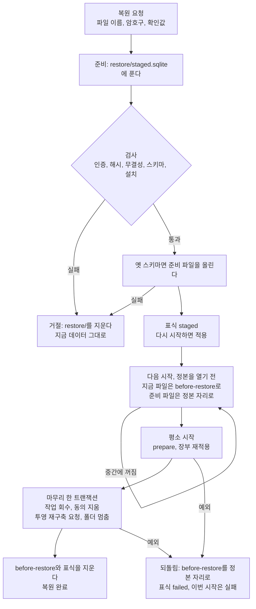

# 스펙: H01 — 백업·복원·백업 암호화·옛 스키마 올리기

- 날짜: 2026-11-23 / 상태: 확정(잠정 결정 D1~D13 포함)
- 관련: 이슈 #32(H01), 총괄 #1, Phase 7 #9, 선행 #21(I04)·#25(K01)·#29(P03), 진행 중 #30(X01). [ADR 0010](../adr/0010-encryption-at-rest.md)(백업은 반드시 암호화, 키는 암호구에서), [I04 spec](2026-11-21-I04-invalidation.md)(R17 복원 뒤 재적용, "T10이 넘기는 것" 7·11), [I02-B spec](2026-11-22-I02-local-file-import.md)(R34 복원과 위치), [R04 잠금 spec](2026-11-23-R04-data-dir-lock.md), [I03 spec](2026-11-21-I03-persistent-queue.md)
- 번호: 요구사항 `H01-R<n>`, 결정 `H01-D<n>`, 작업 `H01-T<n>`. 완료 기준은 이슈 #32의 `H01-C1`·`C2` 아래를 `a`·`b`·`c`로 나눈다. **`H01-C3`(embedding 교체)은 이 단위에 없다**(D1). 마이그레이션은 더하지 않는다(설정 행과 파일만 쓴다).

| 말 | 뜻 |
|---|---|
| 백업 파일 | 정본 SQLite의 한 시점 사본과 목록표를 암호구로 암호화한 파일 하나(`.pkibak`) |
| 목록표(manifest) | 백업 파일 안에 든 설명서. 언제, 어느 스키마·모델 판에서, 무엇이 몇 건 들었는지 적는다 |
| 준비(staging) | 복원할 파일을 데이터 폴더의 옆자리에 풀어 놓고 검사하는 단계. 지금 데이터는 건드리지 않는다 |
| 바꿔치기(swap) | 준비한 파일을 정본 자리로 옮기는 단계. 백엔드가 정본을 열기 전에만 한다 |
| 장부 | 삭제 사건을 줄로 쌓는 `tombstone-ledger.jsonl`(I04-R17). 백업에 들지 않고 복원이 덮지 않는다 |

## 배경

지금은 정본 SQLite(`pki.sqlite`)를 잃으면 되찾을 길이 없다(ARCHITECTURE 7절 "정본 SQLite 손상 → 백업에서 복원(H01)"). 한편 복원에 필요한 장치는 대부분 이미 있다.

- 지켜야 할 데이터는 **파일 하나**에 있다. 원본·근거·지식·사용자 조치·피드백·작업·설정·tombstone·식별자 키·Wiki·키워드 색인이 모두 `pki.sqlite` 안이다(`backend/src/composition.ts:573`, ARCHITECTURE 4절). 엔진과 벡터 색인은 아직 실물이 없는 투영이다(`composition.ts:159`의 `EmptyVectorIndex`).
- **복원 뒤의 삭제 재적용**은 I04가 만들었다. 시작할 때 API가 열리기 전에 장부에서 정본이 못 본 줄을 다시 적용한다(`backend/src/boot.ts:235`, `backend/src/ledger-boot.ts:160`). 지금 시험은 파일을 손으로 덮어 복원을 흉내 낸다(`backend/src/ledger.boot-reconcile.test.ts:226`). 실제 백업 파일로 하는 검증이 H01-C2로 넘어와 있다.
- 새 스키마의 파일은 이미 거절된다(`storage/src/migrations.ts:1929`). 복원으로 보이는 시작은 읽던 폴더를 멈춘다(`backend/src/local-files-driver.ts:123`).

없는 것은 셋이다. 백업 파일을 만드는 길, 그 파일을 안전하게 들이는 길, 그리고 I04가 H01에 넘긴 두 구멍(장부 순번이 같은 오래된 복원본은 재구축·폴더 멈춤이 걸리지 않는다: I04 "T10이 넘기는 것" 11 ①).

## 목표

1. 사용자가 고른 폴더에 암호화된 백업 파일을 만들고, 그 목록표가 든 것을 정확히 말한다.
2. 백업 파일을 복원하면 **지금 데이터 전부이거나 복원본 전부**가 남고 섞이지 않는다. 손상·틀린 암호구·새 스키마·중간에 꺼짐·시작 실패 어느 경우에도 그렇다.
3. 백업 뒤에 한 삭제·권한 상실·폴더 철회·전송 동의 철회가 옛 백업의 복원으로 되살아나지 않는다.

## 비목표

- **Embedding 교체의 shadow index → 검증 → 전환(H01-C3).** D1.
- **정본 SQLite의 파일 단위 암호화와 그 드라이버 평가.** ADR 0010의 현재 결정(평문, 화면에 "적용 안 됨")을 바꾸지 않는다(D3).
- **자동·주기 백업, 여러 벌 보관, 증분 백업, 클라우드 올리기.**
- **암호구를 OS 자격 증명 저장소에 기억시키기.** D4.
- **전체 데이터 삭제, 보류한 삭제의 확인·버림, `provider_calls` 보존 기간.** 다른 spec이 H01에 적어 둔 항목이지만 이 단위의 기준이 아니다("넘기는 것").
- **실행 중 바꿔치기와 셸이 백엔드를 대신 다시 띄우기.** 적용은 다음 시작이 한다(D6).
- **Windows 설치본에서의 실행 확인.** 배포처 항목.

## 요구사항

### 백업 파일

- **H01-R1 한 시점 사본.** 백업은 정본 연결에서 `VACUUM INTO`로 데이터 폴더의 `backup-tmp/<무작위>.sqlite`에 사본을 만든다(`SqlDriver.exec`, 트랜잭션 밖). 사본은 한 시점의 것이고 지운 자리의 바이트를 싣지 않는다. 사본은 암호화가 끝나면(실패해도) 지우고, 꺼져서 남은 것은 다음 시작이 지운다.
- **H01-R2 담는 것과 빼는 것.**

| | 대상 | 까닭 |
|---|---|---|
| 담는다 | `pki.sqlite` 전체(원본·근거·지식·이력·사용자 조치·피드백·작업·스케줄·설정·동의·tombstone·식별자 키·Wiki·키워드 색인) | 정본. 키가 데이터와 함께 다녀야 복원본의 삭제가 계속 대조된다(I04 결정 11) |
| 뺀다 | `secrets.json` | 암호문이 이 PC의 OS 키에 묶여 있어 다른 곳에서 못 쓴다. 평문을 백업에 넣지 않는다(ARCHITECTURE 4절) |
| 뺀다 | 장부 파일들 | I04-R17: 백업 대상이 아니고 복원이 덮지 않는다 |
| 뺀다 | `models/`, `cli-runs/`, `instance.lock`, `backup-tmp/`, `restore/` | 캐시·임시·잠금 |
| 뺀다 | 엔진·벡터 투영 | 정본에서 다시 만든다(R11) |

- **H01-R3 목록표.** `backupId`(무작위), 만든 시각, 형식 판 `1`, 스키마 번호, 변경 순번, 장부 순번, 사본의 바이트 수와 SHA-256, 건수(원본·원본 version·항목·사실·관계·근거·열린 작업·스케줄·피드백·tombstone), embedding 공간(`modelId`·`revision`·`dimension`, 없으면 `null`), 벡터 색인이 반영한 변경 순번(없으면 `null`), 설치 지문(`installation`: 식별자 키로 고정 문구를 서명한 값. 키 자체를 싣지 않고 R8이 같은 설치인지 가르는 데 쓴다). 건수와 번호는 **사본 파일을 읽어** 적는다(정본이 그 사이 바뀌어도 목록표와 내용이 어긋나지 않는다).
- **H01-R4 암호화.** Node 내장 `node:crypto`만 쓴다. 키는 암호구와 파일마다 새 salt에서 scrypt로 만든다(값은 머리에 적는다). 본문은 목록표 조각 하나와 사본 조각들을 AES-256-GCM으로 암호화하고, 조각 번호와 마지막 조각 표시를 인증 자료에 넣어 잘림·순서 바뀜·바꿔 끼움을 잡는다. 평문 머리에는 형식 판, 만든 시각, 스키마 번호, scrypt 값, salt, 키 확인값만 있다. 암호구는 12자 이상이다.
- **H01-R5 읽지 못할 때의 답.** 키 확인값이 맞지 않으면 `wrong-passphrase`, 맞는데 조각 인증·해시·크기가 어긋나면 `damaged`, 형식 판을 모르면 `unsupported-format`이다. 어느 경우에도 평문을 내놓지 않고 지금 데이터를 건드리지 않는다. 암호구를 잃으면 그 파일은 읽을 수 없고 되찾는 길이 없다(화면이 만들 때 알린다).
- **H01-R6 암호구의 자리.** 암호구와 만든 키는 요청을 처리하는 동안만 메모리에 있다. 설정·작업 행·로그·오류 문구·응답에 남기지 않는다.
- **H01-R7 쓰기.** 사용자가 고른 폴더에 `pki-backup-<UTC 날짜시각>.pkibak.partial`로 쓰고 fsync한 뒤 이름을 바꾼다. 같은 이름이 있으면 덮지 않고 실패한다. 폴더는 기존 폴더 고르기 표(`ApprovalTickets`, `backend/src/local-locations.ts:136`)로 받아 설정 `backup.folder`에 적는다. 표 없이 경로를 직접 받는 것은 기존 규칙대로 배포 빌드가 아닐 때뿐이다(`local-locations.ts:269`).

### 복원 준비 (실행 중, 지금 데이터를 건드리지 않는다)

- **H01-R8 살펴보기.** 파일 이름과 암호구를 받아 목록표 조각만 풀어 요약을 돌려준다: `backupId`, 만든 시각, 건수, 스키마 판정(`same`·`older`·`newer`), 같은 설치인지, embedding 공간이 지금과 같은지.
- **H01-R9 준비와 검사.** 복원 요청은 살펴보기에서 본 `backupId`를 확인값으로 싣는다(다르면 `confirm-mismatch`. I02B-R8의 "본 수를 되돌려 보낸다"와 같은 방식). 통과하면 `restore/staged.sqlite`에 풀고 차례로 검사한다. ① 모든 조각의 인증, 바이트 수, SHA-256 ② `PRAGMA integrity_check`와 `foreign_key_check` ③ 스키마 번호가 이 빌드보다 크면 `newer-schema`로 거절 ④ 설치 판정(D8): 백업의 식별자 키가 지금 정본의 키와 다르고 지금 정본에 원본이나 tombstone이 있으면 `other-installation`으로 거절 ⑤ 옛 스키마면 준비 파일에 평소의 `migrate`를 돌려 올린다. 하나라도 실패하면 `restore/`를 지우고 그 코드를 답한다. 모두 통과하면 파일을 닫고 fsync한 뒤 표식 `restore/pending.json`(`state: "staged"`, `backupId`, 목록표 요약)을 임시 파일과 이름 바꾸기로 쓴다. 답은 "다시 시작하면 적용됨"이다.
- **H01-R10 대기와 취소.** 대기 중인 복원은 하나다. 취소는 `restore/`를 지운다. 대기 중에 한 변경은 적용 때 사라지고(삭제는 장부로 남는다), 화면이 그렇게 알린다.

### 시작할 때의 적용

- **H01-R11 바꿔치기.** 백엔드는 정본을 열기 전에(`boot.ts:182`의 `openCanonicalDb` 앞) 표식을 본다. 실행 중에는 바꿔치기를 하지 않는다. 셸이 쥔 데이터 잠금(`instance.lock`)은 그대로이고, 바꾸는 것은 `pki.sqlite` 하나다.

| 표식 | 파일 상태 | 하는 일 |
|---|---|---|
| 없음 | `restore/`나 `backup-tmp/`가 남음 | 지운다(준비 중 꺼짐) |
| `staged` | 준비 파일 있음, 옛 자리 없음 | 지금 파일을 `pki.sqlite.before-restore`로 이름 바꿈 → 준비 파일을 `pki.sqlite`로 이름 바꿈 → 표식 `swapped` |
| `staged` | 준비 파일과 `before-restore`가 다 있음 | 준비 파일을 `pki.sqlite`로 이름 바꿈 → `swapped` (두 이름 바꾸기 사이에 꺼짐) |
| `staged` | 준비 파일 없음, `before-restore` 있음 | `swapped`로 적는다(표식을 고치기 전에 꺼짐) |
| `swapped` | — | 그대로 연다. 마무리(R12)가 이미 끝났으면 남은 파일과 표식만 지운다 |
| `rolling-back` | — | 되돌림 도중 꺼짐. `before-restore`가 있으면 `pki.sqlite`를 지우고 되돌린 뒤 `failed`로 적는다(R13) |
| `failed` | — | 평소 시작. 상태 API가 실패 코드를 보인다 |

  지금 파일 옆에 `pki.sqlite-journal`이 남아 있으면(지난 실행이 쓰다 꺼짐) 이름을 바꾸기 전에 지금 파일을 한 번 열었다 닫아 SQLite가 되감게 한다. 남의 저널이 새 파일에 적용되면 안 된다. 어느 순간에 꺼져도 `pki.sqlite`와 `before-restore`는 각각 온전한 한 파일이다.
- **H01-R12 평소 시작과 마무리.** 바꾼 뒤는 평소 시작이다: `prepareCanonicalDb`, 장부 붙이기, `reapplyAtStart`(백업 뒤의 삭제·해제를 순번 차례로 다시 적용. 기존 함수 그대로). 그 다음, 서버와 실행기를 열기 전에 **한 트랜잭션**으로 마무리한다.
  1. `running`인 작업을 lease 끝과 상관없이 기존 회수 규칙으로 돌린다(`storage/src/jobs.ts:336`의 세 갈래, 토큰 올림). 사본 속의 lease가 살아 있는 것처럼 이어지지 않는다.
  2. `consents` 행을 모두 지운다(D9). 백업 뒤에 거둔 전송 동의가 되살아나지 않는다.
  3. 엔진·벡터 투영의 재구축을 순번과 상관없이 요청한다(`requestProjectionRebuild`, I04 "T10이 넘기는 것" 11 ①의 의무).
  4. 설정 `restore.last`에 결과를 적는다: `backupId`, 준비 시각(`stagedAt`), 적용 시각, 백업 시각, 다시 적용한 삭제 수, 멈춘 폴더 수, 지운 동의 수, embedding 공간이 달랐는지. `backupId`와 `stagedAt`이 표식과 같은 기록이 이미 있으면 마무리가 이미 커밋된 것이다(그 시작에서 꺼진 경우): 남은 파일과 표식만 지운다.
  
  그리고 로컬 파일 구동기를 "복원됨"으로 시작한다(`boot.ts:347`의 인자에 이 사실을 더한다. I02B-R34: 읽던 위치를 모두 `paused`·`restored`로). 스케줄은 손대지 않는다. 지나간 주기는 기존 점검이 주기마다 작업 하나로 접는다(`backend/src/scheduler.ts:261`). 마무리가 커밋되면 `before-restore`를 지우고 표식을 지운다. 이것이 "복원 확인"이다.
- **H01-R13 되돌림.** 바꾼 뒤 마무리 커밋 전에 시작이 예외로 끝나면(준비 실패, 장부의 줄을 적용하지 못함 등) 정본을 닫고 표식을 `rolling-back`으로 적은 뒤 `before-restore`를 `pki.sqlite`로 되돌리고 표식을 `failed`(코드만)로 적고 그 시작은 실패로 끝낸다. 다음 시작은 이전 데이터로 뜬다.
- **H01-R14 되살아나지 않는 것.**

| 백업 뒤에 한 일 | 복원 뒤 | 장치 |
|---|---|---|
| 원본 삭제(사용자·출처), 권한 상실, 삭제 해제 | 다시 적용됨. 본문·사실·색인이 없다 | 장부 재적용(I04-R17, 기존) |
| 로컬 폴더 철회·일시 중지 | 읽던 위치가 모두 멈춘 채로 뜬다. 철회된 원본은 장부가 지운다 | R12의 "복원됨"(I02B-R34) |
| Provider 전송 동의 철회 | 동의가 없다. 사용자가 다시 동의한다 | R12-2 |
| 배포처가 바꾼 연결 범위 | 지금 빌드의 값이 다시 적힌다 | 시작 때의 `applyConfiguredScopes`(`boot.ts:186`, 기존) |

  이전 version 지우기(I04-T12)는 장부에 줄이 없어 **되살아난다**. 화면이 복원 전에 알린다(I04 후속 표 14의 요청 가운데 안내 쪽을 택함, D10).

### API와 화면

- **H01-R15 API.** `GET /api/backup`(폴더, 폴더 안 백업 파일의 머리 정보, 대기 중 복원, `restore.last`, 실패 코드), `PUT /api/backup/folder`, `POST /api/backup`(암호구 → 파일 이름과 목록표 요약), `POST /api/restore/inspect`(R8), `POST /api/restore`(R9), `DELETE /api/restore`(R10). 스키마는 새 파일 `packages/contracts/src/backup-types.ts`에 두고 `index.ts`에는 export와 경로만 더한다. 거절은 오류 응답이 아니라 `status: "refused"`와 코드를 담은 200 응답이다(화면이 말로 알리도록). 계약 시험이 "경로마다 JSON Schema 객체"를 요구하므로 응답은 판별 합집합이 아니라 한 객체와 검증식이다. 시험 빌드는 `bootBackend`의 `backupScrypt`로 scrypt 비용을 낮춘다(제품 값은 D5 그대로).
- **H01-R16 화면.** 설정에 "백업·복원" 묶음 하나. 폴더 고르기, 암호구(두 번 입력)로 백업 만들기, 파일 목록, 살펴보기 결과와 확인 뒤 복원. 알릴 것: 암호구를 잃으면 못 읽는다, 비밀 값(API 키 등)은 백업에 없다, 복원은 다시 시작해야 적용되고 그때까지의 변경은 사라진다, 지운 이전 version은 되살아날 수 있다, 복원 전에 지금 데이터를 백업하라. 복원이 끝난 뒤에는 `restore.last`의 수를 한 번 보인다.

## 인터페이스 / 설계 개요

새 모듈 넷이고 기존 파일에는 호출만 더한다.

- `storage/src/backup-file.ts`: 파일 형식(머리, scrypt, 조각 암호화·복호화, 오류 코드). 순수 함수와 스트림.
- `storage/src/backup.ts`: `createSnapshot(db, dir)`(R1), `readManifestFacts(file)`(R3), `stageRestore(...)`(R9의 검사와 `migrate`). 표식 읽기·쓰기.
- `backend/src/restore-boot.ts`: `applyPendingRestore(dataDir, open)`(R11), `finishRestore(db, run, report)`(R12), `rollbackRestore(run)`(R13), `readIndexFacts(vectorIndex)`(R3·R12가 쓰는 색인의 답. 이 빌드가 묶는 색인은 "없음"을 던져서 답하므로 던짐을 `null`로 읽는다). `boot.ts`에는 호출 셋과 실패 반응 하나, `driver.start`의 인자 한 곳이 더해진다. 실패 반응은 `bootBackend`가 본문(`startBackend`)의 같은 promise에 곁가지 `catch`로 붙는 것이다: 감싸는 `async` 함수를 두면 시작이 끝나는 시점이 몇 틱 늦어져, 시작 도중 러너가 잡은 작업이 호출자의 `booted` 대입보다 먼저 도는 기존 시험(`projection-jobs.test.ts`)이 깨진다. 저장소 경계 규칙(어댑터는 조립 지점만 닿음) 때문에 `composition.ts`에 SQLite 파일을 여는 `openSqlFile` 한 줄을 더해 저널 점검과 사본 읽기가 쓴다.
- `backend/src/backup-api.ts`: 여섯 경로의 처리기. `server.ts`에는 import·조립·처리기 줄만.

### 대안과 기각 사유

- **데이터 폴더를 통째로 바꿔치기**: 기각. 셸이 폴더 안의 `instance.lock`을 쥐고 있고(R04L-R4) 장부·비밀 값은 덮으면 안 된다. 지킬 것이 파일 하나라 파일 하나만 바꾼다.
- **실행 중에 정본 연결을 닫고 바꾸기**: 기각. 연결을 쥔 곳(실행기, 구동기, 서버)이 많아 "닫혔다"를 보장하려면 시작 순서를 거꾸로 다시 짜야 한다. 시작 전에는 아무도 열지 않았다.
- **복원 뒤 이전 데이터를 사용자가 확인할 때까지 보관**: 기각. 그 파일은 그 뒤의 삭제가 닿지 않는 사본이라 삭제의 약속(I04-C3)을 깬다. 시작이 성공하면 지운다(D7).
- **백업을 작업(job)으로 돌리기**: 기각. 암호구가 작업 행에 적힌다(R6).

## 완료 기준 (테스트 가능한 형태)

| 기준 | 문장 | 증명 테스트 |
|---|---|---|
| H01-C1a | 원본·지식·작업·피드백이 든 정본을 백업하면 목록표의 건수·스키마 번호·변경 순번·embedding 공간이 사본의 내용과 같고, 사본을 만든 뒤 정본에 쓴 행은 목록표에도 복원본에도 없다(R1·R3) | `storage/src/backup.test.ts` |
| H01-C1b | 백업 파일에 SQLite 머리말과 본문 카나리가 평문으로 없다. 맞는 암호구로는 사본이 바이트까지 되돌아오고, 틀린 암호구는 `wrong-passphrase`, 한 바이트를 바꾸거나 끝을 자른 파일은 `damaged`다(R4·R5) | `storage/src/backup-file.test.ts` |
| H01-C1c | 암호구 카나리가 백업 뒤 정본의 모든 테이블·로그 출력·응답에 없다. 백업에 `secrets.json`이 실리지 않고 복원이 그 파일과 장부를 바꾸지 않으며, 비밀 값이 없는 설치에 복원해도 지식은 읽히고 Provider 키 상태는 기존의 "없음" 답이다(R2·R6) | `backend/src/backup-api.test.ts` |
| H01-C2a | 손상된 파일, 이 빌드보다 큰 스키마 번호의 파일, 다른 설치의 파일(지금 정본에 원본이 있을 때), 확인값이 다른 요청은 각각의 코드로 거절되고 `pki.sqlite`의 바이트와 `restore/`의 부재가 전과 같다. 옛 스키마의 파일은 준비에서 지금 번호로 올라간다(R9) | `storage/src/backup.test.ts`, `backend/src/backup-api.test.ts` |
| H01-C2b | 바꿔치기의 각 단계 뒤에서 멈춘 상태(표의 네 줄)로 `applyPendingRestore`를 다시 부르면 끝은 늘 복원본 전체이고, 어느 중간 상태에서도 `pki.sqlite`와 `before-restore`는 각각 `integrity_check`를 통과한다. 마무리 전에 시작이 예외로 끝나면 `pki.sqlite`가 이전 데이터이고 표식이 `failed`다(R11·R13) | `backend/src/restore-boot.test.ts` |
| H01-C2c | 실제 `bootBackend`로: 원본 둘을 넣고 동의를 주고 백업한 뒤, 하나를 삭제 경로(`/api/sources/delete`)로 지우고 동의를 거두고, 백업을 복원해 다시 시작한다. 지운 원본의 본문 카나리가 정본 어디에도 없고 tombstone이 있으며 남긴 원본은 읽힌다. `consents`가 비고, 읽던 로컬 위치가 `paused`·`restored`이고, `running`이던 작업이 `running`이 아니며, 장부 순번이 같아도 엔진·벡터 재구축 작업이 등록돼 있고, `restore.last`의 수가 맞다(R12·R14) | `backend/src/restore-ledger.test.ts` |
| H01-C1d | 브라우저에서 폴더를 정하고 백업을 만들면 목록에 나오고, 살펴본 뒤 복원을 확인하면 "다시 시작하면 적용" 표시가 뜨며, 취소하면 사라진다(R15·R16) | `apps/web/e2e/backup.e2e.ts` |

C2c의 세 지킴(장부 재적용 뒤의 내용 부재, 동의 지움, 폴더 멈춤)은 데이터 보호의 허용·차단이라 변이 확인을 한다(테스트 간략화 규칙 5): 각 줄을 빼면 그 시험이 빨개져야 한다. 새 데이터 폴더 항목은 `backend/src/derivative-coverage.ts:214`의 목록에 더하고 기존 시험이 지킨다. 경계값·조합의 전수 시험은 하지 않는다.

## 잠정 결정과 가정

바꾸려면 적힌 자리 하나를 고치면 된다.

- **H01-D1 `H01-C3`은 X01(#30)이 합쳐진 뒤의 단위로 미룬다.** main에는 벡터를 쓰는 길도, 벡터로 찾는 길도 없다: 제품이 묶는 색인은 `EmptyVectorIndex`이고(`composition.ts:161`), 재구축은 "벡터를 쓰지 않는다(X01)"며 비운 채 끝나고(`knowledge-engine/src/projections.ts:235`), 규격의 `reset`은 **먼저 다 버리고** 다시 만드는 모양이라(`packages/contracts/src/vector-index.ts:27`) generation 개념이 없다. 이슈 #32도 "재인덱싱 중 유지할 탐색은 X01에서 생긴다"고 적는다. 지금 만들면 X01이 만드는 길을 따로 지어내게 된다. 기다리는 것: ① 벡터를 실제로 담는 `VectorIndex` 구현이 `productAdapters`에 묶임 ② 벡터 쓰기 길 ③ `search`를 부르는 읽기 경로. 그때 `reset`을 "새 generation을 옆에 만들고 검증 뒤 전환"으로 바꾸는 규격 변경이 필요하다.
- **H01-D2 `H01-C1`의 "model/index version"은 목록표의 embedding 공간과 벡터 색인 순번이다.** 지금은 기록과 비교(R8)까지만 하고, 복원 뒤에는 같든 다르든 재구축을 요청한다.
- **H01-D3 정본 파일은 평문으로 둔다.** ADR 0010 "사용자 확인 결과": 사용자가 판단을 위임했고 위임받은 판단이 "Phase 1은 평문, H01의 드라이버 조사에서 Windows에 쓸 드라이버가 확인되면 다시 판단"이다. 그 조사는 평가하지 않은 네이티브 구성요소와 Windows 실행이 필요해 이 단위에서 하지 않는다. ADR 0010에는 "백업 암호화는 이 spec, 드라이버 조사는 후속 이슈"라는 줄만 더한다.
- **H01-D4 키는 암호구에서만 만들고 OS 자격 증명 저장소에 두지 않는다.** ADR 0010의 백업 행이 이미 그렇게 정했다(다른 PC에서 복원해야 한다). 이슈 C1의 "키 OS credential store"는 "OS 키에 묶인 비밀 값은 백업에 넣지 않고 복원이 건드리지 않는다"(R2·R6, C1c)로 읽는다. 암호구를 이 PC에 기억시키려면 비밀 값 이름 하나(`backup.passphrase`)를 셸이 백엔드에 내어 주는 범위(ADR 0019)에 더해야 하고, 그것은 무인 백업이 생길 때의 일이다.
- **H01-D5 scrypt 값(N=2^17, r=8, p=1), 조각 크기 1MiB, 암호구 12자 이상은 상수다.** 머리에 값이 적혀 있어 올려도 옛 파일이 읽힌다. Windows 저사양 PC에서의 시간은 재지 않았다.
- **H01-D6 적용은 다음 시작이 하고, 다시 시작은 사용자가 한다.** 셸의 재시작 횟수 한도(`apps/desktop/src/main.ts:52`, 3회)를 쓰지 않고 셸을 고치지 않는다. 버튼 하나로 다시 띄우려면 셸의 감독기에 "세지 않는 종료 코드"를 더한다.
- **H01-D7 `before-restore`는 시작이 성공하면 지운다.** 사용자가 고르는 "복원 취소"는 없다(대안과 기각). 안전망은 복원 전 백업 안내다. 며칠 보관하려면 R12의 지우는 줄과 삭제 약속의 예외 문장을 함께 고친다.
- **H01-D8 다른 설치의 백업은 비어 있는 설치(원본도 tombstone도 없음)에만 복원한다.** I04-R17은 키가 다른 장부를 옆으로 치우는 길을 갖고 있지만, 쓰던 설치를 남의 백업으로 덮으면 그 설치의 삭제 기록이 재적용에서 빠진다. 허용하려면 R9 ④를 지운다(I04의 치움·알림이 그대로 받는다).
- **H01-D9 복원은 전송 동의를 모두 지운다.** 어느 동의가 백업 뒤에 거둬졌는지 복원본은 모른다. 닫힌 쪽으로 간다. 지금 정본의 동의를 옮겨 오려면 마무리가 `before-restore`를 읽어 `consents`를 덮게 한다.
- **H01-D10 지운 이전 version은 안내로만 다룬다.** 장부에 `pruned-below` 줄을 더하는 쪽은 I04의 줄 형식·재적용·키 규칙을 모두 바꾼다.
- **H01-D11 백업은 요청 하나가 끝까지 기다린다.** `VACUUM INTO`는 동기 호출이라 그동안 API가 멈춘다(시작 때의 `VACUUM`과 같은 사정, `storage/src/identity.ts:260`). 큰 정본에서의 시간은 재지 않았다. 길면 사본 만들기를 별도 프로세스로 옮긴다.
- **H01-D12 백업 폴더는 설정 하나(`backup.folder`)이고 파일은 그 폴더의 `*.pkibak`만 본다.** 폴더 고르기는 기존 표(`folder` 종류)를 그대로 써서 셸을 고치지 않는다. 파일 하나를 직접 고르게 하려면 표에 `file` 종류를 더한다.
- **H01-D13 ADR은 새로 쓰지 않는다.** 새 엔진·새 의존성이 없다. ADR 0010에 한 줄, ARCHITECTURE 4절의 백업 행과 7절의 손상 행을 고친다.

## 미해결 질문 / 검증하지 않은 범위

- **Windows.** 열린 파일 옆에서의 이름 바꾸기, 디렉터리 fsync, 지운 파일의 남은 바이트, 실제 설치본에서의 전체 순서는 확인하지 않는다(개발 OS는 macOS).
- **크기와 시간.** 큰 정본의 백업·준비 시간, 디스크가 모자랄 때(사본 + 암호문, 준비 파일 + 이전 파일이 동시에 있다)는 "실패하고 지금 데이터 그대로"까지만 요구하고 재지 않는다.
- **다른 PC로의 복원**은 "장부 없음"의 기존 알림(I04-R17)에 기대며 이 단위는 같은 설치의 길(C2c)만 실행한다. 백업 뒤에 처음 들어와 지운 로컬 파일(I02-B 남는 위험 19)은 그대로 남는 위험이다.
- **되돌림 뒤의 장부.** 복원본으로 뜨다 실패한 시작이 장부에 줄을 보탠 경우(같은 설치에서는 보탤 것이 없다고 보았다)를 따로 시험하지 않는다.
- **실제 `safeStorage`와 복원의 조합**은 셸을 띄우지 않고 비밀 값 원천의 대역으로만 본다.

## 작업 분해

PR 하나로 간다. T1 뒤에 T2·T3을 나란히, T3 뒤에 T4·T5를 나란히 할 수 있다(파일이 겹치지 않는다).

| 작업 | 산출물 | 기준 | 선행 | 건드리는 파일 | 검증 증거 |
|---|---|---|---|---|---|
| H01-T1 | 저장: 파일 형식, 사본·목록표, 준비와 검사, 표식, 작업 회수의 "만료를 보지 않음" 선택 | C1a, C1b, C2a(저장) | 없음 | 새 파일 `storage/src/backup-file.ts`·`backup.ts`와 두 시험 / 덧붙임 `storage/src/index.ts`(export), `storage/src/jobs.ts`(선택 인자 하나) | `backup-file.test.ts`, `backup.test.ts`, `jobs.test.ts` 통과 출력 |
| H01-T2 | 시작: 바꿔치기·마무리·되돌림, `boot.ts` 연결, 데이터 폴더 항목 | C2b, C2c | T1 | 새 파일 `backend/src/restore-boot.ts`·`restore-boot.test.ts`·`restore-ledger.test.ts` / 덧붙임 `backend/src/boot.ts`(호출 셋, try/catch, 인자 한 곳), `backend/src/derivative-coverage.ts`(목록 세 줄), `backend/src/composition.ts`(`openSqlFile` 한 줄), `backend/src/local-files-driver.ts`(`isReadable` export) | 두 시험과 `ledger.boot-reconcile.test.ts`·`local-restore.test.ts` 통과 출력, C2c 변이 셋의 빨간 출력 |
| H01-T3 | API: 계약과 여섯 경로, 폴더 설정, 서버 조립 | C1c, C2a(API) | T1 | 새 파일 `packages/contracts/src/backup-types.ts`, `backend/src/backup-api.ts`·`backup-api.test.ts` / 덧붙임 `packages/contracts/src/index.ts`(export·경로), `backend/src/server.ts`(import·조립·처리기), `backend/src/boot.ts`(조립 인자 한 줄) | `backup-api.test.ts`, `api.contract.test.ts` 통과 출력 |
| H01-T4 | 화면: 설정의 "백업·복원", 브라우저 E2E 하나 | C1d | T3 | 새 파일 `apps/web/src/backup.tsx`·`backup-text.ts`, `apps/web/e2e/backup.e2e.ts` / 덧붙임 `apps/web/src/App.tsx`(import와 한 줄) | `pnpm e2e`의 `backup.e2e.ts` 통과 출력 |
| H01-T5 | 문서: ADR 0010 한 줄, ARCHITECTURE 4절·7절의 백업 줄, site-setup 항목 하나 | (문서) | T3 | `docs/adr/0010-encryption-at-rest.md`, `docs/ARCHITECTURE.md`, `docs/site-setup.md`(줄 더하기) | `pnpm lint` 통과, 문서의 파일 이름·설정 키가 코드 상수와 같음 |

`backend/src/server.ts`·`packages/contracts/src/index.ts`·`apps/web/src/App.tsx`·`docs/site-setup.md`·`docs/ARCHITECTURE.md`는 다른 세션이 지금 고치는 파일이다. H01은 **덧붙이는 줄**만 쓰고 기존 줄을 고치지 않는다. `boot.ts`는 T2와 T3이 함께 건드리므로 T3의 한 줄은 T2 뒤에 넣는다. `storage/src/migrations.ts`는 건드리지 않는다.

## 넘기는 것

- **X01(#30) 뒤의 단위(H01-C3).** D1의 세 가지가 main에 오면 generation별 shadow index → 검증 → 전환과 "부분 재인덱싱 실패에도 기존 탐색"을 그 읽기 경로로 증명한다. X01에게: `VectorIndex.reset`이 먼저 버리는 모양이라는 것, 복원 뒤 재구축 요청이 온다는 것, 목록표가 embedding 공간을 적는다는 것.
- **후속 이슈(조사).** 암호화 SQLite 드라이버 평가(Windows 바이너리·라이선스·유지보수)와 정본·벡터 암호화의 재판단(ADR 0010의 "다시 열 조건"). 결과에 따라 사용자 결정이 필요하다.
- **후속 이슈(기능).** 전체 데이터 삭제(장부와 옆으로 치운 장부까지, ARCHITECTURE 4절), 보류한 삭제의 확인·버림(I04 후속 표 16), `provider_calls` 보존 기간(I03), 자동 백업과 암호구 기억(D4), 한 번에 다시 띄우기(D6), 파일 하나 고르기(D12).
- **배포처(site-setup 항목 하나, 번호는 합칠 때의 다음 번호).** Windows 설치본에서 백업 → 삭제 → 복원 → 다시 시작을 실행해 지운 내용이 데이터 폴더의 파일 바이트에 없는지(S22의 카나리 방식), 이름 바꾸기와 되돌림이 되는지, 실제 크기에서의 시간, `safeStorage`의 비밀 값이 복원 뒤에도 읽히는지를 기록한다. 백업 폴더가 회사 정책상 허용된 위치인지도 여기서 정한다.

## 변경 이력

| 날짜 | 변경 | 대상 | 사유 |
|---|---|---|---|
| 2026-11-23 | 처음 씀, 확정 | 전체 | 이슈 #32 착수. X01이 진행 중이라 C3은 뒤 단위로 넘기고 C1·C2를 한 PR로 묶음. 정본 암호화는 ADR 0010의 현재 결정을 유지 |
| 2026-11-23 | 설계 개요: 시작 실패 반응을 곁가지 catch로 | 설계 개요(boot.ts) | 전체 스위트가 잡음: 감싸는 async 함수가 시작의 완료 시점을 늦춰 projection-jobs 시험 둘이 빨개짐(변경 범위 시험으로는 안 보였음) |
| 2026-11-23 | R3: 목록표에 `installation`(설치 지문) 추가; R15: 거절은 200 응답의 코드, `backupScrypt` 시험 틈 | R3, R15 | T3 구현 중 확인: R8의 "같은 설치인지"를 복호화 전에 가를 값이 목록표에 없었고, 계약 시험이 객체 응답만 받음 |
| 2026-11-23 | R11·R12·R13: `rolling-back` 표식, `restore.last`에 `stagedAt`, 뜨겁지 않은 저널의 이동; 설계: `readIndexFacts`, `openSqlFile` | R11~R13, 설계 개요, T2 표 | T2 구현 중 확인: 되돌림 도중 꺼짐을 표식이 구분하지 못했고, 마무리 커밋 뒤 꺼짐을 가릴 기록이 필요했으며, 이 빌드의 `EmptyVectorIndex.embeddingSpace()`는 null이 아니라 던지고, 어댑터는 조립 지점에서만 열 수 있음 |
