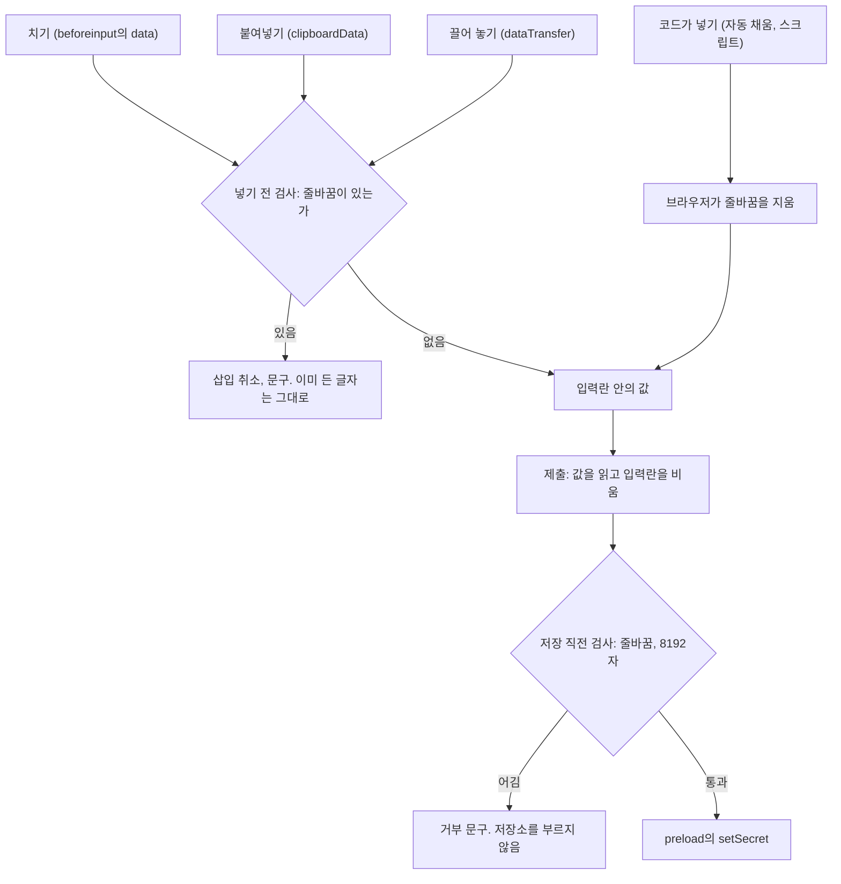

# 스펙: I06F 자격 증명·API 키 입력란의 남은 틈

- 날짜: 2026-11-23 / 상태: 확정(잠정 결정 포함)
- 관련: 이슈 #162(이 spec), 앞선 작업 #114와 PR #159(I06-T04). [I06 spec](2026-11-22-I06-connector-credentials.md)의 I06-R14(화면에서 값을 넣는 길), "I06-T04가 넘기는 것"의 화면 항목(비제어 입력란, 설정 화면은 후속), "잠정 결정과 가정"의 행 "이 화면에서 넣는 자격 증명은 한 줄, 8192자 이하다(2026-11-23, I06-T04 검토 F3)". [V01 spec](2026-11-21-V01-vertical-skeleton.md)의 V01-R11(API 키)·V01-R9(CLI 종료), [ADR 0019](../adr/0019-connector-credentials.md), [connector-sdk.md](../connector-sdk.md) 8·11장, [site-setup.md](../site-setup.md) S28

이 spec은 I06 spec을 고치지 않는다. I06 spec의 결정을 그대로 받고(한 줄, 8192자, 자르지 않고 거부, 값은 넘기는 즉시 화면에서 비움), 그 결정이 닿지 못한 자리만 메운다. I06 spec에서 이 작업 뒤로 낡는 문장은 맨 아래 "후속" 표에 모았다.

낯선 말은 [ARCHITECTURE 0절](../ARCHITECTURE.md#0-처음-나오는-말)과 I06 spec 머리의 표에 풀이가 있다. 이 spec에서 새로 쓰는 말은 아래 표에 있다. `I06-…`·`V01-…`은 그 spec의 번호, `I06F-…`는 이 spec의 번호다.

| 말 | 뜻 |
|---|---|
| 비밀 값 입력란 | 사용자가 비밀 값을 넣는 두 곳. 출처 화면의 수집기 자격 증명 칸(`connector-table.tsx`의 `SlotEntry`)과 설정 화면의 API 키(`App.tsx`의 `OpenAICompatible`) |
| 비제어 입력란 | React가 값을 들고 있지 않은 입력란. 값은 브라우저의 입력란 안에만 있고, 코드는 제출할 때 한 번 읽는다. 반대인 제어 입력란은 글자를 칠 때마다 값을 React 상태에 넣고, React는 그 값을 DOM의 `value` 속성에 다시 적는다 |
| DOM의 `value` 속성 | HTML 마크업에 글자로 보이는 `value="…"`. 입력란이 지금 들고 있는 값(`input.value`)과는 다른 것이다. 속성에 실린 값은 페이지 마크업을 읽는 모든 것(확장 프로그램, 화면 덤프, 오류 수집기)에 보인다 |
| 넣는 길 | 글자가 입력란에 들어오는 경로. 치기, 붙여넣기, 끌어 놓기, 그리고 코드가 넣기(비밀번호 관리자의 자동 채움, 스크립트)의 넷 |
| 판정 불가 | 시험이 본 것으로는 맞다 틀리다를 말할 수 없는 시도. 실패와 다르다. 이 spec에서는 가짜 CLI가 자기 PID를 적기 전에 끝난 시도를 가리킨다 |

## 배경

PR #159의 독립 검토가 병합을 막지 않는 메모 여섯을 남겼고 이슈 #162가 그것을 모았다. 코드에서 확인한 지금 상태는 이렇다.

1. **코드가 넣은 값은 줄바꿈 검사를 지나친다.** `SlotEntry`는 `beforeinput`과 `paste` 두 이벤트에서만 줄바꿈을 본다. 코드가 넣은 값에는 이 이벤트가 없다. 제출할 때 `changeCredential`이 `checkCredentialValue`로 한 번 더 보지만, 비밀번호 입력란은 브라우저가 줄바꿈을 먼저 지우므로 그때 읽는 값에는 줄바꿈이 없다. 줄바꿈이 지워진 값이 저장되고 화면은 "반영했습니다"를 보인다. 설정 화면의 API 키는 사정이 더 나쁘다. `saveApiKey`에는 검사가 아예 없어서 8192자를 넘는 키는 셸이 거부하고 화면은 "키를 저장할 수 없습니다 (OS 보호 저장소)"라는 틀린 까닭을 보인다.
2. **끌어 놓기는 `event.data`만 본다.** `beforeinput`의 `data`가 비어 오는 끌어 놓기에서는 줄바꿈을 놓친다. 끌어 놓은 글은 `dataTransfer`에도 있다.
3. **줄바꿈을 거부할 때 앞에 친 글자까지 지운다.** `refuseLineBreak`가 입력란을 비운다. 삽입은 이미 취소했으므로 비울 까닭이 없다.
4. **동작이 끝나면 초점이 늘 입력란으로 돌아온다.** `run`의 `finally`가 조건 없이 `focus()`를 부른다. 저장을 누르고 다른 단추로 옮겨 간 사용자의 초점을 빼앗는다.
5. **설정 화면의 API 키는 제어 입력란이다.** `useState`의 `key`가 `value={key}`로 묶여 있어 치는 동안 키가 DOM의 `value` 속성에 실린다. 수집기 자격 증명 입력란은 PR #159에서 비제어로 바꿨고 이쪽은 후속으로 남겼다.
6. **`cli-kill` 시험이 부하에서 실패한다.** `providers/src/adapters/cli-kill.test.ts`의 "ends a hung version query itself"는 제한 시간 1.5초로 버전 질의를 끝낸 뒤 `treeGone`으로 가짜 CLI의 PID 기록이 둘 이상인지 본다. 기계가 바쁘면 가짜 CLI(Node 프로세스 하나)가 뜨고 PID를 적기 전에 1.5초가 끝나 기록이 0건이고 `expected 0 to be greater than or equal to 2`로 실패한다. 제품의 결함이 아니라 시험이 "기록이 생길 만큼 빨리 뜬다"고 가정한 것이다.

1~5는 입력란 하나의 문제가 둘로 갈라져 있어서 생긴다. PR #159가 한쪽만 고쳤고, 지금 고치는 것도 한쪽에만 넣으면 같은 틈이 다시 생긴다.

## 목표

- 비밀 값 입력란 두 곳이 같은 컴포넌트 하나를 쓴다. 그래서 값이 DOM에 실리지 않는 것, 줄바꿈과 길이의 거부, 초점의 규칙이 두 곳에서 같다.
- 값은 셸의 저장소로 넘어가기 직전에 한 번 더 검사된다. 어느 화면도 이 검사를 건너뛰어 저장할 수 없다.
- 끌어 놓기의 줄바꿈이 `data`가 비어 있어도 잡힌다. 거부는 이미 친 글자를 건드리지 않는다.
- 초점은 정해진 조건에서만 입력란으로 돌아온다.
- 브라우저가 이미 바꾼 값을 화면이 알 수 없다는 한계가 문서에 적히고, 그 한계가 실제로 그렇다는 것을 시험이 보인다.
- `cli-kill`의 버전 질의 시험이 가짜 CLI가 늦게 떠도 통과하고, 판정은 PID 기록이 있는 시도에서만 내린다.

## 비목표

- **여러 줄 값 받기.** I06 결정표의 "한 줄, 8192자 이하"를 그대로 둔다.
- **자동 채움을 막거나, 브라우저가 지운 줄바꿈을 알아내기.** `autocomplete`의 값을 바꾸거나 값의 출처를 추적하는 장치를 넣지 않는다. 실제 비밀번호 관리자의 동작은 이 저장소의 시험으로 잴 수 없다. 한계로 적는다(I06F-R6).
- **실제 OS 끌어 놓기와 실제 비밀번호 관리자의 시험.** 시험은 꾸민 이벤트를 쓴다. 실제 동작은 "검증하지 않은 것"이다.
- **비밀이 아닌 입력란.** 설정 화면의 주소와 모델 입력란은 그대로 제어 입력란이다.
- **Electron에서 실제 저장소를 거치는 입력의 e2e.** PR #159와 같이 브라우저에서 기록 대역 preload를 쓴다. 실제 키체인은 건드리지 않는다.
- **`cli-kill`의 다른 시험과 제품 코드.** 요청 제한 시간(5초)과 출력 넘침 시험은 실패가 관측되지 않았고 방아쇠가 다르다. `cli-provider.ts`는 고치지 않는다. Windows 경로(`taskkill`)도 이 spec의 일이 아니다.
- **새 의존성.** `apps/web`에는 DOM 대역(jsdom 등)이 없다. 이벤트와 초점은 Playwright e2e로, 값의 검사와 문구는 단위 시험으로 닫는다.
- **I06 spec 본문 수정.** 다른 세션의 영역이다. 낡는 문장은 "후속" 표로 넘긴다.

## 요구사항

### 한 컴포넌트

- **I06F-R1 입력란은 하나다.** 출처 화면의 칸 입력란과 설정 화면의 API 키 입력란은 같은 컴포넌트(`SecretField`, 잠정 이름. `apps/web/src/secret-field.tsx`)를 쓴다. 이 컴포넌트가 입력란, 저장 단추, (값이 저장돼 있을 때) 삭제 단추, 그리고 I06F-R2·R3·R4·R7의 동작을 갖는다. 화면마다 다른 것은 접근 가능한 이름, 단추 글자, 쓸 수 없음(`disabled`) 여부, 그리고 저장·삭제·거부를 받아 처리하는 함수 하나뿐이다. `SlotEntry`와 `OpenAICompatible`에는 입력란의 이벤트 처리나 값 읽기가 남지 않는다.
- **I06F-R2 값은 입력란 안에만 있다.** 입력란은 `type="password"`, `autoComplete="off"`인 비제어 입력란이다. 친 값은 React 상태에도, DOM의 `value` 속성에도, 페이지 마크업 어디에도 없다. 제출하면 값을 한 번 읽고 **저장소를 부르기 전에** 입력란을 비운다. 저장소가 거부해도, 저장 직전 검사(I06F-R5)가 거부해도 다시 채우지 않는다.
  - 설정 화면에서 달라지는 것: 지금은 저장의 답이 온 뒤에 비운다. 이제는 누르는 즉시 비운다(I06 "T04가 넘기는 것"의 규칙과 같아진다).

### 넣기 전의 거부

- **I06F-R3 줄바꿈이 든 삽입은 세 길 모두에서 취소된다.** 아래 어느 것에든 CR 또는 LF가 있으면 그 삽입을 취소(`preventDefault`)하고 고정 문구(`한 줄 값만 넣을 수 있습니다. …`, I06 결정표의 문구 그대로)를 보인다. 저장소도 변경 알림도 부르지 않는다.
  1. `beforeinput`의 `data`. `data`가 비어 있으면 그 이벤트의 `dataTransfer`에서 읽은 글(`text/plain`).
  2. `paste`의 `clipboardData`에서 읽은 글.
  3. `drop`의 `dataTransfer`에서 읽은 글.
- **I06F-R4 거부는 이미 든 글자를 건드리지 않는다.** I06F-R3의 거부 뒤에 입력란의 값은 거부 전과 같고, 저장 단추의 켜짐·꺼짐도 같다. 사용자는 이어서 치거나 저장할 수 있다.
  - 제출할 때의 거부(I06F-R5)는 다르다. 그때는 I06F-R2에 따라 입력란이 이미 비어 있다. 값을 화면에 남겨 두지 않는 쪽이 앞선다.

### 저장 직전의 검사

- **I06F-R5 저장소를 부르는 함수가 직접 검사한다.** preload의 `setSecret`을 부르는 곳은 `saveApiKey`(`apps/web/src/api-key.ts`) 하나이고, 두 화면 모두 이 함수로만 저장한다. 이 함수는 부르기 직전에 값을 검사해서 ① CR 또는 LF가 있으면 `line-break` ② 길이가 8192(UTF-16 코드 단위. 셸의 `SecretValueSchema` 한도)를 넘으면 `too-long`을 돌려주고 `setSecret`을 부르지 않는다. 정확히 8192자는 통과한다.
  - 수집기 자격 증명: 거부는 지금처럼 `refused` 결과가 되어 고정 문구로 보이고 변경 알림은 가지 않는다. `changeCredential`의 따로 하던 검사는 이 검사 하나로 합친다(검사가 두 벌이면 한쪽만 고쳐진다).
  - API 키: 같은 두 문구가 설정 화면의 기존 실패 자리(`role="alert"`)에 보인다. "키를 저장할 수 없습니다 (OS 보호 저장소)"는 셸이 거부했을 때만 보인다.
- **I06F-R6 화면이 알 수 없는 것을 문서에 적는다.** 비밀번호 입력란은 코드가 값을 넣을 때 브라우저가 줄바꿈을 먼저 지운다(HTML의 값 정리 규칙). 화면의 어떤 코드가 읽어도 지워진 뒤의 값만 보이므로, 그 값에 줄바꿈이 있었는지는 알 길이 없다. 그래서 I06F-R5의 줄바꿈 검사는 입력란을 거쳐 온 값에서는 걸리지 않고, 입력란을 거치지 않고 함수를 부르는 코드를 막는 울타리로 남는다. 길이 검사는 입력란을 거친 값에도 걸린다. 이 한계는 이 spec의 "알 수 없는 것" 절과 connector-sdk.md 8장에 적는다(I06F-R12).

### 초점

- **I06F-R7 초점은 떠나지 않았을 때만 돌아온다.** 저장·삭제·거부 처리가 끝난 순간에 문서의 초점(`document.activeElement`)이 ① 이 입력란의 폼 안(입력란, 저장 단추, 삭제 단추)에 있거나 ② 아무 데도 없으면(`body`. 초점을 가진 단추가 꺼지거나 사라진 경우) 초점을 입력란에 둔다. 그 밖의 요소에 있으면 건드리지 않는다.
  - PR #159의 두 동작은 그대로다: Enter로 제출한 뒤와 키보드로 삭제한 뒤 초점은 입력란에 있다(둘 다 ① 또는 ②에 든다).

### 두 화면이 그대로 지키는 것

- **I06F-R8 설정 화면.** 접근 가능한 이름은 그대로다: 입력란 `<호스트>에 쓸 API 키`(호스트가 없으면 `API 키`), 단추 `키 저장`·`키 삭제`. 주소를 저장하기 전(`keyName`이 없음)에는 입력란과 저장 단추를 쓸 수 없다. 아무것도 치지 않았으면 저장 단추는 꺼져 있다. 셸이 없으면 입력란 없이 개발용 안내만 보인다. 저장·삭제 뒤 목록을 다시 읽는 것도 그대로다.
- **I06F-R9 출처 화면.** I06-C11이 붙잡은 것은 모두 그대로다: 접근 가능한 이름(`<인스턴스> <칸> 값`·`저장`·`삭제`), 셸이 없으면 입력란 없음, 저장소 불가 칸의 입력란, 제출 즉시 비움, 요청과 페이지에 값 없음, `queued`의 재조회. `apps/web/e2e/connector-credential.e2e.ts`의 기존 시험은 I06F-R4가 바꾸는 한 곳(줄바꿈 거부 뒤 입력란이 비는 것)만 고치고 나머지는 손대지 않고 통과한다.

### `cli-kill` 시험

- **I06F-R10 가짜 CLI는 느린 시작을 흉내 낼 수 있다.** `FakeCliConfig`에 선택 값 `startDelayMs`(잠정 이름)를 더한다. 가짜 CLI는 무엇이든 기록하기 전에 그만큼 기다린다. 기다리는 동안 SIGTERM을 받으면 기록 없이 끝난다(실제로 늦게 뜬 프로세스와 같다). 기본값은 없음(기다리지 않음)이고 다른 시험의 동작은 달라지지 않는다. 시험 전용 대역이며 제품에 실리지 않는다.
- **I06F-R11 버전 질의의 제한 시간 시험은 기록이 있는 시도에서만 판정한다.** "ends a hung version query itself"는 제한 시간의 사다리(잠정 1.5초 → 5초 → 15초. 합이 이 파일의 시험 제한 30초 안)를 차례로 쓴다.
  - 어느 시도에서든 질의의 답은 "설치됨, 버전 없음"이어야 한다.
  - 시도가 끝났을 때 가짜 CLI의 PID 기록이 없으면 그 시도는 **판정 불가**다. 실패로 치지 않고 다음 칸의 더 긴 제한으로 다시 한다.
  - PID 기록이 있는 시도에서 판정한다: 걸린 시간이 그 시도의 제한에 여유(잠정 2.5초. 지금의 4초 − 1.5초)를 더한 것보다 짧고, 기록된 프로세스와 손자 프로세스가 모두 사라진다(`treeGone`).
  - 사다리를 다 쓰고도 기록이 없으면 "가짜 CLI가 한 번도 자기를 기록하지 못했다"는 문구로 실패한다. 조용히 통과하지 않는다.
  - 시험마다의 누출 검사(`afterEach`의 `leftovers`와 실행 폴더 검사)는 판정 불가 시도에도 그대로 걸린다.

### 문서

- **I06F-R12 "알려진 틈" 문장을 지금 상태로 고친다.** connector-sdk.md 8장과 11장, site-setup.md S28, ADR 0019의 "결과"에는 "입력란의 알려진 틈은 #162가 추적한다"는 문장이 있고 문서 대응 시험(`tooling/docs/connector-sdk.test.ts`, `tooling/docs/site-setup-i06.test.ts`)이 그 문장을 단언한다. 이 작업 뒤에는 닫힌 틈(끌어 놓기, 설정 화면의 DOM 값)을 빼고 남은 한계 하나(I06F-R6)를 적는다. 문서 대응 시험도 새 문장을 단언하게 고친다. 잠정 문장은 "문서에 적을 문장" 절에 있다.

## 인터페이스 / 설계 개요

### 값이 지나는 길과 걸리는 자리

넣는 길은 넷이고 검사 자리는 둘이다. 그림이 보이는 것은 "어느 길이 어느 자리에서 걸리고, 어느 것이 빠져나가는가"다.



빠져나가는 것은 하나다. "코드가 넣기"는 넣기 전 검사를 지나지 않고, 저장 직전 검사에 닿을 때는 줄바꿈이 이미 없다. 길이는 그 길에서도 걸린다.

### `SecretField`의 경계(잠정)

지금 `SlotEntry`의 폼 부분이 거의 그대로 이 컴포넌트가 된다. 부르는 쪽이 아는 것을 줄이는 것이 목적이다.

```ts
// apps/web/src/secret-field.tsx (이름과 속성은 잠정)
type SecretAction =
  | { kind: "save"; value: string }
  | { kind: "delete" }
  | { kind: "refused"; reason: SecretRefusal }; // 넣기 전 검사가 막은 것

function SecretField(props: {
  inputLabel: string; // 입력란의 접근 가능한 이름
  visibleLabel?: string; // 설정 화면처럼 글자로 보이는 이름이 있을 때
  saveLabel: string; saveText: string;
  remove?: { label: string; text: string }; // 저장된 값이 있을 때만
  disabled?: boolean;
  onAction(action: SecretAction): Promise<void> | void; // 끝나면 초점 규칙(R7)을 적용
}): JSX.Element;

// apps/web/src/api-key.ts
type SecretRefusal = "line-break" | "too-long";
function saveApiKey(bridge, name, value): Promise<"saved" | "unavailable" | SecretRefusal>;
```

- 컴포넌트 안에 숨는 것: 입력란의 `ref`, 비어 있음 상태, 세 이벤트의 줄바꿈 검사, 제출할 때 읽고 비우기, 진행 중 표시, 초점 규칙.
- 밖에 남는 것: 저장소와 알림을 부르는 순서, 결과 문구를 어디에 보일지. 출처 화면은 지금처럼 `changeCredential`과 `role="status"`의 메모, 설정 화면은 `saveApiKey`·`deleteApiKey`와 `role="alert"`의 실패 문구.
- 거부 사유의 형, 한도 상수, 두 문구는 두 화면이 함께 쓰는 한 곳(잠정 `api-key.ts`. `connector-credential.ts`가 이미 이 파일을 쓴다)에 둔다. `connector-credential.ts`의 지금 이름(`CredentialRefusal`, `MAX_CREDENTIAL_LENGTH`, `checkCredentialValue`)은 옮기면서 남기지 않는다. 같은 것이 두 이름으로 있으면 안 된다.

### 알 수 없는 것

- **브라우저가 이미 바꾼 값.** I06F-R6. 코드가 넣은 값에서 줄바꿈이 지워진 뒤의 값은 사용자가 처음부터 그렇게 친 값과 구별되지 않는다. 그 값은 저장되고 화면은 "반영했습니다"를 보인다. 틀린 값이면 나중에 `credential-rejected`(수집기) 또는 Provider의 인증 실패(API 키)로 드러난다. 사용자가 할 일은 값을 다시 넣는 것이다.
- **코드가 넣은 값과 저장 단추.** 스크립트가 `input.value`만 바꾸고 `input` 이벤트를 내지 않으면 저장 단추는 꺼진 채이고 Enter도 제출하지 않는다. 사용자가 한 글자라도 더 쳐야 저장할 수 있다. 자동 채움은 이벤트를 내므로 단추가 켜진다. 이 spec은 이 동작을 바꾸지 않는다.
- **빈 곳을 눌러 뗀 초점.** I06F-R7의 ②는 "초점을 가진 단추가 사라져서 `body`가 된 것"과 "사용자가 빈 곳을 눌러서 `body`가 된 것"을 구별하지 않는다. 둘 다 입력란으로 돌아온다.
- **실제 끌어 놓기에서 브라우저가 내는 이벤트의 모양.** 시험은 꾸민 `drop`과 꾸민 `beforeinput`(`data` 없음, `dataTransfer` 있음)으로 두 자리를 각각 잰다. 실제 OS 끌어 놓기가 이 둘 가운데 어느 모양으로 오는지는 재지 않았다.

### 문서에 적을 문장(잠정)

문서 대응 시험이 문장을 그대로 단언하므로 문장을 여기서 정한다. 구현자가 다듬을 수 있으나 시험과 문서는 같은 문장이어야 한다.

| 자리 | 지금 | 바꿀 문장 |
|---|---|---|
| connector-sdk.md 8장, "한 줄, 8192자" 항목의 끝 | "이 입력란에는 알려진 틈이 남아 있다. … 공용 저장소의 #162가 추적한다." | "이 입력란에 남은 한계는 하나다. 코드가 넣은 값(비밀번호 관리자의 자동 채움, 스크립트)은 브라우저가 줄바꿈을 지운 뒤에야 화면에 닿으므로, 화면은 그 값에 줄바꿈이 있었는지 알 수 없고 지워진 값이 저장된다." |
| connector-sdk.md 11장의 행 "화면에서 여러 줄 자격 증명을 넣는 일" | "없다. 한 줄, 8192자 이하만 받는다. 이 입력란의 알려진 틈은 #162가 추적한다(8장)" | "없다. 한 줄, 8192자 이하만 받는다. 코드가 넣은 값의 줄바꿈은 화면이 알 수 없다(8장)" |
| site-setup.md S28 | "이 화면의 알려진 틈은 공용 저장소의 #162가 추적한다." | "이 화면에 남은 한계(코드가 넣은 값의 줄바꿈은 알 수 없다)는 connector-sdk.md 8장에 있다." |
| ADR 0019 "결과"의 셋째 항목 | "입력란의 알려진 틈(…)은 공용 저장소의 #162가 추적한다." | "끌어 놓기와 설정 화면의 틈은 #162에서 닫혔다. 남은 한계는 코드가 넣은 값의 줄바꿈을 화면이 알 수 없다는 것 하나다." |

### 대안과 기각 사유

| # | 대안 | 기각 사유 |
|---|---|---|
| 1 | 설정 화면의 입력란만 따로 비제어로 고친다(컴포넌트를 나누지 않음) | 같은 처리가 두 벌이 된다. PR #159가 한쪽만 고쳐 이 이슈가 생겼다. 설정 화면에는 줄바꿈·길이 검사와 끌어 놓기 처리도 없어서, 따로 고치면 그것들을 또 한 벌 쓰거나 빼놓게 된다 |
| 2 | 저장 직전 검사를 컴포넌트의 제출 처리에 둔다 | 컴포넌트를 거치지 않고 `saveApiKey`를 부르는 코드는 검사를 지나친다. 저장소를 부르는 함수 안이 "건너뛸 수 없는" 유일한 자리다. 단위 시험으로 닫힌다는 것도 이쪽의 이점이다 |
| 3 | 값의 출처를 추적한다(마지막으로 본 입력 이벤트의 값과 제출 값이 다르면 거부) | 자동 채움은 `input` 이벤트를 내므로 이 장치로도 구별되지 않는다. 막는 것은 이벤트 없이 값을 바꾼 스크립트뿐인데, 그 경우는 저장 단추가 꺼져 있어 이미 제출되지 않는다. 얻는 것이 없다 |
| 4 | `autoComplete`를 `new-password`로 바꿔 자동 채움을 줄인다 | 이슈가 요구하지 않았고, 실제 비밀번호 관리자가 따르는지 이 저장소에서 잴 수 없다. I06-C11의 e2e가 `off`를 단언하고 있다 |
| 5 | 거부할 때 초점을 늘 입력란에 둔다(지금) | 이슈의 메모 그대로다. 다른 곳으로 옮긴 사용자의 초점을 빼앗는다 |
| 6 | 초점 규칙에 "동작을 시작할 때 초점이 폼 안에 있었는가"를 더한다 | 상태가 하나 더 생긴다. 막는 경우는 끌어 놓기 거부 때 초점이 `body`였던 것 하나인데, 그때 입력란에 초점이 가는 것은 사용자가 겨눈 자리라 해롭지 않다 |
| 7 | `cli-kill`의 제한 시간을 넉넉한 값 하나로 올린다(예: 5초) | 실패가 드물어질 뿐 없어지지 않고, 평소에도 시험이 그만큼 느려진다(Provider 둘에 3.5초씩). 고쳐졌다는 것을 붙잡는 시험도 쓸 수 없다 |
| 8 | `treeGone`이 기록을 기다리게만 한다 | 기록 전에 끝난 가짜 CLI는 뒤늦게 기록하지 않는다. 기다려도 0건이고 실패의 문구만 시간 초과로 바뀐다 |
| 9 | 제품의 `cli-provider.ts`에 시계나 제한 시간의 주입구를 더한다 | 시험을 위해 제품 코드에 이음매를 더하는 일이다. 사다리는 제품을 건드리지 않는다 |

### 작업 분해

담당은 모두 구현자다. 순서는 T01 → T02 → T03, T04는 따로, T05는 T02·T03 뒤다.

| 작업 | 낼 것 | 기준 | 선행 |
|---|---|---|---|
| I06F-T01 | 저장 직전 검사를 `saveApiKey`로 옮기고 거부 사유·한도·문구를 한 곳으로 모음. `changeCredential`의 중복 검사 제거 | C1 | 없음 |
| I06F-T02 | `SecretField` 컴포넌트와 `SlotEntry`의 적용. 끌어 놓기, 앞 글자 보존, 초점 규칙, 한계의 시험 | C2, C3, C4, C5, C6 | T01 |
| I06F-T03 | 설정 화면 `OpenAICompatible`의 적용과 e2e | C7, C8 | T01, T02 |
| I06F-T04 | 가짜 CLI의 `startDelayMs`와 버전 질의 시험의 사다리 | C9, C10 | 없음 |
| I06F-T05 | 문서 넷의 문장과 문서 대응 시험 둘 | C11 | T02, T03 |

## 완료 기준 (테스트 가능한 형태)

**닫는 방법.** 모든 기준은 저장소 안의 자동 시험으로 닫힌다. 단위 시험은 `pnpm test`(Vitest), 화면 시험은 `pnpm e2e`(Playwright, 브라우저 프로젝트. 기록 대역 preload를 쓰므로 실제 저장소를 건드리지 않는다). 손으로 한 번 해 본 것은 기준을 닫지 못한다. 값은 모두 지어낸 것이다.

- [ ] **I06F-C1** (R5): `apps/web/src/api-key.test.ts`에서 ① 줄바꿈(`\n`, `\r` 각각)이 든 값으로 `saveApiKey`를 부르면 `line-break`가 돌아오고 `setSecret`이 불리지 않는다 ② 8193자 값이면 `too-long`이 돌아오고 불리지 않는다 ③ 정확히 8192자 값이면 `setSecret`이 그 값으로 불리고 `saved`가 돌아온다. `apps/web/src/connector-credential.test.ts`에서 ④ 같은 두 값으로 `changeCredential`을 부르면 `refused`와 그 사유가 돌아오고 저장소도 변경 알림도 불리지 않으며, 두 사유의 문구가 서로 다르고 값을 담지 않는다.
- [ ] **I06F-C2** (R1, R2): `apps/web/src/secret-field.test.tsx`에서 `SecretField`를 정적 마크업으로 그리면 ① 입력란이 `type="password"`, `autocomplete="off"`이고 `value` 속성이 없다 ② 저장 단추가 꺼져 있다 ③ `remove`를 주지 않으면 삭제 단추가 없다 ④ `disabled`이면 입력란과 저장 단추가 둘 다 꺼져 있다. `connector-table.test.tsx`의 기존 시험이 고치지 않고 통과한다.
- [ ] **I06F-C3** (R3): `apps/web/e2e/connector-credential.e2e.ts`에서 칸 입력란에 ① 줄바꿈이 든 글을 실은 꾸민 `drop` 이벤트를 보내면 이벤트가 취소되고(`dispatchEvent`가 `false`) 거부 문구가 보인다 ② `data`가 없고 `dataTransfer`에 줄바꿈이 든 글을 실은 꾸민 `beforeinput`(`insertFromDrop`)을 보내면 취소되고 거부 문구가 보인다 ③ 줄바꿈이 없는 글을 실은 같은 두 이벤트는 취소되지 않는다 ④ ①②의 어느 뒤에도 preload 호출과 변경 알림이 0건이다. 기존의 치기·붙여넣기 거부 시험도 통과한다.
- [ ] **I06F-C4** (R4): 같은 파일에서 입력란에 `abc`를 친 뒤 ① 줄바꿈이 든 글을 넣으려 하면(키보드 삽입) ② 줄바꿈이 든 붙여넣기를 하면 ③ 줄바꿈이 든 끌어 놓기를 하면, 각각 거부 문구가 보이고 입력란의 값은 `abc` 그대로이며 저장 단추는 켜져 있다. 이어서 Enter를 누르면 preload가 길이 3으로 한 번 불린다.
- [ ] **I06F-C5** (R7): 같은 파일에서 ① 변경 알림의 답을 붙잡아 둔 채 값을 넣어 Enter로 제출하고, 초점을 다른 인스턴스의 `동기화` 단추로 옮긴 뒤 답을 풀면, "반영했습니다."가 보인 뒤에도 초점이 그 단추에 있다 ② Enter 제출 뒤와 키보드 삭제 뒤에는 초점이 입력란에 있다(PR #159의 기존 단언이 그대로 통과).
- [ ] **I06F-C6** (R6): 같은 파일에서 코드가 줄바꿈이 든 값을 넣고(입력란의 원래 값 설정자와 `input` 이벤트. 자동 채움의 흉내) 읽으면 ① 입력란의 값에 CR도 LF도 없다 ② 그대로 제출하면 preload가 그 줄바꿈 없는 길이로 한 번 불리고 "반영했습니다."가 보인다. 시험의 제목과 주석이 이것이 **알려진 한계의 기록**임을 말한다. ③ 같은 방법으로 8193자 값을 넣어 제출하면 `8192`가 든 거부 문구가 보이고 preload는 불리지 않는다(길이는 이 길에서도 걸린다).
- [ ] **I06F-C7** (R1, R2, R8): `apps/web/e2e/provider-settings.e2e.ts`의 기록 대역 preload 시험에서 ① API 키 입력란에 값을 친 직후 입력란의 `value` 속성과 `page.content()`에 그 값이 없다 ② `키 저장`을 누르면 preload가 호스트의 이름과 값의 길이로 한 번 불리고 입력란이 비며, 그 뒤에도 페이지에 값이 없다 ③ 같은 파일의 첫 시험(브라우저와 Electron 양쪽: 입력란의 이름, 쓸 수 있음, 빈 입력란의 꺼진 `키 저장`, 새 호스트에서 다시 묻기)이 고치지 않고 통과한다.
- [ ] **I06F-C8** (R3, R5, R8): 같은 파일에서 API 키 입력란에 ① 줄바꿈이 든 붙여넣기를 하면 취소되고 "한 줄 값만 넣을 수 있습니다"가 보인다 ② 8193자 값을 넣어 제출하면 `8192`가 든 문구가 보이고 "OS 보호 저장소" 문구는 보이지 않는다 ③ ①② 어느 쪽에서도 preload가 불리지 않는다.
- [ ] **I06F-C9** (R10): `packages/testkit/src/fake-cli.test.ts`에서 `startDelayMs`를 준 가짜 CLI의 `--version` 실행을 그 시간 안에 SIGTERM으로 끝내면 실행 기록(`runs()`)과 PID 기록(`spawned()`)이 둘 다 비어 있다. `startDelayMs`가 없는 기존 시험은 고치지 않고 통과한다.
- [ ] **I06F-C10** (R11): `providers/src/adapters/cli-kill.test.ts`에서 ① 사다리의 첫 칸보다 긴 `startDelayMs`(잠정 2초)를 준 가짜 CLI로 버전 질의의 제한 시간 시험을 돌리면 통과하고, 판정한 시도의 제한이 첫 칸(1.5초)보다 길다(첫 시도가 판정 불가였고 다음 칸에서 판정했다는 뜻). Provider 하나로 충분하다 ② 사다리의 어느 칸보다도 긴 `startDelayMs`와 짧은 사다리(잠정 두 칸, 합 1초 이내)를 주면 같은 판정 함수가 "기록하지 못했다"는 문구로 거부한다 ③ `startDelayMs`가 없는 기존 시험 "ends a hung version query itself"가 두 Provider에서 통과한다. ①은 고치기 전의 시험 모양(`treeGone`을 바로 부름)에서 `expected 0 to be greater than or equal to 2`로 실패해야 한다.
- [ ] **I06F-C11** (R12): `tooling/docs/connector-sdk.test.ts`와 `tooling/docs/site-setup-i06.test.ts`가 ① "문서에 적을 문장" 표의 새 문장 셋(8장, 11장, S28)을 단언하고 ② connector-sdk.md의 8·11장과 site-setup.md의 S28에 `#162`가 없음을 단언한다.

**기준이 증명하지 않는 것.** 실제 OS 끌어 놓기, 실제 비밀번호 관리자의 자동 채움, Chromium이 아닌 브라우저 엔진, Electron에서 실제 셸과 저장소를 거치는 입력, Windows. `cli-kill`은 "가짜 CLI가 늦게 떠도 통과한다"만 증명하고, 실제 부하에서 몇 번을 돌려도 실패하지 않는다는 것은 증명하지 않는다(판정 시도의 걸린 시간 상한은 여전히 시계에 기댄다).

## 미해결 질문

없다. 사용자의 결정이 필요한 것은 없고, 아래 표의 잠정 결정은 모두 이 저장소 안에서 되돌릴 수 있다.

## 잠정 결정과 가정

| 결정·가정 | 고른 쪽과 이유 | 바꾸려면 |
|---|---|---|
| 두 입력란이 컴포넌트 하나를 쓴다 | 같은 처리를 두 벌 두지 않는다(대안 1). 설정 화면이 줄바꿈·길이 거부와 끌어 놓기 처리를 함께 얻는다 | `OpenAICompatible`이 `SecretField`를 쓰지 않게 하고 I06F-R1·C7·C8을 고친다 |
| API 키도 한 줄, 8192자다 | 셸의 한도가 같고(`SecretValueSchema`), API 키는 한 줄이다. 영향: 지금까지 8192자를 넘는 키는 "OS 보호 저장소" 문구로, 줄바꿈이 든 붙여넣기는 공백으로 바뀐 값으로 저장되던 것이 둘 다 고정 문구의 거부가 된다 | 검사는 `saveApiKey` 한 곳이다. 화면마다 다르게 하려면 검사를 인자로 뺀다 |
| 거부 문구는 두 화면이 같다 | 문구의 "여러 줄 값(PEM, JSON)은 이 화면에서 받지 않습니다"는 API 키에도 참이다 | 문구 표 한 곳 |
| 설정 화면의 거부 문구는 기존 실패 자리에 보인다 | 새 자리를 만들지 않는다. 그 자리는 "불러오지 못했습니다: "로 시작하므로 문구가 어색할 수 있다 | `OpenAICompatible`의 실패 표시 |
| 제출할 때의 거부는 입력란을 비운 뒤다 | 값을 화면에 남기지 않는 I06의 규칙이 앞선다. 영향: 8192자를 넘는 값은 다시 넣어야 한다 | I06F-R2와 R4의 둘째 문장 |
| 초점 규칙(폼 안이거나 `body`일 때만) | 상태를 더하지 않고 한 순간의 판정으로 끝난다(대안 6) | `SecretField`의 한 곳과 C5 |
| 자동 채움의 흉내는 원래 값 설정자와 `input` 이벤트 | React는 자기가 감싼 설정자로 넣은 값을 "바뀌지 않음"으로 보아 저장 단추를 켜지 않는다. 자동 채움은 브라우저 안에서 값을 넣으므로 원래 설정자가 더 가깝다. **가정**: Chromium이 이 길에서 줄바꿈을 지운다(HTML 규격의 값 정리). 구현자가 C6을 쓸 때 관측한 모양을 시험에 적는다. 지우지 않고 공백으로 바꾸면 C6 ①은 그대로 참이고 ②의 길이만 달라진다 | C6 |
| 끌어 놓기는 `drop`과 `beforeinput` 두 자리에서 본다 | 실제 끌어 놓기가 어느 모양으로 오는지 재지 못했으므로 둘 다 막는다. 같은 검사 함수 하나를 쓴다 | I06F-R3의 1·3 |
| 사다리 1.5초 → 5초 → 15초, 여유 2.5초 | 평소에는 지금과 같은 1.5초로 끝난다. 합 21.5초가 시험 제한 30초 안이다 | `cli-kill.test.ts`의 상수 |
| 느린 시작의 시험은 Provider 하나로 | 판정 함수는 Provider와 무관하다. 이 시험 하나가 7초쯤 걸린다(1.5초 + 5초) | C10 ① |
| `startDelayMs`는 기록보다 먼저 기다린다 | 늦게 뜬 Node 프로세스와 같은 모양이다(기록도, SIGTERM 처리기도 아직 없음) | `fake-cli-main.ts`의 맨 앞 |
| 요청 제한 시간(5초)과 출력 넘침 시험은 그대로 | 실패가 관측된 것은 1.5초 시험뿐이다. 같은 실패가 보이면 같은 판정 함수를 쓴다 | 비목표의 그 항목 |
| 문서 넷을 이 작업에서 고친다 | 틈이 닫힌 뒤 "틈이 남아 있다"는 문장은 거짓이 된다. 문서 대응 시험이 옛 문장을 붙잡고 있어 문서만 따로 고칠 수도 없다 | T05를 빼면 문장은 낡은 채 남고(해롭지는 않다) C11을 뺀다 |
| ADR 0019의 한 문장을 고친다 | 결정이 아니라 "결과"의 상태 문장이다 | 고치지 않고 두려면 T05에서 그 행을 뺀다. C11은 ADR을 단언하지 않는다 |

## 후속(다른 문서의 고칠 곳)

| 문서 | 고칠 것 | 하는 작업 |
|---|---|---|
| I06 spec "I06-T04가 넘기는 것"의 화면 항목 | ① "제출 뒤 초점은 입력란에 남는다" → 조건이 붙었다(I06F-R7) ② "같은 방식으로 고칠 곳이 하나 남았다: 설정 화면의 API 키 입력란 … 후속으로 넘긴다" → 이 spec에서 고쳤다 ③ `SlotEntry`의 입력란이 `secret-field.tsx`로 옮겨 갔다 | 조정자가 I06 spec의 담당 세션에 전한다(이 spec은 I06 spec을 고치지 않는다) |
| I06 spec 결정표의 "한 줄, 8192자" 행 | "바꾸려면"의 자리가 `connector-credential.ts`의 `checkCredentialValue`에서 `api-key.ts`의 `saveApiKey`로 옮겨 갔다. API 키에도 같은 규칙이 걸린다 | 위와 같다 |
| I06 spec의 "#162가 추적한다" 두 곳 | 닫혔다는 한 줄과 이 spec의 링크 | 위와 같다 |
| 이슈 #162 | "스펙" 절에 이 spec의 경로, 태스크 넷에 작업 번호 | 조정자 |

## 변경 이력

| 날짜 | 변경 내용 | 대상 | 사유 |
|---|---|---|---|
| 2026-11-23 | 최초 작성(초안). 두 입력란을 컴포넌트 하나로, 저장 직전 검사를 `saveApiKey`로, 끌어 놓기의 `dataTransfer`, 거부 때 앞 글자 보존, 초점의 조건, 브라우저가 바꾼 값의 한계, `cli-kill` 버전 질의 시험의 사다리와 가짜 CLI의 `startDelayMs` | 이 문서, `docs/README.md` | 이슈 #162의 구현 spec |
