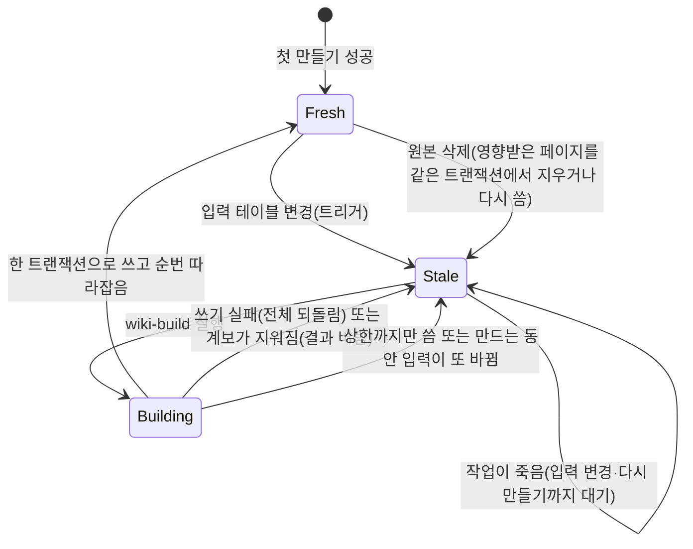

# 스펙: K01 — 근거 기반 Wiki 투영(페이지·Backlink·재생성)

- 날짜: 2026-11-23 / 상태: 확정(잠정 결정 포함)
- 관련: 이슈 #25(K01), 총괄 #1(설계 분석 1·5·9번), Phase 4 #6, 선행 #23(S02)·#24(S03). [I04 spec](2026-11-21-I04-invalidation.md)(등록표의 "Wiki 페이지" 줄, C1이 넘긴 K01-C3), [S02 spec](2026-11-22-S02-entity-resolution-temporal-graph.md)(R23·R24), [S03 spec](2026-11-22-S03-analytical-semantic.md)(R19), [ARCHITECTURE.md](../ARCHITECTURE.md), [OSS_EVALUATION.md](../OSS_EVALUATION.md), [ADR 0002](../adr/0002-authority-in-product-records.md)·[0013](../adr/0013-failure-recovery.md)·[0014](../adr/0014-egress-policy-and-consent.md)
- 번호: 요구사항 `K01-R<n>`, 결정 `K01-D<n>`. 완료 기준 `K01-C1`~`C3`은 이슈 #25의 번호 그대로이고 그 아래를 `a`·`b`·`c`로 나눈다. `K01-C4`는 이 spec이 더한 것이고 `K01-C5`~`C7`은 후속 #235가 더했다. ADR 번호와 마이그레이션 번호는 **합쳐지는 때 main의 다음 번호**를 쓴다.

| 말 | 뜻 |
|---|---|
| 정본 | 원본·근거·항목·사실·관계처럼 제품이 권위를 두는 SQLite의 행(ADR 0002) |
| 투영 | 정본에서 언제든 다시 만들 수 있는 사본. 잃어도 정본에서 복구된다 |
| 페이지 | 이 spec이 더하는 투영 한 줄. 한 대상(항목 묶음 하나, Insight 하나)에 대해 정본의 행을 모아 놓은 문서 |
| 주장 | 페이지 안의 한 줄. 사실 하나 또는 관계 하나를 가리키고, 그 행의 근거 ID를 달고 있다 |
| 계보 | 어떤 파생물이 어느 원본 version에서 나왔는지의 목록(I04). 삭제·범위·전송 등급을 모두 이것으로 판정한다 |
| 편집 레이어 | 사용자가 페이지에 붙인 메모와 "이 주장 숨김". 페이지와 다른 테이블에 있고 읽을 때 겹쳐 보인다 |

## 배경

지식의 정본(항목·사실·관계·근거·충돌·묶음)은 S01~S03으로 쌓였지만, 사용자가 "이 프로젝트에 대해 지금 아는 것"을 한 장으로 읽을 곳이 없다. 총괄 설계는 Wiki를 **정본의 투영**으로 정했다. LLM이 쓴 글이 다시 근거로 인용되면 근거 없는 내용이 스스로 불어나므로, Wiki의 글은 어떤 경우에도 근거가 되지 않는다. I04는 Wiki 페이지를 무효화·승계 계약에 등록할 자리를 비워 두고 실행 검증을 K01-C3에 넘겼다.

기존 LLM Wiki OSS(llm-wiki-compiler, sage-wiki)는 R01에서 "보류"였고 K01에서 다시 보기로 했다. 둘 다 자기 페이지 파일을 정본으로 삼고, 원본 삭제의 연쇄 제거와 시간 유효성이 실행으로 확인되지 않았다. 이 spec은 OSS를 들이지 않고 **같은 구조(종류별 페이지 + index + log)** 를 제품의 투영으로 만든다(K01-D1).

## 목표

1. 정본에서 종류별 페이지와 index·log가 만들어진다.
2. 새 지식이 들어오면 관련 페이지만 바뀌고, 페이지는 서로를 가리키며(backlink), 주장마다 근거와 충돌과 변경 이력이 보인다.
3. 쓰다가 실패해도 반쯤 쓰인 Wiki가 남지 않고, 원본을 지우면 그 내용이 페이지에서 사라지고, 원본의 access_scope가 페이지에 승계되고, 같은 정본 상태에서 다시 만들면 같은 페이지가 나온다. 사용자 편집은 다시 만들어도 남는다.
4. LLM 요약은 Provider Broker와 전송 정책을 지나는 선택 기능이고, 허용되지 않으면 결정적 페이지만으로 동작한다.

## 비목표

- **새 그래프·벡터·메모리 엔진, Wiki OSS 도입.** 페이지는 정본 SQLite의 테이블이다.
- **페이지 본문의 자유 편집(마크다운 편집기).** 사실을 고치는 길은 S01의 사용자 조치 입구다. Wiki의 편집은 메모와 숨김 둘뿐이다.
- **페이지 전문 검색, 벡터 검색, Q&A 문맥으로 쓰기.** X01(#30).
- **주제 묶기(여러 항목을 LLM이 한 topic으로 묶는 것), 그래프 화면.** K02(#26)·X02(#31).
- **페이지 내보내기(마크다운 파일), 백업.** H01(#32).
- **Electron 전용 E2E.** 이 화면은 주 흐름이 아니므로 브라우저 E2E 하나만 둔다.
- **실제 배포처 Provider·범위 정책으로의 확인.** 배포처 후속.

## 요구사항

### 페이지의 모양

- **K01-R1 페이지 종류와 키.** 페이지 키는 `<종류>/<대상 번호>`다. 대상은 항목 묶음의 대표 항목(S02 `rootOf`) 또는 Insight다. 항목 유형과 종류의 대응은 코드 상수 하나다.

| 종류 | 대상 |
|---|---|
| `concepts` `projects` `people` `organizations` `systems` `decisions` `business-rules` `metrics` | 같은 이름의 항목 유형(`Concept`…`Metric`) |
| `tasks` | `Task`, `Commitment` |
| `issues` | `Issue`, `OpenQuestion` |
| `topics` | 위에 없는 모든 항목 유형(`Event`, `Dependency`, `Dataset`, `Join`, 사용자·원본이 제안한 유형) |
| `syntheses` | 활성 Insight 하나(여러 원본을 묶은 결론) |
| `index`, `log` | 저장하지 않는다. 읽을 때 페이지 목록과 변경 기록에서 만든다 |

- **K01-R2 페이지의 내용은 정본에서 결정적으로 만든다.** 페이지는 제목(대표 항목의 이름), 묶음의 구성원 이름, 주장의 목록이다. 주장 하나는 사실 또는 관계 한 행의 ID, 종류와 값(관계는 유형과 상대 페이지 키), 상태, 인식 유형, 유효 기간, 근거 ID들, 충돌 상대(`CONTRADICTS`)와 대체한 행(`SUPERSEDES`)을 담는다. `rejected` 행은 싣지 않고(`rejected` 항목은 페이지도 만들지 않는다) 나머지는 상태 표시와 함께 싣는다. `syntheses`는 Insight의 요약과 근거, 양 끝 항목의 페이지 키를 담고 페이지 제목은 Insight의 요약이다. `metrics`는 상태만 쓰고 검사 결과는 쓰지 않는다(S03-R19). 문장으로 풀어 쓰는 일은 화면이 한다. 같은 정본 상태면 페이지의 바이트가 같다(순서는 행 ID).
- **K01-R3 Backlink.** 관계 주장과 Insight의 양 끝은 `(from 페이지, to 페이지, 근거가 된 행)` 줄로 저장한다. 어떤 페이지의 backlink는 그 페이지를 `to`로 가진 줄이다.

### 만들기와 고치기

- **K01-R4 만들기는 작업 하나다(`wiki-build`).** 새 작업 종류이고 Provider를 부르지 않는다. 작업은 ① 지금의 입력 순번을 읽고 ② 대상마다 페이지를 만들어 내용 해시를 저장된 것과 견주고 ③ **달라진 페이지와 없어진 대상의 페이지만** 결과로 낸다. 결과는 기존 작업 실행기가 `commitDerived`로 **한 트랜잭션**에 쓴다(페이지·계보·backlink·변경 기록·"여기까지 만들었다"는 순번). "관련 페이지 찾기"는 글자 검색이 아니라 **묶음의 대표 항목으로 키를 정하는 것**이다: 키가 있으면 그 페이지를 고치고 없으면 새로 만든다. `wiki-build`는 fence 없는 작업 종류다: 원본 version에 묶이지 않으므로 쓰기에서 결합 정책을 적용하지 않고, 계보의 원본이 지워졌으면 `assertLineage`가 여전히 결과를 버리며, 보여도 되는지는 읽을 때 정한다.
- **K01-R5 언제 만드는가.** 페이지가 읽는 테이블(원본 version 목록 `source_versions` 포함: 근거가 현재 version의 것인지가 페이지 내용을 정한다)이 바뀌면 트리거가 Wiki의 입력 순번을 올린다. 입력 순번이 만든 순번보다 크면 "낡음"이다. 낡았을 때 작업을 넣는 자리는 넷이다: 시작할 때, 어떤 작업이든 닫힐 때, 쓰는 API 요청이 성공한 뒤, Wiki를 읽을 때. 열린 `wiki-build`는 하나뿐이다. 죽었거나 취소된 작업(`dead_letter`·`cancelled`) 뒤에는 입력이 다시 바뀌거나 사용자가 "다시 만들기"를 누를 때만 새로 넣는다. 한 번에 쓰는 페이지 수에는 상한이 있고(잠정 500), 넘으면 순번을 올리지 않아 다음 실행이 잇는다.
- **K01-R6 변경 기록.** 페이지가 생기고 바뀌고 없어질 때마다 내용 없는 줄 하나를 남긴다: 페이지 키, 동작, 그때의 knowledge revision과 변경 순번, 더해진·빠진 주장 수, 시각. 페이지의 "변경 이력"과 `log`는 이 줄을 읽는다. 줄은 잠정 1,000줄까지 두고 오래된 것부터 지운다. 이 수는 저장된 페이지에서 센 것이라, 읽는 쪽이 페이지의 주장을 모두 볼 수 없으면 그 페이지의 변경 이력과 `log` 줄의 더해진·빠진 수를 0으로 준다(K01-D19). 줄마다 더 좁히는 규칙은 R18에 있다. 페이지 대상 항목이 지워지면 그 키의 변경 기록은 지우고 메모는 `<키>#gone` 키로 옮겨, 같은 번호를 새로 받은 항목의 페이지에 붙지 않게 한다(K01-D20).

### 실패·삭제·범위·재생성

- **K01-R7 반쯤 쓰인 Wiki는 없다.** 쓰기가 도중에 실패하면 그 트랜잭션 전체가 되돌려져 페이지는 실패 전 그대로이고, 순번이 오르지 않아 "낡음"으로 남는다. 작업은 기존 재시도 규칙(I03)으로 다시 돌고, 강제 종료 뒤에는 시작할 때의 확인이 잇는다. 낡은 동안 읽기 API는 `stale: true`를 함께 준다.
- **K01-R8 원본 삭제와 정리.** 파생물 종류 `wiki-page`를 등록한다(층 `projection`, 실행 위치 `canonical`: K01-D3). 페이지의 계보는 항목의 계보와 페이지가 싣는 모든 사실·관계의 행 계보의 합집합이다(사용자가 쓴 항목은 제 계보가 없어도 거기 붙은 추출 사실의 원본이 계보에 든다). tombstone과 지난 version 정리의 트랜잭션 안에서, 계보에 그 원본의 지워지는 version이 있는 페이지를 그 트랜잭션이 남긴 정본에서 다시 그린다. 지운 원본만이 채우던 페이지(또는 대상이 사라진 페이지)는 계보·backlink와 함께 지우고, 다른 원본도 채우던 페이지는 영향받은 키를 다시 그려 같은 트랜잭션에서 덮어 써서 트랜잭션이 끝날 때 지운 원본의 내용이 없게 한다(공통 계약의 ②는 계보가 남은 행이 남을 것을 요구한다). 만들기 결과를 쓰는 순간 계보의 원본이 지워져 있으면 `commitDerived`가 결과 전체를 버린다(낡은 쓰기 거부).
- **K01-R9 access_scope 승계.** 페이지의 범위는 저장하지 않고 계보에서 읽는다(I04-R13). 읽기 경로는 `backend/src/wiki-read.ts`에 있고 읽기 문(`read-gate.ts`)의 도우미를 쓴다: 대상(항목·Insight)이 지금 있고 보일 때만 페이지가 나오고(아니면 없는 페이지와 같은 `not-found`), 주장·근거·backlink는 가리키는 행이 **지금 있고 보이는 것만** 나온다. LLM 요약은 페이지 계보 전체가 보이고 그 계보를 한데 묶어도 될 때(`combinable`)만 나온다. index와 log도 보이는 페이지의 줄만 낸다. 주장 수를 가리는 규칙은 R6에 있다. 범위 정책이 거부하는 범위 조합은 읽을 때만 걸러진다(쓰기에는 결합 정책이 없다): 두 사실을 잇는 `contradicts`·`supersedes`는 두 사실 계보의 합이 `combinable`일 때만 나온다. 사실의 실제 끝(`validUntil`)은 본문에 미리 합쳐 두지 않고(자기 끝과 대체한 사실의 목록·시작만 둔다) 읽을 때 보이고 합칠 수 있는 대체 사실만으로 계산한다(S02-R24 1). **합치기 줄은 보이는 것만 묶음이다**: 읽는 쪽이 보는 묶음은 대표에서 이어지는 보이는 줄·보이는 항목만이고(S02-T09 묶음 보기와 같은 도우미 `groupView`, S02-R24 4), 줄이나 항목이 보이지 않는 구성원의 이름·주장(사실·관계)·그에서 나온 backlink·대체 사실의 끝은 대표 페이지에 없으며, 보이는 구성원의 원본을 정책이 함께 묶지 못하면 대표 항목만 남는다.
- **K01-R10 재생성.** "다시 만들기"는 내용 해시 비교와 500쪽 상한을 건너뛰고 모든 페이지를 다시 그려 내용 해시가 다른 페이지만 쓴다(해시가 같은 페이지는 쓰지 않아 해시·시각·기록이 그대로다). 한 번에 끝나므로 상한 때문에 같은 쪽만 되풀이하지 않고, `wiki_state`의 강제 순번(요청한 순번과 처리한 순번)으로 추적한다. 같은 정본 상태(같은 knowledge revision과 변경 순번)에서 다시 만든 페이지의 내용 해시는 이전과 같다. LLM 요약은 그 페이지의 내용 해시가 같으면 그대로 두고 다시 부르지 않는다(요약 자체는 이 동일성의 대상이 아니다).
- **K01-R11 사용자 편집은 편집 레이어에 있다.** 편집은 둘이다: 페이지에 메모 달기·지우기, 주장 숨기기·되돌리기. 편집은 페이지 테이블이 아닌 `wiki_edits`에 저장하고 **읽을 때** 겹친다. 만들기와 다시 만들기는 이 테이블을 쓰지 않는다. 숨김 줄은 그 사실·관계가 지워질 때 함께 지워진다. 메모는 사용자가 쓴 글이므로 페이지가 없어져도 남고, index가 "붙을 페이지가 없는 메모"로 보여 주며 사용자가 지운다.

### LLM 요약

- **K01-R12 요약은 선택 기능이고 Broker만 지난다.** 설정 `wiki.summary`(기본 OFF, 값이 정확히 `on`일 때만 켬)가 켜져 있으면, 요약이 지금 내용 해시의 것이 아닌 페이지마다 작업 `wiki-summary`를 넣는다. 넣는 자리는 셋이다: 시작할 때, 어떤 작업이든 닫힐 때, 설정을 켤 때. 한 페이지에 열린 작업은 하나이고, 같은 내용 해시로 이미 시도한 페이지는 다시 넣지 않는다. `syntheses` 페이지는 요약하지 않는다. 작업은 Broker에 **ID만** 넘긴다(계보의 원본 version 행 ID, 대상 항목 ID, 작업 종류 `wiki-summary`). 동의·전송 정책·등급(계보 전체와 항목 이름, I04-R16·S02-R23)·실행 조건은 기존 Broker가 판정한다. 계보를 한데 묶어도 되는지는 호출 전에 등록부의 `combinable`에 묻고, 계보의 원본 version이 잠정 8개를 넘거나 원문의 합이 추출 한 번의 상한(잠정 2만 글자)을 넘으면 요약하지 않는다. `wiki-summary`도 fence 없는 종류다.
- **K01-R13 요약도 근거에 묶이고, 근거가 되지는 않는다.** 응답은 문장마다 그 문장이 기댄 문서의 ID와 원문에서 그대로 베낀 인용문을 단다. 코드가 그 문서의 본문에서 인용문을 정확히 한 번 찾지 못한 문장은 버리고(추출과 같은 규칙), 남은 문장을 잠정 5개까지 페이지 행의 요약 칸에 `(문장, 원본 version, 위치)`로, 그때의 내용 해시와 함께 저장한다. 페이지 내용이 바뀌어 다시 쓰일 때 요약 칸은 비워진다(원본 삭제로 다시 쓰이는 페이지 포함). 화면은 "LLM 요약"으로 구분해 보인다. 요약은 `evidence`·`facts`·`relations`·키워드 색인에 쓰이지 않고, 추출과 연결 후보의 입력으로 읽히지 않는다.
- **K01-R14 허용되지 않으면 결정적 페이지로 남는다.** Provider가 없거나 Broker가 막으면 작업은 기존 규칙대로 보류되고(`held`) 페이지는 요약 없이 그대로 보인다. 다른 Provider로 넘어가지 않는다. 읽기 API는 요약의 상태를 준다: 설정이 꺼져 있으면 `off`, 지금 내용 해시의 요약이 있고 보여도 되면 `ready`(문장 포함), 그 페이지의 작업이 보류 중이면 `held`, 나머지는 `none`.

### API·화면·문서

- **K01-R15 API.** `GET /api/wiki`(index: 종류별 페이지 목록, 최근 변경 기록, 낡음 표시, 붙을 페이지가 없는 메모), `POST /api/wiki/page`(본문에 키 하나. 응답에는 사용자가 숨긴 주장 목록 `hidden`이 있고 `claims`와 같은 읽기 규칙으로 걸러진다. 서버에 변수 있는 GET이 없어 id로 읽는 길은 POST다), `POST /api/wiki/edit`(`op`와 선택 필드를 가진 엄격한 객체 하나, `op`는 편집 넷 중 하나), `POST /api/wiki/rebuild`. index 응답의 `buildDead`는 낡았는데 마지막 만들기 작업이 죽었거나 취소되어 아무것도 다시 시도하지 않는 상태다(R5). 쓰기 뒤 작업을 넣다가 던져도 이미 커밋된 요청은 성공으로 답한다(K01-D21). 스키마는 `packages/contracts`에 둔다. `wiki.summary`는 기존 Semantic 설정 API의 `wikiSummary` 필드로 읽고 쓴다(설정 화면은 없다).
- **K01-R16 화면.** 내비게이션에 "위키"를 더한다. 종류별 목록에서 페이지를 열면 주장(상태·충돌 표시), 근거 열기(기존 근거 보기 재사용), 링크와 backlink, 메모, 숨긴 주장(응답의 `hidden`에서 읽어 다시 보이기 단추를 둔다), 변경 이력이 보인다. `buildDead`이면 화면은 낡음 안내 대신 실패 안내를 보이고 읽기를 되풀이하지 않는다. 문구는 한국어 문구 모듈에 둔다.
- **K01-R17 문서.** ARCHITECTURE의 저장 표("Wiki 페이지" 줄), I04 등록표의 그 줄(실행 위치), OSS_EVALUATION·REUSE_AND_BUILD의 Wiki 계층 판정, 문서 색인, 새 ADR 하나(Wiki는 정본 SQLite 안의 투영, OSS 미도입), site-setup의 배포처 항목을 같은 PR에서 고친다.

### 후속 #235 (읽기에서 새는 틈)

- **K01-R18 변경 수는 지금도 판정할 수 있는 줄에만 준다.** 기록 줄은 주장 ID를 담지 않으므로, 읽을 때 보이는지 다시 물을 수 있는 것은 지금 본문에 남은 주장뿐이다. ① 줄의 더해진 수는 R6의 조건(읽는 쪽이 지금 페이지의 주장을 모두 본다)에 더해 **그 줄 뒤에 같은 페이지의 어느 줄도 주장을 빼지 않았을 때만** 주고, 아니면 0이다. 빠진 수는 언제나 0이고 화면은 "−n"을 보이지 않는다(빠진 주장은 본문에 없어 보이는지 물을 수 없다. KF-R3). 가리는 조건이 "숨은 주장이 있었는가"가 아니라 "뒤에 빠진 것이 있는가"이므로 가려진 줄에서 숨은 주장의 존재를 알 수 없다. 응답의 모양은 그대로다. ② "주장을 모두 본다"는 페이지 응답이 주장을 걸러 내는 규칙과 같다: 관계 주장은 상대 페이지가 보이고 관계의 대상이 그 페이지의 묶음 보기에 들어야 본 것이다(R9). 페이지의 변경 이력과 index의 `log`에 똑같이 적용한다(K01-D22).
- **K01-R19 되돌리기로 지워진 항목의 페이지는 그 자리에서 지운다.** 사용자가 만든 항목의 만들기를 되돌려 항목 행이 지워지면, 같은 트랜잭션에서 그 항목을 대상으로 한 페이지 행과, 항목과 함께 지워진 Insight의 `syntheses` 페이지 행을 계보·링크와 함께 지운다. 다음 만들기를 기다리지 않으므로 같은 번호를 받은 새 항목의 페이지로 옛 제목·구성원 이름이 보이지 않는다(K01-D23).

## 인터페이스 / 설계 개요

**테이블(마이그레이션 하나).** `wiki_pages`(키, 종류, 대상, 제목, 본문 JSON, 내용 해시, 요약 JSON과 그것이 만들어진 내용 해시, 시각), `wiki_page_lineage`(페이지, 원본, version), `wiki_links`(from, to, 근거가 된 행의 종류와 ID), `wiki_log`(K01-R6), `wiki_edits`(K01-R11), `wiki_state`(한 줄: 입력 순번, 만든 순번, 만든 때의 knowledge revision·변경 순번)와 입력 테이블의 트리거. `backend/src/derivative-coverage.ts`의 테이블 분류에 같은 변경으로 더한다(`wiki_log`·`wiki_state`는 운영, 나머지는 종류 `wiki-page`).

**모듈.** 저장은 `storage/src/wiki.ts`, 만들기(순수 함수)와 작업·종류 등록은 `knowledge-engine`, 읽기 문·경로·작업 넣는 자리는 `backend`, 화면은 `apps/web`. 묶음은 `EntityGroups`, 충돌은 `assertion-links`, 근거는 기존 근거 읽기, 작업은 기존 큐와 실행기, 쓰기는 `commitDerived`, 보류와 풀림은 기존 `held` 규칙을 그대로 쓴다.

**Wiki의 상태.** "낡음"과 "만드는 중"을 오가는 길이 여럿이라 그림으로 둔다.

### 대안과 기각 사유

- **OSS(llm-wiki-compiler) 도입**: 페이지 파일이 두 번째 정본이 되고, 삭제 연쇄·시간 유효성·Electron 번들 호환이 실행으로 확인되지 않았다(OSS_EVALUATION 3.1절·7절).
- **저장하지 않고 읽을 때마다 만들기**: 변경 이력과 LLM 요약을 둘 곳이 없고 backlink를 매번 전부 계산한다.
- **삭제를 커밋 뒤 작업으로(엔진·벡터 투영과 같은 길)**: 페이지가 정본과 같은 파일에 있으므로 같은 트랜잭션에서 지우거나 다시 쓸 수 있고, 그러면 지운 내용이 남는 구간이 없다.
- **편집을 페이지에 직접 쓰기**: 다시 만들 때 합치는 규칙이 필요하고 틀리면 편집을 잃는다.

## 완료 기준 (테스트 가능한 형태)

모든 시험은 합성 fixture만 쓴다. 각 기준은 대표 사례 1~2개다.

- **K01-C1** (R1·R2) 항목 유형마다 한 행씩과 활성 Insight 하나를 넣고 만들면, 표의 대응대로 열두 종류의 페이지가 생기고(`Event`는 `topics`), 주장이 근거 ID·상태를 달고 있으며, `metrics` 페이지에 검사 결과가 없다. index가 종류별로 그 페이지를 나열하고 log에 생성 줄이 있다. → `knowledge-engine/src/wiki-render.test.ts`
- **K01-C2a** (R3·R4·R5·R6·R15, 실제 입력) 띄운 백엔드에 합성 JSONL을 가져오기 API로 넣고 fixture 추출로 작업을 끝까지 돌리면: ① 페이지가 생기고 주장의 근거 ID가 근거 API에서 원문 위치로 열린다 ② 관계의 상대 페이지에 backlink가 있다 ③ 같은 항목의 다른 값을 담은 두 번째 문서를 넣으면 **같은 키의 페이지가 바뀌고**(새 페이지 없음) 두 주장이 서로를 충돌 상대로 가리키며, 변경 기록이 "생성" 뒤 "변경"이고, 무관한 페이지의 내용 해시와 시각은 그대로다. → `backend/src/wiki-flow.test.ts`
- **K01-C2b** (R16) 사용자가 "위키"에서 페이지를 열어 주장을 보고, 근거를 열고, 링크로 넘어가 backlink를 보고, 메모를 달면 다시 열어도 남아 있다. → `apps/web/e2e/wiki.e2e.ts`(브라우저 하나)
- **K01-C3a** (R7, 부분 쓰기 실패 복구) 여러 페이지를 쓰는 도중 한 페이지의 쓰기가 던지면 저장된 페이지가 실패 전과 같고 `stale`이 참이다. 다시 돌리면 끝나고, 결과가 실패 없이 한 번에 만든 것과 내용 해시로 같다. → `knowledge-engine/src/wiki-build-job.test.ts`
- **K01-C3b** (R8·R9, 삭제와 access_scope 승계) ① 두 원본에서 주장을 얻은 페이지가 있을 때 한 원본을 지우면, 그 트랜잭션이 끝난 직후 Wiki 테이블 어디에도 그 원본의 카나리 글자가 없고, 두 원본이 채우던 페이지에는 남은 원본의 주장만 있으며(그 트랜잭션 안에서 다시 써진 것), 지운 원본만이 채우던 페이지는 계보·링크와 함께 없다. ② 한 범위를 거부하는 범위 정책으로 읽으면 그 범위 원본의 주장과 요약이 응답에 없고, 대상이 가려진 페이지는 없는 페이지와 같은 답이다. ③ 등록된 종류 공통 계약(I04 계약 ①~⑥)이 `wiki-page`에 대해 통과한다. ④ 사용자가 쓴 항목에 다른 원본에서 추출한 사실이 붙어 있을 때 그 원본을 지우면 같은 트랜잭션에서 Wiki 테이블에 카나리가 없고, 지우기 전에 계획한 만들기가 지운 뒤에 커밋하면 결과 전체가 버려진다. ⑤ 거부된 범위의 사실이 보이는 사실을 대체해도 응답의 `validUntil`에 그 날짜가 없고, 두 범위를 합칠 수 없는 정책에서는 `contradicts`·`supersedes`와 대체 사실에서 온 끝이 없다. ⑥ 두 항목을 합친 줄이 정책에서 보이지 않을 때(각 원본은 따로 보이나 함께는 거부) 대표 페이지에 다른 구성원의 이름·주장이 없고, 그 구성원의 관계에서 온 backlink가 대상 페이지에 없으며, 관계의 대상이나 Insight의 끝이 숨은 구성원이면 그 관계 주장·링크·대상 쪽 backlink가 없고(대상 쪽 페이지는 그 구성원의 대표 페이지라는 사실이 새지 않는다), 함께 묶을 수 있는 정책에서는 모두 나온다. **변이**: 종류의 삭제와 읽기 문의 걸러 내기를 각각 빼면 ①·②가, 페이지 계보에서 사실·관계의 행 계보를, 대체 사실의 보임 확인을, `combinable` 확인을 각각 빼면 ④·⑤가, 묶음 보기(`groupOf`), backlink의 관계 주체 확인, 관계 대상 확인(주장·backlink), Insight 끝 확인(링크·backlink)을 각각 빼면 ⑥이 빨개진다. → `knowledge-engine/src/wiki-kind.test.ts`, `backend/src/wiki-gate.test.ts`, 공통 계약 함수 `derivativeKindContract`(`packages/testkit/src/derivatives.contract.ts`)는 `wiki-kind.test.ts`에서 부른다
- **K01-C3c** (R10·R11, 재생성과 사용자 편집) 메모 하나와 숨김 하나가 있는 상태에서 "다시 만들기"를 돌리면 모든 페이지의 내용 해시가 이전과 같고, 메모가 그대로 보이며 숨긴 주장은 여전히 빠져 있다. → `backend/src/wiki-flow.test.ts`
- **K01-C4** (R12·R13·R14, 이 spec이 더함) ① `wiki.summary`를 켜고 fake Provider로 돌리면 인용문이 원문에 있는 문장만 요약으로 저장되고(없는 인용문의 문장은 버려짐), `evidence`·`facts`·키워드 색인의 행 수가 그대로다. ② 동의가 없으면 작업이 `held`이고 Provider 호출 기록에 시도가 없으며 페이지는 요약 상태 `held`로 그대로 열린다. ③ 설정이 꺼져 있으면 작업이 생기지 않는다. → ① `knowledge-engine/src/wiki-summary-job.test.ts`와 `providers/src/broker.wiki-summary.test.ts`(작업 종류·등급), ②·③ `backend/src/wiki-flow.test.ts`(보류와 상태 표시는 실행기와 읽기 경로가 정한다). 요약의 범위 걸러 내기는 C3b ②의 `backend/src/wiki-gate.test.ts`가 본다.
- **K01-C5** (R18 ①, 새는 틈 가드) 한 페이지에 공개 주장 하나로 만들고, 거부되는 범위의 주장이 더해진 뒤 빠지고, 공개 주장이 하나 더 더해지면(줄 넷): 그 범위를 거부하는 정책으로 읽든 모두 허용하는 정책으로 읽든 변경 이력과 index `log`의 더해진 수는 마지막 줄만 1이고 앞의 세 줄은 0이며, 빠진 수는 모든 줄에서 0이다. **변이**: "뒤 줄이 주장을 뺐는가" 확인을 빼면 빨개진다(주장이 빠진 뒤에는 지금 페이지의 주장이 모두 보이므로 R6의 조건만으로는 이 사례를 가리지 못한다). → `backend/src/wiki-gate.test.ts`
- **K01-C6** (R18 ②, 새는 틈 가드) C3b ⑥의 fixture(관계의 대상이 숨은 구성원)에서 관계 주체 페이지의 생성 줄은, 두 범위를 함께 묶지 못하는 정책으로 읽으면 더해진 수가 0이고 묶을 수 있는 정책으로 읽으면 2다(사실 하나와 관계 하나). **변이**: 변경 수 판정의 관계 끝 확인을 빼면 빨개진다(그 관계의 행 자체는 보이고 주체도 묶음 보기에 들며 빠진 줄이 없어, 다른 확인은 이 사례를 가리지 않는다). → `backend/src/wiki-gate.test.ts`
- **K01-C7** (R19) 사용자가 만든 항목과 그 항목을 끝으로 둔 Insight의 페이지가 저장돼 있을 때 그 항목의 만들기를 되돌리면, 되돌리기가 끝난 직후 `wiki_pages`에 두 페이지의 행이 없고 `wiki_page_lineage`에 그 키의 줄이 없다. → `storage/src/wiki.test.ts`

변이 검사는 C5·C6에만 한 번씩 한다(둘 다 숨은 정보를 수로 내보낼지 정하는 가드다). C7은 낡은 행을 지우는 일이라 먼저 빨간 시험으로 충분하다.

| 기준 | 지금 충족 가능한가 | 남는 것 |
|---|---|---|
| C1, C2a·b, C3a·b·c | 가능(오늘의 main) | `metrics`가 `listMetricViews`를 읽는 것은 S03-T08 뒤(T3) |
| C4 | S03-T07이 합쳐진 뒤(같은 파일을 고친다) | 실제 Provider로의 요약 품질은 배포처 |
| C5~C7 | 가능(오늘의 main, 마이그레이션 없음) | 빠진 수를 다시 보이려면 D22의 길 |

## 미해결 질문 / 검증하지 않은 범위

- **규모.** 만들기는 매번 모든 대상을 훑어 해시를 견준다. 항목 수만 개에서의 시간은 재지 않았다. 느리면 바뀐 대상만 훑는 표시를 더한다(K01-D5).
- **500쪽 상한의 이음.** 상한을 넘으면 다음 실행이 잇는 반복은 시험하지 않았다.
- **범위 정책의 거부.** 서로 다른 범위를 한 페이지에 묶는 것을 거부하는 배포처 정책은 읽을 때만 적용된다. 쓰기는 결합 정책을 묻지 않으므로 저장된 페이지에는 그 조합이 있을 수 있다.
- **메모에 남은 원문.** 사용자가 메모에 원문을 옮겨 적었다면 원본을 지워도 메모에는 남는다. 제품은 사용자가 쓴 글을 지우지 않는다(K01-D7).
- **요약의 품질·비용**, 요약에 넘기는 원본 수 상한(8)의 적정값은 재지 않았다.
- **Windows 설치본에서의 화면**은 확인하지 않는다(H02 #33).

## 잠정 결정과 가정

| 번호 | 결정 | 이유 | 바꾸려면 |
|---|---|---|---|
| K01-D1 | Wiki OSS를 들이지 않고 같은 구조를 제품의 투영으로 만든다 | 후보의 삭제 연쇄·시간 모델이 미검증이고 페이지 파일이 두 번째 정본이 된다 | 읽기 API(R15) 뒤에서 만들기만 OSS 어댑터로 바꾼다. 정본·읽기 문·편집 레이어는 그대로 |
| K01-D2 | 페이지는 정본 SQLite 안의 테이블, 본문은 구조화된 JSON(문장화는 화면) | 삭제를 같은 트랜잭션에서 하고, 같은 상태면 같은 바이트가 된다 | 본문 칸의 모양만 바꾸고 화면의 그리기를 고친다 |
| K01-D3 | 종류 `wiki-page`의 실행 위치는 `canonical`(I04 등록표는 `projection`으로 적혀 있었다) | 같은 파일이므로 tombstone 트랜잭션에서 지우거나 다시 써 "지운 내용이 남는 구간"을 없앤다 | 종류의 `storage`를 `projection`으로 바꾸고 `projection-remove` 포트를 단다 |
| K01-D4 | 낡음은 Wiki 자신의 입력 순번(트리거)으로 판정한다. knowledge revision은 기록과 동일성 시험에만 쓴다 | knowledge revision은 항목·사실·관계·유형 정의만 따라가서 근거·충돌·묶음·Insight·삭제를 놓친다. 그 번호의 뜻을 넓히면 S03의 검사 현재성이 흔들린다 | 트리거 대상 테이블 목록(상수와 대조 시험)을 고친다 |
| K01-D5 | 만들기는 전체를 훑고 달라진 것만 한 트랜잭션에 쓴다. 한 번에 500쪽 | 구현이 작고 반쯤 쓰인 상태가 구조적으로 없다 | 상한 상수를 바꾸거나, 바뀐 대상 표시 테이블을 더한다 |
| K01-D6 | `topics`는 제 종류가 없는 항목 유형의 페이지, `syntheses`는 Insight, index·log는 읽을 때 계산 | 주제 묶기 엔진 없이 이슈의 종류 목록을 채운다 | 대응 상수를 바꾼다. 주제 묶기는 K02 |
| K01-D7 | 편집은 메모와 숨김 둘, 읽을 때 겹친다. 메모는 페이지가 없어져도 남는다 | 다시 만들기가 편집을 건드릴 길이 없고, 사용자의 글을 조용히 지우지 않는다 | `wiki_edits`의 동작 종류를 더한다. 메모를 대상과 함께 지우려면 종류의 삭제에 한 줄 |
| K01-D8 | LLM 요약은 기본 OFF, 페이지당 문장 5개까지, 입력은 계보의 원문 문서와 대상 항목의 이름(Broker의 기존 입력 모양). `syntheses` 페이지는 요약하지 않는다 | 호출 예산을 추출과 나눠 쓰는 추정 기능이라 켜기 전 측정이 필요하다. Broker에 새 입력 모양을 만들지 않는다 | 설정 기본값, 상한 상수. 주장만 보내려면 Broker에 파생 입력 모양을 더하는 별도 spec |
| K01-D9 | `rejected`만 빼고 후보·이의·지난 값도 상태 표시와 함께 싣는다 | Wiki는 "지금 아는 것과 그 확실함"을 보이는 곳이다(S03 미해결 6번의 답) | 만들기의 상태 거르기 상수 |
| K01-D10 | `metrics`는 `Metric` 항목을 다른 종류와 같은 길로 만든다(T3 보류) | `listMetricViews`(S03-T08)는 있으나 `MetricView`는 대표 항목 자신의 행만 담고, 행에 유효 기간·대체·충돌 상대가 없으며, 정해진 사실 종류 묶음에 든 것만 돌려주고, `grain`은 Dataset의 사실이다. R2의 주장 모양으로 옮기려면 새 대응을 지어내야 한다 | 하지 않기로 했다(KF-D4, [K01·K02 후속 spec](2026-11-24-K01K02F-followups.md), 2026-11-24 다시 확인). 바꾸려면 `/api/analytical`이 유효 기간·대체를 실어야 할 이유가 생겼을 때 S03 읽기를 넓히고 T3을 다시 연다 |
| K01-D11 | `syntheses` 페이지는 요약하지 않는다 | 대상이 Insight라 이미 요약이고, Broker의 후보 모양은 항목만 이름 짓는다 | 대기열 조건 1을 빼고 후보에 Insight 조회를 더한다 |
| K01-D12 | 상한 8은 계보의 원본 **version** 수(보내는 문서 수)로 센다 | 한 호출이 싣는 양을 막는다 | 원본 수(`DISTINCT source_id`)로 센다 |
| K01-D13 | 작업 대상은 `<페이지 키>#<내용 해시>`이고 핸들러는 지금 내용을 요약한다 | 페이지당 열린 작업 하나, 같은 내용으로 실패한 시도를 되풀이하지 않음, 새 칸 없음 | 시도 횟수 칸을 마이그레이션으로 더한다 |
| K01-D14 | 페이지 내용이 바뀌어 다시 쓰이면 요약 칸을 비운다 | 낡은 요약을 보이지 않고, 지운 원본의 글이 남지 않게 한다(C3b ①) | 비우기를 `wiki-kind.ts`의 무효화에만 둔다 |
| K01-D15 | 설정은 기존 Semantic 설정 경로로 노출하고 화면은 없다 | 새 경로 없이 쓰고, 켜기는 측정 뒤의 출시 단계다(D8) | 전용 경로나 Wiki 화면의 토글을 더한다 |
| K01-D16 | 화면은 문장만 보이고 "위치 열기" 단추는 없다 | `evidence` 행이 아닌 (version, 위치)를 여는 읽기가 없고 R13이 근거 쓰기를 막는다 | 원본 구간을 여는 읽기를 후속 이슈로 더한다 |
| K01-D17 | 인용문이 두 번 나오는 문장은 버린다 | `locateQuote`를 그대로 쓴다 | 핸들러에서 첫 일치를 받아들인다 |
| K01-D18 | 핸들러는 스키마 불일치에 호출을 되풀이하지 않는다 | 한 페이지 한 호출로 추출과 나눠 쓰는 예산을 지킨다 | `extractOnce`처럼 한 번 더 부른다 |
| K01-D19 | 변경 기록의 더해진·빠진 수는 호출자가 그 페이지의 주장을 모두 볼 수 있을 때만 주고, 아니면 0이다 | 수가 저장된 페이지에서 센 것이라 호출자별 정확한 수를 저장 행에서 만들 수 없다 | 줄에 주장 ID를 저장해 읽을 때 센다 |
| K01-D20 | 대상 항목(Insight)이 지워지면 그 페이지 키의 변경 기록을 지우고 메모는 `<키>#gone`으로 옮긴다. 정수 행 번호는 재사용될 수 있다(AUTOINCREMENT 아님) | 같은 번호를 받은 새 항목의 페이지에 옛 메모와 이력이 붙지 않게 한다. 메모는 지우지 않는다(D7) | 항목 테이블에 줄어들지 않는 번호를 둔다 |
| K01-D21 | 쓰기 뒤 `afterWrite`가 던져도 이미 커밋된 요청은 성공으로 답하고 경로 이름·오류 종류만 로그한다. 종류 `wiki-page`의 다시 쓰기 시각은 등록부의 시계를 쓴다. 죽은 작업은 index의 `buildDead`로 알린다 | 커밋된 쓰기가 500으로 보이면 재시도로 중복 쓰기가 난다. 화면이 죽은 작업을 모르면 1.5초마다 읽기를 되풀이한다 | — |
| K01-D22 | 줄의 더해진 수는 지금 페이지의 주장이 모두 보이고 그 뒤 줄에서 빠진 주장이 없을 때만 주고, 빠진 수는 주지 않는다(항상 0). 마이그레이션은 없다 | 줄에 주장 ID가 없어 지금 본문에 남은 주장만 다시 판정할 수 있다. 뒤에 빠진 것이 없으면 그 줄이 더한 주장은 모두 본문에 남아 있다. 칸을 더하는 마이그레이션은 병행 브랜치와 번호가 겹친다. 화면은 "−n"을 보이지 않는다(KF-R3) | `wiki_log`에 줄이 더하고 뺀 주장 ID 칸을 마이그레이션으로 더하고, 읽을 때 지금 있고 보이는 ID만 센다(D19의 길). 행이 지워진 주장은 그때도 세지 못한다 |
| K01-D23 | 페이지 행을 바로 지우는 것은 되돌리기 경로뿐이다. 원본 삭제 경로는 그대로 둔다 | 원본 삭제에서는 종류 `wiki-page`가 같은 트랜잭션에서 그 페이지를 지우고 지운 수를 센다. 항목 삭제 쪽에서 먼저 지우면 그 수가 0이 된다 | 지우기를 `endWikiItemIncarnation`에 합치고 종류의 집계를 고친다 |

## 작업 분해

큰 단위로 간다. T1이 이슈의 세 기준을 모두 닫고, T2·T3은 다른 세션이 쥔 파일이 풀린 뒤에 잇는다.

| 작업 | 내용 | 기준 | 선행 |
|---|---|---|---|
| K01-T1 | 마이그레이션, 저장, 만들기, 작업과 넣는 자리, 종류 등록, 읽기 문, API, 화면, 문서·ADR | C1, C2a·b, C3a·b·c | 없음(오늘의 main에서 시작). PR 전에 S02-T09/T10이 합쳐진 main으로 rebase |
| K01-T2 | LLM 요약: 작업 종류 `wiki-summary`, Broker 작업 정의, 설정, 요약 상태 표시 | C4 | K01-T1, S03-T07 머지 |
| K01-T3 | `metrics` 페이지가 `listMetricViews`를 읽도록 바꿈 | C1(그 줄) | K01-T1, S03-T08 머지. **하지 않음**: 읽기 함수의 모양이 R2의 주장 모양과 맞지 않고(D10) 다시 재도 그대로다(KF-D4) |
| K01-T4 | 후속 #235 F1~F3: 줄별 변경 수 가리기, 변경 수 판정의 관계 끝 확인, 되돌리기 때 페이지 행 삭제 | C5, C6, C7 | K01-T1 |

## 배포처 후속

`docs/site-setup.md`에 항목 하나를 더한다(번호는 S35다. S33·S34는 S02·S03이 잡았고, 합칠 때 이미 쓰였으면 다음 번호).

- 배포처 범위 정책을 건 채로 Wiki를 열어, 허용되지 않은 범위 원본의 주장·요약·backlink가 나오지 않는지 확인한다(K01-C3b ②의 실제 정책판).
- `wiki.summary`를 켜기 전에 요약에 실리는 원본의 등급이 배포처 전송 정책에서 허용되는지, 호출 예산이 추출을 밀어내지 않는지 잰다.
- 실제 규모에서 첫 만들기와 증분 만들기의 시간을 잰다(K01-D5).

## 변경 이력

| 날짜 | 변경 내용 | 대상 | 사유 |
|---|---|---|---|
| 2026-11-23 | 초안 작성 | 이 문서 | 이슈 #25 착수 |
| 2026-11-23 | 확정. C3b의 공통 계약 시험 위치를 종류 자신의 시험 파일로 고침 | 상태, K01-C3b | 계약은 종류마다 제 시험에서 부르는 함수다 |
| 2026-11-23 | 구현이 정한 것을 글에 맞춤: 페이지 읽기는 POST, 편집 요청은 `op` 하나의 엄격한 객체, 요약 상태는 T2 전까지 `off`(R15·R14). 삭제 때 공유 페이지는 같은 트랜잭션에서 다시 쓰고 단독 페이지는 지움(R8, D3, C3b ①, 상태 그림). 강제 다시 만들기는 상한 밖이고 강제 순번으로 추적(R10). 읽기 경로는 `wiki-read.ts`(R9). `rejected` 항목은 페이지 없음, `syntheses` 제목은 요약(R2). `wiki-build`는 fence 없는 종류이고 결합 정책은 읽을 때만(R4·R9). 미해결에 상한 이음과 범위 정책 거부 | R2, R4, R8~R10, R14, R15, D3, C3b ①, 상태 그림, 미해결 | K01-T1 구현 |
| 2026-11-23 | 독립 검토 반영(보안): 페이지 계보에 사실·관계의 행 계보를 더함(R8, C3b ④), `validUntil`을 읽을 때 보이는 대체 사실로 계산하고 두 사실 연결에 `combinable`을 건다(R9, C3b ⑤) | R8, R9, C3b | K01-T1 검토 S-M1~S-M3 |
| 2026-11-23 | 독립 검토 반영(정확성): 강제 다시 만들기는 상한 없이 해시가 다른 페이지만 쓴다고 문장을 코드에 맞춤(R10), `source_versions`를 입력 테이블에 더함(R5), 페이지 응답에 `hidden`(R15)과 화면의 숨긴 주장 목록(R16) | R5, R10, R15, R16 | K01-T1 검토 C-M1~C-M3 |
| 2026-11-23 | 합치기 줄 보임 검사: 읽는 쪽 묶음은 보이는 줄·항목만(R9), C3b ⑥ 추가(관계 대상·Insight 끝 포함) | R9, C3b | 후속 #220 첫 항목, 독립 검토 M1 |
| 2026-11-23 | K01-T2 구현이 정한 것을 글에 맞춤: 요약 작업을 넣는 자리와 중복 규칙, `syntheses` 제외, 원문 크기 상한, 응답의 문서 ID와 인용문 규칙, 내용이 바뀌면 요약 칸을 비움(R12·R13). 상태 넷의 뜻(R14), 요약에 `combinable`(R9), 설정 필드(R15), 시험 파일 위치(C4), 문장 수와 입력(D8), 결정 D11~D18 | R9, R12~R15, C4, D8, D11~D18 | K01-T2 구현 |
| 2026-11-23 | 후속 #220·#225 정확성: 변경 수 가리기(R6, D19), 대상이 지워진 키의 메모·기록 분리(R6, D20), `afterWrite` 실패 격리·시계 주입·`buildDead`와 화면의 실패 안내(R16, R15, D21). T3은 읽기 함수가 R2의 주장 모양과 맞지 않아 보류, D10에 불일치를 적음 | R6, R9, R15, R16, D10, D19~D21, T3 | K01 후속 구현 |
| 2026-11-23 | 항목과 함께 연쇄로 지워진 Insight의 `syntheses/<번호>` 키도 같은 트랜잭션에서 끝낸다(페이지가 먼저 없어졌어도). 항목 삭제 때 존재하지 않는 Insight를 가리키는 `syntheses/` 키를 훑는다 | R6, D20 | 독립 검토 M1 |
| 2026-11-24 | 후속 #235 F1~F3: 변경 수를 줄마다 판정(뒤에 빠진 주장이 있으면 더해진 수 0, 빠진 수는 항상 0), 변경 수 판정에 관계 끝 확인, 되돌리기로 지워진 항목의 페이지 행을 같은 트랜잭션에서 삭제. 마이그레이션 없음 | R6, R18, R19, C5~C7, D22, D23, T4 | #220·#225 검토의 남은 지적 중 읽기에서 새는 틈 셋 |
| 2026-11-24 | K01 후속 묶음: 이력 줄은 빠진 수를 보이지 않음(R18), T3은 하지 않기로 판정(D10, T3). 마이그레이션 없음 | R18, D10, D22, T3 | [K01·K02 후속 spec](2026-11-24-K01K02F-followups.md) KF-R3·KF-R4 |
| 2026-11-24 | R5와 R15의 `buildDead` 문장: "죽은 작업 뒤"를 "죽었거나 취소된 작업 뒤"로. 마이그레이션 없음 | R5, R15 | [PD2 spec](2026-11-24-PD2-pending-decisions.md) PD2-R2 (#220) |
