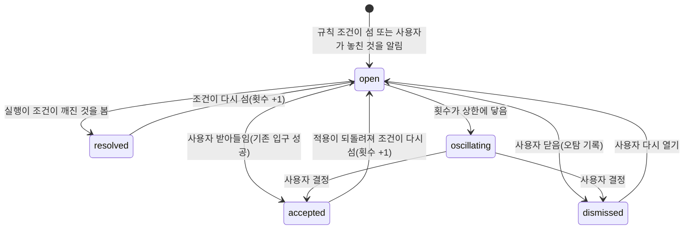

# 스펙: K02 — Reflection·Consolidation·Knowledge Lint

- 날짜: 2026-11-23 / 상태: 확정(잠정 결정 포함)
- 관련: 이슈 #26(K02), 총괄 #1(설계 분석 9번), Phase 4 #6, 선행 #25(K01)·#20. [I03 spec](2026-11-21-I03-persistent-queue.md)(주기·작업·상한), [I04 spec](2026-11-21-I04-invalidation.md)(파생물 등록), [S01 spec](2026-11-22-S01-semantic-registry.md)·[S02 spec](2026-11-22-S02-entity-resolution-temporal-graph.md)(승인 입구), [K01 spec](2026-11-23-K01-wiki-projection.md)(R13), [P01 spec](2026-11-23-P01-insight-discovery.md)
- 번호: 요구사항 `K02-R<n>`, 결정 `K02-D<n>`, 작업 `K02-T<n>`. 완료 기준 `K02-C1`~`C3`은 이슈 #26의 번호 그대로이고 그 아래를 `a`·`b`·`c`로 나눈다. `K02-C4`는 이 spec이 더한 것이다. 마이그레이션 번호는 **합쳐지는 때 main의 다음 번호**를 쓴다(쓰는 지금 main은 v28).

| 말 | 뜻 |
|---|---|
| 재검토(Reflection) | 이미 쌓인 지식을 정해진 범위만 다시 보는 배경 작업. 새 원문을 읽지 않는다 |
| dirty | 지난 재검토 뒤에 내용이 바뀐 항목이라는 표시 |
| 점검 규칙(Lint) | DB만 읽고 "고칠 만한 곳"을 찾는 코드 규칙. Provider를 부르지 않는다 |
| 발견 | 규칙이 찾은 한 건. 대상 행의 ID와 규칙 이름만 갖는 **후보**이고, 그 자체로는 지식을 바꾸지 않는다 |
| 적용 | 사용자가 발견을 받아들여, 기존 승인 입구(S01·S02)가 지식을 바꾸는 것 |

## 배경

S02는 문서가 들어올 때 그 문서가 건드린 항목만 보고 합치기 후보와 충돌을 계산한다. 그래서 시간이 지나며 생기는 문제는 아무도 다시 보지 않는다: 아직 확정되지 않은 별칭으로만 이어지는 같은 대상, 새 version에서 사라진 내용에만 기대는 관계, 목표일이 지났는데 끝났다는 기록이 없는 업무, 여러 문서에 함께 나오는데 관계가 없는 두 항목. 총괄 설계 9번은 이 재검토를 **제한된 재계산**으로 정했다: 바뀐 곳만 보고, 예산과 진행 상태를 남기고, 제품이 스스로 쓴 글을 근거로 다시 세지 않고, 같은 수정이 왔다 갔다 하는 것을 알아챈다.

## 목표

1. 매일·매주 정해진 범위(dirty 항목과 주의가 필요한 항목)만 다시 보고, 점검 규칙이 발견을 근거와 함께 남긴다.
2. 발견은 후보다. 지식은 사용자가 받아들일 때 기존 승인 입구로만 바뀐다.
3. 같은 발견이 열렸다 닫혔다를 되풀이하면 멈추고, Wiki·Insight 같은 제품의 산출물은 규칙의 입력이 되지 않으며, 한 번에 볼 양을 넘기면 남은 일이 저장돼 다음 실행이 잇는다.
4. 사용자가 "틀린 발견"과 "놓친 것"을 표시하면 규칙별로 세어 둔다.

## 비목표

- **자동 적용.** 기존 자동 규칙(S01 자동 승격, S02 자동 이의)이 하던 것 말고는 아무것도 스스로 합치거나 지우지 않는다.
- **주제 묶기(여러 항목을 한 topic으로), 임베딩·유사도 기반 발견.** K01이 K02로 넘겼으나 이슈 #26의 기준에 없다. 후속 이슈로 둔다(X01 #30의 검색이 선행).
- **Insight 파일·유형 변경.** "미해결 업무"는 지금 있는 날짜 종류(`target_date`·`completion_date`)만 읽는다. 상태 종류는 P01-T05의 몫이다.
- **전체 corpus 재추출·재전송, 원문 다시 읽기.** 재검토는 DB의 행만 읽는다.
- **새 승인 입구, 새 엔진.** 합치기·사용자 조치·관계 추가는 기존 함수를 부른다.
- **Electron 전용 E2E, 실제 Provider로의 확인.** 브라우저 E2E 하나, 나머지는 배포처 후속.

## 요구사항

### 범위(dirty)와 주기

- **K02-R1 dirty 표시.** 항목·사실·관계·근거·주장 연결·합치기 줄·원본 version이 바뀌면 트리거가 관련 항목 ID를 `reflection_dirty`에 순번과 함께 적는다. 재검토 자신이 쓰는 테이블(`lint_*`, `reflection_*`)과 Wiki·Insight 테이블은 트리거 대상이 아니다. 대상 테이블 목록은 상수 하나이고 대조 시험이 지킨다.
- **K02-R2 작업과 주기.** 작업 종류는 `reflect` 하나이고 대상이 `daily`·`weekly`다. 원본에 묶이지 않는 종류다(fence 없음, `wiki-build`와 같다). 시작할 때 주기 두 개를 기존 `ensureSchedule`로 만든다(잠정: 매일 03:00, 일요일 04:00). 끄기·바꾸기·지금 실행은 기존 주기 API를 쓴다.
- **K02-R3 볼 범위.** `daily`(consolidation)는 dirty 항목의 묶음과, 지난 실행 뒤 목표일이 지난 업무만 본다. `weekly`(refinement)는 거기에 열린 발견의 대상과 `disputed` 행·풀리지 않은 `CONTRADICTS`가 있는 묶음을 더한다. 어느 쪽도 전체 항목을 훑지 않는다.
- **K02-R4 상한과 이어 하기.** 한 실행이 보는 묶음 수에 상한이 있다(잠정 daily 200, weekly 1,000). 결과는 기존 `commitDerived`로 한 트랜잭션에 쓰고, **본 항목의 dirty 줄을 같은 트랜잭션에서 지운다**(읽은 순번 이하만). 상한 때문에 못 본 항목과 실행 중에 또 바뀐 항목은 dirty로 남아 다음 실행이 잇는다. weekly의 주의 집합은 항목 ID 순서의 커서를 `reflection_state`에 두고 돌아가며 본다. 작업 결과의 수(본 묶음, 남은 dirty, 규칙별 새 발견·풀린 발견)를 기존 결과 수 칸에 남긴다.

### 규칙과 발견

- **K02-R5 재검토는 기존 계산을 다시 부른다.** 범위의 항목에 대해 `refreshCandidates`(중복), `refreshConflicts`(상충), `recomputeInsights`를 추출과 같은 순서로 부른다. 결과는 기존 테이블(`merge_candidates`, `assertion_links`)에 기존 규칙대로 남는다.
- **K02-R6 점검 규칙 넷.** 규칙은 `(DB, 묶음들, 지금) → 발견들`의 순수 함수이고 Provider를 부르지 않는다.

| 규칙 | 대상 | 조건 | 받아들이면(기존 입구) |
|---|---|---|---|
| `synonym` | 묶음 두 개 | 유형이 같고, 한쪽의 이름·별칭(`alias.*`, `rejected` 아님)이 다른 쪽의 이름·별칭과 정규화해서 같고, `merge_candidates`에 없고 "다른 대상" 표시가 없다 | `EntityDecisions.merge` |
| `stale` | 사실·관계 하나 | `superseded`·`rejected`가 아닌데 유효하지 않다(`validRow`가 없음: 현재 version의 근거도 사용자 입력도 아님) | `userDecisions.decide(…, "reject")` |
| `overdue-work` | `Task`·`Commitment` 묶음 | 유효한 `target_date`가 지금보다 이전이고 유효한 `completion_date`가 없다 | 없음(알림만. 사용자가 기존 수정 입구로 완료일을 넣으면 풀린다) |
| `missing-link` | 묶음 두 개 | 계보가 서로 다른 원본 2개 이상을 함께 갖고, 둘 사이에 유효한 관계가 어느 방향으로도 없다. 묶음 하나당 함께 나온 수가 큰 순으로 5쌍까지 | `userDecisions.add`(관계. 유형은 사용자가 고른다) |

- **K02-R7 발견의 모양.** 발견은 규칙 이름, 대상 행의 ID, 지문(규칙+대상 ID, 유일), 출처(`rule`·`user`), 상태, 뒤집힌 횟수, 시각만 갖는다. 이름·값·인용문은 저장하지 않는다. 근거는 대상 행의 기존 근거를 읽을 때 붙인다(`missing-link`는 함께 나온 원본 version). 계보는 대상 행 계보의 합집합이고 `lint_finding_lineage`에 둔다.
- **K02-R8 다시 판정.** 실행은 범위 안의 발견을 저장된 것과 견준다: 조건이 새로 서면 `open`으로 만들고, 조건이 깨지면 `resolved`로 닫고, 같으면 쓰지 않는다. 사용자가 닫은 발견(`dismissed`)과 받아들인 발견(`accepted`)은 실행이 **다시 열지 않는다**(사용자 교정 보존). 단 `accepted`는 그 적용을 사용자가 되돌려 조건이 다시 서면 열린다.
- **K02-R9 왔다 갔다 막기.** `resolved`나 `accepted`였던 발견이 다시 열릴 때마다 뒤집힌 횟수가 1 오른다. 잠정 3이 되면 상태가 `oscillating`이 되고, 실행은 그 발견을 더는 열거나 닫지 않는다. 화면은 "반복됨"으로 보이고 사용자의 결정만 이 상태를 끝낸다.
- **K02-R10 제품이 쓴 글은 입력이 아니다.** 규칙과 R5의 계산은 `wiki_*`, `insights*`, `lint_*`를 읽지 않는다. "함께 나온 원본"은 `source_versions`의 계보로만 센다. 재검토는 `evidence`·`facts`·`relations`·`items`에 쓰지 않는다(R5의 기존 계산이 하던 쓰기 제외).

### 적용·기록·읽기

- **K02-R11 결정은 한 트랜잭션이다.** 받아들이기는 표의 기존 입구를 부르고, 그 입구가 받아들였을 때만 발견이 `accepted`가 된다. 입구가 거절하면(범위 정책, 유형 불일치 등) 발견은 `open`으로 남고 응답에 그 거절 코드를 준다. 닫기(`dismissed`)와 다시 열기는 발견만 바꾼다.
- **K02-R12 오탐·미탐 기록.** 닫기는 그 규칙의 오탐 1건이다. 사용자는 "놓친 것"을 규칙 이름과 대상 ID로 알릴 수 있고, 이것은 출처 `user`의 열린 발견으로 저장되며 그 규칙의 미탐 1건이다. 읽기 API는 규칙별로 열림·적용·오탐·미탐·반복됨의 수를 준다.
- **K02-R13 파생물 등록과 삭제.** 종류 `lint-finding`을 I04 등록부에 올린다(실행 위치 `canonical`). 원본 삭제·지난 version 정리의 트랜잭션에서, 계보에 그 version이 있는 발견은 남은 정본으로 다시 판정해 서지 않으면 지운다. `reflection_dirty`·`reflection_state`는 운영 테이블로 분류한다(ID·순번·시각만).
- **K02-R14 읽기 문.** 발견은 대상 행이 모두 지금 있고 보이며, 계보 전체가 보이고 한데 묶어도 될 때(`combinable`)만 나온다. 경로는 `backend/src/lint-read.ts`에 두고 `read-gate.ts`의 도우미를 쓴다. 수(R12)도 보이는 발견만 센다.
- **K02-R15 API와 화면.** `GET /api/lint`(발견 목록, 규칙별 수, 마지막 실행의 결과 수, 남은 dirty 수), `POST /api/lint/decide`(`op`: `accept`·`dismiss`·`reopen`, `missing-link`의 `accept`에는 관계 유형), `POST /api/lint/report`(놓친 것). 스키마는 `packages/contracts`. 내비게이션에 "점검"을 더하고, 규칙별 목록·근거 열기(기존 근거 보기)·받아들이기·닫기·"반복됨" 표시를 보인다. 문구는 한국어 문구 모듈에 둔다.

### LLM 다듬기(선택)

- **K02-R16 기본 OFF, Broker만, ID만.** 설정 `reflection.refine`(값이 정확히 `on`일 때만 켬)이 켜져 있으면 `weekly` 실행 뒤, 열린 `synonym`·`missing-link` 발견마다 작업 `reflection-refine`을 넣는다(실행당 잠정 20건, 같은 발견·같은 계보로 이미 물은 것은 다시 넣지 않음, `oscillating` 제외). Broker에는 계보의 원본 version ID와 두 항목 ID만 넘긴다(`wiki-summary`와 같은 길). 동의·전송 정책·등급·호출 예산은 기존 Broker가 판정하고, 예산이 다하면 기존 규칙대로 미뤄진다.
- **K02-R17 의견만 남긴다.** 응답은 판정(`same`·`related`·`unrelated`)과, 원문에서 그대로 베낀 인용문이다. 인용문을 원문에서 정확히 한 번 찾지 못하면 버린다(추출과 같은 규칙). 남은 판정은 발견의 의견 칸에만 저장하고 화면이 "LLM 의견"으로 보인다. 발견의 상태, `evidence`·`facts`·`relations`는 바뀌지 않는다. Provider가 없거나 막히면 작업은 보류되고 발견은 의견 없이 그대로 보인다.

## 인터페이스 / 설계 개요

**테이블(마이그레이션 하나).** `reflection_dirty`(항목 ID, 순번), `reflection_state`(한 줄: dirty 순번, 마지막 daily·weekly 시각, weekly 커서), `lint_findings`(R7의 칸과 LLM 의견·그것을 물은 계보 해시), `lint_finding_lineage`(발견, 원본, version), R1의 트리거. `backend/src/derivative-coverage.ts`의 분류에 같은 변경으로 더한다.

**모듈.** 저장은 `storage/src/reflection.ts`, 규칙(`lint-rules.ts`)·작업(`reflect-job.ts`)·종류(`lint-kind.ts`)는 `knowledge-engine`, 주기 만들기·읽기 문·경로는 `backend`, 화면은 `apps/web/src/lint.tsx`. 큐·주기·`commitDerived`·`held`·묶음(`entityGroups`)·유효 판정(`validRow`)·계보(`rowLineage`, `lineageOfItems`)는 있는 것을 그대로 쓴다.

**발견의 상태.** 실행과 사용자가 서로 다른 길로 상태를 바꾸므로 그림으로 둔다.

### 대안과 기각 사유

- **dirty를 호출 자리에서 직접 적기**: 쓰는 자리가 여럿이라 하나를 빠뜨리면 조용히 안 본다. K01-D4와 같은 이유로 트리거를 쓴다.
- **발견을 `merge_candidates`·Insight에 섞기**: 두 테이블은 각자의 규칙이 지우고 다시 쓰므로 사용자의 닫음과 뒤집힌 횟수를 둘 곳이 없다.
- **단계마다 checkpoint로 나눠 쓰기**: dirty 줄이 이미 "남은 일"이라 한 실행 한 트랜잭션으로 충분하다.
- **LLM이 발견을 만들기**: 호출 예산과 전송 범위가 corpus에 비례해 커진다. 코드가 좁힌 후보에 의견만 붙인다.

## 완료 기준 (테스트 가능한 형태)

모든 시험은 합성 fixture만 쓴다. 각 기준은 대표 사례 1~2개다.

- **K02-C1a** (R5·R6·R7) 고정 fixture `fixtures/k02-reflection.json`(확정 안 된 별칭으로만 이어지는 두 항목, 지난 version에만 근거가 있는 관계, 목표일이 지난 업무, 두 원본에 함께 나오고 관계가 없는 두 항목, 낡은 합치기 후보 줄 하나)에 재검토를 돌리면 네 규칙의 발견이 한 건씩 대상 ID·계보와 함께 생기고, 낡은 후보 줄이 없어진다. → `knowledge-engine/src/lint-rules.test.ts`
- **K02-C1b** (R2·R11·R15, 실제 입력) 띄운 백엔드에 합성 JSONL을 가져오기 API로 넣고 fixture 추출을 돌린 뒤 주기의 "지금 실행"으로 재검토하면 `GET /api/lint`에 `missing-link` 발견이 근거와 함께 나오고, 유형을 골라 받아들이면 그 관계가 사용자 행으로 생기고 발견이 `accepted`다. 입구가 거절하는 유형이면 발견이 `open`으로 남는다. → `backend/src/lint-flow.test.ts`
- **K02-C2a** (R8·R9·R10) ① 재검토 전후로 `items`·`facts`·`relations`·`evidence`의 행 수가 같다. ② 닫은 발견은 다시 돌려도 `dismissed`다. ③ 합치기를 받아들이고 되돌리기를 되풀이하면 세 번째에 `oscillating`이 되고 그 뒤 실행은 상태를 바꾸지 않는다. ④ 두 항목을 함께 적은 Wiki 페이지·요약·Insight를 만들어 둔 상태와 없는 상태에서 발견 목록이 같다. → `knowledge-engine/src/reflect-job.test.ts`
- **K02-C2b** (R4) dirty 묶음 5개에 상한 2로 돌리면 결과 수가 "본 것 2, 남은 것 3"이고 dirty 줄 3개가 남으며, 다시 돌리면 잇는다. 실행이 읽은 뒤에 바뀐 항목의 dirty 줄은 지워지지 않는다. → `knowledge-engine/src/reflect-job.test.ts`
- **K02-C3a** (R1·R2·R3) ① 사실 하나를 고치면 그 항목만 dirty다. ② 시작하면 `reflect`의 daily·weekly 주기가 있다. ③ 무관한 항목이 많은 DB에서 daily는 dirty 묶음만 보고(결과 수), weekly는 열린 발견의 대상을 더 보되 전체를 보지 않는다. → `storage/src/reflection.test.ts`, `backend/src/lint-flow.test.ts`
- **K02-C3b** (R12·R13·R14) ① 닫기 한 번과 "놓친 것" 한 번 뒤 그 규칙의 오탐 1·미탐 1이 응답에 있다. ② 발견을 받치던 원본을 지우면 그 트랜잭션 직후 발견과 계보 줄이 없고, 공통 계약(`derivativeKindContract`)이 `lint-finding`에 대해 통과한다. ③ 한 범위를 거부하는 정책으로 읽으면 그 범위 원본에 기댄 발견이 목록과 수에 없다. **변이**: 읽기 문의 걸러 내기를 빼면 ③이 빨개진다. → `knowledge-engine/src/lint-kind.test.ts`, `backend/src/lint-gate.test.ts`
- **K02-C3c** (R15) 사용자가 "점검"에서 발견을 보고, 근거를 열고, 하나를 닫으면 다시 열어도 닫혀 있고 오탐 수가 1이다. → `apps/web/e2e/lint.e2e.ts`(브라우저 하나)
- **K02-C4** (R16·R17, 이 spec이 더함) ① 설정을 켜고 fake Provider로 돌리면 인용문이 원문에 있는 판정만 의견으로 저장되고 발견의 상태와 `evidence`·`facts`의 행 수가 그대로다. ② 동의가 없으면 작업이 `held`이고 Provider 호출 기록에 시도가 없다. ③ 설정이 꺼져 있으면 작업이 생기지 않는다. → `knowledge-engine/src/reflection-refine-job.test.ts`, `providers/src/broker.reflection-refine.test.ts`

## 미해결 질문 / 검증하지 않은 범위

- **기존 계산이 놓치는 경우가 실제로 있는가.** `refreshCandidates`·`refreshConflicts`는 쓰는 자리에서 이미 불린다. 재검토의 재호출(R5)이 무엇을 더 찾는지는 코드로 확인하지 않았다. C1a의 "낡은 후보 줄"은 fixture가 직접 심는다.
- **`recomputeInsights`의 모양.** P01-T04/T05가 진행 중이라 인자가 바뀔 수 있다. 합칠 때의 main에 맞춘다.
- **`lint-finding`의 층.** 등록부의 층(`insight`로 잠정)과 같은 층 안의 순서 제약은 구현에서 확인한다.
- **`userDecisions.add`가 관계 유형을 거절하는 조건**은 읽지 않았다. 거절 코드는 그대로 넘긴다.
- **규칙의 품질.** `missing-link`의 문턱(원본 2개, 5쌍)과 `synonym`의 정규화가 실제 자료에서 내는 오탐률은 재지 않았다. R12의 수가 그 측정 수단이다.
- **규모.** 큰 원본 하나에 항목이 수백 개일 때의 `missing-link` 계산 시간, dirty 트리거가 가져오기 속도에 주는 영향은 재지 않았다.
- **사용자가 Wiki 글을 손으로 옮겨 새 문서로 가져오는 경우**는 막지 못한다(원본으로 들어오면 원본이다). 내보내기는 H01.
- **Windows 설치본에서의 화면**은 확인하지 않는다(H02 #33).

## 잠정 결정과 가정

| 번호 | 결정 | 이유 | 바꾸려면 |
|---|---|---|---|
| K02-D1 | 코드 규칙 넷이 발견을 만들고 LLM은 의견만 붙인다(기본 OFF) | 범위·비용이 corpus에 비례하지 않고 Provider 없이 동작한다 | 규칙 표에 줄을 더한다. LLM 후보 생성은 별도 spec |
| K02-D2 | 결정적 재검토는 기본 ON(주기 둘), 끄기는 기존 주기 API | Provider를 부르지 않고 후보만 만들며 상한이 있다 | 시작할 때 주기를 만들지 않거나 꺼진 채로 만든다 |
| K02-D3 | dirty는 트리거가 항목 ID로 적는다 | 쓰는 자리를 빠뜨릴 수 없다. 대표는 합치기로 바뀌므로 항목 ID가 안정적이다 | 대상 테이블 상수를 고친다 |
| K02-D4 | 한 실행 한 트랜잭션, 진행 상태는 남은 dirty 줄 | checkpoint 칸 없이 "예산 초과 시 진행 저장"을 채운다 | 실행기의 `checkpoint`로 단계 쓰기를 더한다 |
| K02-D5 | 상한: daily 200, weekly 1,000 묶음. 시각: 03:00, 일 04:00 | 측정 전의 보수적인 값 | 상수, 주기 API |
| K02-D6 | `stale`을 받아들이면 `reject`, `synonym`은 합치기, `missing-link`는 사용자가 유형을 고른 관계 추가, `overdue-work`는 알림만 | 모두 있는 입구이고 되돌릴 수 있다 | 규칙 표의 "받아들이면" 칸 |
| K02-D7 | 닫기는 발견만 바꾸고 "다른 대상" 표시(`item_distinct`)를 쓰지 않는다 | 닫기의 뜻을 S02의 상태와 섞지 않는다 | `synonym` 닫기에 `setDistinct`를 더한다 |
| K02-D8 | 뒤집힘 상한 3, `oscillating`은 사용자만 끝낸다 | 자동으로 풀면 다시 돈다 | 상수 |
| K02-D9 | "놓친 것"은 출처 `user`의 발견으로 저장하고 미탐으로 센다 | 새 테이블 없이 오탐·미탐을 한 곳에서 센다 | 기록 전용 테이블로 뗀다 |
| K02-D10 | 중복·상충은 발견으로 따로 저장하지 않고 기존 후보·충돌 화면이 보인다 | 같은 것을 두 목록에 두지 않는다 | 규칙 표에 줄을 더한다 |
| K02-D11 | 주제 묶기는 하지 않는다 | 이슈의 기준에 없고 유사도 검색이 선행이다 | 후속 이슈 |
| K02-D12 | LLM 의견 칸을 첫 마이그레이션에 함께 둔다 | T3이 마이그레이션 번호를 또 쓰지 않는다 | T3에서 따로 더한다 |

## 작업 분해

T1과 T2는 **PR 하나, 구현 한 번**으로 간다(T1만으로는 사용자가 볼 것이 없고 C1b·C2a가 두 작업에 걸친다). T3은 다른 세션이 쥔 파일이 풀린 뒤의 두 번째 PR이다.

| 작업 | 내용 | 기준 | 선행 |
|---|---|---|---|
| K02-T1 | 마이그레이션·트리거, 저장, 규칙 넷, 작업 `reflect`와 주기, 종류 `lint-finding` 등록과 분류, fixture | C1a, C2a(①·②·④), C2b, C3a, C3b(②) | 없음(오늘의 main) |
| K02-T2 | 결정 경로(기존 입구 호출)와 왔다 갔다 막기, 오탐·미탐 수, 읽기 문, API 셋, "점검" 화면, 브라우저 E2E | C1b, C2a(③), C3b(①·③), C3c | T1(같은 PR) |
| K02-T3 | LLM 다듬기(`reflection-refine` 작업·Broker 작업 정의·설정)와 문서: ARCHITECTURE 저장 표, I04 등록표, 문서 색인, site-setup 항목, README | C4 | T1·T2 머지, P01-T04 머지(`providers/src/tasks.ts`) |

## 배포처 후속

`docs/site-setup.md`에 항목 하나를 더한다(번호는 합칠 때의 다음 번호, T3에서).

- 실제 자료에서 규칙별 오탐·미탐 수를 한 주기 이상 모아 문턱(K02-D5·R6)을 정한다.
- 배포처 범위 정책을 건 채로 "점검"을 열어, 허용되지 않은 범위 원본에 기댄 발견이 나오지 않는지 확인한다(C3b ③의 실제 정책판).
- `reflection.refine`을 켜기 전에 실리는 원본의 등급이 전송 정책에서 허용되는지, 호출 예산이 추출을 밀어내지 않는지 잰다.
- 실제 규모에서 dirty 트리거가 가져오기에 주는 시간과 재검토 한 번의 시간을 잰다.

## 변경 이력

| 날짜 | 변경 내용 | 대상 | 사유 |
|---|---|---|---|
| 2026-11-23 | 초안 작성 | 이 문서 | 이슈 #26 착수 |
| 2026-11-23 | 확정. 잠정 결정 D1~D12를 그대로 채택 | 상태 | 조율 세션 검토: 기준 8개가 이슈 #26의 C1~C3을 덮고 기존 입구만 씀 |
