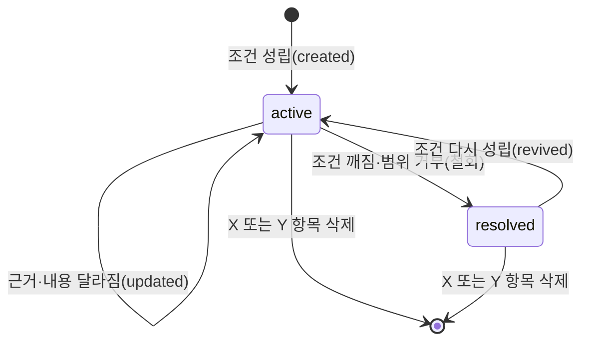

# 스펙: P01 — Insight 발견·변경 감지·설명 가능한 Ranking

- 날짜: 2026-11-23 / 상태: 확정(잠정 결정 D1~D19 포함)
- 관련: 이슈 #27(P01), 총괄 #1, Phase 5 #7, 선행 #23(S02)·#20, 후속 #28(P02 알림)·#29(P03 피드백)·#30(X01 검색). [V02 spec](2026-11-21-V02-vertical-slice.md)(R9·R10: 첫 규칙 "의존 업무 지연"), [S02 spec](2026-11-22-S02-entity-resolution-temporal-graph.md)(R13 묶음, R18·R19 주장 연결), [I04 spec](2026-11-21-I04-invalidation.md)(종류 `insight`), [ARCHITECTURE.md](../ARCHITECTURE.md) 4절·5.6절
- 번호: 요구사항 `P01-R<n>`, 결정 `P01-D<n>`, 작업 `P01-T<nn>`. 완료 기준 `P01-C1`~`C3`은 이슈 #27의 번호 그대로이고 그 아래를 `a`·`b`·`c`로 나눈다. 마이그레이션 번호는 **합쳐지는 때 main의 다음 번호**를 쓴다(K01이 v27을 써서 main에 먼저 들어왔고, P01은 rebase로 v28이 됐다).

| 말 | 뜻 |
|---|---|
| 유형 | Insight의 종류 이름. 저장된 `insights.rule` 값이다(`dependency_delay` 등) |
| 사실 줄 | Insight가 쓴 정본 행(사실·관계)의 값을 코드가 그대로 옮겨 적은 문장. 해석이 들어 있지 않다 |
| 추론 문장 | 그 사실들에서 끌어낸 결론 한 문장(기존 `summary`). 화면은 "추론"으로 표시한다 |
| 이유 요약 | 어떤 비교로 그 결론에 이르렀는지 사용자에게 보여 주는 짧은 글(`reasoning_summary`). 모델의 사고 과정이 아니다 |
| 지문(fingerprint) | "같은 Insight"를 정하는 키: (유형, X 묶음의 대표 항목, Y 묶음의 대표 항목) |
| 철회 | 조건이 더는 서지 않아 Insight를 `resolved`로 돌리는 것. 행은 남고 글과 근거 연결은 비운다 |

## 배경

V02가 규칙 하나("의존 업무 지연")와 Insight 행(`insights`, 키 `(rule, x, y)`, 근거·사용자 입력·주장 연결)을 만들었고, S02가 묶음과 주장 연결(`SUPERSEDES`·`CONTRADICTS`)을 더했다. 규칙이 하나뿐이라 실행 자리 네 곳(추출, 원본 변경 전파, 사용자 조치, 묶음 변경)이 그 규칙 함수를 직접 부르고, Insight에는 유형별 지원 상태도 순위도 없다. P01은 이것을 **여러 유형이 같은 틀로 도는 구조**로 일반화한다. 새 엔진이나 새 테이블은 만들지 않는다.

## 목표

1. 요청된 13개 유형마다 지원 상태가 코드와 fixture로 명시된다. 지원하지 않는 유형은 사유와 함께 "미지원"으로 보고된다.
2. Insight 하나가 사실 줄·추론 문장·이유 요약·근거·신뢰도를 갖고, 여섯 축 순위가 같은 입력에서 같은 값으로 계산되어 설명된다.
3. 날짜·상태·의존·중복은 코드가 판정하고 LLM은 해석만 한다. 같은 지문은 한 행으로 합쳐지고, 새 근거에 갱신·철회된다. 신뢰도가 낮은 Insight에는 자동 알림 제외 표시가 붙는다.

## 비목표

- **알림 발송과 억제.** 제외 표시까지만 한다. 실제 억제는 P02(#28).
- **개인화(사용자 관심·피드백으로 순위 조정), "놓친 정보".** P03(#29)의 기록이 있어야 한다.
- **유사도·검색에 기대는 유형("유사 해결", "관련 문서").** X01(#30) 뒤. 여기서는 미지원으로 보고한다.
- **새 그래프·순위 엔진, 그래프 순위 알고리즘.** 순위는 저장된 값 몇 개의 가중합이다.
- **모델 내부 사고 과정의 저장.** 어떤 경로로도 저장하지 않는다.
- **실제 Provider·배포처 데이터로의 확인.** 합성 fixture와 test double만 쓴다.

## 요구사항

### 유형과 지원 상태

- **P01-R1 유형 표.** 13개 유형은 코드 상수 하나(`INSIGHT_TYPES`, `@pki/contracts`)에 있다. 줄마다 유형 이름, 한글 이름, 판정 주체(`code`·`llm`), 상태(`supported`·`unsupported`), 미지원 사유, 영향·행동성 기본값을 갖는다. 미지원 유형의 Insight는 만들어지지 않는다. 아래 표가 목표이고, 상수의 상태는 **구현된 만큼만** `supported`다.

| 유형 | 이름 | 판정 | 조건(코드) | 지원 |
|---|---|---|---|---|
| 의존 업무 지연 | `dependency_delay` | 코드 | X가 Y에 의존, Y의 완료일 > X의 목표일 | 지원(V02, T01이 새 틀로 옮김) |
| 일정 충돌 | `schedule_conflict` | 코드 | 한 묶음의 완료일 > 자기 목표일 | 지원(T02) |
| 충돌 | `conflict` | 코드 | 한 묶음의 유효한 두 사실 사이 `CONTRADICTS` 연결 | 지원(T02) |
| 중요 변경 | `important_change` | 코드(변경 감지) | 날짜 종류 사실의 `SUPERSEDES` 연결(대신한 쪽이 유효) | 지원(T02, 날짜 종류만) |
| 의사결정 변경 | `decision_change` | 코드 | Decision의 한 값 종류가 대체됨 | 미지원: 결정의 진술(`statement`)은 여러 값 종류라 대체 연결이 없다(T05) |
| 정책 변화 | `policy_change` | 코드 | BusinessRule의 한 값 종류가 대체됨 | 미지원: 위와 같음(T05) |
| 미처리 요청 | `pending_request` | 코드 | 요청의 상태·기한 | 미지원: 상태 종류가 없다(T05) |
| 미해결 이슈 | `open_issue` | 코드 | Issue의 상태 | 미지원: 상태 종류가 없다(T05) |
| 새 관계 | `new_relation` | 코드 | 최근에 처음 관측된 관계 | 미지원(T05) |
| 기회 | `opportunity` | LLM 해석 | 해석 작업이 낸 후보를 코드가 근거·중복·상태를 정해 저장 | 지원(T04). 설정 `insight.interpret`이 켜져 있을 때만 생긴다 |
| 유사 해결 | `similar_resolution` | 검색 | — | 미지원: 유사도 검색 없음(X01) |
| 관련 문서 | `related_document` | 검색 | — | 미지원: 검색 없음(X01) |
| 놓친 정보 | `missed_information` | 코드 | — | 미지원: 열람·피드백 기록 없음(P03) |

### Insight의 모양

- **P01-R2 내용.** 활성 Insight는 유형, 추론 문장(`summary`), 사실 줄(`fact_lines`, 한 개 이상), 이유 요약(`reasoning_summary`, 500자 이하), 신뢰도(`confidence`, 0~100), 시급의 기준 날짜(`urgency_date`, 없을 수 있음), 마지막으로 내용이 바뀐 시각(`changed_at`)을 갖는다. 사실 줄은 인용한 행의 값만으로 코드가 쓰고, 추론은 `summary`에만 둔다. 인식 유형은 지금처럼 `inferred` 하나다.
- **P01-R3 근거.** 활성 Insight는 근거(`insight_evidence`)나 사용자 입력(`insight_user_inputs`)을 하나 이상 갖고, 판정에 쓴 주장 연결은 `insight_link_inputs`에 둔다. 계보·범위·삭제 전파는 기존 종류 `insight`가 그대로 맡는다. 철회된 행은 글(추론·사실 줄·이유 요약)과 신뢰도·날짜·근거 연결을 갖지 않는다.
- **P01-R4 순위.** 여섯 축은 각각 0~100의 정수이고, 점수는 고정 가중합이다. `rankInsight(신호, 지금)`은 순수 함수이며 축 값과 점수를 함께 돌려준다(설명 가능). 시급·신규는 "지금"에 달려 있어 **저장하지 않고 읽을 때 계산**한다.

| 축 | 값 | 가중 |
|---|---|---|
| 관련성 | 사용자 입력 행을 썼으면 100, 아니면 50(개인화는 P03) | 0.15 |
| 영향 | 유형 표의 기본값 | 0.25 |
| 시급 | 기준 날짜까지 7일 이하(지난 날짜 포함) 100, 30일 이하 70, 90일 이하 40, 그 밖 20, 날짜 없음 30 | 0.25 |
| 신규 | `changed_at`에서 1일 이하 100, 7일 이하 70, 30일 이하 40, 그 밖·없음 10 | 0.10 |
| 신뢰 | 저장된 `confidence`(없으면 50) | 0.15 |
| 행동성 | 유형 표의 기본값 | 0.10 |

- **P01-R5 사고 과정을 저장하지 않는다.** Insight에 저장되는 글은 `summary`·`fact_lines`·`reasoning_summary` 셋뿐이다. LLM 해석의 출력 스키마(T04)는 네 키(`reasoningSummary`·`impact`·`actionability`·`opportunity`)만 받고 모든 단계에서 엄격하다: 그 밖의 키가 있거나 이유 요약이 500자를 넘으면 Broker가 응답 전체를 거부한다(`invalid-output`). `reasoning_summary`는 500자를 넘으면 저장하지 않는다. Provider 호출 이력은 지금처럼 본문을 갖지 않는다.

### 판정과 수명

- **P01-R6 규칙 틀.** 유형 하나는 규칙 하나(`InsightRule`: 판정할 키 찾기, 키 하나 판정)다. `recomputeInsights`가 등록된 규칙을 모두 돌리고, 기존 실행 자리 네 곳은 이 함수를 부른다. 규칙은 DB만 읽고 Provider를 부르지 않는다. 읽기는 기존의 깊이 1 질의다.
- **P01-R7 LLM은 해석만 한다(T04).** LLM은 코드가 만든 활성 Insight의 이유 요약·영향·행동성을 채우거나, LLM 판정 유형의 후보를 낸다. 상태(활성·철회), 근거, 날짜 비교, 중복 판정은 바꾸지 못한다. Provider가 없거나 전송이 거부되면 코드가 쓴 내용 그대로 남는다. 해석은 코드가 쓴 열을 덮지 않고 **자기 열 셋**(`llm_reasoning_summary`·`llm_impact`·`llm_actionability`)에 저장하며, 코드가 그 행을 쓸 때마다(만들기·갱신·철회) 비워진다. 설정 `insight.interpret`은 기본 끔이고 정확히 `on`일 때만 켜진다. Provider로 나가는 것은 그 Insight의 계보 원본 version ID, 두 항목의 ID, 그리고 등급을 매기는 후보로서의 그 Insight(`insight:<id>`: 유형·추론 문장·사실 줄)뿐이다.
- **P01-R8 지문으로 통합.** 지문은 (유형, X 대표, Y 대표)이고 기존 유일 키가 지킨다. 항목 하나에 대한 유형은 X = Y다. 같은 항목의 어긋남 여러 쌍, 변경 여러 건은 Insight 한 건의 사실 줄 여러 개가 된다. 묶음이 합쳐지면 대표의 키 한 행으로 모인다(S02-R13과 같다).
- **P01-R9 갱신과 철회.** 다시 판정한 결과가 저장된 것과 다르면 그 행을 고치고(`updated`), 조건이 깨지면 철회하고(`resolved`), 다시 서면 같은 행을 되살린다(`revived`). 같으면 쓰지 않는다. `changed_at`은 만들어지거나 되살아나거나 추론 문장·사실 줄이 바뀔 때만 바뀐다.
- **P01-R10 신뢰도와 알림 제외 표시.** 신뢰도는 판정에 쓴 행들의 값 중 **가장 낮은 것**이다: 사용자 입력·`verified` 100, `disputed` 30, `candidate`는 행의 `confidence`×100(없으면 50). 신뢰도가 50 미만이면 `autoNotifyExcluded`가 참이다(함수 하나가 판정, P02가 읽는다).

## 인터페이스 / 설계 개요

Insight 한 행의 수명은 V02의 것 그대로이고, 모든 유형이 같은 길을 지난다.

- **스키마.** `insights`에 열 다섯을 더한다(`ADD COLUMN`, 모두 NULL 허용, 기존 행은 고치지 않는다): `fact_lines`(JSON 배열), `reasoning_summary`(길이 500 이하 CHECK), `confidence`(0~100 CHECK), `urgency_date`, `changed_at`. 기존 행은 다음 판정 때 채워진다. T04가 해석 열 셋을 더 더한다(`llm_reasoning_summary` 500자 이하, `llm_impact`·`llm_actionability` 0~100, 마이그레이션 번호는 합쳐지는 때 main의 다음 번호이고 이 구현은 v29).
- **함수.** `recomputeInsights(db, itemIds, { scope?, at?, rules? })`(`knowledge-engine/src/insight-rules.ts`)가 묶음으로 넓히고, 규칙마다 키를 모으고(관계·연결에서 찾은 것 + 저장된 키), 판정하고, 범위 정책(`combinable`)과 신뢰도를 계산하고, 달라진 것만 쓴다. `rankInsight`(`insight-ranking.ts`)는 저장된 신호와 시각만 받는다.
- **실행 자리.** 추출의 `rule` 항목, 종류 `insight`의 `invalidate`, 서버의 `judgeAgain`, 묶음 변경 수신자. 넷 다 주장 연결을 다시 판정한 **뒤에** 돈다(지금의 순서 그대로).

### 대안과 기각 사유

- **유형마다 테이블, 또는 `insights`를 다시 만들어 키를 넓히기**: 기각. 기존 유일 키로 지문을 표현할 수 있고, 테이블을 다시 만들면 딸린 테이블 셋과 K01의 읽기를 건드린다.
- **순위 점수를 저장**: 기각. 시급·신규가 날마다 달라져 저장하면 날마다 다시 써야 한다.
- **알림 제외를 열로 저장**: 기각. 신뢰도에서 한 함수로 정해지므로 두 값이 어긋날 자리를 만들지 않는다(D5).

## 완료 기준 (테스트 가능한 형태)

모든 기준은 저장소 안의 자동 테스트로 판정한다.

- [ ] **P01-C1** — 중요 변경/일정 충돌/의존 업무 지연/의사결정 변경/충돌/미처리 요청/미해결 이슈/유사 해결/관련 문서/기회/정책 변화/새 관계/놓친 정보의 fixture와 지원 상태를 갖춘다.
  - **C1a** (R1, R6): 지원 유형의 fixture를 넣고 판정하면 기대한 Insight 한 건(유형, 사실 줄, 근거 인용문)이 생기고, 조건을 깨는 변형에서는 생기지 않는다.
  - **C1b** (R1): fixture와 유형 표가 같은 13개 유형을 갖고, 미지원 유형은 사유가 있으며 그 유형의 Insight가 만들어지지 않는다.
  - **C1a 추가** (T04, R1): `opportunity`는 해석 응답이 후보를 내면 부모 Insight의 근거를 그대로 가진 한 건이 생기고, 부모 내용이 바뀌면 철회된다.
- [ ] **P01-C2** — Insight schema·evidence·reasoning_summary·사실/추론 구분·관련성/영향/시급/신규/신뢰/행동성 ranking을 검증한다. 모델 내부 사고과정을 저장하지 않는다.
  - **C2a** (R2, R3): 규칙이 만든 활성 Insight는 사실 줄·추론 문장·이유 요약·신뢰도와 근거(또는 사용자 입력) 하나 이상을 갖고, 철회하면 글·신뢰도·날짜·근거 연결이 모두 비워진다.
  - **C2b** (R4): `rankInsight`는 여섯 축과 점수를 돌려주고, 같은 입력과 시각에서 같은 값이며, 기준 날짜가 가까운 쪽이 시급이 높고 신뢰도가 낮은 쪽이 점수가 낮다.
  - **C2c** (R5): 500자를 넘는 이유 요약은 저장이 거부되고, (T04) 정해진 키 밖의 키가 있거나 이유 요약이 500자를 넘는 해석 응답은 `invalid-output`이고 아무것도 저장되지 않는다.
- [ ] **P01-C3** — 날짜·상태·dependency·dedup은 코드 판정, 해석은 LLM을 사용한다. fingerprint로 통합하고 새 근거에 갱신·철회하며 low-confidence Insight에는 자동 알림 제외 표시를 남기고 실제 발송 억제는 P02(#28)에서 검증한다.
  - **C3a** (R6, R7): 코드 유형은 Provider 없이 판정되고, (T04) 해석이 저장되면 해석 열 셋만 달라지고 상태·추론 문장·사실 줄·코드 이유 요약·근거·`changed_at`은 그대로이며 다시 판정하면 `unchanged`다. Provider가 없거나 전송이 거부되면 작업은 `held`이고 행은 그대로다.
  - **C3b** (R8): 한 항목에 어긋남이 두 쌍이면 Insight는 한 건이고 사실 줄이 둘이다. 다시 판정하면 같은 행이고 결과는 `unchanged`다.
  - **C3c** (R9): 근거가 되는 행이 바뀌면 같은 행이 `updated`, 조건이 깨지면 `resolved`, 다시 서면 같은 id로 `revived`다.
  - **C3d** (R10): 신뢰도 0.3인 후보 사실을 쓴 Insight는 신뢰도 30이고 `autoNotifyExcluded`가 참이며, 그 사실이 승인되면 거짓이 된다.

### 기준별 증명 테스트

| 기준 | 테스트(파일) | 작업 |
|---|---|---|
| C1a | `knowledge-engine/src/insight-code-rules.test.ts`: fixture의 지원 유형마다 기대 Insight 한 건, 변형에서는 0건 | T02 |
| C1b | `packages/contracts/src/insight-types.test.ts`: 13개 유형과 상태·사유 / 위 fixture 테스트: 유형 표와 fixture의 유형 집합이 같고 미지원 유형 Insight 0건 | T01·T02 |
| C2a | `knowledge-engine/src/insight-rules.test.ts`: 활성 행의 필드 / `storage/src/insights.test.ts`: 철회가 새 열을 비움 | T01 |
| C2b | `knowledge-engine/src/insight-ranking.test.ts`: 축·점수, 날짜와 신뢰도 대표 사례 | T01 |
| C2c | `storage/src/insights.test.ts`: 501자 이유 요약 거부 / (T04) `providers/src/broker.insight-interpret.test.ts`: 다른 키·501자 응답은 `invalid-output` | T01·T04 |
| C3a | C1a의 테스트가 Provider 없이 돈다 / (T04) `knowledge-engine/src/insight-interpret.test.ts`(해석 열 셋만 바뀜·`unchanged`·`opportunity`)와 `backend/src/insight-interpret-flow.test.ts`(동의 없으면 `held`) | T02·T04 |
| C1a(`opportunity`) | (T04) `knowledge-engine/src/insight-interpret.test.ts`: 부모 근거를 가진 한 건, 부모가 바뀌면 철회 | T04 |
| C3b | `knowledge-engine/src/insight-code-rules.test.ts`: 어긋남 두 쌍 → 한 건, 재판정 `unchanged` | T02 |
| C3c | `knowledge-engine/src/insight-rules.test.ts`: `updated`·`resolved`·`revived`와 같은 id | T01 |
| C3d | `knowledge-engine/src/insight-rules.test.ts`: 신뢰도 30과 제외 표시, 승인 뒤 해제 | T01 |

화면 흐름의 E2E 하나는 T03에 둔다(브라우저만).

## 작업 분해

**첫 묶음(PR 하나)은 T01 + T02다.** T03~T05는 다른 세션이 쥔 파일이 풀린 뒤에 잇는다.

| 작업 | 내용 | 기준 | 선행 | 주요 파일 |
|---|---|---|---|---|
| P01-T01 | 마이그레이션(열 다섯), 저장(`saveInsight`·`readInsight`), 유형 표, 규칙 틀 `recomputeInsights`(지문·갱신·철회·범위·신뢰도), `rankInsight`, "의존 업무 지연"을 틀로 옮김, 실행 자리 넷 교체 | C1b, C2a·b·c(저장), C3c·d | 없음 | `storage/src/{migrations,insights}.ts`, `packages/contracts/src/insight-types.ts`, `knowledge-engine/src/{insight-rules,insight-ranking,dependency-delay,extraction,canonical-kinds}.ts`, `backend/src/{server,composition}.ts` |
| P01-T02 | 코드 규칙 셋(`schedule_conflict`·`conflict`·`important_change`)과 fixture `fixtures/p01-insights.json`(13개 유형) | C1a·b, C3a(코드)·b | T01 | `knowledge-engine/src/insight-code-rules.ts`, `fixtures/` |
| P01-T03 | API와 화면: Insight 응답에 유형·사실 줄·이유 요약·순위·알림 제외, 순위순 목록, `GET /api/insights/types`, Home 표시, 브라우저 E2E 하나 | C2(API 층), C1b(보고) | T02, K01 머지 | `packages/contracts/src/index.ts`, `backend/src/{read-gate,server}.ts`, `storage/src/evidence-view.ts`, `apps/web/src/evidence-view.tsx` |
| P01-T04 | LLM 해석: Broker 작업 `insight-interpret`, 엄격한 출력 스키마, 해석 열 셋(v29)과 설정 `insight.interpret`, `opportunity` 유형, Provider 없을 때 보존 | C2c(해석), C3a(LLM), C1a(`opportunity`) | T01, S03-T07 머지 | `packages/contracts/src/{provider,insight-types}.ts`, `providers/src/tasks.ts`, `storage/src/{migrations,insights,insight-interpretation,job-kinds}.ts`, `knowledge-engine/src/{insight-interpret,insight-code-rules,insight-ranking,linking}.ts`, `backend/src/{composition,boot}.ts`, `apps/web/src/job-text.ts`, `docs/site-setup.md` |
| P01-T05 | 남은 코드 유형: 상태·요청 종류 추가(유형 목록 판 올림), `decision_change`·`policy_change`·`pending_request`·`open_issue`·`new_relation`, 가져오기를 지나는 JSONL fixture | C1a(나머지) | T02, S03-T07 머지 | `packages/contracts/src/knowledge-schema.ts`, `storage/src/migrations.ts`, `knowledge-engine/src/insight-code-rules.ts`, `packages/testkit/src/fixture-extraction.ts` |

## 잠정 결정과 가정

바꾸려면 적힌 자리 하나를 고치면 된다.

- **P01-D1 유형 이름은 기존 `insights.rule` 열에 둔다.** 새 열을 만들지 않는다.
- **P01-D2 지문은 (유형, X 대표, Y 대표)다.** 한 항목의 어긋남·변경은 한 건으로 모은다. 자리(종류·꼬리표)마다 한 건으로 나누려면 유일 키를 넓히는 마이그레이션이 필요하다.
- **P01-D3 "일정 충돌"은 한 항목의 완료일이 자기 목표일보다 늦은 것으로 정의한다.** 사람의 일정 겹침은 Event의 시각 종류가 생긴 뒤의 일이다.
- **P01-D4 "중요 변경"은 날짜 종류(`target_date`·`completion_date`)의 대체만 본다.** 어떤 변경이 중요한지의 해석은 T04의 LLM 몫이다. 종류 목록은 규칙 파일의 상수 하나다.
- **P01-D5 알림 제외 표시는 저장하지 않고 신뢰도에서 계산한다.** 기준값 50은 상수 하나다(`LOW_CONFIDENCE_BELOW`). P02가 저장된 표시를 원하면 열을 더한다.
- **P01-D6 순위의 가중치와 구간 값은 상수다.** 실제 사용 기록이 없어 근거 있는 값이 아니다. P03에서 다시 정한다.
- **P01-D7 관련성은 "사용자 입력 행을 썼는가"만 본다.** 사용자 관심 모델이 없기 때문이다(P03).
- **P01-D8 첫 묶음의 fixture는 규칙 층의 시나리오 파일(JSON)이다.** 가져오기를 지나는 JSONL은 T05에서 더한다(추출 double과 합성 목록을 S03-T07이 고치는 중). "의존 업무 지연"의 가져오기 경로는 V02 fixture가 이미 증명한다.
- **P01-D9 기존 활성 행은 마이그레이션에서 채우지 않는다.** 다음 판정 때 채워지고 그때 `changed_at`이 한 번 새로 적힌다.
- **P01-D10 `recomputeDependencyDelay`는 규칙 하나만 도는 입구로 남긴다.** 기존 테스트 열세 파일이 V02·S02의 동작을 이 이름으로 증명하고 있다.
- **P01-D11 ADR은 따로 쓰지 않는다.** 새 테이블·새 종류가 없고 결정은 이 절에 있다. ARCHITECTURE의 Insight 줄만 고친다.
- **P01-D12 해석은 열 셋에 따로 둔다.** `llm_reasoning_summary`(500자 이하)·`llm_impact`·`llm_actionability`(0~100), 모두 NULL 허용. 코드가 쓴 `reasoning_summary`를 덮으면 규칙 실행기가 다음 판정에서 `updated`로 되돌려 C3b가 깨지기 때문이다. 읽는 쪽(T03)은 `llm_reasoning_summary ?? reasoning_summary`를 쓰고, `rankInsight`는 두 숫자를 선택 신호로 받아 유형 기본값 대신 쓴다. 제자리에 저장하려면 실행기가 이유 요약 비교를 그만두고 틀을 따로 보관해야 한다.
- **P01-D13 코드가 행을 쓸 때마다 해석을 비운다.** `saveInsight`가 만들기·갱신·되살리기·철회에서 세 열을 NULL로 만든다(R3, K01-D14: 바뀌거나 사라진 원본에서 나온 글이 남지 않게). 실행기는 `unchanged`에 쓰지 않으므로 다시 판정해도 해석은 남는다. 갱신 뒤에도 남기려면 기준 해시 열을 두고 읽을 때 거른다.
- **P01-D14 작업 대상은 `<Insight id>#<기준>`이다.** 기준은 `[유형, 추론 문장, 사실 줄, 이유 요약, 신뢰도, 시급 날짜, 근거 id, 사용자 입력, 연결 id]`의 SHA-256이고, 행이 활성이고 기준이 그대로일 때만 쓴다(K01-D13 방식, 새 열 없음). Insight마다 열린 작업은 하나이고 이미 시도한 기준은 상태와 무관하게 다시 만들지 않는다(처음 계획은 기준에 신뢰도·시급 날짜·이유 요약을 넣지 않았으나, 그것만 바뀐 쓰기가 해석을 비우고도 다시 시도되지 않는 틈이 생겨 넣었다). 시도 횟수 열을 두면 바꿀 수 있다.
- **P01-D15 설정 `insight.interpret`은 기본 끔이고 정확히 `on`일 때만 켠다**(루트 13-5 dark launch, `wiki.summary`와 같은 방식). 시작 때, 작업이 닫힐 때, 켜질 때 큐에 넣고 한 번에 50건까지다. **저장소 스위치(`setInsightInterpret`)만 들어가고 API·화면은 없다**: 설정 경로(`backend/src/server.ts`·`packages/contracts/src/index.ts`)는 다른 세션이 쥐고 있다. 후속(이슈 또는 T03)에서 그 경로에 `insightInterpret` 필드를 더한다.
- **P01-D16 Provider로 나가는 것.** `sourceVersionIds`는 Insight 계보의 version 행(8개 이하, 합계 `MAX_EXTRACT_CODE_POINTS` 이하), `candidateItemIds`는 X·Y와 `insight:<id>`다. `knowledgeCandidates`가 `insight:<id>`에 이름(`[유형] 추론 | 사실 줄`)과 등록부의 `insight` 계보를 답하고, 사용자 입력 행을 쓴 Insight는 출처 없는 이름으로 가장 엄격한 등급을 받는다(닫힌 쪽으로 실패). 계보가 없거나 한도를 넘거나 정책이 묶음을 거부하면 호출 없이 끝난다. Broker는 그대로이고 읽기·등급은 Broker만 한다. Insight 글을 보내지 않으려면 세 번째 후보를 빼야 하고 그 대신 모델이 유형을 모른다.
- **P01-D17 응답 스키마 v1은 모든 단계에서 엄격하다.** `{ reasoningSummary: 1~500자, impact: 0~100 정수, actionability: 0~100 정수, opportunity: { statement: 1~200자 } | null }`. 다른 키나 긴 글은 Broker의 `invalid-output`이고 처리기는 다시 묻지 않는다(`retryable: false`). 부분 수용을 하려면 길이 검사를 처리기로 옮겨야 한다.
- **P01-D18 `opportunity`는 해석 응답이 제안하고 나머지는 코드가 정한다.** 키는 부모의 `(opportunity, X, Y)`다. 처리기가 문장을 `summary`로(추론), 부모의 사실 줄·근거·사용자 입력·연결·시급 날짜를 그대로 복사해 쓰고, 신뢰도는 `min(부모, 40)`이라 늘 자동 알림 제외다. 활성 행이 이미 있으면 제안은 버린다. 규칙(`opportunityRule`)은 같은 키에 사실 줄·입력이 같은 활성 Insight가 있는 동안만 유지하고 아니면 철회하며, 철회된 행은 규칙이 되살리지 않는다(글이 없다). 모델의 인용문과 새 근거 행은 만들지 않는다(근거는 사실·관계에 매인다). `opportunity` 행은 다시 해석하지 않는다. 상한은 상수 하나다.
- **P01-D19 유형 표는 `opportunity`를 지원으로 올린다.** 설정이 켜져야만 생기지만 R1이 "구현된 만큼"을 지원으로 정하기 때문이다. 보고서에 "지원(꺼짐)"이 필요하면 세 번째 상태를 더한다.

## 미해결 질문 / 검증하지 않은 범위

- 새 규칙 셋이 추출·전파 경로에서 함께 돌면서 기존 테스트의 Insight 수·전파 기록 수가 달라질 수 있다. 구현에서 확인하고, 달라진 기대값은 PR에 이유와 함께 적는다.
- K01의 `syntheses` 페이지는 Insight의 양 끝을 backlink로 쓴다. X = Y인 Insight에서 자기 자신을 가리키는 줄이 생기는지는 K01이 합쳐진 뒤 확인한다.
- 실제 LLM의 해석 품질, 실제 Provider의 스키마 준수, 배포처 범위 정책 아래의 동작은 검증하지 않는다.
- 설정 `insight.interpret`을 켜는 API·화면이 없다(후속). 실제 Provider의 해석 품질과 호출 비용은 재지 않았으므로 켜기 전에 잰다.
- 순위 값이 사용자에게 쓸모 있는 순서를 만드는지는 검증하지 않는다(P03).

## 변경 이력

| 날짜 | 변경 내용 | 대상 | 사유 |
|---|---|---|---|
| 2026-11-23 | 최초 작성(초안) | 이 문서 | 이슈 #27의 구현 spec |
| 2026-11-23 | 상태를 초안에서 확정으로 바꿈(잠정 결정 D1~D11 그대로 수용) | 이 문서 | 오케스트레이터가 계획을 수용하고 구현 착수 |
| 2026-11-23 | T04 설계 반영: 해석 열 셋, 설정 insight.interpret, opportunity 지원, D12~D19 | R1·R5·R7·C1a·C2c·C3a·작업 분해 | P01-T04 구현 |
