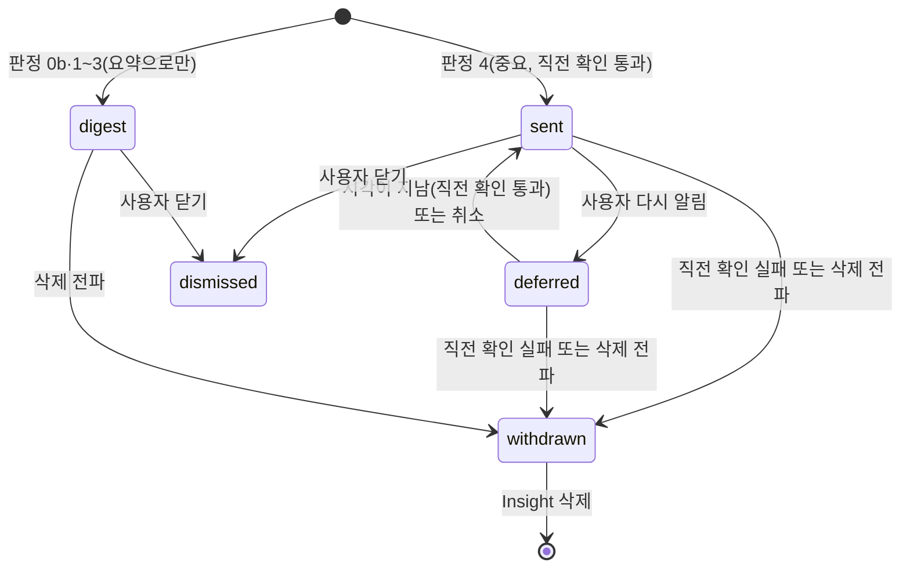
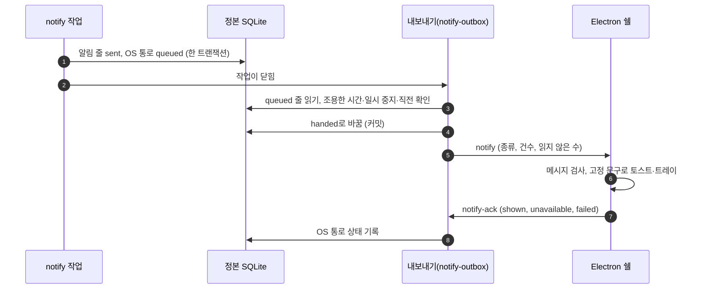

# 스펙: P02 — 알림·Digest·Timeline과 반복 억제

- 날짜: 2026-11-23 / 상태: 확정(잠정 결정 D1~D16 포함)
- 관련: 이슈 #28(P02), 총괄 #1(설계 분석 5번·10번), Phase 5 #7, 선행 #27(P01)·#26(K02), 후속 #29(P03 피드백). [P01 spec](2026-11-23-P01-insight-discovery.md)(R4 순위, R10 알림 제외 표시), [K02 spec](2026-11-23-K02-reflection-consolidation.md)(발견·규칙별 수), [I03 spec](2026-11-21-I03-persistent-queue.md)(작업·주기), [I04 spec](2026-11-21-I04-invalidation.md)(파생물 등록, `ScopePolicy`의 용도 `notify`), [V02 spec](2026-11-21-V02-vertical-slice.md)("T11이 넘기는 것": 열린 화면의 새로 고침)
- 번호: 요구사항 `P02-R<n>`, 결정 `P02-D<n>`, 작업 `P02-T<n>`. 완료 기준 `P02-C1`~`C3`은 이슈 #28의 번호 그대로이고 그 아래를 `a`·`b`·`c`로 나눈다. 마이그레이션 번호는 **합쳐지는 때 main의 다음 번호**를 쓴다(쓰는 지금 main은 v31).

| 말 | 뜻 |
|---|---|
| 알림 줄 | "이 Insight의 이 내용을 어떻게 전했는가"를 적은 한 행(`notifications`). Insight의 ID와 상태만 갖고 글은 갖지 않는다 |
| 피드 | 앱 안의 알림 목록. 전달의 기본 통로이고 OS 권한과 무관하게 항상 있다 |
| OS 알림 | 운영체제가 띄우는 토스트. Electron 쉘만 띄우며 건수만 적힌 고정 문구다 |
| 요약(Digest) | 하루치 알림 줄을 모아 보는 것. 주간 지식 리포트는 한 주치에 K02 점검 결과를 더한 것 |
| 타임라인 | 알림 줄 전부를 시간순으로, 어떻게 전했는지(즉시·요약으로만·미룸·닫음)와 함께 보는 것 |
| 조용한 시간 | OS 알림을 띄우지 않는 시간대. 피드는 그대로 쌓인다 |

## 배경

P01이 Insight마다 순위(여섯 축)와 신뢰도, "자동 알림 제외" 표시를 만들었지만 그것을 사용자에게 먼저 알려 주는 길은 없다. 홈에 들어가야 보인다. 총괄 설계 10번은 알림을 이렇게 정했다: 중요한 것만 즉시, 나머지는 요약으로, 조용한 시간·다시 알림·중복 억제·권한 철회를 지키고, 판정은 코드가 한다. 설계 5번은 알림 직전에 삭제와 접근 범위를 다시 확인하라고 한다. 쉘에는 아직 트레이와 OS 알림이 없고, V02-T11은 "이미 열려 있는 화면이 바뀐 내용을 스스로 다시 읽는 방법"을 이 작업으로 넘겼다.

## 목표

1. 중요한 Insight는 피드와 OS 알림으로 곧바로, 나머지는 매일 요약과 주간 지식 리포트로 전하고, 전부를 타임라인으로 본다. 모두 실제 백엔드의 값이다.
2. 알림 하나는 왜 중요한지, 무엇을 이었는지, 근거, 추론이라는 표시, 할 수 있는 조치를 보인다. OS 알림 문구에는 내용이 없다.
3. 같은 내용은 한 번만 전한다(재시도·재시작 포함). 전하기 직전에 삭제와 범위를 다시 확인한다. 조용한 시간·다시 알림·OS 권한 거부에서도 피드는 남는다.

## 비목표

- **앱 밖으로 나가는 것.** 메일·메신저·웹훅·외부 시스템 변경은 만들지 않는다. 통로는 피드와 OS 알림 둘뿐이고, 조치는 앱 안의 넷(근거 보기·다시 알림·닫기·점검으로 가기)뿐이다.
- **LLM이 알림 여부를 정하기, 알림 문구를 LLM이 쓰기.** 판정은 코드이고, 보이는 글은 P01이 저장한 Insight의 글이다.
- **개인화, "이 유형은 알리지 않기", 피드백 학습.** P03(#29).
- **창을 닫아도 계속 도는 상주 실행, 시작 프로그램 등록.** 쉘의 종료 방식은 그대로다(H02 #33).
- **알림에서 특정 화면으로 바로 가기(deep link), 브라우저의 Web Notification.**
- **WebSocket·SSE 같은 새 전송 통로, 새 큐·새 엔진.**
- **Electron E2E, Windows 설치본에서의 실제 토스트 확인.** 쉘은 단위 시험, 화면은 브라우저 E2E 하나.

## 요구사항

### 판정

- **P02-R1 알림 줄.** 활성 Insight의 (ID, `changed_at`)마다 알림 줄이 많아야 하나다(유일 키). 줄은 Insight ID, 상태, 사유 코드, 시각, OS 통로 상태만 갖고 이름·문장·인용문은 저장하지 않는다. 글은 읽을 때 Insight에서 가져온다.
- **P02-R2 판정은 순수 함수다.** `decideNotification(신호, 지난 줄들, 지금)`은 Provider를 부르지 않고 아래 순서로 정한다. 문턱과 기간은 상수다.

| 순서 | 조건 | 결과(상태 / 사유) |
|---|---|---|
| 0a | P03의 `preferenceSignals`가 `hidden`(관련 없음·이미 앎·확인함) | `withdrawn`(줄은 남기되 피드·요약·건수에 나오지 않음) |
| 0b | 같은 신호가 `muted`(다시 알리지 않기) | `digest` / `muted` |
| 1 | P01의 `isAutoNotifyExcluded`가 참 | `digest` / `low-confidence` |
| 2 | `rankInsight` 점수가 문턱(잠정 70) 미만 | `digest` / `below-threshold` |
| 3 | 같은 Insight를 지난 24시간 안에 즉시 알렸다 | `digest` / `repeat` |
| 4 | 그 밖 | `sent`(피드에 올리고 OS 통로를 `queued`로) |

- **P02-R3 작업과 주기.** 작업 종류는 `notify` 하나이고 대상이 `scan`·`daily`·`weekly`다. 원본에 묶이지 않고(fence 없음) Provider를 부르지 않는다. 시작할 때 주기 셋을 기존 `ensureSchedule`로 만든다(잠정: `scan` 10분마다, `daily` 매일 09:00, `weekly` 월요일 09:10). `extract`·`reflect` 작업이 성공으로 닫히면 `scan` 주기를 기존 "지금 실행"으로 깨운다. 끄기·바꾸기는 기존 주기 API다.
- **P02-R4 `scan`.** 알림 줄이 없는 활성 Insight(한 번에 잠정 200건)를 R2로 판정해 한 트랜잭션에 쓰고, 다시 알림 시각이 지난 줄을 R7의 확인 뒤 피드로 되돌린다. 결과 수(즉시, 요약으로만, 거둠)를 기존 결과 수 칸에 남긴다.
- **P02-R5 요약과 리포트.** `daily`·`weekly`는 지난 요약의 끝부터 지금까지를 구간으로 하는 줄 하나를 만든다(키는 종류와 구간의 시작). 구간에 알림 줄이 하나도 없으면(주간은 열린 발견도 없을 때) 줄을 만들지 않는다. 줄은 구간만 갖고, **내용은 읽을 때 계산한다**: 그 구간의 알림 줄(즉시 알린 것과 요약으로만 온 것을 사유와 함께)이고, 주간 리포트는 여기에 K02의 규칙별 수(열림·적용·오탐·미탐·반복됨)와 구간 안에 새로 열린 발견을 더한다. 요약 줄도 OS 통로를 탄다.

### 전달

- **P02-R6 피드가 기본 통로다.** `sent` 줄은 OS 통로의 상태와 무관하게 피드에 있다. 사용자 설정 `notifications.os`가 꺼졌거나, 쉘이 없거나(브라우저), OS가 알림을 지원하지 않거나 띄우기에 실패하면 OS 통로만 `unavailable`·`failed`로 끝나고 오류는 내지 않는다.
- **P02-R7 전하기 직전 확인.** 함수 하나(`mayDeliver`)가 ① 줄의 Insight가 지금 활성이고 `changed_at`이 줄의 것과 같으며 ② 등록부의 `visible(…, "notify")`가 그 Insight를 허용하고 ③ 알림 제외 표시가 서지 않았고 P03의 `preferenceSignals`(용도 `notify`)가 `hidden`·`muted`가 아닌지를 본다(`hidden`이면 철회, `muted`이면 요약으로만 내리고 OS 통로를 취소한다). 피드에 올릴 때(R4), 다시 알림에서 되돌릴 때, OS로 넘길 때(R8) 모두 이 함수를 지난다. 통과하지 못한 줄은 `withdrawn`이 되고 피드·요약·타임라인에 나오지 않는다. 읽기 경로도 같은 문(용도 `display`)을 지난다.
- **P02-R8 OS 통로는 많아야 한 번이다.** 백엔드의 내보내기 함수가 `queued` 줄을 모아 R7을 확인하고, **한 트랜잭션에서 `handed`로 바꾼 뒤에** 쉘에 메시지 하나를 보낸다. `handed`인 줄은 재시작·재시도 뒤에도 다시 보내지 않는다(놓치는 쪽을 택한다. 피드에 남아 있다). 쉘은 띄운 결과(`shown`·`unavailable`·`failed`)를 답한다.
- **P02-R9 잠금 화면에 내용이 없다.** 백엔드가 쉘로 보내는 메시지는 `{ type: "notify", id, kind: "insight"|"daily"|"weekly", count, unread }`뿐이고 쉘이 키와 값을 정확히 검사한다(다른 키가 있으면 버린다). 문구는 쉘이 가진 고정 틀 셋에 수만 넣는다(예: "확인할 변경이 3건 있습니다"). 항목 이름·Insight 문장·원본 이름은 어떤 경로로도 OS 알림과 트레이에 가지 않는다.
- **P02-R10 조용한 시간과 전체 일시 중지.** 설정 `notifications.quietHours`(잠정 기본 22:00~08:00, 끌 수 있음)의 시간대와 `notifications.snoozeUntil` 이전에는 내보내기 함수가 `queued` 줄을 그대로 둔다. 시간이 지나면 쌓인 줄을 **메시지 하나**(건수)로 보낸다. 피드는 이 동안에도 쌓인다.
- **P02-R11 사용자 조치.** 줄마다 읽음, 닫기(`dismissed`), 다시 알림(`deferred`, 정해진 시간 뒤 R7을 지나 피드로 돌아오고 OS 통로를 다시 한 번 탄다), 다시 알림 취소. 닫거나 읽은 줄의 `queued`는 `cancelled`가 된다. 조치는 이 넷뿐이고 앱 밖으로 아무것도 보내지 않는다.
- **P02-R12 트레이.** 쉘은 트레이 아이콘 하나를 두고 툴팁에 읽지 않은 수만 보인다. 누르면 창을 앞에 띄운다. 메뉴는 "열기"·"종료"다.

### 저장·읽기·화면

- **P02-R13 파생물 등록과 삭제.** 종류 `notification`을 I04 등록부에 올린다(층 `delivery`, 실행 위치 `canonical`). 계보는 줄의 Insight 계보다. 원본 삭제·정리의 트랜잭션에서, Insight가 사라진 줄은 지우고(외래 키) Insight가 철회되거나 내용이 바뀐 줄은 `withdrawn`으로 바꾼다. 요약 줄은 구간만 가져 계보가 없다. 테이블 분류(`derivative-coverage.ts`)에 같은 변경으로 더한다.
- **P02-R14 API.** 스키마는 `packages/contracts`에 **더하기만** 한다.
  - `GET /api/notifications`: 보이는 알림 줄(상태·사유·시각과, P01-T03의 Insight 응답 모양 그대로의 Insight: 유형·추론 문장·사실 줄·이유 요약·순위 축·근거 수·인식 유형), 줄마다 가능한 조치 목록, 읽지 않은 수, 요약 줄 목록.
  - `POST /api/notifications/digest`: 요약 줄 하나의 내용(R5). 없거나 보이지 않는 줄은 `{ digest: null }`이다.
  - `POST /api/notifications/act`: `op`는 `read`·`dismiss`·`snooze`(분: 60·240·1440 중 하나, `snooze`일 때만)·`unsnooze`이고 그 밖은 400이다. 답은 `applied`·`refused`(줄은 있으나 그 상태에는 적용되지 않음)·`not-found`와 읽지 않은 수다.
  - `GET`·`POST /api/settings/notifications`: OS 알림 켬·끔, 조용한 시간, 전체 일시 중지.
  - `GET /api/changes`: 순번 셋(원본 변경, 지식 변경, 알림 변경)과 읽지 않은 수. 본문이 없는 싼 읽기다.
- **P02-R15 화면.** 내비게이션에 "알림"을 더하고 읽지 않은 수를 붙인다. 화면은 한 응답을 세 가지로 보인다: 피드(지금 볼 것), 요약(매일·주간), 타임라인(전부, 날짜별, 전한 방식과 사유). 카드 하나는 "추론" 표지, 왜 중요한지(이유 요약과 순위 축), 이은 정보(사실 줄), 근거 열기(기존 근거 보기), 조치 단추를 보인다. 요약으로만 온 줄은 사유("신뢰도 낮음" 등)를 보인다. 문구는 한국어 문구 모듈에 둔다.
- **P02-R16 열린 화면의 새로 고침(V02-T11이 넘긴 것).** 화면은 보이는 동안 `GET /api/changes`를 잠정 5초마다 읽고, 순번이 달라지면 지금 화면의 읽기를 다시 한다(훅 하나 `useChanges`, `apps/web/src/changes.ts`: 앱이 한 번 읽어 순번 키를 홈·알림 화면에 내려 준다). 알림·홈·근거 보기에 붙인다. 다른 창에서 원본이 지워지면 열려 있던 근거 보기가 다음 읽기에서 "원본이 더 이상 없음"이 된다.

## 인터페이스 / 설계 개요

**테이블(마이그레이션 하나).** `notifications`(종류 `insight`·`daily`·`weekly`, 유일한 중복 키, `insight_id`(지워지면 함께 지워짐), 상태, 사유, `not_before`, 구간 시작·끝, OS 통로 상태, 만든 시각, 읽은 시각), `notify_state`(한 줄: 알림 변경 순번). 설정 셋은 기존 `settings` 표다.

**모듈.** 저장 `storage/src/notifications.ts`, 판정(`notify-rules.ts`)·작업(`notify-job.ts`)·종류(`notify-kind.ts`)는 `knowledge-engine`, 주기 만들기(`notify-schedules.ts`)·내보내기(`notify-outbox.ts`)·읽기 문(`notify-read.ts`)·경로는 `backend`, 쉘은 `apps/desktop/src/notifier.ts`(토스트·트레이, Electron 객체는 주입), 화면은 `apps/web/src/notifications.tsx`. 큐·주기·`commitDerived`·`rankInsight`·`isAutoNotifyExcluded`·`createLintReads`·쉘의 부모 채널(`secret-request`가 쓰는 것)은 있는 것을 그대로 쓴다.

**알림 줄의 상태.** 작업과 사용자, 삭제 전파가 서로 다른 길로 바꾸므로 그림으로 둔다.

**OS 통로의 순서.** `handed`를 먼저 적고 나서 보낸다는 순서가 중복 방지의 전부다.

### 대안과 기각 사유

- **Insight를 쓰는 자리 넷에서 바로 알림 만들기**: 쓰는 자리가 다른 작업의 파일이고 하나를 빠뜨리면 조용히 안 온다. "줄이 없는 활성 Insight"를 찾는 질의는 빠뜨릴 수 없고 다시 돌려도 같다.
- **요약의 내용을 저장**: 지워진 원본의 글이 요약에 남는다. 구간만 두고 읽을 때 문을 지나게 한다.
- **OS 알림을 "적어도 한 번"으로**: 재시작마다 같은 토스트가 뜰 수 있다. 피드가 남으므로 놓치는 쪽이 싸다.
- **SSE로 화면에 밀기**: `app://` 프로토콜의 대리 응답이 긴 연결을 견디는지 확인된 적이 없고, 5초 읽기로 넘겨받은 문제가 풀린다.

## 완료 기준 (테스트 가능한 형태)

모든 시험은 합성 fixture만 쓰고, 기준마다 대표 사례 1~2개다.

- **P02-C1a** (R1~R4·R14, 실제 입력) 띄운 백엔드에 합성 JSONL을 가져오기 API로 넣고 fixture 추출을 돌린 뒤 `scan`을 "지금 실행"하면, `GET /api/notifications`에 점수가 문턱 이상인 Insight가 `sent`로 사실 줄·이유 요약·근거 수·`inferred`·조치 목록과 함께 나오고, 신뢰도 30인 Insight는 `digest`·`low-confidence`이며 쉘로 간 메시지의 건수에 들지 않는다. → `backend/src/notify-flow.test.ts` **[T2 충족]**
- **P02-C1b** (R5) `daily`를 돌리면 구간을 가진 요약 줄 하나가 생기고 그 내용에 즉시 알린 줄과 요약으로만 온 줄이 사유와 함께 있다. `weekly`의 내용에는 K02 fixture의 규칙별 수가 있다. 구간에 아무것도 없으면 줄이 생기지 않는다. → `knowledge-engine/src/notify-job.test.ts`, `backend/src/notify-flow.test.ts` **[충족: 작업 부분은 T1(`notify-job.test.ts`), 읽기 부분은 T2(`notify-flow.test.ts`)]**
- **P02-C1c** (R15·R16) 사용자가 "알림"에서 카드의 "추론" 표지·이유·사실 줄을 보고, 근거를 열고, 다시 알림을 누르면 피드에서 사라지고 타임라인에 "다시 알림 예정"으로 남는다. 요약에서 신뢰도 낮은 줄의 사유를 본다. 다른 탭에서 원본을 지우면 열려 있던 화면이 다시 누르지 않아도 바뀐다. → `apps/web/e2e/notifications.e2e.ts`(브라우저 하나) **[T2 충족]**
- **P02-C2a** (R2) `decideNotification`이 표의 네 줄을 각각 한 사례로 돌려준다: 제외 표시, 문턱 미만, 24시간 안의 반복, 그 밖. → `knowledge-engine/src/notify-rules.test.ts` **[T1 충족]**
- **P02-C2b** (R9·R12) 쉘의 알림 모듈에 가짜 Electron 객체를 주면 ① 올바른 메시지에 토스트 한 번이 고정 문구와 수로 뜨고 트레이 툴팁이 읽지 않은 수다. ② 키가 하나 더 있는 메시지(예: `summary`)는 토스트 없이 버려진다. ③ 알림 미지원이면 `unavailable`을 답하고 던지지 않는다. → `apps/desktop/src/notifier.test.ts`, `apps/desktop/src/backend-process.notify.test.ts` **[T2 충족: 쉘이 키와 값을 정확히 검사하는 가드의 변이(`z.strictObject`→`z.object`)가 두 파일을 각각 빨갛게 함을 확인]**
- **P02-C2c** (R6·R10·R11) ① 조용한 시간 안에서는 `sent` 줄 둘이 피드에 있고 쉘로 간 메시지가 0건이며, 시각을 조용한 시간 뒤로 옮기면 건수 2인 메시지 하나가 간다. ② 쉘이 `unavailable`을 답하거나 쉘이 없어도 피드의 줄은 그대로다. ③ 다시 알림한 줄은 시각 전에는 피드에 없고 지나면 돌아온다. → `backend/src/notify-outbox.test.ts` **[T1 충족]**
- **P02-C3a** (R1·R8) ① `scan`을 두 번 돌리거나 실패 뒤 다시 돌려도 Insight 하나에 알림 줄이 하나다. ② `handed`를 적은 뒤 메시지를 보내기 전에 끊고 새 프로세스로 내보내기를 돌리면 메시지가 0건이다. `queued`인 채로 끊겼으면 한 번 간다. → `knowledge-engine/src/notify-job.test.ts`, `backend/src/notify-outbox.test.ts` **[T1 충족]**
- **P02-C3b** (R7·R13) ① 판정 뒤, 내보내기 전에 받치던 원본을 지우면 메시지가 가지 않고 줄이 피드·요약·타임라인에 없으며, 공통 계약(`derivativeKindContract`)이 `notification`에 대해 통과한다. ② 용도 `notify`를 거부하는 범위 정책에서는 줄이 `withdrawn`이고 메시지가 0건이다. ③ (P03 인계) Insight에 `mute` 피드백이 있으면 스캔에서 즉시 보내지 않고 요약으로만 가며, 줄을 큐에 넣은 뒤 `mute`가 오면 내보내기가 OS 통로를 취소한다. **변이**: `mayDeliver`의 범위 확인을 빼면 ②가, 활성 확인을 빼면 ①이 빨개진다. → `backend/src/notify-gate.test.ts`, `knowledge-engine/src/notify-kind.test.ts` **[T1 충족: 변이 둘이 각각 `notify-gate.test.ts`를 빨갛게 함을 확인]**
- **P02-C3c** (비목표 "앱 밖", R3·R11) ① 호출되면 던지는 Broker를 준 채로 `notify` 작업 셋이 성공한다(Provider 호출 0건). ② `act`의 `op`는 넷뿐이고 그 밖의 값은 400이다. ③ 알림 모듈들(`notify-*.ts`, `notifier.ts`)은 네트워크·Connector·Broker 모듈을 들여오지 않는다(들여오기 대조 시험). → `backend/src/notify-no-egress.test.ts` **[충족: ①·③은 T1, ②는 T2(`notify-flow.test.ts`가 `act`의 `op`와 다시 알림 시간 밖의 값에 400을 확인)]**

## 미해결 질문 / 검증하지 않은 범위

- **Windows 설치본의 실제 토스트·트레이.** 알림 센터 표시, 집중 지원(방해 금지)과의 겹침, 앱 ID(AppUserModelID)가 없을 때의 동작, 트레이 아이콘 모양은 확인하지 않는다. macOS에서 OS 권한이 거부됐을 때 Electron이 `show`를 알리는지도 확인하지 않았다(알리지 않으면 `handed`로 남고 피드는 그대로다).
- **문턱 70과 24시간.** 실제 자료에서 즉시 알림이 하루 몇 건 나오는지 재지 않았다. P01의 순위 값 자체가 실측 전이다(P01-D6).
- **10분 주기와 5초 읽기의 비용.** Insight가 수천 건일 때 `scan`의 시간, 창을 오래 열어 둘 때의 읽기 부하는 재지 않았다.
- ~~요약 줄처럼 계보가 없는 행을 가진 종류가 공통 계약과 테이블 대조 시험을 그대로 통과하는지~~ T1에서 확인: 공통 계약은 계보 없는 행(`withoutLineage`)을 받고 대조 시험은 `notifications`를 종류 `notification`의 표로 받는다. D6의 대안은 쓰지 않는다.
- **문턱 70이 닿는 범위(T1 측정).** 합성 신호로 `rankInsight`를 재면 긴급 날짜(7일 안)가 없고 사용자 입력을 쓰지 않은 Insight는 어떤 유형도 최대 67점(`dependency_delay`, 신뢰도 100)이고, 날짜가 7일 안이면 신뢰도 50에서 7개 유형이 71~77점, `important_change`·`opportunity`·`new_relation`이 64~69점이다. 즉 70은 "기한이 임박한 Insight"만 즉시 알리는 값이라 도달 불가는 아니어서 그대로 둔다(D2). 실제 분포는 여전히 재지 않았다.
- **P01-T03이 합쳐진 뒤의 Insight 응답 모양**(아래 "가정")과, 배포처 범위 정책이 용도 `notify`에 실제로 무엇을 답하는지.

## 잠정 결정과 가정

| 번호 | 결정 | 이유 | 바꾸려면 |
|---|---|---|---|
| P02-D1 | 알림 대상은 P01의 Insight뿐이다. K02 발견은 주간 리포트에만 나온다 | 발견은 후보이고 순위·신뢰도가 없다 | 판정 함수에 발견용 줄 종류를 더한다 |
| P02-D2 | 즉시 알림 문턱은 점수 70, 반복 억제는 24시간, 한 번에 200건 | 실측 전의 보수적인 값 | `notify-rules.ts`의 상수 |
| P02-D3 | 중복 키는 (Insight ID, `changed_at`)이다. 내용이 바뀌면 새 줄이고 24시간 안이면 요약으로만 간다 | `changed_at`은 내용이 바뀔 때만 바뀐다(P01-R9). 새 열이 필요 없다 | 키에 근거 해시를 넣는다 |
| P02-D4 | 알림을 찾는 것은 주기 작업(10분)이고 추출·재검토가 끝나면 깨운다 | Insight를 쓰는 다른 작업의 파일을 고치지 않는다 | 주기 API, 또는 쓰는 자리에서 직접 깨운다 |
| P02-D5 | 요약은 매일 09:00, 리포트는 월요일 09:10. 내용은 저장하지 않고 읽을 때 계산한다. 빈 구간은 건너뛴다 | 조용한 시간 뒤이고 K02의 일요일 재검토 다음이다. 지워진 글이 남지 않는다 | 주기 API. 내용을 고정하려면 줄별 ID 목록 테이블을 더한다 |
| P02-D6 | 요약 줄과 Insight 알림 줄을 한 테이블에 두고 종류 `notification`(층 `delivery`)으로 등록한다 | OS 통로와 읽음 처리가 한 곳이다. `delivery` 층은 이 용도로 비어 있었다 | 요약 줄을 운영 테이블 `digests`로 뗀다 |
| P02-D7 | 피드는 조용한 시간에도 쌓이고, 조용한 시간·전체 일시 중지는 OS 통로만 미룬다 | 앱을 보고 있는 사람에게 감출 이유가 없다 | 내보내기 대신 판정 단계에서 미룬다 |
| P02-D8 | OS 알림은 건수만 적은 고정 문구이고, 쌓인 줄은 한 번에 하나로 띄운다 | 잠금 화면에 내용이 없고 방해가 적다 | 쉘의 문구 틀. 내용 표시는 설정과 잠금 상태 확인이 선행 |
| P02-D9 | OS 통로는 "많아야 한 번"이다(`handed`를 먼저 적는다) | 중복이 놓침보다 나쁘다. 피드가 남는다 | 쉘의 답을 받은 뒤 `handed`로 바꾸고 쉘이 ID로 중복을 거른다 |
| P02-D10 | `notifications.os`는 기본 켬, 조용한 시간은 기본 22:00~08:00 | 이 기능의 본체이고 문구에 내용이 없다 | 설정 API, 기본값 상수 |
| P02-D11 | 쉘의 종료 방식은 그대로다(창을 닫으면 끝난다). 트레이는 앱이 떠 있는 동안만 있다 | 상주 실행은 설치본·잠금·종료 시험을 건드린다 | H02에서 상주를 정한다 |
| P02-D12 | 트레이 아이콘은 코드에 넣은 작은 그림 하나다 | 저장소에 아이콘 자산이 없다 | 설치본 아이콘이 정해지면 그 파일을 쓴다 |
| P02-D13 | 알림을 누르면 창만 앞에 온다. 화면 이동은 없다 | preload에 새 통로를 더하지 않는다 | 쉘→화면 통로를 더한다 |
| P02-D14 | 열린 화면의 새로 고침은 5초마다의 순번 읽기다 | 새 전송 통로 없이 브라우저와 쉘에서 같다 | `useChanges` 훅의 구현을 바꾼다 |
| P02-D15 | 철회되었거나 보이지 않는 Insight의 줄은 타임라인에서도 뺀다 | "없음"과 "가려짐"이 같은 답이어야 한다(기존 읽기 문과 같다) | 글 없이 "해소됨"만 보인다 |
| P02-D16 | 다시 알림은 정해진 세 값(1시간·4시간·하루)이다 | 입력 검사가 닫힌 목록이다 | 계약의 값 목록 |
| P02-D17 | 사용자 피드백으로 막는 방식: `hidden`은 `withdrawn`, `muted`만이면 요약으로만(`digest` / `muted`). 줄이 이미 `sent`·`deferred`이거나 OS 통로 `queued`였어도 직전 확인(`deliveryVerdict`)이 같은 규칙으로 내린다 | P03 스펙의 "둘 중 하나라도 참이면 보내지 않는다"를 지키되, 사용자가 숨긴 것은 어디에도 세지 않고 알리지만 않기를 원한 것은 하루 요약에서 볼 수 있게 한다. 한 곳(직전 확인)이 스캔·되돌림·내보내기를 모두 막는다 | `notify-gate.ts`의 `deliveryVerdict`에서 `digest`를 `withdraw`로 바꾸면 `muted`도 철회한다 |
| P02-D18 | 읽기 문은 `gate.insights()`(용도 `display`)와 P03의 `hidden`을 한 번 읽어 모든 줄·요약 줄을 거른다. 요약 줄은 구간 안에 보이는 줄이 하나라도 있거나(주간은 열린 발견이 있어도) 있을 때만 나오고, 읽지 않은 수는 목록에서는 보이는 줄로, `GET /api/changes`와 쉘의 트레이는 `unreadCount`(용도 `notify`)로 센다 | 사용자에게 안 보이는 줄이 건수·요약에 남지 않게 하고(T1 검토 FU4), 5초마다 읽는 순번 읽기를 싸게 한다 | `notify-read.ts`의 `shownLines`·`changes` |
| P02-D19 | 다시 알림을 사용자가 취소하면(`unsnooze`) 줄은 직전 확인을 지나 피드로 돌아오되 OS 통로는 다시 타지 않는다. 읽거나 닫은 줄(요약 줄 포함)의 `queued`는 내보내기의 다음 정리에서 `cancelled`가 된다(T1 검토 FU2) | 사용자가 지금 피드를 보고 있다. 시각이 지나 돌아오는 경우만 토스트를 한 번 더 띄운다 | `returnNotification`의 `queueOs` |
| P02-D20 | 토스트의 결과는 플랫폼이 `show`나 `failed`를 알릴 때만 답하고(3초), 아무것도 알리지 않으면 답하지 않는다. 트레이 툴팁의 읽지 않은 수는 알림 메시지가 올 때만 갱신된다 | OS 권한을 끈 경우 Electron이 무엇을 알리는지 확인하지 못했다. 답이 없으면 줄이 `handed`로 남고 피드는 그대로다 | 쉘의 `notifier.ts`. 트레이를 항상 맞추려면 쉘이 `GET /api/changes`를 읽는다 |

**가정(P01-T03이 합쳐진 뒤 다시 확인).** ① Insight 응답 스키마가 유형·사실 줄·이유 요약·순위(축과 점수)·알림 제외를 갖고 다른 응답에 끼워 쓸 수 있게 내보내진다. ② 읽기 문이 Insight 하나를 ID로 그 모양으로 돌려준다(없으면 `notify-read.ts`가 목록에서 고른다). ③ 순위 입력(해석 열 포함)을 모으는 도우미가 있으면 그것을 쓰고, 없으면 P02가 하나 만들어 T03의 읽기와 같은 값을 내는지 시험한다. ④ 홈은 `useChanges`를 붙이는 한 줄만 고친다. K02-T3(LLM 의견)은 쓰지 않는다. 파일만 겹친다(`composition.ts`, `job-kinds.ts`, `job-text.ts`, `site-setup.md`).

## 작업 분해

구현은 P01-T03과 K02-T3이 합쳐진 뒤에 시작한다. T1과 T2는 각각 PR 하나다. 겹치는 파일(`server.ts`, `contracts/src/index.ts`, `composition.ts`, `boot.ts`)에는 줄을 더하기만 한다.

| 작업 | 내용(산출물 하나) | 기준 | 선행 | 주요 파일 | 증거 |
|---|---|---|---|---|---|
| P02-T1 | 백엔드: 마이그레이션, 저장, 판정, 작업 `notify`와 주기 셋, 종류 `notification` 등록·분류, 직전 확인, 내보내기(가짜 채널로 시험), 작업 문구 | C1b(작업), C2a, C2c, C3a, C3b, C3c(①·③) | P01-T03·K02-T3 머지 | `storage/src/{migrations,notifications,job-kinds,index}.ts`, `knowledge-engine/src/notify-{rules,job,kind}.ts`, `backend/src/{notify-schedules,notify-outbox,composition,boot,derivative-coverage,read-gate,shell-main}.ts`, `apps/web/src/job-text.ts` | 위 시험 파일의 실패→통과, 변이 둘의 빨간 출력, 전체 스위트 1회 |
| P02-T2 | 화면까지: 계약과 경로 여섯(알림 목록·요약 내용·조치·설정 읽기와 쓰기·변경 순번), 읽기 문, "알림" 화면과 `useChanges`, 쉘의 토스트·트레이와 채널 메시지, 시드와 브라우저 E2E **[완료. 계약은 `index.ts`에 더했고(`InsightSummarySchema`를 끌어 쓰려면 한 파일이어야 순환 없이 평가됨), 훅은 `apps/web/src/changes.ts`]** | C1a, C1b(읽기), C1c, C2b, C3c(②) | T1 | `packages/contracts/src/{notifications,index}.ts`, `backend/src/{server,notify-read}.ts`, `apps/web/src/{App,notifications,notifications-text,evidence-view}.tsx`, `apps/desktop/src/{notifier,main,backend-process}.ts`, `backend/src/p02-seed.e2e.ts`, `apps/web/e2e/notifications.e2e.ts` | 시험 파일의 실패→통과, `pnpm e2e` 포함 전체 스위트 1회 |
| P02-T3 | 문서: ARCHITECTURE(저장 표·쉘 채널·`delivery` 층), I04 등록표, 문서 색인, site-setup 항목(S44), README **[완료]** | (문서 대조 시험) | T2 | `docs/{ARCHITECTURE,site-setup,README}.md`, `docs/specs/2026-11-21-I04-invalidation.md` | `pnpm lint`·문서 대조 시험. T2의 PR에 함께 실어도 된다 |

## 배포처 후속

`docs/site-setup.md`에 항목 하나를 더한다(번호는 합칠 때의 다음 번호, T3에서).

- Windows 11 설치본에서 토스트가 뜨는지, 잠금 화면과 알림 센터에 건수 문구만 보이는지, 집중 지원이 켜졌을 때와 OS 알림 권한을 끈 때 피드만 남는지 확인한다. 앱 ID 등록이 필요하면 설치본 작업(H02)에 넘긴다.
- 배포처 범위 정책이 용도 `notify`에 답하는 값을 정하고, 허용되지 않은 범위 원본에 기댄 Insight가 피드·요약·OS 알림 건수에 들지 않는지 확인한다(C3b ②의 실제 정책판).
- 실제 자료로 한 주 이상 돌려 하루 즉시 알림 수와 요약 크기를 재고 문턱(D2)과 시각(D5·D10)을 정한다.
- 배포처가 메일·메신저로 알림을 보내려면 별도 spec과 사용자 승인 절차가 먼저다. 이 저장소에는 그 통로가 없다.

## 변경 이력

| 날짜 | 변경 내용 | 대상 | 사유 |
|---|---|---|---|
| 2026-11-23 | 초안 작성 | 이 문서 | 이슈 #28 착수(P01-T03·K02-T3 머지 전이라 문서만) |
| 2026-11-23 | T1 구현 반영: 완료 기준 상태 표시, 계보 없는 행의 공통 계약 통과 확인(D6 대안 불필요), 문턱 70의 도달 범위 측정 기록, 마이그레이션 v33(P03이 v32를 먼저 씀) | 이 문서 | P02-T1(백엔드) 구현. 문턱 값은 도달 가능하여 바꾸지 않음 |
| 2026-11-23 | P03 반영(rebase): 마이그레이션 v33, 판정 표에 0a·0b(`hidden`·`muted`), R7 ③에 피드백 확인, 결정 D17 | 이 문서 | P03(#253)이 v32·S36을 먼저 합치고 "P02에게" 인계에서 알림 전 `muted` 확인을 P02의 완료 기준으로 넘김 |
| 2026-11-23 | T2·T3 구현 반영: 완료 기준 C1a·C1b(읽기)·C1c·C2b·C3c②에 충족 표시, 결정 D18~D20(읽기 문의 거름과 읽지 않은 수, 다시 알림 취소는 OS 통로를 다시 타지 않음, 토스트 결과는 플랫폼이 알릴 때만 답함), 계약의 digest 답을 `{ digest: null }`·`act`의 요청을 한 객체로 정함, site-setup 항목 S44과 설정 표 | 이 문서 | P02-T2(화면·쉘)·T3(문서) 구현. P01-T03이 합쳐져 가정 ①~④를 확인함(Insight 응답 스키마·`insightView`·`rankedInsightViews`가 있어 그대로 씀, 읽기 문에 Insight 하나를 ID로 읽는 길은 `insightEvidence`) |
