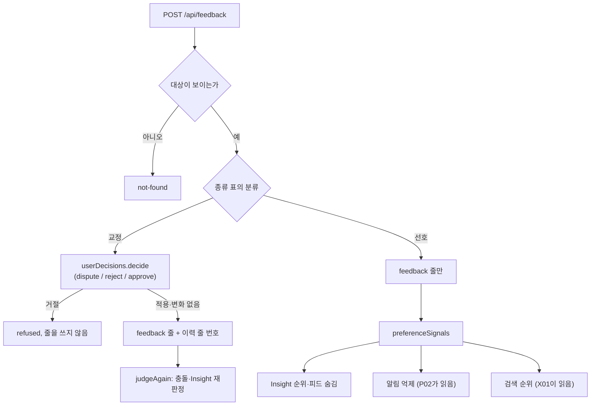

# 스펙: P03 — Feedback Learning·교정과 선호 분리

- 날짜: 2026-11-23 / 상태: 확정(잠정 결정 D1~D14 포함)
- 관련: 이슈 #29(P03), 총괄 #1, Phase 5 #7, 선행 #27(P01)·#22(S01), 나란히 가는 #28(P02 알림)·#30(X01 검색). [원 설계](../design/original-design.md) 12절, [S01 spec](2026-11-22-S01-semantic-registry.md)(사용자 조치·취소·재추출 보존), [P01 spec](2026-11-23-P01-insight-discovery.md)(R4 순위, D6·D7), [K02 spec](2026-11-23-K02-reflection-consolidation.md), [I04 spec](2026-11-21-I04-invalidation.md)(테이블 분류)
- 번호: 요구사항 `P03-R<n>`, 결정 `P03-D<n>`, 작업 `P03-T<n>`. 완료 기준 `P03-C1`~`C3`은 이슈 #29의 번호 그대로이고 그 아래를 `a`·`b`·`c`로 나눈다. 마이그레이션 번호는 **합쳐지는 때 main의 다음 번호**를 쓴다(쓰는 지금 main은 v31이라 이 구현은 v32. 다른 작업이 먼저 v32를 쓰고 들어오면 나중에 합치는 쪽이 번호와 `migrations` 배열의 줄을 옮긴다).

| 말 | 뜻 |
|---|---|
| 피드백 | 사용자가 Insight나 지식 행에 누르는 여덟 가지 평가 가운데 하나. 글이 없고 종류 코드와 대상 ID만 있다 |
| 교정 | "이 지식은 틀렸다/맞다"는 피드백. 지식 행의 **상태**를 바꾼다(S01의 승인·이의·기각) |
| 선호 | "나에게 쓸모 있다/없다"는 피드백. 지식은 그대로 두고 **순서·숨김·알림**만 바꾼다 |
| 선호 신호 | 어떤 대상에 대해 지금 유효한 선호를 숫자 하나와 표시 둘로 줄인 값. 순위·알림·검색이 읽는다 |
| 취소 | 피드백 한 건을 없던 것으로 돌리는 것. 줄은 기록에 남고 효과만 사라진다 |

## 배경

사용자의 교정은 이미 길이 있다. S01의 사용자 입구 `userDecisions`(승인·이의·기각·취소, `storage/src/semantic-user.ts:98`)가 상태와 이력을 쓰고, 서버는 그 조치와 같은 트랜잭션에서 Insight와 충돌 연결을 다시 판정한다(`judgeAgain`, `backend/src/server.ts:603`). 재추출이 사용자의 결정을 덮지 않는다는 것도 S01이 증명했다(`knowledge-engine/src/reextract-preserve.test.ts`).

없는 것은 선호다. Insight 순위의 관련성 축은 "사용자 입력 행을 썼는가"만 보고(`knowledge-engine/src/insight-ranking.ts:50`, P01-D7), ARCHITECTURE의 저장 표에는 "피드백·선호: 아직 없다"고 적혀 있다. P03은 여덟 가지 피드백을 받아 **교정은 기존 입구로 보내고, 선호는 새 기록 하나에 쌓아** 순위·숨김·알림 억제의 입력으로 내놓는다.

## 목표

1. 여덟 가지 피드백이 한 기록에 저장되고, 한 건씩 취소할 수 있다.
2. 교정 피드백은 지식 검토 상태를 바꾸고, 선호 피드백은 지식을 건드리지 않은 채 Insight 순위·피드 숨김·알림 억제 신호가 된다.
3. 피드백과 그 효과는 재추출·재검토(Reflection) 뒤에도 남고, 대상이 삭제되면 함께 사라진다. 개인화를 켜기 전과 뒤의 순위를 합성 자료로 비교한다.

## 비목표

- **Fine-tuning·강화학습, 모델이 매기는 선호.** 가중은 코드가 세어 만든 정수다.
- **알림 발송과 실제 억제.** 억제 여부를 답하는 읽기 함수까지만 한다. 알림 경로에서의 확인은 P02(#28).
- **검색 순위에의 반영.** 같은 읽기 함수를 내놓고, 반영과 검증은 X01(#30, X01-C1).
- **Prompt context.** 선호를 Provider 프롬프트에 싣지 않는다(D12).
- **원본(문서)에 대한 피드백, 피드백에 붙이는 메모 글, 열람 기록, "놓친 정보" 유형.** 대상은 Insight·항목·사실·관계 넷이다(D3).
- **사용자가 여럿인 선호.** 설치본 하나에 사용자 하나다.
- **실제 사용 기록으로 정한 가중 값.** 값은 모두 잠정 상수다.

## 요구사항

### 피드백의 종류와 기록

- **P03-R1 종류 표.** 여덟 종류와 그 분류·허용 대상·효과는 표 하나(`packages/contracts/src/feedback-types.ts`)에 있고, 저장·API·화면이 그 표만 읽는다. 표에 없는 조합(예: 관계에 "유용함")은 `bad-request`다.

| 코드 | 화면 이름 | 분류 | 허용 대상 | 효과 |
|---|---|---|---|---|
| `useful` | 유용함 | 선호 | Insight, 항목 | 가중 +50 |
| `important` | 중요함 | 선호 | Insight, 항목 | 가중 +100 |
| `irrelevant` | 관련 없음 | 선호 | Insight, 항목 | 가중 −100. Insight면 내 피드에서 숨김, 알림 억제 |
| `already_known` | 이미 알고 있음 | 선호 | Insight | 그 Insight의 내용이 바뀔 때까지 피드에서 숨김, 알림 억제 |
| `mute` | 다시 알리지 않기 | 선호 | Insight, 항목 | 알림 억제만(피드·순위는 그대로) |
| `confirmed` | 확인 완료 | 대상에 따라 | Insight → 선호 / 항목·사실·관계 → 교정 | Insight: `already_known`과 같음. 지식 행: 승인(`approve`) |
| `wrong_info` | 잘못된 정보 | 교정 | 항목, 사실 | 검토로 보냄(R4) |
| `wrong_relation` | 잘못된 관계 | 교정 | 관계 | 검토로 보냄(R4) |

- **P03-R2 기록.** 테이블 하나 `feedback`: 종류, 대상(Insight·항목·사실·관계 가운데 정확히 하나의 ID), 만든 시각, 취소 시각(없으면 유효), 교정이 쓴 이력 줄 번호(없을 수 있음). 글·이름·값은 저장하지 않는다. 같은 대상에 같은 종류의 유효한 줄은 하나뿐이다. 이미 있고 그 효과가 아직 유지되면(교정은 R5의 "자기 줄" 조건, 호오는 D9의 "가장 새 줄" 조건, Insight의 `already_known`·`confirmed`는 D4의 "`changed_at` 이후" 조건) 새 줄을 쓰지 않고 그 줄을 답한다. 효과가 이미 사라진 줄이면 같은 트랜잭션에서 그 줄에 취소 시각을 적고 새 줄을 쓴다(교정은 입구를 다시 부른다).
- **P03-R3 취소.** 유효한 줄 하나를 ID로 취소한다. 선호는 취소 시각만 적는다. 교정은 R4의 되돌리기가 받아들여진 때에만 취소 시각을 적는다. 이미 취소된 줄은 `nothing-to-undo`다. 취소는 줄을 지우지 않는다.

### 교정의 길

- **P03-R4 교정은 S01의 입구만 지난다.** 교정 피드백은 같은 트랜잭션에서 `userDecisions.decide`를 부르고, 그것이 쓴 이력 줄 번호(`seq`)를 피드백 줄에 적는다. 지식 상태를 직접 고치는 SQL은 없다.
  - `wrong_info`·`wrong_relation`: 대상이 `verified`면 `dispute`, `candidate`면 `reject`. 그 밖의 상태(`disputed`·`rejected`·`superseded`)면 상태를 바꾸지 않고 피드백 줄만 쓴다.
  - `confirmed`(지식 행): `approve`. 이미 `verified`면 피드백 줄만 쓴다.
  - 입구가 거절하면(예: 데이터 검사를 지나지 못한 승인 `data-check-unmet`) 피드백 줄도 쓰지 않고 그 사유를 답한다.
  - 적용된 뒤에는 기존 조치와 똑같이 `judgeAgain`이 돈다(충돌 연결, Insight, 합치기 후보).
- **P03-R5 교정의 취소는 자기 줄만 되돌린다.** 피드백 줄에 이력 줄 번호가 있으면, 대상 행의 가장 새 상태 줄이 **그 번호일 때만** `userDecisions.undo`를 부르고 `judgeAgain`을 돈다. 그 뒤에 다른 조치가 쌓였으면 `not-latest`로 거절하고 아무것도 바꾸지 않는다(다른 화면에서 한 승인을 피드백 취소가 되돌리지 않게). 번호가 없는 줄(상태를 바꾸지 않은 교정)은 취소 시각만 적는다. 번호가 없는 줄은 대상 행이 아직 조치가 필요 없는 상태일 때만 유지되는 줄이다. 새 줄을 취소해도 R2가 먼저 취소 처리한 낡은 줄은 되살아나지 않는다.

### 선호의 길

- **P03-R6 선호는 지식을 바꾸지 않는다.** 선호 피드백의 기록과 취소는 `items`·`facts`·`relations`와 세 이력 테이블, `insights`의 어떤 행도 쓰지 않는다. "관련 없음"은 사실을 지우지도 상태를 바꾸지도 않는다.
- **P03-R7 선호 신호.** `preferenceSignals(db, 대상들, 옵션)`(`storage/src/feedback.ts`)이 Insight나 항목마다 다음을 답한다. 유효한 줄만 읽고, 같은 입력에 같은 값이다.

| 값 | 뜻 | 정하는 법 |
|---|---|---|
| `weight` | −100~100의 정수. 0은 의견 없음 | 아래 세 단계 가운데 처음 값이 있는 것 |
| `source` | `direct`·`item`·`type`·`null` | `weight`가 어느 단계에서 왔는지(설명용) |
| `hidden` | 내 피드에서 빠짐 | 그 Insight의 가장 새 호오 줄이 `irrelevant`이거나, 유효한 `already_known`·`confirmed` 줄이 Insight의 `changed_at`보다 늦거나 같음 |
| `muted` | 알림을 보내지 않음 | `hidden`이거나, 그 Insight 또는 그 X·Y 묶음의 항목에 유효한 `mute` 줄이 있음 |

  - **직접(`direct`)**: 대상 자신의 호오 줄(`useful`·`important`·`irrelevant`) 가운데 가장 새 것의 가중. 가장 새 줄을 취소하면 그 앞 줄이 다시 유효하다.
  - **항목(`item`)**: Insight에 직접 줄이 없으면, X·Y 묶음에 속한 항목들의 직접 가중 가운데 절댓값이 가장 큰 것(같으면 음수).
  - **유형(`type`, 기본 끔)**: 위 둘이 없고 설정이 켜져 있으면, 같은 유형 Insight에 달린 직접 호오 줄을 세어 `round(100 × (긍정 − 부정) / (긍정 + 부정 + 3))`. 설정 `feedback.learned`가 정확히 `on`일 때만 계산한다(D7).
  - 호출자는 "이 대상의 줄을 써도 되는가"를 판정하는 함수를 넘길 수 있고, 거절된 대상의 줄은 어떤 단계에도 쓰이지 않는다(R10).
- **P03-R8 순위 반영.** `rankInsight`의 입력에 선택 값 `preference`(위의 `weight`)를 더한다. 관련성 축은 `clamp(기존 값 + preference / 2, 0, 100)`이고, 값이 없거나 0이면 지금과 같다. 돌려주는 순위에 쓴 `preference`를 함께 실어 설명할 수 있게 한다. 가중 여섯과 다른 축은 고치지 않는다.
- **P03-R9 피드와 알림.** `GET /api/insights`는 `hidden`인 Insight를 빼고 답한다(사용자가 직접 누른 것의 결과라 설정 없이 늘 적용). 알림 쪽은 `muted`를 읽는 것으로 끝이고 P03은 알림을 만들지 않는다.

### 범위·삭제·유지

- **P03-R10 숨은 대상을 드러내지 않는다.** 피드백의 쓰기·취소·목록은 대상이 지금 보이는지 먼저 묻는다(사실·관계·항목은 `gate.semanticShown`, Insight는 등록부의 `visible`, `backend/src/lint-read.ts:75`와 같은 방식). 없는 대상, 지워진 대상, 보이지 않는 대상은 모두 같은 `not-found`다. 목록은 보이는 대상의 줄만 싣고, API가 신호를 계산할 때는 보이지 않는 대상의 줄을 쓰지 않는다.
- **P03-R11 삭제.** 피드백 줄은 대상 행을 외래 키로 가리키고(`ON DELETE CASCADE`), 원본 삭제가 대상 행을 지우면 같은 트랜잭션에서 함께 사라진다. 테이블은 I04의 분류표(`backend/src/derivative-coverage.ts:36`)에 올린다(D5). 새 파생물 종류는 만들지 않는다.
- **P03-R12 유지.** 재추출(같은 version, 새 version)과 재검토 작업(`reflect`)은 피드백 줄을 쓰지도 지우지도 않는다. 교정이 바꾼 상태는 S01-R12~R14가 지키는 그대로 남고, 선호 신호는 그 앞뒤로 같다.
- **P03-R13 평가.** 합성 fixture 하나(`fixtures/p03-personalization.json`: Insight 신호 목록, 피드백 기록, "이 사용자에게 관련 있음" 라벨)로 **피드백을 주지 않은 Insight들**의 순위를 두 번 계산한다: 선호 신호 없이(전), 신호와 `feedback.learned`를 켜고(후). 지표는 상위 3건 가운데 관련 있음의 비율과 관련 있음 Insight의 평균 순위다. 두 값을 시험이 출력하고 후가 전보다 나쁘지 않음을 단언한다.

### API와 화면

- **P03-R14 API.** 경로 셋을 더한다(기존 경로는 `GET /api/insights`의 숨김 말고는 그대로).
  - `POST /api/feedback` `{ target: { kind, id }, kind }` → `{ status: "applied", feedback }` 또는 `{ status: "refused", reason }`. 교정이면 바뀐 행의 상태를 함께 싣는다.
  - `POST /api/feedback/undo` `{ id }` → `{ status: "applied" }` 또는 `{ status: "refused", reason }`.
  - `GET /api/feedback` → 유효한 줄을 새 것부터 100건까지(ID, 종류, 분류, 대상, 대상의 표시 이름, 시각).
- **P03-R15 화면.** 홈의 Insight마다 Insight에 허용된 여섯 종류의 버튼을 두고, 홈 아래 "최근 피드백" 목록에서 줄마다 취소한다. 누른 직후와 취소 직후 Insight 목록을 다시 읽는다. 새 컴포넌트는 새 파일(`apps/web/src/feedback.tsx`·`feedback-text.ts`)에 두고 기존 파일에는 끼우는 줄만 더한다.

## 인터페이스 / 설계 개요

피드백 한 건이 지나는 길이다. 분류가 갈림길이고, 두 길은 서로의 테이블을 쓰지 않는다.

- **스키마(v32, 더하기만).** `feedback(id, kind, insight_id, item_id, fact_id, relation_id, created_at, undone_at, applied_seq)`. 대상 열 넷은 각자의 테이블을 `ON DELETE CASCADE`로 가리키고 정확히 하나만 값이 있다(CHECK). `kind`는 여덟 코드의 CHECK. 유효한 줄의 유일 색인은 대상 열마다 `(kind, 대상) WHERE undone_at IS NULL`.
- **저장 모듈 하나(`storage/src/feedback.ts`).** `recordFeedback(tx, decisions, 입력, 시각)`, `undoFeedback(tx, decisions, id, 시각)`, `listFeedback(db, 한도)`, `preferenceSignals(db, 대상들, { learned?, usable? })`, 설정 읽기 `feedbackLearned(db)`. 앞의 둘은 교정이 건드린 행(`EntryRef`)을 결과에 실어, 호출자가 `judgeAgain`을 돌 수 있게 한다. 표 접근·분류 분기·가중 계산이 이 파일 안에 있고 밖에서는 이 다섯만 본다.
- **서버(`backend/src/feedback-api.ts`).** `createLintReads`와 같은 모양(`backend/src/server.ts:628`): DB, 읽기 문, 등록부, `decisions`, `judgeAgain`, 시계를 받아 경로 셋의 처리기를 돌려준다. `server.ts`에는 import, 조립, 처리기 세 줄, `insights` 처리기의 숨김 한 줄만 더한다.
- **P02·X01이 붙는 자리.** 둘 다 `preferenceSignals` 하나를 읽는다. 대상을 `{ kind: "insight" | "item", id }`로 넘기면 `{ weight, source, hidden, muted }`가 오고, 피드백이 없는 대상은 `weight: 0, source: null, hidden: false, muted: false`다. X01이 선언한 "선호 신호 인터페이스, 기본은 신호 없음"은 `(대상) => weight`로 이 함수에 묶으면 되고, P02의 억제 판정은 `muted`다. 각자 자기 용도(`notify`·`search`)의 보임 판정을 `usable`로 넘긴다.

### 대안과 기각 사유

- **교정용 기록을 따로 두기**: 기각. 교정의 정본은 이미 대상 행과 이력 줄이고, 사본을 두면 재추출·취소에서 둘이 어긋난다. 피드백 줄은 이력 줄 번호만 든다.
- **선호 가중을 `insights`의 열로 저장**: 기각. 항목에 준 선호와 유형 가중은 여러 Insight에 걸치고, 규칙 실행기가 행을 다시 쓸 때마다 지켜야 할 열이 는다. 읽을 때 계산한다(순위와 같은 방식, P01-R4).
- **파생물 종류 `feedback`을 새로 등록**: 기각. 줄에 글도 자기 계보도 없고 외래 키가 삭제를 맡는다. 등록하면 아무 일도 하지 않는 `invalidate`가 생긴다.
- **"관련 없음"을 기각(`reject`)으로 처리**: 기각. 이슈 C2와 원 설계 12절이 금지한다.

## 완료 기준 (테스트 가능한 형태)

| 기준 | 문장 | 증명 테스트 |
|---|---|---|
| P03-C1a | 여덟 종류를 각각 허용된 대상에 기록하면 유효한 줄이 하나 생기고, 같은 것을 다시 기록하면 줄이 늘지 않으며, 표에 없는 조합은 거절된다(R1·R2) | `storage/src/feedback.test.ts` |
| P03-C1b | 선호 줄을 취소하면 신호가 기록 전과 같아지고, 교정 줄을 취소하면 대상 상태가 전으로 돌아가며, 그 사이 다른 사용자 조치가 있었으면 `not-latest`로 거절되고 상태가 그대로다(R3·R5) | `storage/src/feedback.test.ts` |
| P03-C1c | API 경로 셋이 계약대로 답하고, 보이지 않는 대상에 대한 쓰기·취소는 없는 대상과 같은 `not-found`이며 목록에 나오지 않는다(R10·R14) | `backend/src/feedback-api.test.ts` |
| P03-C2a | `irrelevant`를 기록해도 지식 세 테이블·이력·`insights`의 행이 기록 전과 같고, `wrong_info`를 `verified` 사실에 기록하면 그 사실이 `disputed`가 되고 이력 줄이 하나 늘며 선호 신호는 0이다(R4·R6) | `storage/src/feedback.test.ts` |
| P03-C2b | `preference`를 준 `rankInsight`는 관련성 축과 점수가 식대로 움직이고 값이 없으면 지금과 같다. `irrelevant`인 Insight는 `GET /api/insights`에서 빠지고 취소하면 돌아온다. 항목에 `mute`를 주면 그 항목의 Insight가 `muted`다(R7·R8·R9) | `knowledge-engine/src/insight-ranking.test.ts`, `backend/src/feedback-api.test.ts`, `storage/src/feedback.test.ts` |
| P03-C3a | 교정 하나와 선호 하나를 기록한 뒤 새 version의 재추출과 `reflect` 작업을 실제 처리기로 돌려도 줄·상태·신호가 그대로이고, 원본을 삭제해 대상 행이 사라지면 그 줄도 사라진다(R11·R12) | `knowledge-engine/src/feedback-lifecycle.test.ts` |
| P03-C3b | fixture에서 피드백을 주지 않은 Insight의 상위 3건 관련 비율과 평균 순위가 전·후로 계산되어 출력되고, 후가 전보다 나쁘지 않다. `feedback.learned`가 꺼져 있으면 유형 단계가 값을 내지 않는다(R7·R13) | `knowledge-engine/src/feedback-eval.test.ts` |
| P03-C1d | 브라우저에서 홈의 Insight에 "관련 없음"을 누르면 목록에서 사라지고, "최근 피드백"에서 취소하면 다시 나온다(R15) | `apps/web/e2e/feedback.e2e.ts` |

테이블 분류(R11)는 기존 `backend/src/derivative-coverage.test.ts`가 지킨다(분류하지 않은 테이블이 있으면 빨개진다). 스키마 번호는 `storage/src/migrations.test.ts`의 기대값을 올린다. 경계값·조합의 전수 시험은 하지 않는다(테스트 간략화 규칙 1).

## 잠정 결정과 가정

바꾸려면 적힌 자리 하나를 고치면 된다.

- **P03-D1 `wrong_info`·`wrong_relation`은 `verified`를 이의(`dispute`)로, `candidate`를 기각(`reject`)으로 보낸다.** S01의 전이 표에 `candidate → disputed`가 없기 때문이다(`storage/src/semantic-lifecycle.ts:112`). 둘 다 S01의 취소로 되돌아간다. 늘 기각으로 보내려면 종류 표의 조치 한 칸을 고친다.
- **P03-D2 "확인 완료"는 대상에 따라 뜻이 갈린다.** 지식 행에서는 승인(교정), Insight에서는 "봤고 처리했다"(선호, `already_known`과 같은 효과). Insight는 추론이라 승인할 상태가 없다. Insight의 확인을 근거 행 전체의 승인으로 넓히려면 종류 표와 R4를 고친다.
- **P03-D3 대상은 넷(Insight·항목·사실·관계)이고 원본은 뺀다.** 검색 결과(원본)에 피드백을 받으려면 대상 열 하나(`source_id`)와 종류 표의 허용 대상을 더한다. X01이 필요로 하면 그때 한다.
- **P03-D4 `already_known`·`confirmed`의 숨김은 Insight의 `changed_at`까지다.** 새 근거로 내용이 바뀌면 다시 보인다. 영영 숨기려면 `irrelevant`를 쓴다. 비교를 없애려면 R7의 `hidden` 조건 한 줄을 고친다.
- **P03-D5 `feedback` 테이블은 분류표에서 종류 `item`에 둔다.** 모든 대상이 항목이거나 항목에 매달린 행이고, 삭제는 외래 키가 한다(`insight_user_inputs`·`wiki_edits`의 선례). 피드백이 글이나 자기 계보를 갖게 되면 종류를 등록한다.
- **P03-D6 가중 값(+50·+100·−100)과 관련성 식(`+ preference / 2`)은 상수다.** 점수로는 최대 ±7.5점이다(관련성 가중 0.15). 실제 사용 기록이 없어 근거 있는 값이 아니다. P01-D6이 P03으로 넘긴 "가중 다시 정하기"는 근거가 없어 하지 않았고 여섯 가중은 그대로다.
- **P03-D7 유형 단계는 설정 `feedback.learned`(기본 끔, 정확히 `on`) 뒤에 둔다**(루트 13-5 dark launch). 사용자가 누르지 않은 Insight의 순위를 미루어 움직이는 유일한 추정이기 때문이다. 직접·항목 단계와 숨김·억제는 사용자가 그 대상에 직접 한 조치라 늘 켜져 있다. 저장소 스위치만 들어가고 API·화면은 없다(P01-D15와 같은 사정: 설정 경로를 다른 세션이 쥐고 있다). 식의 3은 줄이 적을 때 값이 튀지 않게 하는 상수다.
- **P03-D8 항목 단계는 묶음 대표 기준이다.** 합쳐진 항목 어느 쪽에 준 선호든 그 묶음의 Insight에 닿는다(S02-R13과 같은 기준). 항목에 준 `irrelevant`는 가중만 내리고 Insight를 숨기지 않는다.
- **P03-D9 호오 셋은 "가장 새 줄이 이긴다".** 다른 종류의 앞 줄은 지우거나 취소 처리하지 않는다. 같은 종류의 유효한 줄이 가장 새 호오 줄이 아니면 기록 때 그 줄에 취소 시각을 적고 새 줄을 쓴다(R2의 "이미 있으면 답한다"는 가장 새 줄일 때만). 새 줄을 취소하면 그 앞의 다른 종류 줄이 다시 이기고, 취소 처리된 같은 종류의 낡은 줄은 되살아나지 않는다. 한 대상에 하나만 유효하게 하려면 기록 때 다른 종류의 앞 줄에도 취소 시각을 적는다.
- **P03-D10 화면은 Insight 대상의 여섯 종류만 낸다.** `wrong_info`·`wrong_relation`과 지식 행의 `confirmed`는 API로만 된다. Insight의 근거 줄이 사실·관계 ID를 싣지 않고(`packages/contracts/src/index.ts:627`), 그 응답과 화면은 P01-T03이 고치는 중이다. 후속 이슈로 남긴다.
- **P03-D11 API의 순위 응답에 `preference`를 싣는 한 줄은 P01-T03이 합쳐진 뒤에 넣는다.** 지금 `rankInsight`를 부르는 제품 코드가 없다. P03의 PR을 올릴 때 P01-T03이 main에 있으면 T3에서 그 호출에 `preference`를 넘기고, 없으면 "넘기는 것"대로 한다. 함수 층의 반영은 C2b가 증명한다.
- **P03-D12 Prompt context는 넣지 않는다.** 선호를 프롬프트에 실으면 Provider로 나가는 자료가 늘어 등급 판정이 필요하고, 그것을 읽을 프롬프트도 정해지지 않았다. 필요해지면 `preferenceSignals`의 결과를 등급 판정 뒤에 싣는다.
- **P03-D13 평가는 TypeScript 시험과 fixture로 한다.** `eval/scorer`(Python)는 Insight 지표를 아직 계산하지 않는다(`eval/scorer/README.md:55`). 골든 데이터에 선호 라벨이 생기면 같은 지표를 채점기로 옮긴다.
- **P03-D14 ADR은 쓰지 않는다.** 새 엔진·새 파생물 종류가 없고 결정은 이 절에 있다. ARCHITECTURE 저장 표의 "피드백·선호" 줄만 고친다.

## 미해결 질문 / 검증하지 않은 범위

- **개인화가 실제로 쓸모 있는 순서를 만드는지는 검증하지 않는다.** C3b의 fixture는 장치가 식대로 도는지를 보이는 합성 자료이고 효과의 증거가 아니다. `feedback.learned`를 켜는 것은 실제 기록으로 전후를 잰 뒤의 일이다(루트 13-5의 활성화 조건).
- 실제 알림 경로에서의 억제(P02), 검색 순위에서의 반영(X01), 배포처 범위 정책 아래에서의 숨김 동작은 확인하지 않는다.
- P01-T03·P02·X01이 마이그레이션을 더하는지 모른다. 번호는 합칠 때 정한다.
- 묶음이 풀리거나 나뉜 뒤 항목 단계 선호가 어느 쪽에 남는지는 "줄이 가리키는 항목 그대로"이고 따로 시험하지 않는다.

## 작업 분해

PR 하나로 간다. T2·T3은 T1 뒤에 나란히, T4·T5는 T3 뒤에 나란히 할 수 있다(파일이 겹치지 않는다).

| 작업 | 산출물 | 기준 | 선행 | 건드리는 파일 | 검증 증거 |
|---|---|---|---|---|---|
| P03-T1 | 저장: 마이그레이션 v32, 종류 표, `feedback.ts`(기록·취소·목록·신호·설정), 테이블 분류 | C1a, C1b, C2a, C2b(신호) | 없음 | 새 파일 `packages/contracts/src/feedback-types.ts`, `storage/src/feedback.ts`·`feedback.test.ts` / 덧붙임 `packages/contracts/src/index.ts`(export 한 줄), `storage/src/migrations.ts`·`migrations.test.ts`, `storage/src/index.ts`, `backend/src/derivative-coverage.ts`(한 줄) | `feedback.test.ts`, `migrations.test.ts`, `derivative-coverage.test.ts` 통과 출력 |
| P03-T2 | 순위 입력 `preference`, 유지·삭제 시험, 평가 fixture와 전후 비교 | C2b(순위), C3a, C3b | T1 | `knowledge-engine/src/insight-ranking.ts`·`insight-ranking.test.ts` / 새 파일 `knowledge-engine/src/feedback-lifecycle.test.ts`·`feedback-eval.test.ts`, `fixtures/p03-personalization.json` | 세 시험 통과 출력, 전·후 지표 두 줄 |
| P03-T3 | API: 계약 스키마와 경로 셋, `feedback-api.ts`, 서버 조립, 피드 숨김 | C1c, C2b(피드) | T1 | 새 파일 `backend/src/feedback-api.ts`·`feedback-api.test.ts` / 덧붙임 `packages/contracts/src/index.ts`(스키마·경로), `backend/src/server.ts`(import·조립·처리기) | `feedback-api.test.ts`, `api.contract.test.ts` 통과 출력 |
| P03-T4 | 화면: 버튼, "최근 피드백", 브라우저 E2E 하나 | C1d | T3 | 새 파일 `apps/web/src/feedback.tsx`·`feedback-text.ts`, `apps/web/e2e/feedback.e2e.ts` / 덧붙임 `apps/web/src/App.tsx`(import와 한 줄), `apps/web/src/evidence-view.tsx`(한 줄) | `pnpm e2e`의 `feedback.e2e.ts` 통과 출력 |
| P03-T5 | 문서: ARCHITECTURE 저장 표의 "피드백·선호" 줄, site-setup의 `feedback.learned` 항목, EVALUATION의 개인화 전후 지표 정의 | (문서) | T3 | `docs/ARCHITECTURE.md`, `docs/site-setup.md`, `docs/EVALUATION.md`(각각 줄·절 더하기) | `pnpm lint` 통과, 문서의 설정 키가 코드 상수와 같음 |

`packages/contracts/src/index.ts`·`backend/src/server.ts`·`apps/web/src/App.tsx`·`docs/site-setup.md`는 다른 세션이 지금 고치는 파일이다. P03은 **끝에 덧붙이는 줄**만 쓰고 기존 줄을 고치지 않는다. 예외는 `server.ts`의 `insights` 처리기 한 줄(숨김)과 `evidence-view.tsx`의 Insight 줄 하나이고, 둘 다 P01-T03과 겹치므로 나중에 합치는 쪽이 rebase에서 한 줄을 다시 끼운다.

## 넘기는 것

- **P02(#28)에게.** 알림을 보내기 전에 `preferenceSignals`의 `muted`를 읽는다(용도 `notify`의 보임 판정을 `usable`로). 실제 알림 경로에서 "다시 알리지 않기"·"관련 없음"·"이미 알고 있음"이 억제되는지의 확인은 P02의 완료 기준이다. 신뢰도가 낮은 Insight의 제외(P01-R10 `autoNotifyExcluded`)와는 별개의 판정이고 둘 중 하나라도 참이면 보내지 않는다.
- **X01(#30)에게.** 검색 순위의 선호 입력은 `preferenceSignals`의 `weight`다(대상이 항목이거나 Insight일 때. 없으면 0). 반영 식과 X01-C1의 검증은 X01의 몫이다. 원본 결과에 직접 피드백을 받으려면 D3대로 대상을 넓힌다.
- **P01-T03에게(또는 후속 이슈).** 순위를 계산하는 자리에서 `rankInsight`에 `preference`를 넘기고 응답의 순위 설명에 싣는다(D11). 근거 줄에 사실·관계 ID가 실리면 그 줄에 "잘못된 정보"·"잘못된 관계" 버튼을 단다(D10).
- **후속 이슈.** 설정 `feedback.learned`를 켜는 API·화면(D7), 골든 데이터의 선호 라벨과 채점기 지표(D13).
- **배포처(site-setup 항목 하나, 번호는 합칠 때의 다음 번호).** 실제 사용 기록에서 개인화 전후 지표를 한 주기 이상 잰 뒤에 `feedback.learned`를 켠다. 배포처 범위 정책을 건 채로 "최근 피드백"을 열어 허용되지 않은 범위의 대상이 나오지 않는지 확인한다.

## 변경 이력

| 날짜 | 변경 | 대상 | 사유 |
|---|---|---|---|
| 2026-11-23 | 처음 씀, 확정 | 전체 | 이슈 #29 착수. P02·X01·P01-T03이 진행 중이라 알림·검색·순위 응답은 읽기 함수 하나로 경계를 긋고 넘김 |
