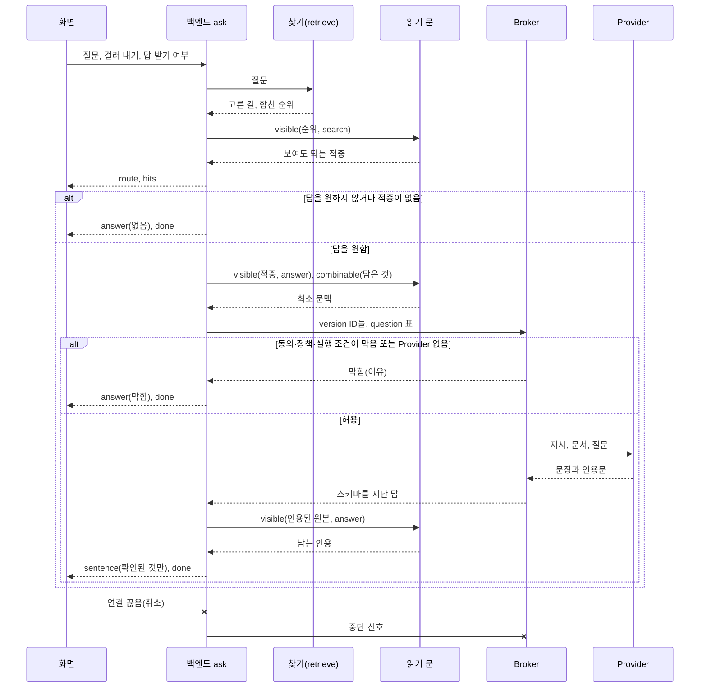

# 스펙: X01 — 질문별 Hybrid Retrieval·근거 Q&A

- 날짜: 2026-11-23 / 상태: 확정(잠정 결정 포함). 구현은 T1~T6이 끝났고 배포처 확인은 `site-setup.md`의 S37~S41
- 관련: 이슈 #30(X01), 총괄 #1(원 설계 13절·14절 Ask·18절), Phase 6 #8, 선행 #23(S02)·#25(K01)·#29(P03, 미착수), 후속 #31(X02). [I04 spec](2026-11-21-I04-invalidation.md)(R13 읽기 검사, R14 범위 승계, R16 전송 등급, 등록표), [S02 spec](2026-11-22-S02-entity-resolution-temporal-graph.md)(R23·R24 경로 검사), [K01 spec](2026-11-23-K01-wiki-projection.md), [R05 spec](2026-11-21-R05-golden-dataset.md)·[EVALUATION.md](../EVALUATION.md)(지표, ablation 5개), [ADR 0004](../adr/0004-embedded-storage.md)(벡터는 어댑터 뒤)·[0006](../adr/0006-embedding.md)·[0014](../adr/0014-egress-policy-and-consent.md)
- 번호: 요구사항 `X01-R<n>`, 결정 `X01-D<n>`, 작업 `X01-T<n>`. 완료 기준 `X01-C1`~`C4`는 이슈 #30의 번호 그대로이고 그 아래를 `a`·`b`·`c`로 나눈다. **마이그레이션은 없다**(X01-D3). 구현 중 필요해지면 합쳐지는 때 main의 다음 번호를 쓰고, 나중에 합치는 쪽이 번호를 옮긴다. 새 ADR 번호와 `site-setup.md` 항목 번호도 같은 규칙이다.

| 말 | 뜻 |
|---|---|
| 전략 | 질문에 맞는 원본을 찾는 한 가지 방법(키워드, 벡터, 그래프 등). 전략마다 "순위 목록" 하나를 낸다 |
| 길 고르기(routing) | 질문의 글을 보고 어느 전략을 돌릴지 코드 규칙으로 정하는 일. LLM을 부르지 않는다 |
| 적중(hit) | 찾은 원본 version 하나. 순위와 "어느 전략이 찾았는지"를 갖는다 |
| 합치기(rerank) | 여러 전략의 순위 목록을 하나로 합치는 계산 |
| 답변 문맥 | 답을 쓰라고 Provider에 보내는 원본 version들 |
| 인용(citation) | 답 문장 하나가 기대는 원본 version과 그 안의 정확한 글자 위치 |
| 읽기 문 | I04의 `visible`·`combinable`. 삭제됐거나(tombstone) 범위 정책이 막는 자료를 빼는 검사 |

## 배경

지금 제품에서 "찾기"는 원본 화면의 키워드 검색 하나다. 항목·관계·시간 사실·Wiki는 각자의 화면에서만 읽히고, 사용자가 말로 물어서 근거와 함께 답을 받는 길이 없다. 원 설계 13절은 여덟 가지 검색 방식 가운데 **질문에 필요한 것만** 골라 쓰고, 답에는 원본 출처를 달고, 저장된 요약을 사실로 믿지 말고, 부족하거나 충돌하면 그렇다고 말하라고 한다. 18절은 복잡한 검색이 실제로 품질을 올리지 못하면 걷어 내라고 한다.

코드에서 확인한 출발점:

- 키워드 색인(FTS5 `keyword_index`)과 `searchKeyword`가 있다. 벡터는 규격(`VectorIndex`, `EmbeddingProvider`)만 있고 제품은 "사용 불가"를 돌려주는 빈 구현(`EmptyVectorIndex`)에 묶여 있다. **벡터를 쓰는(색인하는) 제품 코드는 없고**, ADR 0004는 실제 벡터 구현을 고르기 전에는 색인 작업을 막는다.
- 그래프 읽기(`relationPaths`·`traceChains`), 항목·사실·관계 읽기, Wiki 읽기는 모두 읽기 문을 지난다. 범위 용도에는 이미 `search`와 `answer`가 있다.
- Provider 호출은 Broker만 하고, 부르는 쪽은 **ID만** 넘긴다. Provider 규격에는 한 번에 전체 답을 돌려주는 호출만 있다(글자 단위 스트리밍 없음). 서버의 모든 경로는 JSON 한 덩어리로 답한다.
- I04 등록표는 "답변 문맥, 인용, 답변 캐시"의 처리를 X01이 정하도록 비워 두었다.

## 목표

1. 질문 하나에 대해 필요한 전략만 골라 돌리고, 결과를 하나의 순위로 합쳐 돌려준다. Provider와 임베딩 모델이 없어도 키워드와 이미 있는 색인(항목·관계·사실·Wiki)으로 찾을 수 있다.
2. 답은 단계별로 흘러나온다(고른 길 → 찾은 원본 → 근거가 확인된 문장). 문장마다 원본 인용이 있고, 관련 지식으로 가는 링크와 "근거 부족·충돌·낡음" 표시가 붙으며, 도중에 취소할 수 있다.
3. 찾은 결과를 내보내기 직전과 답을 만들기 직전에 읽기 문을 다시 지난다. Provider에는 허용된 원본만, 필요한 만큼만 보낸다. 막힌 자료는 답·인용·호출 기록·로그 어디에도 나오지 않는다.
4. Golden Dataset으로 다섯 구성을 견줄 수 있는 실행기를 두고, 사외에서 잴 수 있는 만큼 재서 "이득 없는 전략은 끈다"는 ADR을 남긴다.

## 비목표

- **벡터 색인 만들기(문서 임베딩·`upsert`)와 실제 벡터 구현 고르기.** ADR 0004가 R07 뒤로 미뤘다. X01은 찾는 쪽(`search`)만 어댑터를 통해 부르고, 없으면 "사용 불가"라고 알린다. 가짜 벡터 결과를 만들지 않는다.
- **글자 단위(토큰) 스트리밍.** Provider 규격에 없고, 인용을 확인하기 전의 글은 화면에 내보내지 않는다.
- **답변·질문의 저장, 답변 캐시, 대화 이력, 여러 차례 이어 묻기.** 질문과 답은 요청 하나가 끝나면 사라진다.
- **모델을 쓰는 재순위(cross-encoder), LLM이 길을 고르는 방식, 질문 다시 쓰기.** 합치기는 코드 계산이다.
- **선호 신호 그 자체(피드백 저장·가중치 계산).** P03(#29). X01은 신호를 받는 자리만 둔다.
- **Wiki 글·Insight 글을 답의 근거나 인용으로 쓰기.** 둘은 원본을 찾는 실마리로만 쓴다.
- **Ask를 뺀 화면 개편, 근거 보기 화면과의 깊은 연결, 접근성·대량 페이지 나눔.** X02(#31).
- **Electron 전용 E2E, 실제 Provider·실제 모델·Windows 설치본에서의 확인.** 배포처 후속.

## 요구사항

### 찾기

- **X01-R1 전략은 같은 모양이다.** 전략은 `(질문, 조건) → 순위 목록`이고 스스로 "지금 쓸 수 있는가"를 답한다(`사용 가능` 또는 `사용 불가`와 이유). 순위의 단위는 **원본 version**이다. 항목·관계·사실·Wiki에서 찾는 전략은 찾은 행의 계보(등록부 `lineage`)로 원본 version을 얻는다. 전략 목록은 상수 하나다.

| 전략 | 찾는 곳 | 고르는 때(질문의 글) | 쓸 수 없는 때 |
|---|---|---|---|
| `keyword` | FTS5 색인(`searchKeyword`). 내용 낱말마다 질의 하나, 낱말 전부를 묶은 질의 하나, `concept`가 낸 별칭 질의들을 돌려 순위 역수 합으로 하나의 목록으로 합친다. 질문·단서 낱말(어떻게·의존 등)은 버리고 끝의 한국어 조사 하나는 뗀다(`searchKeyword`가 낱말을 모두 포함하는 글만 찾기 때문) | 항상 | — |
| `metadata` | 요청의 걸러 내기 칸(수집기, 기간) | 칸이 있으면. 순위를 내지 않고 다른 전략의 결과를 거른다 | — |
| `concept` | 항목 이름·별칭(`alias.*`) | 질문에 등록된 이름·별칭이 정규화해서 들어 있을 때. 그 항목의 근거 원본을 내고, 별칭을 키워드 질의에 더한다 | — |
| `graph` | 관계(`relationPaths` 등, 깊이 2까지) | 항목이 둘 이상 잡히거나, 하나 잡히고 관계를 묻는 말(의존·영향·담당·원인 등)이 있을 때 | — |
| `temporal` | 사실의 유효 기간, `SUPERSEDES` 연결 | 날짜나 때를 가리키는 말(최근·지난달·이후·바뀐 등)이 있을 때 | — |
| `wiki` | 잡힌 항목의 Wiki 페이지가 기대는 원본 | 전체 맥락을 묻는 말(전체·맥락·정리·개요 등)과 잡힌 항목이 있을 때 | 페이지가 없으면 빈 목록 |
| `vector` | `EmbeddingProvider.embed`(질의) → `VectorIndex.search` | 켜져 있고 둘 다 `ready`일 때 | 모델 없음, 색인 `unavailable`·`rebuilding`(이유를 그대로 알림) |
| `rerank` | 위 목록들 | 항상(R3) | — |

- **X01-R2 길 고르기는 코드 규칙이고 결과를 알린다.** 위 표의 조건은 말 목록 상수와 순수 함수다. 응답은 전략마다 `used`(돌림)·`skipped`(질문이 부르지 않음)·`off`(꺼 둠)·`unavailable`(쓸 수 없음, 이유) 가운데 하나를 알린다. `route` 사건은 상태와 이유만 싣고 건수는 싣지 않는다. 어떤 전략이 꺼져 있거나 쓸 수 없어도 나머지로 답한다. 다른 전략이나 외부 Provider로 **몰래 바꿔 쓰지 않는다.**
- **X01-R3 합치기.** 목록들을 순위 역수 합(Reciprocal Rank Fusion, 각 목록에서의 등수만 쓰는 계산)으로 하나로 만든다. 순서는 검사(R12, 목록마다 보이지 않는 원본을 뺌) → 합치기 → 선호 신호의 가중 곱하기(R4) → 위에서 잠정 20건 자르기다. 합쳐지는 쪽에서 보이지 않는 원본이 자리나 등수를 차지하지 않게 하려는 순서다. 전략마다 목록을 50건으로 자르는 것도 이 검사 뒤다. 다만 `temporal`의 사실 200건 창과 `vector` 색인의 상위 50건은 이 검사보다 앞에 있다(알려진 한계: 미해결 질문 「잘라내기 한계」).
- **X01-R4 선호 신호는 순서만 바꾼다.** 신호는 `(원본 version) → 가중(양수)`인 읽기 전용 인터페이스이고 기본 구현은 언제나 1("신호 없음")이다. 가중은 자르기 전에 곱하며, 후보를 빼거나 더하지 않고, 신호를 주는 쪽은 DB에 쓸 손잡이를 받지 않는다. 실제 신호와 그 효과의 확인은 P03이다.
- **X01-R5 켜고 끄기.** 켜 둔 전략 목록은 코드 상수 하나다. `keyword`·`metadata`·`rerank`는 항상 켜 있다. 나머지의 기본값은 X01-T4의 측정이 EVALUATION 3절의 유지 조건을 채운 것만 켠다(측정 전 초기값은 끔). 요청으로는 바꿀 수 없고, 평가 실행기만 함수 인자로 다른 목록을 준다.

### 표시와 답

- **X01-R6 부족·충돌·낡음.** 전략과 무관하게, 남은 적중에 대해 코드가 표시를 단다. `insufficient`: 적중이 없거나, 답에서 확인된 문장이 하나도 없다. `conflict`: 적중들의 원본에 기대는 사실 사이에 풀리지 않은 `CONTRADICTS` 연결이 있다. `stale`: 그 원본에 검색에 보이는 더 새 version이 있거나(보이지 않는 새 version은 세지 않는다, R12), 그 원본에 기대는 사실이 다른 사실로 대체됐다. 표시는 대상 원본 version의 ID만 갖는다.
- **X01-R7 관련 지식 링크.** 적중마다 그 원본에 근거를 둔 항목(대표 항목)과 그 항목의 Wiki 페이지를 ID와 이름으로 붙인다(적중당 잠정 5개). 링크의 대상도 읽기 문을 지난 것만 싣는다.
- **X01-R8 답은 Broker로, ID만.** 요청이 답을 원하고 적중이 있으면 작업 종류 `answer`를 Broker에 **사용자 동작**으로 한 번 부른다(연결 시험과 같은 사용자 동작 기록, 같은 "격리 미검증 확인" 칸). 넘기는 것은 답변 문맥의 원본 version ID들과 후보 `question:<일회용 표>` 하나뿐이다. 질문 글은 요청이 사는 동안만 메모리에 있고, Broker의 후보 조회가 그 표로 읽는다. 질문은 출처 없는 글이므로 Broker가 가장 엄격한 등급으로 매긴다(지금 동작 그대로). 동의·전송 정책·실행 조건·호출 예산은 Broker가 판정한다.
- **X01-R9 문장은 확인된 것만 나간다.** 응답 스키마는 문장 목록(글, 기댄 문서 ID, 그 문서에서 그대로 베낀 인용문)과 "근거 부족" 여부다. 인용문을 그 문서 본문에서 정확히 한 번 찾지 못한 문장은 버리고 버린 수를 알린다(Wiki 요약·추출과 같은 규칙, `quote.ts`). 남은 문장의 인용은 원본 version ID와 글자 위치다. 답은 `evidence`·`facts`·`relations`·`items` 어디에도 쓰지 않는다.
- **X01-R10 흘려보내기와 취소.** `POST /api/ask`는 한 줄에 사건 하나인 JSON 줄(NDJSON)로 답한다. 이 경로는 계약의 경로 표(`routes`, JSON 응답만 담는 표)의 행이 아니다. `askRoute`를 `packages/contracts/src/ask.ts`에서 내보내고, `server.ts`의 갈래 하나가 Host·Origin·토큰 검사를 지난 뒤에 이 경로를 잇는다. 순서는 `route`(R2) → `hits`(적중, 표시, 링크) → `answer`(상태: 시작·없음·막힘·실패·취소와 이유) → `sentence`(0개 이상) → `done`. `hits`의 등수는 보이는 적중만으로 다시 매기고, `done`의 버린 수는 인용 확인에서 버린 문장만 센다(R14로 문서에서 뺀 것은 세지 않는다). `hits`는 Provider를 부르기 **전에** 나간다. 화면이 연결을 끊으면 그것이 취소다: 서버는 Broker 호출의 중단 신호를 내고 그 뒤로 아무 사건도 쓰지 않는다. 답을 원하지 않는 요청, Provider가 없거나 막힌 경우는 `answer`가 그 상태를 알리고 `done`으로 끝난다(오류가 아니다).
- **X01-R11 화면.** 내비게이션에 "질문"을 더한다. 질문 칸, 걸러 내기, "답 받기" 켬/끔, 고른 길과 쓸 수 없는 전략의 이유, 적중 목록(제목, 찾은 전략, 낡음 표시, 관련 지식 링크), 문장과 인용문, 부족·충돌 알림, 취소 단추. 문구는 한국어 문구 모듈에 둔다.

### 보호

- **X01-R12 검색 검사.** `visible(…, "search")`는 두 번 지난다. 먼저 전략마다의 목록이 합쳐지기 **전에**(R3) 보이지 않는 원본을 뺀다. 그래야 가려진 원본이 적중 자리와 등수를 차지해 보이는 적중의 수·순서가 바뀌는 일이 없다. 다음으로 응답에 싣기 직전에 합친 순위를 한 번 더 지난다(이중 방어). 검사를 지난 뒤의 수·제목·순서·오류에는 빠진 것의 흔적이 없다. 전략이 자기 목록을 50건으로 자르는 것은 이 검사 뒤라서 가려진 원본이 그 자리를 차지하지 않는다. `route`의 전략별 건수와 재순위 건수도 검사·자르기 뒤의 수다. 남은 한계는 미해결 질문 「잘라내기 한계」에 적었다. 등록부가 판정하지 못하면 요청이 실패한다(닫힘). 전략 안에서 그래프·항목·Wiki를 읽을 때도 기존 읽기 문 도우미를 쓴다.
- **X01-R13 답 만들기 직전의 검사와 최소 문맥.** 답변 문맥은 Broker를 부르기 직전에 다시 고른다: ① 적중을 `visible(…, "answer")`로 다시 거른다. ② 순위대로 잠정 5건까지, 합친 글자 수가 한 번의 호출 한계(`MAX_EXTRACT_CODE_POINTS`)를 넘지 않는 만큼만 담는다. ③ 담을 때마다 지금까지 담은 것과 **한데 묶어도 되는지**(`combinable`) 묻고, 안 되면 그 건을 건너뛴다. 항목 이름·Wiki 글·Insight 글·다른 적중의 제목은 보내지 않는다. 남는 문맥이 없으면 Provider를 부르지 않고 `answer`가 `insufficient`를 알린다.
- **X01-R14 돌아온 뒤 한 번 더.** Provider가 답한 뒤 문장을 내보내기 직전에, 인용된 원본을 `visible(…, "answer")`로 한 번 더 묻는다. 호출 도중 지워진 원본에 기댄 문장은 버린다.
- **X01-R15 남기지 않는다.** 질문·적중·답·인용을 DB에 저장하지 않는다. 로그에는 경로 이름, 전략별 건수, 결과 상태만 적는다(질문 글, 제목, 인용문, 원본 ID는 적지 않는다). Provider 호출 기록은 기존 칸(종류·등급·결과)만 쓴다.
- **X01-R16 등록.** I04 등록표의 "답변 문맥, 인용, 답변 캐시" 줄을 "읽을 때 계산, 저장하지 않음(등록할 행 없음). 범위는 R12~R14의 `visible`·`combinable`로, 전송 등급은 Broker가 문맥 version들의 계보로 승계"로 채운다(그래프 경로와 같은 처리). 답변 캐시는 만들지 않는다. "벡터 투영의 실제 쓰기" 줄은 X01이 아니라 벡터 구현을 고르는 작업(R07 뒤)으로 고친다.

### 평가

- **X01-R17 실행기.** 실행기는 Golden Dataset의 원본을 가져오기 경로로 넣고, 다섯 구성(C1 `keyword` / C2 +`vector` / C3 +`graph` / C4 +`concept`·`temporal` / C5 +`wiki`)으로 dev 분할의 질문을 돌려 `eval/scorer`가 읽는 predictions 파일을 낸다. 지식(항목·관계·시간 사실)은 Provider 없이 **정답 라벨에서 심는다**. 그래서 C3~C5의 수치는 "추출이 완벽할 때의 상한"이고 그렇게 표시한다. 봉인된 eval 분할은 돌리지 않는다.
- **X01-R18 측정과 ADR.** 사외에서 재는 것: dev·코퍼스 T0에서 구성별 Recall@5·Precision@5·MRR. C2는 로컬 모델 팩이 준비된 기기에서만 재고(벡터는 실행기 안의 메모리 색인에만 넣는다), 없으면 "재지 못함"으로 적는다. 결과와 환경을 `eval/results/`에 남기고, ADR에 구성별 수치·EVALUATION 3절 유지 조건의 판정·R5의 기본 목록을 적는다. 이득이 확인되지 않은 전략은 기본에서 끈다.

## 인터페이스 / 설계 개요

**모듈.** 찾기는 `knowledge-engine/src/retrieval/`(전략들, 길 고르기, 합치기, 선호 인터페이스, 표시·링크 계산)이고 바깥에 내는 것은 `retrieve(db, registry, 질문, 조건) → { 길, 적중, 표시 }` 하나다. 요청 하나의 진행(찾기 → 검사 → Broker → 문장 확인 → 사건)은 `backend/src/ask.ts`, 읽기 문 호출은 `backend/src/ask-read.ts`(`read-gate.ts`의 방식 그대로, 그 파일은 고치지 않음), 일회용 질문 표는 `backend/src/ask-questions.ts`, NDJSON 경로는 `backend/src/ask-route.ts`, 스키마는 `packages/contracts/src/ask.ts`, 화면은 `apps/web/src/ask.tsx`. 여럿이 함께 쓰는 파일에는 **줄을 더하기만** 한다(작업 분해의 표).

**요청 하나의 흐름.** 검사가 세 번 끼고 갈래가 여럿이라 그림으로 둔다.

### 대안과 기각 사유

- **질문·답을 테이블에 저장하고 I04 종류 `delivery`로 등록**: 이슈가 이력을 요구하지 않는데 지울 것과 마이그레이션(번호 충돌)이 생긴다. 저장하지 않으면 무효화할 것이 없다.
- **`BrokerRequest`에 질문 글 칸을 더하기**: "부르는 쪽은 ID만"이라는 규칙을 깬다. 기존 후보 조회(이름을 ID로 읽음)에 접두어 하나를 더하는 편이 규칙 안이다.
- **답을 큐 작업으로**: 진행을 화면에 흘리려면 진행 저장이 필요하다. 사용자가 기다리는 한 번의 호출은 연결 시험처럼 사용자 동작이 맞다.
- **적중을 문단 단위로 잘라 보내기**: Broker는 version 전체를 ID로 읽는다. 문단 잘라 보내기는 Broker 규격을 바꾸는 일이라 측정 뒤의 후속으로 둔다(지금의 최소화는 건수·글자 수·묶음 검사).
- **LLM으로 길 고르기**: Provider가 없으면 찾기 자체가 멈춘다.

## 완료 기준 (테스트 가능한 형태)

모든 시험은 합성 fixture만 쓴다. 각 기준은 대표 사례 1~2개다. 고정 fixture는 `fixtures/x01-ask.jsonl`(원본)과 `fixtures/x01-expected.json`이다.

- **X01-C1a** (R1~R5) ① 낱말만 있는 질문은 `keyword`만 `used`이고, 두 항목의 의존을 묻는 질문은 `graph`가 `used`이며 키워드만으로는 안 나오는 원본(질문의 낱말이 없고 관계의 근거인 문서)이 적중에 든다. ② 한 원본에 가중 2를 주는 가짜 선호 신호를 넣으면 그 원본의 등수가 오르고, 적중의 집합과 `items`·`facts`·`relations`·`evidence`의 행 수는 신호가 없을 때와 같다. → `knowledge-engine/src/retrieval/retrieve.test.ts`
- **X01-C1b** (R2·R10, 오프라인) Provider를 고르지 않고 임베딩 모델이 없는 기본 구성으로 띄운 백엔드에 `POST /api/ask`를 보내면 `hits`에 키워드 적중이 있고, `route`가 `vector`를 `off`로 알리고(기본 목록은 벡터를 끈다. 서버 옵션 `askStrategies`로 벡터를 켠 채 모델이 없으면 `unavailable`과 이유를 알린다. 두 경우를 모두 시험한다), `answer`가 "Provider 없음"이고, Provider 호출 기록에 시도가 없다. → `backend/src/ask-flow.test.ts`
- **X01-C2a** (R6~R10, 실제 API) 띄운 백엔드에 합성 JSONL을 가져오기 API로 넣고(가져오기는 실제 API를 지난다. 지식은 fixture 추출이 이 사실 종류를 만들 수 없어 라벨에서 심는다) fake Provider로 질문하면 ① 사건이 `route`→`hits`→`answer`→`sentence`→`done` 순서로 오고 `hits`가 Provider 호출보다 먼저 쓰인다. ② `sentence`의 인용문이 그 원본 version의 저장된 본문에서 인용 위치 그대로 나온다. 원문에 없는 인용문을 단 문장은 오지 않고 `done`의 버린 수가 1이다. ③ 적중에 관련 항목 링크가 있다. ④ 서로 어긋나는 두 사실의 원본이 함께 적중이면 `conflict`, 새 version이 있는 원본의 옛 version이 적중이면 `stale`, 아무것도 못 찾는 질문이면 `insufficient`이고 Provider 호출이 없다. → `backend/src/ask-flow.test.ts`
- **X01-C2b** (R10, 취소) fake Provider가 답을 붙들고 있는 동안 요청을 끊으면 Provider가 중단 신호를 받고, 호출 기록의 결과가 취소이며, 끊은 뒤 `sentence`가 쓰이지 않는다. → `backend/src/ask-flow.test.ts`
- **X01-C2c** (R11) 사용자가 "질문"에서 묻고, 적중과 문장·인용문을 보고, 관련 지식 링크가 있음을 본다. Provider가 없는 구성에서는 적중과 "답을 만들 수 없음" 안내를 본다. → `apps/web/e2e/ask.e2e.ts`(브라우저 하나)
- **X01-C3** (R17·R18) ① 실행기를 dev 질문 2개짜리 표본에 돌리면 다섯 구성의 predictions 줄이 나오고 `eval/scorer/score.py`가 오류 없이 채점한다. → `backend/src/retrieval-ablation.test.ts` ② dev·T0 전체를 돌린 결과 파일이 `eval/results/`에 있고, ADR이 구성별 Recall@5·Precision@5·MRR, 재지 못한 구성과 이유, 유지 조건 판정, 기본 전략 목록을 적으며, 코드의 기본 목록 상수가 ADR과 같다(대조 시험).
- **X01-C4a** (R12·R14·R15, 부정 시험) 카나리 낱말을 가진 원본 둘(하나는 정책이 `search`·`answer`를 거부하는 범위, 하나는 가져온 뒤 삭제해 tombstone)과 보이는 원본 하나를 두고 카나리로 질문하면, 응답의 모든 사건·fake Provider가 받은 요청·Provider 호출 기록·잡아 둔 로그 줄에 두 원본의 카나리·제목·ID가 없고 보이는 원본은 있다. 정책이 `search`는 허용하고 `answer`만 거부하면 적중에는 있고 Provider 요청에는 없다. 또한 보이는 원본 25건에 정책이 거부하는 원본 10건이 위 등수로 섞여 있어도 적중 수는 20건이고 보이는 적중의 순서는 거부된 원본이 없을 때와 같다. **변이**: 목록을 합치기 전의 검사(R12)를 빼면, 그리고 R13 ①을 빼면 각각 빨개진다. 응답 경계의 검사만 빼면 이제 어느 시험도 빨개지지 않는다(앞의 검사가 먼저 걸러 이중 방어가 됐다). → `backend/src/ask-gate.test.ts`, `knowledge-engine/src/retrieval/retrieve.test.ts`
- **X01-C4b** (R8·R13·R15·R16, 최소 문맥) ① 적중이 8건이면 fake Provider가 받은 문서는 5건 이하이고 후보는 `question:` 하나뿐이며 항목 이름이 없다. ② 한데 묶을 수 없는 범위의 적중은 문서에서 빠진다. ③ 질문 전후로 `provider_calls`를 뺀 모든 테이블의 행 수가 같다. → `backend/src/ask-gate.test.ts`

## 미해결 질문 / 검증하지 않은 범위

- **확인하지 못한 사실(추측하지 않음).** ① 원본 version에 원 시스템의 작성·수정 시각 칸이 있어 `metadata`의 기간 걸러 내기에 쓸 수 있는지. 없으면 `metadata`는 수집기 걸러 내기만 한다. ② (확인함) 서버의 경로 표(`routes`)는 JSON만 담아 NDJSON 경로를 받지 못한다. 그래서 `server.ts`에 갈래 하나를 더했다(R10). ③ (확인함) 화면의 API 클라이언트는 JSON 한 덩어리만 읽는다. 줄 단위 읽기는 `apps/web/src/ask-stream.ts`가 맡고, 클라이언트에는 주소·토큰을 건네는 접근자 `connectionOf` 하나만 더했다(`api.ts`). ④ `concept`가 질문에서 이름을 찾을 때의 비용(항목이 많을 때).
- **잘라내기 한계(알려진 잔여 한계).** 전략의 원본 목록을 50건으로 자르는 일은 R12의 검사 뒤로 옮겼다(#254). 아직 검사보다 앞에 있는 한계가 둘이다. `temporal`이 읽는 시간 사실의 창(200건, 사실 단위라 그 사실의 보임 판정은 창 안에서만 이뤄진다)과 `vector` 색인이 돌려주는 상위 50건(색인 안에서 자르며 이 쪽에서 더 읽을 수 없다). 한계에 닿는 규모에서는 가려진 사실·원본이 그 자리를 차지해 보이는 적중의 구성이 달라질 수 있다. 가려진 것의 제목·글은 나오지 않는다.
- **R6과 R12의 충돌(해결, #254).** `stale`은 검색에 보이는 더 새 version이 있을 때만 붙고, 가려졌거나 삭제된 새 version은 세지 않는다. 가려진 것은 흔적을 남기지 않는다는 R12를 R6보다 우선한다. 현재 제품 등록부에서는 version마다 범위가 달라지지 않아(범위는 원본 단위, 삭제 표지는 그 version 이하 전부를 덮음) 이 경우가 생기지 않지만, 등록부 구현이 version 단위로 가리게 되어도 새지 않도록 코드가 보이는 version만 센다.
- **품질.** 길 고르기 말 목록, 합치기 상수, 문맥 5건이 실제 질문에서 맞는지 재지 않았다. X01-C3의 수치는 T0(방해 문서 없음)·라벨에서 심은 지식 기준이라 **잠정**이다. 단계 선택의 정식 판정(T1, 실제 추출)과 봉인 eval 한 번은 배포처 몫이다.
- **Answer Groundedness, Citation Accuracy.** 앞의 것은 채점표가 없어 EVALUATION에서 "판정 보류"이고, 뒤의 것은 실제 Provider의 답이 있어야 한다. 실행기는 Provider가 설정된 환경에서 `citation` 줄을 내도록 만들되 사외에서는 수치를 보고하지 않는다(fake Provider의 답은 측정이 아니다).
- **벡터.** 제품에서 `search`를 부르는 길은 메모리 구현으로만 확인된다. 실제 벡터 구현, 문서 임베딩, 삭제 뒤 벡터 제거의 실제 동작은 미검증으로 남는다(R07 뒤).
- **실제 Provider의 인용문 정확도, 답 시간, 호출 예산이 추출을 밀어내는지**는 재지 않았다.
- **Windows 설치본·Electron에서의 화면과 NDJSON 응답**은 확인하지 않는다(H02 #33).
- **선호 신호의 실제 효과**는 P03(#29)이 검증한다.

## 잠정 결정과 가정

| 번호 | 결정 | 이유 | 바꾸려면 |
|---|---|---|---|
| X01-D1 | 선호 신호는 읽기 전용 인터페이스 뒤에 두고 기본은 "신호 없음" | P03이 아직 없다. 순서만 바꾸고 지식을 못 건드리는 모양을 먼저 고정 | P03이 구현을 끼운다 |
| X01-D2 | 함께 쓰는 파일은 줄 추가만, 화면은 제 파일에 두고 `App.tsx` 연결은 마지막 작업 | 다른 세션들이 `server.ts`·계약 색인·`tasks.ts`·`App.tsx`를 쥐고 있다 | — |
| X01-D3 | 질문·답·인용을 저장하지 않는다. 마이그레이션 없음, I04 등록은 "읽을 때 계산" | 지울 것이 없으면 새는 것도 없다. 번호 충돌도 없다 | 이력이 필요해지면 `delivery` 종류와 테이블을 따로 spec으로 |
| X01-D4 | 몰래 바꿔 쓰기 없음. 쓸 수 없는 전략은 이유와 함께 알리고 나머지로 답한다 | 하네스 규칙, 오프라인 탐색 보존 | — |
| X01-D5 | "스트리밍"은 단계 사건(NDJSON)이고 문장은 확인 뒤에만 나간다. 취소는 연결 끊기 | Provider 규격에 글자 스트리밍이 없고, 확인 전 글은 내보낼 수 없다 | Provider 규격에 스트리밍을 더하는 별도 spec |
| X01-D6 | 벡터는 찾는 쪽만 부르고 기본은 "사용 불가". 색인 쓰기는 하지 않는다 | ADR 0004가 구현 선택 전의 색인 작업을 막는다 | R07이 구현을 고른 뒤의 작업 |
| X01-D7 | 길 고르기는 말 목록 코드 규칙, 합치기는 순위 역수 합(상수 60), 남기는 수 20 | Provider 없이 돌고 설명할 수 있다. 널리 쓰는 기본값 | 상수 |
| X01-D8 | 전략의 기본 켬 목록은 코드 상수이고 측정이 이득을 보인 것만 켠다. 사용자 설정은 두지 않는다 | 원 설계 18절. 설정 칸은 함께 쓰는 파일 셋을 더 건드린다 | 상수(ADR과 함께), 또는 설정 칸을 더한다 |
| X01-D9 | 답변 문맥은 원본 version 전체, 5건·호출 한계·묶음 검사로 줄인다 | Broker가 ID로 version을 읽는 규격 안에서의 최소 | Broker에 문단 단위 입력을 더한다 |
| X01-D10 | 질문은 일회용 표로 Broker에 건네고 "출처 없는 글"로 가장 엄격하게 매긴다 | 질문에도 민감한 내용이 들 수 있다. 기존 등급 규칙 그대로 | 배포처 등급 표에서 질문의 등급을 따로 정한다 |
| X01-D11 | Wiki·Insight 글은 근거도 문맥도 아니다. Wiki는 원본을 찾는 실마리 | 원 설계 13절, EVALUATION C5 | — |
| X01-D12 | 평가의 지식은 라벨에서 심고 "상한"으로 표시, dev·T0만 | 사외에서 실제 Provider 추출을 돌리지 않는다. eval 분할은 한 번만 쓰는 약속 | 배포처가 실제 추출·T1로 다시 잰다 |
| X01-D13 | 평가 실행기는 `backend/src/`에 둔다 | `eval/`·`verification/`은 작업 공간 밖이라 시험이 돌지 않는다 | 실행기용 패키지를 만든다 |
| X01-D14 | Windows·설치본·실제 Provider 실행은 미검증 범위와 `site-setup.md` 항목으로 둔다 | 배포처 검증 | — |

## 작업 분해

PR은 둘이다. **PR 1 = T1~T4**(백엔드와 평가. T4는 T1 뒤 T2·T3과 나란히 할 수 있다: 같은 파일을 건드리지 않는다). **PR 2 = T5·T6**(화면과 문서. 다른 세션이 쥔 `App.tsx`와 문서 묶음이 풀린 뒤, 맨 마지막).

| 작업 | 산출물(하나) | 기준 | 선행 | 새 파일 | 줄만 더하는 함께 쓰는 파일 | 증거 |
|---|---|---|---|---|---|---|
| X01-T1 | 찾기 모듈 `retrieve`(전략 여덟, 길 고르기, 합치기, 선호 인터페이스, 표시·링크)와 fixture | C1a | 없음 | `knowledge-engine/src/retrieval/*`, `fixtures/x01-ask.jsonl`, `fixtures/x01-expected.json` | `knowledge-engine/src/index.ts`(export). 새 저장 읽기가 꼭 필요하면 `storage/src/retrieval-reads.ts` + `storage/src/index.ts`(export 한 줄) | `retrieve.test.ts` 통과 출력 |
| X01-T2 | 요청 진행 `ask`(검사 세 번, 최소 문맥, `answer` 작업 정의, 질문 표, 문장 확인) | C4a, C4b | T1 | `backend/src/ask.ts`, `ask-read.ts`, `ask-questions.ts`, `ask-gate.test.ts`, `providers/src/broker.answer.test.ts` | `providers/src/tasks.ts`(작업 정의 한 줄과 스키마), `packages/contracts/src/provider.ts`(`TASK_KINDS`에 `answer`), `backend/src/composition.ts`(후보 조회를 질문 표로 감싸는 한 줄) | `ask-gate.test.ts` 통과 출력, 변이 둘이 빨개진 출력 |
| X01-T3 | NDJSON 경로 `POST /api/ask`와 스키마, 취소 | C1b, C2a, C2b | T2 | `packages/contracts/src/ask.ts`, `backend/src/ask-route.ts`, `ask-flow.test.ts` | `packages/contracts/src/index.ts`(export 한 줄. 경로는 `routes` 표의 행이 아니라 `ask.ts`의 `askRoute`), `backend/src/server.ts`(Host·Origin·토큰 검사 뒤의 갈래 하나) | `ask-flow.test.ts` 통과 출력 |
| X01-T4 | 평가 실행기, dev·T0 결과, ADR | C3 | T1 | `backend/src/retrieval-ablation.ts`·`.test.ts`, `eval/results/x01-dev-t0.json`, `docs/adr/00NN-retrieval-strategies.md` | `docs/adr/README.md`(한 줄), `docs/EVALUATION.md`(결과를 가리키는 한 줄), `knowledge-engine/src/retrieval/`의 기본 목록 상수(T1의 파일) | 실행 명령과 `score.py` 출력, 대조 시험 통과 |
| X01-T5 (완료) | "질문" 화면과 브라우저 E2E | C2c | T3, `feat/p01-t03-insight-api-ui` 머지 | `apps/web/src/ask.tsx`, `ask-text.ts`, `ask-stream.ts`, 그 시험, `apps/web/e2e/ask.e2e.ts` | `apps/web/src/App.tsx`(import, 이름, 화면 세 줄) | `pnpm e2e` 가운데 `ask.e2e.ts` 통과 출력 |
| X01-T6 (완료) | 문서: I04 등록표 두 줄, ARCHITECTURE(5.4절 벡터 호출 자리, 읽기 경로), 문서 색인, README, `site-setup.md` 항목 | R16 | T3·T4, `feat/k02-t3-refine` 머지 | — | `docs/specs/2026-11-21-I04-invalidation.md`, `docs/ARCHITECTURE.md`, `docs/README.md`, `README.md`, `docs/site-setup.md` | 문서 대조 시험(`tooling/docs`) 통과 |

`TASK_KINDS`와 `tasks.ts`는 `feat/k02-t3-refine`도 한 줄씩 더한다. 나중에 합치는 쪽이 rebase에서 두 줄을 모두 남긴다.

## 넘기는 것

- **P03(#29)**: X01-R4의 인터페이스에 실제 선호 신호를 끼우고, 순서가 바뀌는지와 지식이 그대로인지(P03-C2)를 그쪽에서 검증한다.
- **X02(#31)**: 인용에서 근거 보기 화면의 그 위치로 가는 연결, 관련 지식 링크의 도착 화면, 접근성·빈 상태·대량 목록, Electron E2E.
- **H01(#32)·H02(#33)·H03**: 질문·답을 저장하지 않으므로 백업·전체 삭제에 더할 것이 없다는 사실, 설치본에서의 NDJSON 응답과 화면.
- **R07(#37) 뒤의 벡터 작업**: 실제 구현, 문서 임베딩과 `upsert`, 삭제 뒤 제거, C2 구성의 정식 측정.
- **K02 후속(주제 묶기)·P01의 "유사 해결"·"관련 문서"**: X01의 `retrieve`를 쓸 수 있다. 벡터가 생긴 뒤.

## 배포처 후속

`docs/site-setup.md`에 항목을 더한다(번호는 합칠 때의 다음 번호, T6에서).

- 실제 Provider로 질문해 인용문이 원문과 맞는 비율, 답 시간, 호출 예산을 재고, Citation Accuracy를 EVALUATION 기준으로 채점한다.
- 실제 추출과 코퍼스 T1에서 다섯 구성을 다시 재서 기본 전략 목록(ADR)을 확정하거나 고친다. 봉인 eval은 최종 구성에 한 번만 돌린다.
- 배포처 범위 정책을 건 채로 질문해, 허용되지 않은 범위의 원본이 적중·답·Provider 요청에 나오지 않는지 확인한다(C4a의 실제 정책판). 질문 글의 등급(X01-D10)이 배포처 전송 정책에서 어떻게 판정되는지 정한다.
- Windows 11 설치본에서 "질문" 화면이 단계별로 채워지고 취소가 되는지 본다.

## 변경 이력

| 날짜 | 변경 내용 | 대상 | 사유 |
|---|---|---|---|
| 2026-11-23 | 초안 작성 | 이 문서 | 이슈 #30 착수. 조율 세션의 잠정 결정 다섯(D1~D4, D14)을 기록하고 D5~D13을 더함 |
| 2026-11-23 | 구현과 맞춤: 키워드 전략의 질의 구성(R1·R3), 검색 검사를 합치기 전에도 적용(R12, 검토 F1), `/api/ask`는 `routes` 밖(R10·T3), C1b·C2a·C4a 문구, `route`·`hits`·`done` 세부(R2·R10), R6과 R12의 충돌을 미해결로 올림 | R1·R2·R3·R10·R12, T3, C1b·C2a·C4a, 미해결 질문 | 구현 중 받아들인 편차와 검토 지적 F1을 스펙에 반영 |
| 2026-11-23 | T5("질문" 화면과 브라우저 E2E)·T6(문서) 완료 표시. R3·R12의 과장 정정: 전략마다 목록을 자르는 한계(50건, `temporal`은 사실 200건의 창)가 검사보다 앞에 있어 가려진 원본이 자리를 차지할 수 있음을 알려진 잔여 한계로 적고 후속 #254를 가리킴(코드 변경 없음). 미해결 질문 ③을 확인함으로 고침. R16의 I04 등록표 반영 | 상태, R3, R12, 작업 분해, 미해결 질문 | 독립 검토에서 R3·R12가 가려진 원본의 흔적이 전혀 남지 않는 것처럼 읽힌다는 지적. T5·T6 구현 |
| 2026-11-23 | R6·R12 충돌 해소(`stale`은 검색에 보이는 더 새 version만 셈), 전략 목록 자르기를 검사 뒤로 옮김(R3·R12), 남은 한계를 `temporal` 사실 창·`vector` 상위 50건으로 좁힘 | R3, R6, R12, 미해결 질문 | 후속 이슈 #254의 정확성 지적 F2·잘라내기 |
