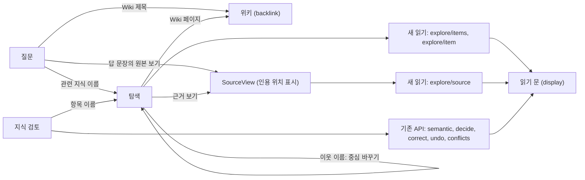

# 스펙: X02 — Knowledge·Explore·Semantic·Evidence 전체 탐색 UX

- 날짜: 2026-11-23 / 상태: 확정(잠정 결정 포함)
- 관련: 이슈 #31(X02), 총괄 #1(원 설계 14절 UI 8화면), Phase 6 #8, 선행 #30(X01)·#24(S03)·#26(K02). [X01 spec](2026-11-23-X01-retrieval-qa.md)("넘기는 것"의 X02 줄), [S01 spec](2026-11-22-S01-semantic-registry.md)(승인·기각·값 고치기), [S02 spec](2026-11-22-S02-entity-resolution-temporal-graph.md)(R19 충돌, R21 근거 사슬, R22 관계 경로, R24 범위 검사), [K01 spec](2026-11-23-K01-wiki-projection.md)(Wiki·backlink), [I04 spec](2026-11-21-I04-invalidation.md)(R13 읽기 검사, 등록표)
- 번호: 요구사항 `X02-R<n>`, 결정 `X02-D<n>`, 작업 `X02-T<n>`. 완료 기준 `X02-C1`~`C3`은 이슈 #31의 번호 그대로이고 그 아래를 `a`·`b`·`c`로 나눈다. **마이그레이션, 새 테이블, 새 ADR은 없다**(X02-D2). `site-setup.md` 항목 번호는 합쳐지는 때 main의 다음 번호를 쓴다(지금은 S42. 다른 세션이 먼저 쓰면 나중에 합치는 쪽이 옮긴다).

| 말 | 뜻 |
|---|---|
| 항목 | 지식 등록부의 한 대상(프로젝트, 시스템, 사람 등). 합쳐진 묶음은 대표 하나로 본다(S02-R13) |
| 이웃 | 한 항목에서 관계를 1~3번 따라가 닿는 항목들과 그 관계들. 화면이 한 번에 보여 주는 그래프의 전부다 |
| 읽기 문 | I04의 `visible`·`combinable`. 삭제됐거나(tombstone) 범위 정책이 막는 자료를 빼는 검사 |
| 가려진 것 | 읽기 문을 지나지 못한 행. 없는 행과 똑같이 답해야 하고 개수·순서에도 흔적이 없어야 한다 |

## 배경

원 설계 14절은 여덟 화면(Home, Knowledge, Explore, Semantic, Ask, Sources, Activity, Settings)을 말한다. 지금 화면은 홈·원본·위키·점검·질문·활동·설정 일곱이고, 모두 실제 백엔드에서 값을 읽는다(화면 코드에 가짜 자료가 없음을 확인했다). 빠진 것은 다음이다.

- **Explore, Semantic 화면이 없다.** 백엔드에는 이미 읽기·조치 API가 있는데(`semantic`, `semanticDecide`, `semanticCorrect`, `semanticUndo`, `conflicts`, `graphPaths`, `graphTrace`) 화면이 부르지 않는다.
- **화면끼리 이어지지 않는다.** "질문"의 관련 지식은 이름만 보이고("다음 단계(X02)에서 더합니다"), 답 문장의 인용에서 원본의 그 위치를 열 수 없다(X01이 넘긴 것).
- **API에서 확인한 빈 곳 셋.** ① `GET /api/semantic`은 항목 100개에서 자르고 다음 쪽을 읽을 길이 없다. 이름으로 찾는 길도 없다. ② `graphPaths`는 항목 번호만 답해서, 처음 100개 밖의 이웃은 이름을 알 수 없고 사실의 유효 기간(타임라인)도 어느 읽기에도 없다(Wiki 페이지에만 있다). ③ 원본 version을 version 번호로 여는 읽기가 없다(`evidenceSource`는 근거 번호만 받는데, 답의 인용은 version 번호와 글자 위치를 준다).

## 목표

1. 사용자가 관심 항목 하나를 이름으로 찾아, 그 이웃(관계·종류 걸러 내기·깊이)과 시간순 사실을 보고, 근거 원본의 그 위치까지 내려간다.
2. 후보를 승인·기각·고치고 충돌을 검토하는 화면이 있고, 조치 결과가 다시 읽은 목록에 반영된다.
3. 질문 → 관련 지식 → 탐색·위키, 답 문장 → 인용 원본으로 화면이 이어진다.
4. 새 읽기는 모두 읽기 문을 지나며, 가려진 것은 응답·개수·순서 어디에도 흔적이 없다.

## 비목표

- **그림으로 그린 그래프(캔버스·SVG 배치, 끌기·확대).** 이웃은 표와 목록으로 보인다(X02-D3).
- **전체 그래프 보기.** 항상 한 항목의 이웃(깊이 3, 항목 200까지 — S02-R22의 한계 그대로)만 읽는다.
- **합치기·풀기·나누기·구별 표시, 유효 기간 고치기, 유형 정의(ontology) 화면, 조치 이력 보기.** API는 있으나 이번 화면에 넣지 않는다(넘기는 것).
- **새 저장.** 탐색 상태·최근 본 항목을 저장하지 않는다.
- **기존 일곱 화면의 재배치·이름 바꾸기, 디자인 시스템.**
- **Electron 전용 E2E, Windows 설치본 확인, 성능 측정.** H02(#33)·H03(#34)·배포처.

## 요구사항

### 새 읽기 (백엔드, 세 경로)

모두 `routes` 표의 행이고, 번호로 읽는 다른 경로처럼 본문이 있는 `POST`다. 저장하는 것은 없다.

- **X02-R1 항목 찾기 `POST /api/explore/items`.** 요청 `{ query?, after? }`, 응답 `{ items: [{ id, type, name }], next }`. 묶음의 대표만, 번호 오름차순, 한 쪽 50개. `query`(200자까지)는 이름에 그 글이 들어 있는 항목만 남긴다(대소문자 무시). `next`는 보이는 항목이 더 있을 때 마지막으로 실은 번호이고 없으면 `null`이다. 전체 개수는 답하지 않는다.
- **X02-R2 이웃 읽기 `POST /api/explore/item`.** 요청 `{ itemId, depth }`(깊이 1~3, 넘으면 기존 `depth-exceeded` 거부). 응답은 ① 중심 항목(번호·종류·이름, 보이는 Wiki 페이지가 있으면 그 키), ② 중심의 사실·관계(Semantic 목록과 같은 모양에 유효 시작·끝 `validAt`·`validUntil`을 더함), ③ 이웃의 항목들(번호·종류·이름)과 선들(관계 번호·종류·방향·양 끝·몇 번째 걸음), ④ `truncated`. 이웃은 이미 있는 `gate.graphPaths`의 결과로만 만든다(새 그래프 걷기를 쓰지 않는다).
- **X02-R3 원본 version 읽기 `POST /api/explore/source`.** 요청 `{ versionId }`, 응답은 `evidenceSource`의 `sourceVersion`과 같은 칸(번호·version·최신 version·제목·본문). 본문은 가져온, 신뢰할 수 없는 글이다.
- **X02-R4 읽기 문.** 세 경로는 `display` 용도로 기존 검사(`semanticShown`, `sourceShown`, `graphPaths`)를 지난다. ① 가려진 항목·사실·관계·version은 어느 응답에도 없다. ② 번호로 물은 대상이 가려졌으면 없는 번호와 같은 `not-found`(404)다. ③ R1의 쪽은 가려진 항목 때문에 짧아지지 않고(더 넓게 읽어 채운다), 보이는 항목의 순서와 `next`는 가려진 항목이 없을 때와 같다. ④ 가려진 이웃으로 가는 선과 그 너머는 나오지 않는다. 중심 항목의 관계도 다른 끝이 가려졌으면 통째로 뺀다(관계 줄의 끝 번호가 그 항목을 가리키므로). ⑤ 응답과 로그에 가려진 것의 이름·값·번호가 없다.

### 화면

- **X02-R5 화면 둘과 이동.** 내비게이션에 "탐색"과 "지식 검토"를 더한다. 화면 사이 이동은 새 파일 `nav.tsx`의 한 가지 방법(`go(화면, 대상)`)으로 한다. ① "질문"의 관련 지식 이름은 "탐색"의 그 항목을, Wiki 제목은 "위키"의 그 페이지를 연다(안내문 `ASK_RELATED_PENDING`은 지운다). ② "질문"의 답 문장마다 "원본 보기"가 있어, R3으로 읽은 원본을 기존 `SourceView`에 인용 위치를 표시해 그 자리에서 보인다. ③ "탐색"의 중심 항목에서 Wiki 페이지로(backlink는 그 페이지가 이미 보인다), "지식 검토"의 항목에서 "탐색"으로 간다.
- **X02-R6 탐색 화면.** ① 이름 검색과 항목 목록, "더 보기"(R1의 `next`; 제출된 검색어로 이어 읽는다). ② 항목을 고르면 이웃 표(상대 항목·관계 종류·방향·걸음 수), 깊이 고르기(기본 1), 관계 종류 걸러 내기(화면에서 거른다). 이웃 이름을 누르면 그 항목이 중심이 된다. ③ 타임라인: 유효 시작이 있는 사실·관계를 시작 날짜순으로, 없는 것은 그 뒤에 "시점 없음"으로. ④ 사실·관계 줄마다 "근거 보기"(`graphTrace` → 근거 번호 → `evidenceSource` → `SourceView`, version과 최신 version 표시 포함)와 R7의 조치.
- **X02-R7 지식 검토 화면.** ① `semantic` 목록을 상태로 걸러(기본 "후보") 항목별로 보이고, 줄마다 승인·기각·이의·되돌리기·값 고치기를 한다. 조치 뒤 목록을 다시 읽어 결과를 보이고, 거절(`refused`)이면 이유 코드를 우리말로 보인다. ② 충돌 목록(`conflicts`): 쌍의 두 사실(항목 이름·종류·값), 종류(대신함·어긋남), 한쪽 기각. 기각 뒤 다시 읽으면 그 쌍이 사라진다(S02-R19). ③ 목록이 잘렸으면(`truncated`) 그렇다고 알리고 "탐색"에서 찾아 같은 조치를 하도록 안내한다. 조치 줄은 탐색 화면과 같은 컴포넌트를 쓴다.
- **X02-R8 상태와 접근성(새 화면 둘과 R5의 추가분).** 불러오는 중(`role="status"`), 빈 목록 안내, 실패(`role="alert"`)를 각각 보인다. 모든 조치는 이름 있는 버튼·입력이어서 키보드만으로 닿고, 항목을 고르거나 근거를 열면 초점이 그 제목으로 간다(기존 `useFocusOn`). 가져온 글(이름·값·제목·본문)은 글로만 그리고 `<bdi>`로 감싼다.

## 인터페이스 / 설계 개요

화면은 제 파일에, 새 읽기는 한 모듈(`backend/src/explore-read.ts`, 스키마 `packages/contracts/src/explore.ts`)에 둔다. 함께 쓰는 파일(`App.tsx`, `server.ts`, 계약 `index.ts`, `storage/src/index.ts`)에는 줄만 더한다. 화살표는 "누르면 열린다" 또는 "부른다"이다.

## 완료 기준 (테스트 가능한 형태)

모든 시험은 합성 자료만 쓴다. 기준마다 대표 사례 1~2개다. 이 저장소의 웹 단위 시험에는 DOM이 없으므로(새 의존 없음), 기준의 "누르면"은 화면이 그 누름에 부르는 함수(`relatedActions`, `openCitation`, `perform`, `searchPage`, `traceEvidence`)와 정적 마크업으로 확인하고, 실제 누름·키보드·초점은 C3b가 본다.

- **X02-C1a** (R5, 단위) ① 내비게이션에서 "탐색"·"지식 검토"를 누르면 그 화면이 열린다. "질문"의 관련 지식 이름을 누르면 "탐색"이 그 항목 번호로 `exploreItem`을 부르고, Wiki 제목을 누르면 "위키"가 그 키로 `wikiPage`를 부른다. → `apps/web/src/nav.test.tsx` ② 답 문장의 "원본 보기"를 누르면 `exploreSource`를 그 version 번호로 부르고 인용 구간이 `<mark>`로 표시된다. → `apps/web/src/ask.test.tsx`
- **X02-C2a** (R1~R3, 계약·실제 API) 합성 자료를 넣고 띄운 백엔드에서 ① 이름 일부로 찾으면 그 항목이 오고, 항목이 50개를 넘으면 첫 쪽이 50개와 `next`를, `after`로 읽은 둘째 쪽이 겹침 없는 나머지와 `next: null`을 답한다. ② 깊이 1의 이웃 읽기가 관계로 이어진 상대 항목의 이름과 선을 싣고, 유효 시작이 있는 사실에 `validAt`이 있으며, 깊이 4는 `depth-exceeded`다. ③ version 번호로 읽은 원본의 본문이 저장된 본문과 같다. → `backend/src/explore-api.test.ts`
- **X02-C2b** (R4, 부정 시험) 카나리 이름을 가진 항목 둘(하나는 정책이 `display`를 거부하는 범위의 원본에서, 하나는 가져온 뒤 원본을 삭제)과 보이는 항목들을 두면 ① 세 경로의 응답 전체와 잡아 둔 로그에 카나리와 그 번호가 없고, 두 항목을 번호로 물으면 없는 번호와 같은 404다. ② 가려진 항목이 사이사이 끼어 있어도 첫 쪽은 50개이고 보이는 항목의 순서·`next`가 가려진 항목이 없는 자료와 같다. ③ 가려진 항목이 이웃이면 그 선과 항목이 없다. ④ 가려진 version은 404다. **변이**: 항목 목록의 검사를 빼면, 중심 항목 줄의 검사를 빼면 각각 빨개진다. → `backend/src/explore-gate.test.ts`
- **X02-C2c** (R7, 단위) 가짜 API로 ① 후보 사실을 승인하면 `semanticDecide`가 불리고 다시 읽은 목록의 상태가 "확정"으로 보인다. 거절 응답이면 이유가 우리말로 보인다. ② 값 고치기가 `semanticCorrect`를 `replace`로 부른다. ③ 충돌 쌍의 한쪽을 기각하면 다시 읽은 뒤 그 쌍이 목록에 없다. → `apps/web/src/semantic-review.test.tsx`
- **X02-C3a** (R6·R8, 단위) 가짜 API로 탐색 화면이 ① 불러오는 중·빈 목록·실패를 각각 보이고 ② "더 보기"가 `after`로 다음 쪽을 불러 목록 뒤에 붙이며 ③ 관계 종류를 끄면 그 종류의 선이 표에서 빠지고 ④ 타임라인이 시작 날짜순이며 ⑤ 항목을 고르면 초점이 그 제목에 있다. → `apps/web/src/explore.test.tsx`
- **X02-C3b** (R5~R8, 브라우저 E2E 하나) 기존 seed(`backend/src/v02-seed.e2e.ts`, "plain")로 띄운 화면에서 사용자가 "지식 검토"에서 후보 하나를 승인해 바뀐 상태를 보고, "탐색"에서 이름으로 항목을 찾아 **키보드로** 고르고, 이웃에서 상대 항목과 관계를 보고, 사실의 근거를 열어 인용문이 표시된 원본을 보고, Wiki 페이지로 넘어가 backlink가 있는 페이지를 본다. → `apps/web/e2e/explore.e2e.ts`(브라우저만)

## 잠정 결정

| 번호 | 결정 | 이유 | 바꾸려면 |
|---|---|---|---|
| X02-D1 | 여덟 화면 가운데 Knowledge는 지금의 "위키"(와 "점검")로 본다. 이름을 바꾸지 않고 "탐색"·"지식 검토" 둘만 더한다 | 다른 세션의 E2E가 지금 이름을 누른다. 기능은 이미 있다 | `App.tsx`의 `SCREENS` 이름 |
| X02-D2 | 저장하지 않는다. 마이그레이션·새 파생물 종류 없음, I04 등록표에는 "읽을 때 계산" 한 줄 | 지울 것이 없으면 새는 것도 없고 번호 충돌도 없다 | 최근 본 항목 등이 필요해지면 따로 spec |
| X02-D3 | 이웃은 표·목록으로 보이고 그래프를 그리지 않는다 | 키보드·화면 낭독기로 그대로 읽힌다. 그리기 라이브러리를 들이지 않는다 | 같은 응답 위에 그리는 컴포넌트를 더한다 |
| X02-D4 | 새 경로는 셋뿐이고 한 모듈에 둔다. 나머지는 기존 API를 화면이 부른다 | 빈 곳으로 확인된 것만(쪽 나눔·이름 찾기, 이웃의 이름·유효 기간, version 읽기) | — |
| X02-D5 | 쪽 나눔은 번호 커서와 "더 보기", 한 쪽 50개, 전체 개수 없음 | 개수는 가려진 것의 흔적이 될 수 있다 | 상수 |
| X02-D6 | 이름 찾기는 부분 일치만(별칭·전문 검색 없음) | 관심 항목 하나를 고르는 데 충분하다 | X01의 `concept` 읽기를 붙인다 |
| X02-D7 | "지식 검토"는 기존 `semantic` 목록(처음 100개)을 쓰고, 그 밖의 항목은 "탐색"에서 같은 조치를 한다 | 기존 경로의 요청 모양을 바꾸지 않는다(함께 쓰는 행) | 상태로 거르는 서버 쪽 읽기를 더한다 |
| X02-D8 | 화면 사이 이동은 `nav.tsx`의 React context. URL 경로·뒤로 가기는 두지 않는다 | `App.tsx`에 줄만 더하면 되고 기존 화면의 props를 건드리지 않는다 | 라우터 도입(별도 spec) |
| X02-D9 | R3의 "최신 version" 칸은 `evidenceSource`와 같은 계산을 그대로 쓴다 | 같은 `SourceView`를 쓴다. X01이 미해결로 둔 "가려진 새 version" 문제를 넓히지도 풀지도 않는다 | 그 후속 이슈의 결정에 맞춘다 |
| X02-D10 | E2E는 브라우저 하나. Electron 묶음에 넣지 않는다 | 쉘이 더하는 단언이 없다(간략화 규칙 3) | `playwright.config.ts`의 electron `testMatch` |

## 검증하지 않는 범위

- 항목·관계가 많을 때의 응답 시간(이웃 200개, 가려진 항목이 많아 넓게 읽는 경우), 실제 추출이 만든 지식에서의 화면 품질.
- 화면 낭독기 실제 사용, 색 대비. 시험은 역할·이름·초점만 본다.
- Electron·Windows 설치본에서의 새 화면.
- `POST`인 읽기 경로는 응답 뒤 Wiki 빌드 요청 훅을 지난다(번호로 읽는 기존 경로와 같다). 부하 영향은 재지 않는다.

## 넘기는 것

- **후속 이슈(X02 뒤)**: 독립 검토의 "필수 아님" 지적 가운데 코드와 대조해 남은 것은 [X02F spec](2026-11-24-X02F-explore-followups.md)이 묶어 처리한다. 합치기 후보·합치기·풀기·나누기·구별 표시 화면, 유효 기간 고치기, 유형 정의 화면, 조치 이력 보기, 그린 그래프, 별칭 검색, "지식 검토"의 서버 쪽 상태 걸러 내기(100개 밖 후보), 원본·활동 목록의 쪽 나눔.
- **H02(#33)**: Electron·Windows 설치본에서 새 화면과 화면 이동, Electron E2E.
- **H03(#34)**: 새 세 경로의 보안 부정 시험을 최종 시나리오에 포함, 대량 자료에서의 시간, 접근성 실사용 점검.
- **H01(#32)**: X02는 저장하는 것이 없어 백업·전체 삭제에 더할 것이 없다는 사실.
- **배포처**: `docs/site-setup.md` 새 항목(지금 다음 번호 S42) — 배포처 범위 정책을 건 채 "탐색"·"지식 검토"에서 허용되지 않은 범위의 항목·원본이 목록·이웃·근거에 나오지 않는지 확인. 실제 수집기 자료에서의 화면 확인.

## 작업 분해

PR 하나. 시험을 먼저 쓴다. 상세는 작업 공간의 작업 그래프에 있다.

| 작업 | 산출물(하나) | 기준 | 선행 |
|---|---|---|---|
| X02-T1 | 새 읽기 세 경로(스키마·저장 읽기·모듈·등록) | C2a, C2b | 없음 |
| X02-T2 | 화면 이동 `nav.tsx`와 "질문" 연결 | C1a | T1 |
| X02-T3 | "지식 검토" 화면과 조치 줄 컴포넌트 | C2c | T2 |
| X02-T4 | "탐색" 화면 | C3a | T1·T3 |
| X02-T5 | 브라우저 E2E | C3b | T2~T4 |
| X02-T6 | 문서(I04 등록표 한 줄, `docs/README.md`, README, `site-setup.md` 항목) | R4·D2 | T1 |

## 변경 이력

| 날짜 | 변경 내용 | 대상 | 사유 |
|---|---|---|---|
| 2026-11-23 | 초안 | 전체 | 이슈 #31 착수 |
| 2026-11-23 | R4 ④에 중심 항목 관계의 다른 끝 검사 한 줄, 완료 기준 머리말에 DOM 없는 단위 시험의 범위 | R4, 완료 기준 | 구현 중 부정 시험이 중심 관계 줄의 끝 번호로 가려진 항목 번호가 새는 것을 잡았고, 웹 단위 시험 환경에 DOM이 없음 |
| 2026-11-24 | 검토의 남은 지적 처리를 X02F spec이 맡음("넘기는 것"에 가리키는 줄) | 넘기는 것 | 이슈 #268 후속 묶음 |
