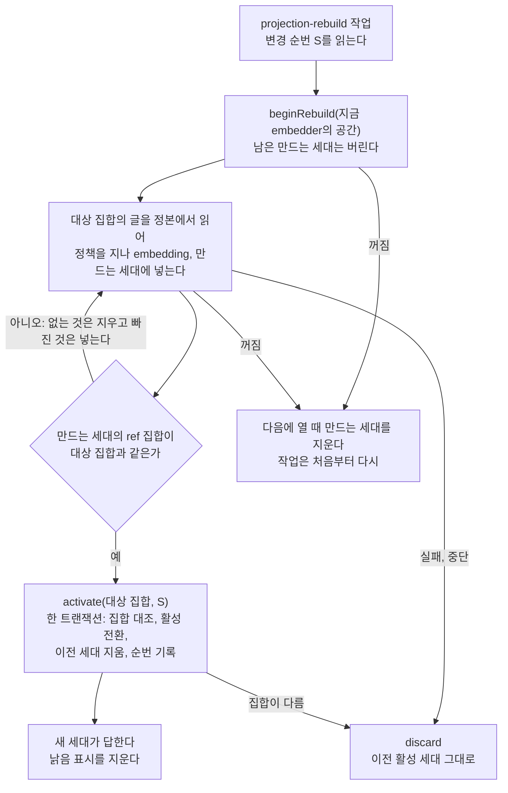

# 스펙: H01-C3 — 실제 벡터 색인, 문서 embedding 쓰기 경로, embedding 교체

- 날짜: 2026-11-24 / 상태: 초안(잠정 결정 D1~D12 포함)
- 관련: 이슈 #32(H01, 기준 `H01-C3`), 총괄 #1, #30(X01), #37(R07). [H01 백업·복원 spec](2026-11-23-H01-backup-restore.md)(D1 "C3은 뒤 단위", R2 "투영은 백업에서 뺀다"), [X01 spec](2026-11-23-X01-retrieval-qa.md), [ADR 0004](../adr/0004-embedded-storage.md), [ADR 0006](../adr/0006-embedding.md), [ADR 0025](../adr/0025-retrieval-strategies.md), ARCHITECTURE 3.2·4·5.4절
- 번호: 요구사항 `H01C3-R<n>`, 완료 기준 `H01C3-C<n>`, 결정 `H01C3-D<n>`, 작업 `H01C3-T<n>`. 정본 마이그레이션은 더하지 않는다(가장 높은 번호는 v33 그대로, `storage/src/migrations.ts:1953`).

| 말 | 뜻 |
|---|---|
| 세대(generation) | 한 embedding 공간(모델 ID·판·차원)으로 만든 벡터 묶음 하나 |
| 활성 세대 | 검색이 읽는 세대. 많아야 하나 |
| 만드는 세대(shadow) | 옆에서 채우는 중인 세대. 검색이 읽지 않는다. 많아야 하나 |
| 대상 집합 | 정본에 version 행이 있는 원본마다 가장 높은 version 하나(`knowledge-engine/src/projections.ts:155`의 `latestSources`와 같다) |
| ref | 벡터의 이름 `source-version:<원본 ID>:<version>`(`projections.ts:68`). 색인은 글을 갖지 않는다 |

## 배경

벡터로 찾는 쪽(`vector` 전략)은 X01이 만들었지만 제품에는 찾을 것이 없다.

- 제품이 묶는 색인은 모든 호출을 거절하는 `EmptyVectorIndex`다(`backend/src/composition.ts:173`).
- 문서를 embedding해 넣는 길이 없다. 벡터 재구축은 비우기만 하고 끝난다(`projections.ts:235`의 "Phase 1 writes no vectors"). 평가 실행기만 `upsert`를 부른다(`backend/src/retrieval-ablation.ts:444`).
- 규격의 `reset`은 먼저 다 버리고 다시 만드는 모양이다(`packages/contracts/src/vector-index.ts:27`). 모델을 바꾸다 실패하면 이전 색인도 없다. 이슈 #32의 `H01-C3`은 "옆에 만들고 → 검증 → 한 번에 전환, 실패하면 이전 것 유지"를 요구한다.
- 이미 있는 것: 규격과 계약 시험·메모리 구현(`packages/testkit/src/vector-index.contract.ts`, `memory-vector-index.ts`), 로컬 embedder(`providers/src/adapters/transformers-embedder.ts:134`), 전송 정책을 지나는 embed 입구(`providers/src/embedding.ts:35`. 제품 코드에서 부르는 곳은 아직 없다), 삭제를 색인에 알리는 작업(`backend/src/projection-ports.ts:49`), 재구축 작업 `projection-rebuild`(`backend/src/projection-jobs.ts:149`), 복원 마무리의 재구축 요청(`backend/src/restore-boot.ts:315`).

## 목표

1. 규격 뒤에 벡터를 실제로 담는 색인을 두고, 원본이 들어오고 바뀌고 지워질 때 색인이 따라간다.
2. embedding 공간이 바뀌면 새 세대를 옆에 만들어 검증한 뒤 한 번에 바꾼다. 중간에 실패·중단·꺼짐이 있어도 이전 세대가 그대로 남는다.
3. 지운 원본의 벡터는 어느 세대에도 남지 않는다.

## 비목표

- **sqlite-vec를 비롯한 네이티브 벡터 모듈.** R07의 일이다(D1).
- **`vector` 전략 켜기.** 기본 목록은 그대로다(ADR 0025). 색인 만들기 자체도 기본은 꺼 둔다(D3).
- **검색 품질·속도 측정, 실제 bge-m3로의 확인.** 배포처 S39.
- **화면, 새 API 경로, 새 작업 종류.** 기존 `projection-rebuild` 작업만 쓴다(D6).
- **문서를 조각(chunk)으로 나누기, 지식 항목의 embedding.** 원본 version 하나에 벡터 하나다(D7).
- **교체하는 동안 옛 모델로 질의를 계속 embedding하기.** 묶인 embedder는 하나다(D5).
- **만들던 세대를 이어서 만들기.** 버리고 처음부터 다시 만든다(D8).

## 요구사항

### 저장

- **H01C3-R1 색인 파일.** 새 구현 `SqliteVectorIndex`는 데이터 폴더의 `vectors/index.sqlite`(정본과 다른 파일, 같은 드라이버)에 세대 표(모델 ID·판·차원·상태 `building`/`active`·반영한 변경 순번), 세대별 벡터, ref별 순서 표시를 둔다. 검색은 활성 세대의 벡터를 모두 읽어 코사인 값으로 줄 세운다. 이 파일의 스키마가 빌드와 다르면 파일을 지우고 빈 색인으로 시작한다(다시 만들 수 있는 투영이라 올리지 않는다).
- **H01C3-R2 규격.** `VectorIndex`에서 `reset`을 없애고 `beginRebuild(space)`를 둔다. 돌려받는 손잡이로 `refs()`, `upsert(items, changeSeq)`, `activate(expectedRefs, appliedChangeSeq)`, `discard()`를 부른다.
  - `status`·`embeddingSpace`·`appliedChangeSeq`·`search`·색인의 `upsert`는 **활성 세대만** 본다. 활성 세대가 없으면 `status`는 만드는 세대가 있을 때 `rebuilding`, 없을 때 `unavailable`이고 `upsert`는 거절한다.
  - `remove`는 **모든 세대**에서 지우고, 세대가 하나도 없으면 지울 것 없이 성공한다.
  - `beginRebuild`는 남아 있던 만드는 세대를 버리고 새로 시작한다. 활성 세대는 건드리지 않는다.
  - `activate`는 색인 파일의 **한 트랜잭션**에서 ① 만드는 세대의 ref 집합이 `expectedRefs`와 같은지 본 뒤 ② 그 세대를 활성으로 바꾸고 ③ 이전 활성 세대의 행을 지우고 ④ 반영 순번을 적는다. 집합이 다르면 아무것도 바꾸지 않고 거절한다.
  - 오래된 순번의 쓰기 거절, 차원 검사, `k`개 이하·점수순은 지금 계약 그대로다.
- **H01C3-R3 다시 열기.** 색인을 열 때 `building` 세대는 지운다. 활성 세대는 그대로 답한다.

### 쓰기

- **H01C3-R4 재구축.** 벡터 색인의 `projection-rebuild`는 ① 지금 embedder의 공간으로 `beginRebuild` ② 대상 집합의 글(`제목\n본문`)을 정본에서 읽어 묶음마다 embedding해 넣고 ③ 만드는 세대의 ref 집합이 대상 집합과 같아질 때까지 맞춘다(정본에 더는 없는 ref는 `remove`로 지우고 빠진 것은 넣는다) ④ `activate(대상 집합, 읽은 순번)`를 부른다. 묶음 사이마다 작업의 중단 신호를 본다. 어디서든 실패하면 `discard`하고 실패를 작업에 넘긴다(기존 분류 그대로, 새 코드 없음).
- **H01C3-R5 새 version.** 통지 하나를 전달할 때 벡터 쪽은 새 version의 글을 embedding해 활성 세대에 넣고 이전 version의 ref를 지운다. 활성 세대의 공간이 embedder와 다르면 쓰지 않고 색인을 낡음으로 표시한다(기존 낡음 표시, `projections.ts:187`).
- **H01C3-R6 전송 정책.** 문서를 embedding하는 두 자리(R4·R5)는 `embedWithinPolicy`와 `denyExternalEmbedding`을 지난다. `egress`가 `local`이 아닌 embedder는 불리지 않는다.
- **H01C3-R7 지운 원본.** 삭제·권한 상실·폴더 철회는 모두 tombstone을 거쳐 기존 `projection-remove` 작업이 된다. 그 `remove`가 모든 세대에서 지우고(R2), 만드는 도중에 지워진 원본은 전환 전의 맞추기와 `activate`의 집합 대조가 걸러 낸다(R4 ③·④). 지운 원본의 ref는 활성 세대에도, 만드는 세대에도, 실패 뒤 남은 세대에도 없다.

### 읽기와 교체

- **H01C3-R8 읽는 쪽의 상태.** 서버가 받는 색인은 `status`만 덧씌운 것이다. 색인이 낡음으로 표시돼 있으면 `rebuilding`, 활성 세대의 공간이 묶인 embedder와 다르면 `unavailable`(이유: 공간 다름)이다. `vector` 전략은 `ready`가 아니면 지금처럼 이유를 달아 `unavailable`로 답하고 다른 전략의 결과는 바뀌지 않는다.
- **H01C3-R9 embedding 교체(`H01-C3`).** 교체는 따로 만든 길이 아니라 R4의 재구축이다. 활성 세대는 `activate`가 성공하는 순간까지 행 하나 바뀌지 않는다(지운 원본의 `remove`만 예외). 실패·중단·꺼짐 뒤에는 이전 세대만 남고(R3), 작업은 기존 재시도·lease 회수로 처음부터 다시 돈다.
- **H01C3-R10 언제 다시 만드는가.** 시작할 때의 비교(`projections.ts:242`)는 벡터 색인이 ① 반영 순번이 정본과 다르거나 ② 낡음 표시가 있거나 ③ 활성 세대가 없거나 ④ 활성 세대의 공간이 embedder와 다르면 낡음으로 표시하고 `projection-rebuild` 작업을 요청한다. **시작하는 자리에서 embedding하지 않는다.** 복원 마무리는 재구축 요청과 같은 트랜잭션에서 벡터 색인의 낡음 표시를 쓴다(복원은 번호 발급까지 되돌리므로 복원 전의 ref가 다른 원본을 가리킬 수 있다).

### 묶기

- **H01C3-R11 켜는 옵션.** `bootBackend`의 옵션 `vectorIndexing`(기본 꺼짐)이 켜져 있을 때만 `SqliteVectorIndex`를 묶는다. 꺼져 있으면 지금처럼 `EmptyVectorIndex`이고 시작·삭제·재구축의 동작이 지금과 같으며, 데이터 폴더에 `vectors/`가 있으면 시작할 때 지운다(삭제 통지가 닿지 않는 파생 데이터를 두지 않는다). 파생물 종류 `vectorIndex`의 `dataPaths`에 `vectors`를 적는다.

## 인터페이스 / 설계 개요

- `packages/contracts/src/vector-index.ts`: R2의 규격. `packages/testkit`의 메모리 구현과 계약 시험이 같이 바뀐다. `reset`을 부르던 곳(`projections.ts:237`, `retrieval-ablation.ts:432`, 시험들)은 `beginRebuild` → `activate`로 옮긴다.
- `storage/src/adapters/sqlite-vector-index.ts`: R1·R3. `storage/src/adapters/index.ts`에서만 내보낸다.
- `knowledge-engine/src/vector-build.ts`(새 파일): R4의 맞추기와 전환. `projections.ts`는 재구축에서 이것을 부르고, 통지 전달에 R5를, 시작 비교에 R10을 더한다. embedding 함수와 "재구축 작업 요청"은 조립 지점이 넣어 준다(이 패키지는 `providers`를 모른다).
- `backend/src/composition.ts`: 옵션에 따라 색인을 고르고, 정책을 지나는 embedding 함수와 R8의 덧씌운 색인을 만든다. `boot.ts`는 옵션과 `vectors/` 지우기, 서버에 넘기는 색인 한 줄. `projection-ports.ts`는 중단 신호를 넘긴다. `restore-boot.ts`는 낡음 표시 한 줄.

### 대안과 기각 사유

- **벡터를 정본 SQLite의 테이블로**: 기각. 백업은 정본 파일을 통째로 뜨므로(`storage/src/backup.ts:135`) 벡터가 백업에 실려 H01-R2("투영은 뺀다")와 어긋나고, 정본 마이그레이션과 복원의 스키마 대조(H01-R9 ⑥)를 건드린다. ARCHITECTURE 4절도 벡터 색인을 "별도 파일"로 적는다.
- **`reset`을 남기고 세대 메서드를 더하기**: 기각. 다시 만드는 길이 둘이 된다.
- **새 작업 종류·API로 교체를 시작**: 기각. 재구축 작업이 이미 요청·중복 방지·재시도·화면 문구를 갖고 있다.
- **만드는 동안 삭제를 막기**: 기각. 삭제가 색인을 기다리면 안 된다.

## 완료 기준 (테스트 가능한 형태)

모두 `FakeEmbedder`와 합성 원본으로 한다. E2E는 없다(화면이 없다).

| 기준 | 문장 | 증명 테스트 |
|---|---|---|
| H01C3-C1 | `SqliteVectorIndex`와 `MemoryVectorIndex`가 같은 계약 시험을 통과한다. 기존 사례(순서, 차원, `k`)에 더해: 만드는 동안과 `discard` 뒤에 `search`·`embeddingSpace`·`appliedChangeSeq`가 이전 활성 세대의 답과 같다. `activate` 뒤에는 새 세대의 답이고 이전 세대의 행이 없다. `expectedRefs`가 다르면 `activate`가 거절하고 활성 세대는 그대로다. `SqliteVectorIndex`는 파일을 다시 열면 활성 세대가 답하고 만드는 세대가 없다(R1~R3) | `packages/testkit/src/vector-index.contract.ts`, `storage/src/adapters/sqlite-vector-index.contract.test.ts` |
| H01C3-C2 | 원본 둘을 넣고 재구축하면 ref가 최신 version마다 하나이고, 한 원본의 글과 같은 질의 벡터로 찾으면 그 ref가 첫째다. 새 version을 통지하면 새 version의 ref만 남는다. `egress`가 `external`인 embedder로는 `embed`가 한 번도 불리지 않고 색인에 벡터가 없다(R4~R6) | `knowledge-engine/src/vector-build.test.ts` |
| H01C3-C3 | 재구축이 첫 묶음을 넣은 뒤에 원본 하나를 삭제 경로로 지우면, 재구축이 성공으로 끝나고 그 원본의 ref가 활성 세대에 없다. 만드는 세대에 든 ref에 `remove`를 부르면 그 세대의 `refs()`에 없다(R7) | `knowledge-engine/src/vector-build.test.ts`, `packages/testkit/src/vector-index.contract.ts` |
| H01C3-C4 | 모델 A로 만든 활성 세대가 있을 때 모델 B로 재구축한다. 둘째 묶음에서 `embed`가 실패하거나 중단 신호가 오면 재구축은 실패로 끝나고 `search` 결과와 `embeddingSpace`(A)가 전과 같으며 만드는 세대가 없다. 성공하면 공간이 B이고 반영 순번이 읽은 순번이다. B가 묶였는데 활성이 A인 동안, 그리고 낡음 표시가 있는 동안 덧씌운 `status`는 `ready`가 아니고 `vector` 전략은 `unavailable`이다(R8·R9) | `knowledge-engine/src/vector-build.test.ts`, `backend/src/vector-serving.test.ts` |
| H01C3-C5 | 실제 `bootBackend`로: `vectorIndexing`을 켜고 원본을 넣은 뒤 다시 시작하면 시작 중 `embed` 호출이 0이고 `projection-rebuild` 작업이 돈 뒤 상태 API의 벡터 색인이 `ready`다. 원본을 `/api/sources/delete`로 지우면 그 ref가 색인 파일에 없다. 옵션 없이 시작하면 묶인 색인이 `EmptyVectorIndex`이고 `vectors/`가 지워져 있으며 재구축 작업이 새로 등록되지 않는다. 복원 마무리 뒤에는 벡터 색인의 낡음 표시가 `1`이다(R10·R11) | `backend/src/vector-index.boot.test.ts`, `backend/src/restore-ledger.test.ts`(단언 하나), `backend/src/derivative-coverage.test.ts`(기존) |

**변이 확인**(테스트 간략화 규칙 5, 데이터 보호의 허용·차단): ① `remove`가 활성 세대만 지우게 하면 C3의 계약 사례가 빨개진다 ② R4 ③의 "정본에 없는 ref 지우기"를 빼면 C3의 재구축 사례가 빨개진다 ③ `activate`의 집합 대조를 빼면 C1의 거절 사례가 빨개진다. 변이가 맞힌 줄을 PR에 적는다. 경계값·조합은 더 늘리지 않는다.

## 잠정 결정과 가정

바꾸려면 적힌 자리 하나를 고치면 된다.

- **H01C3-D1 구현은 앱 코드의 전수 코사인 비교다.** ADR 0004가 sqlite-vec의 교체안으로 남겨 둔 것이고(`docs/adr/0004-embedded-storage.md:33`, 가정 A08), 새 네이티브 의존성이 없다. 다만 ADR 0004는 "첫 색인 작업 전에 R07이 구현을 고른다"고 적었고(`:39`) ARCHITECTURE 3.2절은 "벡터 점수 계산"을 엔진의 일로 적는다(`docs/ARCHITECTURE.md:176`). 이 단위는 그 둘을 **R07보다 먼저 잠정으로** 넘는다. 새 ADR에 적고 두 문서를 고친다(T4). 바꾸기: R07이 다른 구현을 고르면 `storage/src/adapters`의 파일 하나와 조립 한 줄을 바꾼다. 계약 시험이 같은 동작을 지킨다.
- **H01C3-D2 벡터는 정본과 다른 SQLite 파일에 두고 백업에서 뺀다.** 복원 뒤에는 기존 재구축 요청이 다시 만든다. 백업 목록표의 embedding 공간·색인 순번은 활성 세대의 값이다(기존 `readIndexFacts`). 백업에 넣으려면 백업 spec의 R2와 목록표를 고친다.
- **H01C3-D3 색인 만들기는 옵션으로 켜고 기본은 꺼짐이다.** 기본 설치는 모델이 준비되지 않은 상태라 재구축이 실패 작업으로 쌓이고, 읽는 전략이 꺼져 있는 동안 코퍼스 전체를 embedding하는 비용은 재지 않았다. 켜는 것은 배포 단계의 결정이다(S39의 측정 뒤). 바꾸기: 옵션의 기본값 한 줄. 옵션을 설정·화면으로 올리는 일은 그때의 작업이다.
- **H01C3-D4 `vector` 전략은 기본 목록에 넣지 않는다.** ADR 0025의 판정 그대로다.
- **H01C3-D5 공간이 바뀐 교체 중에는 벡터 검색이 `unavailable`이다.** 질의는 묶인(새) 모델로만 embedding할 수 있어 이전 세대와 비교할 수 없다. 이슈의 "기존 탐색이 가능하다"는 이렇게 읽는다: 다른 전략은 그대로 답하고, 이전 세대는 지워지지 않아 공간이 같은 재구축에서는 계속 답하며 embedder를 되돌리면 다시 만들지 않고 바로 답한다. 교체 중에도 벡터 검색을 이으려면 embedder 둘을 함께 묶는 구조가 필요하다.
- **H01C3-D6 교체는 `projection-rebuild` 작업이 하고 사람이 누르는 길은 없다.** 시작할 때 공간이 다르면 스스로 요청한다. 모델을 준비한 직후에는 요청하지 않으므로 다음 시작이 만든다. 바로 만들게 하려면 준비 성공 뒤에 요청 한 줄을 더한다.
- **H01C3-D7 원본 version 하나에 벡터 하나, 글은 `제목\n본문`.** 평가 실행기와 같은 모양이다(`retrieval-ablation.ts:438`). 긴 문서는 모델의 한도에서 잘린다. 조각 나누기는 ARCHITECTURE 3.2절이 엔진의 일로 둔다.
- **H01C3-D8 만들던 세대는 이어 만들지 않는다.** 꺼지거나 실패하면 버리고 처음부터다. 재구축 작업의 실행 한도는 60분이라(`projection-jobs.ts:89`) 그 안에 끝나지 않는 코퍼스는 끝내 전환하지 못한다. 실제 크기에서의 시간은 재지 않았다. 필요해지면 세대에 진행 위치를 적어 잇는다.
- **H01C3-D9 검증은 "ref 집합이 대상 집합과 같다"와 "공간이 embedder와 같다" 둘이다.** 건수 일치는 집합 일치에 들어 있고 차원은 넣을 때 검사한다. 검색 품질 검증은 하지 않는다.
- **H01C3-D10 낡음으로 표시된 색인은 답하지 않는다.** 놓친 통지나 복원 뒤의 색인은 다른 원본을 가리킬 수 있다. 낡은 채로 답하게 하려면 R8의 첫 조건을 뺀다.
- **H01C3-D11 재구축은 지금처럼 통지와 한 줄로 선다**(`projections.ts:144`). 만드는 동안 새 version의 통지는 기다렸다가 전환 뒤 새 세대에 들어간다. 삭제 작업도 같은 동시 실행 묶음이라 재구축 뒤에 돈다(`storage/src/job-concurrency.ts:16`). 그래서 R7의 전환 전 맞추기가 필요하다.
- **H01C3-D12 색인 파일은 암호화하지 않는다.** ADR 0010의 현재 결정(정본도 평문)과 같다. 지운 자리는 드라이버의 `secure_delete`가 덮는다(`storage/src/adapters/better-sqlite3-driver.ts:20`).

## 미해결 질문 / 검증하지 않은 범위

- **실제 모델.** bge-m3로 만든 색인, 긴 문서의 잘림, 큰 코퍼스의 재구축 시간과 검색 시간, Windows에서의 색인 파일은 확인하지 않는다(S39).
- **통지 전달의 embedding 비용.** 옵션을 켜면 원본이 들어올 때마다 embedding이 통지 줄에서 돈다. 엔진 통지가 그만큼 늦어진다(제품의 엔진은 빈 구현). 재지 않았다.
- **모델이 없는 채로 옵션만 켠 설치.** 재구축 작업이 `projection-unavailable`로 실패·재시도한다. 시험하지 않는다.
- **삭제 작업이 포기된 채 재구축도 할 수 없는 경우**(모델 없음 + 색인 파일 쓰기 오류)에는 지운 원본의 벡터(글 아님)가 이전 세대에 남을 수 있다. 옵션을 끄면 파일째 지워진다.

## 작업 분해

PR 하나, 한 구현자가 차례로 한다. T4는 T2·T3과 파일이 겹치지 않아 나란히 할 수 있다.

| 작업 | 산출물 | 기준 | 선행 | 건드리는 파일 | 검증 증거 |
|---|---|---|---|---|---|
| H01C3-T1 | 규격의 세대 모양과 두 구현 | C1, C3(계약 사례) | 없음 | `packages/contracts/src/vector-index.ts`, `packages/testkit/src/memory-vector-index.ts`·`vector-index.contract.ts`, 새 `storage/src/adapters/sqlite-vector-index.ts`와 계약 시험, `storage/src/adapters/index.ts`·`empty-vector-index.ts`, `reset`을 부르던 곳의 옮김 | 두 계약 시험 통과 출력, 변이 ①·③의 빨간 출력 |
| H01C3-T2 | 재구축·통지·시작 비교의 쓰기 경로 | C2, C3(재구축 사례), C4(앞 두 문장) | T1 | 새 `knowledge-engine/src/vector-build.ts`와 시험, `knowledge-engine/src/projections.ts`·`projection-kinds.ts`, `backend/src/retrieval-ablation.ts` | `vector-build.test.ts`·`projections.test.ts` 통과 출력, 변이 ②의 빨간 출력 |
| H01C3-T3 | 제품 묶기: 옵션, 정책을 지나는 embedding, 덧씌운 상태, 복원의 낡음 표시 | C4(끝 문장), C5 | T2 | `backend/src/composition.ts`·`boot.ts`·`projection-ports.ts`·`restore-boot.ts`, 새 `backend/src/vector-serving.test.ts`·`vector-index.boot.test.ts`, `backend/src/restore-ledger.test.ts` | 세 시험과 `derivative-coverage.test.ts`·`projection-remove.test.ts` 통과 출력 |
| H01C3-T4 | 문서: 새 ADR(잠정 구현과 세대 전환), ADR 0004에 가리키는 줄, ADR 0025의 "색인 없음" 문장, ARCHITECTURE 3.2·4·5.4절과 A08, site-setup S39, `docs/README.md`·`docs/adr/README.md` | (문서) | T1 | 왼쪽 문서들 | `pnpm lint` 통과, 문서의 파일 이름·옵션 이름이 코드와 같음 |

`backend/src/composition.ts`·`boot.ts`·`restore-boot.ts`·`docs/site-setup.md`·`docs/ARCHITECTURE.md`·`docs/README.md`는 여러 세션이 자주 고치는 파일이다. 줄을 덧붙이는 쪽으로 쓴다. `backend/src/server.ts`, `packages/contracts/src/index.ts`, `storage/src/index.ts`, `storage/src/migrations.ts`는 건드리지 않는다.

## 넘기는 것

- **후속 이슈(전송 정책).** 질의를 embedding하는 자리(`knowledge-engine/src/retrieval/strategies.ts:245`)는 `embedWithinPolicy`를 지나지 않는다. 지금 묶인 embedder는 로컬이라 나가는 것이 없지만, 외부 embedder를 묶는 포크에서는 질의가 정책 없이 나간다.
- **R07(#37).** sqlite-vec 채택 여부, 3.2절의 선을 어디에 둘지, 색인 파일 암호화.
- **배포처 S39.** 옵션과 `askStrategies`를 함께 켜고 실제 모델로 만들기·찾기·삭제 뒤 부재·교체를 확인하고 시간을 기록한다.
- **후속(기능).** 모델 준비 직후의 재구축 요청(D6), 이어 만들기(D8), 옵션을 설정으로 올리기(D3).

## 변경 이력

| 날짜 | 변경 | 대상 | 사유 |
|---|---|---|---|
| 2026-11-24 | 처음 씀(초안) | 전체 | H01 백업·복원(#271)이 합쳐지고 X01이 찾는 쪽을 만든 뒤, 미뤄 둔 `H01-C3`과 그 전제(실제 색인·쓰기 경로)를 한 단위로 묶음 |
