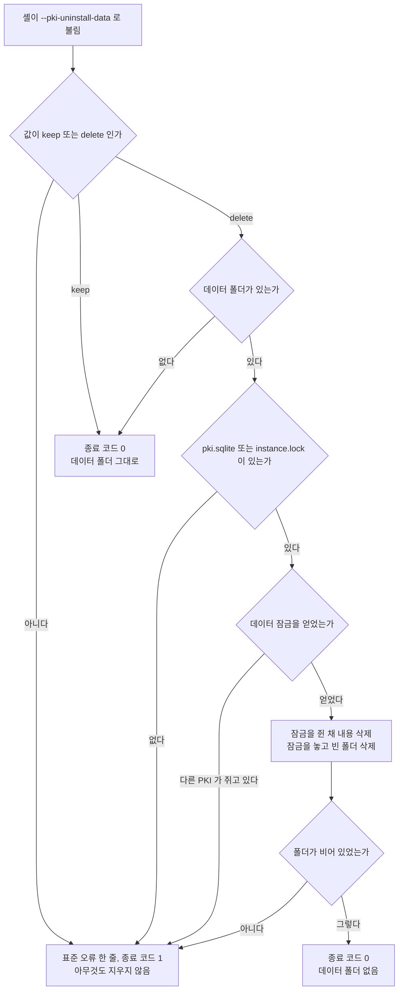

# 스펙: H02 공용 범위 — SBOM, 업데이트 검증, 제거 때 데이터 선택, 자동 시작, 절전 복귀

- 날짜: 2026-11-24 / 상태: 확정(잠정 결정 D1~D9 포함)
- 관련: 이슈 #33(H02), 총괄 #1, Phase #9, 선행 #31·#32(머지됨). [ADR 0007](../adr/0007-packaging.md), [R04 설치 키트 spec](2026-11-21-R04-windows-installer.md), [데이터 잠금 spec](2026-11-23-R04-data-dir-lock.md), [site-setup](../site-setup.md) S10·S12·S19·S44
- 번호: 요구사항 `H02A-R<n>`, 완료 기준 `H02A-C<n>`, 결정 `H02A-D<n>`. 이슈의 `H02-C1~C3`과 겹치지 않게 `A`(공용 범위)를 붙였다.

| 말 | 뜻 |
|---|---|
| 공용 범위 | Windows PC, 실제 서명 자격, 업데이트를 둘 주소 없이 이 저장소의 시험으로 확인할 수 있는 부분 |
| SBOM | 설치본에 들어가는 외부 소프트웨어의 목록(이름·버전·라이선스). 식품의 원재료 표시와 같다 |
| manifest | 업데이트 하나를 설명하는 작은 JSON(버전, 파일 이름, 해시, 크기) |
| 채널 | manifest와 설치 파일을 받아 오고 설치를 시작하는 통로. 배포처가 구현한다 |
| 데이터 폴더 | 정본 DB(`pki.sqlite`)와 `secrets.json`이 있는 OS 사용자별 폴더(`dataDirectory()`) |

## 배경

이슈 #33은 설치·업데이트·제거와 OS 수명주기를 Windows 11에서 완성하라고 한다. 이 저장소에는 설치 파일도, Windows 실행 환경도, 서명 자격도 없다(ADR 0007: 서명 정체성 미정, 자동 업데이트는 꺼 둠). 그래서 이 문서는 **Windows 없이 증명할 수 있는 논리**만 만들고, 나머지는 배포처 항목으로 넘긴다.

이미 있어서 다시 만들지 않는 것(이슈 `H02-C1`·`C3`의 공용 증거):

| 항목 | 있는 곳 | 지키는 시험 |
|---|---|---|
| 단일 실행(이슈 위험 기록) | Electron 잠금 + 데이터 폴더 잠금(`apps/desktop/src/data-lock.ts`). **위험 기록은 R04L로 해소됨** | `data-lock.test.ts`, `e2e/lifecycle.e2e.ts` |
| 정상 종료, 백엔드 충돌 뒤 재시작 | `backend-process.ts`, `backend-supervisor.ts` | `backend-process.stop.test.ts`, `backend-supervisor.test.ts`, `lifecycle.e2e.ts` |
| 트레이, OS 알림 | `main.ts`, `notifier.ts` | `notifier.test.ts` |
| 절전 뒤 놓친 주기 합치기, 임대 만료 재실행 | `backend/src/scheduler.ts`, `job-runner.ts`(I03) | I03의 가짜 시계 시험 |
| 런타임을 따로 설치하지 않음 | 빌드가 번들과 런타임 패키지를 앱 폴더에 넣음 | `artifact/artifact.runtime.e2e.ts`, `artifact.contents.e2e.ts` |
| CLI·모델이 없어도 비LLM 기능 사용 | 홈의 안내와 목록·검색 | `apps/web/e2e/degraded.e2e.ts` |

비어 있는 것은 다섯이다: SBOM이 없다. 업데이트를 검증하는 코드가 없다. 제거할 때 데이터 폴더를 어떻게 할지 정하는 길이 없다(데이터 폴더는 Electron의 userData와 다른 곳이라 설치 프로그램이 모른다). 자동 시작이 없다. 절전에서 깨어났음을 백엔드에 알리지 않는다(ARCHITECTURE A23의 "틀렸을 때 고칠 곳").

## 목표

1. 빌드가 설치본에 들어가는 외부 소프트웨어의 목록(SBOM)을 낸다.
2. 서명이 맞지 않거나, 더 새롭지 않거나, 해시가 다른 업데이트는 설치 단계에 닿지 못한다.
3. 제거할 때 데이터 폴더를 남길지 지울지 고를 수 있고, 지우기는 PKI의 데이터 폴더가 맞고 아무도 쓰고 있지 않을 때만 일어난다.
4. 로그인할 때 자동으로 시작하도록 켜고 끌 수 있다.
5. 절전에서 깨어나면 30초 점검을 기다리지 않고 바로 밀린 일을 확인한다.

## 비목표

- **설치 파일(NSIS) 만들기, 서명, 업데이트를 둘 주소와 채널 구현, Windows 11에서의 실행 확인.** 전부 배포처 후속이다(아래 "미검증·배포처/Windows 후속").
- **셸이 업데이트를 언제 확인할지와 화면 안내.** 채널이 없으면 부를 것이 없다. `main.ts`는 업데이트 코드를 부르지 않는다(D3).
- electron-builder·electron-updater 등 새 의존성 추가.
- 제거 때 userData(Electron 프로필), 백업 폴더, 사용자가 승인한 원본 파일을 지우는 일. 데이터 폴더 밖은 건드리지 않는다.
- 자동 시작 때 창 없이 트레이로만 뜨기(D7). 설정 화면에 자동 시작 항목 추가.
- 절전에서 깨어난 뒤 진행 중 Provider 호출을 모두 취소하기(A24). S19의 실행 결과가 필요하다고 할 때 한다.
- 위 표의 이미 있는 항목에 시험 더하기.

## 요구사항

**SBOM**

- **H02A-R1** `pnpm --filter @pki/desktop build`는 `apps/desktop/dist/sbom.cdx.json`(CycloneDX JSON)을 쓴다. 내용은 ① 작업 공간의 배포 의존성 전부(`pnpm sbom --prod`의 출력) ② Electron(고정 버전) ③ 앱 폴더에 복사한 런타임 패키지마다 "복사됨" 표시와, 네이티브 코드(`.node`·`.dll`·`.so`·`.dylib` 파일)가 든 패키지의 "네이티브" 표시다. 표시는 구성 요소의 속성 `pki:copied`·`pki:native`다.
- **H02A-R2** 복사한 런타임 패키지 가운데 목록에 없는 것(purl 기준. pnpm은 범위 이름 `@a/b`를 이름 `b`와 그룹 `@a`로 나누고 purl에는 `%40a/b`로 적는다)이 하나라도 있으면 빌드가 그 이름을 대고 멈춘다. 빠진 채로 SBOM을 쓰지 않는다.

**업데이트 검증**

- **H02A-R3** manifest는 JSON 바이트 그대로이고 필드는 `version`(`숫자.숫자.숫자`), `file`, `sha512`(16진), `size`다. 서명은 그 바이트 전체에 대한 Ed25519 분리 서명이다. `verifyManifest`는 주어진 공개 키로 서명이 맞고, 모양이 맞고, `version`이 지금 버전보다 클 때만 manifest를 돌려준다. 아니면 이유(`bad-signature`, `malformed`, `not-newer`)를 단 오류를 던진다. 공개 키가 없으면 `bad-signature`다.
- **H02A-R4** `runUpdate`는 채널에서 manifest와 서명을 받아 R3으로 검증하고, 파일을 받아 크기와 SHA-512가 manifest와 같을 때만 채널의 설치를 부른다. 어느 단계든 실패하면 설치를 부르지 않고, 받은 파일을 지우고, 실패 이유를 결과로 돌려준다. 지금 설치본은 건드리지 않는다.
- **H02A-R5** 공용 저장소의 채널은 `unavailableUpdateChannel` 하나이고, 모든 호출이 `미구현, 배포처 후속`으로 시작하는 오류를 던진다. `runUpdate`는 이것을 성공이나 "업데이트 없음"으로 바꾸지 않는다.

**제거 때 데이터 선택**

- **H02A-R6** 셸은 `--pki-uninstall-data=keep|delete`로 불리면 창·백엔드를 만들지 않고 아래 순서로 판정한 뒤 끝난다. 이 갈래는 디버깅 스위치 거부 다음, **Electron 단일 실행 잠금보다 앞**에 둔다(같은 userData로 PKI가 떠 있을 때 "넘겨졌다"는 0으로 조용히 끝나지 않게).
- **H02A-R7** 지우기는 다음이 모두 참일 때만 한다: ① 값이 정확히 `delete` ② 데이터 폴더에 `pki.sqlite` 또는 `instance.lock`이 있다 ③ 데이터 잠금을 얻었다(쓰는 PKI가 없다). 하나라도 아니면 아무 파일도 지우지 않고 표준 오류 한 줄과 종료 코드 1로 끝난다. `keep`이거나 데이터 폴더가 없으면 아무것도 지우지 않고 0으로 끝난다.
- **H02A-R8** 지울 때는 잠금을 쥔 채 데이터 폴더 안의 항목을 지우고(심볼릭 링크는 따라가지 않고 링크만 지운다), 잠금을 놓은 뒤 잠금 파일과 빈 폴더를 지운다. 폴더가 비지 않았으면(그 사이 누가 썼다) 통째로 지우지 않고 1로 끝난다. 대상은 언제나 셸이 정한 데이터 폴더다. 배포 빌드는 폴더를 바꾸는 스위치를 받지 않는다.
- **H02A-R9** 이 갈래는 `keep`·`delete` 어느 쪽이든 자동 시작 등록을 끈다.

**자동 시작**

- **H02A-R10** 트레이 메뉴에 "로그인할 때 자동 시작" 체크 항목이 있다. 표시 값은 OS에 등록된 상태를 읽은 것이고(따로 저장하지 않는다), 누르면 OS 등록을 바꾼다. 기본은 꺼짐이다. 패키지된 앱이 아니면(원본 실행, 앱 폴더 실행) 항목은 비활성이고 OS 등록을 바꾸지 않는다.

**절전 복귀**

- **H02A-R11** 셸은 OS의 절전 복귀 알림(`powerMonitor`의 `resume`)을 받으면 실행 중인 백엔드에 `resumed` 메시지를 보낸다. 백엔드가 없으면 아무것도 보내지 않는다. 백엔드는 이 메시지를 받으면 스케줄 점검을 한 번 돌리고 작업 실행기를 깨운다. 점검의 내용(놓친 주기 합치기, 임대 처리)은 I03 그대로다.

**문서**

- **H02A-R12** `docs/site-setup.md`에 아래 "미검증" 절의 세 항목을 더하고, "자동 업데이트 주소: 아직 없다" 문장을 지금 상태(검증 코드는 있고 채널·공개 키는 배포처가 넣는다)로 고친다. ADR 0007에 "manifest 서명 검증은 Authenticode와 별개의 층"이라는 한 줄과 `docs/README.md` 색인 줄을 더한다.

## 인터페이스 / 설계 개요

새 모듈은 넷이고 모두 Electron 객체를 인자로 받는 순수 논리다(시험은 가짜 객체로 한다).

- `apps/desktop/build/sbom.ts` — `completeSbom(base, { electronVersion, runtime })`: `pnpm sbom`의 출력에 Electron과 표시를 더해 돌려주고, R2를 어기면 던진다. `build.ts`가 5단계 뒤에 부른다.
- `apps/desktop/src/update.ts` — `verifyManifest`, `runUpdate`, `unavailableUpdateChannel`, 채널 규격 `UpdateChannel { fetchManifest(); download(manifest, toFile); install(file) }`. 암호는 `node:crypto`만 쓴다.
- `apps/desktop/src/data-removal.ts` — `removeUserData({ choice, dir, lock, disableAutostart })`가 `{ code, line }`을 돌려준다. `main.ts`는 그 값을 찍고 끝낼 뿐이다.
- `apps/desktop/src/autostart.ts` — `autostartMenuItem({ packaged, get, set })`이 트레이 메뉴 항목 하나를 만든다.
- 절전 복귀는 새 모듈 없이 기존 통로에 메시지 하나를 더한다: `main.ts`(`powerMonitor.on("resume")`) → `Supervisor.resumed()` → `Backend.resumed()` → `shell-main.ts` → `BootedBackend.resumed()`(= `scheduler.check()` + `runner.wake()`).

## 완료 기준 (테스트 가능한 형태)

- **H02A-C1** (R1·R2, 단위) `completeSbom`에 작은 목록과 런타임 패키지 둘(하나는 네이티브)을 주면 결과에 Electron 구성 요소가 고정 버전으로 있고 두 패키지에 표시가 붙는다. 목록에 없는 런타임 패키지를 주면 그 이름을 담은 오류를 던진다. → `apps/desktop/build/sbom.test.ts`. 산출물 확인 1건: 빌드 뒤 `sbom.cdx.json`에 빌드 보고서의 `packages` 전부와 Electron이 있다 → `apps/desktop/artifact/artifact.contents.e2e.ts`
- **H02A-C2** (R3, 단위) 시험 안에서 만든 합성 Ed25519 키로 서명한 manifest는 통과한다. manifest 한 바이트를 바꾸거나 다른 키로 검증하면 `bad-signature`, 지금 버전과 같거나 낮으면 `not-newer`다. → `apps/desktop/src/update.test.ts`
- **H02A-C3** (R4·R5, 단위) 가짜 채널이 준 파일의 해시가 manifest와 다르면 `runUpdate`가 `install`을 부르지 않고 받은 파일이 남아 있지 않다. 정상 파일이면 `install`이 한 번 불린다. `unavailableUpdateChannel`로 돌리면 결과의 이유가 `미구현, 배포처 후속`으로 시작한다. → 같은 파일
- **H02A-C4** (R7·R8·R9, 단위) 표식이 있는 임시 데이터 폴더에 `delete`를 주면 폴더가 없어지고 옆 폴더의 파일은 남는다. `keep`이면 파일 바이트가 그대로다. 다른 프로세스가 잠금을 쥐고 있거나, 표식이 없는 폴더이거나, 값이 `keep`·`delete`가 아니면 파일이 하나도 지워지지 않고 `code`가 1이다. 어느 경우든 `disableAutostart`가 불린다(값이 틀린 경우 제외). → `apps/desktop/src/data-removal.test.ts`
- **H02A-C5** (R6·R7, Electron E2E) 셸이 떠 있을 때 **같은 userData·같은 데이터 폴더**로 `--pki-uninstall-data=delete`를 주어 띄우면 종료 코드 1로 끝나고 `pki.sqlite`가 남아 있다. 셸을 끝낸 뒤 다시 띄우면 0으로 끝나고 데이터 폴더가 없다. → `apps/desktop/e2e/lifecycle.e2e.ts`
- **H02A-C6** (R10, 단위) 패키지된 앱에서 항목을 누르면 `set`이 지금 상태의 반대로 한 번 불리고, 패키지되지 않은 앱에서는 항목이 비활성이고 `set`이 불리지 않는다. → `apps/desktop/src/autostart.test.ts`
- **H02A-C7** (R11, 단위) `Backend.resumed()`가 자식에게 `{ type: "resumed" }`를 보내고, 자식이 끝난 뒤에는 보내지 않는다 → `apps/desktop/src/backend-process.resume.test.ts`. 다음 예정 시각을 과거로 옮긴 주기가 있는 백엔드에서 `resumed()`를 부르면 30초 점검을 기다리지 않고 그 주기의 작업이 하나 등록된다 → `backend/src/boot.resume.test.ts`
- **H02A-C8** (R12, 문서 시험) `docs/site-setup.md`에 새 세 항목이 각각 한 번 있고 `--pki-uninstall-data`, `sbom.cdx.json`, `미구현, 배포처 후속`을 코드의 상수와 같은 글자로 담는다. → `tooling/docs/site-setup-h02.test.ts`

**변이 확인**(보안·데이터 보호의 허용/차단 가드만. 백업 사본으로 되돌리고 결과만 PR에 적는다): ① R7의 세 조건(값, 표식, 잠금)을 하나씩 없애면 C4가 실패한다 ② `main.ts`의 제거 갈래를 Electron 잠금 뒤로 옮기면 C5가 실패한다 ③ `verifyManifest`의 서명 검사를 건너뛰면 C2가, `runUpdate`의 해시 대조를 건너뛰면 C3이 실패한다.

`shell-main.ts`가 메시지를 `resumed()`로 넘기는 한 줄과 `main.ts`의 `powerMonitor` 연결은 따로 시험을 두지 않고 검토에서 코드로 확인한다.

## 잠정 결정

| 번호 | 결정 | 이유 | 바꾸려면 |
|---|---|---|---|
| D1 | SBOM은 pnpm 내장 `pnpm sbom --prod`(CycloneDX)를 바탕으로 하고 빌드가 Electron과 표시만 더한다 | 이미 설치된 도구라 새 의존성이 없다. 번들 안에 녹아 든 JS 의존성까지 담긴다(실제로 들어간 것보다 넓을 수 있고 좁지는 않다). Electron은 개발 의존성이라 `--prod`에 없어 따로 더한다 | `sbom.ts`의 바탕만 바꾼다(SPDX는 `--sbom-format spdx`) |
| D2 | SBOM은 `dist/`에 두고 앱 폴더에는 넣지 않는다 | 빌드 보고서와 같은 자리. 어디에 게시할지는 배포처가 정한다 | `build.ts`의 경로 한 줄 |
| D3 | 업데이트는 검증과 실행 순서만 만들고 `main.ts`에서 부르지 않는다 | ADR 0007 "구성만 하고 켜지 않는다". 채널이 없는데 연결하면 설치본마다 실패 줄만 남는다 | 배포처가 채널을 넣고 `run()`에서 `runUpdate`를 부른다(새 site-setup 항목) |
| D4 | manifest 서명은 Ed25519 분리 서명, 공개 키는 호출하는 쪽이 넘긴다(공용 기본 없음 = 항상 거부) | `node:crypto`만으로 되고 Windows 없이 시험된다. electron-updater의 게시자 이름 검사(Authenticode)를 대신하지 않고 그 앞에 서는 층이다 | `verifyManifest` 안만 바꾼다 |
| D5 | 버전 비교는 `숫자.숫자.숫자`만 받는다 | 의존성 없이 비교하고, 읽지 못하는 버전은 거부한다 | 사전 배포 표기가 필요해지면 비교 함수를 넓힌다 |
| D6 | 제거 때 지우는 것은 데이터 폴더뿐이고, 진입은 셸 스위치 하나다. 기본(스위치 없음, `keep`)은 보존 | 데이터 폴더의 위치와 잠금을 아는 것은 셸뿐이다. 설치 프로그램은 물어본 답을 스위치로 넘기기만 하면 된다 | userData까지 지우려면 설치 프로그램 쪽 설정으로(새 site-setup 항목) |
| D7 | 자동 시작은 트레이 체크 항목, OS 등록이 유일한 상태, 창을 보통대로 띄운다 | 백엔드·계약·화면을 고치지 않는다. 지금 셸은 창을 닫으면 끝나므로 창 없는 시작은 종료 규칙을 바꿔야 한다 | 설정 화면 항목이나 숨김 시작은 별도 작업으로 |
| D8 | 패키지되지 않은 실행에서는 자동 시작을 등록하지 않는다 | 등록되는 것이 PKI가 아니라 개발용 Electron 실행 파일이 된다 | `packaged` 판정을 바꾼다 |
| D9 | 절전 복귀는 점검을 앞당기기만 한다 | 30초 점검이 이미 같은 일을 한다. 타이머가 깨어나지 않는 경우(A23)의 보험이고 지연을 줄인다 | A24(진행 중 호출 취소)는 S19 결과를 보고 더한다 |

## 미검증·배포처/Windows 후속

이 문서의 시험은 macOS 개발 PC에서 가짜 Electron 객체와 합성 키로 돈다. 아래는 **확인된 것으로 적지 않는다.** 각 항목은 구현 작업에서 `docs/site-setup.md`의 "설치와 운영"에 더한다(번호는 합칠 때의 다음 번호. 지금 마지막은 S45).

| site-setup 항목(새로 더함) | 내용 | 이슈 기준 |
|---|---|---|
| Windows 11 설치본의 수명주기 실행 기록 | 표준 사용자로 설치·업데이트·제거, 트레이·알림(AppUserModelID 포함)·단일 실행·정상 종료·충돌 복구, **자동 시작 등록이 로그인 뒤 실제로 띄우는지, 절전·최대 절전 복귀 때 `resume`이 오는지**(S19와 함께), 데이터 잠금의 Windows 동작 | H02-C1 |
| 업데이트 채널과 서명 | 채널 어댑터 구현(받아 오기·설치), 공개 키를 빌드에 넣는 자리, 서명 키 보관, 릴리스 버전을 매기는 절차(지금 앱 폴더의 `package.json`에는 버전이 없다), 설치 실패 때의 되돌림, electron-updater를 쓸지 여부. 그때까지 공용 채널은 `미구현, 배포처 후속`으로 실패한다 | H02-C2 |
| 설치 프로그램 연결과 SBOM 게시 | 제거 프로그램이 선택을 물어 `--pki-uninstall-data`로 셸을 부르기, 그 종료 코드가 1일 때의 안내, userData와 레지스트리 Run 키 잔여 확인(R04의 `06` 스크립트), **Windows에서 빌드한 SBOM**(네이티브 패키지는 빌드한 OS의 것만 들어간다)과 게시 위치, 번들한 `.dll`·`.node`의 서명 | H02-C2, C3 |

그 밖에 확인하지 못한 것:

- `app.setLoginItemSettings`가 이 Electron 버전의 Windows에서 표준 사용자 권한으로 되는지.
- 셸 스위치 갈래는 `app.whenReady()` 뒤에 자동 시작을 해제한다(창은 만들지 않는다). 준비 전에 부를 수 있는지는 확인하지 않고 피했다. Windows에서 그 해제가 레지스트리 Run 키를 지우는지는 확인하지 못했다.
- 제거 갈래에서 잠금을 놓고 빈 폴더를 지우는 사이의 짧은 틈. macOS·Linux에서는 그 사이 시작한 PKI가 쥔 `instance.lock`이 지워질 수 있고 이어서 시작하는 PKI가 같은 폴더에서 잠금을 또 얻는다(기존 사용자 데이터는 잃지 않는다). Windows에서는 열린 잠금 파일의 삭제가 거절되어 1로 끝나리라 보지만 확인하지 못했다(S46). 닫는 것은 [SLF spec](2026-11-24-SLF-shell-lifecycle-followups.md) D1에서 보류했다.
- 이슈 `H02-C1`의 "실행한다"는 이 문서로 충족되지 않는다. 이슈는 닫지 않는다.

## 변경 이력

| 날짜 | 변경 내용 | 대상 | 사유 |
|---|---|---|---|
| 2026-11-24 | 작성·확정 | 이 문서 | 이슈 #33 공용 범위 |
| 2026-11-24 | 구현 중 실측 반영: R1·R2(SBOM 비교는 purl 기준, 표시는 속성 `pki:copied`·`pki:native`), C7(예정 시각을 과거로 옮겨 시험), 미검증(셸 스위치 갈래는 ready 뒤에 자동 시작 해제), site-setup 번호 S46~S48 확정 | R1, R2, C7, 미검증 | 구현 단계의 미결 사항 4건 해소 |
| 2026-11-24 | 미검증의 잠금 해제 뒤 틈 문장을 macOS·Linux 실측대로 고침(잠금 파일이 지워질 수 있음) | 미검증 | SLF 후속 묶음(#295 A2) 대조에서 "지우지 않는 쪽으로 실패"가 틀렸음을 확인 |
