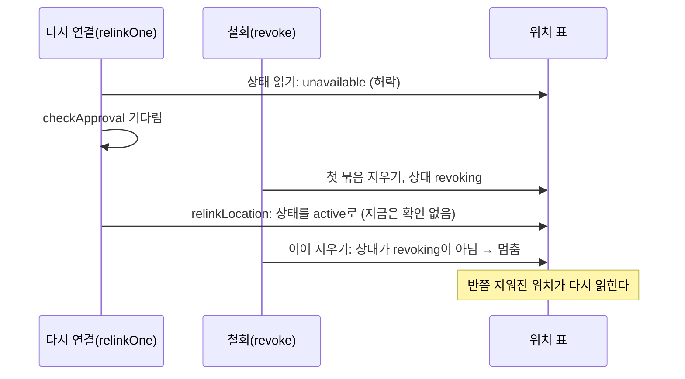

# 스펙: 위치·항목 정리 후속 묶음(LCF) — 다시 연결이 덮는 일시 중지·철회, 말없이 끝나는 위치 고르기, 남는 "다른 것" 안내

- 날짜: 2026-11-24 / 상태: 확정(잠정 결정 포함)
- 관련: 이슈 #335(F1·F3·F4·F5), #200(F3). [DPF spec](2026-11-24-DPF-deferred-features.md)(DPF-R1·R3·R6·D6), [I02 spec](2026-11-22-I02-local-file-import.md)(I02B-R9·R37, D33)
- 번호: 요구사항 `LCF-R<n>`, 완료 기준 `LCF-C<n>`, 결정 `LCF-D<n>`, 작업 `LCF-T<n>`. **마이그레이션과 `packages/contracts` 변경은 없다.**
- 기준 코드: `origin/main` `3d4528b5`. 아래의 `파일:줄`은 그 커밋에서 열어 읽은 자리다(실행한 것은 아니다).

| 말 | 뜻 |
|---|---|
| 다시 연결 | `unavailable`·`needs-confirmation`인 위치를 같은 번호로 새 폴더·파일에 잇는 조치(I02B-R9) |
| 확인 뒤 기다림 | 상태를 읽어 허락한 뒤, 경로 검사(`checkApproval`)를 기다리는 동안 다른 조치가 그 상태를 바꿀 수 있는 틈 |
| 표 | 셸이 고른 경로를 백엔드에 맡기고 화면에는 한 번 쓰는 표만 주는 것(I02B-R37) |

## 배경

DPF 검토가 남긴 #335의 다섯 줄과, 한 번도 묶이지 않은 #200의 세 줄을 지금 코드와 대조했다. 고칠 것은 셋, 빨개지는 시험이 없는 보임 가드가 하나, 문서 한 줄이 하나다.

| 줄 | 분류 | 이 spec | 지금 코드에서 확인한 것 |
|---|---|---|---|
| #335 F3: 다시 연결이 그 사이 시작된 일시 중지·철회를 `active`로 덮음 | **결함(상태)** | R1 | `relinkOne`이 상태를 본 뒤(`backend/src/local-locations.ts:338`) `checkApproval`을 기다리고(`:348`) 다시 보지 않는다. `relinkLocation`(`storage/src/local-lifecycle.ts:90`~`:102`)은 기대 상태 없이 `reopenLocation`을 불러 무엇이든 `active`로 쓴다(`:47`의 `expected`가 비어 있다). 일시 중지(`local-locations.ts:434`)는 이 순서 밖이다. 철회가 그 틈에 들어오면 첫 묶음만 지워지고, 이어 지우기는 상태가 `revoking`이 아니라서 멈춘다(`backend/src/local-revoke.ts:150`). 사용자가 철회한 위치가 반쯤 지워진 채 다시 읽힌다 |
| #200 F3: 백엔드가 떠 있지 않을 때 위치 고르기가 아무 말 없이 끝남 | **결함(안내 누락)** | R2 | 셸은 표를 맡기지 못하면 `{ ticket: null }`을 준다(`apps/desktop/src/bridge.ts:108`, 맡기기는 끝난 백엔드에서 `false`, `apps/desktop/src/backend-process.ts:320`). 취소와 같은 답이라 화면은 아무것도 하지 않는다: 추가(`apps/web/src/local-locations.tsx:87`)와 다시 연결(`:97`) |
| #335 F4: "다른 것" 풀기의 실패 문구가 다른 항목 밑에 남음 | **결함(낮음, 화면)** | R3 | 항목이 바뀌어도 안내를 지우지 않고(`apps/web/src/entity-distinct.tsx:82`~`:93`), 풀기 실패는 `current()`를 보지 않는다(`:104`) |
| #335 F1: 표시 행·상대 항목 검사를 지워도 시험이 초록 | **시험 보강(보임 가드)** | R4 | 가드는 `backend/src/read-gate.ts:269`~`:277`. 지금 시험의 가려진 항목은 자기 묶음의 대표라 `:287`의 대표 검사가 먼저 걸러 낸다(`backend/src/entity-distinct-marks.test.ts:112`~`:131`). 보이는 대표 밑의 가려진 구성원을 시험하는 경우가 없다 |
| #335 F5: I02 D33의 "`active`가 아니면 빈 페이지"가 낡음 | 문서 | R5 | `unavailable`인 JSONL 위치는 원래 파일이 돌아오면 다시 읽는다(`backend/src/adapters/jsonl-connector.ts:116`). D33 행은 `docs/specs/2026-11-22-I02-local-file-import.md:742` |
| #335 F2: 100행 상한 앞의 거르기, `truncated` 수 | 시험 보강 | — | 이슈에 남긴다 |
| #200 F4: `excluded`가 `--user-data` 있을 때만 | 닿지 않음 | — | 데스크톱 쪽 `userData`가 필수 필드다(#200 본문). 고치지 않는다 |
| #200 FU-4, #190 FU-4: 포트 묶기 시험 | 시험 보강 | — | 이슈에 남긴다 |

같이 대조했지만 이미 닫혀 있던 줄: #190 FU-2(만료된 표 시험은 `backend/src/local-locations.api.test.ts:131`), #179 FU1(읽을 수 없는 폴더 옆 삭제 시험은 `backend/src/local-files-lifecycle.test.ts:245`). 승인 두 건이 겹침 검사를 함께 통과하는 경합은 이미 한 줄로 세워져 있다(`local-locations.ts:423`~`:433`).

### R1이 고치는 순서

다시 연결이 경로 검사를 기다리는 사이에 다른 창(또는 API 호출)이 철회를 시작하면 이렇게 된다. 일시 중지도 같은 자리에서 덮인다.

R1 뒤에는 넷째 화살표의 트랜잭션이 상태 `revoking`을 보고 아무것도 쓰지 않으며, 다시 연결은 `bad-request`로 끝난다.

## 목표

- 다시 연결을 기다리는 동안 들어온 일시 중지와 철회가 그대로 선다. 철회는 끝까지 지운다.
- 백엔드가 없어 위치를 고르지 못했으면 화면이 그렇게 말한다.
- "다른 것" 목록의 안내는 지금 보는 항목의 것만 보인다.
- 보이는 대표 밑에 가려진 구성원이 걸린 "다른 것" 표시의 가드를 지우면 시험이 빨개진다.

## 하지 않는 것

- 마이그레이션, `packages/contracts`, 응답의 모양과 거절 코드 이름의 변경.
- 백업 폴더 고르기의 같은 말없는 끝(`apps/web/src/backup.tsx:218`). 백업·복원 화면은 이 묶음 밖에 둔다(D4).
- #335 F2, #200 F4·FU-4, #190 FU-4(위 표의 이유 그대로).
- 일시 중지·확인·다시 켜기를 다시 연결과 한 줄로 세우는 일(D1).

## 요구사항

- **LCF-R1 다시 연결은 쓰는 트랜잭션 안에서 상태를 다시 본다.** `relinkLocation`은 허락할 상태 목록을 받고, 트랜잭션 안에서 위치의 지금 상태가 그 목록에 없으면 아무것도 쓰지 않고 `false`를 돌려준다(경로·정체·보류 삭제·상태 모두 그대로). `relinkOne`은 처음 검사와 같은 목록(폴더·파일은 `unavailable`·`needs-confirmation`, JSONL 파일은 `unavailable`)을 넘기고, `false`면 지금과 같은 `{ error: "bad-request" }`를 답하며 동기화 등록(`:367`~`:373`)과 `changed()`를 하지 않는다.
  - 목록을 받지 않는 기존 호출(시험)은 지금처럼 동작한다.
- **LCF-R2 백엔드에 맡기지 못한 고르기는 취소와 다르게 답한다.** 셸의 `pickLocation`은 사용자가 고른 경로를 맡기지 못하면 `{ ticket: null, failed: "backend-unavailable" }`을 준다. 취소는 지금처럼 `{ ticket: null }`이다. 화면은 `failed`가 있으면 추가·다시 연결 모두 "백엔드가 응답하지 않아 위치를 추가하지 못했습니다. 잠시 뒤에 다시 시도해 주세요." 류의 문구 하나를 거절 자리(`local-locations.tsx:340`)에 보인다. 문구는 `apps/web/src/local-locations-text.ts`에 둔다.
- **LCF-R3 "다른 것" 목록의 안내는 지금 항목의 것만 보인다.** 항목이 바뀌어 다시 읽기를 시작할 때 안내를 지운다. 풀기의 실패는 그 요청이 아직 가장 새것일 때만 안내로 적는다. 시험할 수 있게 읽기·풀기 규칙을 컴포넌트 밖의 작은 함수로 뺀다(웹 단위 시험에 DOM이 없다, X02F-D5).
- **LCF-R4 보이는 대표 밑 가려진 구성원의 표시는 목록에 없다(시험).** 보이는 대표 R과 그 구성원 M(가려진 범위의 원본에서 나옴), 보이는 항목 X가 있고 X와 M 사이에 "다른 것" 표시가 있을 때, X의 목록에 M이 없다. 제품 코드는 고치지 않는다. DPF spec의 변이 ① 문장을 실제(대표 검사만 붙잡혔다)와 맞춘다.
- **LCF-R5 I02 D33 행을 고친다.** "`active`가 아닐 때는 빈 페이지"를 "일시 중지·철회 중에는 빈 페이지, `unavailable`이면 원래 파일이 돌아왔을 때 다시 읽는다(DPF-D6)"로.

### 바꾸는 자리

| 파일 | 바꾸는 것 |
|---|---|
| `storage/src/local-lifecycle.ts` | `relinkLocation`에 선택 인자(허락할 상태 목록)와 트랜잭션 첫머리의 상태 확인. 머리 주석 |
| `backend/src/local-locations.ts` | `relinkOne`이 목록을 넘기고 `false`를 `bad-request`로 |
| `apps/desktop/src/bridge.ts` | 맡기지 못했을 때의 답에 `failed` |
| `apps/web/src/local-locations.tsx`, `apps/web/src/local-locations-text.ts` | `PickerBridge`의 답 모양, `pickAndAdd`·`pickAndRelink`의 `failed` 처리, 문구 하나 |
| `apps/web/src/entity-distinct.tsx` | 읽기·풀기 규칙을 뺀 함수, 안내 지우기와 `current()` 확인 |
| `docs/specs/` I02·DPF, `docs/README.md` | R4·R5의 문장, 변경 이력 한 줄씩, 색인 한 줄 |

## 완료 기준 (테스트 가능한 형태)

| 기준 | 문장 | 증명 테스트 |
|---|---|---|
| LCF-C1 | `unavailable`인 폴더 위치의 다시 연결이 경로 검사에서 기다리는 동안 그 위치를 일시 중지하면, 다시 연결의 답은 `bad-request`이고 위치는 `paused`이며 경로·정체는 옛 값 그대로다(R1). **변이**: `relinkLocation`의 상태 확인을 지우면 빨개진다 | `backend/src/local-locations.relink.test.ts`(경로 검사의 `fs.realpath`를 붙잡아 두는 대역) |
| LCF-C2 | 셸의 맡기기가 `false`면 `pickLocation`이 `{ ticket: null, failed: "backend-unavailable" }`을, 취소면 `{ ticket: null }`을 준다. 화면 쪽 `pickAndAdd`는 앞의 답에 `{ added: false, text: <R2 문구> }`, 뒤의 답에 `undefined`를 돌려준다(R2) | `apps/desktop/src/bridge.test.ts`, `apps/web/src/local-locations.test.tsx` |
| LCF-C3 | 항목 A의 풀기가 실패하기 전에 항목 B의 읽기가 시작되면, 안내는 비어 있고 상태는 B의 목록이다. A의 풀기 실패가 가장 새 요청이면 안내가 적힌다(R3) | `apps/web/src/entity-distinct.test.tsx` |
| LCF-C4 | R4의 배치에서 `entityDistinctMarks({ itemId: X })`에 M이 없다. **변이**: `read-gate.ts:277`의 `itemOk` 조건을 지우면 빨개진다 | `backend/src/entity-distinct-marks.test.ts` |

경계값·조합의 전수 시험은 하지 않는다(일시 중지 하나로 철회를 대표, 추가 하나로 다시 연결의 `failed`를 대표). 변이 확인은 C1(사용자의 철회·일시 중지가 서는가)과 C4(보임 가드) 두 건만 한다. 기존 시험은 `bridge.test.ts:70`(취소의 답)이 그대로 통과해야 한다.

## 잠정 결정

| 결정 | 고른 것 | 까닭 | 바꾸려면 |
|---|---|---|---|
| LCF-D1 | 다시 연결만 쓰는 순간에 상태를 다시 본다. 일시 중지·철회를 같은 줄(`queue`)에 세우지 않는다 | 줄에 세우면 철회가 경로 검사(파일 시스템 대기)를 기다리게 된다. 상태 확인 한 번이면 쓰는 순간의 판정이 트랜잭션 안에서 닫힌다 | `pause`·`revoke`를 `queue.then`으로 감싸고 R1의 인자를 지운다 |
| LCF-D2 | 거절 코드는 지금의 `bad-request`를 그대로 쓴다 | 화면은 이미 그 거절을 문구로 보이고 목록을 다시 읽어 바뀐 상태를 보인다(`local-locations.tsx:206`~`:216`). 새 코드는 계약을 바꾼다 | 계약에 `state-changed`를 더하고 `ACTION_REFUSAL_TEXT`에 문구를 둔다 |
| LCF-D3 | 허락할 상태는 처음 검사와 같은 목록이다(정확히 같은 상태를 요구하지 않는다) | 그 사이 동기화가 `unavailable`과 `needs-confirmation` 사이를 오가도 사용자가 고른 폴더로 잇는 것이 뜻에 맞다. 일시 중지·철회·`active`만 막으면 된다 | 처음 읽은 상태 하나만 넘긴다 |
| LCF-D4 | 백업 폴더 고르기(`backup.tsx:218`)는 이번에 고치지 않는다 | 셸의 답은 R2로 이미 `failed`를 싣는다. 화면 쪽 한 줄이 남지만 백업·복원 화면은 방금 다른 묶음(RLD)이 다룬 자리라 따로 본다 | `backup.tsx`의 고르기에서 `failed`면 거절 문구를 보인다 |
| LCF-D5 | 셸의 새 칸 이름은 `failed: "backend-unavailable"` 하나 | 맡기기가 실패하는 길은 백엔드가 끝났을 때뿐이다(`backend-process.ts:320`, 감독자는 `false`, `apps/desktop/src/backend-supervisor.ts:70`) | 값을 늘리고 화면의 문구 표를 늘린다 |

## 미검증 범위

- 이 문서의 코드 사실은 읽기로 확인했고 실행하지 않았다.
- **R1이 제품에서 닿는 길.** 한 화면에서는 조치 중 단추가 꺼져 있어(`busy`) 두 창이나 API 직접 호출에서만 겹친다. 시험은 대역으로 틈을 만든다.
- **R1의 철회 갈래.** 일시 중지와 같은 확인이 막으므로 일시 중지 하나로 대표한다. 철회의 이어 지우기가 끝까지 도는 것은 시험하지 않는다.
- **R2의 실제 Electron.** 백엔드가 끝난 뒤 실제 대화 상자로 고르는 것은 확인하지 않는다. 화면의 그 자리는 컴포넌트 함수 시험으로만 본다(DOM 없음).
- Windows·Electron 설치본.

## 작업 분해

PR 하나, 한 worktree, 구현자 한 명이 차례로 한다. 전체 시험은 PR 직전에 한 번만 돈다.

| 작업 | 산출물 | 기준 | 선행 | 건드리는 파일 | 검증 명령 |
|---|---|---|---|---|---|
| LCF-T1 | 다시 연결의 상태 재확인과 시험 | C1 | 없음 | `storage/src/local-lifecycle.ts`, `backend/src/local-locations.ts`, `backend/src/local-locations.relink.test.ts` | `pnpm exec vitest run backend/src/local-locations.relink.test.ts storage/src/local-lifecycle.test.ts backend/src/local-files-lifecycle.test.ts` |
| LCF-T2 | 맡기지 못한 고르기의 답과 문구 | C2 | 없음 | `apps/desktop/src/bridge.ts`, `apps/desktop/src/bridge.test.ts`, `apps/web/src/local-locations.tsx`, `apps/web/src/local-locations-text.ts`, `apps/web/src/local-locations.test.tsx` | `pnpm exec vitest run apps/desktop/src/bridge.test.ts apps/web/src/local-locations.test.tsx apps/web/src/local-locations-text.test.ts` |
| LCF-T3 | "다른 것" 안내의 규칙 함수와 시험 | C3 | 없음 | `apps/web/src/entity-distinct.tsx`, `apps/web/src/entity-distinct.test.tsx` | `pnpm exec vitest run apps/web/src/entity-distinct.test.tsx` |
| LCF-T4 | 보임 가드 시험과 DPF 변이 문장 | C4 | 없음 | `backend/src/entity-distinct-marks.test.ts`, DPF spec | `pnpm exec vitest run backend/src/entity-distinct-marks.test.ts` |
| LCF-T5 | I02 D33 문장, 두 spec의 변경 이력, `docs/README.md` 색인 한 줄 | — | T1~T4 | `docs/specs/2026-11-22-I02-local-file-import.md`, DPF spec, `docs/README.md` | `pnpm exec vitest run tooling/docs` |

## 변경 이력

| 날짜 | 변경 | 대상 | 사유 |
|---|---|---|---|
| 2026-11-24 | 처음 씀 | 전체 | #335(DPF 검토)와 #200의 남은 줄 가운데 상태 결함·안내 누락·보임 가드 시험을 한 묶음으로 |
