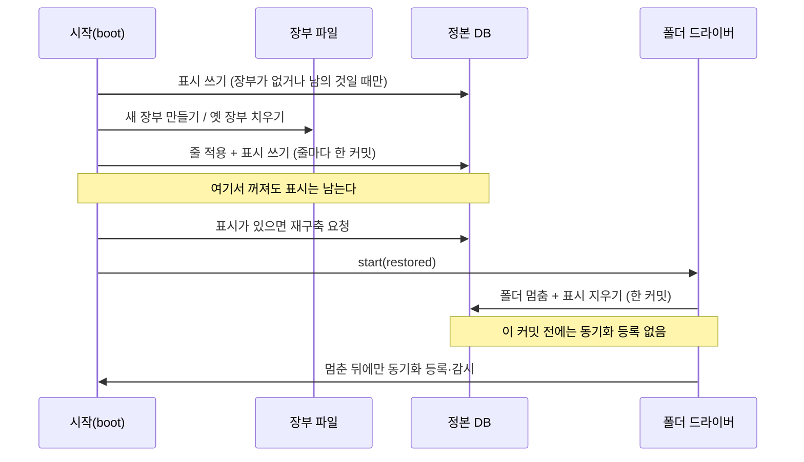

# 스펙: 남은 결함 묶음(RDF) — 장부 재적용 뒤 꺼지면 폴더 멈춤이 사라지는 틈

- 날짜: 2026-11-24 / 상태: 확정(잠정 결정 D1~D5 포함)
- 관련: 이슈 #270(H01 후속 5번 줄), #209, #247, #302, #232. [H01F spec](2026-11-24-H01F-followups.md)(5번 줄을 "보류"로 넘김), [I02 spec](2026-11-22-I02-local-file-import.md)(I02B-R34)
- 번호: 요구사항 `RDF-R<n>`, 완료 기준 `RDF-C<n>`, 결정 `RDF-D<n>`, 작업 `RDF-T<n>`. 마이그레이션은 없다.

| 말 | 뜻 |
|---|---|
| 장부 | 삭제를 적어 두는 파일(tombstone ledger). 정본 DB 옆에 있고 백업에 들지 않는다 |
| 재적용 | 시작할 때 정본이 아직 보지 못한 장부 줄을 정본에 다시 적용하는 일(`reapplyAtStart`) |
| 폴더 멈춤 | 복원된 정본으로 보이는 시작에서 읽는 폴더를 모두 `paused`(사유 `restored`)로 두는 일(I02B-R34). 사용자가 다시 켜야 읽는다 |
| 멈춤 표시 | 이 spec이 더하는 설정 행 하나. "이 정본은 복원본으로 보였고 폴더 멈춤이 아직 끝나지 않았다"를 뜻한다 |

## 배경

여러 후속 이슈에 흩어져 남은 줄 가운데 앞선 묶음들이 분류하지 않았거나 "보류"로 넘긴 다섯 갈래를 지금 코드(`origin/main` abc5bcb9)와 한 줄씩 대조했다. **결함으로 확인된 것은 하나**(#270의 5번 줄)이고, 나머지는 결함이 아니거나 결정·시험 보강·측정 항목이다.

### 고치는 한 건이 실제로 무엇을 깨는가

복원된 옛 정본에는 사용자가 그 뒤에 승인을 철회한 폴더가 `active`로 돌아와 있다(장부는 원본만 알고 폴더 위치는 모른다). 그래서 시작은 "복원본으로 보이면" 읽는 폴더를 모두 멈추고 사용자에게 다시 묻는다. 복원본으로 보는 근거는 그 시작의 재적용 보고뿐이다(`needsRebuild`: 적용한 줄이 있거나, 장부가 없었거나, 남의 장부를 옆으로 치웠을 때).

그런데 그 근거는 메모리에만 있고, 근거를 만든 변경은 이미 디스크에 굳어 있다.

- 재적용은 줄마다 따로 커밋한다(`knowledge-engine/src/ledger-reapply.ts:136`). 폴더 멈춤은 그보다 한참 뒤, 기다림(`await`)을 여러 번 지난 `driver.start`에서 한다(`backend/src/boot.ts:319` → `:480`).
- 그 사이에 프로세스가 꺼지면 다음 시작의 재적용은 0건이라 `needsRebuild`가 거짓이고, 폴더는 멈추지 않는다(`backend/src/local-files-driver.ts:124`). 같은 시작이 동기화를 등록하고 감시를 건다(`:131`·`:132`).
- 결과: **철회한 폴더를 묻지 않고 다시 읽는다.** 이미 지운 파일은 tombstone이 막지만, 그 폴더에 새로 생긴 파일은 막을 것이 없다(코드 읽기로 내린 판단. 아래 미검증 범위).
- 같은 틈에서 투영(검색 색인) 강제 재구축 요청도 사라진다. 요청은 재적용이 다 끝난 뒤 따로 쓴다(`backend/src/ledger-boot.ts:175`).
- 장부가 없었거나 치워진 경우도 같다. 새 장부 파일은 정본을 열 때 만들어지므로(`storage/src/tombstone-ledger.ts:470`·`:476`) 다음 시작에는 "없었다"는 사실이 남지 않는다.

앱 안의 복원(H01)은 이 틈이 없다. 마무리 커밋이 폴더 멈춤을 함께 한다(`backend/src/restore-boot.ts:345`). 남은 것은 정본 파일을 손이나 OS 백업으로 되돌린 경우와, 재적용이 있었던 모든 시작이다.

### 줄별 분류

| 줄 | 분류 | 이 spec | 지금 코드에서 확인한 것 |
|---|---|---|---|
| #270-5 장부 재적용 커밋과 폴더 멈춤 사이의 틈 | **결함(데이터 보호)** | R1~R3 | 위 설명. `boot.ts:319`·`:480`, `ledger-reapply.ts:136`, `local-files-driver.ts:124` |
| #209 취소 자리 ②, 나누기·정리·문서 삭제 판정 자리의 전용 시험 없음 | 시험 보강 | — | 자리는 있다(`storage/src/semantic-user.ts:366`·`:428`, `knowledge-engine/src/canonical-kinds.ts:1141`, `storage/src/analytical-gate.ts:309`). 허용·차단 가드가 아니라 상태 판정이다 |
| #209 나누기 상실의 근거가 작업 자신의 원본 ID | 결함 아님(spec대로) | — | `analytical-gate.ts:309`가 작업의 원본을 근거로 적는다. S03-R16의 표가 ④의 근거를 "그 검사 작업의 표 원본과 현재 version"으로 정했다(S03 spec 293행) |
| #209 분석용 종류의 유형 정의에 대한 이의가 관문을 지나지 않음 | 결함 아님 | — | 유형 정의에는 이의 자체가 없다. `dispute`는 상태와 무관하게 `invalid-transition`으로 거절된다(`storage/src/ontology.ts:771`) |
| #209 기각된 Dataset 항목도 묶인 것으로 셈 | 결정 필요 | — | 사실이다: `bound()`는 표 묶음과 tombstone만 보고 항목 상태를 보지 않는다(`analytical-gate.ts:97`). 다만 S03-R14의 `no-dataset` 정의(S03 spec 278행)가 항목 상태를 말하지 않아 지금 동작이 spec과 어긋나지 않는다. 길을 끊는 사용자 조치는 관계의 기각이다(`:26`·`:62`) |
| #209 추출이 길을 끊는 경우의 판정 자리 | 결함 아님(확인 끝) | — | 추출이 쓰는 전이는 `created`·`evidenceReturned`·`explicitEvidence`뿐이라 관계를 물리거나 기각하지 않는다(`knowledge-engine/src/extraction.ts:821`~`:848`). 새 version이 물린 길은 자리 ③이 본다(`:948`) |
| #209 검토 지적: C3의 자동 승격 → `candidate` 갈래 시험 없음 | 시험 보강 | — | 사용자 승인 갈래만 시험이 있다(`storage/src/analytical-gate.test.ts:187`·`:212`) |
| #209 검토 지적: 결정 36 머리말 문장 부정확 | 문구 | — | S03 spec의 문장 |
| #209 검토 지적: 거부 경로의 행별 `registry.visible` | 측정 먼저 | — | 성능 지적. 잰 수치가 없다 |
| #247 합치기의 `scope-refused`가 가려진 구성원을 드러냄 | 배포처 정책에서만 도달(보류) | — | `scope-refused`는 `combinable`이 거짓일 때만 나온다(`storage/src/entity-decisions.ts:151`). 공용 정책은 늘 참이다(`storage/src/scope-policy.ts:43`, 고르는 자리 `backend/src/scope-policy.ts:38`). 공용 제품에서는 이 답이 나올 수 없다 |
| #302 F2 `vectorIds`가 회차 사이에 `signal.aborted`를 보지 않음 | 결함 아님(한도 있는 낭비) | — | 중단 뒤 더 도는 것은 로컬 색인 검색 최대 3회다(`knowledge-engine/src/retrieval/strategies.ts:240`·`:279`). 밖으로 나가는 호출(`embed`)은 신호를 받는다(`:275`). 결과·보안·데이터에 영향이 없다 |
| #232 U4 읽지 않은 활성 Insight를 한도 없이 읽음 | 측정 먼저 | — | 읽는 것은 Insight마다 짧은 열 네 개이고(`storage/src/insight-interpretation.ts:92`), 설정이 꺼져 있으면 읽지 않으며(`:89`), 넣는 작업 수는 한도가 있다(`:102`) |

## 목표

1. 복원본으로 보인 정본은, 그 시작이 어디서 꺼지든, 폴더 멈춤이 끝나기 전에는 폴더를 읽지 않는다.
2. 같은 경우에 투영 강제 재구축 요청도 잃지 않는다.

## 비목표

- **마이그레이션.** 없다. 설정 행 하나를 쓰고 지울 뿐이고, 행이 없는 기존 정본은 "표시 없음"이다.
- **`boot.ts` 고치기.** 시작 순서와 `driver.start`의 인자는 그대로 둔다(D2).
- **재적용을 한 트랜잭션으로 묶기.** 줄마다 커밋하는 지금 구조("실패한 줄에서 멈추고 앞 줄은 남는다")를 바꾸지 않는다.
- **꺼진 시작의 보고·이력 복원.** 꺼진 시작이 적용한 줄 수는 상태 화면의 이력(`tombstone-ledger.history`)에 더해지지 않은 채로 둔다. 알림용 숫자이고 보호와 무관하다.
- **위 표에서 결함이 아닌 줄 전부.** #209의 Dataset 항목 상태, 합치기의 `scope-refused`, `vectorIds`의 중단, Insight 읽기 한도는 이슈에 둔다.
- 다른 세션이 쥔 파일(`read-gate.ts`, `explore-read.ts`, `semantic-api*`, `system-measure*`, `tooling/eval`, PR #313의 시험 파일들, `apps/web`)은 건드리지 않는다.

## 요구사항

- **RDF-R1 재적용한 줄은 멈춤 표시와 한 커밋이다.** *(변이 확인 대상)* 재적용이 줄 하나를 적용하면 그 줄의 트랜잭션 안에서 멈춤 표시를 쓴다. 미뤄 둔 줄(적용하지 못한 줄)은 쓰지 않는다 — 지금의 `needsRebuild`가 세는 것과 같다.
- **RDF-R2 장부를 새로 만들거나 치우기 전에 멈춤 표시를 쓴다.** *(변이 확인 대상)* 자료가 있는 정본 옆에 장부가 없거나 남의 장부·머리말이 깨진 장부가 있으면, 새 장부 파일을 만들거나 옛 파일의 이름을 바꾸기 **전에** 멈춤 표시를 쓴다. 자료가 없는 새 설치에서는 쓰지 않는다.
- **RDF-R3 폴더 멈춤이 표시를 읽고, 같은 커밋에서 지운다.** *(읽기: 변이 확인 대상)* `driver.start`는 인자가 참이거나 멈춤 표시가 있으면 읽는 폴더를 모두 `paused`·`restored`로 두고, **같은 트랜잭션에서** 표시를 지운다. 표시가 남아 있는 동안에는 어떤 동기화도 등록되지 않는다(지금 순서 그대로: 멈춤이 등록보다 먼저다). 표시가 지워진 뒤의 시작은 사용자가 다시 켠 폴더를 멈추지 않는다.
- **RDF-R4 표시가 있으면 재구축을 다시 요청한다.** `reapplyAtStart`는 보고가 그렇다고 하거나 멈춤 표시가 있으면 두 투영의 재구축을 요청한다. 요청은 이미 열린 작업이 있으면 더하지 않으므로(`backend/src/projection-jobs.ts:185`) 되풀이해도 하나다.

## 인터페이스 / 설계 개요

멈춤 표시는 설정 표의 행 `tombstone-ledger.halt-pending`(값 `1`)이다. 쓰는 자리 둘, 읽는 자리 둘, 지우는 자리 하나다. 이름과 쓰기·읽기·지우기 함수는 `backend/src/ledger-boot.ts`에 둔다.

| 자리 | 파일 | 바꾸는 것 |
|---|---|---|
| 쓰기 ① | `knowledge-engine/src/ledger-reapply.ts` | `ReapplyOptions`에 `onApplied?(tx)`. `applyLine`이 "적용함"으로 끝나는 트랜잭션 안에서 부른다. `reapplyAtStart`가 표시 쓰기를 넘긴다 |
| 쓰기 ② | `storage/src/tombstone-ledger.ts` | `OpenLedgerOptions`에 `beforeReplace?()`. `missing`이 참인 새로 만들기와 옆으로 치우기 직전에 부른다. `attachDirectoryLedger`가 표시 쓰기를 넘긴다 |
| 읽기 ① | `backend/src/ledger-boot.ts` | `reapplyAtStart`의 재구축 조건에 "표시 있음"을 더한다 |
| 읽기 ②·지우기 | `backend/src/local-files-driver.ts` | `start(restored)`가 `restored || 표시 있음`으로 판정하고, 멈춤과 표시 지우기를 `db.transaction` 하나로 묶는다 |

`boot.ts`는 지금처럼 `driver.start(needsRebuild(reapplied))`를 부른다. 인자가 거짓이어도 드라이버가 표시를 직접 읽으므로 꺼졌던 시작의 멈춤이 이어진다.

## 완료 기준 (테스트 가능한 형태)

| 기준 | 문장 | 증명 테스트 |
|---|---|---|
| RDF-C1 | 읽는 폴더 하나와 아직 적용되지 않은 장부 줄 하나가 있는 정본에서 `reapplyAtStart`를 부른 뒤 `driver.start`를 부르지 않고(꺼짐을 흉내 냄), 첫 호출이 넣은 재구축 작업 행을 지우고, 다시 `reapplyAtStart`를 부르면 적용 0건인데 두 투영의 재구축 작업이 열려 있다. 이어서 `driver.start(needsRebuild(둘째 보고))`를 부르면 그 폴더가 `paused`·`restored`이고 동기화가 등록되지 않으며 멈춤 표시 행이 없다. 사용자가 폴더를 다시 켠 뒤의 `driver.start(false)`는 그 폴더를 멈추지 않고 동기화를 등록한다(R1, R3, R4) | `backend/src/ledger-halt.test.ts`(새 파일) |
| RDF-C2 | 자료와 읽는 폴더가 있는 정본 옆에 장부 파일이 없을 때 `attachDirectoryLedger`까지만 돌고 꺼진 뒤, 정본을 다시 열어 `attachDirectoryLedger`·`reapplyAtStart`(이번 보고는 `missing`이 거짓)·`driver.start(needsRebuild(보고))`를 부르면 그 폴더가 `paused`·`restored`다. 자료가 없는 새 정본에서는 같은 순서 뒤에 멈춤 표시 행이 없다(R2) | `backend/src/ledger-halt.test.ts` |

경계값·조합의 전수 시험은 하지 않는다(남의 장부를 치우는 갈래는 장부가 없는 갈래와 같은 호출 자리라 C2 하나로 대표한다). **변이 확인**(지우면 해당 기준이 빨개져야 한다)은 폴더 읽기를 막는 세 줄에만 한다: R1의 표시 쓰기(`reapplyAtStart`가 `onApplied`를 넘기는 줄 → C1), R3의 표시 읽기(드라이버의 `|| 표시 있음` → C1), R2의 `beforeReplace` 호출(→ C2). 기존 시험 `ledger.boot-reconcile.test.ts`("둘째 시작은 재구축을 등록하지 않는다" 포함)와 `local-files-driver.test.ts`는 고치지 않고 그대로 통과해야 한다.

## 잠정 결정

바꾸려면 적힌 자리 하나를 고치면 된다.

- **RDF-D1 사실을 설정 행으로 남긴다(마이그레이션 없음).** 재적용 전체를 한 트랜잭션으로 묶는 길은 줄마다 커밋하는 구조를 바꿔야 하고, 폴더 멈춤을 재적용 안으로 옮기는 길은 장부가 없던 경우를 덮지 못한다. 설정 행은 두 경우를 한 장치로 덮는다. 전용 테이블이나 열로 바꾸려면 `ledger-boot.ts`의 세 함수만 고친다.
- **RDF-D2 드라이버가 표시를 직접 읽고 `boot.ts`는 그대로 둔다.** 멈춤과 표시 지우기가 한 커밋이어야 하므로 지우는 쪽이 읽는 쪽이어야 한다. `start`의 인자는 남긴다(인자만으로 부르는 기존 시험과 호출이 그대로 뜻을 갖는다). 인자를 없애려면 `boot.ts:480`과 드라이버 시험을 함께 고친다.
- **RDF-D3 표시는 "적용한 줄이 있음"에만 쓴다.** 미뤄 둔 줄, 잘린 끝줄, 읽지 못한 줄은 지금도 멈춤을 부르지 않는다. 넓히려면 `onApplied`를 부르는 조건을 고친다.
- **RDF-D4 장부가 없던 경우는 파일을 만들기 전에 표시를 쓴다.** 만든 뒤에 쓰면 그 두 줄 사이에 꺼질 때 같은 틈이 남는다. 먼저 쓰고 파일 만들기가 실패하면 표시만 남는데, 그때는 다음 시작이 폴더를 한 번 멈출 뿐이다(안전한 쪽).
- **RDF-D5 결함이 아닌 줄은 이슈에 분류만 적는다.** #209의 "기각된 Dataset 항목"은 S03-R14의 정의를 바꾸는 결정이라 이 묶음이 정하지 않는다. 정하려면 S03 spec의 `no-dataset` 행에 항목 상태를 적고 `analytical-gate.ts`의 `bound()`에 조건 한 줄을 더한다.

## 미검증 범위

- **시험을 돌리지 않았다.** 이 문서는 코드 읽기로 쓴 초안이다. 완료 기준의 시험은 아직 없다.
- **"새 파일은 읽힌다"는 판단.** 철회한 폴더의 이미 지운 파일은 tombstone이 막는다고 I02B-R34가 적고 있고, 그 폴더에 새로 생긴 파일이 읽힌다는 것은 tombstone이 원본마다 있다는 구조에서 내린 추론이다. 실행해 보지 않았다.
- **전원 차단.** 표시 쓰기는 SQLite 커밋이고 장부 만들기는 파일 연산이다. 프로세스가 죽는 경우에는 순서가 지켜지지만, 전원이 나갔을 때 정본의 마지막 커밋이 디스크에 남는지는 SQLite 동기화 설정에 달려 있고 확인하지 않았다.
- **Windows·Electron 실행.** 실제 프로세스 강제 종료로는 재현하지 않는다(함수 단위 시험).
- **#209의 두 줄.** "유형 정의에 대한 이의"는 검토자가 뜻한 경로를 특정하지 못했다(이의가 거절되는 것까지만 확인). "나누기 상실의 근거"가 이력 읽기에서 가려지는지는 읽지 않았다(공용 정책에서는 가릴 범위가 없다).
- **#302 F2.** `vector` 전략이 기본으로 켜져 있는지는 다시 확인하지 않았다. 켜져 있어도 판단은 같다(최대 3회, 로컬).

## 작업 분해

PR 하나, 한 worktree에서 한다. 자세한 설명은 작업 폴더의 설계 보고에 있다.

| 작업 | 산출물 | 기준 | 선행 | 건드리는 파일 | 검증 증거 |
|---|---|---|---|---|---|
| RDF-T1 | 멈춤 표시: 쓰기 둘, 읽기 둘, 지우기 하나와 그 시험 | C1, C2 | 없음 | `backend/src/ledger-boot.ts`, `backend/src/local-files-driver.ts`, `knowledge-engine/src/ledger-reapply.ts`, `storage/src/tombstone-ledger.ts`, 새 파일 `backend/src/ledger-halt.test.ts` | 새 시험과 기존 `ledger.boot-reconcile.test.ts`·`local-files-driver.test.ts`·`restore-ledger.test.ts`의 통과 출력, 변이 셋의 빨간 출력 |
| RDF-T2 | 문서: I02B-R34에 이 spec을 가리키는 한 줄, `docs/README.md` 색인 한 줄, 이슈에 분류 적기 | — | T1 | `docs/specs/2026-11-22-I02-local-file-import.md`(한 줄 더하기), `docs/README.md`(한 줄 더하기) | diff |

## 변경 이력

| 날짜 | 변경 | 대상 | 사유 |
|---|---|---|---|
| 2026-11-24 | 처음 씀(초안) | 전체 | #270의 5번 줄과 #209·#247·#302·#232의 남은 줄을 코드와 대조해 결함 한 건만 정함 |
