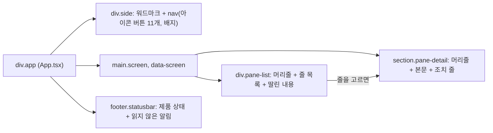

# 스펙: 화면 모양 바꾸기 — AB "밝은 3단" (UI01)

- 날짜: 2026-11-24 / 상태: 구현 완료, 독립 리뷰 대기(개정 — 1차 구현은 `6e723cfd`, 사용자 반려 뒤 다시 씀. 잠정 결정 D1~D14 포함)
- 관련: 이슈 #281(채택 결정과 제약), #290(새 기능 후보 — 범위 밖), #268·#283(탐색 후속 — 같은 때 진행 중). 기준 목업: 브랜치 `docs/ui-direction-options`의 `docs/design/ui-options/ab-light-panes/`(`9d163a7`)의 `home.png`·`home.html`·`style.css`
- 번호: 요구사항 `UI01-R<n>`, 완료 기준 `UI01-C<n>`, 결정 `UI01-D<n>`, 작업 `UI01-T<n>`

## 배경

사용자가 목업 열두 가지 가운데 AB안(B의 3단 배치 + A의 따뜻한 밝은 톤, 단축키 표시 없음)을 골랐다. 1차 구현은 "요소를 옮기지 않고 감싸개와 CSS만"이라는 조건으로 틀·토큰·글꼴을 입혔는데, 결과가 목업과 달라 사용자가 반려했다(2026-11-24). **목업의 구성을 그대로 쓰고, 그러기 위해 화면의 DOM을 다시 짜는 것을 허용한다.** 기능·API·저장 구조와 제품이 가진 데이터는 늘리지 않는다.

1차 구현과 목업의 차이: 메뉴 아이콘과 알림 배지, 칸 머리줄(제목·건수·전환, 상세의 "1 / 5"와 조치), 한 장짜리 큰 카드 대신 짧은 목록 줄(제목·보조 줄, 고른 줄의 왼쪽 강조 막대), 상세 칸의 구성(큰 제목 → 속성 표 → 본문 → 근거 인용과 출처 줄 → 아래에 붙은 조치 줄), 상태 줄의 제품 상태.

지금 코드에서 확인한 것:

- 메뉴는 **열한 개**다(X02B가 "유형 정의"를 더했다).
- Insight 응답(`InsightSummarySchema`)에는 유형, 추론 표지, 요약 문장, 근거 수, 사실 줄, 판단 이유, 순위 값이 있고 **심각도·상태·시각은 없다.** 알림 줄(`NotificationLineSchema`)에는 `createdAt`이 있다. 근거 줄에는 인용, 원본 제목, version, 위치가 있고 **수집기 종류·작성자·날짜는 없다.**
- `GET /api/status`가 백엔드·Provider·Embedding(로컬 계산/외부 전송) 상태를 준다. **마지막 수집 시각은 어느 응답에도 없다.**
- CSP는 셸이 붙인다(`style-src 'self'`, `font-src 'self'`, `img-src 'self' data:`). 웹 단위 시험에는 DOM이 없다. E2E는 역할·이름·문구로 찾고, 화면 전체에서 `status`·`alert`·`img`를 하나로 찾는 시험이 있다.

## 목표

1. 홈이 `home.png`와 같은 구성으로 보인다: 아이콘 메뉴 · 머리줄 있는 목록 칸(짧은 줄, 고른 줄 강조) · 머리줄·본문·아래 조치 줄이 있는 상세 칸 · 제품 상태를 보이는 상태 줄.
2. 알림·위키·점검이 같은 줄·머리줄·상세 구성을 쓰고, 원본·활동·설정은 머리줄과 같은 톤의 표·양식을 쓴다.
3. 제품에 있던 기능은 모두 그대로 쓸 수 있고(자리만 옮긴다), 키보드 조작과 접근성 이름이 나빠지지 않는다.
4. Pretendard가 제품과 함께 들어가고 셸의 CSP 아래에서 적용된다(1차 구현 유지).

## 비목표

- **새 기능과 새 데이터**(#290). 아래 "목업에 있으나 뺀 것".
- **#268이 쥔 파일을 고치는 것.** "제외 파일"은 한 줄도 바꾸지 않는다. 질문·탐색·지식 검토·유형 정의는 틀과 기본 요소 스타일, 머리줄만 받고 목업 구성은 #268 머지 뒤의 후속 작업이다(`ask.png`는 그때).
- **어두운 테마, 글자 크기 설정, 메뉴 묶기.**
- **`apps/desktop/**`, `package.json`, `pnpm-lock.yaml` 변경.** 창 기본 크기(1100×760)도 그대로다.
- **Windows 11 렌더링, 배율 125·150%, 설치본 폴더의 글꼴 파일 검사.** 미검증으로 남긴다.

### 제외 파일 (#268, 브랜치 `fix/x02-followups`의 spec X02F와 변경 목록에서 확인)

`apps/web/src/`의 `explore.tsx`, `explore.test.tsx`, `explore-text.ts`, `entity-curation.tsx`, `entity-curation.test.tsx`, `entity-text.ts`, `neighbour-graph.tsx`, `neighbour-graph.test.tsx`, `semantic-review.tsx`, `semantic-review.test.tsx`, `semantic-text.ts`, `ontology.tsx`, `ontology.test.tsx`, `ontology-text.ts`, `ask.tsx`, `ask.test.tsx`, `ask-text.ts`, `row-detail.tsx`, `row-detail.test.tsx`, `latest.ts`, `latest.test.ts`와 `apps/web/e2e/`의 `explore.e2e.ts`, `explore-curation.e2e.ts`, `ask.e2e.ts`.

### 목업에 있으나 뺀 것 (제품에 데이터나 동작이 없음 — #290)

| 목업 요소 | 뺀 이유 |
|---|---|
| 심각도(높음·중간·낮음) 점과 단어, 속성 표의 "심각도" | Insight에 심각도 값이 없다. 순위 값에서 지어내지 않는다 |
| 메뉴의 검색 칸 | 전체 검색 기능이 없다(원본 화면의 원본 검색뿐) |
| 목록 머리줄의 거르기("높음", "검토 전") | 뒤에서 받치는 동작이 없다 |
| 홈 줄의 시각, 속성 표의 "관측 시각"·"상태(검토 전)" | Insight 응답에 시각·상태가 없다(알림 줄에는 시각이 있어 알림에서는 보인다) |
| 근거 출처 줄의 수집기 종류·작성자·날짜, 인용 안의 노란 강조 | 근거 줄에 그 값이 없다. 출처 줄은 "원본 제목 · version N"이다. 노란 강조는 지금처럼 원본 보기 본문에만 있다 |
| 조치 줄의 "탐색에서 보기" | Insight에서 항목으로 가는 번호가 응답에 없다 |
| 상태 줄의 "마지막 수집", "외부 전송 꺼짐", 화면별 건수 | 수집 시각이 없고, "꺼짐"은 여러 설정에서 추측해야 하는 말이다. 대신 `status`가 주는 상태를 그 문구 그대로 보인다 |
| 이전 질문 목록 | 질문 기록이 없다(질문 화면은 이번 범위도 아니다) |

## 요구사항

- **UI01-R1 스타일은 파일로만.** 모든 스타일은 `apps/web/src/styles/`의 스타일시트와 기존 `screens.css`에 있고 `main.tsx`가 불러온다. 화면 소스에 `style` 속성과 `<style>`이 없고, 스타일시트가 가리키는 자원은 같은 출처의 글꼴 파일 하나뿐이다. 아이콘은 화면 소스 안의 `<svg aria-hidden="true">`다(``를 쓰지 않는다).
- **UI01-R2 디자인 토큰.** 색·글자 크기·간격·모서리·선을 `tokens.css`의 CSS 변수로 정하고, 다른 스타일시트는 색과 글자 크기를 변수로만 쓴다. 본문 글자는 15~17px, 보조 정보만 13px다. 본문 글자색과 바탕의 명암비는 7:1 이상, 그 밖의 글자·강조색 조합은 4.5:1 이상이다.
- **UI01-R3 틀.** 왼쪽 메뉴에 열한 화면이 지금 순서·이름으로 있고 화면마다 아이콘이 붙는다. 읽지 않은 알림 수는 알림 메뉴 오른쪽의 배지다. 아래 상태 줄은 왼쪽에 `status`의 백엔드·Provider·Embedding 상태(기존 문구), 오른쪽에 읽지 않은 알림 수를 보인다. `status`를 읽지 못하면 왼쪽을 비운다.
- **UI01-R4 글꼴.** Pretendard 가변 글꼴 파일(woff2)을 고치지 않은 원본 그대로 `apps/web/public/fonts/`에 두고, 같은 폴더에 OFL 1.1 전문(`OFL.txt`)과 출처·판·해시·저작권 줄(`NOTICE.txt`)을 둔다. 대체는 `"Malgun Gothic", sans-serif`다.
- **UI01-R5 목록 칸.** 홈·알림·위키·점검은 목록 칸과 상세 칸이 늘 나란히 있다(960px보다 좁으면 위아래). 목록 칸은 머리줄(제목 · 건수 · 그 화면에 원래 있던 전환이나 조치)과 줄 목록이다. 줄은 제목과 보조 줄 하나로 짧고, 줄 전체가 버튼 하나다. 고른 줄은 `aria-current="true"`이고 왼쪽 강조 막대와 흰 바탕으로 보인다.
- **UI01-R6 상세 칸.** 머리줄(종류 이름 · "n / N" 위치 · 조치 하나), 스크롤하는 본문(큰 제목 → 속성 표 → 본문 절 → 근거 인용과 출처 줄 → 원본 보기), 칸 아래에 붙은 조치 줄(주 조치 하나는 채운 버튼)로 이뤄진다. 고른 것이 없으면 본문 자리에 안내 한 줄만 있다.
- **UI01-R7 있던 기능은 모두 남는다.** 자리는 "제품에만 있는 것의 자리" 표를 따른다. 버튼의 접근성 이름은 그대로이고(줄 버튼만 아래 D11), 근거를 열면 "근거" 제목으로, 원본을 열면 "원본 보기" 제목으로 초점이 가는 것도 그대로다.
- **UI01-R8 넓은 화면.** 원본·활동·설정과 제외 화면 넷은 머리줄(화면 이름)이 있는 한 칸이다. 원본·활동·설정의 절은 흰 바탕의 묶음으로 나뉘고 표는 목업 톤(머리 행, 가는 줄)이다.
- **UI01-R9 색만으로 뜻을 전하지 않는다.** 색 점은 단어 옆에만 붙는다(점검의 발견 상태, 상태 줄).
- **UI01-R10 시험은 지킨 동작을 계속 지킨다.** 옛 구조를 붙잡던 단언은 새 구조에 맞게 고칠 수 있지만, 그 단언이 지키던 동작(이스케이프, 추론 표지, 근거 열기와 초점, 조치의 결과 등)을 보는 단언이 같은 시험 안에 남아야 한다. 바뀌는 단언은 PR 본문에 파일·이유와 함께 적는다.

## 인터페이스 / 설계 개요

### 목업 요소 → 제품 (홈)

| 목업 요소 | 제품에서 |
|---|---|
| 메뉴 아이콘, 고른 메뉴의 바탕 | 만든다. "유형 정의"는 목업에 없어 같은 선 굵기의 아이콘을 하나 더한다 |
| 알림 배지 | 만든다(`changes.unread`) |
| 목록 머리줄 "인사이트 5" | "Insight N"(목록의 줄 수) |
| 줄: 제목 | Insight의 요약 문장(두 줄에서 자름) |
| 줄: 보조 줄 "일정 위험 · 근거 3건 · 추론" | 유형 이름 · 근거 N건 · 추론 |
| 고른 줄의 강조 | 만든다. 근거를 연 Insight가 고른 줄이다 |
| 상세 머리줄 "인사이트 1 / 5", "검토 완료" | "Insight n / N", 기존 피드백 "확인 완료" |
| 큰 제목 | 요약 문장 |
| 속성 표 | 유형(유형 이름 · 추론), 근거(N건), 순위(기존 순위 문구 한 줄), 자동 알림 제외일 때 그 문구 |
| "요약" 절 | "사실 줄"(기존 목록)과 "확정 사실이 아닙니다" 문구 |
| "판단 근거" 절 | 기존 판단 이유 문구(`이유(코드 판정): …`) |
| "근거 N건" 인용과 출처 줄 | 인용 → "원본 제목 · version N" → 줄마다 "원본 보기"와 교정 버튼(확인 완료·잘못된 정보/관계) |
| 조치 줄 | 유용함(주 조치), 중요함, 관련 없음, 이미 알고 있음, 다시 알리지 않기 |
| 상태 줄 | 색 점 + 백엔드·Provider·Embedding 상태, 오른쪽에 읽지 않은 알림 수 |

### 제품에만 있는 것의 자리

| 있는 것 | 자리 |
|---|---|
| 원본 보기 본문, 같은 스레드, "폴더에서 보기" | 상세 본문의 근거 절 아래(원본을 열었을 때) |
| 최근 피드백 | 목록 칸의 줄 목록 아래 |
| Insight 유형 지원 상태(접힘), 상태 표, Embedding 모델 준비 | 목록 칸의 맨 아래, 이 순서 |
| 알림: 피드·요약·타임라인 전환 | 목록 머리줄의 전환 |
| 알림: 읽음·다시 알림·닫기 | 고른 알림의 조치 줄(주 조치는 "읽음"). 알림 줄의 보조 줄에 시각과 "읽지 않음" |
| 알림: 요약 내용, 알림 설정(접힘) | 목록 칸(지금 자리) |
| 위키: "다시 만들기" | 목록 머리줄의 조치. 종류 이름은 줄 묶음의 작은 제목 |
| 위키: 주장 숨기기·메모·링크·변경 이력 | 상세 본문(지금 순서), 메모 쓰기는 조치 줄 |
| 점검: 규칙별 건수와 설명 | 줄 묶음의 작은 제목 아래 |
| 점검: 받아들이기·닫기·다시 열기·관계 유형 고르기, "근거 보기 n" | 고른 발견의 조치 줄과 상세 본문 |

### 틀의 구조

- 두 칸은 `main` 안의 형제이고 격자로 놓는다(1차 구현의 `position: absolute` 방식은 버린다). 칸마다 따로 스크롤하고 머리줄과 조치 줄은 움직이지 않는다.
- 칸의 뼈대는 새 파일 `apps/web/src/panes.tsx`의 작은 컴포넌트가 맡는다: `PaneHead`(제목·건수·오른쪽 자리), `Row`(줄 버튼), `Props`(속성 표 `dl`), `ActionBar`. 상태와 요청은 갖지 않는다.
- Insight의 줄과 상세는 `evidence-view.tsx`의 `InsightRow`·`InsightDetail`이 그리고 홈과 알림이 함께 쓴다. 기존 `InsightSummary`(카드 한 장)는 없앤다.
- 화면마다 `h1`은 하나다. 홈은 목록 머리줄의 제목이 "Insight"이므로 `h1`("홈")을 화면에서만 숨긴다(읽기 도구에는 남는다).
- 아이콘은 새 파일 `apps/web/src/icons.tsx`(16px, 선만, `aria-hidden`).

### 스타일시트 (`main.tsx`가 이 순서로 불러옴)

| 파일 | 담는 것 | 1차 구현에서 |
|---|---|---|
| `styles/tokens.css` | `@font-face`, `:root`의 변수 | 유지, 변수 추가 |
| `styles/base.css` | 요소·역할 선택자만. 제외 화면이 이것으로 기본 모양을 받는다 | 유지, 표·양식 톤 보강 |
| `styles/shell.css` | `.app`, `.side`, `.wordmark`, `nav`와 아이콘·배지, `.screen`, `.pane-list`, `.pane-detail`, `.pane-wide`, `.statusbar`, 960px 분기 | 격자와 메뉴·상태 줄은 유지, 칸 규칙은 다시 씀 |
| `styles/components.css` | `.pane-head`, `.tabs`, `.rows`·`.row`, `.props`, `.sec`, `.quote`, `.actions`, `.btn-primary`, `.state`, `.group`(넓은 화면의 묶음), `.scroll-x`, `.sr-only` | `.cards`는 없애고 다시 씀 |
| `screens.css` | 지금 그대로 | 유지 |

### 토큰 (이름은 계약, 값은 목업의 것)

- 글꼴: `--font: "Pretendard Variable", "Malgun Gothic", sans-serif`
- 글자: `--fs-meta: 13px`, `--fs-sub: 15px`, `--fs-body: 16px`, `--fs-lead: 17px`, `--fs-h3: 18px`, `--fs-h2: 20px`, `--fs-h1: 24px`, `--lh: 1.6`
- 색: `--bg: #F6F5F2`, `--bg-side: #EFEDE8`, `--surface: #FFFFFF`, `--surface-quiet: #FBFAF8`, `--ink: #1B1F24`, `--ink-2: #454B54`, `--ink-meta: #5A616B`, `--line: #DAD7D0`, `--line-strong: #B9B5AC`, `--accent: #1E3A5F`, `--accent-quiet: #E9EEF4`, `--on-accent: #FFFFFF`, `--attn: #8F2F1F`, `--attn-bg: #FBEDE9`, `--warn: #7A5200`, `--warn-bg: #FBF3DD`, `--ok: #2B5B45`, `--none: #6B7079`, `--mark: #FBEFC2`
- 간격: `--sp-1: 4px`, `--sp-2: 8px`, `--sp-3: 12px`, `--sp-4: 16px`, `--sp-5: 24px`, `--sp-6: 32px`
- 모서리·선·크기: `--radius: 8px`, `--radius-sm: 6px`, `--border: 1px solid var(--line)`, `--control-h: 36px`, `--nav-w: 208px`, `--list-w: clamp(320px, 32vw, 408px)`, `--status-h: 30px`, 추가 `--pane-head-h: 48px`, `--row-accent-w: 3px`

### DOM 규칙

1. `<nav>`는 하나이고 버튼 열한 개가 그 직계 자식이다. 버튼 안은 아이콘(`svg aria-hidden`), 이름, 배지 순서다.
2. 틀과 칸의 뼈대는 `role="status"`, `role="alert"`, `aria-live`, ``를 더하지 않는다. 상태 줄은 역할 없는 `footer`다.
3. 목록과 `li` 사이에 감싸개를 넣지 않는다. 줄은 `li` 안의 버튼 하나다.
4. 고른 것을 나타내는 속성은 `aria-current="true"`다(`aria-selected`는 목록 역할이 따로 필요하다).
5. 새 상태는 "어느 줄을 골랐는가"뿐이다(알림·점검에 새로 생긴다. 홈과 위키는 이미 있다). 새 요청은 틀의 `status` 읽기와 D12의 첫 줄 열기뿐이다.

### 결정 (모두 잠정 — 바꾸는 방법 포함)

- **D1 글꼴은 저장소에 파일로 둔다.** npm 패키지 `pretendard`(1.3.9, OFL-1.1)는 풀면 97MB·1,826개 파일이고 `pnpm-lock.yaml`은 여러 세션이 함께 고친다. 가변 woff2 한 개만 두고 해시를 시험에 고정한다. 부분 집합을 직접 만들지 않는다. 바꾸려면: 의존성으로 넣고 빌드에서 복사.
- **D2 `public/` 폴더를 쓴다.** Vite가 빌드 폴더에 그대로 복사해 글꼴과 라이선스 전문이 설치본의 `web/fonts/`에 나란히 놓이고 `apps/desktop`은 고칠 것이 없다.
- **D3 상태 줄은 `status`의 문구를 그대로 쓴다**(`componentText`, `providerStatusText`, `embeddingText`). 틀이 `status`를 한 번 읽고 변경 번호가 바뀔 때 다시 읽는다. 목업의 "외부 전송 꺼짐" 같은 요약 문장은 만들지 않는다(틀리면 안전하다는 거짓 안내가 된다). 색 점은 백엔드가 준비됨이면 정상색, 아니면 주의색이다.
- **D4 심각도는 만들지 않는다.** 줄 맨 앞의 색 점 자리는 비운다. 점검의 발견 상태만 색 점 + 단어(열림·반복됨 → 주의, 닫음 → 없음, 받아들임·풀림 → 정상).
- **D5 메뉴 검색 칸과 목록 거르기는 넣지 않는다.** 알림의 보기 전환은 실제 동작이 있어 머리줄의 전환 자리에 둔다.
- **D6 칸은 형제 요소와 격자로 만든다.** 1차의 감싸개 + `position: absolute`는 "요소를 옮기지 않는다"는 조건 때문이었고 그 조건이 없어졌다.
- **D7 고른 것이 없을 때 상세 칸은 안내 한 줄**("왼쪽 목록에서 고르면 여기에 보입니다.")이다. 새 문구 하나다.
- **D8 3단이 되는 최소 너비는 960px.** 셸 기본 창(1100px)에서 3단이다.
- **D9 `screens.css`는 옮기지 않는다.**
- **D10 메뉴는 열한 개 그대로.**
- **D11 줄 버튼의 이름.** 홈·알림의 줄 버튼은 화면에서 숨긴 앞말 "근거 보기 (N): "과 보이는 제목·보조 줄로 이뤄진다. 기존 이름 "근거 보기 (N)"으로 시작하므로 읽기 도구 사용자와 기존 시험의 찾기가 그대로 통하고, 보이는 글자가 이름에 들어 있다. 위키의 줄은 지금처럼 페이지 제목이 이름이다. 점검의 줄은 발견의 제목이 이름이다.
- **D12 홈은 목록을 읽은 뒤 첫 Insight를 스스로 연다**(연 것이 없을 때 한 번, 초점은 옮기지 않는다). 목업처럼 처음부터 상세가 차 있게 하려는 것이고, 기존 근거 읽기를 한 번 더 부른다. 알림·위키·점검은 스스로 열지 않는다(알림은 열람이 읽음 처리와 얽히고, 위키·점검은 첫 줄이 대표가 아니다). 시험이나 사용에서 걸리면: 이 한 줄을 빼면 D7의 안내가 보인다. **구현 결과: 채택.** 근거 읽기(`insightEvidence`)의 핸들러는 읽기 관문(`gate.insightEvidence`)과 선호 가중치 읽기와 보기 변환뿐이고 저장소에 쓰는 문장, 본 것 표시, 순위·새로움 변경, 감사 기록, Provider 호출이 없다(`backend/src/server.ts`, `backend/src/read-gate.ts`, `storage/src/evidence-view.ts`). 초점은 옮기지 않으려고 `opens`를 올리지 않는 `insight-shown` 동작을 따로 두었고 사용자가 먼저 고른 것이 있으면 덮어쓰지 않는다. 홈의 E2E(`v02-flow`, `local-files` 포함)는 표의 단언 말고는 고칠 것이 없었다.
- **D13 Insight의 큰 제목과 줄 제목은 같은 요약 문장이다.** 짧은 제목 값이 따로 없다. 줄에서는 두 줄에서 자르고 상세에서는 전부 보인다.
- **D14 알림의 요약(digest) 내용은 목록 칸에 둔다.** 상세 칸은 Insight 하나의 자리다.

## 완료 기준 (테스트 가능한 형태)

| 기준 | 문장 | 증명 테스트 |
|---|---|---|
| UI01-C1 | 스타일시트를 읽으면: 위 토큰 이름이 모두 `tokens.css`에 있고, 쓰인 `var(--…)`는 모두 정의돼 있으며, `tokens.css` 밖에는 색 값과 `font-size`의 px 값이 없다. `url(`은 `/fonts/PretendardVariable.woff2` 하나뿐이고 `@import`가 없다. 시험이 아닌 `.tsx`에 `style=`·`<style`·`` 요소가 없다(R1·R3·R4·R8) | `apps/web/e2e/screens.e2e.ts`(기존 흐름에 단언) |
| UI01-C7 | 브라우저(1280px)에서 홈을 열면 첫 Insight가 열려 있고: 목록 칸과 상세 칸의 머리줄이 같은 높이(48px)·같은 위쪽 끝에 있으며 상세 칸이 목록 칸의 오른쪽이다. 고른 줄의 왼쪽 막대 색이 `--accent`이고 바탕이 `--surface`다. 상세 제목의 글자 크기가 24px다. 조치 줄의 아래 끝이 상세 칸의 아래 끝과 같고 본문을 끝까지 스크롤해도 그 자리다. 주 조치 버튼의 바탕이 `--accent`다(R5·R6) | `apps/web/e2e/evidence.e2e.ts`(기존 흐름에 단언) |
| UI01-C8 | 알림·위키·점검의 기존 흐름에서 줄을 고르면 그 줄이 `aria-current="true"`이고 상세 칸이 목록 칸의 오른쪽에 나오며, 그 화면의 조치(다시 알림, 주장 숨기기, 닫기)가 상세 칸에서 지금과 같은 결과를 낸다(R5·R6·R7) | `apps/web/e2e/notifications.e2e.ts`, `wiki.e2e.ts`, `lint.e2e.ts`(기존 흐름을 새 구조에 맞춤) |
| UI01-C9 | 단위 시험과 E2E 전체가 통과하고, 고친 단언마다 같은 시험 안에 그 동작을 보는 단언이 남아 있다(R7·R10) | 시험 전체(`pnpm test`, `pnpm e2e`). 고친 단언의 목록은 PR 본문 |

경계값·조합의 전수 시험과 변이 검사는 하지 않는다. 새 E2E 시험은 만들지 않고 기존 흐름에 단언을 더하거나 새 구조에 맞춘다.

## 미검증으로 넘기는 것

- Windows 11에서의 글꼴 렌더링과 `Malgun Gothic` 대체 모양.
- 배율 125·150%와 좁은 창에서의 배치(960px 분기는 시험하지 않는다).
- 설치본 폴더(`web/fonts/`)에 글꼴과 `OFL.txt`가 실제로 들어 있는지와 SBOM 항목. H02 세션이 `apps/desktop/artifact/`와 `build/sbom.ts`를 쥐고 있어 H02 머지 뒤 후속 이슈로 남긴다.
- 화면에 그려진 글자의 명암비(C2는 토큰 값의 계산이다).
- 목업과의 닮음은 C6~C8의 위치·크기·색 단언과 사람의 눈 확인(같은 창 크기의 화면 사진을 `home.png`와 나란히 보기)으로 본다. 화소 단위 비교는 하지 않는다(목업의 예시 데이터와 제품의 합성 데이터가 다르다).
- 제외 화면 넷의 목업 구성(`ask.png` 포함).

## 미해결 질문

없음. 잠정 결정 D1~D14와 "목업에 있으나 뺀 것"은 완료 보고에서 사용자에게 알린다.

## 변경 이력

| 날짜 | 변경 내용 | 대상 | 사유 |
|---|---|---|---|
| 2026-11-24 | 초안 작성 | 이 문서 | #281 AB안 채택에 따른 구현 기준 |
| 2026-11-24 | 구현 반영: 쓰는 곳이 없는 `.meta`·`.btn-primary` 삭제, 활동 표용 `.scroll-x`와 점검 `풀림` 상태 매핑 추가, D6가 Chromium에서 통과했음을 기록 | 스타일시트 표, 화면 대응, D4, D6 | 구현하며 확인한 차이를 같은 커밋에 반영 |
| 2026-11-24 | 개정 구현 반영: D12 채택(근거와 함께 기록), 상세 머리줄에 "확인 완료"를 따로 두지 않고 조치 줄의 한 묶음에 여섯 버튼, 스펙의 클래스 목록에 없던 `.meta`·`.plain-list`·`.link-list`·`.row-actions`·`.group-label`·`.hint` 추가 | 결정 D12, 스타일시트 | 구현하며 확인한 차이를 같은 커밋에 반영 |
| 2026-11-24 | 개정: DOM 재구성 허용. 줄·머리줄·상세 구성·조치 줄·아이콘·배지·상태 줄을 목업대로(R3·R5~R8·R10 새로 씀, 옛 R6 "기존 계약 유지" 폐기), "목업에 있으나 뺀 것"과 "제품에만 있는 것의 자리" 표 추가, D3·D5·D6·D7 바꿈, D11~D14 추가, C4~C9 다시 씀(옛 C8 "단언을 고치지 않는다" → C9 "지킨 동작을 계속 지킨다") | 배경, 목표, 비목표, 요구사항, 설계 개요, 완료 기준 | 사용자가 1차 구현(`6e723cfd`)을 목업과 다르다는 이유로 반려하고 목업 구성을 그대로 쓰라고 지시 |
