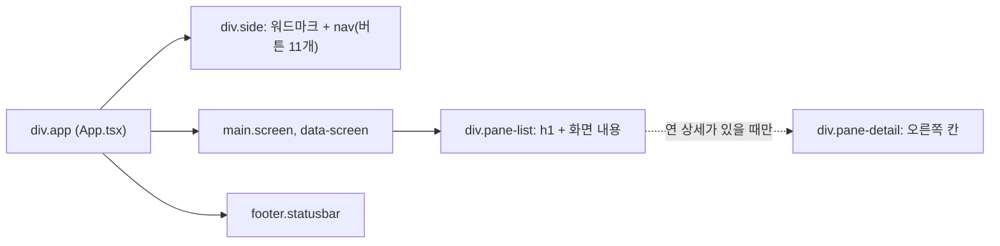

# 스펙: 화면 모양 바꾸기 — AB "밝은 3단" (UI01)

- 날짜: 2026-11-24 / 상태: 확정(잠정 결정 D1~D10 포함)
- 관련: 이슈 #281(채택 결정과 제약), #290(새 기능 후보 — 범위 밖), #268·#283(탐색 후속 — 같은 때 진행 중). 기준 목업: 브랜치 `docs/ui-direction-options`의 `docs/design/ui-options/ab-light-panes/`(`9d163a7`)
- 번호: 요구사항 `UI01-R<n>`, 완료 기준 `UI01-C<n>`, 결정 `UI01-D<n>`, 작업 `UI01-T<n>`

## 배경

지금 화면은 스타일이 거의 없다. 스타일시트는 `apps/web/src/screens.css` 하나(27줄, 원본 본문 줄바꿈과 강조 인용의 읽기 도우미 문구)뿐이고, `App.tsx`는 `<nav>`와 `<main>`을 위아래로 놓는다. 사용자가 목업 열두 가지 가운데 AB안(B의 3단 배치 + A의 따뜻한 밝은 톤, 단축키 표시 없음)을 골랐다.

지금 코드에서 확인한 것:

- 메뉴는 **열한 개**다(이슈는 열 개로 적었지만 X02B가 "유형 정의"를 더했다).
- 화면은 모두 위에서 아래로 흐르는 문서 한 장이다. "목록에서 고르면 옆에 상세"에 해당하는 것은 홈·알림의 근거와 원본 보기(`EvidencePanel`), 위키의 페이지(`PageView`), 점검의 원본 보기뿐이다.
- 목업에 있지만 제품에 없는 것: Insight의 심각도(높음·중간·낮음) 값, 이전 질문 목록, 메뉴의 검색 칸, 상태 줄의 "마지막 수집"·"외부 전송" 정보(홈 화면만 `status`를 읽는다).
- CSP는 셸(`apps/desktop/src/app-protocol.ts`)이 붙인다: `style-src 'self'`, `font-src 'self'`, `img-src 'self' data:`. 셸은 `.woff2`를 이미 `font/woff2`로 내준다. 설치본은 `vite build` 결과 폴더를 통째로 `web/`에 둔다(`apps/desktop/build/build.ts`).
- 웹 단위 시험에는 DOM이 없다(정적 마크업과 함수만 본다). E2E는 역할·이름·문구로 찾는다.

## 목표

1. 열한 화면이 같은 틀(왼쪽 메뉴 · 내용 · 아래 상태 줄) 안에서 같은 색·글꼴·간격으로 보인다.
2. 홈·알림·위키·점검에서 연 상세가 목록 오른쪽 칸에 나온다.
3. Pretendard가 제품과 함께 들어가고, 셸의 CSP 아래에서 실제로 적용된다.
4. 동작·API·저장 구조·화면 문구·접근성 이름은 그대로이고, 기존 시험은 고치지 않고 통과한다.

## 비목표

- **새 기능**(#290): Insight 심각도 값, 이전 질문 목록, 메뉴 검색, 메뉴 묶기, 상태 줄의 수집·전송 정보, 조치 버튼 재구성.
- **#268이 쥔 파일을 고치는 것.** 아래 "제외 파일"은 이 PR에서 한 줄도 바꾸지 않는다. 그 화면(질문·탐색·지식 검토·유형 정의)은 공용 틀과 기본 요소 스타일만 받고, 상세 칸 적용은 #268 머지 뒤의 후속 작업이다.
- **어두운 테마, 글자 크기 설정, 메뉴 아이콘.**
- **`apps/desktop/**` 변경.** 창 기본 크기(1100×760)도 그대로 둔다.
- **Windows 11 렌더링 확인, 배율 125·150% 확인, 설치본 폴더의 글꼴 파일 검사.** 미검증으로 남긴다(아래).
- **기존 시험의 정리·보강.**

### 제외 파일 (#268, 브랜치 `fix/x02-followups`의 spec X02F와 변경 목록에서 확인)

`apps/web/src/`의 `explore.tsx`, `explore.test.tsx`, `explore-text.ts`, `entity-curation.tsx`, `entity-curation.test.tsx`, `entity-text.ts`, `neighbour-graph.tsx`, `neighbour-graph.test.tsx`, `semantic-review.tsx`, `semantic-review.test.tsx`, `semantic-text.ts`, `ontology.tsx`, `ontology.test.tsx`, `ontology-text.ts`, `ask.tsx`, `ask.test.tsx`, `ask-text.ts`, `row-detail.tsx`, `row-detail.test.tsx`, `latest.ts`, `latest.test.ts`와 `apps/web/e2e/`의 `explore.e2e.ts`, `explore-curation.e2e.ts`, `ask.e2e.ts`.

## 요구사항

- **UI01-R1 스타일은 파일로만.** 모든 스타일은 `apps/web/src/styles/`의 스타일시트와 기존 `screens.css`에 있고 `main.tsx`가 불러온다. 화면 소스에 `style` 속성과 `<style>`이 없고, 스타일시트가 가리키는 자원은 같은 출처의 글꼴 파일 하나뿐이다.
- **UI01-R2 디자인 토큰.** 색·글자 크기·간격·모서리·선을 `tokens.css`의 CSS 변수로 정하고, 다른 스타일시트는 색과 글자 크기를 변수로만 쓴다. 본문 글자는 15~17px(기본 16px), 보조 정보만 13px다. 본문 글자색과 바탕의 명암비는 7:1 이상, 그 밖의 글자·강조색 조합은 4.5:1 이상이다.
- **UI01-R3 공용 틀.** 왼쪽에 메뉴(열한 화면 전부, 지금 순서·이름 그대로), 가운데에 내용, 아래에 상태 줄이 있다. 상태 줄은 앱이 이미 가진 값만 보인다: 지금 화면의 이름과, 읽지 않은 알림이 있을 때 그 수(D3).
- **UI01-R4 글꼴.** Pretendard 가변 글꼴 파일(woff2)을 고치지 않은 원본 그대로 `apps/web/public/fonts/`에 두고, 같은 폴더에 OFL 1.1 전문(`OFL.txt`)과 출처·판·해시·저작권 줄(`NOTICE.txt`)을 둔다. 글꼴이 없을 때의 대체는 `"Malgun Gothic", sans-serif`다.
- **UI01-R5 목록과 상세.** 홈·알림의 근거·원본 보기, 위키의 페이지, 점검의 원본 보기는 열렸을 때 목록 오른쪽 칸에 나온다. 연 것이 없으면 목록이 내용 칸 전체를 쓴다. 창 너비가 960px보다 좁으면 지금처럼 목록 아래에 이어진다. 원본·활동·설정은 넓은 한 칸이다.
- **UI01-R6 기존 계약 유지.** 역할·접근성 이름·문구·요소의 순서가 그대로다. 더할 수 있는 것은 역할과 이름이 없는 `div` 감싸개, `class`·`data-*` 속성, 꾸밈용 워드마크, 상태 줄(`footer`)뿐이다. 구체 규칙은 설계 개요의 "DOM 규칙".
- **UI01-R7 색만으로 뜻을 전하지 않는다.** 색 점은 이미 단어가 있는 상태 표시 옆에만 붙는다. 이 PR에서는 점검 화면의 발견 상태에 붙인다(D4).

## 인터페이스 / 설계 개요

### 화면 대응

| 화면 | 배치 | 목록 칸 | 상세 칸(열렸을 때) |
|---|---|---|---|
| 홈 | 목록+상세 | Insight 목록, 최근 피드백, 유형 지원 상태, 상태 표, 모델 준비 | 근거, 원본 보기(`EvidencePanel`) |
| 알림 | 목록+상세 | 보기 전환, 피드·요약·타임라인, 알림 설정 | 근거, 원본 보기(`EvidencePanel`). 요약 내용은 목록 칸에 그대로 |
| 위키 | 목록+상세 | 다시 만들기, 종류별 페이지, 붙을 곳 없는 메모 | 페이지(`PageView`) |
| 점검 | 목록+상세 | 규칙별 발견 | 원본 보기 |
| 원본 | 넓은 한 칸 | Connector 표, JSONL 가져오기, 검색, 저장된 원본 표 | — |
| 활동 | 넓은 한 칸 | 작업·주기·투영, 무효화 기록, Provider 호출 표(가로로 넘치면 칸 안에서 스크롤) | — |
| 설정 | 넓은 한 칸 | 표와 양식 묶음 | — |
| 질문, 탐색, 지식 검토, 유형 정의 | 한 칸(기본 스타일만) | 제외 파일이라 그대로 | 후속 작업 |

### 틀의 구조

- `App.tsx`가 `main` 안에 `div.pane-list`를 한 번 두고 모든 화면을 그 안에 그린다. 화면은 상세를 `div.pane-detail`로 감싸기만 한다(열렸을 때만 그린다).
- `.pane-detail`은 DOM에서는 목록 안 제자리에 있고, CSS가 `main`을 기준으로 오른쪽 칸에 놓는다(`position: absolute`). `main:has(.pane-detail)`일 때만 목록이 목록 너비로 줄어든다. 그래서 요소의 순서와 읽는 순서가 바뀌지 않는다. `main`과 `.pane-detail` 사이의 요소에는 `position`·`transform`을 주지 않는다.
- 두 칸은 따로 스크롤한다. 메뉴와 상태 줄은 움직이지 않는다.

### 스타일시트 (`main.tsx`가 이 순서로 불러옴)

| 파일 | 담는 것 |
|---|---|
| `styles/tokens.css` | `@font-face`, `:root`의 변수 |
| `styles/base.css` | 요소·역할 선택자만: 본문, 제목, 링크, 버튼, 입력, 표, `fieldset`, `details`, 인용, `mark`, `[role="alert"]`, `[role="status"]`, `[role="alertdialog"]`, `[aria-pressed]`, `:focus-visible`, `:disabled`. 제외 파일의 화면이 이것만으로 기본 모양을 받는다 |
| `styles/shell.css` | `.app`, `.side`, `.wordmark`, `nav`, `.screen`, `.pane-list`, `.pane-detail`, `.statusbar`, 960px 분기 |
| `styles/components.css` | 클래스가 필요한 조각: `.cards`(카드 목록), `.tabs`(보기 전환), `.actions`(버튼 줄), `.meta`(보조 글), `.state`와 `.state-attn`·`.state-warn`·`.state-ok`·`.state-none`(색 점 + 단어), `.btn-primary` |
| `screens.css` | 지금 그대로 |

### 토큰 (이름은 계약, 값은 목업의 것으로 시작)

- 글꼴: `--font: "Pretendard Variable", "Malgun Gothic", sans-serif`
- 글자: `--fs-meta: 13px`, `--fs-sub: 15px`, `--fs-body: 16px`, `--fs-lead: 17px`, `--fs-h3: 18px`, `--fs-h2: 20px`, `--fs-h1: 24px`, `--lh: 1.6`
- 색: `--bg: #F6F5F2`, `--bg-side: #EFEDE8`, `--surface: #FFFFFF`, `--surface-quiet: #FBFAF8`, `--ink: #1B1F24`, `--ink-2: #454B54`, `--ink-meta: #5A616B`, `--line: #DAD7D0`, `--line-strong: #B9B5AC`, `--accent: #1E3A5F`, `--accent-quiet: #E9EEF4`, `--on-accent: #FFFFFF`, `--attn: #8F2F1F`, `--attn-bg: #FBEDE9`, `--warn: #7A5200`, `--warn-bg: #FBF3DD`, `--ok: #2B5B45`, `--none: #6B7079`, `--mark: #FBEFC2`
- 간격: `--sp-1: 4px`, `--sp-2: 8px`, `--sp-3: 12px`, `--sp-4: 16px`, `--sp-5: 24px`, `--sp-6: 32px`
- 모서리·선·크기: `--radius: 8px`, `--radius-sm: 6px`, `--border: 1px solid var(--line)`, `--control-h: 36px`, `--nav-w: 208px`, `--list-w: clamp(320px, 32vw, 408px)`, `--status-h: 30px`

### DOM 규칙 (R6)

1. `<nav>`는 하나이고 그 안의 버튼은 `<button …>이름</button>` 그대로다(안에 아이콘·`span`을 넣지 않는다. 알림 수도 지금처럼 글자다).
2. `role="status"`, `role="alert"`, `aria-live`, ``, 새 제목(`h1`~`h6`), 새 `section`·이름 붙은 영역, 새 목록을 더하지 않는다(E2E가 화면 전체에서 `status`·`alert`·`img`를 하나로 찾는다).
3. 목록과 `li` 사이, 표와 행 사이에 감싸개를 넣지 않는다.
4. 단위 시험이 여는 태그를 글자 그대로 보는 요소(`li`, `td`, `h4`, `mark`, `label`, 메뉴 버튼의 내용)에는 속성을 더하지 않는다. `class`는 묶는 쪽(`ul`, `table`, `form`, `section`, `div`)에 단다.
5. `class`를 고르는 것 말고는 화면 코드에 새 상태·요청·분기를 넣지 않는다.

### 결정 (모두 잠정 — 바꾸는 방법 포함)

- **D1 글꼴은 저장소에 파일로 둔다.** npm 패키지 `pretendard`(1.3.9, OFL-1.1)는 풀면 97MB·1,826개 파일이고 `pnpm-lock.yaml`은 여러 세션이 함께 고치는 파일이다. 그 패키지에서 가변 woff2 한 개만 가져와 두고 해시를 시험에 고정한다. 부분 집합을 직접 만들지 않는다(가져온 문서에 어떤 글자가 올지 모르고, 고친 글꼴은 OFL의 이름 조건을 따로 확인해야 한다). 바꾸려면: 의존성으로 넣고 빌드에서 복사.
- **D2 `public/` 폴더를 쓴다.** Vite가 `public/`을 빌드 폴더에 그대로 복사하므로 글꼴과 라이선스 전문이 설치본의 `web/fonts/`에 나란히 놓이고 `apps/desktop`은 고칠 것이 없다. 스타일시트는 `/fonts/PretendardVariable.woff2`를 가리킨다.
- **D3 상태 줄은 화면 이름과 읽지 않은 알림 수만.** 문구는 `읽지 않은 알림 N건`. 목업의 "로컬 전용·외부 전송", "마지막 수집", 건수는 틀이 새로 읽어야 하는 값이라 뺐다(#290). 바꾸려면: `App.tsx`의 `footer` 한 곳.
- **D4 심각도 표시는 값이 없어 만들지 않는다.** 색 점 + 단어(`.state`)는 점검의 발견 상태에만 쓴다(열림·되풀이 → 주의, 닫힘 → 없음, 받아들임 → 정상).
- **D5 메뉴 아이콘과 알림 수의 둥근 배지는 넣지 않는다.** 버튼 내용이 시험 계약이다.
- **D6 상세 칸은 감싸개 하나와 CSS로 만든다(위 "틀의 구조").** 포털이나 요소 옮기기는 순서를 바꾸고 정적 마크업 시험에서 돌지 않는다. 바꾸려면: `shell.css`의 `.pane-detail` 규칙.
- **D7 연 상세가 없으면 오른쪽 칸을 비워 두지 않고 목록이 전체를 쓴다.** 빈 칸의 안내 문구는 새 문구라서 넣지 않는다.
- **D8 3단이 되는 최소 너비는 960px.** 셸 기본 창(1100px)에서 3단이 된다.
- **D9 `screens.css`는 옮기지 않는다.** 강조 인용의 바탕색만 `base.css`의 `mark`가 정한다.
- **D10 메뉴는 열한 개 그대로.** 묶거나 줄이지 않는다.

## 완료 기준 (테스트 가능한 형태)

| 기준 | 문장 | 증명 테스트 |
|---|---|---|
| UI01-C1 | `apps/web/src`의 스타일시트를 읽으면: 위 토큰 이름이 모두 `tokens.css`에 있고, 스타일시트가 쓰는 `var(--…)`는 모두 거기에 정의돼 있으며, `tokens.css` 밖에는 색 값(`#…`, `rgb(`)과 `font-size`의 px 값이 없다. `url(`은 `/fonts/PretendardVariable.woff2` 하나뿐이고 `@import`가 없다. 시험이 아닌 `.tsx`에 `style=`과 `<style`이 없고 `index.html`에 `style`·바깥 `link`가 없다(R1·R2) | `apps/web/src/styles/styles.test.ts`(새 파일) |
| UI01-C2 | 토큰 값으로 계산한 명암비가 `--ink`/`--bg`, `--ink`/`--surface`에서 7 이상, `--ink-2`/`--surface`, `--ink-meta`/`--surface-quiet`, `--accent`/`--surface`, `--on-accent`/`--accent`, `--attn`/`--attn-bg`, `--warn`/`--warn-bg`에서 4.5 이상이고, `--fs-body`가 15~17px다(R2) | 같은 파일 |
| UI01-C3 | `apps/web/public/fonts/PretendardVariable.woff2`의 SHA-256이 시험에 적힌 값과 `NOTICE.txt`에 적힌 값과 같고, `OFL.txt`에 `SIL OPEN FONT LICENSE Version 1.1`과 Pretendard의 저작권 줄이 있다(R4) | 같은 파일 |
| UI01-C4 | `App`의 정적 마크업에: `nav`가 하나이고 그 안의 버튼 열한 개가 지금 순서와 `<button …>이름</button>` 모양이며 첫 화면 버튼만 `aria-current="page"`다. `main` 안에 `div.pane-list`가 하나이고 `h1`이 그 안에 있다. `footer`에 화면 이름이 있고 `role`·`aria-live`가 없다. `` 요소가 없다(R1·R3·R4) | `apps/web/e2e/screens.e2e.ts`(기존 시험에 단언 추가) |
| UI01-C7 | 브라우저(너비 1280px)에서 홈의 근거와 원본을 열면 "원본 보기" 영역의 왼쪽 끝이 Insight 목록의 오른쪽 끝보다 오른쪽이고 둘 다 보인다(R5) | `apps/web/e2e/evidence.e2e.ts`(기존 시험에 단언 추가) |
| UI01-C8 | 기존 단위 시험과 E2E가 단언을 고치지 않은 채 통과한다(R6) | 기존 시험 전체(`pnpm test`, `pnpm e2e`) |

경계값·조합의 전수 시험과 변이 검사는 하지 않는다(허용·차단을 정하는 검사가 없다). 새 E2E 시험은 만들지 않고 기존 두 흐름에 단언만 더한다.

## 미검증으로 넘기는 것

- Windows 11에서의 글꼴 렌더링과 `Malgun Gothic` 대체 모양.
- 배율 125·150%와 좁은 창에서의 배치(960px 분기는 시험하지 않는다).
- 설치본 폴더(`web/fonts/`)에 글꼴과 `OFL.txt`가 실제로 들어 있는지. `apps/desktop/artifact/`와 SBOM(`apps/desktop/build/sbom.ts`)은 H02 세션이 쥐고 있어, H02 머지 뒤 단언 한 줄과 SBOM 항목을 후속 이슈로 남긴다.
- 화면에 그려진 글자의 명암비(C2는 토큰 값의 계산이다).
- 표·양식이 많은 화면(원본·활동·설정)과 제외 화면의 보기 좋음은 사람이 눈으로 확인해야 한다. 시험은 틀과 계약만 본다.
- OFL의 이름 조건(Reserved Font Name) 문구는 가져온 `OFL.txt`에서 확인한다. 원본 파일을 고치지 않으므로 어느 쪽이든 조건을 지킨다.

## 미해결 질문

없음. 잠정 결정 D1~D10은 완료 보고에서 사용자에게 알린다.

## 변경 이력

| 날짜 | 변경 내용 | 대상 | 사유 |
|---|---|---|---|
| 2026-11-24 | 초안 작성 | 이 문서 | #281 AB안 채택에 따른 구현 기준 |
