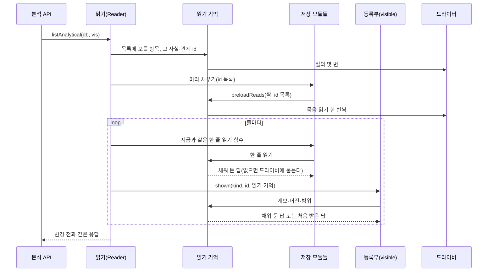

# 스펙: 분석 읽기 일괄화 — 줄마다 묻던 것을 한 번에 묻기

- 날짜: 2026-11-24 / 상태: 확정(잠정 결정 D1~D7 포함)
- 관련: 이슈 #233(분석 읽기 속도). [Phase 3 후속 spec](2026-11-24-P3-followups.md)의 보류 항목 둘(보임 판정의 묶음 조회, 사실별 읽기의 묶음 질의)과 P3F-D3·D4, [분석 읽기 속도 spec](2026-11-23-analytical-read-performance.md), [S03 spec](2026-11-22-S03-analytical-semantic.md) 잠정 결정 35 ⑥(1초 기준)
- 번호: 요구사항 `ARB-R<n>`, 완료 기준 `ARB-C<n>`, 결정 `ARB-D<n>`, 작업 `ARB-T<n>`

| 말 | 뜻 |
|---|---|
| 질의 | 드라이버의 `all`이 한 번 불린 것. 시계와 달리 기계 부하에 흔들리지 않는다 |
| 한 줄 읽기 | id 하나를 넘겨 그 줄(또는 그 줄에 딸린 목록)을 받는 질의. 예: 사실 하나의 근거 목록 |
| 묶음 읽기 | 한 줄 읽기와 같은 답을 id 여러 개에 대해 한 번에 받는 질의. 한 줄 읽기마다 짝이 하나 있다 |
| 읽기 기억 | 읽기 한 번 동안만 사는 기억(`storage/src/read-memo.ts`의 `memoReads`, #293). 같은 질의는 처음 받은 답을 돌려준다 |
| 세 목록 한 묶음 | 측정 세계의 Dataset 1개 + Metric 1개 + Join 1개(`storage/src/analytical-views.read-cost.test.ts`의 `seed`) |

## 배경

#293(읽기 기억) 뒤에도 `GET /api/analytical`의 중앙값은 1,108ms로 1초 기준을 넘는다(#233의 2026-11-24 측정, 200건 × 5회). 남은 비용이 어디 있는지 `origin/main` `70fd7bff`에서 다시 쟀다. 측정 세계는 지연 측정 스크립트의 것과 같고(세 목록 200묶음), 서버 없이 제품 등록부와 기본 범위 정책으로 `listAnalytical`을 불렀다.

### 실측 (2026-11-24, Apple M1, Node 24, 부하가 높아 시계 값은 비율만 본다)

읽기 한 번이 드라이버에 보내는 질의는 **45,012번**이다. 응답은 967,453바이트다.

| 어디서 | 질의 수 | 내용 |
|---|---|---|
| 읽기 함수(읽기 기억을 지난 뒤) | 23,612 | 4묶음이면 484. 같은 질의의 되풀이는 이미 없다. 남은 것은 **줄마다 한 번씩** 묻는 질의다 |
| 보임 판정(`registry.visible`) | 21,400 | 4묶음이면 428. 읽기 기억을 거치지 않는다. 읽기 시간의 약 21%(5회 560~727ms / 2,551~3,430ms) |

보임 판정의 21,400번 가운데 10,000번은 같은 질의의 되풀이다(원본 버전이 살아 있는지 5,000번, 원본의 범위 5,000번인데 서로 다른 것은 각각 200개뿐이다). 그래서 보임 판정이 읽기와 같은 읽기 기억을 쓰기만 해도 질의는 45,012 → 31,012번이 된다. 그러나 **시계 값은 거의 줄지 않는다**(되풀이되는 질의가 싼 질의라서. P3F-D3의 "3% 안팎"과 같은 결과다).

기억을 함께 쓴 뒤 남는 31,012번의 내용:

| 종류 | 질의 수 | 묻는 것 |
|---|---|---|
| 사실 한 줄 읽기 | 7,200 | 사실 1,600개를 다섯 가지 글로 따로 읽는다(`user_authored`, `status·epistemic`, `item_id·kind·value·context`, `item_id·kind`, `item_id`) |
| 관계를 항목·유형으로 읽기 | 4,800 | 관문의 `objectsOf` 1,800, 충돌 읽기 1,800, 읽기의 `objects` 800, 관계 목록 400 |
| 계보(줄이 온 원본 버전) | 4,800 | 사실 1,600, 근거 1,600, 관계 600, 항목 600, 표·검사 줄 400 |
| 이력 줄 | 2,800 | 사실 1,600, 항목 600, 관계 600 |
| 항목 한 줄 읽기 | 2,400 | 이름, 상태, 유형, `user_authored` |
| 근거 목록 | 2,200 | 사실 1,600, 관계 600 |
| 묶음(합치기) 줄 | 1,200 | 대표 찾기, 구성원 찾기 |
| 항목의 사실 목록 | 1,200 | 두 가지 글로 600번씩 |
| 같은 자리의 다른 값 | 1,000 | `slotRivals` |
| 검사 줄 한 줄 읽기 | 1,000 | 검사 줄의 계보 |
| 검사 줄 목록 | 800 | 검사가 필요한 사실마다 |
| 관계 한 줄 읽기 | 600 | `user_authored` |
| 그 밖 | 1,011 | 표 400, 열 맞추기 200, 살아 있는 버전·범위 약 400 등 |

**얼마나 줄일 수 있는지 미리 재 봤다.** 제품 코드를 고치지 않고, 측정 스크립트 안에서 위 종류 가운데 일부의 답을 미리 채워 둔 드라이버로 같은 읽기를 돌렸다(응답 JSON 글은 매번 원래와 같았다).

| 미리 채운 것 | 보낸 질의 | 읽기 시간(5회 중앙값, 채우지 않은 것 = 1) |
|---|---|---|
| 없음(지금) | 45,012 | 1 (1,187ms) |
| 한 줄 읽기·이력·근거·검사 줄·줄 계보 | 약 10,200 | 약 0.75 (893ms) |
| 전부(질의 0에 가까움) | 611 | 약 0.56 (668ms) |

질의가 하나도 없어도 약 600ms가 남는다. 이것은 JS 쪽 비용(행 조립, JSON, 기억의 열쇠 만들기)이고 이 spec의 범위 밖이다. 묶음 읽기 자체는 싸다: 사실 1,600개의 근거 목록을 한 번에 받는 질의가 2.6ms, 계보가 1.7ms였고, 한 줄씩 읽은 답과 1,600건 모두 같았다.

비유하자면 지금은 서류 1,600장을 창구에 한 장씩 따로 신청하는 셈이다. 필요한 번호를 미리 알 수 있으니 목록을 한 번 내고 묶음으로 받아 오면 된다. 받아 온 뒤에 각 부서가 서류를 보는 방식은 그대로다(비유가 맞지 않는 곳: 묶음으로 받은 답은 읽기 한 번이 끝나면 버린다).

## 목표

1. 줄마다 한 번씩 묻던 질의를 묶음 읽기로 바꿔, 읽기 한 번의 질의 수가 줄 수에 덜 비례하게 한다(200묶음에서 45,012 → 약 9,000번 예상).
2. 보임 판정이 읽기와 같은 읽기 기억을 쓰게 한다.
3. 응답 내용은 한 글자도 달라지지 않는다. 숨겨진 줄은 계속 숨겨진다.

## 비목표

- **1초 기준을 완료 기준으로 삼는 것.** 시계 값은 기계 부하에 흔들려 시험으로 쓰면 까닭 없이 깨진다. PR 본문과 #233에 적는 측정값일 뿐이다. 예상은 약 750~900ms이고 재 보기 전에는 모른다.
- **관문·유효 판정·충돌 판정의 계산을 고쳐 쓰는 것.** `valid-row.ts`, `analytical-gate.ts`, `assertion-links.ts`의 판정 순서와 함수 모양은 그대로다. 승인·승격 같은 쓰기 경로도 같은 함수를 쓰기 때문이다.
- **읽기 사이에 걸친 캐시, 새 테이블·마이그레이션.** 없다.
- **JS 쪽 비용(약 600ms) 줄이기.**
- **아래 표의 "이번에 묶지 않는 것".** 실측 수와 함께 남긴다.
- **등록부(`DerivativeRegistry`)의 모양 바꾸기.** `visible`은 그대로 한 번에 한 줄씩 불린다.
- **다른 세션이 쥔 파일.** `storage/src/adapters/*`, `backend/src/explore-read.ts`, `backend/src/read-gate.ts`, `knowledge-engine/src/retrieval/*`, `apps/**`, `backend/src/backend-lock.ts`, `docs/site-setup.md`는 건드리지 않는다.

| 이번에 묶지 않는 것 | 남는 질의(200묶음) | 까닭 |
|---|---|---|
| 충돌 읽기의 관계 질의, 관계 목록 | 2,200 | 묶음 구성원 목록을 값으로 넘기는 질의라 id 하나로 짝을 만들 수 없다 |
| 묶음(합치기) 줄 | 1,200 | 목록을 정하기 전에 읽는다. 따로 한 단계가 더 든다 |
| 항목의 사실 목록 | 1,200 | 항목 수만큼이다(사실 수가 아니다) |
| 같은 자리의 다른 값 | 1,000 | 값·맥락을 함께 넘기는 질의다 |
| 검사 줄의 계보, 항목·표의 계보 | 약 2,000 | 검사 줄의 계보는 `knowledge-engine`에 있다. 항목의 계보는 세 갈래 합집합이다 |
| 표, 열 맞추기 등 | 약 1,000 | 항목 수만큼이다 |

## 요구사항

- **ARB-R1 묶음 읽기의 짝.** 한 줄 읽기를 가진 모듈이 그 옆에 짝인 묶음 읽기를 함께 둔다. 묶음 읽기는 id 목록을 값 하나(JSON 배열, `json_each`)로 받고, id별로 나누면 한 줄 읽기의 답과 **행의 내용과 순서가 같다**. 답이 없는 id의 답은 빈 목록이다. 미리 채우기는 읽기 기억으로 감싼 드라이버에서만 일하고, 그렇지 않은 드라이버(쓰기 경로)에서는 아무것도 하지 않는다. 읽기 기억이 비워지면(`run`·`exec`·`transaction`) 채운 답도 함께 버려진다.
- **ARB-R2 분석 읽기가 미리 채운다.** `listAnalytical`과 `listMetricViews`는 목록에 오를 항목과 그 묶음 구성원을 정한 뒤, 그 항목들의 사실·관계 id를 한 번에 읽고, 다음 한 줄 읽기를 묶음으로 미리 채운다: 항목·사실·관계의 한 줄 읽기와 이력 줄, 사실·관계의 근거 목록, 사실의 검사 줄 목록, 사실·관계·근거의 계보, 관문의 `objectsOf`와 읽기의 `objects`. 미리 채우지 못한 id(목록 밖의 항목 등)는 지금처럼 한 줄 읽기로 읽는다. 사실 줄을 만들 때 그 사실의 `item_id`를 다시 묻지 않는다(이미 아는 값이다).
- **ARB-R3 보임 판정이 같은 읽기 기억을 쓴다.** 읽기는 보임 여부를 물을 때 자기 드라이버(읽기 기억)를 함께 넘기고, 서버는 그 드라이버로 `registry.visible`을 부른다. 드라이버를 받지 않은 호출(`POST /api/analytical/check` 등)은 지금처럼 원래 드라이버를 쓴다.
- **ARB-R4 응답과 보임이 그대로다.** 같은 저장 상태와 같은 보임 판정에서 두 읽기 함수의 반환 값은 변경 전과 같다. `Visibility.shown`에 묻는 (종류, id)와 그 순서·횟수도 그대로다. 미리 채우기가 틀리거나 빠지면 줄이 숨겨지는 쪽이 아니라 **보이는 쪽으로 틀릴 수 있으므로**(계보가 비면 보인다), 계보의 짝은 ARB-C2·C4가 지킨다.

## 인터페이스 / 설계 개요

- `storage/src/read-memo.ts`: `KeyedRead`(한 줄 읽기의 SQL 글 `one`과 짝 `many`. `many`는 첫 열 `key`에 id를 담고 `key`, 그다음 `one`과 같은 순서로 정렬한다)와 `preloadReads(db, read, ids, fixed?)`, 짝을 한 곳에서 만드는 `keyedRead({ columns, from, key, where?, order?, distinct? })`. 아직 답이 없는 id만 `many`로 한 번 읽어, `key` 열을 뗀 행을 `one`의 열쇠(`[id, ...fixed]`) 아래에 얼려 넣는다. 열쇠는 `memoReads`의 `all`과 같은 함수로 만든다. `db`가 읽기 기억이 아니면 아무것도 하지 않는다.
- 한 줄 읽기를 가진 모듈마다 `KeyedRead` 상수와 내보내는 미리 채우기 함수 하나: `knowledge.ts`(근거 목록), `semantic-lifecycle.ts`(`status·epistemic`, 이력 줄)와 `row-lineage.ts`(`user_authored`: 두 모듈이 같은 글을 읽고, `row-lineage.ts`가 잎 모듈이라 순환 없이 공유할 수 있다), `row-lineage.ts`(사실·관계·근거의 계보), `analytical-check-lines.ts`(검사 줄 목록), `assertion-links.ts`(`slotRivals`의 자기 줄), `analytical-gate.ts`(사실의 `item_id·kind`, 항목의 유형, `objectsOf`). 한 줄 읽기 함수는 그 상수의 `one`을 그대로 쓴다. 그래서 두 글이 따로 놀 수 없다.
- `storage/src/analytical-views.ts`: `Reader`에 미리 채우기 한 단계. 자기 한 줄 읽기(항목 이름, 항목 상태, `objects`)의 짝도 여기 둔다. `Visibility.shown(kind, id, db?)`의 셋째 인자로 `Reader`의 드라이버를 넘긴다.
- `backend/src/analytical-api.ts`(타입만), `backend/src/server.ts`의 `shown` 한 줄: 받은 드라이버가 있으면 그것으로 `registry.visible`을 부른다.
- `knowledge-engine/src/canonical-kinds.ts`: 근거 종류의 계보를 `storage`의 함수로 읽는다(한 줄). 계보의 SQL 글이 두 패키지에 따로 있어 그대로는 미리 채운 답과 열쇠가 맞지 않기 때문이다.
- `valid-row.ts`는 고치지 않는다. 그 안의 읽기(근거 목록, `userInputKind`)가 위에서 채워진다.

## 완료 기준 (테스트 가능한 형태)

| 기준 | 문장 | 증명 테스트 |
|---|---|---|
| ARB-C1 | 세 목록을 4묶음과 8묶음 심고 세는 드라이버로 `listAnalytical`을 한 번 부르면, 질의 수가 `45 × 묶음 수 + 60` 이하다(지금 4묶음 484·8묶음 956, 예상 약 165·290). 같은 질의가 두 번 가지 않는다는 것과 (종류, id)를 한 번만 묻는다는 기존 단언은 그대로다(R1, R2) | `storage/src/analytical-views.read-cost.test.ts` |
| ARB-C2 | 내보낸 `KeyedRead` 짝 전부에 대해, 줄이 있는 id·줄이 없는 id·저장되지 않은 id를 섞어 미리 채운 뒤 한 줄 읽기를 부르면 드라이버는 다시 불리지 않고, 답은 미리 채우지 않은 드라이버의 한 줄 읽기와 같다. 감싸지 않은 드라이버에 `preloadReads`를 부르면 질의가 0번이다. 감싼 드라이버로 `run`을 한 뒤에는 한 줄 읽기가 드라이버에 다시 간다(R1) | `storage/src/read-memo.test.ts`(짝 목록을 도는 표 시험 한 건 포함) |
| ARB-C3 | 묶음(합치기) 한 조, 사용자가 쓴 사실, 근거 없는 사실, 다른 값이 있는 사실, 그리고 `Visibility`가 숨기는 항목·사실·근거·검사 줄을 하나씩 담은 고정 세계에서 `listAnalytical`과 `listMetricViews`의 반환 값이 **변경 전 코드로 만들어 저장소에 둔 기대값 파일**과 같다. 숨긴 것의 id는 응답 어디에도 없다(R4) | `storage/src/analytical-views.batch.test.ts`와 기대값 파일. 기존 `analytical-views.test.ts`·`analytical-gate.test.ts`는 고치지 않은 채 통과 |
| ARB-C4 | 실제 서버와 제품 등록부로 세 목록 4묶음을 읽으면 드라이버가 받는 질의가 `75 × 묶음 수 + 60` 이하다(서버 없이 같은 읽기를 잰 값으로 지금 912, 예상 약 215). 같은 세계에서 한 원본을 삭제 표시(tombstone)하면 그 원본에서만 온 항목·사실·근거가 응답에 없다(R3, R4) | `backend/src/analytical-api.test.ts`. 기존 시험은 고치지 않은 채 통과 |

C3의 기대값 파일은 **구현 전에** 지금 코드로 만들어 먼저 커밋하고, 그 시험이 구현 전후에 모두 통과하는 것을 보인다. C1·C4의 상한과 C2는 구현 전에 빨갛게 실패하는 것을 먼저 확인한다. 경계값·조합의 전수 시험은 하지 않는다.

**변이 검사 한 건**(보임을 정하는 답을 미리 채우므로): 사실 계보의 짝 `many`가 행을 돌려주지 않게 바꾸면 C4의 삭제 표시 시험이 빨갛게 되는 것을 확인하고 되돌린다. 빨갛게 되지 않으면 그 시험이 계보의 짝을 지키지 못하는 것이므로 시험을 고친다.

**근거로만 적는 측정(기준 아님)**: 변경 전(`origin/main`)과 변경 후를 같은 세션에서 `pnpm exec node tooling/poc/s03/analytical-read-latency.ts 200 5`로 번갈아 재서, 두 중앙값·표본·1분 평균 부하·응답 바이트 수(967,453으로 같아야 한다)를 PR 본문과 #233에 적는다.

## 잠정 결정

바꾸려면 적힌 자리를 고치면 된다.

- **ARB-D1 판정 함수를 묶음용으로 다시 쓰지 않고, 한 줄 읽기의 답을 미리 채운다.** 관문·유효·충돌 판정은 쓰기 경로와 함께 쓰는 함수라 묶음용으로 고쳐 쓰면 승인·승격의 동작까지 다시 증명해야 한다. 미리 채우기는 "이 질의의 답은 이것"만 바꾸므로 판정 코드는 한 줄도 달라지지 않고, 채우지 못한 곳은 저절로 지금 동작으로 돌아간다. 대가는 한 줄 읽기와 짝의 답이 같아야 한다는 약속이고 C2가 지킨다. 되돌리려면 `Reader`의 미리 채우기 호출을 지운다(짝은 남아도 해가 없다).
- **ARB-D2 id 목록은 `json_each(?)` 값 하나로 넘기고, 나누어 보내지 않는다.** 저장소가 이미 쓰는 방식이고, 값 개수 상한(SQLite의 변수 수 제한)에 걸리지 않는다. 사실 1,600개를 한 번에 넘겨 2.6ms였다. 목록이 아주 커져 나눠야 하면 `preloadReads` 한 곳에서 나눈다.
- **ARB-D3 보임 판정은 묶어 묻지 않고, 같은 읽기 기억을 쓰게만 한다.** `registry.visible`은 줄마다 불리지만 그 안의 질의(계보, 살아 있는 버전, 범위)가 채워 둔 답이나 처음 받은 답으로 풀린다. 등록부와 종류 정의의 모양을 바꾸지 않아도 된다. 묶어 묻게 바꾸려면 `Visibility`에 묶음 입구를 더하고 `DerivativeKind`에 계보의 묶음 읽기를 더한다.
- **ARB-D4 계보는 읽기가 늘 미리 채운다.** 보임 판정이 계보를 읽을지는 `Visibility`를 넘긴 쪽만 알지만, 줄 계보는 `storage`의 것이고 묶음 읽기 세 번(수 ms)이라 가리지 않는다. 보임 판정이 없는 호출자에게 그 비용이 아까우면 `Visibility`에 "미리 채워 달라"는 선택 함수를 더해 그쪽에서 부르게 한다.
- **ARB-D5 `shown`의 셋째 인자는 선택이다.** 인자 둘짜리 기존 구현(시험, K01)은 고치지 않아도 되고 지금처럼 동작한다(같은 기억을 쓰지 못할 뿐이다).
- **ARB-D6 #233을 닫는 조건은 그대로다(P3F-D4).** 한가한 기계에서 잰 중앙값이 1초 아래면 닫는다. 넘으면 열어 두고, 다음 후보는 "이번에 묶지 않는 것" 표의 위에서부터다.
- **ARB-D7 `canonical-kinds.ts`의 한 줄이 다른 세션과 겹치면 그 줄만 뺀다.** 빼면 근거의 계보 1,600번(200묶음)이 한 줄 읽기로 남고, C4의 상한은 그래도 지켜진다(4묶음에서 32번 더).

## 미검증 범위

- 변경 뒤의 실제 시계 값. 위의 약 0.75배는 제품 코드를 고치지 않고 답을 미리 채워 둔 드라이버로 흉내 낸 값이고, 묶음 읽기 약 30번의 비용과 관계 질의 2,600번을 줄인 효과는 들어 있지 않다.
- C1·C4의 "예상" 질의 수. 흉내 낸 값에서 계산했다. 상한 식은 그보다 넉넉하게 잡았다.
- 측정 세계와 모양이 다른 저장소(합쳐진 묶음이 많은 경우, 사용자가 쓴 줄이 많은 경우, 목록이 `limit`에서 잘려 Metric의 Dataset이 목록 밖에 있는 경우)에서의 줄어드는 폭. 답은 같고 덜 줄 뿐이다.
- 짝의 답이 같은지는 사실의 근거 목록과 사실의 계보 둘만 1,600건으로 대조했다. 나머지 짝은 C2가 처음 확인한다.
- `preloadReads`가 읽기 기억을 알아보는 방식이 `pki/module-boundary` lint에 걸리는지(P3F FU3과 같은 자리).
- Windows, 부하가 높은 기계에서의 값.

## 작업 분해

PR 하나. 자세한 그래프(파일·함수·위험)는 작업 폴더의 설계 보고에 있다.

| 작업 | 산출물 | 기준 | 선행 |
|---|---|---|---|
| ARB-T1 | 고정 세계와 기대값 파일(지금 코드로 생성), C1·C4의 새 상한 단언(빨강 확인) | C3, C1·C4의 빨강 | 없음 |
| ARB-T2 | `KeyedRead`·`preloadReads`와 시험 | C2 | T1 |
| ARB-T3 | 저장 모듈들의 짝과 미리 채우기 함수 | C2(짝 목록 시험) | T2 |
| ARB-T4 | `Reader`의 미리 채우기, `item_id` 다시 묻지 않기, `shown`에 드라이버 넘기기 | C1, C3 | T3 |
| ARB-T5 | 백엔드 두 곳과 `canonical-kinds.ts` 한 줄, 삭제 표시 시험, 변이 검사 | C4 | T4 |
| ARB-T6 | 측정값을 PR 본문·#233에, `docs/README.md` 색인 | (문서) | T5 |

## 변경 이력

| 날짜 | 변경 | 대상 | 사유 |
|---|---|---|---|
| 2026-11-24 | 처음 씀 | 전체 | #233이 #293 뒤에도 1초 기준을 넘어(중앙값 1,108ms), P3F spec이 미룬 두 항목을 실측으로 다시 재고 묶음 읽기로 줄이기로 정함 |
| 2026-11-24 | 구현 중 보정: `user_authored` 짝을 `row-lineage.ts`에 두고(순환 회피) `keyedRead` 도우미를 더함. 상한은 실측(C1 4묶음 165, C4 4묶음 234)이 모두 아래라 그대로 | 인터페이스 / 설계 개요 | 구현 |
