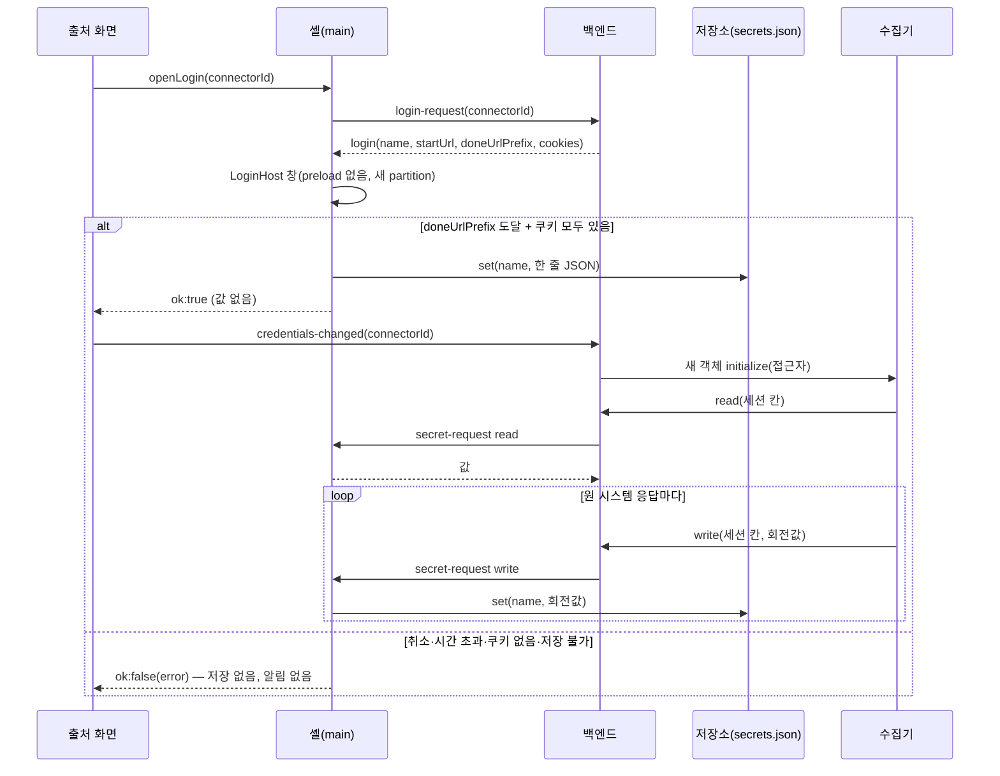

# 스펙: I06S 대화형 로그인(브라우저 세션)으로 인증하는 수집기의 자격 증명

- 날짜: 2026-11-26 / 상태: 확정(잠정 결정 I06S-D1~D10 포함) — 구현·시험 완료, 실제 IdP·Windows 확인은 S49
- 관련: 이슈 #362, [I06 spec](2026-11-22-I06-connector-credentials.md), [I06F spec](2026-11-23-I06F-secret-input-gaps.md), [ADR 0010](../adr/0010-encryption-at-rest.md), [ADR 0019](../adr/0019-connector-credentials.md), [ADR 0027](../adr/0027-session-credentials-interactive-login.md)(이 spec과 함께 쓴 결정 기록), [connector-sdk.md 8장](../connector-sdk.md), [site-setup.md](../site-setup.md) S28·S29
- 번호: 요구사항 `I06S-R<n>`, 완료 기준 `I06S-C<n>`, 결정 `I06S-D<n>`. 배포처 후속은 `S49`(새 항목).
- 기준 코드: `origin/main` `c2630b26`. 아래 `파일:줄`은 그 커밋에서 열어 읽은 자리다(실행한 것은 아니다).

## 배경

원 시스템의 인증이 대화형 웹 로그인(사용자가 IdP에 로그인하면 받는 세션 쿠키·토큰)인 수집기는 지금 규격에 들어올 자리가 없다(#362).

| 지금 코드 | 자리 | 세션형 수집기에서 어긋나는 점 |
|---|---|---|
| 접근자는 `read(slot)` 하나뿐이다 | `packages/contracts/src/connector.ts:74-77` | 로그인으로 얻은 세션과 회전한 새 토큰을 저장할 길이 없다 |
| 백엔드 접근자도 읽기만 만든다 | `backend/src/connector-credentials.ts:170-187` | 같다 |
| 셸에 보내는 비밀 값 요청은 `read`·`presence`·`prune` 셋이다 | `apps/desktop/src/backend-process.ts:119-124`, `:129-149`, `backend/src/secret-sources.ts:26` | 백엔드에서 셸로 값을 쓰는 통로가 없다 |
| 값은 화면 입력란 → preload `setSecret`으로만 들어온다 | `apps/desktop/src/bridge.ts:12-20`, `apps/desktop/src/preload.cjs:16-24`, `apps/web/src/connector-credential.ts:30-56` | 세션 값은 사용자에게 보이지 않아 입력할 수 없다 |
| 칸이 비면 `credential-missing`이고 수집기 객체를 만들지 않는다 | `backend/src/connectors.ts:418-421` | 할 일은 "값을 넣는다"가 아니라 "로그인한다"다 |
| 거부는 하나의 사유 `credential-rejected`이고 안내는 "값을 고쳐 입력하세요" | `packages/contracts/src/index.ts:174-180`, `backend/src/connector-credentials.ts:195-202`, `apps/web/src/connector-text.ts:46-53` | 세션 만료의 실제 할 일(로그인 창을 다시 연다)과 다르다 |
| 거부된 인스턴스는 한 시간 재점검이 건너뛴다(잠금 방지) | `backend/src/connectors.ts:769`, 간격 `:616-617`, `:646`, 보류 해제 `backend/src/held-release.ts:66` | 새 사유도 같은 상한을 받아야 한다 |
| 계약 묶음은 시나리오가 준 값만 찾는다 | `packages/testkit/src/connector.contract.ts:24-52`(코드), `:57-87`(시나리오), `:136-145`(읽기만 하는 접근자) | 원 시스템이 새로 낸 값(회전값)의 누출과 되쓰기 누락을 못 잡는다 |
| 셸이 백엔드에 묻고 백엔드가 `id`로 답하는 선례가 있다 | `apps/desktop/src/backend-process.ts:111-116`, `:338`, `backend/src/local-reveal.ts:76` | 로그인 설명을 셸이 받아 오는 데 같은 모양을 쓴다(D2) |
| 문서가 "값을 되쓰는 길은 없다"고 적고, ADR 0019가 회전 토큰이 알려지면 `write`를 다시 보기로 했다 | `docs/connector-sdk.md:862`, `docs/adr/0019-connector-credentials.md:62` | 이 spec이 그 다시 봄이다 |

## 목표

- 세션형 수집기가 공용 규격 안에서 **로그인 → 저장 → 회전값 되쓰기 → 만료 시 다시 로그인**을 할 수 있다. 포크는 화면도 셸도 고치지 않는다.
- 세션 값과 회전값도 ADR 0019 결정 9의 "누출 없음"을 그대로 받고, 계약 묶음이 그 누출과 되쓰기 누락을 잡는다.
- 계정 잠금 방지의 재시도 상한은 그대로다. 로그인은 자동으로 다시 하지 않는다.

## 비목표

- 실제 IdP·실제 원 시스템에서의 동작, Windows 설치본의 로그인 창 확인(S49, 배포처 후속).
- 쿠키가 아닌 곳(localStorage, 응답 본문, 리다이렉트 조각)에 세션을 두는 원 시스템, 팝업 창을 쓰는 로그인, 다중 요소 인증 장치 연동. 그런 원 시스템은 **미구현, 배포처 후속**으로 적고 [ownership.md 5절](../ownership.md)로 알린다(D4).
- 브라우저 개발 실행(`backend/src/dev.ts`)의 로그인. 저장소가 없으므로 지금처럼 `credential-store-unavailable`이다.
- 규격 버전 변경(D9), 저장 이름 규칙 변경, 거부 사실의 재시작 뒤 기억.
- 자동 재로그인, 만료 시각 예측, 세션을 미리 갱신하는 타이머.

## 요구사항

### 선언

- **I06S-R1** 인스턴스 정의(`ConnectorInstanceConfig`, `backend/src/connectors.ts:103`)에 선택 필드 `login`을 더한다: `{ slot, startUrl, doneUrlPrefix, cookies }`. `slot`은 같은 인스턴스의 `credentials`에 선언한 칸 하나(이 칸이 **세션 칸**), 두 주소는 `https:` 또는 루프백(`127.0.0.1`, `localhost`)의 `http:` 절대 주소, `cookies`는 쿠키 이름 1~8개(RFC 6265의 token 글자 1~64자, 서로 다름)다. 어기면 등록 검사가 새 코드 `instance-login-invalid`를 돌려주고 시작할 때 그 인스턴스만 빠진다. 값이 아니라 설명이므로 저장소에 남아도 된다(포크의 등록 코드).

### 획득(로그인 창)

- **I06S-R2** 로그인 창은 **제품 화면이 연다**(D1). 출처 화면은 세션 칸에 값 입력란 대신 「로그인 창 열기」와 기존 삭제(「로그아웃」)를 보인다. 누르면 preload의 새 함수 `openLogin(connectorId)`를 부른다. 인자는 인스턴스 ID 하나이고 주소나 이름을 화면이 건네지 않는다.
- **I06S-R3** 셸은 `openLogin`을 받으면 백엔드에 `{type:"login-request", id, connectorId}`를 보내고, 백엔드는 그 인스턴스의 설명과 저장 이름(`connectorCredentialName`)을 `{type:"login", id, name, startUrl, doneUrlPrefix, cookies}`로, 없으면 `{type:"login", id, none:true}`로 답한다(D2). 설명이 규칙을 어기면 셸은 그 답을 받아들이지 않고 5초 뒤 `invalid`로 끝낸다. 셸은 이름이 수집기 자격 증명 모양인지(`isConnectorCredentialSecret`)와 R1의 주소 규칙을 다시 검사한다.
- **I06S-R4** 셸의 로그인은 어댑터 `LoginHost`를 거친다(D3). 셸의 판단(`runLogin`)은 어댑터에 다음만 시킨다: 창을 열고, 주 프레임의 이동을 알리고, 정해진 주소의 쿠키를 읽고, 닫고 지운다. Electron 구현은 **preload 없음, `sandbox: true`, `contextIsolation: true`, 로그인마다 새 비영속 partition**으로 창을 만들고, `http:`/`https:` 밖의 이동·다운로드·권한 요청·새 창을 거부한다. 시험은 가짜 어댑터로 한다.
- **I06S-R5** 주 프레임이 `doneUrlPrefix`로 시작하는 주소에 닿으면 셸은 그 주소의 쿠키 가운데 `cookies`에 든 이름을 읽어 **한 줄 JSON** `{"cookies":{"<이름>":"<값>",…}}`(선언 순서)로 만들고, 그 이름으로 저장소에 쓴 뒤 partition을 지우고 창을 닫는다(D5). 화면에 돌아가는 답은 `{ok:true}` 또는 `{ok:false, error}`이고 값이 없다. `error`는 `cancelled`(사용자가 닫음), `timeout`(5분, `LOGIN_TIMEOUT_MS`), `no-session`(닿았는데 이름 하나라도 없음), `too-large`(8192자 초과), `store-unavailable`(OS 보호 없음·쓰기 실패), `invalid`(설명 없음·검사 실패), `busy`(다른 로그인 창이 열려 있음) 가운데 하나이고, `ok:true`가 아니면 아무것도 저장하지 않는다.
- **I06S-R6** 화면은 `ok:true`이면 기존 변경 알림 `POST /api/connectors/credentials-changed`(`{connectorId}`)를 한 번 부르고 기존 `rebuild` 안내를 그대로 쓴다(ADR 0019 결정 7). 실패면 알림을 부르지 않고 코드마다 정한 문장을 보인다.

### 저장(되쓰기)

- **I06S-R7** `ConnectorCredentials`에 선택 메서드 `write?(slot, value): Promise<void>`를 더한다. 제품의 접근자는 언제나 `write`를 갖는다. **세션 칸에만** 쓸 수 있고(D6), 다른 칸, 선언하지 않은 칸, 끊긴 접근자(버린 객체), 한 줄이 아니거나 8192자를 넘거나 빈 값, 3초 안에 끝나지 않은 쓰기, 저장소가 쓸 수 없다고 답한 쓰기는 모두 저장소를 바꾸지 않고 `ConnectorCredentialError`로 거부한다. 쓴 뒤의 `read(slot)`은 쓴 값을 돌려준다(제품은 여전히 값을 기억하지 않고 저장소에서 읽는다).
- **I06S-R8** 백엔드는 셸에 `secret-request`의 새 모드 `write`(값을 실음)로 쓴다. 셸은 `isConnectorCredentialSecret(name)`인 이름만, OS 보호를 쓸 수 있을 때만 ADR 0010의 같은 저장소(`secrets.json`, `safeStorage` 암호문)에 쓰고, Provider 키 이름이나 그 밖의 이름에는 아무것도 쓰지 않고 `unavailable`로 답한다. 쓰기는 변경 알림도 다시 만들기도 일으키지 않는다(쓴 객체가 이미 새 값을 쥐고 있다).

### 만료·회전

- **I06S-R9** 회전: 원 시스템이 새 토큰을 내면 수집기는 **다음 요청 전에** `write`로 세션 칸을 갱신한다. `write`가 거부되면 수집기는 `ConnectorCredentialError`를 던진다(새 토큰을 잃은 세션으로 계속하지 않는다).
- **I06S-R10** 새 사유 `login-required`를 `CREDENTIAL_REASONS`에 더한다. 세션 칸이 있는 인스턴스에서 ① 세션 칸이 비어 있으면(존재 확인) `credential-missing` 대신 `login-required`이고 객체를 만들지 않는다. 같은 인스턴스의 고정 칸도 비어 있으면 `credential-missing`이 먼저다(사용자가 먼저 할 일이 값 입력이다). ② 수집기가 `ConnectorCredentialError`를 던졌고 판정(`judge`)이 `credential-rejected`가 될 자리이면 `login-required`다(D7). 세션 칸이 없는 인스턴스는 지금과 같다. 화면 문장은 "로그인이 필요합니다(세션 만료·로그아웃). 로그인 창을 다시 여세요."이고 그 줄에 「로그인 창 열기」가 있다.
- **I06S-R11** `login-required`는 재시도에서 `credential-rejected`와 같다: 한 시간 재점검이 건너뛰고, 변경 알림(30초 간격, `CREDENTIAL_RETRY_MIN_MS`)과 앱을 켤 때 한 번만 다시 만들며, 동기화 도중이면 멈춤 코드 `credential-unusable`로 작업이 `held`(사유 `login-required`, 화면 문장은 작업 목록의 보류 사유 표에도 있다)가 되고 다시 만들어져 `ready`가 되면 풀린다. 제품은 로그인 창을 스스로 열지 않는다(D8).

### 계약 묶음과 예시

- **I06S-R12** `ConnectorScenario`에 선택 필드 `login?: string`(세션 칸의 이름, `credentials`에 있어야 함)을 더한다. 있으면 묶음의 접근자가 그 칸에만 `write`를 받아 메모리에 두고, 쓰인 값(16자 이상)도 세 모양으로 찾는다. 새 위반 코드 둘:
  - `rotated-credential-leaked`: 수집기가 `write`로 쓴 값이 돌려준 것, 던진 것, 건강 답, `console`·표준 출력·오류에 있다.
  - `session-not-persisted`: 첫 읽기가 끝난 뒤, 묶음의 접근자에 남은 값(쓴 값)으로 초기화한 새 객체가 `initialize`나 첫 `getChanges`에서 `ConnectorCredentialError`로 끝난다.
  재스캔(`later`)의 새 객체가 같은 이유(쓰지 않은 옛 세션)로 거부되면 시나리오의 오류가 아니라 이 코드다.
  시나리오가 준 첫 세션 값의 누출은 기존 코드 넷이 그대로 잡는다. `login`이 없는 시나리오의 결과는 지금과 같다.
- **I06S-R13** 예시 패키지(`packages/connector-example`)에 지어낸 원 시스템 `rotating-session-notes`와 그 수집기를 더한다. 원 시스템은 고정 값을 받지 않고 `login()`이 세션 토큰을 내며, 응답마다 새 토큰을 싣고 옛 토큰은 다음 요청부터 무효다. 수집기는 세션 칸의 한 줄 JSON에서 토큰을 읽고 회전값을 되쓴다. 규격을 한 곳만 어긴 변형 둘(되쓰지 않음, 회전값을 `console`에 씀)을 `violating-connectors.ts`에 더한다.

### 누출 없음과 문서

- **I06S-R14** ADR 0019 결정 9의 시험(`backend/src/connectors.credentials-canary.test.ts`)이 쓰기 길도 지난다: 수집기가 `write`로 쓴 표식 값이 데이터 폴더의 모든 파일, 백엔드 로그·표준 출력·오류, 모든 API 응답, 동기화 결과·작업에 세 모양 어느 것으로도 없다. 셸의 로그인 판단은 로그에 값을 쓰지 않고 화면에 값을 돌려주지 않는다.
- **I06S-R15** 문서: connector-sdk.md 8장에 「세션형 자격 증명」 절(선언, 로그인 창, `write`, `login-required`, 막지 못하는 것)과 6장 위반 코드 표의 두 줄, "값을 되쓰는 길은 없다" 문장의 수정, ADR 0019의 후속 표시, ADR 0027, site-setup의 S29 ④ 수정과 새 S49, ownership.md의 자격 증명 줄.

## 인터페이스 / 설계 개요

### 로그인에서 회전까지



값이 지나는 길은 셋이 된다: 기존 "화면 입력 → 셸의 저장소", "셸 → 백엔드 → 수집기"에 **"수집기 → 백엔드 → 셸의 저장소"(세션 칸만)**가 더해진다. 로그인 창이 얻은 값은 셸 main 프로세스 안에서 곧장 저장소로 가고 화면·백엔드 API를 지나지 않는다.

### 공개 표면(잠정)

```ts
// @pki/contracts
interface ConnectorCredentials {
  read(slot: string): Promise<string>;
  /** Session slot only (I06S-R7); refused with ConnectorCredentialError otherwise. */
  write?(slot: string, value: string): Promise<void>;
}
// CREDENTIAL_REASONS gains "login-required"; ConnectorSummary.credentials[i] gains optional `login: true`.
// backend: ConnectorInstanceConfig.login?: { slot; startUrl; doneUrlPrefix; cookies: readonly string[] }
// desktop: preload openLogin(connectorId) -> { ok: true } | { ok: false; error: LoginError }
// desktop: interface LoginHost { open(url, partition): LoginWindow } — Electron and fake implementations
// testkit: ConnectorScenario.login?: string; codes "rotated-credential-leaked", "session-not-persisted"
```

### 막지 못하는 것(8장 표에 더할 줄)

| 경우 | 누가 맡는가 |
|---|---|
| 새 로그인을 저장한 직후 알림이 닿기 전에 옛 객체가 회전값을 써 새 세션을 덮는다(밀리초 단위 틈) | 옛 세션의 회전값도 유효하면 그대로 돈다. 무효면 `login-required`가 되어 다시 로그인한다 |
| 세션 칸과 고정 칸을 함께 둔 인스턴스에서 고정 칸이 틀려도 `login-required`로 보인다 | D7의 한계. S49에서 그런 원 시스템이면 알린다 |
| 로그인 창 안의 IdP 페이지가 무엇을 하는지(피싱 주소로의 이동 등) | 설명의 주소는 포크의 등록이 정하고 창에는 preload가 없다. 주소의 검토는 포크 |
| 쿠키 밖에 세션을 두는 원 시스템 | 미구현, 배포처 후속(S49, ownership 5절) |

## 완료 기준 (테스트 가능한 형태)

| ID | 기준 | 요구사항 | 변이 검사 |
|---|---|---|---|
| **I06S-C1** | 세션 칸 `session`과 고정 칸 `token`을 선언하고 `login.slot: "session"`인 인스턴스에서, 수집기가 `write("session", v)`를 부르면 저장소의 그 이름에 v가 있고 다음 `read("session")`이 v다. `write("token", v)`, 끊긴 접근자의 `write`, 줄바꿈이 든 값·8193자 값의 `write`는 `ConnectorCredentialError`이고 저장소가 바뀌지 않는다. `login.slot`이 `credentials`에 없는 등록은 `instance-login-invalid`다 | R1, R7 | **예** — 칸 제한과 끊긴 접근자 검사를 지우면 빨개져야 한다 |
| **I06S-C2** | 셸이 `secret-request` 모드 `write`를 받으면 수집기 자격 증명 이름일 때만 저장하고, Provider 키 이름이나 OS 보호를 쓸 수 없을 때는 `unavailable`로 답하며 저장소가 바뀌지 않는다 | R8 | **예** — 이름 모양 검사를 지우면 빨개져야 한다 |
| **I06S-C3** | 가짜 `LoginHost`로 `runLogin`을 돌리면: 창은 preload 없이 `sandbox`, 새 비영속 partition으로 열리고, `doneUrlPrefix`에 닿고 쿠키가 모두 있으면 한 줄 JSON이 받은 이름으로 저장되며 partition이 지워지고 답은 `{ok:true}`(값 없음)다. 취소·시간 초과·쿠키 하나 없음은 각각 `cancelled`·`timeout`·`no-session`이고 저장이 없다 | R3, R4, R5 | **예** — preload 없음·partition 분리를 어기면 빨개져야 한다 |
| **I06S-C4** | 세션 칸이 있는 인스턴스: 세션이 비면 시작에서 `login-required`이고 객체를 만들지 않는다. 동기화 중 수집기가 `ConnectorCredentialError`를 던지면 멈춤 코드 `credential-unusable`, 작업 `held`, 인스턴스 `login-required`다. 한 시간 재점검은 다시 만들지 않고, 세션을 넣은 뒤 변경 알림 하나가 다시 만들어 `ready`가 되고 작업이 풀린다. 세션 칸이 없는 인스턴스의 거부는 여전히 `credential-rejected`다 | R10, R11 | **예** — 한 시간 재점검의 `login-required` 건너뛰기를 지우면 빨개져야 한다(잠금 방지) |
| **I06S-C5** | `rotating-session-notes` 수집기는 `login`이 있는 시나리오에서 `checkConnector`가 `[]`이고, 되쓰지 않는 변형은 `["session-not-persisted"]`, 회전값을 `console`에 쓰는 변형은 `["rotated-credential-leaked"]`다. `login`이 없는 기존 예시들의 결과는 바뀌지 않는다 | R9, R12, R13 | 아니오(변형 자체가 빨간 사례) |
| **I06S-C6** | 표식 회전값을 `write`로 쓰는 수집기로 백엔드를 돌린 뒤 데이터 폴더의 모든 파일, 로그·표준 출력·오류, API 응답, 동기화 결과·작업 어디에도 그 값이 세 모양으로 없다 | R14 | 아니오(찾는 시험) |
| **I06S-C7** | (브라우저 e2e, 기록하는 preload 대역) 세션 칸에는 값 입력란이 없고 「로그인 창 열기」가 있다. 누르면 preload `openLogin`이 인스턴스 ID 하나만 받고, `ok:true`면 변경 알림이 `{connectorId}`만 싣고 한 번 간다. 사유 `login-required`의 문장이 보이고, preload가 없으면 단추가 없다 | R2, R6, R10 | 아니오 |

문서(R15)는 기존 발췌·문서 시험(`tooling/docs/connector-sdk.test.ts`, `backend/src/connector-sdk.docs.test.ts`, `tooling/docs/site-setup-i06.test.ts`)이 깨지지 않는 것과 검토로 본다.

## 잠정 결정

| ID | 결정 | 이유 | 영향 | 바꾸는 법 |
|---|---|---|---|---|
| **I06S-D1** | 로그인 창은 **제품 화면의 단추**가 연다. 수집기가 창을 요청하지 않는다 | 수집기는 백엔드 프로세스에서 돌아 창을 열 수 없고, 세션이 없으면 객체가 없다(`connectors.ts:418-421`). 로그인은 사용자 동작이라 사용자가 시작해야 한다 | 만료되면 사용자가 화면에서 단추를 누른다 | 수집기 요청형이 필요하면 `ConnectorContext`에 `requestLogin()`을 더하고 셸 알림 경로를 연다(ADR 0027 재검토) |
| **I06S-D2** | 로그인 설명은 포크 등록의 인스턴스 정의(`login`)에 두고, 셸이 `login-request`로 백엔드에서 받는다. 화면은 ID만 건넨다 | 포크 코드는 백엔드에만 실린다(ADR 0018). 화면이 주소를 건네면 깨진 렌더러가 아무 주소로 창을 열 수 있다. `reveal-request` 선례와 같은 모양 | 설명은 빌드할 때 정해진다 | 실행 중 설정으로 옮기려면 site-setup 실행 설정에 키를 더한다 |
| **I06S-D3** | 창은 셸의 어댑터 `LoginHost` 뒤에 둔다. 공용은 Electron 구현과 가짜 구현을 싣고, 실제 IdP 확인은 S49다 | 포크는 셸을 고칠 수 없으므로 창 기계는 공용에 있어야 한다. 사이트에 따라 다른 것은 설명(주소·쿠키 이름)뿐이다 | Electron 구현은 공용에서 가짜 어댑터 시험만 받는다(미검증 범위) | 데스크톱 e2e를 더하려면 루프백 합성 로그인 페이지로 한 번 돈다 |
| **I06S-D4** | 세션은 **쿠키**로만 잡는다. 다른 곳의 세션은 미구현, 배포처 후속 | 웹 앱의 REST가 흔히 쓰는 모양이고 Electron이 httpOnly 쿠키도 읽는다. 나머지는 사이트를 보지 않고 설계할 수 없다(YAGNI) | 그런 원 시스템은 S49에서 알려 온다 | 설명에 `capture` 종류를 더하고 셸 판단에 분기를 더한다 |
| **I06S-D5** | 세션 값은 **칸 하나, 한 줄 JSON** `{"cookies":{…}}`. 되쓴 뒤의 모양은 수집기가 정한다(제품에게는 불투명한 한 줄) | 기존 저장소 칸 구조와 8192자 한도를 그대로 쓴다. 칸 여럿이면 쿠키 수가 칸 상한(8)과 이름 규칙에 묶인다 | 쿠키가 커서 8192자를 넘으면 `too-large` | 한도를 올리려면 `SecretValueSchema`와 입력 화면을 함께 본다(ADR 0019 재검토 조건) |
| **I06S-D6** | 되쓰기의 주체는 **수집기**(`write`), 쓸 수 있는 칸은 **세션 칸 하나**, 저장소는 ADR 0010의 같은 것 | 회전은 수집기만 안다. 칸 제한은 고정 값(API 키)을 수집기 실수로 덮지 않게 하는 장치다(격리는 아니다, ADR 0019 결과) | 고정 칸은 여전히 읽기만 | 세션 칸 여럿이 필요하면 `login.slot`을 목록으로 |
| **I06S-D7** | `login-required`는 `credential-rejected`와 다른 사유. 세션 칸이 있는 인스턴스의 모든 거부를 이것으로 본다. 새 오류 종류는 만들지 않는다 | 사용자 할 일이 다르다. 어느 칸이 거부됐는지 수집기가 따로 알리게 하면 오류 종류·위반 코드가 하나씩 는다 | 고정 칸이 틀려도 "로그인" 안내(막지 못하는 것 표) | `ConnectorLoginRequiredError`를 더하고 판정에서 가른다 |
| **I06S-D8** | 재로그인은 알림이지 자동 재시도가 아니다. 재시도 상한은 `credential-rejected`와 같게 공유 | 결정 6(계정 잠금 방지)을 그대로 지킨다 | 만료되면 사용자가 누를 때까지 멈춘다 | — (바꾸려면 ADR 0019 결정 6부터) |
| **I06S-D9** | 규격 버전은 **2 그대로** | 모두 선택 항목이라 깨지지 않는다. `write`를 쓰는 수집기는 `write`가 없으면 `ConnectorCredentialError`로 끝낸다(`if (!context)`와 같은 꼴). 결합이 빌드할 때라 판의 어긋남도 작다 | 기존 수집기는 고칠 것 없음 | 깨지는 변경이 생기면 3으로 올리고 10장에 옮기는 법을 적는다 |
| **I06S-D10** | ADR은 0019를 고치지 않고 **후속 ADR 0027**로 쓴다. 0019에는 후속 표시만 단다 | 0019 결정 8("값이 지나는 길은 둘뿐")과 "되쓰는 길 없음"을 바꾸는 새 통로이고, 0019의 재검토 조건 1이 예고한 결정이다 | ADR이 하나 는다 | 합치려면 0019에 결정을 더하고 0027을 대체됨으로 표시 |

## 미검증 범위(배포처 후속 S49)

- 실제 IdP 로그인, Windows 설치본에서의 Electron 로그인 창·partition·쿠키 읽기, 실제 세션의 만료·회전 주기·잠금 정책, 실제 수집기와 의존성이 세션 값을 남기는지. 공용은 가짜 `LoginHost`와 지어낸 원 시스템으로만 증명한다.
- 새 S49(잠정 문장): "세션형 수집기의 로그인 설명(`login`)을 포크 등록에 적고, Windows 11 설치본에서 ① 로그인 창이 열리고 로그인 뒤 인스턴스가 `ready`, ② 앱을 다시 켜도 세션이 남아 로그인 없이 동기화, ③ 회전 뒤에도 동기화가 이어짐, ④ 로그아웃이나 만료 뒤 `login-required`와 다시 로그인으로 풀림, ⑤ 데이터 폴더·로그에 세션 값과 회전값이 없음을 확인하고 기록. 쿠키가 아닌 곳에 세션을 두거나 팝업 로그인을 쓰는 원 시스템이면 미구현, 배포처 후속으로 적고 ownership 5절로 알린다."

## 작업

T1 계약 표면, T2a 백엔드 `write`·`login` 선언·`login-request` 답, T2b `login-required`, T2c 누출 없음 시험, T3 셸 `write` 모드, T4 셸 로그인 창, T5 계약 묶음, T6 예시, T7 화면, T8 문서.

## 변경 이력

| 날짜 | 변경 내용 | 사유 |
|---|---|---|
| 2026-11-26 | 초안 | #362 |
| 2026-11-26 | 구현을 마치며 확정: R3(규칙을 어긴 `login` 답은 받지 않음), R10(고정 칸이 함께 비면 `credential-missing` 우선), R11(보류 사유 `login-required`), R12(재스캔 객체의 거부도 `session-not-persisted`)를 코드에 맞춰 적음. `SecretSource.write`는 선택 항목(쓸 수 없는 원본은 `unavailable`) | #362 구현 |
